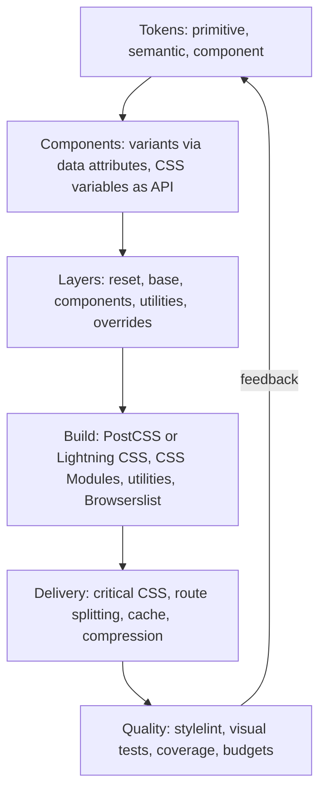

# CSS Architecture, Theming and Tooling

> Verification note: Native cascade features used here (`@layer`, `@scope`) are covered in [03](03-css-cascade-specificity-and-custom-properties.md) (`@scope` verified on MDN 2026-11-19: Baseline 2026 newly available — Chrome/Edge 118, Firefox 146, Safari 26.4). Design-token tiers, theming pipelines, RSC-safe styling rules, the DTCG token spec (first stable version 2025.10 — wording and value encodings to be re-verified) and component-API patterns (data-attribute variants, `cva`-style variants) were verified in [system-design/06](../system-design/06-design-system-and-component-library.md); **Next.js 16 / Turbopack**, filesystem build caching and CSS handling follow [nextjs-and-rendering/07](../nextjs-and-rendering/07-performance-optimization.md); render-blocking CSS, critical CSS and CSS delivery follow [web-performance/02](../web-performance/02-critical-rendering-path-and-loading-performance.md) and [03](../web-performance/03-network-caching-and-delivery.md). **Methodologies (BEM, ITCSS, SMACSS, OOCSS, CUBE CSS), libraries and tools (Tailwind CSS and its current major version/config model, CSS Modules, styled-components, Emotion, vanilla-extract, Panda CSS, StyleX, Linaria, Sass, PostCSS, Lightning CSS, Style Dictionary, stylelint, tailwind-merge) and their React Server Components compatibility and maintenance status change quickly and were not re-fetched — marked *(hedged)*; confirm current docs and maintenance activity before adopting.**

## Table of Contents

1. [Quick Summary (TL;DR)](#1-quick-summary-tldr)
2. [Styling Approaches Compared](#2-styling-approaches-compared)
3. [Methodologies and Naming](#3-methodologies-and-naming)
4. [Design Tokens and Theming Architecture](#4-design-tokens-and-theming-architecture)
5. [Component Styling APIs](#5-component-styling-apis)
6. [Tooling: Build, Lint, Transform](#6-tooling-build-lint-transform)
7. [Delivery and Performance](#7-delivery-and-performance)
8. [Scaling and Governance](#8-scaling-and-governance)
9. [Testing CSS](#9-testing-css)
10. [Print and Constrained Environments](#10-print-and-constrained-environments)
11. [Choosing an Approach](#11-choosing-an-approach)
12. [Pitfalls](#12-pitfalls)
13. [Interview Questions — Fundamentals](#13-interview-questions--fundamentals)
14. [Interview Questions — Senior Scenarios](#14-interview-questions--senior-scenarios)
15. [Cheat Sheet](#15-cheat-sheet)
16. [Key Terms Glossary](#16-key-terms-glossary)
17. [Further Reading](#17-further-reading)

---

## 1. Quick Summary (TL;DR)

- **CSS architecture is about controlling three things at scale:** **specificity**, **scope/leakage**, and **change** (themes, variants, refactors). Pick tools that make the *safe* path the default.
- **Modern native CSS covers much of what used to need tooling:** custom properties (tokens), `@layer` (ordering), `@scope`/nesting (scoping/authoring), container queries, `:has()`. Add tooling for *scoping at build time* (CSS Modules), *consistency/speed* (utility-first), or *typed/dynamic styling* (zero-runtime CSS-in-JS).
- **Tokens first:** primitive → semantic → component tokens as CSS custom properties; themes change token values, not component code.
- **Components expose a small styling API:** variants via `data-*` attributes/props, CSS variables for tuning, slots/parts for structure — and avoid ad-hoc `className` overrides.
- **Prefer zero-runtime or build-time CSS** in server-rendered/RSC apps; runtime CSS-in-JS adds JS cost and often requires Client Components *(hedged: library-specific)*.
- **Automate quality:** stylelint (specificity/`!important` rules), visual regression, CSS coverage/size budgets, Browserslist-driven transforms.
- **Deliver CSS efficiently:** minimal critical CSS, route-level splitting, no `@import` chains, hashed/cached files, stable layer order across chunks.
- **There is no universally best approach** — choose by team size, design-system needs, SSR/RSC constraints, performance budget and maintainability.



---

## 2. Styling Approaches Compared

| Approach | How it works | Strengths | Weaknesses | SSR/RSC *(hedged)* |
|---|---|---|---|---|
| **Global CSS + methodology (BEM/ITCSS)** | Plain stylesheets, naming conventions | Zero tooling, cacheable, universal | Leakage, naming discipline, dead CSS | Fine |
| **CSS Modules** | File-scoped class names hashed at build | Local scope, plain CSS, tiny runtime (none), good tooling | No dynamic values without CSS vars, composition ergonomics, global selectors need `:global` | Fine |
| **Utility-first (Tailwind-style)** | Compose atomic classes in markup; build generates only used CSS | Consistent scale, small CSS bundle growth, fast iteration, no naming | Verbose markup, learning curve, component abstraction needed, override conflicts need merge helpers | Fine (build-time) |
| **Runtime CSS-in-JS** (styled-components, Emotion) | Styles authored in JS, injected at runtime | Dynamic props, colocated, theming | Runtime/hydration cost, SSR complexity, **generally needs Client Components in RSC**, specificity/order issues | Constrained |
| **Zero-runtime CSS-in-JS** (vanilla-extract, Panda, StyleX, Linaria) | Authoring in TS/JS, extracted to static CSS at build | Type safety, no runtime, tokens in TS, atomic CSS (some) | Build complexity, framework integration, constraints on dynamic styles | Generally compatible |
| **Sass/Less** | Preprocessors (variables, nesting, mixins) | Mature, partials/mixins | Compile-time only variables; much now native (nesting, custom properties); can encourage deep nesting | Fine |
| **Native modern CSS** | `@layer`, `@scope`, nesting, custom properties, container queries | No dependencies, standards, future-proof | Browser support policy, no build-time scoping fallback (older engines), author discipline | Fine |
| **Shadow DOM / Web Components** | Encapsulated styles per component | True isolation, framework-agnostic | Theming via custom properties/`::part`, SSR (Declarative Shadow DOM) *(hedged)*, form/a11y quirks | Constrained ([browser-internals/07 §11–12](../browser-internals/07-events-dom-apis-and-web-components.md)) |
| **Component libraries w/ own styling** (MUI, Chakra, Mantine, Radix + CSS, shadcn-style copy-in) *(hedged)* | Pre-built components | Speed, a11y baked in | Customization limits, bundle size, lock-in | Check RSC status per library |

**Key trade-off axes:** dynamic styling vs static extraction, scoping strategy (naming vs hashing vs `@scope` vs Shadow DOM), authoring ergonomics, runtime cost, SSR/RSC fit, design-system integration, team familiarity.

---

## 3. Methodologies and Naming

| Method | Core idea | Use today |
|---|---|---|
| **BEM** (`block__element--modifier`) | Flat, explicit class naming, low specificity | Still excellent for plain CSS; maps to CSS Modules/data attributes |
| **ITCSS** (Inverted Triangle) | Order CSS by reach and specificity: settings → tools → generic → elements → objects → components → utilities | Maps directly to **`@layer` ordering** |
| **SMACSS** | Categories: base, layout, module, state, theme | Conceptual guidance |
| **OOCSS** | Separate structure from skin; reusable objects | Foundation for utilities/variants |
| **CUBE CSS** *(hedged)* | Composition, Utility, Block, Exception | Pragmatic modern blend; works with layers |
| **Utility-first** | Single-purpose classes composed in markup | Tailwind-style; layer utilities last |

**Naming and state**
- **State via attributes:** `[data-state="open"]`, `[aria-expanded="true"]`, `[aria-current="page"]`, `[disabled]` — tied to semantics and no extra specificity beyond 0-1-0; avoid `is-*` class toggles when ARIA attributes already represent state.
- **Avoid structural coupling:** don't write `.sidebar ul li a`; use classes on the elements that need styling.
- **Namespacing:** prefix design-system classes (`ds-`) or use layers/`@scope`/Modules for isolation.
- **Layers as architecture:** `@layer reset, tokens, base, layout, components, patterns, utilities, overrides;` ([03 §4](03-css-cascade-specificity-and-custom-properties.md#4-cascade-layers)).

---

## 4. Design Tokens and Theming Architecture

**Token tiers** (details in [system-design/06 §5, §8](../system-design/06-design-system-and-component-library.md#5-data-model-tokens-and-component-contracts))
1. **Primitive/reference:** raw values (`--blue-600: oklch(...)`, `--space-4: 1rem`).
2. **Semantic/alias:** purpose (`--color-bg-surface`, `--color-text-muted`, `--color-action`) referencing primitives.
3. **Component:** per-component hooks (`--button-bg`, `--button-radius`) defaulting to semantic tokens.

```css
:root { --blue-600: oklch(55% .2 260); --space-4: 1rem; }
:root, [data-theme="light"] { --color-action: var(--blue-600); --color-bg: #fff; --color-text: #111; }
[data-theme="dark"] { --color-bg: #0f1115; --color-text: #eee; }
.button { --button-bg: var(--color-action); background: var(--button-bg); padding-inline: var(--space-4); }
```

**Theming mechanics**
- **Switch themes by attribute/class on a root** (or subtree) changing semantic token values; components only reference semantic/component tokens.
- **No-flash theme application:** resolve theme (cookie → system preference) **before first paint** (server-render the attribute or inline script in `<head>`); set `color-scheme` to theme native UI ([05 §8](05-responsive-design-and-modern-css.md#8-color-theming-and-forced-colors)).
- **Multi-brand/white-label:** brand token sets per tenant; avoid per-tenant CSS builds unless necessary; cache keys must include tenant ([frontend-architecture/04 §9](../frontend-architecture/04-cross-cutting-concerns-architecture.md#9-configuration-and-environments)).
- **Density/size modes:** `[data-density="compact"]` adjusting spacing tokens.
- **Token pipeline:** author tokens in JSON (DTCG format *(spec first stable 2025.10, hedged)*) → transform (Style Dictionary-style *(hedged)*) → CSS variables, TS types, native platform outputs (iOS/Android/React Native) ([react-native/07](../react-native/07-ui-styling-layout-accessibility-and-localization.md)).
- **Governance:** semantic names, deprecation policy, token usage linting (disallow raw hex/px in components), visual regression for token changes.
- **Performance:** many variables on `:root` are fine; avoid frequently mutating high-level variables per frame; scope dynamic ones to small subtrees; registered non-inherited properties reduce invalidation ([03 §7](03-css-cascade-specificity-and-custom-properties.md#7-custom-properties-css-variables)).

---

## 5. Component Styling APIs

| Mechanism | Use | Notes |
|---|---|---|
| **Variants via props → `data-*` attributes** | `size`, `tone`, `variant` | `<button data-variant="primary" data-size="md">`; CSS targets attributes (no runtime style generation) |
| **Variant helpers** (`cva`-style *(hedged)*) | Map props to class names with types | Combine with utility CSS or Modules |
| **CSS custom properties as API** | Tuning (`--card-radius`, `--card-pad`) | Documented hooks; inherited so parents can theme |
| **Slots/parts** | Structural customization | React: composition/children; Web Components: `::part()` and slots |
| **`className`/`style` pass-through** | Escape hatch | Document precedence; with utility classes use a merge helper (tailwind-merge-style *(hedged)*) to resolve conflicts |
| **Layers for override order** | Library in a layer, app unlayered/later layer | Predictable overrides without `!important` ([03](03-css-cascade-specificity-and-custom-properties.md)) |
| **Headless components + styling layer** | Behavior/a11y separate from looks | Radix/Ariakit/React Aria style libraries *(hedged)* ([react/07](../react/07-component-patterns-and-architecture.md)) |
| **Polymorphism** (`as`/`asChild`) | Render as link/button | Keep semantics correct ([01](01-html-semantics-document-structure-and-metadata.md)) |

**Guidelines**
- **Small, stable API:** a few well-named variants; avoid boolean prop explosions.
- **State = attributes:** `aria-*`/`data-*` hooks make styling and testing consistent.
- **No leaking internals:** don't encourage selectors targeting component internals (`.Card > div:nth-child(2)`); expose parts.
- **Accessibility baked in:** focus styles, hit areas, contrast, forced-colors fallbacks.
- **RSC-safe:** avoid runtime style injection in Server Components; use static CSS/Modules/utilities ([system-design/06 §9](../system-design/06-design-system-and-component-library.md#9-deep-dive-2-component-api-styling-strategy-ssrrsc-compatibility)).

---

## 6. Tooling: Build, Lint, Transform

| Tool | Role *(hedged unless stated)* |
|---|---|
| **PostCSS** | Plugin pipeline (nesting, autoprefixer, custom media, imports) |
| **Lightning CSS** | Rust-based parser/transformer/minifier; syntax lowering by Browserslist targets; fast |
| **Autoprefixer + Browserslist** | Vendor prefixes based on support policy; shared Browserslist config across tools |
| **Sass** | Preprocessor; use `@use` modules; limit nesting; consider native CSS for variables |
| **Tailwind CSS** | Utility generator scanning source files for class names; configuration model differs by major version — verify current docs |
| **CSS Modules** | Build-time hashed scoping (supported by Next.js, Vite, webpack; Turbopack default in Next.js 16 — verified earlier) |
| **stylelint** | Lint rules: `declaration-no-important`, `selector-max-id`, `selector-max-specificity`, `no-descending-specificity`, `property-no-unknown`, logical properties plugin, token enforcement |
| **Prettier** | Formatting |
| **PurgeCSS / coverage tooling** | Detect unused CSS (careful with dynamic class names); Chrome DevTools Coverage for audits |
| **Critical CSS tools** | Extract above-the-fold CSS (framework features or tooling) |
| **Storybook + visual tests** | Component documentation and regression ([testing/05](../testing/05-visual-accessibility-and-component-states-testing.md)) |
| **Source maps / DevTools** | Debugging authored styles; verify in production builds |

**Build considerations**
- **Browserslist policy** drives transforms (nesting, `oklch` fallbacks, logical properties fallbacks). Transpilation can't polyfill *behavior* (container queries, `@scope`, view transitions) — use `@supports` and fallbacks ([05 §9](05-responsive-design-and-modern-css.md#9-modern-css-feature-map-and-progressive-enhancement)).
- **CSS order across chunks:** bundlers may reorder CSS between code-split chunks, breaking specificity assumptions → **declare `@layer` order explicitly in one early stylesheet** and keep styles low-specificity so order matters less.
- **Dev/prod parity:** style injection in dev (HMR) vs extracted CSS in prod can differ; test production builds.
- **Monorepos:** share tokens/config via packages; ensure consistent PostCSS/Browserslist configs ([frontend-architecture/05](../frontend-architecture/05-monorepos-build-systems-and-code-sharing.md)).
- **Org note:** install tooling through the internal Artifactory npm registry per org guidance.

---

## 7. Delivery and Performance

- **CSS is render-blocking**; keep it small and early. Inline **critical CSS** for above-the-fold (when it pays off) and load the rest asynchronously (`media` swap/`preload` patterns) *(hedged)*; frameworks often automate this ([web-performance/02](../web-performance/02-critical-rendering-path-and-loading-performance.md)).
- **Route-level CSS splitting:** ship only CSS needed per route; shared base in a long-cached file; hashed filenames + `Cache-Control: immutable` ([web-performance/03](../web-performance/03-network-caching-and-delivery.md)).
- **Avoid `@import` chains** (serial requests); bundle at build time (`@import` in source resolved by bundler).
- **Compression:** Brotli/gzip; minify (Lightning CSS/cssnano *(hedged)*).
- **Atomic/utility CSS** grows sublinearly with app size (reused classes) but HTML grows; compare totals per route.
- **Runtime CSS-in-JS cost:** style serialization and injection on the main thread, hydration cost, larger JS; benchmark on target devices before adopting ([web-performance/04](../web-performance/04-javascript-main-thread-and-inp.md)).
- **Selector/style recalculation:** large DOMs with broad `:has()`/universal selectors can slow recalculation *(hedged)*; use containment/`content-visibility` for heavy sections ([04 §9](04-css-layout-box-model-flexbox-and-grid.md#9-text-overflow-scrolling-and-media-fitting)).
- **Fonts:** `font-display`, preload critical fonts, subsetting, variable fonts ([web-performance/06](../web-performance/06-images-fonts-media-and-third-parties.md)).
- **Third-party CSS/widgets:** isolate with layers, iframes or Shadow DOM; measure impact.
- **CSP:** inline styles may require nonces/hashes under strict CSP; runtime style injection libraries may need `style-src` allowances or nonce support — prefer extracted CSS ([web-security/03](../web-security/03-content-security-policy-in-depth.md)).

---

## 8. Scaling and Governance

- **Ownership:** design-system team owns tokens/primitives/global base; feature teams own feature CSS; CODEOWNERS on shared styles ([frontend-architecture/08](../frontend-architecture/08-teams-governance-platform-and-delivery.md)).
- **Lint as architecture:** stylelint rules (no IDs, max specificity, no `!important` outside utilities/overrides layer, no raw colors/spacings — use tokens), ESLint for className misuse; **ratchet** violations in legacy CSS ([frontend-architecture/07](../frontend-architecture/07-migrations-modernization-and-technical-debt.md)).
- **Dead CSS removal:** coverage + usage analytics; component deletion removes its CSS (Modules/utilities help); track CSS size per route.
- **Versioning:** breaking style changes as design-system majors with codemods; visual regression gates; deprecate tokens with warnings.
- **Documentation:** Storybook/docs site for tokens, variants, theming recipes, do/don't, accessibility notes.
- **Migration strategies:** introduce layers first (wrap legacy in an early layer), then migrate components to Modules/utilities, remove IDs/`!important`, add tokens, visual tests as safety net.
- **Cross-platform:** tokens exported for native/React Native; shared naming ([react-native/07](../react-native/07-ui-styling-layout-accessibility-and-localization.md)).
- **Developer experience:** editor IntelliSense for tokens/classes, fast HMR, clear error messages, templates/generators for new components.

---

## 9. Testing CSS

| Layer | Tools / approach |
|---|---|
| **Static** | stylelint, TypeScript for typed styles (zero-runtime libs), lint class usage |
| **Component visual** | Storybook stories per variant/state/theme + screenshot testing (Playwright, Chromatic-style services *(hedged)*) — disable animations, mask dynamic content, pin fonts/viewport ([testing/05](../testing/05-visual-accessibility-and-component-states-testing.md)) |
| **Cross-browser** | Playwright Chromium/Firefox/WebKit projects ([testing/04](../testing/04-end-to-end-testing-with-playwright.md)) |
| **Accessibility** | axe checks (contrast), forced-colors and reduced-motion emulation (`page.emulateMedia`) |
| **Responsive/container** | Stories/tests at multiple widths; container-width stories |
| **Unit tests (jsdom)** | **Cannot test layout/cascade** (no layout engine; limited computed styles) — use real-browser component tests (Vitest Browser Mode/Playwright CT) for CSS-dependent behavior ([testing/03](../testing/03-component-testing-react.md)) |
| **Performance** | CSS size budgets, Lighthouse CI, Coverage in CI |

**Principle:** test *outcomes* (visibility, layout, contrast, focus visibility), not class names.

---

## 10. Print and Constrained Environments

- **Print CSS:** `@media print` — hide navigation/ads, set page margins (`@page`), `break-inside: avoid`, show link URLs, ensure sufficient contrast, avoid background reliance (`print-color-adjust`) ([04 §9](04-css-layout-box-model-flexbox-and-grid.md#9-text-overflow-scrolling-and-media-fitting)).
- **HTML email** *(hedged)*: limited CSS support (clients strip `<style>`, no flex/grid in many), use table layouts, inline styles, tested via email clients; not comparable to web CSS.
- **Embedded widgets/third-party contexts:** isolate with iframes/Shadow DOM, namespace everything, avoid global resets.
- **Reader/translation modes and forced colors:** don't depend on background images for meaning; test with forced-colors emulation.
- **Low-end/data-saver:** simplify effects (`prefers-reduced-data` where supported *(hedged)*), avoid heavy filters.

---

## 11. Choosing an Approach

| Context | Recommendation *(opinionated, hedged)* |
|---|---|
| **Small app/prototype** | Plain CSS or CSS Modules + custom properties; layers for order |
| **Design system for many apps** | Native CSS with layers + tokens as custom properties; CSS Modules/zero-runtime extraction; data-attribute variants; ship layered CSS; avoid runtime CSS-in-JS |
| **Large product team, speed + consistency** | Utility-first with strict token-based config + component abstractions (and lint) |
| **Next.js App Router / RSC** | CSS Modules, utility CSS or zero-runtime libraries; avoid runtime CSS-in-JS in Server Components |
| **Highly dynamic styles (data viz, user-driven)** | CSS variables set via `style`, SVG/Canvas, or zero-runtime + variables; reserve runtime CSS-in-JS for rare cases |
| **Micro-frontends** | Strong isolation: Modules/`@scope`/Shadow DOM, namespaced tokens, layers; shared token contract ([frontend-architecture/06](../frontend-architecture/06-micro-frontends-and-composition.md)) |
| **Legacy global CSS** | Wrap in a low layer, add lint ratchets, migrate incrementally |
| **React Native** | `StyleSheet`/token objects (different system) ([react-native/07](../react-native/07-ui-styling-layout-accessibility-and-localization.md)) |

**Decision factors:** SSR/RSC, performance budget, team skill, design-system needs (theming/variants), dynamic styling needs, tooling maturity, long-term maintenance risk of libraries (check maintenance activity).

---

## 12. Pitfalls

1. **Global styles leaking** between features/third-party widgets.
2. **Specificity creep** (nesting depth, IDs, `!important`).
3. **Order-dependent CSS** that breaks when bundlers reorder chunks.
4. **Runtime CSS-in-JS in RSC/SSR** without understanding constraints and hydration costs.
5. **Utility-class soup** with no component abstraction or token discipline.
6. **Hard-coded values** (hex, px) instead of tokens → un-themeable.
7. **Theme flash** from late theme resolution.
8. **Class-name-based state** (`.is-open`) diverging from ARIA state.
9. **Component APIs exposing internals** → consumers depend on DOM structure.
10. **Not declaring layer order up front.**
11. **Testing CSS in jsdom** and trusting it.
12. **Unused CSS accumulating**; no size budgets.
13. **Different Browserslist configs per tool** → inconsistent output.
14. **Over-engineering** (token explosion, per-component themes) before needs exist.
15. **Choosing a styling library without a maintenance/RSC check.**

---

## 13. Interview Questions — Fundamentals

- **How do you keep CSS maintainable at scale?** Low specificity, scoping strategy, tokens, layers, lint, visual tests, ownership.
- **BEM — what and why?** Flat, explicit naming (`block__element--modifier`) preventing specificity/structure coupling.
- **CSS Modules vs CSS-in-JS vs utility-first?** Build-time scoped CSS vs JS-authored (runtime or extracted) vs atomic class composition; trade dynamic power, runtime cost, SSR/RSC fit and ergonomics.
- **Why prefer zero-runtime solutions with RSC?** Server Components can't run client-side style injection hooks/runtime; static CSS avoids hydration/runtime cost.
- **What are design tokens?** Named design decisions (primitive/semantic/component) exposed as variables, enabling theming and cross-platform consistency.
- **How do you implement dark mode?** Semantic tokens + `color-scheme`, `prefers-color-scheme`, user override, pre-paint application.
- **How do you expose a component styling API?** Variants via `data-*`, CSS custom properties hooks, slots/parts; limited escape hatches.
- **What do cascade layers solve architecturally?** Deterministic ordering independent of specificity and bundler order.
- **How do you remove unused CSS safely?** Coverage tools, ownership, per-component CSS, visual tests; beware dynamic class names.
- **What does Browserslist influence?** Syntax lowering/prefixing; not behavior polyfills.
- **How do you test CSS?** Stylelint, visual regression, real-browser tests, a11y checks; not jsdom layout.
- **What is critical CSS?** Minimal CSS for above-the-fold content inlined to avoid render-blocking delays.
- **How do you isolate third-party widgets?** Iframes/Shadow DOM/layers and namespacing.
- **What is ITCSS?** Inverted triangle ordering of CSS by specificity/reach — maps to layers.

---

## 14. Interview Questions — Senior Scenarios

### S1. "Choose a styling strategy for a new Next.js App Router product with 6 teams and a design system."
Constraints: RSC, SSR, theming, a11y, performance. Proposal: tokens as CSS custom properties; layered CSS (`@layer`) with an explicit order; CSS Modules or utility CSS for feature code; design-system components with `data-*` variants and static CSS; no runtime CSS-in-JS in Server Components; stylelint + visual regression; documentation and CODEOWNERS; ADR with exit plan ([frontend-architecture/01](../frontend-architecture/01-frontend-architecture-principles-and-decision-making.md)).

### S2. "We have 8 years of global CSS with `!important` everywhere. Modernize it."
Inventory/measure; wrap legacy in an early `@layer legacy`; set layer order; new code in later layers with tokens; replace IDs/`!important` gradually with a ratchet; component-level extraction using Modules/`@scope`; visual regression on critical flows; delete dead CSS with coverage; track progress ([frontend-architecture/07](../frontend-architecture/07-migrations-modernization-and-technical-debt.md)).

### S3. "Support white-labeling for 40 tenants with different brand tokens."
Semantic tokens + per-tenant token sets loaded at runtime (server-rendered attribute/inline variables), no per-tenant builds; guardrails for contrast; tenant-aware caching; visual tests for representative themes; fallbacks; theme preview tooling; fonts/logo assets handled via CDN; keep component code theme-agnostic.

### S4. "Utility classes caused 300-class strings and inconsistent UI."
Create component abstractions (variants) around utilities, enforce token-limited config, lint for arbitrary values, adopt a merge helper for overrides, document patterns, extract repeated patterns into components or `@apply`-like constructs where appropriate *(hedged)*, and review with design for consistency.

### S5. "CSS bundle is 600 KB and render-blocking."
Measure (coverage per route), split by route, remove unused (component deletion, PurgeCSS-safe patterns), avoid duplicates (single token/base file), minify/compress, critical CSS for above-the-fold, evaluate utility/atomic strategy, lazy-load below-the-fold components' styles, set budgets and CI checks ([web-performance/07](../web-performance/07-performance-debugging-budgets-and-culture.md)).

### S6. "A third-party widget's CSS conflicts with ours."
Load widget CSS in a low-priority layer or isolate with iframe/Shadow DOM; namespace our globals; remove global element selectors; add visual tests around the widget; negotiate with the vendor for scoped CSS or adopt an alternative.

---

## 15. Cheat Sheet

| Need | Choose |
|---|---|
| Scope styles | CSS Modules / `@scope` / Shadow DOM |
| Order independent of specificity | `@layer` with explicit order |
| Theming | Semantic tokens as custom properties + attribute switch |
| Variants | `data-*` attributes (+ typed helper) |
| Dynamic values | CSS variables via `style.setProperty` |
| RSC-safe | Static CSS, Modules, utilities, zero-runtime libs |
| Lint | stylelint (specificity, `!important`, tokens) |
| Test | Visual regression + real browsers (not jsdom) |
| Deliver | Route-split, critical CSS, no `@import` chains, immutable caching |
| Browser support | Browserslist + `@supports` fallbacks |


---

## 16. Key Terms Glossary

| Term | Meaning |
|---|---|
| **BEM** | Block-Element-Modifier naming |
| **ITCSS** | Inverted Triangle CSS ordering methodology |
| **CSS Modules** | Build-time locally scoped class names |
| **Utility-first** | Composing atomic single-purpose classes |
| **Zero-runtime CSS-in-JS** | JS-authored styles extracted to static CSS at build |
| **Design token** | Named design value (color, spacing, type) |
| **Semantic token** | Purpose-based alias of a primitive token |
| **Critical CSS** | Minimal CSS needed for first render |
| **Browserslist** | Config of target browsers for tools |
| **Ratchet** | Policy preventing new violations while reducing existing |
| **Visual regression** | Screenshot-based UI change detection |
| **Headless component** | Behavior/accessibility without styles |

---

## 17. Further Reading

- [MDN: CSS layers](https://developer.mozilla.org/en-US/docs/Learn_web_development/Core/Styling_basics/Cascade_layers) · [Design Tokens Community Group](https://www.designtokens.org/) · [stylelint](https://stylelint.io/) · [Browserslist](https://github.com/browserslist/browserslist) *(hedged: confirm URLs)*
- Gallagher, *Inverted Triangle CSS* · BEM docs · CUBE CSS *(hedged: from memory)*
- **This repo:** [03 Cascade and custom properties](03-css-cascade-specificity-and-custom-properties.md) · [05 Responsive and modern CSS](05-responsive-design-and-modern-css.md) · [system-design/06](../system-design/06-design-system-and-component-library.md) · [react/07](../react/07-component-patterns-and-architecture.md) · [frontend-architecture/02](../frontend-architecture/02-modularity-layering-and-boundaries.md) · [web-performance/02](../web-performance/02-critical-rendering-path-and-loading-performance.md) · [testing/05](../testing/05-visual-accessibility-and-component-states-testing.md)
