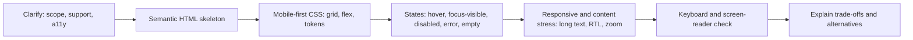
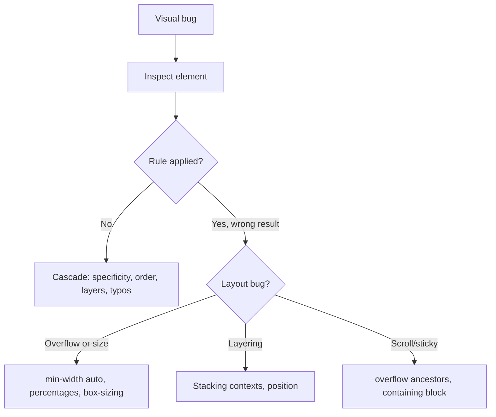

# HTML/CSS Coding Round and Debugging Scenarios

> Verification note: This file is practice-oriented: it applies concepts verified or established in [01](01-html-semantics-document-structure-and-metadata.md)–[07](07-css-architecture-theming-and-tooling.md) (including `@scope`, View Transitions, Popover/`<dialog>` behavior verified there or in earlier categories). Solutions use **well-supported, standards-based CSS**; where a solution uses newer features (`:has()`, container queries, `subgrid`, `@starting-style`, `interpolate-size`, `field-sizing`, CSS anchor positioning, scroll-driven animations, `popover`, `text-wrap`) it says so and gives a fallback. **Support for newer features varies — confirm on MDN/caniuse; CSS anchor positioning and scroll-driven animations are unverified in this repo** *(hedged)*. Interview formats differ; treat the structure ("clarify → semantic HTML → mobile-first CSS → accessibility → edge cases → trade-offs") as the reusable part. Accessibility is summarized at interview depth.

## Table of Contents

1. [Quick Summary (TL;DR)](#1-quick-summary-tldr)
2. [How to Run an HTML/CSS Machine-Coding Round](#2-how-to-run-an-htmlcss-machine-coding-round)
3. [Layout Exercises](#3-layout-exercises)
4. [Component Exercises](#4-component-exercises)
5. [Visual Technique Exercises](#5-visual-technique-exercises)
6. [Debugging Playbook: Symptom to Cause to Fix](#6-debugging-playbook-symptom-to-cause-to-fix)
7. [Rapid-Fire "What Happens?" Questions](#7-rapid-fire-what-happens-questions)
8. [Pitfalls in Interviews](#8-pitfalls-in-interviews)
9. [Interview Questions — Fundamentals](#9-interview-questions--fundamentals)
10. [Interview Questions — Senior Scenarios](#10-interview-questions--senior-scenarios)
11. [Cheat Sheet](#11-cheat-sheet)
12. [Key Terms Glossary](#12-key-terms-glossary)
13. [Further Reading](#13-further-reading)

---

## 1. Quick Summary (TL;DR)

- **Process beats tricks:** clarify requirements (browsers, responsiveness, accessibility, content), choose **semantic HTML**, write **mobile-first** CSS, test **keyboard**, handle **edge cases** (long text, empty states, RTL, zoom), and explain **trade-offs**.
- **Default tool choices:** Grid for 2D layout, Flexbox for 1D alignment, `gap` for spacing, `clamp()/min()` for fluid sizing, `aspect-ratio` for media, native elements (`<dialog>`, `<details>`, `<button>`, `<label>`) over custom divs.
- **Debug systematically:** DevTools → computed styles → box model → stacking contexts → overflow/containing block → media/container queries → cascade (specificity/layers).
- **Top root causes:** `min-width: auto` in flex/grid, margin collapsing, stacking contexts, `overflow` clipping/sticky, `100vh` on mobile, specificity/order, percent heights without definite parents, `position: fixed` inside transformed ancestors.
- **Always mention accessibility and performance** briefly — it separates senior answers.



---

## 2. How to Run an HTML/CSS Machine-Coding Round

1. **Clarify (2 min):** target browsers/devices, responsive behavior, interactivity level (CSS-only vs JS allowed), accessibility expectations, design tokens/brand, performance constraints.
2. **Skeleton (3 min):** landmarks, headings, lists, buttons/links, labels; no div soup ([01](01-html-semantics-document-structure-and-metadata.md)).
3. **Base CSS (3 min):** `box-sizing`, font, container, spacing tokens as custom properties ([03](03-css-cascade-specificity-and-custom-properties.md)).
4. **Layout (10 min):** Grid for page/cards, Flex for toolbars, `gap`, fluid widths.
5. **States (5 min):** `:hover` (guarded by `@media (hover: hover)`), `:focus-visible`, `:disabled`, `[aria-expanded]`, empty/error/loading.
6. **Responsive (5 min):** breakpoints by content, container queries if component-level.
7. **Accessibility pass (3 min):** keyboard order, names, contrast, reduced motion.
8. **Narrate trade-offs:** why Grid vs Flex, why `<dialog>`, fallback strategy, what you'd test.

**Time-savers:** CSS variables for repeated values; logical properties by habit; `display: grid; place-items: center`; a tiny reset; avoid pixel-perfect hacking early.

---

## 3. Layout Exercises

### E1. Holy grail / app shell (header, footer, sidebar, main)
```html
<body class="shell">
  <header>Header</header>
  <nav aria-label="Primary">Nav</nav>
  <main id="main">Main</main>
  <aside aria-label="Related">Aside</aside>
  <footer>Footer</footer>
</body>
```
```css
.shell { min-height: 100dvh; display: grid; gap: 1rem; grid-template-areas: "h" "n" "m" "a" "f"; grid-template-rows: auto auto 1fr auto auto; }
.shell > header { grid-area: h } .shell > nav { grid-area: n } .shell > main { grid-area: m; min-width: 0 }
.shell > aside { grid-area: a } .shell > footer { grid-area: f }
@media (min-width: 60rem) {
  .shell { grid-template-columns: 12rem minmax(0, 1fr) 14rem; grid-template-areas: "h h h" "n m a" "f f f"; grid-template-rows: auto 1fr auto; }
}
```
**Discuss:** DOM order stays logical (a11y); `min-width: 0` for overflow; `dvh` for mobile; sticky footer via `1fr` row; `minmax(0, 1fr)` prevents blowout.

### E2. Responsive card grid with equal heights and bottom-aligned CTAs
```css
.cards { display: grid; gap: 1rem; grid-template-columns: repeat(auto-fit, minmax(min(16rem, 100%), 1fr)); }
.card { display: flex; flex-direction: column; gap: .75rem; padding: 1rem; border: 1px solid var(--border); border-radius: .75rem; }
.card .cta { margin-top: auto; }                       /* push CTA to the bottom */
.card img { aspect-ratio: 4 / 3; width: 100%; object-fit: cover; }
```
**Discuss:** `auto-fit` vs `auto-fill`; image `width/height` attributes for CLS; one link per card (stretched link: `.card a::after { content:""; position:absolute; inset:0 }` with `position: relative` on card) to avoid nested interactive elements; `subgrid` to align titles/prices across cards (support check) ([04 §6](04-css-layout-box-model-flexbox-and-grid.md#6-grid)).

### E3. Sticky header with scrollable main and sticky sidebar
```css
.page { display: grid; grid-template-columns: 16rem 1fr; align-items: start; }
.page > header { grid-column: 1 / -1; position: sticky; top: 0; z-index: 10; background: Canvas; }
.sidebar { position: sticky; top: var(--header-h, 4rem); max-height: calc(100dvh - var(--header-h, 4rem)); overflow: auto; }
```
**Discuss:** `align-items: start` (sticky needs the item not stretched), no `overflow: hidden` ancestors, `scroll-padding-top` for anchors, z-index scale, `scrollbar-gutter`.

### E4. Fixed sidebar + fluid content that never overflows
```css
.layout { display: flex; gap: 1rem; }
.layout > .side { flex: 0 0 14rem; }
.layout > .content { flex: 1 1 0; min-width: 0; }   /* min-width:0 lets long code/URLs shrink or scroll */
.content pre { overflow-x: auto; }
```

### E5. Responsive video embed (16:9)
```css
.embed { aspect-ratio: 16 / 9; width: 100%; }
.embed > iframe { width: 100%; height: 100%; border: 0; }
```
**Discuss:** old padding-top 56.25% hack; `title` on iframe; lazy loading; privacy-enhanced embeds; CSP.

### E6. Masonry-like columns (when strict ordering isn't required)
```css
.masonry { column-width: 16rem; column-gap: 1rem; }
.masonry > * { break-inside: avoid; margin-block-end: 1rem; }
```
**Discuss:** items flow top-to-bottom per column (reading order differs from visual order), alternatives (grid row spans, JS), native masonry not settled *(hedged)*.

### E7. Pricing table with aligned rows using subgrid (progressive enhancement)
```css
.plans { display: grid; gap: 1rem; grid-template-columns: repeat(auto-fit, minmax(16rem, 1fr)); }
.plan  { display: grid; grid-template-rows: subgrid; grid-row: span 4; }   /* title, price, features, CTA align across plans */
@supports not (grid-template-rows: subgrid) { .plan { display: flex; flex-direction: column; } .plan .cta { margin-top: auto; } }
```

---

## 4. Component Exercises

### E8. Accordion (native, accessible, no JS)
```html
<details name="faq"><summary>What is your return policy?</summary><p>30 days…</p></details>
<details name="faq"><summary>Do you ship internationally?</summary><p>Yes…</p></details>
```
```css
details { border-block-end: 1px solid var(--border); }
summary { padding: .75rem 0; cursor: pointer; list-style: none; }
summary::after { content: "+"; float: inline-end; }
details[open] summary::after { content: "−"; }
summary:focus-visible { outline: 2px solid var(--focus); outline-offset: 2px; }
```
**Discuss:** native keyboard/AT semantics; shared `name` attribute for exclusive accordion *(support check)*; animation via grid-rows or `interpolate-size` *(hedged)* ([06 §7](06-css-animation-transitions-and-view-transitions.md#7-animating-entry-exit-and-auto-sizes)); alternative: button + `aria-expanded` + `hidden`.

### E9. Modal dialog
```html
<button type="button" id="open">Open</button>
<dialog id="dlg" aria-labelledby="dlg-title">
  <h2 id="dlg-title">Confirm</h2><p>Delete this item?</p>
  <form method="dialog"><button value="cancel">Cancel</button><button value="ok" autofocus>Delete</button></form>
</dialog>
<script>open.onclick = () => dlg.showModal();</script>
```
```css
dialog { border: 0; border-radius: .75rem; padding: 1.5rem; max-width: min(32rem, 100% - 2rem); }
dialog::backdrop { background: rgb(0 0 0 / .5); }
```
**Discuss:** top layer, inert background, Esc, focus restore, `autofocus`, scroll lock, light dismiss (not default), entry/exit animation with `@starting-style` *(hedged)* ([02 §7](02-html-forms-and-interactive-elements.md#7-disclosure-dialog-and-popover)).

### E10. Dropdown menu with Popover API
```html
<button popovertarget="m" aria-haspopup="menu">Actions</button>
<div id="m" popover role="menu"><button role="menuitem">Edit</button><button role="menuitem">Delete</button></div>
```
**Discuss:** light dismiss and top layer for free; **you must add menu keyboard behavior** (arrow keys, roving focus) or use simple disclosure semantics instead of `role=menu`; positioning with JS/Floating UI or CSS anchor positioning *(support unverified)*.

### E11. Tabs (semantic and accessible)
Prefer `role="tablist"`, `role="tab"`, `role="tabpanel"` with arrow-key navigation (roving `tabindex`), `aria-selected`, `aria-controls`; a CSS-only `:target`/radio hack changes history/semantics and is rarely accessible — mention but don't ship. For link-driven tabs (route-based) use `<nav>` with `aria-current`.

### E12. Toggle switch
```html
<label class="switch"><input type="checkbox" role="switch"> <span>Notifications</span></label>
```
```css
.switch { display: inline-flex; gap: .5rem; align-items: center; }
.switch input { appearance: none; inline-size: 2.5rem; block-size: 1.5rem; border-radius: 999px; background: var(--off); position: relative; }
.switch input::before { content:""; position:absolute; inset: .125rem; inline-size: 1.25rem; border-radius: 50%; background: #fff; transition: transform .15s; }
.switch input:checked { background: var(--on); }
.switch input:checked::before { transform: translateX(1rem); }
.switch input:focus-visible { outline: 2px solid var(--focus); outline-offset: 2px; }
@media (prefers-reduced-motion: reduce) { .switch input::before { transition: none; } }
```
**Discuss:** native checkbox semantics retained; RTL (use logical offsets/`translateX` flips); forced-colors fallback.

### E13. Star rating (radio group)
```html
<fieldset class="rating"><legend>Rating</legend>
  <input type="radio" name="r" id="r5" value="5"><label for="r5" aria-label="5 stars">★</label> … </fieldset>
```
Use DOM order high→low with `flex-direction: row-reverse` and `~` sibling selector for hover fill; **discuss the DOM-vs-visual order trade-off** (arrow keys still work in radio groups; ensure focus order/labels), or use `:has()` for filling *(support check)*.

### E14. Responsive navigation (hamburger)
Wide: inline `<ul>` flex; narrow: toggle button (`aria-expanded`, `aria-controls`) showing a panel (`hidden`/popover/dialog). CSS-only possible with `:has(#toggle:checked)` but prefer a real `<button>`; ensure focus management and Esc close; `@media (min-width)` or container query ([05](05-responsive-design-and-modern-css.md)).

### E15. Tooltip
Prefer **visible text or `aria-describedby`**; the `title` attribute is unreliable. CSS-only tooltip: `.tip:is(:hover, :focus-visible)::after` showing `attr(data-tip)`; popover `popover="hint"`/anchor positioning *(support check)*. **Never put interactive content in tooltips;** must be dismissible and persistent while hovered (WCAG 1.4.13).

### E16. Responsive data table
Wrap in `<div role="region" aria-labelledby="cap" tabindex="0" style="overflow-x:auto">`, keep semantics (`<caption>`, `<th scope>`); sticky first column with `position: sticky; inset-inline-start: 0; background: Canvas`; for card reflow, test that table semantics survive ([01 §7](01-html-semantics-document-structure-and-metadata.md#7-tables-lists-and-data-presentation)).

### E17. Form with inline validation styling
```css
input:user-invalid { border-color: var(--danger); }            /* after interaction; support check */
input:invalid:not(:placeholder-shown) { border-color: var(--danger); }   /* widely supported fallback */
.field:has(input:user-invalid) .error { display: block; }
```
**Discuss:** native constraint validation + `aria-describedby`/`aria-invalid`, error summary and focus ([02 §5](02-html-forms-and-interactive-elements.md#5-constraint-validation-and-error-ux)).

### E18. Light/dark theme toggle
`data-theme` on `<html>` + semantic tokens + `color-scheme` + persisted choice applied pre-paint; `prefers-color-scheme` default; avoid flash; test contrast ([05 §8](05-responsive-design-and-modern-css.md#8-color-theming-and-forced-colors), [07 §4](07-css-architecture-theming-and-tooling.md#4-design-tokens-and-theming-architecture)).

---

## 5. Visual Technique Exercises

| Task | Solution sketch |
|---|---|
| **Single-line ellipsis** | `white-space:nowrap; overflow:hidden; text-overflow:ellipsis;` (+ `min-width:0` in flex) |
| **Multi-line clamp** | `display:-webkit-box; -webkit-box-orient:vertical; -webkit-line-clamp:3; overflow:hidden;` |
| **CSS triangle** | `width:0;height:0;border:8px solid transparent;border-block-end-color:#333;` or `clip-path: polygon(50% 0, 100% 100%, 0 100%)` |
| **Speech bubble tail** | `::after` positioned with border-triangle or `clip-path` |
| **Circle avatar** | `inline-size:3rem; aspect-ratio:1; border-radius:50%; object-fit:cover` |
| **Overlay badge** | Parent `position:relative`; badge `position:absolute; inset-block-start:-.25rem; inset-inline-end:-.25rem` |
| **Gradient text** | `background: linear-gradient(...); background-clip:text; color: transparent;` (keep a solid fallback/contrast) |
| **Skeleton loader** | Placeholder blocks with `background:linear-gradient(90deg,#eee,#f5f5f5,#eee)` and a transformed pseudo-element shimmer; `prefers-reduced-motion` |
| **Spinner** | Border ring + `animation: spin 0.8s linear infinite`; `role="status"` + visually hidden label |
| **Visually hidden (screen-reader only)** | `position:absolute; inline-size:1px; block-size:1px; overflow:hidden; clip-path:inset(50%); white-space:nowrap;` |
| **Zebra rows** | `tbody tr:nth-child(even)`; keep contrast |
| **Sticky table header** | `thead th{position:sticky; top:0; background:Canvas}` in a scroll container |
| **Full-bleed in a column** | Named-line grid or `margin-inline: calc(50% - 50vw)` (scrollbar caveat) |
| **Parallax/scroll reveal** | Scroll-driven animation *(support unverified)* or IntersectionObserver; reduce for motion-sensitive users |
| **Custom checkbox** | Keep native input (`appearance:none` + `::before`), don't hide it with `display:none` |
| **Smooth scroll** | `scroll-behavior:smooth` + reduced-motion override + `scroll-margin-top` |
| **Image hover zoom** | Wrapper `overflow:hidden`; `transform: scale(1.05)` transition |
| **Print-friendly page** | `@media print` hide chrome, `break-inside:avoid`, link URLs |

---

## 6. Debugging Playbook: Symptom to Cause to Fix

| Symptom | Likely causes | Fix |
|---|---|---|
| **`z-index` has no effect** | Element not positioned/flex-grid item; ancestor stacking context (`transform`, `opacity<1`, `filter`) traps it; compared across contexts | Add `position`; move element/portal; `isolation:isolate` on containers; use top layer ([04 §4](04-css-layout-box-model-flexbox-and-grid.md#4-positioning-stacking-and-overflow)) |
| **Flex child overflows/won't shrink; long text breaks layout** | `min-width:auto` | `min-width:0`; `overflow:hidden`; `overflow-wrap:anywhere` |
| **Grid columns unequal/overflow** | `1fr` = `minmax(auto,1fr)` | `minmax(0,1fr)`; `min-width:0` on items |
| **`position: sticky` not sticking** | No `top`; ancestor `overflow` clipping; parent too short; `align-items: stretch` in flex/grid | Add threshold; remove `overflow` on ancestors; `align-self:start` |
| **`position: fixed` behaves like absolute** | Ancestor with `transform/filter/perspective/contain` | Remove/move; render overlay in portal/top layer |
| **Percentage `height:100%` collapses** | Parent has no definite height | Give ancestors heights, or use flex/grid (`min-height:100dvh`) |
| **Full-height mobile page overflows/has gap** | `100vh` includes hidden UI | `100svh/100dvh`; safe-area padding ([05 §6](05-responsive-design-and-modern-css.md#6-viewport-units-mobile-browsers-and-safe-areas)) |
| **Horizontal scrollbar appears** | `100vw` includes scrollbar; fixed widths; negative margins; images/tables; long unbroken strings | Use `100%`, `max-width:100%`, `overflow-x:auto` on tables, `overflow-wrap` |
| **Unexpected gap between parent and child (margin)** | Margin collapsing (parent/first-child) | Padding/border, `display:flow-root`, use `gap` |
| **Gap under inline images** | Inline baseline whitespace | `img{display:block}` or `vertical-align:middle` |
| **Inline-block items have gaps** | Whitespace between inline-blocks | Use flex/grid `gap` |
| **Style not applying** | Specificity/order/layer; typo; invalid value; overridden by `!important`; shorthand reset | DevTools Styles (strikethrough), check layers/order, unset conflicts ([03](03-css-cascade-specificity-and-custom-properties.md)) |
| **Custom property not applied** | Undefined/invalid/cyclic var → guaranteed-invalid; set on wrong scope | Provide fallback; inspect computed; set on ancestor |
| **Hover works on desktop but not touch** | Hover-only UI | Provide tap/focus alternative; guard with `@media (hover:hover)` |
| **Focus ring missing or ugly** | `outline:none`; custom components not focusable | `:focus-visible` styles; use native elements |
| **Text blurry after centering** | `translate(-50%,-50%)` subpixel | Use grid/flex centering or `translate` with even sizes |
| **Layout jumps after load (CLS)** | Images/ads without dimensions; late fonts; injected banners | `width/height`/`aspect-ratio`, reserve space, `font-display`/size-adjust ([web-performance/05](../web-performance/05-rendering-layout-animation-and-cls.md)) |
| **Animation janky** | Animating layout properties; heavy paints; main thread blocked | Animate `transform/opacity`; profile; reduce layers |
| **Dark mode flashes white** | Theme applied after first paint | Server-render attribute/inline script; `color-scheme` |
| **RTL layout broken** | Physical properties; hard-coded `left/right` | Logical properties; `:dir(rtl)` for icons |
| **Font looks different across OS/browsers** | Fallback stacks, metrics, hinting | Define `font-family` stacks, `font-display`, `size-adjust`, test |
| **Safari-only bug** | Flex/grid/`gap`, `100vh`, `position: sticky` in overflow, date inputs, `backdrop-filter` prefixes | Test WebKit early; check caniuse/Baseline; polyfill/fallback |
| **Element invisible/zero height** | Empty content, floats, `height:auto` with only absolutely positioned children | `flow-root`, give dimensions, inspect box |
| **Click not hitting element** | Overlapping pseudo-element/overlay; `pointer-events`; `inert` | Inspect hit target; z-order; `pointer-events:none` on decorative layers |
| **Scroll locked/jumps when modal opens** | `overflow:hidden` on body removes scrollbar | `scrollbar-gutter:stable`; use `<dialog>` modal inertness |
| **`:has()` slow/janky** *(hedged)* | Broad ancestor selectors on large DOMs | Narrow anchors; avoid on `body`; measure |

**DevTools workflow:** (1) Inspect → Computed (winning rule); (2) Layout panel (flex/grid overlays); (3) Box model (margin/padding/overflow); (4) Toggle properties/declaration checkboxes; (5) Layers/3D view for stacking; (6) Rendering panel (paint flashing, layout shift regions); (7) Emulate media (reduced motion, dark, forced colors, print); (8) Performance tab for animation/layout cost.

---

## 7. Rapid-Fire "What Happens?" Questions

1. **`.a { color: red } #b .a { color: blue }` — which wins on `#b .a`?** Blue (ID in selector increases specificity).
2. **`p { margin: 20px 0 } ` between two `<p>`s?** Collapsed: 20px gap, not 40px.
3. **`div { width: 100px; padding: 10px; border: 1px solid }` (content-box)?** Total 122px; with `border-box` total 100px.
4. **`display: none` vs `visibility: hidden` vs `opacity: 0`?** No layout & hidden from AT / keeps space, hidden from AT / keeps space & interactive (focusable/clickable) but invisible.
5. **`position: absolute` with no positioned ancestor?** Relative to the initial containing block.
6. **`z-index: 9999` loses to `z-index: 1`?** Possible when in different stacking contexts.
7. **`flex: 1` vs `flex: 1 1 auto`?** Basis 0 vs auto: equal widths vs content-based distribution.
8. **`margin: 0 auto` doesn't center a block?** Needs a width/`fit-content`, block-level box; not for inline or floated elements.
9. **`height: 100%` inside `body`?** Requires `html, body` heights; prefer `min-height: 100dvh`.
10. **`a:hover` before `a:link` — why does hover break?** Link states order (LVHA) or specificity; with modern selectors keep consistent order.
11. **Two classes `.a.b` vs `.b`?** `.a.b` more specific (0-2-0 vs 0-1-0).
12. **`:is(#id, .class)` specificity?** That of the most specific argument (ID).
13. **`rem` vs `em` nested font-size?** `em` compounds through nesting; `rem` is root-relative.
14. **`inline` element and `width`?** Ignored; use `inline-block`/flex.
15. **What does `* { box-sizing: border-box }` do?** Includes padding/border in specified sizes.
16. **How do you hide visually but keep for screen readers?** Visually-hidden class (not `display:none`).
17. **`transform` on an ancestor and a fixed child?** Child becomes positioned relative to the transformed ancestor.
18. **`@media (min-width: 600px)` mobile-first or desktop-first?** Mobile-first (additive).
19. **`overflow: hidden` on parent and `position: sticky` child?** Sticky may stop working (parent becomes scroll container).
20. **Why does `vh` jump on mobile?** Browser UI changes; use `svh/dvh`.

---

## 8. Pitfalls in Interviews

1. **Starting to style before building semantic HTML.**
2. **Using `div` for buttons/links/headings.**
3. **Pixel-perfect obsession; ignoring responsiveness/zoom.**
4. **Forgetting focus/hover/disabled/error/empty states.**
5. **Using floats/tables for layout; magic numbers (`margin-top: 37px`).**
6. **`!important` and ID selectors to fix problems.**
7. **Overusing absolute positioning and fixed heights.**
8. **Not testing with long text, narrow widths, RTL or keyboard.**
9. **CSS-only hacks (radio/checkbox) without discussing accessibility trade-offs.**
10. **Ignoring browser support/fallbacks when using new features.**
11. **Not narrating decisions or trade-offs.**
12. **Not checking contrast or reduced motion.**

---

## 9. Interview Questions — Fundamentals

- **How do you center content (several ways)?** Grid `place-items:center`, flex, auto margins, `text-align`, absolute + inset/margin auto.
- **Explain Flexbox vs Grid.** 1D vs 2D; content- vs layout-driven; combine.
- **How do you build a responsive layout without a framework?** Fluid grid (`auto-fit/minmax`), `clamp()`, media/container queries, mobile-first.
- **How do you debug a CSS issue?** DevTools computed/box model/layout overlays, isolate, check stacking/overflow/cascade.
- **BEM or modules or utilities?** Context-based; keep specificity low and scope controlled.
- **How do you make a custom control accessible?** Start native; keyboard, roles/states, focus, contrast, reduced motion.
- **Describe the box model and `box-sizing`.** Content/padding/border/margin; border-box includes padding/border.
- **What is a stacking context?** An isolated z-ordering scope created by positioning+z-index, opacity, transform, etc.
- **How do you handle images responsively?** `max-width:100%`, `srcset/sizes`, `aspect-ratio`, lazy loading.
- **How do you implement dark mode?** Tokens + `color-scheme` + preference + no-flash.
- **How do you animate performantly?** `transform/opacity`, avoid layout animation, `will-change` sparingly, reduced motion.
- **How do you structure CSS in a large app?** Layers, tokens, Modules/utilities, lint, visual tests.

---

## 10. Interview Questions — Senior Scenarios

### S1. "Build a reusable Card component for a design system."
Semantic root (`article`), slot structure (media, title, body, actions), `container-type: inline-size` with container-query layouts, tokens for spacing/radius, data-attribute variants, stretched-link pattern for a single primary action, focus-visible styling, `aspect-ratio` media, RTL via logical properties, Storybook states, visual tests, accessibility notes ([system-design/06](../system-design/06-design-system-and-component-library.md)).

### S2. "Implement a responsive dashboard layout with collapsible sidebar and sticky header."
Grid shell with CSS variables for sidebar width, `min-height:100dvh`, main region `overflow:auto; min-height:0`, sticky header, sidebar drawer on small screens using `<dialog>`/`inert`, keyboard/focus management, `prefers-reduced-motion`, container queries for widgets, test at 320px/400% zoom ([04](04-css-layout-box-model-flexbox-and-grid.md)).

### S3. "How would you reproduce a Pinterest-style layout?"
Discuss CSS columns (simple, order trade-off), grid with row spans from image ratios, JS measurement for strict ordering, virtualization, lazy loading, `aspect-ratio`, CLS prevention; native masonry unsettled *(hedged)* ([system-design/07](../system-design/07-image-gallery-and-media-heavy-ui.md)).

### S4. "Make an existing page accessible at 400% zoom and with text spacing overrides."
Replace fixed widths/heights with fluid layout, `rem`/`ch`, wrapping flex, no clipping text (min-height not height), responsive tables, test with spacing bookmarklet, ensure no horizontal scrolling (except data regions), maintain focus visibility.

### S5. "Our design requires a complex tooltip/popover with arrow and collision handling."
Use Popover API for top-layer/light dismiss, position with CSS anchor positioning where support allows (unverified here) or Floating UI with arrow/flip/shift middleware; accessibility (`aria-describedby`, focus handling, Esc), reduced motion, touch behavior; feature-detect and fall back ([02 §7](02-html-forms-and-interactive-elements.md#7-disclosure-dialog-and-popover)).

### S6. "Explain how you would test the CSS of a component library."
Storybook states × themes × viewports with screenshot tests (animations off, fonts pinned), cross-browser projects, a11y checks (contrast, forced colors, reduced motion), real-browser component tests for layout-dependent behavior, stylelint, CSS size budgets ([07 §9](07-css-architecture-theming-and-tooling.md#9-testing-css), [testing/05](../testing/05-visual-accessibility-and-component-states-testing.md)).

---

## 11. Cheat Sheet

| Need | Snippet |
|---|---|
| Base | `*{box-sizing:border-box}` + `max-width:100%` media |
| Center | `display:grid;place-items:center` |
| Card grid | `repeat(auto-fit,minmax(min(16rem,100%),1fr))` |
| Equal CTA bottom | flex column + `.cta{margin-top:auto}` |
| Stop blowout | `min-width:0` / `minmax(0,1fr)` |
| Sticky | `position:sticky;top:0` + no clipping ancestor + `align-self:start` |
| Full height | `min-height:100dvh` |
| Truncate | `nowrap` + `overflow:hidden` + `text-overflow:ellipsis` |
| Visually hidden | `position:absolute;clip-path:inset(50%);inline-size:1px;block-size:1px;overflow:hidden` |
| Focus | `:focus-visible{outline:2px solid ...}` |
| Reduced motion | `@media (prefers-reduced-motion:reduce)` |
| Overlay | `<dialog>` / `popover` |



---

## 12. Key Terms Glossary

| Term | Meaning |
|---|---|
| **Machine coding** | Time-boxed build of a working UI component/page |
| **Stretched link** | Making a whole card clickable via a pseudo-element on one link |
| **Visually hidden** | Hidden visually but available to assistive tech |
| **Blowout** | Content forcing a flex/grid item wider than its track |
| **Stacking context** | Isolated z-ordering scope |
| **Containing block** | Reference box for absolute/fixed/percentage sizing |
| **FOUC/FOUT** | Flash of unstyled content/text |
| **LVHA** | Link–Visited–Hover–Active ordering convention |
| **Roving tabindex** | Single tab stop within composite widget |
| **Top layer** | Layer above the stacking order for dialogs/popovers |

---

## 13. Further Reading

- [MDN: Learn CSS](https://developer.mozilla.org/en-US/docs/Learn_web_development/Core/Styling_basics) · [web.dev Learn CSS](https://web.dev/learn/css) · [WAI-ARIA Authoring Practices](https://www.w3.org/WAI/ARIA/apg/) *(hedged: confirm URLs)*
- **This repo:** [01 Semantics](01-html-semantics-document-structure-and-metadata.md) · [02 Forms and interactive elements](02-html-forms-and-interactive-elements.md) · [03 Cascade](03-css-cascade-specificity-and-custom-properties.md) · [04 Layout](04-css-layout-box-model-flexbox-and-grid.md) · [05 Responsive and modern CSS](05-responsive-design-and-modern-css.md) · [06 Animation](06-css-animation-transitions-and-view-transitions.md) · [react/07 §12 Classic UI coding-round components](../react/07-component-patterns-and-architecture.md#12-classic-ui-coding-round-components) · [js/02](../js/02-frontend-specific-coding.md) · [system-design/](../system-design/README.md)
