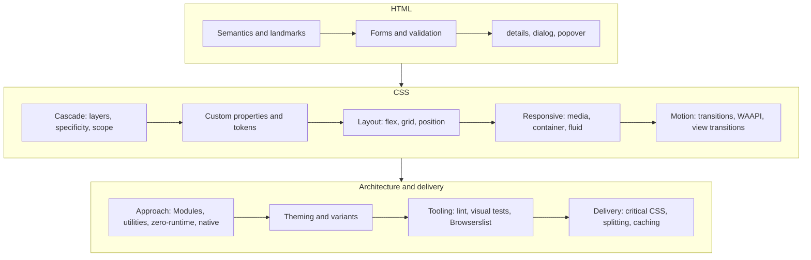
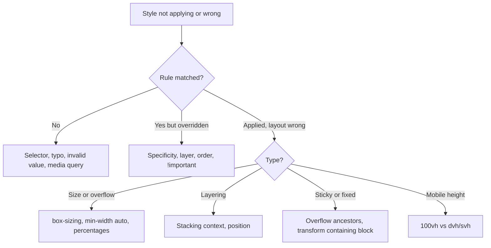

# HTML & CSS Recall Map (Last-Minute Review)

> Verification note: Browser-support facts verified on MDN (2026-11-19): **`@scope`** (Baseline 2026 newly available: Chrome/Edge 118, Firefox 146, Safari 26.4; `&` as `:where(:scope)` Chrome 143, Firefox 142, Safari 26.2), **View Transitions** (same-document Chrome/Edge 111, Firefox 144, Safari 18; `types`/`update` Chrome/Edge 125, Firefox 147, Safari 18.2; cross-document `@view-transition` Chrome/Edge 126, Safari 18.2, Firefox Nightly only) and, from earlier categories, **Popover API** (Baseline 2025 newly available: Chrome 114, Firefox 125, Safari 17) and **`content-visibility: auto`** (Baseline newly available Sep 2025). **Anchor positioning and scroll-driven animations support is unverified; all other modern CSS (container queries, `:has()`, `@layer`, nesting, subgrid, `dvh`, `light-dark()`, `@starting-style`, `interpolate-size`, `field-sizing`, `text-wrap`) is established but its version/Baseline status must be re-checked** *(hedged)*. Details: [01](01-html-semantics-document-structure-and-metadata.md)–[08](08-html-css-coding-round-and-debugging-scenarios.md). Full navigation: [README](README.md).

## Table of Contents

1. [60-Second Mental Model](#1-60-second-mental-model)
2. [Maps](#2-maps)
3. [Decision Tables](#3-decision-tables)
4. [Facts, Numbers and Defaults](#4-facts-numbers-and-defaults)
5. [Mnemonics](#5-mnemonics)
6. [Rapid-Fire Q&A](#6-rapid-fire-qa)
7. [Say-This Scripts](#7-say-this-scripts)
8. [Red Flags vs Green Flags](#8-red-flags-vs-green-flags)
9. [Final 10-Minute Checklist](#9-final-10-minute-checklist)
10. [Related Recall Maps](#10-related-recall-maps)

---

## 1. 60-Second Mental Model

1. **HTML = meaning, CSS = presentation, JS = behavior.** Use the right native element first: you get role, keyboard, focus, forms, no-JS behavior and a11y for free.
2. **Landmarks + headings + labels + `alt`** make pages navigable; `<a>` navigates, `<button>` acts; **ARIA only to repair/extend**, never to replace native semantics.
3. **Forms:** real `<form>`, `name`d controls, `<label>`, correct `type/autocomplete/inputmode`, constraint validation for UX, **server validation for truth**, error association + focus management.
4. **Cascade:** importance → **layer** → **specificity** → **scope proximity** → source order. Keep specificity flat; use `@layer`/`@scope`; `:where()`=0, `:is()`=max.
5. **Custom properties** are runtime, inherited, cascading tokens (themes, component APIs); not usable in media queries.
6. **Layout:** box model + `border-box`; **Flex = 1D, Grid = 2D**; `gap`; `min-width: 0` fixes blowout; `place-items: center`; stacking contexts explain `z-index`; sticky needs a threshold and no clipping ancestor.
7. **Responsive:** fluid first (`auto-fit/minmax`, `clamp`, `ch`), **container queries for components**, media queries for page + **preferences** (motion, color scheme, contrast, hover), `dvh/svh` + safe areas, logical properties for RTL.
8. **Motion:** animate `transform/opacity`; explicit `transition` properties; `prefers-reduced-motion`; View Transitions are progressive enhancement (MPA: Chromium/Safari only, Firefox Nightly).
9. **Architecture:** tokens (primitive → semantic → component), layers, one scoping strategy, data-attribute variants, zero-runtime/static CSS for RSC, lint + visual tests.
10. **Debug with DevTools:** computed → box model → layout overlay → stacking/overflow/containing block → cascade.

---

## 2. Maps

**Document map**

| Topic | File |
|---|---|
| Semantics, landmarks, metadata, images, ARIA basics | [01](01-html-semantics-document-structure-and-metadata.md) |
| Forms, validation, dialog/popover/details, focus | [02](02-html-forms-and-interactive-elements.md) |
| Cascade, specificity, layers, `@scope`, custom properties | [03](03-css-cascade-specificity-and-custom-properties.md) |
| Box model, positioning, flexbox, grid | [04](04-css-layout-box-model-flexbox-and-grid.md) |
| Responsive design, container queries, modern CSS | [05](05-responsive-design-and-modern-css.md) |
| Animation, view transitions, scroll-driven | [06](06-css-animation-transitions-and-view-transitions.md) |
| CSS architecture, theming, tooling | [07](07-css-architecture-theming-and-tooling.md) |
| Coding round and debugging | [08](08-html-css-coding-round-and-debugging-scenarios.md) |

---

## 3. Decision Tables

| Situation | Choose |
|---|---|
| Navigate to a URL | `<a href>` |
| Perform an action | `<button type="button">` |
| Group radios/related fields | `fieldset` + `legend` |
| Mobile numeric keypad (IDs/cards/OTP) | `type="text" inputmode="numeric"` + `autocomplete` |
| Inline disclosure | `
` |
| Blocking overlay | `<dialog>.showModal()` |
| Non-blocking menu/tooltip/toast | Popover API |
| Page layout / 2D | Grid |
| Toolbar / alignment / 1D | Flexbox |
| Responsive card grid | `repeat(auto-fit, minmax(min(16rem,100%), 1fr))` |
| Component-level responsiveness | Container queries |
| Page-level layout, user preferences | Media queries |
| Full-height on mobile | `100svh` / `100dvh` |
| Fluid type | `clamp(1rem, .9rem + .5vw, 1.25rem)` |
| Override third-party CSS | Put it in a low `@layer` |
| Theme | Semantic custom properties + `data-theme` + `color-scheme` |
| Scope styles | CSS Modules / `@scope` / Shadow DOM |
| Animate smoothly | `transform`/`opacity`, WAAPI for dynamic |
| Page/DOM transition | View Transitions (feature-detect) |
| Overlay stacking issues | Top layer instead of z-index battles |
| RSC / SSR styling | Static CSS, Modules, utilities, zero-runtime |

| Flex vs Grid | Flex | Grid |
|---|---|---|
| Axes | One | Two |
| Sizing driven by | Content | Container tracks |
| Typical | Nav, buttons, media object | Page shell, cards, dashboards |

---

## 4. Facts, Numbers and Defaults

| Fact | Value |
|---|---|
| Cascade order | Importance → layers → specificity → scope proximity → source order |
| Layers | Later layer wins (normal); unlayered beats layered (normal); `!important` reverses |
| Specificity | (IDs, classes/attrs/pseudo-classes, types); `:where()` 0; `:is()/:not()/:has()` = highest arg; compared column-wise |
| `@scope` | Baseline 2026 newly available (Chrome/Edge 118, Firefox 146, Safari 26.4); `:scope` = 0-1-0; bare/`&` = 0 weight; donut scope; proximity loses to layers/specificity/importance |
| `flex: 1` | `1 1 0%` |
| Flex min size | `min-width: auto` → use `min-width: 0` |
| `1fr` | `minmax(auto, 1fr)` → use `minmax(0, 1fr)` for equal columns |
| `auto-fit` vs `auto-fill` | Collapse empty tracks vs keep them |
| Prose measure | ~45–75 characters (`65ch`) |
| Touch targets | WCAG 2.2 min ~24×24 CSS px; ~44px comfortable |
| Contrast (WCAG AA) | 4.5:1 text; 3:1 large text and UI components |
| Flash limit | ≤ 3 flashes/second |
| Auto-moving content | Provide pause/stop/hide if > 5 s |
| Frame budget | 16.7 ms at 60 fps |
| Cheap to animate | `transform`, `opacity` |
| Popover API | Baseline 2025 newly available (Chrome 114, Firefox 125, Safari 17) |
| View Transitions (same-doc) | Chrome/Edge 111, Firefox 144, Safari 18 |
| View Transitions (cross-doc) | Chrome/Edge 126, Safari 18.2, Firefox Nightly only |
| `content-visibility: auto` | Baseline newly available (Sep 2025); needs `contain-intrinsic-size` |
| `<meta charset>` | Within first 1024 bytes |
| `defer` vs `async` | Ordered after parse vs as-soon-as-ready |
| Quirks mode trigger | Missing/old doctype |
| `button` default type in form | `submit` |
| `form.submit()` vs `requestSubmit()` | No validation/events vs validation + `submit` event |
| Anchor positioning / scroll-driven animations | Support **unverified** → feature-detect |

---

## 5. Mnemonics

- **ILCTS (cascade):** **I**mportance → **L**ayer → **C**lass-level specificity → **T**ree proximity (`@scope`) → **S**ource order.
- **LVHA:** link states order — **L**ink, **V**isited, **H**over, **A**ctive.
- **BPBM:** box model — **B**ox-sizing, **P**adding, **B**order, **M**argin.
- **FLIP:** **F**irst, **L**ast, **I**nvert, **P**lay.
- **RAM grid:** **R**epeat, **A**uto-fit, **M**inmax.
- **No-flash dark mode:** resolve theme before first paint, then `color-scheme`.
- **Native first:** element → CSS state → ARIA → custom widget.
- **Transform-opacity rule:** if you can't animate it with `transform`/`opacity`, rethink (FLIP).
- **Warn → ratchet** for CSS lint rollouts.
- **`min-width: 0`** — the answer to half of flex/grid overflow bugs.

---

## 6. Rapid-Fire Q&A

- **Semantic HTML benefits?** A11y, SEO, maintainability, default behaviors.
- **`<section>` vs `<article>` vs `
`?** Thematic with heading / standalone / none.
- **`alt` rules?** Meaningful for informative, `""` for decorative, action for linked images.
- **`defer` vs `async`?** Ordered post-parse vs unordered ASAP; module = deferred.
- **Why `width/height` on images?** Reserve space, prevent CLS.
- **`srcset`/`sizes` vs `<picture>`?** Resolution switching vs art direction/format fallback.
- **What gets submitted?** Named, enabled controls; checked boxes/radios; submitter.
- **`readonly` vs `disabled`?** Submitted+focusable vs not.
- **`:invalid` vs `:user-invalid`?** Always vs after interaction (support check).
- **`dialog` vs popover?** Modal inert focus trap vs light non-modal top layer.
- **Specificity of `:is()`/`:where()`?** Highest arg / zero.
- **What do layers do?** Order style groups regardless of specificity.
- **`inherit` vs `initial` vs `unset` vs `revert`?** Parent / spec default / inherit-or-initial / UA style.
- **CSS vars vs Sass vars?** Runtime/inherited vs compile-time.
- **Margin collapse?** Adjacent vertical margins merge; not in flex/grid.
- **Why won't my flex child shrink?** `min-width:auto` → `0`.
- **Sticky not working?** Threshold, ancestor `overflow`, stretch alignment.
- **`z-index` ignored?** Not positioned or different stacking context.
- **Center a div?** `grid` + `place-items:center`.
- **`vh` on mobile?** Use `svh/dvh`.
- **Media vs container queries?** Viewport vs container; page vs component.
- **Why not `vw` font-size alone?** Breaks zoom; use `rem + vw` in `clamp`.
- **Logical properties?** `inline`/`block` axes for RTL/vertical writing.
- **Cheap properties to animate?** `transform`, `opacity`.
- **`will-change`?** Hint layer promotion; use sparingly.
- **View Transitions MPA support?** Chromium 126+, Safari 18.2, Firefox Nightly only.
- **Reduced motion?** `prefers-reduced-motion` — replace big motion with fades.
- **CSS Modules vs utility vs CSS-in-JS?** Build-time scope vs atomic composition vs JS-authored (runtime cost/RSC limits).
- **How to theme?** Semantic tokens + attribute switch + `color-scheme`.
- **Test CSS?** Visual regression + real browsers; not jsdom.
- **Print CSS?** `@media print`, hide chrome, `break-inside`.

---

## 7. Say-This Scripts

- **"How do you approach building a UI component?"** "Semantic HTML first, with native elements and labels. Then mobile-first CSS using Grid or Flex, tokens as custom properties, and container queries if it's reusable. I add focus/hover/error/empty states, check keyboard and reduced motion, and test with long text and RTL."
- **"Why is my z-index not working?"** "z-index only competes within its stacking context. I'd check whether the element is positioned, then look for ancestors creating contexts — transform, opacity, filter — and either move the element, isolate the component, or use the top layer via dialog or popover."
- **"How do you keep CSS maintainable?"** "Low flat specificity, a declared layer order, semantic tokens, one scoping strategy — modules, scope or utilities — lint rules for `!important` and IDs, and visual regression tests. Legacy CSS goes into a low layer and a ratchet shrinks the violations."
- **"Flex or Grid?"** "Flexbox for one-dimensional, content-driven alignment; Grid when I need rows and columns or aligned tracks. Usually grid for the page and cards, flex inside components."
- **"How do you do responsive design?"** "Fluid and intrinsic layouts first, content-driven breakpoints, container queries for components, media queries for page layout and user preferences, fluid type with clamp on rem, logical properties for RTL, tested at 320px and 400% zoom."
- **"Can we use View Transitions / scroll-driven animations?"** "As progressive enhancement behind feature detection: same-document view transitions are in Chrome, Firefox 144 and Safari 18; cross-document ones are Chromium and Safari only, Firefox Nightly. Scroll-driven animations I'd check support and keep content usable without them."

---

## 8. Red Flags vs Green Flags

| Red flags | Green flags |
|---|---|
| `div` with click handlers | Native `button`/`a` |
| Placeholder as label | Associated `<label>`, hints, `aria-describedby` |
| `outline: none` | `:focus-visible` styling |
| `!important`/ID selectors for fixes | Layers, low specificity, tokens |
| `transition: all`, animating `width/top` | Explicit `transform/opacity` transitions |
| `100vh` for mobile full-height | `svh/dvh` + safe areas |
| Fixed pixel layouts | Fluid grid, `clamp`, `rem`, zoom-tested |
| `type=number` for IDs/cards | `inputmode` + `autocomplete` |
| Pure-`vw` fonts | `clamp(rem + vw)` |
| Testing CSS in jsdom | Real-browser visual/a11y tests |
| Runtime CSS-in-JS in RSC by default | Static/zero-runtime CSS |
| No reduced-motion handling | `prefers-reduced-motion` respected |
| Assuming new CSS works everywhere | `@supports`, Baseline check, fallbacks |

---

## 9. Final 10-Minute Checklist

- [ ] Landmarks, heading outline, `<a>` vs `<button>`, labels, `alt`, doctype/lang/viewport
- [ ] Script loading (`defer/async/module`), image `width/height`, `srcset/sizes/picture`
- [ ] Form submission rules, validation API, error UX, `autocomplete/inputmode`, `dialog` vs popover vs details
- [ ] Cascade order, specificity math, layers, `@scope`, nesting, `:has/:is/:where`
- [ ] Custom properties (runtime, inheritance, fallbacks, `@property`), units (`rem`, `ch`, `dvh`, `clamp`)
- [ ] Box model, margin collapsing, positioning, stacking contexts, sticky pitfalls
- [ ] Flexbox (`flex` shorthand, `min-width:0`), Grid (`fr`, `minmax`, `auto-fit`, subgrid), centering recipes
- [ ] Media vs container queries, preference queries, logical properties/RTL, safe areas
- [ ] Transitions vs keyframes vs WAAPI vs View Transitions; compositor properties; reduced motion
- [ ] Architecture: tokens, layers, Modules/utilities/zero-runtime, variants, lint, visual tests, delivery
- [ ] Debugging playbook (overflow, z-index, sticky, fixed, 100vh, collapse, specificity)
- [ ] One coding-round walkthrough rehearsed ([08](08-html-css-coding-round-and-debugging-scenarios.md))

---

## 10. Related Recall Maps

- [Browser Internals](../browser-internals/08-browser-internals-recall-map.md) · [Web Performance](../web-performance/08-web-performance-recall-map.md) · [System Design](../system-design/09-system-design-recall-map.md) · [React](../react/09-react-recall-map.md) · [Testing](../testing/09-testing-recall-map.md) · [Web Security](../web-security/09-web-security-recall-map.md) · [Frontend Architecture](../frontend-architecture/09-frontend-architecture-recall-map.md) · [Next.js & Rendering](../nextjs-and-rendering/09-nextjs-recall-map.md) · [TypeScript](../typescript/06-typescript-recall-map.md) · [Networking & APIs](../networking-and-apis/09-networking-and-apis-recall-map.md) · [React Native](../react-native/16-react-native-recall-map.md)
