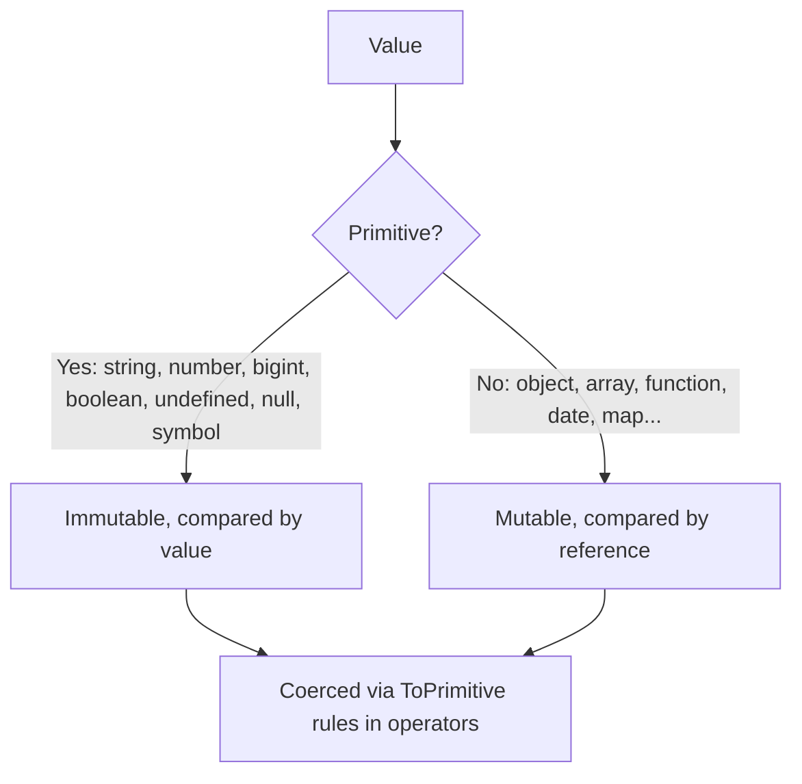
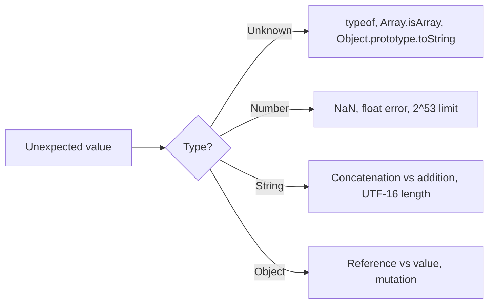

# JavaScript Language Fundamentals: Types, Coercion and Equality

> Verification note: Language semantics in this file (primitive and object types, `typeof`, number representation per IEEE-754, `BigInt`, string/UTF-16 behavior, abstract equality and `ToPrimitive` coercion, truthiness, `Object.is`/SameValueZero, `var`/`let`/`const` scoping and the temporal dead zone, strict mode, logical assignment operators) follow the **ECMAScript specification** and **MDN**; they are stable across engines. Edition-specific features cited (`BigInt` and `globalThis` in **ES2020**, logical assignment in **ES2021**, `Object.hasOwn` and `.at()` in **ES2022**) were cross-checked against the **TC39 finished-proposals** list (fetched 2026-11-26). Output shown in comments is what a spec-compliant engine prints. **Runtime support for the newest features varies by browser/Node version and must be confirmed on MDN/caniuse before relying on it** *(hedged)*. This is the **basic tier** of the JavaScript category; later documents deepen scope/closures ([03](03-functions-scope-closures-and-this.md)), the object model ([04](04-prototypes-classes-and-the-object-model.md)) and async ([05](05-asynchronous-javascript-event-loop-promises-and-async-await.md)). Existing Q&A on equality and truthiness remains in [08, Q19](08-advanced-fundamentals-and-coding.md#19-what-are-the-differences-between---objectis-and-truthiness) and is cross-referenced rather than duplicated.

## Table of Contents

1. [Quick Summary (TL;DR)](#1-quick-summary-tldr)
2. [Types: Primitives and Objects](#2-types-primitives-and-objects)
3. [`typeof`, `instanceof` and Reliable Type Checks](#3-typeof-instanceof-and-reliable-type-checks)
4. [Numbers, `BigInt` and Floating-Point](#4-numbers-bigint-and-floating-point)
5. [Strings, Unicode and Template Literals](#5-strings-unicode-and-template-literals)
6. [Type Coercion: How and Why](#6-type-coercion-how-and-why)
7. [Equality: `==`, `===`, `Object.is`, SameValueZero](#7-equality---objectis-samevaluezero)
8. [Truthiness, Short-Circuiting and Logical Assignment](#8-truthiness-short-circuiting-and-logical-assignment)
9. [Variables, Scope Basics and Strict Mode](#9-variables-scope-basics-and-strict-mode)
10. [Values, References and "Pass by Sharing"](#10-values-references-and-pass-by-sharing)
11. [Control Flow Gotchas](#11-control-flow-gotchas)
12. [Output-Prediction Round: Classic Puzzles](#12-output-prediction-round-classic-puzzles)
13. [Pitfalls](#13-pitfalls)
14. [Interview Questions — Fundamentals](#14-interview-questions--fundamentals)
15. [Interview Questions — Senior Scenarios](#15-interview-questions--senior-scenarios)
16. [Cheat Sheet](#16-cheat-sheet)
17. [Key Terms Glossary](#17-key-terms-glossary)
18. [Further Reading](#18-further-reading)

---

## 1. Quick Summary (TL;DR)

- **Seven primitives** (`string`, `number`, `bigint`, `boolean`, `undefined`, `null`, `symbol`) are **immutable values**; everything else is an **object** (arrays, functions, dates, maps…), handled **by reference**.
- **`typeof` is a quick probe, not a classifier:** `typeof null === 'object'` (historic quirk), `typeof function(){} === 'function'`, arrays are `'object'` (use `Array.isArray`).
- **All JS numbers are IEEE-754 doubles** → `0.1 + 0.2 !== 0.3`, integers are exact only up to `Number.MAX_SAFE_INTEGER` (2^53 − 1). Use `BigInt` for large integers, integer cents for money.
- **Coercion is rule-based, not random:** `+` concatenates if either side becomes a string after `ToPrimitive`; `-`, `*`, `/` convert to numbers; `==` runs the abstract-equality algorithm. Default to **`===`**.
- **Falsy values are exactly eight:** `false`, `0`, `-0`, `0n`, `""`, `null`, `undefined`, `NaN`.
- **`??` and `?.` check *nullish*, `||` checks *falsy*;** logical assignment (`||=`, `&&=`, `??=`) short-circuits and only assigns when needed.
- **Prefer `const`, then `let`; avoid `var`.** `let`/`const` live in a temporal dead zone until initialized; `const` freezes the *binding*, not the object.
- **Function arguments are "passed by sharing":** the reference is copied; mutating the object is visible to the caller, reassigning the parameter is not.



---

## 2. Types: Primitives and Objects

| Type | Examples | Notes |
|---|---|---|
| `undefined` | `let x;` | "No value assigned"; default for missing args/properties |
| `null` | `null` | Intentional absence; `typeof null` is `'object'` (legacy bug kept for compatibility) |
| `boolean` | `true`, `false` | |
| `number` | `42`, `3.14`, `NaN`, `Infinity`, `-0` | One numeric type for integers and floats (IEEE-754 double) |
| `bigint` | `123n` | Arbitrary-precision integers; cannot mix with `number` in arithmetic |
| `string` | `"hi"` | Immutable sequence of UTF-16 code units |
| `symbol` | `Symbol('id')` | Unique, non-enumerable-by-default keys |
| **object** | `{}`, `[]`, `function(){}`, `new Date()`, `/re/`, `new Map()` | Mutable, identity-based; functions are callable objects |

**Primitives have no properties of their own** — `"abc".length` works because the engine temporarily wraps the primitive in a `String` object (autoboxing). `new String("abc")` creates a *wrapper object* that is **not** `=== "abc"`; avoid wrapper constructors.

```js
typeof new String('a');  // 'object'
typeof String('a');      // 'string'  (called without new = conversion)
new Number(5) === 5;     // false
new Number(5) == 5;      // true  (object converted to primitive)
```

**Immutability of primitives:** string "mutation" methods return new strings; `str[0] = 'X'` silently fails (throws in strict mode).

**`undefined` vs `null`:** `undefined` is what the engine gives you for "nothing there yet" (missing property, uninitialized variable, function without `return`, missing parameter). `null` is what *you* assign to mean "deliberately empty". `JSON` has `null` but no `undefined` (properties with `undefined` values are dropped by `JSON.stringify`).

**Global object:** `globalThis` (ES2020) is the portable reference to the global object (`window` in browsers, `global` in Node, `self` in workers). Top-level `var` and function declarations in a classic script create properties on it; `let`/`const` do not. Modules have module scope, not global scope ([06](06-modules-iterators-generators-errors-and-text-processing.md)).

---

## 3. `typeof`, `instanceof` and Reliable Type Checks

| Expression | Result |
|---|---|
| `typeof undefined` | `'undefined'` |
| `typeof null` | `'object'` (quirk) |
| `typeof true` / `1` / `1n` / `'s'` / `Symbol()` | `'boolean'` / `'number'` / `'bigint'` / `'string'` / `'symbol'` |
| `typeof {}` / `[]` / `new Date()` / `/x/` | `'object'` |
| `typeof function(){}` / `class {}` / `async () => {}` | `'function'` |
| `typeof NaN` | `'number'` |
| `typeof undeclaredVariable` | `'undefined'` (does **not** throw) |
| `typeof tdzVariable` (before `let` initialization) | throws `ReferenceError` |

**Reliable checks**

```js
Array.isArray(x);                          // arrays (works across realms/iframes)
x === null;                                // null
x == null;                                 // null OR undefined (the one accepted use of ==)
Number.isNaN(x);                           // true only for the NaN value (no coercion)
Number.isFinite(x);                        // finite number (no coercion; global isFinite coerces)
Number.isInteger(x); Number.isSafeInteger(x);
Object.prototype.toString.call(x);         // '[object Date]', '[object RegExp]', '[object Null]'...
typeof x === 'function';                   // callable
x instanceof Foo;                          // prototype-chain check (fails across realms)
Object.hasOwn(obj, 'key');                 // own-property check (ES2022; prefer over obj.hasOwnProperty)
Error.isError?.(x);                        // Error.isError reached stage 4 for ES2026; support varies (hedged)
```

**Plain object check (common helper):**
```js
const isPlainObject = (v) =>
  v !== null && typeof v === 'object' &&
  (Object.getPrototypeOf(v) === Object.prototype || Object.getPrototypeOf(v) === null);
```

**`instanceof` caveats:** checks whether `Constructor.prototype` appears in the object's prototype chain; breaks across iframes/realms (different `Array` constructors), can be customized via `Symbol.hasInstance`, and does not work on primitives (`'a' instanceof String` is `false`). More in [04](04-prototypes-classes-and-the-object-model.md).

---

## 4. Numbers, `BigInt` and Floating-Point

**One numeric type.** Integers and decimals are both IEEE-754 double-precision floats (64-bit).

```js
0.1 + 0.2;                       // 0.30000000000000004
0.1 + 0.2 === 0.3;               // false
Math.abs(0.1 + 0.2 - 0.3) < Number.EPSILON;  // true  (tolerance compare)
Number.MAX_SAFE_INTEGER;         // 9007199254740991  (2**53 - 1)
9007199254740993;                // prints 9007199254740992  (precision lost)
2 ** 53 === 2 ** 53 + 1;         // true
```

**Special values:** `NaN` (not equal to itself), `Infinity`/`-Infinity` (from `1/0`, overflow), `-0` (from `-1 * 0`; `Object.is(0, -0)` is `false`, `0 === -0` is `true`; `1/-0 === -Infinity`).

**Conversions**

| Input | `Number(x)` | `parseInt(x)` | `parseFloat(x)` |
|---|---|---|---|
| `"42"` | `42` | `42` | `42` |
| `"42px"` | `NaN` | `42` | `42` |
| `""` | `0` | `NaN` | `NaN` |
| `"  7  "` | `7` | `7` | `7` |
| `null` | `0` | `NaN` | `NaN` |
| `undefined` | `NaN` | `NaN` | `NaN` |
| `true` | `1` | `NaN` | `NaN` |
| `[]` | `0` | `NaN` | `NaN` |
| `[5]` | `5` | `5` | `5` |
| `{}` | `NaN` | `NaN` | `NaN` |

`["1", "2", "3"].map(parseInt)` returns `[1, NaN, NaN]` because `map` passes `(value, index, array)` and `parseInt`'s second argument is the **radix**. Use `.map(Number)` or `.map((s) => parseInt(s, 10))`. Always pass a radix to `parseInt`.

**Rounding and formatting:** `Math.round(-2.5)` is `-2` (rounds half toward +∞); `(1.005).toFixed(2)` is `"1.00"` (binary representation of 1.005 is slightly below); `toFixed` returns a **string**. Use `Intl.NumberFormat` for display; do arithmetic in **integer minor units** (cents) and convert at the edges.

**`BigInt` (ES2020):**
```js
const big = 2n ** 64n;               // 18446744073709551616n
typeof big;                          // 'bigint'
1n + 1;                              // TypeError: Cannot mix BigInt and other types
Number(10n) + 1;                     // 11 (explicit conversion; may lose precision)
10n / 3n;                            // 3n (integer division, truncates)
JSON.stringify({ n: 1n });           // TypeError (BigInt not serializable by default)
0n == false;                         // true; 0n === 0 is false
```
Use for IDs beyond 2^53, cryptography, high-precision counters. Math functions (`Math.max`) don't accept BigInt.

**Useful numeric utilities:** `Number.isInteger`, `Number.isSafeInteger`, `Number.EPSILON`, numeric separators `1_000_000` (ES2021), `**` exponent (right-associative), `Math.trunc`, `Math.sign`, `Math.hypot`, `Math.clamp` (not standard yet; write your own), bitwise ops coerce to 32-bit integers (`x | 0`, `x >>> 0`), `Math.sumPrecise` (reached stage 4 for ES2026; support hedged).

---

## 5. Strings, Unicode and Template Literals

- Strings are **immutable** sequences of **UTF-16 code units**. `.length` counts code units, not user-perceived characters.

```js
'😀'.length;                 // 2  (surrogate pair)
[...'😀'].length;            // 1  (iterates by code point)
'👨‍👩‍👧'.length;              // 8  (multiple code points joined by ZWJ)
[...new Intl.Segmenter().segment('👨‍👩‍👧')].length;  // 1 grapheme
'é' === 'e\u0301';           // false  (precomposed vs combining)
'é'.normalize() === 'e\u0301'.normalize();   // true
```

- **Comparison:** `<`/`>` compare by code unit; for human sorting use `localeCompare` / `Intl.Collator`. `'a' < 'B'` is `false` (uppercase letters sort before lowercase in code-unit order).
- **Template literals:** backticks, interpolation `${expr}`, multiline strings; **tagged templates** call a function with `(strings, ...values)` (used by styled-components, `sql`, `html` helpers; also how `String.raw` works).
- **Common methods:** `at()` (ES2022, negative index), `padStart/padEnd`, `trim*`, `replaceAll` (ES2021), `startsWith/endsWith/includes`, `repeat`, `codePointAt`, `normalize`, `localeCompare`, `split`, `matchAll`; see [02](02-arrays-objects-collections-and-modern-syntax.md) for `slice`/`substring`/`split`/`join`.
- **Well-formed Unicode:** `isWellFormed()` / `toWellFormed()` (ES2024) detect/fix lone surrogates (relevant before `encodeURIComponent`, which throws on lone surrogates).
- **Security:** never build HTML/SQL/URLs by concatenating untrusted strings; use escaping APIs (`URL`, `URLSearchParams`, framework escaping) ([web-security/02](../web-security/02-xss-trusted-types-and-sanitization.md)).

---

## 6. Type Coercion: How and Why

**Two kinds:** *explicit* (`Number(x)`, `String(x)`, `Boolean(x)`) and *implicit* (operators, `if`, `==`).

**`ToPrimitive`:** when an object is used where a primitive is needed, the engine calls (in order) `obj[Symbol.toPrimitive](hint)` if present; otherwise `valueOf()` then `toString()` for hint `"number"` (and `toString()` then `valueOf()` for hint `"string"`; `"default"` behaves like number except `Date`, which defaults to string).

```js
const price = { valueOf: () => 42, toString: () => '$42' };
price + 1;           // 43       (default hint -> valueOf)
`${price}`;          // '$42'    (string hint -> toString)
price * 2;           // 84
[] + [];             // ''       ([] -> '' via toString)
[] + {};             // '[object Object]'
[1, 2] + [3];        // '1,23'
```

**Operator rules (cheat)**

| Operator | Rule |
|---|---|
| `+` (binary) | `ToPrimitive` both; if either is a string → **concatenate** (other converted to string); otherwise **add as numbers/BigInts** |
| `-`, `*`, `/`, `%`, `**` | Convert both to numbers (BigInt only with BigInt) |
| Unary `+x` | `Number(x)` |
| `<`, `>`, `<=`, `>=` | Both strings → code-unit comparison; otherwise numbers |
| `==` | Abstract equality (see §7) |
| `!`, `if`, `&&`, `\|\|`, `?:` | Truthiness (§8) |
| Template literal `${x}` | `String(x)` (Symbols throw) |

```js
'5' + 2;          // '52'
'5' - 2;          // 3
'5' * '2';        // 10
true + 1;         // 2
null + 1;         // 1
undefined + 1;    // NaN
'b' + 'a' + +'a' + 'a';   // 'baNaNa'
1 < 2 < 3;        // true   ((true) < 3 -> 1 < 3)
3 > 2 > 1;        // false  ((true) > 1 -> 1 > 1)
null >= 0;        // true   (relational: null -> 0)
null == 0;        // false  (== has a special rule: null only equals undefined)
```

**Symbols** don't implicitly convert to strings or numbers (`'' + Symbol()` throws `TypeError`). **BigInt** doesn't mix with numbers.

**Guidance:** parse and validate input at the boundary (`Number(str)`, `Number.isNaN`, schema validation) rather than relying on implicit coercion in the middle of logic ([debugging-scenarios/03 §4](../debugging-scenarios/03-javascript-async-and-data-bugs.md#4-scenario-catalogue-types-numbers-and-dates)).

---

## 7. Equality: `==`, `===`, `Object.is`, SameValueZero

| Algorithm | Used by | `NaN` vs `NaN` | `+0` vs `-0` | Coercion |
|---|---|---|---|---|
| **Strict equality** (`===`) | `===`, `!==`, `switch`, `indexOf` | `false` | `true` | None |
| **Loose equality** (`==`) | `==`, `!=` | `false` | `true` | Yes |
| **SameValue** (`Object.is`) | `Object.is`, `Object.defineProperty` checks | `true` | `false` | None |
| **SameValueZero** | `includes`, `Map`/`Set` keys | `true` | `true` | None |

**Abstract equality (`==`) rules, simplified:**
1. Same type → behaves like `===`.
2. `null == undefined` is `true`; `null`/`undefined` equal **nothing else**.
3. Number vs string → string converted to number.
4. Boolean → converted to number first (`true` → 1), then rules re-applied.
5. Object vs primitive → object converted via `ToPrimitive`.
6. BigInt vs number/string → compared mathematically.

```js
'1' == 1;            // true
0 == '';             // true
0 == '0';            // true
'' == '0';           // false  (both strings -> string compare)
false == '0';        // true   (false->0, '0'->0)
false == [];         // true   ([] -> '' -> 0)
[] == ![];           // true   (![] is false -> 0; [] -> '' -> 0)
null == undefined;   // true
null == 0;           // false
NaN == NaN;          // false
[1] == 1;            // true
({}) == '[object Object]';   // true
```

**Practical rule:** use `===`/`!==`; use `== null` only to test "null or undefined" if your lint config allows. Reference equality for objects/arrays means `[] === []` and `{} === {}` are `false`; compare structurally with a deep-equal utility or compare IDs ([09](09-coding-challenges-polyfills-and-output-prediction.md)). See also [08, Q9 and Q19](08-advanced-fundamentals-and-coding.md#19-what-are-the-differences-between---objectis-and-truthiness).

---

## 8. Truthiness, Short-Circuiting and Logical Assignment

**Falsy (exactly eight):** `false`, `0`, `-0`, `0n`, `""`, `null`, `undefined`, `NaN`. Everything else is truthy — including `"0"`, `"false"`, `[]`, `{}`, `function(){}`, `new Boolean(false)`, `-1`, `Infinity`. (`document.all` is a legacy falsy object exception.)

**Short-circuit operators return one of their operands (not a boolean):**

```js
a || b;     // a if truthy, else b
a && b;     // a if falsy,  else b
a ?? b;     // a unless a is null/undefined, else b
user && user.profile && user.profile.name;   // old guard; prefer optional chaining
user?.profile?.name ?? 'Anonymous';
```

**`||` vs `??`:** `0 || 10` → `10`; `0 ?? 10` → `0`. Mixing `??` with `||`/`&&` needs parentheses (syntax error otherwise). More in [02](02-arrays-objects-collections-and-modern-syntax.md#optional-chaining-).

**Logical assignment (ES2021):**
```js
opts.timeout ||= 3000;   // assign if opts.timeout is falsy
opts.name &&= opts.name.trim();   // assign if truthy
cache.value ??= compute();        // assign only if null/undefined (lazy init)
```
These **short-circuit**: the right side (and the setter) is not evaluated when no assignment is needed.

**Other operators worth knowing:** `**` (right-assoc), comma operator, `void 0` (yields `undefined`), `in` (property exists, including inherited), `delete` (removes own property; not variables), `new.target`, bitwise operators (32-bit), exponent with unary minus must be parenthesized (`(-2) ** 2`).

---

## 9. Variables, Scope Basics and Strict Mode

| | `var` | `let` | `const` |
|---|---|---|---|
| Scope | Function | Block | Block |
| Hoisted | Yes, initialized to `undefined` | Yes, **uninitialized (TDZ)** | Yes, **uninitialized (TDZ)** |
| Redeclare in same scope | Allowed | Error | Error |
| Reassign | Yes | Yes | No (binding is constant, object is not) |
| Global object property | Yes (script top level) | No | No |

```js
for (var i = 0; i < 3; i++) setTimeout(() => console.log(i));   // 3 3 3
for (let j = 0; j < 3; j++) setTimeout(() => console.log(j));   // 0 1 2  (new binding per iteration)

console.log(typeof undeclared);   // 'undefined'
{ console.log(a); let a = 1; }    // ReferenceError (TDZ)

function f() { return g(); function g() { return 1; } }   // function declarations hoist with their body
const h = () => 1;   // function expressions do NOT hoist their value
```

**Function declarations in blocks** have legacy sloppy-mode semantics; avoid. **Implicit globals:** assigning to an undeclared identifier in sloppy mode creates a global; in strict mode it throws `ReferenceError`.

**Strict mode** (`'use strict'`; automatic in ES modules and class bodies): throws on assignments to undeclared variables, silent failures (writing to read-only properties) become errors, `this` is `undefined` in plain function calls, duplicate parameter names disallowed, `with` and octal literals disallowed, `arguments` doesn't alias parameters.

**Default and rest parameters** are covered with destructuring in [02](02-arrays-objects-collections-and-modern-syntax.md#destructuring); deep scope/closure behavior in [03](03-functions-scope-closures-and-this.md).

---

## 10. Values, References and "Pass by Sharing"

JavaScript copies *values* when assigning or passing arguments. For objects, the value copied is the **reference**.

```js
function mutate(o) { o.x = 2; }           // visible to caller
function reassign(o) { o = { x: 3 }; }    // not visible
const a = { x: 1 };
mutate(a);   a.x;   // 2
reassign(a); a.x;   // 2

const b = a;           // same reference
b.x = 99; a.x;        // 99
```

- **Shallow vs deep copy:** spread, `Object.assign`, `slice`, `Array.from` are shallow; `structuredClone` is deep for supported types; JSON round-trip loses types. See [08, Q8](08-advanced-fundamentals-and-coding.md#8-what-are-shallow-copy-and-deep-copy-how-would-you-implement-a-robust-deep-clone-function) and [dsa-for-fe/05](../dsa-for-fe/05-frontend-specific-coding.md#problem-4-deep-clone).
- **`const` object:** the binding is fixed; the object can change. `Object.freeze` is shallow ([08, Q17](08-advanced-fundamentals-and-coding.md#17-what-are-objectfreeze-objectseal-and-objectpreventextensions-are-they-deep-operations)).
- **Immutable update patterns:** `{ ...obj, k: v }`, `arr.with(i, v)`, `toSorted`, `toSpliced` (ES2023), `arr.concat`, `arr.filter` instead of `splice`/`push` when state must not be mutated (React/Redux).
- **Equality of references:** `a === b` only if same object; important for `React.memo`, `useEffect` deps and caches ([08, Q9](08-advanced-fundamentals-and-coding.md#9-explain-reference-equality-object-mutation-immutability-and-their-effects-on-react-rendering)).

---

## 11. Control Flow Gotchas

- **`switch` uses strict equality** and falls through without `break`; use block scoping (`case 1: { ... }`) for `let` declarations.
- **`for...in`** iterates enumerable string keys including **inherited** ones (use `Object.keys`/`Object.entries`/`Object.hasOwn`); order: integer-like keys ascending, then strings in insertion order. **`for...of`** iterates *values* of iterables (arrays, strings, Maps, Sets, generators) — not plain objects.
- **`try/catch/finally`:** `finally` always runs; a `return` inside `finally` overrides earlier `return`/`throw`. Optional catch binding `catch { }` (ES2019). Errors thrown in async callbacks aren't caught by an outer `try/catch` ([05](05-asynchronous-javascript-event-loop-promises-and-async-await.md), [06](06-modules-iterators-generators-errors-and-text-processing.md)).
- **Labeled statements** allow `break outer;` / `continue outer;` in nested loops.
- **`forEach` can't be `break`-ed or awaited;** use `for...of`, `some`, or `every` for early exit.
- **Sparse arrays and holes:** `Array(3)` has holes; `forEach/map` skip holes, `for...of` visits `undefined`.
- **Automatic semicolon insertion (ASI):** lines starting with `(`, `[`, or a template literal can merge with the previous line when semicolons are omitted; a `return` followed by a newline returns `undefined`.

```js
function f() {
  return        // ASI inserts a semicolon here
  { ok: true }
}
f();            // undefined
```

---

## 12. Output-Prediction Round: Classic Puzzles

Try to answer before reading the comments.

```js
console.log(typeof typeof 1);                 // 'string'
console.log([] + []);                         // ''
console.log({} + []);                         // '[object Object]'  (as an expression)
console.log([10, 9, 1].sort());               // [1, 10, 9]
console.log(['1', '2', '3'].map(parseInt));   // [1, NaN, NaN]
console.log(0.1 * 3);                         // 0.30000000000000004
console.log(Math.max());                      // -Infinity
console.log(Math.min());                      // Infinity
console.log([,'a'].length);                   // 2
console.log(NaN === NaN, Object.is(NaN, NaN));// false true
console.log([1, 2, 3] + '');                  // '1,2,3'
console.log(+[], +{}, +'');                   // 0 NaN 0
console.log(9007199254740992 === 9007199254740993); // true
console.log('b' + 'a' + +'a' + 'a');          // 'baNaNa'
var x = 1; { var x = 2; } console.log(x);     // 2   (var ignores block)
let y = 1; { let y = 2; } console.log(y);     // 1
console.log(typeof null, typeof undefined);   // 'object' 'undefined'
console.log(!!'0', !!'', !![]);               // true false true
console.log(1 + '2' - 1);                     // 11   ('12' - 1)
console.log([1,2,3].indexOf(NaN), [NaN].includes(NaN)); // -1 true
console.log(new Date(0).getTime() === 0);     // true
```

For async ordering and `this` puzzles see [05](05-asynchronous-javascript-event-loop-promises-and-async-await.md), [03](03-functions-scope-closures-and-this.md) and [09](09-coding-challenges-polyfills-and-output-prediction.md).

---

## 13. Pitfalls

1. **Using `typeof` for arrays/null** (`typeof [] === 'object'`, `typeof null === 'object'`).
2. **`parseInt` without a radix,** or passing it directly to `map`.
3. **Floating-point money** (`0.1 + 0.2`) instead of integer minor units.
4. **IDs above 2^53 as numbers** — silent precision loss; send as strings/BigInt.
5. **`==` surprises** with `''`, `0`, `[]`, `null`.
6. **`||` for defaults** swallowing `0`/`''`/`false` — use `??`.
7. **Mixing `BigInt` and `number`** — throws.
8. **Assuming string `.length` equals characters** (emoji, combining marks).
9. **Mutating arguments/objects** that callers still use; confusing `const` with immutability.
10. **`var` in loops with async callbacks** capturing the shared binding.
11. **Relying on `for...in` order or inherited keys.**
12. **`isNaN(x)` vs `Number.isNaN(x)`** — the global coerces (`isNaN('abc')` is `true`).
13. **Forgetting `new Boolean(false)` is truthy.**
14. **Using `delete` on arrays** (leaves holes) instead of `splice`/`filter`.
15. **ASI traps** with `return\n{`.
16. **Sorting numbers without a comparator;** locale-insensitive string sorting.

---

## 14. Interview Questions — Fundamentals

- **What are JavaScript's primitive types?** `string`, `number`, `bigint`, `boolean`, `undefined`, `null`, `symbol`.
- **Why is `typeof null` `'object'`?** A historical bug preserved for backward compatibility; check `x === null` explicitly.
- **How do you check for an array?** `Array.isArray(x)`.
- **Difference between `null` and `undefined`?** Engine's "not assigned" vs deliberate "empty"; `null == undefined` but `null !== undefined`.
- **Why is `0.1 + 0.2 !== 0.3`?** Binary floating point cannot represent these decimals exactly; compare with tolerance or use integers.
- **What is `Number.MAX_SAFE_INTEGER` and what happens beyond it?** 2^53 − 1; larger integers lose precision; use `BigInt` or strings.
- **`==` vs `===` vs `Object.is`?** Coercing equality vs strict vs strict-with-NaN/±0 distinctions.
- **List the falsy values.** `false`, `0`, `-0`, `0n`, `""`, `null`, `undefined`, `NaN`.
- **`||` vs `??`?** Falsy fallback vs nullish fallback.
- **What does `[] + {}` return?** `'[object Object]'`.
- **`var` vs `let` vs `const`?** Scope, hoisting/TDZ, reassignment, redeclaration.
- **Does `const` make an object immutable?** No; it prevents rebinding. Use `Object.freeze` (shallow) or immutable updates.
- **Is JavaScript pass-by-value or reference?** Pass-by-value of the reference ("sharing") for objects.
- **What is autoboxing?** Temporary wrapper objects let primitives use methods (`'a'.toUpperCase()`).
- **What does `isNaN('abc')` return vs `Number.isNaN('abc')`?** `true` (coerces) vs `false`.
- **How do you safely check for a property?** `Object.hasOwn(obj, key)` for own; `key in obj` includes inherited.

---

## 15. Interview Questions — Senior Scenarios

### S1. "Totals are off by a cent between UI and invoice."
Float arithmetic and inconsistent rounding. Move money to **integer minor units**, define rounding rules (per line vs total) once on the server, format with `Intl.NumberFormat`, add golden-case tests (e.g., `19.99 × 3`, tax rounding) and assert client/server parity ([debugging-scenarios/03 §9.2](../debugging-scenarios/03-javascript-async-and-data-bugs.md#92-total-is-off-by-one-cent)).

### S2. "An API returns 64-bit IDs; some lookups hit the wrong record."
`JSON.parse` converts large integers to doubles and silently rounds. Require **string IDs** in the contract, or parse with a BigInt-aware reviver/parser (the `JSON.parse` source-text-access proposal reached stage 4 for ES2026; support hedged), validate with `Number.isSafeInteger` at the boundary, and add contract tests with IDs above 2^53.

### S3. "A form accepts `'abc'` as a quantity and the cart total becomes `NaN`."
Implicit coercion in arithmetic. Parse and validate at the boundary (`Number()`, `Number.isFinite`, integer range checks, schema validation), store typed values, never concatenate/add raw input strings; lint `no-implicit-coercion`, enable TypeScript `strict` ([typescript/05](../typescript/05-typescript-with-react-and-apis.md)).

### S4. "A teammate wants to ban `==` everywhere; another wants `== null`."
Adopt `eqeqeq` with the `null: 'ignore'` option (or `'always'` for strictness) and document the rationale; `x == null` is a concise, well-defined "null or undefined" check; consistency and linting matter more than the rule's absolute form. Discuss `??`/`?.` as modern alternatives.

### S5. "State updates sometimes don't re-render."
Mutating a shared object/array keeps the same reference; shallow comparisons treat it as unchanged. Use immutable updates (`{...state}`, `toSorted`, `with`), Immer, and stable references; add a lint rule/tests for mutation ([react/01](../react/01-rendering-model-and-reconciliation.md)).

### S6. "How do you decide between `number`, `BigInt` and strings for IDs and counters?"
Counters/measurements within 2^53 → `number`; arbitrary-precision arithmetic → `BigInt` (not JSON-serializable by default); identifiers that aren't arithmetic → **strings** (opaque, safe in JSON, URLs, keys). Consider database types, API contracts, and serialization boundaries.

---

## 16. Cheat Sheet

| Topic | Remember |
|---|---|
| Primitives | string, number, bigint, boolean, undefined, null, symbol |
| `typeof` quirks | `null` → `'object'`; functions → `'function'`; arrays → `'object'` |
| Safe checks | `Array.isArray`, `Number.isNaN`, `Object.hasOwn`, `x == null` |
| Numbers | IEEE-754; safe int ≤ 2^53 − 1; `BigInt` for bigger; integer cents for money |
| Coercion | `+` concatenates if any string; `-*/` numeric; objects via `ToPrimitive` |
| Equality | Prefer `===`; `Object.is` for NaN/±0; `includes`/Map use SameValueZero |
| Falsy | `false 0 -0 0n "" null undefined NaN` |
| Defaults | `??` (nullish) not `\|\|` (falsy) unless intentional |
| Scope | `const` > `let` > avoid `var`; TDZ for let/const |
| Params | Reference copied; mutation visible, reassignment not |



---

## 17. Key Terms Glossary

| Term | Meaning |
|---|---|
| **Primitive** | Immutable value type (string, number, bigint, boolean, undefined, null, symbol) |
| **Autoboxing** | Temporary wrapper object so primitives can use methods |
| **Coercion** | Implicit or explicit conversion between types |
| **`ToPrimitive`** | Algorithm converting an object to a primitive via `Symbol.toPrimitive`/`valueOf`/`toString` |
| **IEEE-754** | Floating-point standard behind JS numbers |
| **Truthy/falsy** | Boolean behavior of values in conditions |
| **Nullish** | `null` or `undefined` |
| **SameValueZero** | Equality used by `includes`, `Map`, `Set` |
| **TDZ** | Temporal dead zone for `let`/`const`/`class` before initialization |
| **Pass by sharing** | Argument passing that copies object references |
| **Strict mode** | Opt-in stricter semantics that remove silent errors |
| **ASI** | Automatic semicolon insertion |

---

## 18. Further Reading

- [MDN: JavaScript data types and data structures](https://developer.mozilla.org/en-US/docs/Web/JavaScript/Data_structures) · [MDN: Equality comparisons and sameness](https://developer.mozilla.org/en-US/docs/Web/JavaScript/Guide/Equality_comparisons_and_sameness) · [MDN: Type coercion](https://developer.mozilla.org/en-US/docs/Glossary/Type_coercion) · [MDN: BigInt](https://developer.mozilla.org/en-US/docs/Web/JavaScript/Reference/Global_Objects/BigInt) · [MDN: Strict mode](https://developer.mozilla.org/en-US/docs/Web/JavaScript/Reference/Strict_mode) · [ECMAScript specification](https://tc39.es/ecma262/) · [TC39 finished proposals](https://github.com/tc39/proposals/blob/main/finished-proposals.md) *(hedged: confirm URLs)*
- **This repo:** [02 Arrays, objects and modern syntax](02-arrays-objects-collections-and-modern-syntax.md) · [03 Functions, scope, closures and `this`](03-functions-scope-closures-and-this.md) · [08 Advanced fundamentals Q&A](08-advanced-fundamentals-and-coding.md) · [09 Coding challenges](09-coding-challenges-polyfills-and-output-prediction.md) · [debugging-scenarios/03](../debugging-scenarios/03-javascript-async-and-data-bugs.md) · [typescript/01](../typescript/01-type-system-fundamentals.md)
