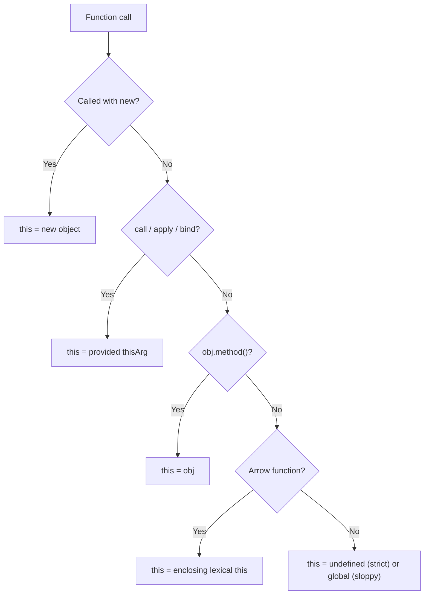
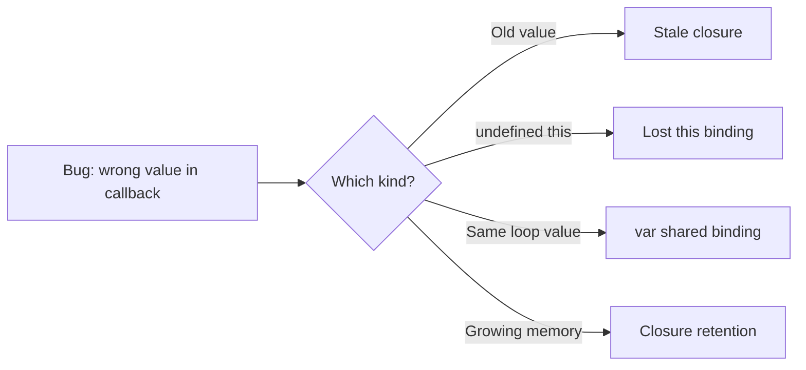

# Functions, Scope, Closures and `this`

> Verification note: Function semantics, lexical scoping, closures, hoisting of declarations, default-parameter scope, `arguments` vs rest parameters, arrow-function `this`, and the `this` binding rules (`new` > explicit `call`/`apply`/`bind` > method call > default) follow the **ECMAScript specification** and **MDN**. Recursion limits (call-stack depth) are **engine-specific and not specified**; **tail-call optimization is in the spec but is not implemented in most engines** (historically Safari/JavaScriptCore only) so it must not be relied on *(hedged)*. This is the **medium tier** of the JavaScript category. The existing, more compact Q&A on execution context, closures, `this`/`call`/`apply`/`bind` (including a custom `bind`) lives in [08, Q1, Q2, Q5, Q6](08-advanced-fundamentals-and-coding.md#1--explain-the-javascript-execution-context-call-stack-lexical-environment-and-scope-chain) and is **kept intact**; this document adds depth, patterns and interview-style questions around it. Debounce/throttle/memoize implementations stay in [dsa-for-fe/05](../dsa-for-fe/05-frontend-specific-coding.md).

## Table of Contents

1. [Quick Summary (TL;DR)](#1-quick-summary-tldr)
2. [Function Forms and When They Differ](#2-function-forms-and-when-they-differ)
3. [Parameters: Defaults, Rest, `arguments`, Destructuring](#3-parameters-defaults-rest-arguments-destructuring)
4. [Scope and the Scope Chain](#4-scope-and-the-scope-chain)
5. [Closures in Depth](#5-closures-in-depth)
6. [`this`: The Complete Rules](#6-this-the-complete-rules)
7. [`call`, `apply`, `bind` and Borrowing Methods](#7-call-apply-bind-and-borrowing-methods)
8. [Higher-Order Functions, Currying, Partial Application and Composition](#8-higher-order-functions-currying-partial-application-and-composition)
9. [Pure Functions, Side Effects and Idempotence](#9-pure-functions-side-effects-and-idempotence)
10. [Recursion, Stack Depth and Trampolines](#10-recursion-stack-depth-and-trampolines)
11. [Closures and `this` in Frontend Code (React, Events, Timers)](#11-closures-and-this-in-frontend-code-react-events-timers)
12. [Output-Prediction Round](#12-output-prediction-round)
13. [Pitfalls](#13-pitfalls)
14. [Interview Questions — Fundamentals](#14-interview-questions--fundamentals)
15. [Interview Questions — Senior Scenarios](#15-interview-questions--senior-scenarios)
16. [Cheat Sheet](#16-cheat-sheet)
17. [Key Terms Glossary](#17-key-terms-glossary)
18. [Further Reading](#18-further-reading)

---

## 1. Quick Summary (TL;DR)

- **Functions are first-class objects:** assignable, passable, returnable, with properties (`name`, `length`).
- **Scope is lexical:** a function's outer environment is fixed where it is **written**, not where it is called. Block scope for `let`/`const`/`class`, function scope for `var`.
- **A closure is a function plus the lexical environment it was created in.** Closures power private state, factories, callbacks with memory, `debounce`, hooks — and cause **stale-closure** bugs and **memory retention**.
- **`this` is decided at call time** (except in arrow functions, which capture it lexically): `new` → explicit binding (`call`/`apply`/`bind`) → method call (`obj.fn()`) → default (`undefined` in strict mode, global object in sloppy mode).
- **Arrow functions** have no own `this`, `arguments`, `super`, `new.target`, and cannot be constructors.
- **Higher-order functions** (take/return functions) are the basis of `map`/`filter`, middleware, decorators, currying and composition.
- **Prefer pure functions** for logic; isolate side effects at the edges. Deep recursion can overflow the stack — iterate or trampoline for unbounded depth.



---

## 2. Function Forms and When They Differ

| Form | Hoisted | Own `this`/`arguments` | `new`-able | Notes |
|---|---|---|---|---|
| **Declaration** `function f() {}` | Yes (name + body) | Yes | Yes | Block-level declarations have legacy quirks |
| **Expression** `const f = function() {}` | Binding hoisted (TDZ for `const`), value not | Yes | Yes | Named expressions can self-reference by name |
| **Arrow** `const f = () => {}` | Like expression | **No** (lexical) | **No** | No `prototype`; concise body returns expression; wrap object literal in parentheses `() => ({})` |
| **Method shorthand** `{ m() {} }` | n/a | Yes | **No** | Has `[[HomeObject]]` so `super` works |
| **Generator** `function* g() {}` | Yes | Yes | No | Returns an iterator ([06](06-modules-iterators-generators-errors-and-text-processing.md)) |
| **Async** `async function f() {}` | Yes | Yes | No | Always returns a promise ([05](05-asynchronous-javascript-event-loop-promises-and-async-await.md)) |
| **Class constructor** | TDZ (like `let`) | Yes | Only with `new` | Calling without `new` throws |
| **IIFE** `(function(){ ... })()` | n/a | Yes | n/a | Creates a scope; mostly replaced by modules/blocks |

```js
hoisted();                      // works
function hoisted() { return 1; }

notHoisted();                   // TypeError: notHoisted is not a function (var) / ReferenceError (let/const)
var notHoisted = function () {};

const obj = { fn() { return this; }, arrow: () => this };   // arrow's this is outer (module/global) this
```

**Function properties:** `fn.name`, `fn.length` (number of parameters before the first default/rest), `fn.toString()`. Functions are objects, so they can hold properties (memoization caches, `displayName`).

**Constructor functions and `new.target`:** a function called with `new` sees `new.target` set; useful for abstract classes and factory-or-constructor patterns ([04](04-prototypes-classes-and-the-object-model.md)).

**Default parameter evaluation:** defaults are evaluated **at call time**, left to right, in their own scope (can reference earlier parameters):

```js
function f(a, b = a * 2, c = () => a + b) { return c(); }
f(1);          // 3
function g(list = []) { list.push(1); return list; }   // new array each call (unlike Python)
```

---

## 3. Parameters: Defaults, Rest, `arguments`, Destructuring

- **Default** applies only when the argument is `undefined` (not `null`, `0`, `''`).
- **Rest parameters** `...args` collect extra arguments into a real array; must be last. Prefer over `arguments` ([02](02-arrays-objects-collections-and-modern-syntax.md#rest)).
- **`arguments`** is an array-like (not an Array); not available in arrow functions; in sloppy mode with simple parameter lists it aliases named parameters; avoid.
- **Destructured parameters** with defaults give a clean "options object" API:

```js
function connect({ host = 'localhost', port = 5432, ssl = false } = {}) { /* ... */ }
connect();                   // all defaults
connect({ port: 6543 });
```

- **Named arguments pattern** = options object; **positional** for 1–2 obvious args.
- **Argument evaluation order** is left-to-right; **function length** ignores rest and defaulted params.
- **Pass-by-sharing** semantics apply to arguments ([01 §10](01-language-fundamentals-types-coercion-and-equality.md#10-values-references-and-pass-by-sharing)).

---

## 4. Scope and the Scope Chain

**Scope types:** global (script top level), **module** (each ES module has its own top-level scope), **function**, **block** (`{}` with `let`/`const`/`class`), **catch clause**, and class **static blocks** (ES2022).

```js
const a = 'global';
function outer() {
  const b = 'outer';
  function inner() {
    const c = 'inner';
    return [a, b, c];       // scope chain: inner -> outer -> global
  }
  return inner();
}
```

**Lexical (static) scoping:** where a function is defined determines which variables it can see — not where it's called.

```js
const x = 'global';
function show() { return x; }
function wrapper() { const x = 'local'; return show(); }
wrapper();   // 'global'  (not 'local')
```

**Shadowing:** an inner declaration hides an outer one of the same name; lint with `no-shadow` where it causes confusion. **TDZ** spans from block start to the declaration.

**`var` vs block:** `var` ignores blocks; hoists to function scope; `let` in `for` creates a per-iteration binding. **`eval` and `with`** dynamically alter scope — avoid; they defeat optimization and are banned in strict mode (`with`).

**Global leakage:** assigning to undeclared names in sloppy mode creates globals; strict mode (and modules) throw. `globalThis` is the portable global reference.

Deeper explanation of execution contexts and the scope chain: [08, Q1](08-advanced-fundamentals-and-coding.md#1--explain-the-javascript-execution-context-call-stack-lexical-environment-and-scope-chain).

---

## 5. Closures in Depth

**Definition:** every function carries a reference to the lexical environment where it was created. When a function outlives its creating scope, variables stay alive as long as the closure is reachable.

```js
function counter() {
  let n = 0;
  return { inc: () => ++n, get: () => n };    // n is private
}
const c = counter(); c.inc(); c.inc(); c.get();  // 2
```

**Use cases**
- **Encapsulation/private state** (module pattern; privacy before `#private`).
- **Function factories / partial application** (`makeAdder(5)`).
- **Callbacks with memory** (debounce timers, once-only guards, memoize caches) — see [dsa-for-fe/05](../dsa-for-fe/05-frontend-specific-coding.md).
- **Event handlers** capturing per-item data; **iterators/generators** state.
- **React hooks**: every render creates new closures capturing that render's props/state.

**Closures in loops**

```js
for (var i = 0; i < 3; i++) setTimeout(() => console.log(i));       // 3 3 3
for (let i = 0; i < 3; i++) setTimeout(() => console.log(i));       // 0 1 2
for (var i = 0; i < 3; i++) ((j) => setTimeout(() => console.log(j)))(i);   // 0 1 2 (IIFE copies value)
```

**Stale closures:** a function captured values from an older scope and keeps using them.

```js
function Counter() {
  const [count, setCount] = useState(0);
  useEffect(() => {
    const id = setInterval(() => setCount(count + 1), 1000);   // captured count is always 0
    return () => clearInterval(id);
  }, []);
}
// Fix: setCount(c => c + 1), refs for latest values, or correct dependencies
```

**Memory:** a closure keeps its environment reachable. Long-lived closures (listeners, timers, caches) can retain large objects; clear timers, remove listeners, narrow captured scope, use `WeakMap`/`WeakRef` where appropriate ([08, Q2 and Q16](08-advanced-fundamentals-and-coding.md#16-explain-memory-management-garbage-collection-retained-references-and-common-causes-of-javascript-memory-leaks)). Engines optimize by capturing only referenced variables in many cases, but **do not rely on it** (a direct `eval` or heavy debugging can change this).

**Closure vs class:** closures give true privacy and are lightweight for single instances; classes share methods via prototype (better for many instances) and support inheritance.

**Pattern: once**
```js
const once = (fn) => { let done = false, result; return (...a) => done ? result : (done = true, result = fn(...a)); };
```

---

## 6. `this`: The Complete Rules

**Precedence (highest first):**
1. **`new Fn()`** → `this` is the newly created object (unless the constructor returns another object).
2. **Explicit binding:** `fn.call(obj)`, `fn.apply(obj)`, or a function created by `fn.bind(obj)` (a bound function's `this` cannot be changed by later `call`).
3. **Method call:** `obj.method()` → `this === obj` (the object **left of the dot at call time**).
4. **Default:** plain call `fn()` → `undefined` in strict mode/modules/classes; `globalThis` in sloppy mode.
5. **Arrow functions:** ignore all of the above; `this` is whatever it was in the enclosing scope when the arrow was created.

```js
const user = {
  name: 'Ada',
  hi() { return this.name; },
  later() { setTimeout(function () { console.log(this?.name); }); },       // undefined (default binding)
  laterArrow() { setTimeout(() => console.log(this.name)); },              // 'Ada'
};
const f = user.hi;
f();                    // undefined / TypeError in strict mode (lost this)
user.hi();              // 'Ada'
(0, user.hi)();         // lost this (comma operator returns the function value)
```

**Where `this` goes missing**
- **Detached methods:** `const { hi } = user; hi()`, passing `obj.method` as a callback.
- **Callbacks** in `setTimeout`, `Array.prototype.map`, promise `.then`.
- **Class methods used as event handlers** (`onClick={this.handle}` loses `this`). Fix: arrow class field, `bind` in constructor, or wrapper arrow.
- **Nested regular functions** inside methods.

**Event handlers (DOM):** with `addEventListener('click', function () { this })`, `this` is the element (`event.currentTarget`); with arrows it's lexical. Inline `onclick` attribute `this` is the element.

**Classes:** class bodies are strict; extracted methods have `this === undefined`. **Class fields** with arrows create per-instance functions capturing `this` (extra memory per instance).

**`this` at top level:** module → `undefined`; classic script → `window`/`globalThis`; Node CJS module → `module.exports`.

**Getters/setters/computed**: `this` is the receiver the property was accessed on (matters with inheritance and `Reflect.get`).

---

## 7. `call`, `apply`, `bind` and Borrowing Methods

| Method | Invokes now | Args | Returns |
|---|---|---|---|
| `fn.call(thisArg, a, b)` | Yes | Comma separated | Result |
| `fn.apply(thisArg, [a, b])` | Yes | Array/array-like | Result |
| `fn.bind(thisArg, a)` | No | Pre-filled (partial) | New bound function |

```js
Math.max.apply(null, [1, 5, 3]);        // 5  (modern: Math.max(...arr))
Array.prototype.slice.call(arguments);  // legacy array-like to array (modern: Array.from / rest)
const bound = fn.bind(ctx, 1);          // bound.name === 'bound fn'; bound.length reduced
new bound();                            // bound this ignored with new
```

- **Method borrowing:** use another object's method on array-likes (`Array.prototype.map.call('abc', ...)`).
- **`bind` is permanent:** `bound.call(other)` still uses the original `thisArg`.
- A **custom `bind`** implementation (with `new` support) is in [08, Q6](08-advanced-fundamentals-and-coding.md#6--explain-this-binding-and-the-differences-between-call-apply-and-bind-implement-a-custom-bind); `call`/`apply` polyfills are in [09](09-coding-challenges-polyfills-and-output-prediction.md).
- **Performance:** spread is generally clearer than `apply`; avoid creating bound functions in hot render paths.

---

## 8. Higher-Order Functions, Currying, Partial Application and Composition

**Higher-order function (HOF):** takes and/or returns functions (`map`, `filter`, `setTimeout`, `addEventListener`, middleware, decorators, React HOCs).

**Partial application vs currying**
- **Partial:** fix some arguments now, supply the rest later (`bind`, `makeAdder`).
- **Currying:** transform `f(a, b, c)` into `f(a)(b)(c)` (one argument at a time).

```js
const curry = (fn) => function curried(...args) {
  return args.length >= fn.length ? fn.apply(this, args) : (...next) => curried.apply(this, [...args, ...next]);
};
const add3 = curry((a, b, c) => a + b + c);
add3(1)(2)(3); add3(1, 2)(3); add3(1)(2, 3);   // 6
```
Currying relies on `fn.length`, which ignores default/rest parameters — a common edge case.

**Composition**
```js
const pipe = (...fns) => (x) => fns.reduce((v, f) => f(v), x);             // left to right
const compose = (...fns) => (x) => fns.reduceRight((v, f) => f(v), x);      // right to left
const slugify = pipe((s) => s.trim(), (s) => s.toLowerCase(), (s) => s.replace(/\s+/g, '-'));
slugify('  Hello World '); // 'hello-world'
```
Async pipe: `fns.reduce((p, f) => p.then(f), Promise.resolve(x))`.

**Other patterns:** `once`, `memoize` ([dsa-for-fe/05](../dsa-for-fe/05-frontend-specific-coding.md#problem-3-memoize)), `debounce/throttle` ([dsa-for-fe/05](../dsa-for-fe/05-frontend-specific-coding.md#problem-1-debounce)), `retry`, `compose` for middleware (Express/Redux style), decorators (stage 3 syntax — support hedged; HOF equivalents are universal), function factories, strategy maps (`const handlers = { add, remove }`).

---

## 9. Pure Functions, Side Effects and Idempotence

- **Pure function:** same inputs → same output; no observable side effects (no mutation of arguments/globals, no I/O, no time/randomness without being passed in). Easier to test, memoize, parallelize, and reason about; foundation for React render functions and reducers ([react/01](../react/01-rendering-model-and-reconciliation.md)).
- **Side effects:** DOM writes, network, storage, logging, timers, mutation of shared state. Push them to boundaries; make them explicit and cancellable.
- **Idempotent operation:** repeating it has the same effect as doing it once (PUT, setting state to a value, `Math.abs`); essential for safe retries ([networking-and-apis/06](../networking-and-apis/06-resilience-retries-timeouts-and-offline.md)).
- **Referential transparency:** an expression can be replaced by its value without changing behavior.
- **Immutability** helps purity: copy-on-write updates ([01 §10](01-language-fundamentals-types-coercion-and-equality.md#10-values-references-and-pass-by-sharing)).

```js
// impure: mutates input and depends on Date.now
function addTimestamp(user) { user.at = Date.now(); return user; }
// pure: returns new object, time injected
const addTimestamp2 = (user, now) => ({ ...user, at: now });
```

---

## 10. Recursion, Stack Depth and Trampolines

- Each call pushes a stack frame; unbounded recursion throws `RangeError: Maximum call stack size exceeded` (limit varies by engine and frame size).
- **Always define a base case**; ensure each call progresses toward it.
- **Memoize** overlapping subproblems (Fibonacci): exponential → linear ([dsa-for-fe/05](../dsa-for-fe/05-frontend-specific-coding.md#problem-3-memoize)).
- **Tail-call optimization** is specified (ES2015) but **not implemented by most engines** *(hedged)*; do not rely on it.
- **Convert deep recursion to iteration** with an explicit stack/queue (DFS/BFS on large trees/DOM), or use a **trampoline**:

```js
const trampoline = (fn) => (...args) => { let r = fn(...args); while (typeof r === 'function') r = r(); return r; };
const sumTo = (n, acc = 0) => n === 0 ? acc : () => sumTo(n - 1, acc + n);
trampoline(sumTo)(100000);   // no stack overflow
```

- **Frontend recursion examples:** deep clone, flatten, tree rendering, DOM traversal (`querySelectorAll` or iterative walkers), JSON traversal, file explorers, comment threads; watch out for **cycles** (use a `WeakSet`/`WeakMap` visited set) ([08, Q8](08-advanced-fundamentals-and-coding.md#8-what-are-shallow-copy-and-deep-copy-how-would-you-implement-a-robust-deep-clone-function)).
- Complexity: state **time and space**, including stack depth.

---

## 11. Closures and `this` in Frontend Code (React, Events, Timers)

- **React function components:** every render is a new closure over that render's props/state; handlers see **that render's values** ("render-time capture"). Use functional updates (`setX(x => x + 1)`), refs for mutable latest values, `useEffectEvent` (React 19.2) for effect-only callbacks, and correct dependency arrays ([react/02](../react/02-hooks-deep-dive.md)).
- **Class components** (legacy): bind handlers or use arrow fields; `this.state` is read at call time (not captured per render), a different mental model than hooks.
- **Event listeners:** keep the same function reference for `removeEventListener`; use `AbortController` signals to remove many listeners at once; avoid capturing big objects ([debugging-scenarios/03 §7](../debugging-scenarios/03-javascript-async-and-data-bugs.md#7-scenario-catalogue-events-timers-and-memory)).
- **Timers:** `setTimeout(fn, ms)` passes no `this`; use arrows; clear on cleanup; stale closures in intervals.
- **Debounced handlers in components:** create once (`useMemo`/`useRef`), otherwise each render makes a new closure with a fresh timer variable and "debounce doesn't work".
- **Memoization and dependency arrays** rely on reference identity of closures ([08, Q9](08-advanced-fundamentals-and-coding.md#9-explain-reference-equality-object-mutation-immutability-and-their-effects-on-react-rendering)).
- **Module-level closures** (singletons, caches) in server code are shared across requests — a leak risk in SSR ([debugging-scenarios/04](../debugging-scenarios/04-react-and-nextjs-debugging-scenarios.md)).

---

## 12. Output-Prediction Round

```js
// 1
var a = 1;
function f() { console.log(a); var a = 2; }
f();                                  // undefined  (local var hoisted, uninitialized value)

// 2
const obj = { v: 1, get: function () { return this.v; } };
const g = obj.get;
console.log(g());                     // undefined (strict: TypeError reading 'v' of undefined)

// 3
const o = { v: 1, get: () => this?.v };
console.log(o.get());                 // undefined (arrow: outer this)

// 4
function Foo() { this.x = 1; return { y: 2 }; }
console.log(new Foo());               // { y: 2 }  (returned object wins)

// 5
const fns = [];
for (var i = 0; i < 3; i++) fns.push(() => i);
console.log(fns.map((f) => f()));     // [3, 3, 3]

// 6
const add = (a) => (b) => a + b;
console.log(add(1)(2));               // 3

// 7
function outer() { let c = 0; return () => ++c; }
const n1 = outer(), n2 = outer();
console.log(n1(), n1(), n2());        // 1 2 1

// 8
console.log((function () { return typeof arguments; })());      // 'object'
console.log((() => { try { return typeof arguments; } catch { return 'err'; } })());
// module/CJS note: arrow sees enclosing arguments (Node CJS wrapper) or throws ReferenceError in modules

// 9
const bound = function () { return this.name; }.bind({ name: 'A' });
console.log(bound.call({ name: 'B' }));   // 'A'

// 10
console.log(typeof f, typeof f.prototype, typeof (() => {}).prototype);  // 'function' 'object' 'undefined'
```

More puzzles (including event-loop ones) in [09](09-coding-challenges-polyfills-and-output-prediction.md) and [08, Q3](08-advanced-fundamentals-and-coding.md#3--explain-the-event-loop-call-stack-microtask-queue-and-macrotask-queue-predict-the-output-of-a-complex-example-involving-promises-and-settimeout).

---

## 13. Pitfalls

1. **Using arrow functions as object methods or constructors** (wrong `this`, not constructible).
2. **Passing methods as callbacks without binding.**
3. **`var` in loops with async callbacks.**
4. **Stale closures** in intervals/effects/handlers.
5. **Leaking large objects** via long-lived closures and listeners.
6. **Relying on `arguments`** in arrows or modern code.
7. **Default parameter objects mutated** (shared references when defaults are module-level constants).
8. **Currying with default/rest params** (`fn.length` surprises).
9. **Recursion without base case or on untrusted deep input.**
10. **Creating debounced/throttled functions inside render.**
11. **Shadowing variables** unintentionally.
12. **Overusing `bind` in hot paths;** creating new functions each render breaking memoization.
13. **Assuming `this` is lexical** in non-arrow functions.
14. **Mutating arguments** in "pure" helpers.
15. **Using `eval`/`with`.**

---

## 14. Interview Questions — Fundamentals

- **What is a closure and why is it useful?** A function with access to its creating lexical environment; enables private state, factories, callbacks with memory.
- **Lexical vs dynamic scope?** JS uses lexical (static) scope; `this` is the dynamic part.
- **How is `this` determined?** `new` → explicit (`call/apply/bind`) → method call → default; arrows are lexical.
- **Arrow vs regular function differences?** `this`, `arguments`, `new`, `prototype`, `super`, hoisting form.
- **Why do loops with `var` and `setTimeout` print the same value?** One shared function-scoped binding; use `let` or an IIFE.
- **`call` vs `apply` vs `bind`?** Invoke with list, invoke with array, return bound function.
- **What is currying vs partial application?** One-arg-at-a-time transformation vs pre-filling some arguments.
- **What is a pure function?** Deterministic, no side effects.
- **What is hoisting?** Declarations processed before execution; functions hoist with body, `var` as `undefined`, `let/const` in TDZ.
- **What is an IIFE and why use it?** Immediately-invoked function expression for scope isolation; largely replaced by modules/blocks.
- **What is a higher-order function?** Takes/returns functions.
- **What is the difference between a function's `length` and `arguments.length`?** Declared parameters (before default/rest) vs actual arguments passed.
- **How can closures cause memory leaks?** Retaining large environments via long-lived references.
- **What does `new` do?** Creates an object linked to `Constructor.prototype`, binds `this`, runs the constructor, returns the object (or the explicit returned object).
- **How do you implement `once`/`compose`/`curry`?** See §5 and §8.

---

## 15. Interview Questions — Senior Scenarios

### S1. "A React effect's interval always shows the initial state value."
Stale closure from an empty dependency array. Fix with functional updates, a ref for the latest value, a reducer, or correct dependencies; consider `useEffectEvent` for effect callbacks; add a test with fake timers ([react/02](../react/02-hooks-deep-dive.md)).

### S2. "`this` is `undefined` inside a class method passed as a callback in a legacy component."
Methods aren't auto-bound; bind in the constructor, use arrow class properties, or wrap at the call site; migrate to function components; add lint rules (`react/jsx-no-bind` trade-offs) and tests for handlers.

### S3. "Memory climbs as users navigate a SPA; heap snapshots show closures retaining detached DOM."
Find listeners/timers/subscriptions not cleaned up and closures capturing DOM nodes; add cleanup, `AbortController`, narrow captured scope, `WeakRef`/`WeakMap` where appropriate; verify with heap snapshot comparison ([debugging-scenarios/02 §6](../debugging-scenarios/02-debugging-toolkit-devtools-node-and-editors.md#6-performance-and-memory-profiling-workflows)).

### S4. "Design a small middleware/plugin pipeline (like Express/Koa/Redux)."
Compose functions of `(ctx, next)`; ensure `next` can only be called once, support async, error handling, ordering; implement `compose(middlewares)` returning a dispatcher; test ordering and error propagation ([09](09-coding-challenges-polyfills-and-output-prediction.md)).

### S5. "Why does our debounced search fire for every keystroke inside a component?"
The debounced wrapper is recreated on each render, losing its timer closure; create it once with `useMemo`/`useRef`/`useCallback` (stable deps) or a library hook, and cancel on unmount.

### S6. "Explain closures vs classes for encapsulation in a UI library."
Closures give hard privacy and simple factories but allocate per-instance methods; classes share prototype methods, support `instanceof`, inheritance and tooling; `#private` fields give privacy in classes. Choose by instance count, API ergonomics, debuggability and team conventions ([04](04-prototypes-classes-and-the-object-model.md)).

---

## 16. Cheat Sheet

| Topic | Rule |
|---|---|
| Scope | Lexical; block for `let/const`, function for `var` |
| Closure | Function + creation environment; watch stale values and retention |
| `this` | new > call/apply/bind > obj.method() > default; arrow = lexical |
| Lost `this` | Detached methods, callbacks, event handlers |
| `bind` | Permanent `this` + partial args |
| Currying | `fn.length` driven; breaks with defaults/rest |
| Composition | `pipe` L→R, `compose` R→L |
| Purity | No mutation, no I/O, inject time/random |
| Recursion | Base case, stack limits, memoize, iterate/trampoline |
| React | Render-time capture; functional updates; stable callbacks |



---

## 17. Key Terms Glossary

| Term | Meaning |
|---|---|
| **Closure** | Function plus its creation-time lexical environment |
| **Lexical scope** | Scope determined by where code is written |
| **Scope chain** | Outward lookup path through lexical environments |
| **TDZ** | Period before `let/const` initialization |
| **HOF** | Higher-order function |
| **Currying** | Converting a multi-arg function into unary steps |
| **Partial application** | Pre-filling arguments |
| **Composition** | Combining functions so output feeds input |
| **Pure function** | Deterministic, side-effect-free function |
| **Idempotent** | Repeating has same effect as once |
| **Trampoline** | Loop that executes returned thunks to avoid stack growth |
| **Stale closure** | Closure using outdated captured values |

---

## 18. Further Reading

- [MDN: Closures](https://developer.mozilla.org/en-US/docs/Web/JavaScript/Guide/Closures) · [MDN: this](https://developer.mozilla.org/en-US/docs/Web/JavaScript/Reference/Operators/this) · [MDN: Functions](https://developer.mozilla.org/en-US/docs/Web/JavaScript/Guide/Functions) · [MDN: Arrow functions](https://developer.mozilla.org/en-US/docs/Web/JavaScript/Reference/Functions/Arrow_functions) · [MDN: Function.prototype.bind](https://developer.mozilla.org/en-US/docs/Web/JavaScript/Reference/Global_Objects/Function/bind) *(hedged: confirm URLs)*
- **This repo:** [01 Fundamentals](01-language-fundamentals-types-coercion-and-equality.md) · [04 Object model](04-prototypes-classes-and-the-object-model.md) · [dsa-for-fe/05 Frontend-specific coding](../dsa-for-fe/05-frontend-specific-coding.md) · [08 Advanced Q&A](08-advanced-fundamentals-and-coding.md) · [09 Coding challenges](09-coding-challenges-polyfills-and-output-prediction.md) · [react/02](../react/02-hooks-deep-dive.md) · [browser-internals/04](../browser-internals/04-javascript-engine-event-loop-and-memory.md)
