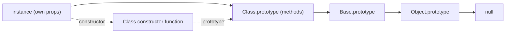
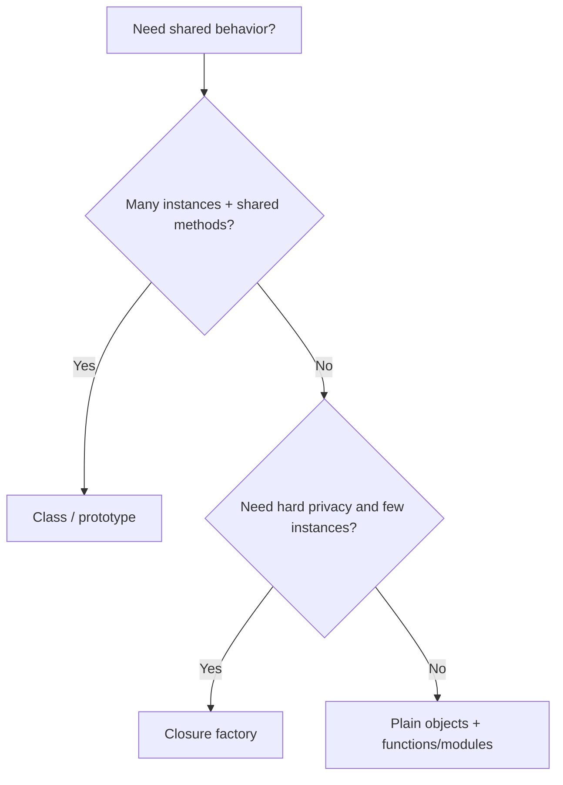

# Prototypes, Classes and the Object Model

> Verification note: Object semantics (property descriptors, own vs inherited properties, `[[Prototype]]`, `new`, `instanceof`, `Object.create`), ES2015 classes (`extends`, `super`, `static`), **ES2022 class features** (public/private fields, private methods, `#x in obj` brand checks, static blocks) and **`Object.hasOwn` (ES2022)**, `Proxy`/`Reflect`, well-known `Symbol`s, and `WeakMap`/`WeakRef` follow the **ECMAScript specification** and **MDN**; edition attribution was cross-checked against the **TC39 finished-proposals** list (fetched 2026-11-26). **Decorators** and **Explicit Resource Management (`using`)** are mentioned only as emerging features (the latter is listed as finished for **ES2027**); **runtime support and tooling configuration must be confirmed on MDN/caniuse and your build tool before use** *(hedged)*. This is the **medium tier** of the JavaScript category. Existing compact Q&A on prototypes, classes-as-sugar, `Symbol`, `WeakMap`, and freezing is kept in [08, Q7, Q15, Q17](08-advanced-fundamentals-and-coding.md#7-explain-prototypal-inheritance-the-prototype-chain-and-how-javascript-classes-work-internally); this document goes deeper and adds practice questions.

## Table of Contents

1. [Quick Summary (TL;DR)](#1-quick-summary-tldr)
2. [Objects, Properties and Descriptors](#2-objects-properties-and-descriptors)
3. [The Prototype Chain](#3-the-prototype-chain)
4. [Constructor Functions and `new`](#4-constructor-functions-and-new)
5. [Classes (ES2015 to ES2022)](#5-classes-es2015-to-es2022)
6. [Inheritance, Composition and Mixins](#6-inheritance-composition-and-mixins)
7. [Accessors, `toString`, `toJSON` and Customizing Conversion](#7-accessors-tostring-tojson-and-customizing-conversion)
8. [Symbols and Well-Known Protocols](#8-symbols-and-well-known-protocols)
9. [`Proxy` and `Reflect`](#9-proxy-and-reflect)
10. [Weak References and Memory-Friendly Metadata](#10-weak-references-and-memory-friendly-metadata)
11. [Object Model in Frontend Practice](#11-object-model-in-frontend-practice)
12. [Output-Prediction Round](#12-output-prediction-round)
13. [Pitfalls](#13-pitfalls)
14. [Interview Questions — Fundamentals](#14-interview-questions--fundamentals)
15. [Interview Questions — Senior Scenarios](#15-interview-questions--senior-scenarios)
16. [Cheat Sheet](#16-cheat-sheet)
17. [Key Terms Glossary](#17-key-terms-glossary)
18. [Further Reading](#18-further-reading)

---

## 1. Quick Summary (TL;DR)

- **JavaScript objects are dynamic bags of properties** with an internal `[[Prototype]]` link; inheritance is **delegation along the prototype chain**, not copying.
- **Property lookup** walks the chain until found or `null`; **writes** create/overwrite on the object itself (shadowing), except for inherited setters or non-writable properties.
- **`class` is syntax over prototypes and constructor functions**, with added semantics (TDZ, strict mode, non-enumerable methods, private `#fields`, `super`, must use `new`).
- **Own vs inherited:** `Object.keys/entries/values` and `JSON.stringify` see **own enumerable** properties; `for...in` includes inherited enumerable string keys; use `Object.hasOwn(obj, key)` for own checks.
- **Property descriptors** (`value`, `writable`, `enumerable`, `configurable`, or `get`/`set`) control behavior; `Object.freeze/seal/preventExtensions` are shallow.
- **Prefer composition** and small functions/modules; use inheritance for genuine "is-a" relationships and framework extension points.
- **`Proxy`/`Reflect`** enable interception (validation, reactivity, logging) at a performance and debuggability cost.
- **Symbols** add unique keys and protocol hooks (`Symbol.iterator`, `Symbol.toPrimitive`, `Symbol.hasInstance`).



---

## 2. Objects, Properties and Descriptors

**Literal features:** shorthand (`{ a, b }`), computed keys (`{ [k]: v }`), method shorthand, getters/setters, spread (`{ ...a, ...b }`, shallow, own enumerable), `__proto__` in literals (legacy).

**Keys:** strings and symbols; numbers are converted to strings; integer-like keys iterate first in ascending order ([02](02-arrays-objects-collections-and-modern-syntax.md#objectkeys--objectvalues--objectentries)).

**Property descriptors**

| Attribute | Default via assignment | Default via `defineProperty` | Meaning |
|---|---|---|---|
| `value` | assigned | `undefined` | Data value |
| `writable` | `true` | `false` | Can reassign |
| `enumerable` | `true` | `false` | Shows in `for...in`, `Object.keys`, spread |
| `configurable` | `true` | `false` | Can delete/redefine |
| `get` / `set` | — | — | Accessor property (instead of value/writable) |

```js
const o = {};
Object.defineProperty(o, 'id', { value: 1, enumerable: false });   // writable/configurable false
o.id = 2;              // ignored (TypeError in strict mode)
Object.keys(o);        // []
Object.getOwnPropertyDescriptor(o, 'id');  // { value: 1, writable: false, enumerable: false, configurable: false }
Object.getOwnPropertyDescriptors(o);       // all descriptors (use to copy accessors correctly)
```

**Integrity levels (shallow):** `preventExtensions` < `seal` < `freeze`; check with `Object.isFrozen/isSealed/isExtensible`. Table and deep-freeze example: [08, Q17](08-advanced-fundamentals-and-coding.md#17-what-are-objectfreeze-objectseal-and-objectpreventextensions-are-they-deep-operations).

**Useful statics:** `Object.assign` (shallow, triggers setters on target, copies own enumerable), `Object.entries/fromEntries`, `Object.getOwnPropertyNames` (includes non-enumerable strings), `Object.getOwnPropertySymbols`, `Reflect.ownKeys` (all own keys), `Object.groupBy` (ES2024; returns a null-prototype object), `structuredClone` (deep clone for supported types).

**Own checks:** `Object.hasOwn(o, k)` (ES2022) replaces `o.hasOwnProperty(k)` (which can be shadowed or absent on null-prototype objects). `k in o` includes inherited properties.

**Null-prototype objects** (`Object.create(null)`) are safe dictionaries with no inherited keys (`toString`, `__proto__`) — avoids prototype pollution and key collisions.

**Prototype pollution (security):** merging untrusted JSON into objects via recursive merge can set `__proto__`/`constructor.prototype` and alter all objects; mitigate with safe merge utilities, `Object.create(null)`, key allow-lists, `structuredClone`/schema validation, and Node's `--disable-proto` option where appropriate ([web-security/08](../web-security/08-secure-frontend-patterns-and-vulnerability-catalogue.md)).

---

## 3. The Prototype Chain

- Every object has `[[Prototype]]` (access via `Object.getPrototypeOf(o)` / `Object.setPrototypeOf(o, p)`; `__proto__` is a legacy accessor). Functions also have a `.prototype` property used when they are called with `new`.
- **Lookup:** `o.x` → own property → `Object.getPrototypeOf(o).x` → … → `null` (then `undefined`).
- **Writes:** `o.x = v` creates/updates an **own** property (shadowing the inherited one) unless an inherited **setter** exists or an inherited property is **non-writable** (in strict mode a TypeError).
- **Methods defined on prototypes are shared**; per-instance data belongs on instances.

```js
const animal = { speak() { return `${this.name} makes a sound`; } };
const dog = Object.create(animal, { name: { value: 'Rex', enumerable: true } });
dog.speak();                        // 'Rex makes a sound'
Object.getPrototypeOf(dog) === animal;   // true
animal.isPrototypeOf(dog);               // true
'speak' in dog;                          // true
Object.hasOwn(dog, 'speak');             // false
```

**Chain for arrays and functions:** `[] → Array.prototype → Object.prototype → null`; `function → Function.prototype → Object.prototype`. Date, RegExp, Map etc. have similar chains.

**`instanceof`:** `x instanceof C` is true if `C.prototype` is in x's chain (customizable via `C[Symbol.hasInstance]`). **Cross-realm** objects (iframes) fail `instanceof` checks; use `Array.isArray` or brand checks.

**Changing prototypes after creation** (`setPrototypeOf`) is allowed but deoptimizes engines; prefer `Object.create` or classes at creation time. **Never monkey-patch built-in prototypes** in app code (collision/"SmooshGate"-style risks; polyfills only when feature-detected).

**Performance note:** engines optimize objects with stable "shapes" (hidden classes); adding/removing properties in varying orders, deleting properties, or mixing types in the same property can defeat optimizations (see [browser-internals/04](../browser-internals/04-javascript-engine-event-loop-and-memory.md)).

---

## 4. Constructor Functions and `new`

**`new Fn(...args)` does:**
1. Creates a new object whose `[[Prototype]]` is `Fn.prototype`.
2. Calls `Fn` with `this` = that object.
3. Returns the object — **unless** the constructor returns another **object**, in which case that object is returned (primitives returned are ignored).

```js
function Person(name) {
  if (!new.target) return new Person(name);   // safe to call without new
  this.name = name;
}
Person.prototype.greet = function () { return `Hi, ${this.name}`; };
const p = new Person('Ada');
p.constructor === Person;                      // true (inherited from Person.prototype.constructor)
```

**Classic inheritance with functions**
```js
function Student(name, school) { Person.call(this, name); this.school = school; }
Student.prototype = Object.create(Person.prototype);
Student.prototype.constructor = Student;
```

A **minimal `new`** polyfill and `instanceof` implementation are in [09](09-coding-challenges-polyfills-and-output-prediction.md).

---

## 5. Classes (ES2015 to ES2022)

```js
class Counter {
  static #instances = 0;           // private static
  #count = 0;                      // private instance field (ES2022)
  label = 'counter';               // public field (per instance)
  static { Counter.#instances = 0; }   // static initialization block (ES2022)

  constructor(start = 0) { this.#count = start; Counter.#instances++; }
  get value() { return this.#count; }
  set value(v) { if (v < 0) throw new RangeError('negative'); this.#count = v; }
  inc() { this.#count++; return this; }
  #validate() { /* private method */ }
  static get instances() { return Counter.#instances; }
  static isCounter(o) { return #count in o; }   // ergonomic brand check (ES2022)
}
```

**Key facts**
- Class declarations are **hoisted but in the TDZ**; class bodies are **strict mode**; constructors **require `new`**.
- Methods are on `Class.prototype` and **non-enumerable**; **fields** are own properties created per instance (so arrow-function fields allocate a function per instance).
- **Private members (`#x`)** are truly private (not accessible via `obj['#x']`, not visible to `Object.keys`, `JSON.stringify`, or Proxies); access from outside throws `SyntaxError` at parse time; subclasses cannot access parent's privates; `#x in obj` tests brand.
- **`extends`**: sets `Derived.prototype.__proto__ = Base.prototype` and `Derived.__proto__ = Base` (static inheritance). In a derived constructor you **must call `super()` before using `this`**.
- **`super.method()`** calls the parent's method; `super` works in object-literal methods too.
- **`new.target`** supports abstract-class patterns: `if (new.target === Shape) throw new TypeError('abstract')`.
- **Static members** belong to the constructor; **static blocks** run once at class definition.
- **Accessors** `get`/`set` live on the prototype; **computed method names** and **generators** `*[Symbol.iterator]()` supported.
- **Class expressions** can be named/anonymous and used in mixins.
- **Extending built-ins** (`class MyArray extends Array`, `extends Error`) works; set `name` and use `Error` `cause` (ES2022) — `new Error('msg', { cause })`. Transpiled targets may have quirks.

**Classes vs prototypes**

| Aspect | Prototype/constructor | `class` |
|---|---|---|
| Syntax | Verbose | Concise |
| Strict mode / TDZ / must use `new` | No | Yes |
| Methods enumerable | Yes (assignment) | No |
| Private data | Closures/WeakMap | `#private` |
| Inheritance setup | Manual | `extends`/`super` |
| Underlying mechanism | Prototypes | Same |

**Decorators:** a language feature in progress (standardized form differs from the older TypeScript experimental decorators); tooling support varies *(hedged)* — equivalent behavior is available via higher-order functions/wrapping.

---

## 6. Inheritance, Composition and Mixins

**Problems with deep inheritance:** tight coupling, fragile base class, hard-to-test hierarchies, "gorilla/banana" problem. Prefer **composition over inheritance** where behavior is mixed or optional.

```js
// Composition with factories
const canFly = (state) => ({ fly: () => `${state.name} flies` });
const canSwim = (state) => ({ swim: () => `${state.name} swims` });
const makeDuck = (name) => { const s = { name }; return { ...canFly(s), ...canSwim(s) }; };

// Mixin with class expressions
const Serializable = (Base) => class extends Base { toJSON() { return { ...this }; } };
class User { constructor(n) { this.name = n; } }
class SerializableUser extends Serializable(User) {}
```

**Delegation (OLOO):** `Object.create(proto)` objects delegating to shared behavior.

**When to use what**
- **Classes:** many instances sharing methods; framework contracts (custom elements extend `HTMLElement` — [browser-internals/07](../browser-internals/07-events-dom-apis-and-web-components.md)); error hierarchies.
- **Factories/closures:** few instances, true privacy, simple configuration.
- **Plain objects + functions/modules:** most frontend business logic; easiest to test and tree-shake.
- **React:** function components and hooks replaced class inheritance; error boundaries are the main remaining class use ([react/01](../react/01-rendering-model-and-reconciliation.md)).

**Error subclasses**
```js
class HttpError extends Error {
  constructor(status, message, options) { super(message, options); this.name = 'HttpError'; this.status = status; }
}
try { throw new HttpError(404, 'Not found', { cause: new Error('upstream') }); }
catch (e) { e instanceof HttpError; e.cause; }
```

---

## 7. Accessors, `toString`, `toJSON` and Customizing Conversion

- **Getters/setters** compute or validate properties; they're **inherited** and can be non-enumerable on classes. Avoid expensive getters; avoid side effects.
- **`toString()`/`valueOf()`/`Symbol.toPrimitive`** customize coercion ([01 §6](01-language-fundamentals-types-coercion-and-equality.md#6-type-coercion-how-and-why)).
- **`toJSON()`** controls `JSON.stringify` output (used by `Date`); `Map`/`Set` serialize as `{}` unless converted ([06](06-modules-iterators-generators-errors-and-text-processing.md)).
- **`Symbol.toStringTag`** customizes `Object.prototype.toString.call(x)` (`'[object MyThing]'`).
- **`Object.prototype.toString.call`** is a reliable built-in type tag.

---

## 8. Symbols and Well-Known Protocols

- `Symbol('desc')` is unique; `Symbol.for('key')` uses the global registry; symbols can be WeakMap keys (non-registered, ES2023).
- **Well-known symbols** let objects hook into language behavior:

| Symbol | Hook |
|---|---|
| `Symbol.iterator` | `for...of`, spread, destructuring ([06](06-modules-iterators-generators-errors-and-text-processing.md)) |
| `Symbol.asyncIterator` | `for await...of` |
| `Symbol.toPrimitive` | Coercion |
| `Symbol.hasInstance` | `instanceof` |
| `Symbol.toStringTag` | `Object.prototype.toString` |
| `Symbol.species` | Constructor for derived arrays/promises |
| `Symbol.isConcatSpreadable`, `Symbol.match` etc. | Builtin protocol customization |

- Symbol keys are skipped by `Object.keys`, `for...in`, `JSON.stringify`; use `Object.getOwnPropertySymbols`/`Reflect.ownKeys`.
- **Uses:** collision-free metadata keys, "private-ish" properties (not truly private), protocol implementation, enum-like constants.

---

## 9. `Proxy` and `Reflect`

`new Proxy(target, handler)` intercepts operations via **traps**: `get`, `set`, `has`, `deleteProperty`, `ownKeys`, `getOwnPropertyDescriptor`, `defineProperty`, `apply`, `construct`, `getPrototypeOf`, etc. `Reflect` provides default behaviors with matching signatures.

```js
const validator = {
  set(target, key, value, receiver) {
    if (key === 'age' && !Number.isInteger(value)) throw new TypeError('age must be an integer');
    return Reflect.set(target, key, value, receiver);
  },
  get(target, key, receiver) { return key in target ? Reflect.get(target, key, receiver) : `missing:${String(key)}`; },
};
const person = new Proxy({}, validator);
person.age = 30;      // ok
person.age = 'x';     // TypeError
```

**Use cases:** validation, default values, logging/tracing, access control, **reactivity systems** (Vue 3 uses Proxy; immer uses proxies for draft state), API clients (dynamic methods), test doubles/spies, observable stores.

**Caveats:** performance overhead; identity (`proxy !== target`); internal slots (`Map`, `Date` methods on a proxy need bound `this`); private fields don't pass through proxies; invariants enforced for non-configurable properties; debugging is harder; can't polyfill fully in old browsers.

**Revocable proxies:** `Proxy.revocable`. **Reflect** also gives consistent function forms (`Reflect.has`, `Reflect.ownKeys`, `Reflect.apply`).

---

## 10. Weak References and Memory-Friendly Metadata

- **`WeakMap`/`WeakSet`:** hold keys weakly; not iterable; keys must be objects (or non-registered symbols, ES2023). Use for private data tied to object lifetime and caches keyed by objects ([08, Q15–16](08-advanced-fundamentals-and-coding.md#15-what-are-generators-iterators-symbols-and-weak-collections-where-are-they-useful)).
- **`WeakRef`/`FinalizationRegistry`** (ES2021): weak pointers and finalization callbacks; non-deterministic and engine-dependent; **avoid for correctness logic**; use sparingly for caches *(hedged: behavior varies)*.
- **Memory leaks** with Maps used as caches or listeners keyed by DOM nodes: use `WeakMap` or explicit cleanup.

---

## 11. Object Model in Frontend Practice

- **DOM and Web APIs are objects with prototype chains** (`HTMLButtonElement → HTMLElement → Element → Node → EventTarget → Object`); custom elements extend `HTMLElement` with classes.
- **React:** props/state objects are plain; immutability and reference equality drive re-renders ([08, Q9](08-advanced-fundamentals-and-coding.md#9-explain-reference-equality-object-mutation-immutability-and-their-effects-on-react-rendering)); class components extend `React.Component` (legacy); error boundaries require a class.
- **State libraries** (Immer proxies, MobX, Valtio, Vue reactive) rely on `Proxy`; Redux requires plain serializable objects.
- **Serialization boundaries:** class instances lose prototypes through `JSON.stringify`/`structuredClone`/`postMessage`; revive or use plain data/DTOs (and schema validation) ([debugging-scenarios/03 §8](../debugging-scenarios/03-javascript-async-and-data-bugs.md#8-scenario-catalogue-strings-regex-json-and-serialization)).
- **TypeScript** layers structural typing over this dynamic model; `private` (TS keyword) is compile-time only, `#private` is runtime-enforced ([typescript/01](../typescript/01-type-system-fundamentals.md)).
- **Security:** prototype pollution in merge utilities and `Object.assign`-style config loading; avoid `__proto__`/`constructor` keys from untrusted JSON.
- **Performance:** keep object shapes consistent in hot paths; avoid `delete`; use Maps for dynamic key sets; prefer arrays of consistent element types.

---

## 12. Output-Prediction Round

```js
function A() {} A.prototype.x = 1;
const a = new A();
a.x = 2; delete a.x;
console.log(a.x);                      // 1  (own property removed, inherited visible again)

class B { static s = 1; i = 2; m() {} }
console.log(Object.keys(new B()));     // ['i']   (methods not enumerable)
console.log(typeof B, B.prototype.m === new B().m);   // 'function' true

const o = Object.create({ inherited: 1 });
o.own = 2;
for (const k in o) console.log(k);     // 'own', 'inherited'
console.log(Object.keys(o));           // ['own']
console.log(JSON.stringify(o));        // '{"own":2}'

class P { #secret = 1; static has(o) { return #secret in o; } }
console.log(P.has(new P()), P.has({})); // true false

console.log([] instanceof Object, Object.create(null) instanceof Object);  // true false

const target = {}; const p = new Proxy(target, { get: () => 42 });
console.log(p.anything, 'anything' in p);   // 42 false

class C { constructor() { this.a = 1; } }
class D extends C { constructor() { this.b = 2; super(); } }   // ReferenceError: must call super before this
```

More in [09](09-coding-challenges-polyfills-and-output-prediction.md).

---

## 13. Pitfalls

1. **Confusing `.prototype` (property of functions) with `[[Prototype]]`** (the link on every object).
2. **Putting mutable data on prototypes** (shared across instances).
3. **Arrow functions as methods needing `this`;** class-field arrows allocate per instance.
4. **Forgetting `super()` before `this`** in derived constructors.
5. **Using `for...in` on arrays/objects with inherited properties.**
6. **`obj.hasOwnProperty(k)` on null-prototype or shadowed objects** — use `Object.hasOwn`.
7. **Shallow `Object.assign`/spread assumed to clone deeply.**
8. **Prototype pollution** from unsafe deep merge of untrusted data.
9. **Monkey-patching built-ins** or `__proto__` mutation in app code.
10. **Class instances through JSON/`structuredClone`/`postMessage`** losing methods.
11. **Overusing inheritance;** deep hierarchies.
12. **Relying on `WeakRef`/finalizers** for correctness.
13. **`Proxy` pitfalls** with built-in internal slots and identity.
14. **`instanceof` across realms/bundles** (duplicate package copies) — use brand checks or duck typing.
15. **Extending `Error`/`Array` in older transpile targets** without verifying prototype fixes.

---

## 14. Interview Questions — Fundamentals

- **Explain the prototype chain.** Objects delegate missing property lookups along `[[Prototype]]` links until `null`.
- **`__proto__` vs `prototype`?** `[[Prototype]]` (via `__proto__`/`getPrototypeOf`) is an object's link; `prototype` is a function property used as the link target for instances created by `new`.
- **What does `new` do?** Create object with prototype link, bind `this`, run constructor, return object.
- **How do classes work internally?** Constructor function + prototype methods + strictness/TDZ/privates; `extends` links prototypes.
- **How do you create an object with no prototype?** `Object.create(null)`.
- **Own vs inherited properties?** `Object.hasOwn` vs `in`; `Object.keys` own enumerable only.
- **What are property descriptors?** Attributes controlling value/accessors, writability, enumerability, configurability.
- **`Object.freeze` vs `const`?** Immutable properties (shallow) vs non-reassignable binding.
- **What are private fields and how differ from TS `private`?** `#x` enforced at runtime; TS `private` is compile-time only.
- **What is a mixin?** A function adding behavior to a class/object (class factory or object assignment).
- **What are Symbols for?** Unique keys and protocol hooks.
- **What is a Proxy used for?** Intercepting operations — validation, reactivity, logging.
- **`instanceof` limitations?** Realm boundaries, can be customized, doesn't work with primitives or null-prototype objects.
- **When prefer composition over inheritance?** When behaviors vary independently or hierarchy would be deep/brittle.
- **How does `super` work?** Refers to parent prototype/constructor; required before `this` in derived constructors.
- **What is prototype pollution?** Injecting properties into `Object.prototype` via unsafe property assignment/merge.

---

## 15. Interview Questions — Senior Scenarios

### S1. "A deep-merge helper for config caused all objects to gain a property in production."
Prototype pollution via `__proto__`/`constructor.prototype` keys in untrusted JSON. Patch the merge to skip dangerous keys or use safe libraries, validate with schemas, use `Object.create(null)` for dictionaries, add tests with polluted payloads, and scan dependencies ([web-security/08](../web-security/08-secure-frontend-patterns-and-vulnerability-catalogue.md)).

### S2. "Design a lightweight reactive store without a library."
Use a `Proxy` (or getters/setters) to track reads/writes, a subscriber registry (`WeakMap` from target → deps), batching via microtasks, and immutable snapshots for React (`useSyncExternalStore`); discuss pitfalls (identity, nested objects, Map/Set, performance) and alternatives (explicit `set`/signals) ([react/06](../react/06-state-management-and-data-fetching.md)).

### S3. "`instanceof` fails for objects from a library in our micro-frontend setup."
Duplicate copies of the library/class from separate bundles (different constructor identity) or cross-realm objects. Dedupe via shared dependency/peer config, use brand checks (`Symbol.for` tag or `#x in obj` for same-realm), or duck-type interfaces ([frontend-architecture/06](../frontend-architecture/06-micro-frontends-and-composition.md)).

### S4. "Choose between class-based services and function modules for an API client."
Functions/modules are simpler, tree-shakeable and easy to mock; classes help when holding configuration/state with many methods and when polymorphism (interfaces) matters; avoid inheritance; inject dependencies; keep instances serializable boundaries clear ([networking-and-apis/07](../networking-and-apis/07-api-client-architecture-and-contracts.md)).

### S5. "A class instance sent via `postMessage` lost its methods."
Structured clone copies data but not prototypes; send plain DTOs and rehydrate on the receiving side (factory `fromJSON`), or share code via modules; validate payloads at the boundary.

### S6. "How would you implement private state before and after `#private` fields?"
Closures/factory functions or `WeakMap` per-instance data before; `#private` fields now (runtime enforced, brand checks, no reflection/proxy passthrough). Discuss trade-offs: per-instance memory, debugging visibility, test access, serialization.

---

## 16. Cheat Sheet

| Topic | Remember |
|---|---|
| Chain | instance → Class.prototype → Base.prototype → Object.prototype → null |
| `new` | create, link, run, return (object return overrides) |
| Class | prototype sugar + TDZ + strict + privates + `super` |
| Own check | `Object.hasOwn(o, k)` |
| Keys | `Object.keys` own enumerable; `for...in` includes inherited |
| Freeze | Shallow; `const` ≠ immutable |
| Private | `#x` runtime private; TS `private` compile-time |
| Proxy | Intercept with traps; identity and internal-slot caveats |
| Symbol | Unique keys + protocols |
| Weak | `WeakMap` for metadata; avoid `WeakRef` for logic |
| Prefer | Composition; plain objects/functions in most UI logic |



---

## 17. Key Terms Glossary

| Term | Meaning |
|---|---|
| **`[[Prototype]]`** | Internal link for property delegation |
| **`.prototype`** | Function property used as prototype for `new` instances |
| **Own property** | Defined directly on the object |
| **Descriptor** | Attribute set controlling a property |
| **Shadowing** | Own property hiding an inherited one |
| **Mixin** | Reusable behavior composed into a class/object |
| **Brand check** | Testing for a private-field brand (`#x in o`) |
| **Proxy trap** | Handler intercepting an object operation |
| **Well-known symbol** | Built-in symbol hooking language protocols |
| **Prototype pollution** | Maliciously modifying `Object.prototype` |
| **Null-prototype object** | Object without inherited properties |
| **Realm** | Separate global environment (iframe, worker) |

---

## 18. Further Reading

- [MDN: Inheritance and the prototype chain](https://developer.mozilla.org/en-US/docs/Web/JavaScript/Guide/Inheritance_and_the_prototype_chain) · [MDN: Classes](https://developer.mozilla.org/en-US/docs/Web/JavaScript/Reference/Classes) · [MDN: Private elements](https://developer.mozilla.org/en-US/docs/Web/JavaScript/Reference/Classes/Private_elements) · [MDN: Proxy](https://developer.mozilla.org/en-US/docs/Web/JavaScript/Reference/Global_Objects/Proxy) · [MDN: Object.defineProperty](https://developer.mozilla.org/en-US/docs/Web/JavaScript/Reference/Global_Objects/Object/defineProperty) · [MDN: Symbol](https://developer.mozilla.org/en-US/docs/Web/JavaScript/Reference/Global_Objects/Symbol) *(hedged: confirm URLs)*
- **This repo:** [01 Fundamentals](01-language-fundamentals-types-coercion-and-equality.md) · [03 Functions and `this`](03-functions-scope-closures-and-this.md) · [06 Iterators and errors](06-modules-iterators-generators-errors-and-text-processing.md) · [08 Advanced Q&A](08-advanced-fundamentals-and-coding.md) · [09 Coding challenges](09-coding-challenges-polyfills-and-output-prediction.md) · [browser-internals/07](../browser-internals/07-events-dom-apis-and-web-components.md) · [typescript/01](../typescript/01-type-system-fundamentals.md)
