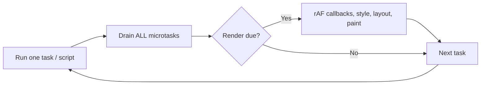
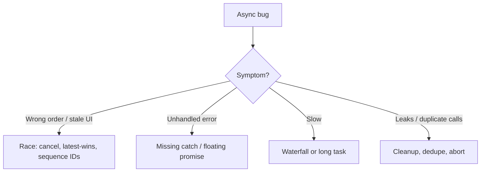

# Asynchronous JavaScript: Event Loop, Promises and async/await

> Verification note: The event-loop model (call stack, task/macrotask queue, microtask queue, rendering opportunity, `requestAnimationFrame`), Promise semantics (states, chaining, `then`/`catch`/`finally`, combinators `all`/`allSettled`/`race`/`any`), `async`/`await`, `AbortController`/`AbortSignal`, and the Node.js loop phases (`process.nextTick` before promise microtasks, `setImmediate` in the check phase) follow the **HTML Standard, ECMAScript, Node.js docs and MDN**; the browser-side event-loop and long-task material was verified in earlier categories ([browser-internals/04](../browser-internals/04-javascript-engine-event-loop-and-memory.md), [web-performance/04](../web-performance/04-javascript-main-thread-and-inp.md)). **`Promise.withResolvers` (ES2024)** and **`Promise.try` (ES2025)** and **`Array.fromAsync` (listed for ES2026)** were cross-checked against the **TC39 finished-proposals** list (fetched 2026-11-26). **Runtime availability of these newer APIs, `AbortSignal.any`, `scheduler.yield`/`scheduler.postTask`, async iteration of streams, `SharedArrayBuffer` requirements and timer-throttling thresholds vary by browser/Node version and must be confirmed on MDN/caniuse** *(hedged)*. This is the **medium-to-advanced tier** of the JavaScript category. The existing worked event-loop trace, timing comparison, `Promise.all` implementation, concurrency limiter, async/await error propagation and race-condition debugging Q&A remain in [08, Q3, Q4, Q12–14, Q20](08-advanced-fundamentals-and-coding.md#3--explain-the-event-loop-call-stack-microtask-queue-and-macrotask-queue-predict-the-output-of-a-complex-example-involving-promises-and-settimeout) and are linked, not duplicated.

## Table of Contents

1. [Quick Summary (TL;DR)](#1-quick-summary-tldr)
2. [The Concurrency Model: One Thread, Many Queues](#2-the-concurrency-model-one-thread-many-queues)
3. [Event Loop in Browsers vs Node.js](#3-event-loop-in-browsers-vs-nodejs)
4. [Callbacks and Their Problems](#4-callbacks-and-their-problems)
5. [Promises in Depth](#5-promises-in-depth)
6. [Promise Combinators and Modern Helpers](#6-promise-combinators-and-modern-helpers)
7. [async/await in Depth](#7-asyncawait-in-depth)
8. [Cancellation, Timeouts and AbortController](#8-cancellation-timeouts-and-abortcontroller)
9. [Common Async Patterns](#9-common-async-patterns)
10. [Async Iteration, Streams and Workers](#10-async-iteration-streams-and-workers)
11. [Timers, Scheduling and Keeping the UI Responsive](#11-timers-scheduling-and-keeping-the-ui-responsive)
12. [Async Errors and Debugging](#12-async-errors-and-debugging)
13. [Output-Prediction Round](#13-output-prediction-round)
14. [Pitfalls](#14-pitfalls)
15. [Interview Questions — Fundamentals](#15-interview-questions--fundamentals)
16. [Interview Questions — Senior Scenarios](#16-interview-questions--senior-scenarios)
17. [Cheat Sheet](#17-cheat-sheet)
18. [Key Terms Glossary](#18-key-terms-glossary)
19. [Further Reading](#19-further-reading)

---

## 1. Quick Summary (TL;DR)

- **JavaScript runs your code on one thread per realm;** "async" means *scheduling work for later* via queues, not parallel execution of JS (parallelism comes from the browser/OS, workers and I/O).
- **Event loop turn:** run one **task** → drain **all microtasks** (promise reactions, `queueMicrotask`) → maybe render (`requestAnimationFrame`, style/layout/paint) → next task.
- **Promises** represent a future value: *pending → fulfilled | rejected* (settled once). `.then` handlers always run **asynchronously as microtasks**; chains flatten returned promises; errors skip to the next `.catch`.
- **`async` functions return promises;** `await` suspends the function and resumes in a microtask. Independent work must be started **together** (`Promise.all`) to run concurrently.
- **Combinators:** `all` (fail fast), `allSettled` (never rejects), `race` (first to settle), `any` (first to fulfill; `AggregateError` if all reject).
- **`fetch` rejects only on network failure/abort — not on HTTP 4xx/5xx.** Check `response.ok`.
- **Cancellation is cooperative:** use `AbortController`/`AbortSignal`; `Promise.race` with a timeout does not stop the underlying work.
- **Race conditions** are ordering bugs: latest-wins guards, cancellation, idempotency, and single-flight caches.



---

## 2. The Concurrency Model: One Thread, Many Queues

| Piece | Role |
|---|---|
| **Call stack** | Synchronous execution of the current function chain |
| **Heap** | Object storage |
| **Task (macrotask) queues** | Timers, DOM events, message events, network callbacks, `MessageChannel`; browser may prioritize queues (input over timers) |
| **Microtask queue** | Promise reactions, `queueMicrotask`, `MutationObserver` callbacks; drained fully after each task and after callbacks when the stack empties |
| **Rendering steps** | `requestAnimationFrame` callbacks, style/layout/paint — at most once per frame, after microtasks, when the browser decides to render |
| **Web APIs / host** | Timers, fetch, DOM events, workers, I/O — work happens outside the JS thread and posts a task when complete |

**Consequences**
- A **long synchronous task blocks** everything: rendering, input handling, timers (jank, poor INP — [web-performance/04](../web-performance/04-javascript-main-thread-and-inp.md)).
- **Microtasks run before the next task and before rendering** — a microtask loop (`promise.then` re-queuing itself) can **starve rendering and events**.
- **`setTimeout(fn, 0)` is not immediate:** it queues a task after current work and microtasks (and is clamped by nesting/background rules).
- **JS is run-to-completion:** within a task nothing else interleaves — except at `await`/callback boundaries.

Worked traces are in [08, Q3 and Q4](08-advanced-fundamentals-and-coding.md#4--what-is-the-difference-between-promisethen-queuemicrotask-settimeout-and-requestanimationframe).

---

## 3. Event Loop in Browsers vs Node.js

| Aspect | Browser | Node.js |
|---|---|---|
| Spec | HTML Standard event loop | libuv loop + Node scheduling |
| Task sources | Timers, UI/input, network, `postMessage`, … (multiple queues) | Phases: **timers → pending callbacks → idle/prepare → poll (I/O) → check (`setImmediate`) → close callbacks** |
| Microtasks | After each task; promise jobs, `queueMicrotask` | After each phase callback; **`process.nextTick` queue runs before promise microtasks** |
| Rendering | Yes (rAF, layout, paint) | No |
| Timer clamping | Nested timers clamped (~4 ms after nesting), background tabs throttled *(hedged thresholds)* | `setTimeout` min 1 ms |
| Extras | `requestIdleCallback`, `scheduler.postTask/yield` (support varies) | `setImmediate`, `process.nextTick`, worker threads |

**Node ordering classic:**
```js
setTimeout(() => console.log('timeout'), 0);
setImmediate(() => console.log('immediate'));
process.nextTick(() => console.log('nextTick'));
Promise.resolve().then(() => console.log('promise'));
// CommonJS main script: nextTick, promise, then timeout/immediate (the order of the last two can vary from the main module;
// inside an I/O callback, immediate always runs first). In an ES module, promise microtasks run before nextTick.
```

**Rule of thumb:** `nextTick` > promise microtasks > timers/immediate. Overusing `nextTick` can starve I/O.

---

## 4. Callbacks and Their Problems

**Callback:** a function passed to be invoked later. Node convention: **error-first** `(err, data)`.

```js
fs.readFile(path, (err, data) => { if (err) return handle(err); use(data); });
```

**Problems:** *inversion of control* (you trust a third party to call your callback once, on time, with proper errors), *callback hell* (nested pyramids), scattered error handling, hard cancellation and composition.

**Promisify:**
```js
const promisify = (fn) => (...args) => new Promise((resolve, reject) =>
  fn(...args, (err, result) => (err ? reject(err) : resolve(result))));
```
Node ships `util.promisify` and promise-based APIs (`fs/promises`). Events (many occurrences) are not a good fit for promises (one settlement) — use event emitters, observables, or async iterators.

**Zalgo:** an API sometimes sync, sometimes async callback invocation; make it consistently async (`queueMicrotask`) ([debugging-scenarios/03 §3](../debugging-scenarios/03-javascript-async-and-data-bugs.md#3-scenario-catalogue-async-promises-and-races)).

---

## 5. Promises in Depth

**States:** *pending* → *fulfilled* (value) or *rejected* (reason); immutable once settled. The executor runs **synchronously**; `resolve`/`reject` calls after the first are ignored.

**`then(onFulfilled, onRejected)` returns a new promise:**
- Handler **returns a value** → next promise fulfills with it.
- Handler **returns a promise/thenable** → next promise **adopts its state** (flattening).
- Handler **throws** → next promise rejects.
- No handler for that outcome → passes the value/reason through.

```js
Promise.resolve(1)
  .then((x) => x + 1)                 // 2
  .then((x) => { throw new Error('boom'); })
  .then(() => console.log('skipped'))
  .catch((e) => 'recovered')          // returns 'recovered'
  .finally(() => console.log('cleanup'))   // no value passed; passes through result
  .then(console.log);                 // 'recovered'
```

**Rules worth memorizing**
- **Always `return` the promise** inside `.then` chains (forgetting it detaches the chain: errors lost, ordering broken).
- `catch(fn)` ≡ `then(undefined, fn)`; `.then(a, b)` does **not** catch errors thrown by `a`; `.then(a).catch(b)` does.
- `finally` runs on both outcomes, receives no argument, doesn't change the result unless it throws/rejects.
- **Thenables** (objects with `then`) are assimilated by `Promise.resolve`.
- **Microtask timing:** `Promise.resolve().then(cb)` runs `cb` as a microtask even though the promise is already resolved; multiple `.then`s on one promise run in registration order.
- **Executor anti-pattern:** wrapping an existing promise in `new Promise(...)` ("explicit construction anti-pattern") and `new Promise(async (res) => ...)` (swallowed throws).
- **Unhandled rejections:** rejection with no handler by the time microtasks drain triggers `unhandledrejection` (browser, `window.addEventListener`) / `process.on('unhandledRejection')` (Node ≥15 terminates by default). Always handle or report.

**Promise "lazy vs eager":** a promise starts its work when **created**; to defer work, wrap in a function (thunk) — important for concurrency limiters ([08, Q13](08-advanced-fundamentals-and-coding.md#13-how-would-you-limit-concurrency-when-executing-100-asynchronous-api-requests)).

---

## 6. Promise Combinators and Modern Helpers

| API | Resolves when | Rejects when | Result | Use |
|---|---|---|---|---|
| `Promise.all([...])` | All fulfill | **First** rejection | Array of values (input order) | Need all results; fail fast |
| `Promise.allSettled([...])` | All settle | Never | `[{status:'fulfilled',value}\|{status:'rejected',reason}]` | Partial results acceptable |
| `Promise.race([...])` | First settles (either) | First settles with rejection | First outcome | Timeouts (with abort), first response |
| `Promise.any([...])` | First **fulfills** | All reject → `AggregateError` | First value | Redundant sources/mirrors |
| `Promise.resolve(x)` / `Promise.reject(e)` | — | — | Wrap values | Normalization |
| **`Promise.withResolvers()`** (ES2024) | — | — | `{ promise, resolve, reject }` | Externalize resolution without executor boilerplate |
| **`Promise.try(fn, ...args)`** (ES2025) | — | — | Runs `fn` synchronously, returns promise capturing sync throws and results | Uniform sync/async error handling |

```js
const { promise, resolve } = Promise.withResolvers();
button.addEventListener('click', () => resolve('clicked'), { once: true });
await promise;

await Promise.try(() => maybeSyncOrAsync());   // sync throws become rejections
```

**Implementations** of `Promise.all` and a concurrency limiter: [08, Q12–13](08-advanced-fundamentals-and-coding.md#12-implement-promiseall-how-should-it-behave-when-one-promise-rejects). More (`race`, `allSettled`, `any`, `retry`) in [09](09-coding-challenges-polyfills-and-output-prediction.md).

**`Array.fromAsync`** (ES2026-listed): builds an array from async iterables/array-likes of promises *(support: confirm)*.

---

## 7. async/await in Depth

- `async function` always returns a promise; returned values are wrapped, thrown errors reject.
- `await x` = `Promise.resolve(x).then(continue)` — the function **pauses** and resumes in a **microtask**; non-promise values still yield one microtask turn.
- **Errors:** `try/catch` around `await` catches rejections; without it, the returned promise rejects.

```js
async function load(id) {
  try {
    const res = await fetch(`/api/items/${id}`);
    if (!res.ok) throw new Error(`HTTP ${res.status}`);     // fetch doesn't reject on 404/500
    return await res.json();
  } catch (e) {
    report(e);
    throw e;                                                // rethrow if caller must decide
  }
}
```

**`return await` vs `return`:** inside `try/catch`, `return promise` does **not** let the local `catch` handle its rejection; `return await promise` does. Outside try/catch they're equivalent (minor stack-trace/perf differences).

**Sequential vs parallel**
```js
// Sequential (total = a + b)
const a = await fetchA(); const b = await fetchB();
// Parallel (total = max(a, b))
const [a2, b2] = await Promise.all([fetchA(), fetchB()]);
// Start now, await later (single point of error handling matters)
const pa = fetchA(); const pb = fetchB(); const ra = await pa; const rb = await pb;   // beware unhandled rejection if pb rejects before await
```
Prefer `Promise.all`/`allSettled` to attach handlers immediately.

**Loops**
```js
for (const id of ids) await process(id);                       // sequential, ordered
await Promise.all(ids.map(process));                           // parallel (all at once)
ids.forEach(async (id) => await process(id));                  // BUG: not awaited, errors unhandled
for await (const chunk of stream) { /* async iteration */ }
```

**Top-level `await`** (ES2022, modules only) blocks dependents' evaluation of the module graph; use for init sparingly ([06](06-modules-iterators-generators-errors-and-text-processing.md)).

**Event handlers:** `async` handlers return promises that the event system ignores — handle errors inside; React event handlers don't await returned promises.

**`await` in `Array` callbacks:** `map` returns array of promises (wrap with `Promise.all`); `filter(async...)` always truthy (promises) — a classic bug; `reduce` with async accumulators requires care.

**Cost:** each `await` adds microtask turns; avoid awaiting in tight loops when batching is possible.

---

## 8. Cancellation, Timeouts and AbortController

Promises cannot be cancelled; **operations** can be told to stop.

```js
const controller = new AbortController();
const res = await fetch(url, { signal: controller.signal });
controller.abort();                                   // fetch rejects with DOMException name 'AbortError'

fetch(url, { signal: AbortSignal.timeout(5000) });    // aborts with TimeoutError after 5 s
fetch(url, { signal: AbortSignal.any([userSignal, AbortSignal.timeout(5000)]) });   // combine (support: confirm)
```

- **Listen for abort in your own async code:** `signal.addEventListener('abort', cleanup, { once: true })`, `signal.throwIfAborted()`, `signal.aborted`, `signal.reason`.
- **Remove many listeners at once:** `addEventListener(type, fn, { signal })`.
- **Timeout with `Promise.race`** only *races*; the loser continues unless aborted:
```js
const timeout = (ms) => new Promise((_, rej) => setTimeout(() => rej(new Error('timeout')), ms));
await Promise.race([fetch(url), timeout(3000)]);       // fetch still running → also pass a signal
```
- **Latest-wins pattern:** abort the previous controller before starting a new request (search-as-you-type); also guard stale responses ([08, Q20](08-advanced-fundamentals-and-coding.md#20-how-would-you-debug-a-race-condition-involving-multiple-asynchronous-operations)).
- **React effects:** create the controller in the effect; abort in cleanup; ignore `AbortError`.

---

## 9. Common Async Patterns

| Pattern | Sketch / idea |
|---|---|
| **sleep/delay** | `const sleep = (ms) => new Promise((r) => setTimeout(r, ms));` |
| **Retry with backoff + jitter** | Retry idempotent calls; delay = `min(cap, base * 2**attempt) * random(0.5–1)`; respect `Retry-After`; abort support ([networking-and-apis/06](../networking-and-apis/06-resilience-retries-timeouts-and-offline.md)) |
| **Timeout** | `AbortSignal.timeout` + handle `TimeoutError` |
| **Polling** | Loop with `sleep`, stop on condition/abort, back off, pause when hidden (`visibilitychange`) |
| **Concurrency limit / pool** | Worker loop over shared index ([08, Q13](08-advanced-fundamentals-and-coding.md#13-how-would-you-limit-concurrency-when-executing-100-asynchronous-api-requests)) |
| **In-flight request dedupe (single-flight)** | `Map<key, Promise>`; return the same promise; delete on settle |
| **Memoize promises** | Cache the promise, not the value (avoids duplicate requests); evict on failure |
| **Debounced async** | Debounce trigger + cancel previous in-flight |
| **Queue/serial executor** | Chain tasks: `tail = tail.then(task, task)` |
| **Mutex / semaphore** | Promise-based lock with release in `finally` |
| **Batching** | Collect calls in a microtask/timeout window, issue one request (DataLoader-style) |
| **Lazy init** | `let p; const get = () => (p ??= init());` |
| **Parallel with error collection** | `allSettled` then partition results |
| **Pipeline/compose async** | `reduce((p, f) => p.then(f), Promise.resolve(x))` |
| **Event → promise** | `once(target, 'load')`; `Promise.withResolvers` |
| **Token refresh single-flight** | Share one refresh promise among concurrent 401s ([debugging-scenarios/06 §4](../debugging-scenarios/06-network-api-auth-and-caching-scenarios.md#4-cookies-sessions-and-authentication-scenarios)) |

```js
// single-flight + cache-the-promise
const inflight = new Map();
function getUser(id) {
  if (!inflight.has(id)) {
    inflight.set(id, fetchUser(id).finally(() => inflight.delete(id)));
  }
  return inflight.get(id);
}
```

---

## 10. Async Iteration, Streams and Workers

- **Async iterators/generators:** `async function*` yields values over time; consume with `for await...of`. Good for paginated APIs, streaming responses, event streams ([06](06-modules-iterators-generators-errors-and-text-processing.md)).
- **Streams API:** `response.body` is a `ReadableStream`; read with `getReader()` or async iteration where supported *(hedged)*; supports backpressure; used for large downloads, progressive rendering/SSR streaming ([nextjs-and-rendering/05](../nextjs-and-rendering/05-streaming-ppr-and-instant-navigation.md)).
- **Web Workers:** true parallelism for CPU-heavy work; communicate via `postMessage` (structured clone; use **Transferables** for large buffers); no DOM access. **SharedArrayBuffer/Atomics** require cross-origin isolation in browsers *(hedged: confirm headers/support)* ([browser-internals/04](../browser-internals/04-javascript-engine-event-loop-and-memory.md)).
- **Worker pools** and libraries (Comlink) simplify RPC; consider `OffscreenCanvas` for rendering off-thread.
- **Service workers:** event-driven proxies for network/cache/push ([browser-internals/05](../browser-internals/05-browser-storage-and-caching-apis.md)).
- **When to move work off-thread:** parsing big JSON, image/video processing, crypto, search indexing, diffing; not for tiny tasks (message overhead).

---

## 11. Timers, Scheduling and Keeping the UI Responsive

- **`setTimeout`/`setInterval`:** minimum delays, nesting clamps and **background-tab throttling** *(hedged thresholds)*; intervals can drift/overlap — prefer recursive `setTimeout` or timestamps.
- **`requestAnimationFrame`:** run visual updates before the next paint; paused in hidden tabs.
- **`requestIdleCallback`:** low-priority work during idle (limited support; not in Safari historically *(hedged)*).
- **`queueMicrotask`:** run after current script but before next task (use sparingly).
- **`scheduler.postTask` / `scheduler.yield()`** (Prioritized Task Scheduling; support varies *(hedged)*); fallback: `await new Promise(r => setTimeout(r))` or `MessageChannel`.
- **Chunking long work:**
```js
async function processAll(items) {
  let last = performance.now();
  for (const item of items) {
    work(item);
    if (performance.now() - last > 8) { await new Promise((r) => setTimeout(r)); last = performance.now(); }
  }
}
```
- **Long tasks (> 50 ms)** hurt interaction latency; break up, defer, or offload to workers ([web-performance/04](../web-performance/04-javascript-main-thread-and-inp.md)).
- **Microtask starvation:** infinite promise chains/`queueMicrotask` loops block rendering and input.

---

## 12. Async Errors and Debugging

- **Where errors go:** sync throw in `async` fn → rejection; in a callback after `await` → in the async function's `try/catch`; in a plain callback (timer/event) → global `error` event, **not** your `try/catch`; in a floating promise → `unhandledrejection`.
- **Global reporting:** `window.addEventListener('unhandledrejection', ...)` and `'error'`; error boundaries (React) don't catch async/event errors.
- **Error `cause`:** `new Error('load failed', { cause: err })` preserves context (ES2022).
- **`AggregateError`:** from `Promise.any`; `errors` array.
- **Debugging:** DevTools async stack traces, "pause on caught exceptions", logpoints, network panel timing; add request IDs and sequence logs for races ([debugging-scenarios/02](../debugging-scenarios/02-debugging-toolkit-devtools-node-and-editors.md), [debugging-scenarios/03 §3](../debugging-scenarios/03-javascript-async-and-data-bugs.md#3-scenario-catalogue-async-promises-and-races)).
- **Testing async code:** use fake timers for time, controlled promises (`withResolvers`) for ordering, `await expect(...).rejects`, avoid arbitrary sleeps ([testing/02](../testing/02-unit-testing-and-test-doubles.md)).
- **Idempotency & retries:** design operations safe to retry; use idempotency keys for non-idempotent POSTs.

---

## 13. Output-Prediction Round

```js
// 1
console.log(1);
setTimeout(() => console.log(2), 0);
Promise.resolve().then(() => console.log(3));
console.log(4);
// 1 4 3 2

// 2
async function a() { console.log('a1'); await b(); console.log('a2'); }
async function b() { console.log('b'); }
console.log('s'); a(); console.log('e');
// s a1 b e a2

// 3
Promise.reject(new Error('x'))
  .then(() => console.log('then'))
  .catch(() => console.log('catch'))
  .then(() => console.log('after'));
// catch after

// 4
new Promise((res) => { console.log('executor'); res(); }).then(() => console.log('then'));
console.log('sync');
// executor sync then

// 5
Promise.resolve(1).then(2).then((v) => console.log(v));   // 1  (non-function .then arg is ignored)

// 6
const p = Promise.resolve();
(async () => { await p; console.log('A'); })();
p.then(() => console.log('B'));
// A B  (registered in order; both microtasks)

// 7
setTimeout(() => console.log('t1'), 0);
setTimeout(() => console.log('t2'), 0);
Promise.resolve().then(() => { console.log('m1'); setTimeout(() => console.log('t3'), 0); });
// m1 t1 t2 t3

// 8
console.log(await Promise.allSettled([Promise.reject(1), 2]));
// [{status:'rejected',reason:1},{status:'fulfilled',value:2}]

// 9
(async () => {
  try { return Promise.reject(new Error('e')); } catch { console.log('caught'); }
})().catch(() => console.log('outer'));
// outer  (return without await bypasses local catch)
```

More, including bigger event-loop mixes: [08, Q3](08-advanced-fundamentals-and-coding.md#3--explain-the-event-loop-call-stack-microtask-queue-and-macrotask-queue-predict-the-output-of-a-complex-example-involving-promises-and-settimeout) and [09](09-coding-challenges-polyfills-and-output-prediction.md).

---

## 14. Pitfalls

1. **`forEach(async ...)`** — not awaited; use `for...of` or `Promise.all(map)`.
2. **Forgetting to `return`** promises in `.then` chains.
3. **Awaiting independent calls sequentially** (slow waterfalls).
4. **Assuming `fetch` rejects on HTTP errors.**
5. **`Promise.all` fail-fast hiding other results/errors;** use `allSettled` when appropriate.
6. **Treating `Promise.race` timeouts as cancellation.**
7. **Unhandled rejections** and swallowed errors in empty `catch`.
8. **Race conditions:** stale responses, double submits, effects without cleanup.
9. **Creating promises eagerly** when you meant to defer (concurrency limiters).
10. **`new Promise(async ...)`** anti-pattern; wrapping promise-returning APIs needlessly.
11. **Long synchronous tasks and microtask loops** starving UI.
12. **Overusing `setInterval`** (overlapping async work; no backoff).
13. **Using `await` in `filter`/`some` callbacks.**
14. **Errors thrown in timers/events** not caught by outer `try/catch`.
15. **Top-level `await`** blocking module graph/startup; circular dependencies with TLA.
16. **Non-idempotent retries** causing duplicate side effects.

---

## 15. Interview Questions — Fundamentals

- **Explain the event loop.** Stack runs a task; microtasks drain; browser may render; next task.
- **Microtask vs macrotask?** Promise jobs/`queueMicrotask` vs timers/events/messages; microtasks first and fully.
- **What are the states of a promise?** Pending, fulfilled, rejected (settled once).
- **What does `.then` return?** A new promise adopting returned value/promise/throw.
- **Difference between `.then(a, b)` and `.then(a).catch(b)`?** The latter also catches errors thrown by `a`.
- **`Promise.all` vs `allSettled` vs `race` vs `any`?** See §6.
- **How does `async/await` relate to promises?** Syntax over promises; `await` resumes in a microtask.
- **Does `fetch` reject on 404?** No; check `response.ok`.
- **How do you run requests in parallel?** `Promise.all([...])` (start before awaiting).
- **How do you cancel a request?** `AbortController`/`AbortSignal`.
- **What is a race condition in frontend async code?** Outcome depends on completion order; fix with cancellation/latest-wins.
- **What is `process.nextTick`?** Node queue that runs before promise microtasks.
- **What happens on unhandled rejection?** `unhandledrejection` event / Node process termination (by default in modern versions).
- **What are Web Workers for?** CPU-heavy work off the main thread.
- **`setTimeout(fn, 0)` vs `Promise.resolve().then(fn)`?** Next task vs current microtask checkpoint.
- **What is `Promise.withResolvers`?** Returns promise plus resolve/reject functions (ES2024).

---

## 16. Interview Questions — Senior Scenarios

### S1. "Search-as-you-type shows stale results sometimes."
Cancel the previous request with `AbortController`, ignore stale responses with request IDs, debounce input, use a query library keyed by input; test with delayed mock responses ([debugging-scenarios/03 §9.1](../debugging-scenarios/03-javascript-async-and-data-bugs.md#91-stale-search-results-overwrite-newer-ones), [system-design/03](../system-design/03-autocomplete-and-typeahead-search.md)).

### S2. "Design a robust `fetchJSON` utility for a large app."
Timeout via `AbortSignal.timeout`, merge caller signals, check `ok`, parse content-type safely, typed errors with `cause`, retry only idempotent requests with backoff + jitter, dedupe in-flight GETs, auth refresh single-flight, request IDs and tracing headers, schema validation ([networking-and-apis/02](../networking-and-apis/02-fetch-api-and-browser-networking.md), [networking-and-apis/07](../networking-and-apis/07-api-client-architecture-and-contracts.md)).

### S3. "The page janks while processing a 50 MB JSON/CSV."
Profile for long tasks; stream/parse incrementally, chunk work with yielding, move parsing to a worker with transferable buffers, virtualize rendering, show progress; measure INP before/after ([web-performance/04](../web-performance/04-javascript-main-thread-and-inp.md)).

### S4. "Implement a task scheduler with priorities, concurrency limits and cancellation."
Priority queue of thunks, worker loop respecting limit, per-task `AbortSignal`, error isolation, backpressure, metrics; consider `scheduler.postTask` where available; unit test ordering with fake timers ([09](09-coding-challenges-polyfills-and-output-prediction.md)).

### S5. "A Node SSR endpoint sometimes returns empty data under load."
Look for missing `await`, shared mutable module state across requests, timeouts not aborting upstream calls, unhandled rejections, event loop lag; add request-scoped context, concurrency limits, timeouts and structured logging ([debugging-scenarios/04](../debugging-scenarios/04-react-and-nextjs-debugging-scenarios.md)).

### S6. "Explain why this `await` in a loop is slow and how to fix it safely."
Sequential awaits create waterfalls; use `Promise.all` with a **concurrency limit** to avoid overloading servers/browsers (6 connections per origin on HTTP/1.1, HTTP/2 multiplexing differences), handle partial failures (`allSettled`), preserve ordering if needed, and add retries/backoff.

---

## 17. Cheat Sheet

| Need | Use |
|---|---|
| Run after current script | `Promise.then` / `queueMicrotask` |
| Run next task | `setTimeout(fn)` / `MessageChannel` |
| Before paint | `requestAnimationFrame` |
| All results or fail | `Promise.all` |
| Partial results | `Promise.allSettled` |
| First success | `Promise.any` |
| Timeout + cancel | `AbortSignal.timeout` |
| Latest-wins | Abort previous + ignore stale |
| Sequential | `for...of` + `await` |
| Parallel | `Promise.all(map)` (limit concurrency!) |
| Expose resolve | `Promise.withResolvers` |
| Off-thread CPU | Web Worker |
| Retry | Backoff + jitter + idempotency |



---

## 18. Key Terms Glossary

| Term | Meaning |
|---|---|
| **Event loop** | Scheduler running tasks, microtasks and rendering |
| **Task / macrotask** | Unit of work from a task queue (timer, event, message) |
| **Microtask** | Promise job or `queueMicrotask` callback run after the current task |
| **Promise** | Object representing eventual completion/failure |
| **Thenable** | Object with a `then` method |
| **Settle** | Become fulfilled or rejected |
| **`AbortController`** | API to signal cancellation |
| **Single-flight** | Sharing one in-flight operation among callers |
| **Backpressure** | Slowing producers when consumers can't keep up |
| **Long task** | Main-thread task > 50 ms |
| **Idempotent** | Safe to repeat |
| **Structured clone** | Algorithm used by `postMessage`/`structuredClone` |

---

## 19. Further Reading

- [MDN: Using promises](https://developer.mozilla.org/en-US/docs/Web/JavaScript/Guide/Using_promises) · [MDN: async function](https://developer.mozilla.org/en-US/docs/Web/JavaScript/Reference/Statements/async_function) · [MDN: AbortController](https://developer.mozilla.org/en-US/docs/Web/API/AbortController) · [MDN: Microtask guide](https://developer.mozilla.org/en-US/docs/Web/API/HTML_DOM_API/Microtask_guide) · [HTML Standard: Event loops](https://html.spec.whatwg.org/multipage/webappapis.html#event-loops) · [Node.js: The Node.js Event Loop](https://nodejs.org/en/learn/asynchronous-work/event-loop-timers-and-nexttick) *(hedged: confirm URLs)*
- **This repo:** [03 Functions and closures](03-functions-scope-closures-and-this.md) · [06 Iterators and errors](06-modules-iterators-generators-errors-and-text-processing.md) · [08 Advanced Q&A (Q3, Q4, Q12–14, Q20)](08-advanced-fundamentals-and-coding.md) · [09 Coding challenges](09-coding-challenges-polyfills-and-output-prediction.md) · [browser-internals/04](../browser-internals/04-javascript-engine-event-loop-and-memory.md) · [web-performance/04](../web-performance/04-javascript-main-thread-and-inp.md) · [debugging-scenarios/03](../debugging-scenarios/03-javascript-async-and-data-bugs.md)
