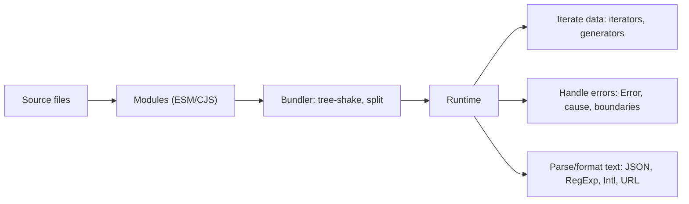
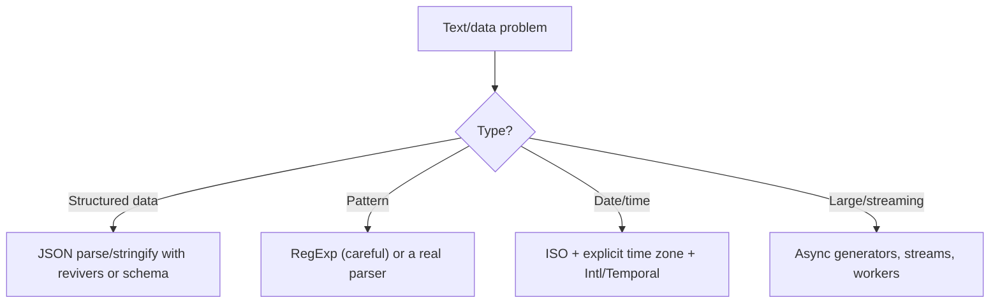

# Modules, Iterators, Errors and Text Processing (JSON, RegExp, Dates, Intl)

> Verification note: ES module semantics (static `import`/`export`, live bindings, strict-by-default, module scope, top-level `await`, dynamic `import()`, `import.meta`), CommonJS interop, the iterator/iterable protocols, generators and async generators, `Error` types with **`cause` (ES2022)** and `AggregateError`, `JSON` serialization rules, `RegExp` flags/features and `Intl` APIs follow the **ECMAScript specification**, **Node.js docs** and **MDN**. Edition attribution was cross-checked against the **TC39 finished-proposals** list (fetched 2026-11-26): **import attributes / JSON modules (ES2025)**, **sync Iterator helpers (ES2025)**, **RegExp `v` flag (ES2024)**, **RegExp modifiers, duplicate named capture groups, `RegExp.escape` (ES2025)**, **`Error.isError` and `Iterator` sequencing (ES2026)**, and **Temporal and Explicit Resource Management (ES2027)**. **Runtime support (browsers, Node versions, bundler/transpiler behavior, Node's `require(esm)` rules) differs and must be confirmed on MDN/caniuse/Node docs before use** *(hedged)*. This is the **medium tier** of the JavaScript category. Dates/time-zone pitfalls in production are also covered in [debugging-scenarios/03 §4](../debugging-scenarios/03-javascript-async-and-data-bugs.md#4-scenario-catalogue-types-numbers-and-dates); module build/tooling debugging in [debugging-scenarios/08](../debugging-scenarios/08-build-tooling-typescript-dependency-and-ci-debugging.md).

## Table of Contents

1. [Quick Summary (TL;DR)](#1-quick-summary-tldr)
2. [ES Modules vs CommonJS](#2-es-modules-vs-commonjs)
3. [Module Patterns: Exports, Barrels, Dynamic Import, Cycles](#3-module-patterns-exports-barrels-dynamic-import-cycles)
4. [Iterators and Iterables](#4-iterators-and-iterables)
5. [Generators and Async Generators](#5-generators-and-async-generators)
6. [Errors and Exception Handling](#6-errors-and-exception-handling)
7. [JSON: Serialization Rules and Pitfalls](#7-json-serialization-rules-and-pitfalls)
8. [Regular Expressions](#8-regular-expressions)
9. [Dates, Time Zones and `Intl`](#9-dates-time-zones-and-intl)
10. [URLs, Encoding and Binary Data](#10-urls-encoding-and-binary-data)
11. [Output-Prediction Round](#11-output-prediction-round)
12. [Pitfalls](#12-pitfalls)
13. [Interview Questions — Fundamentals](#13-interview-questions--fundamentals)
14. [Interview Questions — Senior Scenarios](#14-interview-questions--senior-scenarios)
15. [Cheat Sheet](#15-cheat-sheet)
16. [Key Terms Glossary](#16-key-terms-glossary)
17. [Further Reading](#17-further-reading)

---

## 1. Quick Summary (TL;DR)

- **ES modules** are static (analyzable → tree-shaking), strict, singleton-per-URL, expose **live bindings**, and support top-level `await` and dynamic `import()`. **CommonJS** is dynamic, synchronous, and exports a value copy via `module.exports`.
- **Barrel files** (`index.ts` re-exports) can hurt tree-shaking, circular imports and dev-server speed; prefer direct imports in hot paths.
- **Iterables** implement `[Symbol.iterator]()` returning an iterator with `next()`; **generators** are the easy way to write them (lazy, pausable); **async generators** + `for await` handle streams.
- **Errors:** throw `Error` objects (not strings), preserve context with `cause`, never swallow silently; `try/catch` doesn't catch async errors outside `await`.
- **`JSON.stringify` drops `undefined`/functions/symbols, converts `NaN`/`Infinity` to `null`, flattens `Date` via `toJSON`, throws on `BigInt` and cycles, and turns `Map`/`Set` into `{}`.**
- **RegExp:** global/sticky regexes are **stateful (`lastIndex`)**; beware catastrophic backtracking; prefer `matchAll`, named groups, `u`/`v` flags for Unicode.
- **Dates:** `Date` is a UTC timestamp wrapper with local-time getters; months are 0-based; parse only ISO 8601; use `Intl.DateTimeFormat` with explicit `timeZone`; **Temporal** is the modern replacement (finished for ES2027; shipping status hedged).



---

## 2. ES Modules vs CommonJS

| Feature | ES Modules (ESM) | CommonJS (CJS) |
|---|---|---|
| Syntax | `import`/`export` | `require()`/`module.exports` |
| Loading | Static analysis, async graph loading | Dynamic, synchronous |
| Bindings | **Live read-only bindings** | Value copies at require time (object references shared) |
| Strict mode | Always | Opt-in |
| Top-level `this` | `undefined` | `module.exports` |
| `__dirname`/`__filename`/`require` | Not available (use `import.meta.url`, `import.meta.dirname/filename` in newer Node, `createRequire`) | Available |
| Top-level `await` | Yes | No |
| Tree-shaking | Yes (static) | Hard |
| File extension in Node | `.mjs` or `"type": "module"` | `.cjs` or default |
| Specifiers | Must include extension and exact path in Node ESM | Extensionless resolution |
| Cycles | Supported via live bindings (TDZ pitfalls) | Partially-populated exports object |
| In browsers | `<script type="module">` (deferred, CORS) | Needs bundler |

**Interop (Node/bundlers):** ESM can `import` CJS (default = `module.exports`); CJS can `import()` ESM (async) and, in newer Node versions, `require()` synchronous ESM without top-level await *(hedged: confirm Node line/flags)*; `esModuleInterop`/`allowSyntheticDefaultImports` and `default` wrappers cause "default is not a function" bugs ([debugging-scenarios/08 §4](../debugging-scenarios/08-build-tooling-typescript-dependency-and-ci-debugging.md#4-node-version-module-system-and-runtime-scenarios)). **Package `exports` map** controls entry points and conditions (`import`, `require`, `types`, `browser`); dual packages risk the **dual-package hazard** (two instances).

**Live bindings demo**
```js
// counter.js
export let count = 0;
export function inc() { count++; }
// main.js
import { count, inc } from './counter.js';
inc(); console.log(count);   // 1  (live view)
count = 5;                   // TypeError: Assignment to constant variable (imports are read-only)
```

**Module singletons:** a module is evaluated once per realm/URL; exported objects are shared state — convenient (stores/config) and dangerous on servers (per-request data in module scope leaks across requests — [debugging-scenarios/04](../debugging-scenarios/04-react-and-nextjs-debugging-scenarios.md)).

**Scripts vs modules in browsers:** modules are deferred by default, CORS-fetched, have their own scope (no accidental globals), and are cached per URL. `<script nomodule>` provides legacy fallback.

---

## 3. Module Patterns: Exports, Barrels, Dynamic Import, Cycles

- **Named vs default exports:** named exports support static analysis, refactoring and consistent names; default exports are harder to rename consistently (and awkward for tree-shaking with some patterns). Many style guides prefer named exports.
- **Re-exports:** `export { x } from './x.js'`, `export * from './y.js'`, `export * as ns from './z.js'`.
- **Barrel files:** convenient public API but can pull whole subtrees into bundles (if side effects unknown), create cycles, slow type-checking/dev servers. Mitigate with `"sideEffects": false`, direct imports, or package-level boundaries ([frontend-architecture/02 §5](../frontend-architecture/02-modularity-layering-and-boundaries.md#5-public-apis-barrels-and-circular-dependencies)).
- **Dynamic `import()`:** returns a promise of the module namespace; basis for **code splitting** and lazy loading (`React.lazy`, Next `dynamic`, route-level splitting) ([web-performance/02](../web-performance/02-critical-rendering-path-and-loading-performance.md)).

```js
const { default: Chart } = await import('./chart.js');   // loaded on demand
```
- **`import.meta`:** `import.meta.url` (module URL), bundler-specific `import.meta.env` (Vite) / `import.meta.hot`.
- **Import attributes (ES2025)** and **JSON modules:** `import data from './data.json' with { type: 'json' };` (older syntax `assert` was replaced by `with`; support varies *(hedged)*).
- **Circular dependencies:** with ESM, bindings are live but may be in TDZ during evaluation → `ReferenceError`/`undefined` at module init; with CJS, partially-filled `exports`. Break cycles by extracting shared code, dependency inversion, lazy access inside functions ([debugging-scenarios/03 §6](../debugging-scenarios/03-javascript-async-and-data-bugs.md#6-scenario-catalogue-modules-and-environment)).
- **Tree-shaking requirements:** ESM syntax, side-effect-free modules (`sideEffects` flag in `package.json`), no dynamic property access on namespace imports, avoiding transpilation to CJS before bundling.
- **Side-effect imports:** `import './polyfill.js'` runs for effects only; mark in `sideEffects` so bundlers keep them.
- **Isolating globals:** modules avoid global pollution; use explicit exports instead of `window.foo`.
- **Explicit Resource Management** (`using` declarations / `Symbol.dispose`) is finished for ES2027 — emerging; availability varies *(hedged)*.

---

## 4. Iterators and Iterables

**Protocols**
- **Iterable:** object with `[Symbol.iterator]()` returning an iterator.
- **Iterator:** object with `next()` returning `{ value, done }` (optionally `return()`/`throw()`).
- Built-in iterables: arrays, strings (by code point), `Map`, `Set`, `arguments`, `NodeList`, typed arrays, generators. **Plain objects are not iterable** (use `Object.entries`).

```js
class Range {
  constructor(from, to) { this.from = from; this.to = to; }
  [Symbol.iterator]() {
    let cur = this.from; const end = this.to;
    return { next: () => (cur <= end ? { value: cur++, done: false } : { value: undefined, done: true }) };
  }
}
[...new Range(1, 3)];    // [1, 2, 3]
const [first] = new Range(5, 9);   // destructuring uses the iterator (and calls return() to close it)
```

**Consumers:** `for...of`, spread, destructuring, `Array.from`, `new Map/Set(iterable)`, `Promise.all(iterable)`, `yield*`. **`entries()/keys()/values()`** return iterators for arrays/Maps/Sets.

**Iterator helpers (ES2025, sync iterators):** `Iterator.from`, and methods on `Iterator.prototype`: `map`, `filter`, `take`, `drop`, `flatMap`, `reduce`, `toArray`, `forEach`, `some`, `every`, `find` — lazy, avoiding intermediate arrays:

```js
function* naturals() { let n = 1; while (true) yield n++; }
naturals().filter((n) => n % 2).map((n) => n * n).take(3).toArray();   // [1, 9, 25]  (support: confirm)
```
Additional iterator proposals (sequencing/concat, chunking, joint iteration) are at various finished stages for ES2026/ES2027 *(hedged)*.

**Laziness:** iterators compute on demand — useful for large/infinite sequences, pagination cursors, pipelines; arrays are eager.

**Early termination:** `break`/`return` in `for...of` calls `iterator.return()` for cleanup.

---

## 5. Generators and Async Generators

```js
function* idGen(prefix = 'id') { let i = 1; while (true) { const reset = yield `${prefix}-${i++}`; if (reset) i = 1; } }
const g = idGen();
g.next().value;      // 'id-1'
g.next().value;      // 'id-2'
g.next(true).value;  // 'id-1'  (value passed into the paused yield)
g.return('done');    // { value: 'done', done: true }
```

- **Two-way communication:** `yield` expression receives the argument of the next `next(arg)`; `throw(err)` injects an exception at the paused point.
- **`yield*`** delegates to another iterable/generator (tree traversal):
```js
function* walk(node) { yield node.value; for (const c of node.children ?? []) yield* walk(c); }
```
- **Generators as coroutines:** historically used with promise runners (co) before `async/await`; `async/await` is conceptually generator + promise.
- **Uses:** lazy sequences, custom iteration over data structures, state machines, cooperative scheduling (redux-saga uses generators), chunked processing.

**Async generators / `for await`**
```js
async function* pages(url) {
  let next = url;
  while (next) {
    const res = await fetch(next);
    const data = await res.json();
    yield* data.items;
    next = data.nextPage;
  }
}
for await (const item of pages('/api/items?page=1')) { process(item); }
```
- `for await...of` works with async iterables (`Symbol.asyncIterator`) and sync iterables of promises. **Streams** (`ReadableStream`) are async iterable in modern runtimes *(hedged)*; `Array.fromAsync` (ES2026-listed) collects async iterables.
- Breaking out of `for await` calls `return()` for cleanup (close connections).
- **Backpressure** naturally emerges: the producer is paused until the consumer requests the next value.

---

## 6. Errors and Exception Handling

**Built-in types:** `Error`, `TypeError`, `RangeError`, `ReferenceError`, `SyntaxError`, `URIError`, `EvalError`, `AggregateError` (from `Promise.any`), `DOMException` (web APIs: `AbortError`, `QuotaExceededError`, `DataCloneError`...). JavaScript can `throw` any value — **always throw `Error` objects** (stack traces, `instanceof`, `cause`).

```js
class ValidationError extends Error {
  constructor(message, options) { super(message, options); this.name = 'ValidationError'; }
}
try { parse(input); }
catch (err) {
  throw new Error('Failed to load config', { cause: err });   // keep original context (ES2022)
} finally { cleanup(); }
```

**`try/catch/finally` details:** optional catch binding (`catch { }`); `finally` runs even after `return`/`throw` and **can override** a prior `return`; `catch` catches synchronous throws and awaited rejections only. Errors in timers/events/promise callbacks without `await` are not caught by an enclosing `try` ([05 §12](05-asynchronous-javascript-event-loop-promises-and-async-await.md#12-async-errors-and-debugging)).

**Patterns**
- **Typed errors** (class hierarchy or `code` property) so callers can branch; prefer `error.code`/`name` checks over message matching.
- **Result/Either style** (`{ ok: true, value } | { ok: false, error }`) for expected failures; exceptions for exceptional ones.
- **Error boundaries (React)** catch render/lifecycle errors, **not** event handlers or async code ([debugging-scenarios/04](../debugging-scenarios/04-react-and-nextjs-debugging-scenarios.md)).
- **Global handlers:** `window.onerror`/`'error'` event, `'unhandledrejection'`; Node `process.on('uncaughtException' | 'unhandledRejection')` (log and exit gracefully).
- **Don't swallow errors;** don't log-and-rethrow repeatedly (duplicate noise); log once at the boundary with context.
- **`Error.isError(x)`** (finished for ES2026) is a reliable cross-realm check; `x instanceof Error` fails across realms *(support hedged)*.
- **Stack traces:** `error.stack` is non-standard format; source maps map minified traces ([debugging-scenarios/02 §11](../debugging-scenarios/02-debugging-toolkit-devtools-node-and-editors.md#11-source-maps-in-depth)).
- **Defensive programming:** validate at boundaries (schemas), fail fast on programmer errors, handle operational errors (network, disk, user input) gracefully.

**Cleanup:** `finally`, `AbortController`, and (emerging) `using` declarations for deterministic disposal *(hedged)*.

---

## 7. JSON: Serialization Rules and Pitfalls

**`JSON.stringify(value, replacer?, space?)` rules**

| Value | Result |
|---|---|
| `undefined`, functions, symbols (as object property values) | **Omitted** |
| In arrays | Converted to `null` |
| `NaN`, `Infinity`, `-Infinity` | `null` |
| `Date` | ISO string via `toJSON()` |
| `Map`, `Set`, `WeakMap` | `{}` (data lost) |
| `BigInt` | **Throws `TypeError`** |
| Circular references | **Throws `TypeError`** |
| Class instances | Own enumerable properties only (prototype lost) |
| `-0` | `0` |
| Objects with `toJSON` | Uses its return value |

```js
JSON.stringify({ a: undefined, b: () => 1, c: NaN, d: new Date(0), e: new Map([[1, 2]]) });
// '{"c":null,"d":"1970-01-01T00:00:00.000Z","e":{}}'
JSON.stringify({ a: 1, b: [1, 2] }, null, 2);           // pretty-print
JSON.stringify(obj, ['a', 'b']);                        // key allow-list replacer
JSON.stringify(obj, (k, v) => (typeof v === 'bigint' ? v.toString() : v));   // BigInt as string
```

**`JSON.parse(text, reviver?)`:** only double-quoted strings, no trailing commas, no comments, no `undefined`; throws `SyntaxError` on invalid input; **reviver** can restore dates/BigInt:
```js
JSON.parse(text, (k, v) => (k.endsWith('At') && typeof v === 'string' ? new Date(v) : v));
```
Large integers beyond 2^53 lose precision when parsed as numbers — send as strings (the "JSON.parse source text access" proposal finished for ES2026 helps revivers; support hedged).

**Pitfalls**
- `JSON.parse(JSON.stringify(x))` is **not** a safe deep clone (drops/transforms types) — use `structuredClone` ([dsa-for-fe/05](../dsa-for-fe/05-frontend-specific-coding.md#problem-4-deep-clone)).
- Parsing HTML error pages as JSON → `Unexpected token '<'` ([debugging-scenarios/03 §8](../debugging-scenarios/03-javascript-async-and-data-bugs.md#8-scenario-catalogue-strings-regex-json-and-serialization)).
- **Never `eval` JSON;** `JSON.parse` is safe for data (not for executing code).
- **Prototype pollution** when merging parsed JSON into objects ([04 §2](04-prototypes-classes-and-the-object-model.md#2-objects-properties-and-descriptors)).
- **Key order:** insertion order with integer-like keys first.
- **Performance:** parsing very large JSON blocks the main thread — stream/chunk or use a worker ([05 §10–11](05-asynchronous-javascript-event-loop-promises-and-async-await.md#10-async-iteration-streams-and-workers)).
- **Stable stringify** for cache keys needs sorted keys (custom function).

---

## 8. Regular Expressions

**Syntax essentials:** character classes (`\d \w \s`, `[a-z]`), anchors (`^ $ \b`), quantifiers (`* + ? {n,m}` greedy; lazy with `?`), groups `( )`, **named groups** `(?<year>\d{4})`, non-capturing `(?: )`, alternation `|`, lookahead `(?= ) (?! )`, **lookbehind** `(?<= ) (?<! )`, backreferences `\1`, `\k<name>`.

**Flags**

| Flag | Meaning |
|---|---|
| `g` | Global (all matches; stateful `lastIndex` for `exec/test`) |
| `i` | Case-insensitive |
| `m` | `^`/`$` match line boundaries |
| `s` | Dot matches newlines |
| `u` | Unicode mode (code points, property escapes `\p{L}`) |
| `v` | Unicode sets mode (ES2024; set notation/properties of strings; supersedes `u`) |
| `y` | Sticky (match at `lastIndex` only) |
| `d` | Indices for matches (`match.indices`) |

```js
const re = /(?<y>\d{4})-(?<m>\d{2})-(?<d>\d{2})/u;
const { groups } = '2026-03-08'.match(re);          // { y: '2026', m: '03', d: '08' }
'2026-03-08'.replace(re, '$<d>/$<m>/$<y>');         // '08/03/2026'
[...'a1b22'.matchAll(/\d+/g)].map((m) => m[0]);     // ['1', '22']
'a-b-c'.replaceAll('-', '+');                       // 'a+b+c'
'x'.replace(/x/, (m, offset) => m.toUpperCase());  // replacer function
```

**Stateful regexes:** with `g` or `y`, `re.test(str)` / `re.exec(str)` advance `lastIndex`; reusing a global regex literal across calls yields alternating results:
```js
const r = /a/g;
r.test('a'); r.test('a');   // true, false  (second search starts at lastIndex 1)
```
Create a new regex or reset `lastIndex = 0`; prefer `str.match`, `matchAll`, `replace` which handle state.

**Catastrophic backtracking (ReDoS):** nested/overlapping quantifiers like `(a+)+$` or `(.*)*` explode on non-matching input; avoid ambiguous patterns, bound input length, use atomic-like alternatives, linear-time engines/validators ([web-security/08](../web-security/08-secure-frontend-patterns-and-vulnerability-catalogue.md)).

**Modern additions:** `RegExp.escape(str)` (finished for ES2025) escapes user input for literal matching *(support: confirm)*; duplicate named groups across alternatives (ES2025); inline modifiers `(?i:...)` (ES2025). **Escape user input** before building a RegExp (`str.replace(/[.*+?^${}()|[\]\\]/g, '\\$&')` as a fallback).

**Common tasks:** validate/format (prefer dedicated parsers for emails/URLs/HTML — regex isn't enough), tokenization, slugify, trimming/normalizing whitespace, extracting query params (use `URLSearchParams`), parsing logs. **Don't parse HTML with regex.**

---

## 9. Dates, Time Zones and `Intl`

**`Date` model:** a single number — milliseconds since the Unix epoch (UTC) — with local-time getters.

```js
new Date(2026, 2, 8);                 // month is 0-based → March 8, 2026 local time
new Date('2026-03-08');               // date-only ISO → parsed as UTC midnight
new Date('2026-03-08T00:00:00');      // date-time without offset → local time
new Date('2026-03-08T00:00:00Z');     // explicit UTC
date.getTime(); Date.now();           // timestamps
date.toISOString();                   // UTC ISO string
date.getTimezoneOffset();             // minutes (sign opposite to "UTC±")
new Date('invalid').getTime();        // NaN → "Invalid Date"
```

**Pitfalls**
- **Non-ISO strings** parse implementation-dependently (Safari historically stricter) → always ISO 8601.
- **Date-only vs date-time** parsing difference creates off-by-one-day bugs in negative-offset zones.
- **DST:** "+24 hours" ≠ "next day"; use calendar-aware arithmetic.
- **Mutation:** `setDate`, `setMonth` mutate; clone before modifying.
- **`getYear` deprecated;** use `getFullYear`.
- **Server vs client time zones:** pass explicit time zones; store UTC instants; format at the edge.
- **Comparisons:** `a < b` works on timestamps; `a === b` compares references — use `getTime()`.

**`Intl` (built-in i18n):**

| API | Example |
|---|---|
| `Intl.DateTimeFormat` | `new Intl.DateTimeFormat('en-GB', { dateStyle: 'medium', timeZone: 'Europe/London' }).format(d)` |
| `Intl.NumberFormat` | `new Intl.NumberFormat('de-DE', { style: 'currency', currency: 'EUR' }).format(1234.5)` → `1.234,50 €` |
| `Intl.RelativeTimeFormat` | `new Intl.RelativeTimeFormat('en', { numeric: 'auto' }).format(-1, 'day')` → `yesterday` |
| `Intl.PluralRules` | Plural categories (`one`, `other`, ...) per locale |
| `Intl.Collator` | Locale-aware sorting (`['ä','a'].sort(new Intl.Collator('de').compare)`) |
| `Intl.ListFormat` | `['a','b','c']` → `a, b, and c` |
| `Intl.Segmenter` | Grapheme/word/sentence segmentation |
| `Intl.DisplayNames` | Language/region/currency display names |

Differences between ICU data versions across browsers/Node can change output — pin versions in tests and use explicit locales ([frontend-architecture/04 §7](../frontend-architecture/04-cross-cutting-concerns-architecture.md#7-internationalization-and-localization-architecture)).

**Temporal (finished for ES2027; shipping status varies *(hedged)*):** immutable, time-zone-aware types — `Temporal.PlainDate`, `PlainDateTime`, `ZonedDateTime`, `Instant`, `Duration` — with explicit calendars and arithmetic; TypeScript 6 includes types under `esnext` ([typescript/04](../typescript/04-tsconfig-modules-and-tooling.md)). Until broadly available, use well-maintained libraries (date-fns, Luxon, Day.js) or polyfills; avoid Moment for new code (maintenance mode).

---

## 10. URLs, Encoding and Binary Data

- **`URL` and `URLSearchParams`** build and parse URLs safely; encode components with `encodeURIComponent` (not `encodeURI`) for parameter values; `URLSearchParams` encodes spaces as `+`.
- **`TextEncoder`/`TextDecoder`:** UTF-8 ↔ bytes.
- **Base64:** `btoa/atob` handle Latin-1 only (throw for non-Latin-1 characters) — encode UTF-8 first; `Uint8Array.prototype.toBase64/fromBase64` finished for ES2026 *(support hedged)*; Node has `Buffer`.
- **Blob/File/FileReader/`Response.blob()/arrayBuffer()`**, typed arrays, `ArrayBuffer` transfer/resizable buffers (ES2024) for binary work.
- **`structuredClone`** for deep-copying supported types, including `Date`, `Map`, `Set`, `ArrayBuffer`; throws on functions/DOM nodes.
- **`crypto.randomUUID()`** and `crypto.getRandomValues` require secure contexts (HTTPS) in browsers.
- **Sanitization and escaping:** don't build HTML/URLs with string concatenation ([web-security/02](../web-security/02-xss-trusted-types-and-sanitization.md)).

---

## 11. Output-Prediction Round

```js
// 1
const r = /\d/g;
console.log(r.test('1'), r.test('1'));         // true false

// 2
console.log(JSON.stringify([undefined, () => {}, NaN, new Date(0)]));
// '[null,null,null,"1970-01-01T00:00:00.000Z"]'

// 3
console.log(new Date('2026-03-08').getUTCDate(), new Date(2026, 2, 8).getMonth());   // 8 2

// 4
function* g() { const x = yield 1; console.log('got', x); yield x * 2; }
const it = g(); console.log(it.next().value, it.next(5).value);   // got 5 → logs 1 10

// 5  (module cycle)
// a.js: import { b } from './b.js'; export const a = 'A'; console.log(b);
// b.js: import { a } from './a.js'; export const b = 'B'; console.log(a);   // ReferenceError (TDZ) depending on entry

// 6
try { null.x; } catch (e) { console.log(e instanceof TypeError, e.constructor.name); }   // true 'TypeError'

// 7
console.log((() => { try { return 'try'; } finally { console.log('finally'); } })());      // finally, then 'try'

// 8
console.log([...'a😀b'].length, 'a😀b'.length);   // 3 4

// 9
console.log(parseInt('08'), Number('08'), +'0x10', Number('1e3'));   // 8 8 16 1000

// 10
console.log([..."ab"].entries().next(), typeof Symbol.iterator);    // { value: [0, 'a'], done: false } 'symbol'
```

More in [09](09-coding-challenges-polyfills-and-output-prediction.md).

---

## 12. Pitfalls

1. **ESM/CJS mismatch:** missing extensions, `__dirname` in ESM, `default` interop, dual-package hazard.
2. **Barrel-file bloat and cycles.**
3. **Module-level mutable state on servers** shared across requests.
4. **Dynamic `require`/non-static imports defeating tree-shaking.**
5. **Reusing a global regex literal with `test`/`exec`.**
6. **ReDoS-prone patterns** on user input; unescaped user strings in `new RegExp`.
7. **`JSON.stringify` surprises** (`undefined`, `Map`, `BigInt`, cycles) and JSON-clone misuse.
8. **Parsing non-ISO dates;** date-only vs date-time confusion; DST arithmetic.
9. **Formatting dates/numbers manually** instead of `Intl`; assuming locale = `en-US`.
10. **Throwing strings or swallowing errors;** missing `cause`.
11. **Expecting `try/catch` to catch async callback errors.**
12. **Consuming iterators twice** (generators are single-use).
13. **Infinite generators without limits** (e.g., spreading).
14. **`btoa` with non-Latin-1 strings.**
15. **Using `encodeURI` for parameter values.**

---

## 13. Interview Questions — Fundamentals

- **ESM vs CommonJS?** Static/async/live bindings/strict vs dynamic/sync/value exports; interop caveats.
- **What are live bindings?** Imports reflect the exporting module's current values (read-only).
- **What is tree-shaking and what enables it?** Dead-code elimination via static ESM analysis and side-effect annotations.
- **What is dynamic `import()` used for?** Lazy loading/code splitting; returns a promise.
- **What is an iterator vs iterable?** Object with `next()` vs object providing an iterator via `[Symbol.iterator]`.
- **What is a generator?** A function that can pause (`yield`) and resume, returning an iterator.
- **How do you make an object iterable?** Implement `[Symbol.iterator]` (often as a generator).
- **How does `for await...of` work?** Iterates async iterables, awaiting each value.
- **What's special about errors in `finally`?** `finally` can override returns/throws.
- **How do you preserve an underlying error?** `new Error(msg, { cause })`.
- **What does `JSON.stringify` do with `undefined`/`NaN`/`Date`/`Map`?** Omit/`null`/ISO string/`{}`.
- **How do you restore Dates when parsing JSON?** A reviver or schema-based parsing.
- **What are named capture groups?** `(?<name>...)` accessible via `match.groups`.
- **Why can `regex.test()` alternate results?** `g`/`y` flags keep `lastIndex` state.
- **What causes ReDoS?** Catastrophic backtracking from ambiguous nested quantifiers.
- **Why are JS months zero-based?** Legacy from Java's `Date`; remember when constructing dates.
- **What does `Intl.DateTimeFormat` give you over `toLocaleString`?** Reusable formatter, options, time zone control.

---

## 14. Interview Questions — Senior Scenarios

### S1. "Migrate a large CJS Node codebase to ESM."
Inventory dependencies (ESM-only/CJS-only), set `type: module` incrementally (`.mjs`/`.cjs` boundaries), replace `__dirname` with `import.meta` helpers, add extensions to relative imports, handle JSON imports (`with { type: 'json' }`), update test runner/tooling, dual-publish libraries carefully (`exports` conditions), and add CI matrices; evaluate `require(esm)` support in target Node versions *(hedged)* ([debugging-scenarios/08 §4](../debugging-scenarios/08-build-tooling-typescript-dependency-and-ci-debugging.md#4-node-version-module-system-and-runtime-scenarios)).

### S2. "Bundle size grew because importing one utility pulls a whole library."
Check barrel imports and `sideEffects`, switch to direct/subpath imports or ESM builds, analyze bundles, enforce size budgets and lint rules against deep barrel imports, and consider replacing the library ([web-performance/02](../web-performance/02-critical-rendering-path-and-loading-performance.md)).

### S3. "Dates show the wrong day for some users."
Identify date-only vs date-time parsing and time-zone conversions; store UTC instants and date-only strings separately; format with explicit `timeZone`; test with `TZ` set to negative/positive offsets and DST boundaries; consider Temporal/Luxon ([debugging-scenarios/03 §4](../debugging-scenarios/03-javascript-async-and-data-bugs.md#4-scenario-catalogue-types-numbers-and-dates)).

### S4. "Design a typed error strategy for a frontend API layer."
Define an error hierarchy or `code` taxonomy (network, HTTP status, validation, auth, unexpected), wrap lower-level errors with `cause`, normalize at the client boundary, map to user messages, report with context/request IDs, and ensure retry logic only applies to retryable errors ([networking-and-apis/07](../networking-and-apis/07-api-client-architecture-and-contracts.md)).

### S5. "A regex validating user input freezes the page for some inputs."
Reproduce with the offending input; identify ambiguous quantifiers; rewrite using unambiguous patterns/anchors/possessive-like logic, limit length before testing, move validation to simpler parsers, and add regression tests with adversarial strings; consider server-side limits.

### S6. "Process a paginated API of unknown length without loading everything in memory."
Use an async generator yielding items per page with `for await`, apply backpressure naturally, support cancellation via `AbortSignal`, add retries/backoff per page, and expose iterator helpers or batching for downstream processing.

---

## 15. Cheat Sheet

| Topic | Remember |
|---|---|
| ESM | Static, live bindings, strict, TLA, extensions required in Node |
| CJS | Dynamic, sync, `module.exports`, `__dirname` |
| Barrels | Convenience vs bundle/cycle cost |
| Dynamic import | Promise of namespace; code splitting |
| Iterable | `[Symbol.iterator]()` → `{ next() }` |
| Generator | `function*`, `yield`, lazy, single-use |
| Async iteration | `for await`, async generators, pagination/streams |
| Errors | Throw `Error`, use `cause`, don't swallow, `finally` caveats |
| JSON | Drops `undefined`/fn, `NaN`→`null`, throws on BigInt/cycles |
| RegExp | `g` is stateful; named groups; avoid ReDoS |
| Dates | ISO only; 0-based months; explicit time zones; `Intl` |
| Temporal | Future immutable date API (ES2027; support hedged) |



---

## 16. Key Terms Glossary

| Term | Meaning |
|---|---|
| **ESM / CJS** | ECMAScript modules / CommonJS modules |
| **Live binding** | Import that reflects the exporter's current value |
| **Tree-shaking** | Removing unused exports at build time |
| **Barrel file** | Module that re-exports many modules |
| **Iterator / iterable** | `next()` protocol / object providing one |
| **Generator** | Pausable function returning an iterator |
| **`cause`** | Error option linking an underlying error |
| **Reviver / replacer** | `JSON.parse` / `JSON.stringify` customization hooks |
| **`lastIndex`** | Regex state used by `g`/`y` flags |
| **ReDoS** | Regex denial of service via backtracking |
| **`Intl`** | Built-in internationalization APIs |
| **Temporal** | New immutable date/time API |

---

## 17. Further Reading

- [MDN: JavaScript modules](https://developer.mozilla.org/en-US/docs/Web/JavaScript/Guide/Modules) · [Node.js: ECMAScript modules](https://nodejs.org/api/esm.html) · [MDN: Iteration protocols](https://developer.mozilla.org/en-US/docs/Web/JavaScript/Reference/Iteration_protocols) · [MDN: Control flow and error handling](https://developer.mozilla.org/en-US/docs/Web/JavaScript/Guide/Control_flow_and_error_handling) · [MDN: JSON](https://developer.mozilla.org/en-US/docs/Web/JavaScript/Reference/Global_Objects/JSON) · [MDN: Regular expressions](https://developer.mozilla.org/en-US/docs/Web/JavaScript/Guide/Regular_expressions) · [MDN: Intl](https://developer.mozilla.org/en-US/docs/Web/JavaScript/Reference/Global_Objects/Intl) · [TC39 finished proposals](https://github.com/tc39/proposals/blob/main/finished-proposals.md) *(hedged: confirm URLs)*
- **This repo:** [04 Object model](04-prototypes-classes-and-the-object-model.md) · [05 Async](05-asynchronous-javascript-event-loop-promises-and-async-await.md) · [07 Modern ECMAScript and browser APIs](07-modern-ecmascript-and-javascript-in-the-browser.md) · [09 Coding challenges](09-coding-challenges-polyfills-and-output-prediction.md) · [typescript/04](../typescript/04-tsconfig-modules-and-tooling.md) · [debugging-scenarios/03](../debugging-scenarios/03-javascript-async-and-data-bugs.md)
