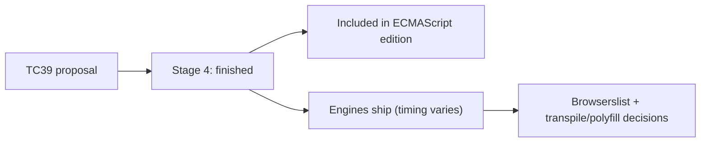
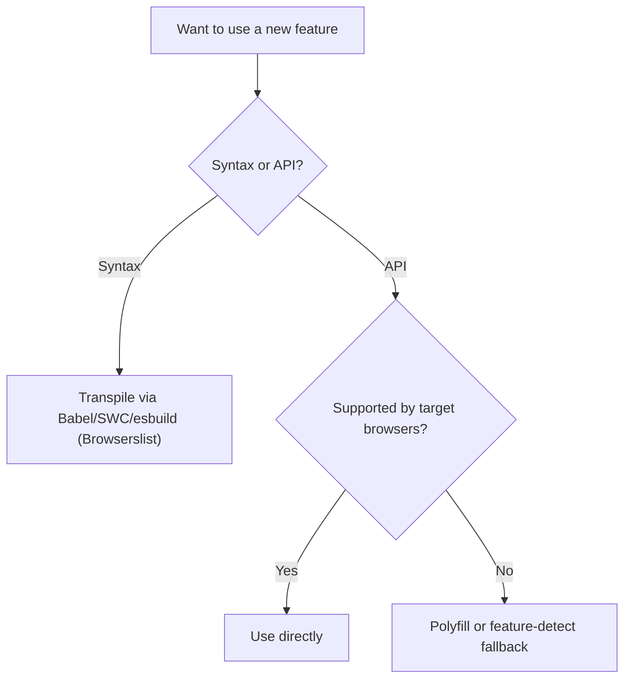

# Modern ECMAScript (ES2015 to ES2027) and JavaScript in the Browser

> Verification note: The **edition-by-edition feature map** below was cross-checked against the **TC39 finished-proposals list** (fetched 2026-11-26; the table's "expected publication year" is used as the edition label — for example Set methods, `Promise.try`, iterator helpers and `RegExp.escape` are labeled **ES2025**; `Error.isError`, `Array.fromAsync`, `Math.sumPrecise`, Uint8Array Base64 and `JSON.parse` source-text access **ES2026**; **Temporal** and **Explicit Resource Management** **ES2027**). Earlier editions (ES2015–ES2024) follow the same list and MDN. **A TC39 "finished" label means the feature is included or soon to be included in the spec — it does not mean every browser/Node version ships it; runtime support, polyfills and transpilation options must be confirmed on MDN/caniuse/Node docs and your Browserslist/`target` configuration before use** *(hedged)*. DOM/Web API material (events, observers, History API, forms) follows the **WHATWG HTML/DOM standards and MDN**; deeper browser mechanics are linked from [browser-internals/](../browser-internals/README.md) rather than repeated. This is the **breadth tier** of the JavaScript category: use it to spot gaps, then jump to the deep-dive documents.

## Table of Contents

1. [Quick Summary (TL;DR)](#1-quick-summary-tldr)
2. [Edition Timeline: What Each Version Added](#2-edition-timeline-what-each-version-added)
3. [Features Interviewers Expect You to Know Cold](#3-features-interviewers-expect-you-to-know-cold)
4. [Newer Array, Object, String and Collection APIs](#4-newer-array-object-string-and-collection-apis)
5. [Choosing and Shipping Modern Syntax: Targets, Transpilers, Polyfills](#5-choosing-and-shipping-modern-syntax-targets-transpilers-polyfills)
6. [DOM Essentials for Coding Rounds](#6-dom-essentials-for-coding-rounds)
7. [Events: Phases, Delegation and Performance](#7-events-phases-delegation-and-performance)
8. [Browser APIs Worth Knowing](#8-browser-apis-worth-knowing)
9. [Performance-Aware JavaScript in the Browser](#9-performance-aware-javascript-in-the-browser)
10. [Security-Aware JavaScript in the Browser](#10-security-aware-javascript-in-the-browser)
11. [Output-Prediction and Mini-Coding Round](#11-output-prediction-and-mini-coding-round)
12. [Pitfalls](#12-pitfalls)
13. [Interview Questions — Fundamentals](#13-interview-questions--fundamentals)
14. [Interview Questions — Senior Scenarios](#14-interview-questions--senior-scenarios)
15. [Cheat Sheet](#15-cheat-sheet)
16. [Key Terms Glossary](#16-key-terms-glossary)
17. [Further Reading](#17-further-reading)

---

## 1. Quick Summary (TL;DR)

- **ECMAScript ships yearly.** A feature typically goes proposal → **Stage 4 (finished)** → included in the next edition; engines often ship earlier or later than the edition label.
- **Know the "greatest hits" by era:** ES2015 (classes, modules, arrows, promises), ES2017 (`async/await`), ES2020 (`?.`, `??`, `BigInt`, `allSettled`), ES2022 (class fields/privates, top-level `await`, `.at()`, `Object.hasOwn`, `cause`), ES2023 (non-mutating array methods), ES2024 (`groupBy`, `Promise.withResolvers`), ES2025 (Set methods, iterator helpers, `Promise.try`).
- **Prefer standard features with feature detection** over UA sniffing; transpile syntax (Babel/SWC/esbuild) and polyfill **APIs** only for browsers you support.
- **DOM interview staples:** event phases (capture/target/bubble), **event delegation**, `target` vs `currentTarget`, `preventDefault` vs `stopPropagation`, `DocumentFragment`, `textContent` vs `innerHTML`, layout thrashing, `defer`/`async` scripts.
- **Observers** (`IntersectionObserver`, `ResizeObserver`, `MutationObserver`, `PerformanceObserver`) replace polling and scroll handlers.
- **Use passive listeners, debounce/throttle, `requestAnimationFrame`, and avoid forced synchronous layout** for smooth UIs.
- **Security:** never inject untrusted strings as HTML; prefer `textContent`, DOM APIs, Trusted Types and sanitization.



---

## 2. Edition Timeline: What Each Version Added

| Edition | Highlights (selected) |
|---|---|
| **ES2015 (ES6)** | `let`/`const`, arrow functions, classes, template literals, destructuring, default/rest/spread, ES modules, `Promise`, `Symbol`, iterators/generators, `Map`/`Set`/`WeakMap`/`WeakSet`, `Proxy`/`Reflect`, typed arrays, tail calls (spec only) |
| **ES2016** | `**` exponent operator, `Array.prototype.includes` |
| **ES2017** | `async`/`await`, `Object.values`/`Object.entries`, `String.prototype.padStart/padEnd`, `Object.getOwnPropertyDescriptors`, trailing commas in parameter lists, `SharedArrayBuffer`/`Atomics` |
| **ES2018** | Object rest/spread, async iteration (`for await`), `Promise.prototype.finally`, RegExp named groups, lookbehind, `s` (dotAll) flag, Unicode property escapes |
| **ES2019** | `Array.prototype.flat/flatMap`, `Object.fromEntries`, `trimStart/trimEnd`, optional `catch` binding, stable `Array.prototype.sort`, `Symbol.prototype.description`, well-formed `JSON.stringify` |
| **ES2020** | `BigInt`, optional chaining `?.`, nullish coalescing `??`, `globalThis`, `Promise.allSettled`, dynamic `import()`, `import.meta`, `String.prototype.matchAll`, `export * as ns` |
| **ES2021** | `String.prototype.replaceAll`, `Promise.any`/`AggregateError`, logical assignment (`\|\|=`, `&&=`, `??=`), numeric separators, `WeakRef`/`FinalizationRegistry` |
| **ES2022** | Class public/private fields, private methods, **static blocks**, `#x in obj`, **top-level `await`**, `Array.prototype.at`, `Object.hasOwn`, `Error` `cause`, RegExp `d` flag |
| **ES2023** | `findLast`/`findLastIndex`, **change-array-by-copy** (`toSorted`, `toReversed`, `toSpliced`, `with`), hashbang, symbols as `WeakMap` keys |
| **ES2024** | `Object.groupBy`/`Map.groupBy`, `Promise.withResolvers`, RegExp `v` flag, `ArrayBuffer.prototype.transfer` and resizable `ArrayBuffer`, `String.prototype.isWellFormed/toWellFormed`, `Atomics.waitAsync` |
| **ES2025** | **New `Set` methods** (`union`, `intersection`, `difference`, `symmetricDifference`, `isSubsetOf`, `isSupersetOf`, `isDisjointFrom`), **`Promise.try`**, **sync iterator helpers** (`map`, `filter`, `take`, `drop`, `flatMap`, `reduce`, `toArray`, `some`, `every`, `find`, `forEach`, `Iterator.from`), **`RegExp.escape`**, **import attributes / JSON modules**, RegExp modifiers, duplicate named capture groups, `Float16Array`/`Math.f16round` |
| **ES2026 (listed)** | `Error.isError`, `Array.fromAsync`, `Math.sumPrecise`, `Uint8Array` Base64/hex conversion, iterator sequencing (`Iterator.concat`), upsert (`Map.prototype.getOrInsert`-style API), `JSON.parse` source-text access |
| **ES2027 (listed)** | **Temporal**, **Explicit Resource Management** (`using`/`await using`, `Symbol.dispose`), iterator chunking/joint iteration/`includes`/`join`, `Atomics.pause`, dynamic code brand checks |

*(Labels follow TC39's "expected publication year"; verify the exact edition and runtime support for anything you plan to ship.)*

---

## 3. Features Interviewers Expect You to Know Cold

| Feature | One-liner | Where covered |
|---|---|---|
| `let`/`const`, TDZ | Block scope; use `const` by default | [01](01-language-fundamentals-types-coercion-and-equality.md#9-variables-scope-basics-and-strict-mode) |
| Arrow functions | Lexical `this`; no `arguments`/`new` | [03](03-functions-scope-closures-and-this.md#2-function-forms-and-when-they-differ) |
| Destructuring, spread, rest | Unpack/expand/collect | [02](02-arrays-objects-collections-and-modern-syntax.md#destructuring) |
| Optional chaining / nullish coalescing | `?.` and `??` | [02](02-arrays-objects-collections-and-modern-syntax.md#optional-chaining-) |
| Template literals / tagged templates | Interpolation, multiline, DSLs | [01](01-language-fundamentals-types-coercion-and-equality.md#5-strings-unicode-and-template-literals) |
| Classes / private fields | Prototype sugar + `#private` | [04](04-prototypes-classes-and-the-object-model.md#5-classes-es2015-to-es2022) |
| Promises / `async`-`await` | Async composition | [05](05-asynchronous-javascript-event-loop-promises-and-async-await.md) |
| Modules / dynamic import | Static graph, lazy loading | [06](06-modules-iterators-generators-errors-and-text-processing.md#2-es-modules-vs-commonjs) |
| `Map`/`Set`/`WeakMap` | Keyed collections | [02](02-arrays-objects-collections-and-modern-syntax.md#map-collection) |
| Iterators/generators | Lazy sequences | [06](06-modules-iterators-generators-errors-and-text-processing.md#4-iterators-and-iterables) |
| `Proxy`/`Reflect`, `Symbol` | Metaprogramming | [04](04-prototypes-classes-and-the-object-model.md#9-proxy-and-reflect) |
| `BigInt` | Big integers | [01](01-language-fundamentals-types-coercion-and-equality.md#4-numbers-bigint-and-floating-point) |
| `structuredClone` | Deep clone for supported types | [08 Q8](08-advanced-fundamentals-and-coding.md#8-what-are-shallow-copy-and-deep-copy-how-would-you-implement-a-robust-deep-clone-function) |

---

## 4. Newer Array, Object, String and Collection APIs

**Arrays (non-mutating, ES2023)**
```js
const a = [3, 1, 2];
a.toSorted((x, y) => x - y);   // [1, 2, 3]   (a unchanged)
a.toReversed();                // [2, 1, 3]
a.toSpliced(1, 1, 'x');        // [3, 'x', 2]
a.with(0, 99);                 // [99, 1, 2]
a.at(-1);                      // 2  (ES2022)
a.findLast((n) => n > 1);      // 2  (ES2023)
```
Use them to avoid mutation in React/Redux state updates (runtime support: confirm; fall back to copy-then-mutate).

**Grouping (ES2024)**
```js
Object.groupBy(users, (u) => u.team);    // null-prototype object { frontend: [...], backend: [...] }
Map.groupBy(users, (u) => u.active);     // Map { true => [...], false => [...] }
```

**Set operations (ES2025)**
```js
const A = new Set([1, 2, 3]), B = new Set([2, 3, 4]);
A.union(B);                 // Set {1,2,3,4}
A.intersection(B);          // Set {2,3}
A.difference(B);            // Set {1}
A.symmetricDifference(B);   // Set {1,4}
A.isSubsetOf(B);            // false
```

**Objects/strings**
- `Object.hasOwn(o, k)` (ES2022), `Object.fromEntries`, `structuredClone`.
- `String.prototype.at`, `replaceAll`, `isWellFormed/toWellFormed` (ES2024).
- **Promise helpers:** `Promise.withResolvers()` (ES2024), `Promise.try()` (ES2025) ([05](05-asynchronous-javascript-event-loop-promises-and-async-await.md#6-promise-combinators-and-modern-helpers)).
- **Iterator helpers (ES2025):** lazy `map/filter/take` over iterators ([06](06-modules-iterators-generators-errors-and-text-processing.md#4-iterators-and-iterables)).
- **`Array.fromAsync`, `Error.isError`, `Math.sumPrecise`** (ES2026-listed): confirm support before use.
- **Temporal** (ES2027-listed): modern date/time ([06 §9](06-modules-iterators-generators-errors-and-text-processing.md#9-dates-time-zones-and-intl)).
- **`using` declarations:** deterministic cleanup via `Symbol.dispose` (ES2027-listed; support varies).

---

## 5. Choosing and Shipping Modern Syntax: Targets, Transpilers, Polyfills

- **Define supported browsers** with **Browserslist** (`last 2 versions`, `> 0.5%`, `not dead`, or explicit iOS Safari/Chrome versions) shared by Babel/SWC/esbuild/autoprefixer; "modern + legacy" differential builds are mostly obsolete for evergreen-only audiences.
- **Syntax vs API:** transpilers rewrite **syntax** (optional chaining, class fields, `??`); **APIs** (`Array.prototype.toSorted`, `Promise.withResolvers`, `structuredClone`) need **polyfills** (core-js) or feature checks. Missing syntax support = parse error (blank page); missing API = runtime `TypeError`.
- **Feature detection:** `if (Array.prototype.toSorted)`, `typeof structuredClone === 'function'`, `'IntersectionObserver' in window`, `CSS.supports(...)`; avoid UA sniffing ([debugging-scenarios/05 §3](../debugging-scenarios/05-browser-compatibility-storage-and-environment-bugs.md#3-feature-support-polyfills-and-progressive-enhancement)).
- **TypeScript:** `target`/`lib` control emitted syntax and available types; TypeScript 6 defaults to a current-year ES target and includes Temporal types under `esnext` ([typescript/04](../typescript/04-tsconfig-modules-and-tooling.md)).
- **Node:** use `engines`, `.nvmrc`, and test on supported LTS lines; features land at different versions than browsers.
- **Polyfill hygiene:** import only what you need (`core-js` per-feature/usage-based), avoid global pollution in libraries, keep polyfills out of modern bundles via differential serving if applicable *(hedged)*.
- **Adopting very new features:** check Baseline/caniuse status, add lint rules (`eslint-plugin-compat`), keep a documented support policy, and add smoke tests in target engines.

---

## 6. DOM Essentials for Coding Rounds

**Selecting:** `getElementById`, `querySelector/All` (static NodeList), `closest()`, `matches()`; live collections (`getElementsByClassName`, `children`) vs static NodeLists.

**Creating/updating**
```js
const li = document.createElement('li');
li.textContent = userInput;                 // safe: text, not HTML
list.append(li);                            // append can take nodes/strings; appendChild takes one node
const frag = document.createDocumentFragment();   // batch insert off-DOM
items.forEach((i) => frag.append(Object.assign(document.createElement('li'), { textContent: i })));
list.append(frag);
const tpl = document.querySelector('template#row').content.cloneNode(true);   // <template> reuse
```

- **`textContent` vs `innerText` vs `innerHTML`:** `textContent` raw text (fast, safe); `innerText` layout-aware (triggers reflow); `innerHTML` parses HTML (XSS risk with untrusted input) ([web-security/02](../web-security/02-xss-trusted-types-and-sanitization.md)).
- **Attributes vs properties:** HTML attribute (string, initial) vs DOM property (live state): `input.value` vs `getAttribute('value')`, `checked`, `dataset` (`data-*`), `classList`, `style` vs computed styles (`getComputedStyle`).
- **Traversal:** `parentElement`, `children`, `nextElementSibling`; implement `walk(node)` recursively or with `TreeWalker`; **DOM manipulation interview tasks:** build a tree from JSON, implement `getElementsByClassName`, `querySelector` subset, `deepClone` of DOM, flatten nested lists, render large lists efficiently (virtualization) ([system-design/02](../system-design/02-news-feed-and-infinite-scroll.md)).
- **Forms:** `FormData`, `form.elements`, constraint validation API, `submit` event vs `click`, preventing default; accessibility ([accessibility/04](../accessibility/04-accessible-forms-errors-and-dynamic-content.md)).
- **Script loading:** `<script defer>` (executes after parsing, in order), `async` (as soon as ready, unordered), `type="module"` (deferred); `DOMContentLoaded` (DOM parsed) vs `load` (all resources) ([html-and-css/01](../html-and-css/01-html-semantics-document-structure-and-metadata.md#9-scripts-styles-and-resource-loading-from-html)).
- **Rendering costs:** reading layout properties (`offsetHeight`, `getBoundingClientRect`) after writing styles forces synchronous layout; **batch reads then writes** (or use `requestAnimationFrame`, `ResizeObserver`) to avoid thrashing ([web-performance/05](../web-performance/05-rendering-layout-animation-and-cls.md)).

---

## 7. Events: Phases, Delegation and Performance

**Phases:** capture (window → target) → target → bubble (target → window). `addEventListener(type, fn, { capture, once, passive, signal })`.

| Concept | Notes |
|---|---|
| `event.target` | Element that triggered the event |
| `event.currentTarget` | Element the listener is attached to (also `this` for non-arrow handlers) |
| `preventDefault()` | Cancels default action (link navigation, form submit); doesn't stop propagation |
| `stopPropagation()` | Stops further propagation; `stopImmediatePropagation()` also stops other listeners on same node |
| Bubbling | Most events bubble; `focus`/`blur` don't (use `focusin`/`focusout`); `mouseenter/leave` don't |
| `passive: true` | Promises not to call `preventDefault` → smoother scrolling (touch/wheel default passive on window-level targets *(hedged)*) |
| `once: true` | Auto-remove after first call |
| `signal` | Remove via `AbortController` |
| `composed` | Whether event crosses shadow DOM boundaries |

**Event delegation:** attach one listener to a stable ancestor and use `event.target.closest(selector)` — fewer listeners, supports dynamically added children.

```js
list.addEventListener('click', (e) => {
  const li = e.target.closest('li[data-id]');
  if (!li || !list.contains(li)) return;
  select(li.dataset.id);
});
```

**Custom events:** `new CustomEvent('cart:add', { detail, bubbles: true })`; `dispatchEvent`; a tiny **EventEmitter / pub-sub** is a common coding question ([09](09-coding-challenges-polyfills-and-output-prediction.md)).

**Performance:** debounce/throttle high-frequency events (`scroll`, `resize`, `mousemove`, `input`) ([dsa-for-fe/05](../dsa-for-fe/05-frontend-specific-coding.md)); prefer `IntersectionObserver`/`ResizeObserver`; avoid layout reads inside handlers; use `pointer` events for unified input; remove listeners on teardown (`AbortController`).

**React:** synthetic events delegate at the root; `e.stopPropagation()` interplay with native listeners; handlers run in the event's task — async work and state batching considerations ([react/01](../react/01-rendering-model-and-reconciliation.md)).

---

## 8. Browser APIs Worth Knowing

| API | Use | Notes |
|---|---|---|
| **`fetch` / `Request` / `Response` / `Headers`** | Network | Doesn't reject on HTTP errors; use `signal` ([networking-and-apis/02](../networking-and-apis/02-fetch-api-and-browser-networking.md)) |
| **`URL` / `URLSearchParams`** | Parse/build URLs | Prefer over string concatenation |
| **`History API` (`pushState`, `popstate`)** / Navigation API *(hedged)* | SPA routing | [browser-internals/02](../browser-internals/02-navigation-and-page-lifecycle.md) |
| **Web Storage / IndexedDB / Cache API / cookies** | Persistence | [browser-internals/05](../browser-internals/05-browser-storage-and-caching-apis.md) |
| **`IntersectionObserver`** | Lazy loading, infinite scroll, visibility analytics | Replaces scroll polling |
| **`ResizeObserver`** | Element size changes | Avoid layout loops |
| **`MutationObserver`** | DOM changes | Microtask-timed callbacks |
| **`PerformanceObserver` / User Timing / Long Tasks** | Metrics | [web-performance/01](../web-performance/01-performance-metrics-and-measurement.md) |
| **Web Workers / `SharedWorker` / `BroadcastChannel`** | Off-thread work / tab messaging | [05 §10](05-asynchronous-javascript-event-loop-promises-and-async-await.md#10-async-iteration-streams-and-workers) |
| **`requestAnimationFrame` / `requestIdleCallback`** | Scheduling | [05 §11](05-asynchronous-javascript-event-loop-promises-and-async-await.md#11-timers-scheduling-and-keeping-the-ui-responsive) |
| **`AbortController`** | Cancellation | [05 §8](05-asynchronous-javascript-event-loop-promises-and-async-await.md#8-cancellation-timeouts-and-abortcontroller) |
| **Clipboard API** | Copy/paste | Secure context + user gesture |
| **`navigator.sendBeacon` / `fetch keepalive`** | Analytics on unload | Use `pagehide`/`visibilitychange` rather than `unload` |
| **Page Visibility API** | Pause work when hidden | `visibilitychange` |
| **`matchMedia`** | Responsive/preference queries in JS | `prefers-reduced-motion`, color scheme |
| **Web Crypto (`crypto.subtle`, `randomUUID`)** | Hashing, random IDs | Secure contexts |
| **Custom Elements / Shadow DOM / Templates** | Web Components | [browser-internals/07](../browser-internals/07-events-dom-apis-and-web-components.md) |
| **Service Workers** | Offline/caching/push | [browser-internals/05](../browser-internals/05-browser-storage-and-caching-apis.md) |
| **`structuredClone`, `queueMicrotask`, `reportError`** | Utilities | `reportError` raises to global error handlers *(support: confirm)* |

**Feature gating pattern:** `if ('IntersectionObserver' in window) {...} else { fallback }`; avoid assuming Chrome-only APIs ([debugging-scenarios/05](../debugging-scenarios/05-browser-compatibility-storage-and-environment-bugs.md)).

---

## 9. Performance-Aware JavaScript in the Browser

- **Main-thread budget:** keep tasks < 50 ms; yield to the browser in long loops; offload to workers ([web-performance/04](../web-performance/04-javascript-main-thread-and-inp.md)).
- **Avoid unnecessary work:** memoize derived data, cache DOM lookups, virtualize long lists, defer non-critical JS (`defer`, dynamic import, `requestIdleCallback`).
- **Memory:** clean up listeners/timers/observers/subscriptions; avoid retaining DOM nodes in closures/collections ([08 Q16](08-advanced-fundamentals-and-coding.md#16-explain-memory-management-garbage-collection-retained-references-and-common-causes-of-javascript-memory-leaks)).
- **Data structures:** `Map`/`Set` for frequent lookups; avoid O(n²) nested loops in render paths; use `for` loops in hot paths if profiling shows array-method overhead (measure first).
- **Shape stability:** initialize object properties consistently; avoid `delete` in hot objects ([04 §3](04-prototypes-classes-and-the-object-model.md#3-the-prototype-chain)).
- **Bundles:** modern syntax targets, code splitting, tree-shaking, avoid heavy polyfills for modern browsers ([web-performance/02](../web-performance/02-critical-rendering-path-and-loading-performance.md)).
- **Measure:** DevTools Performance panel, `performance.mark/measure`, Long Animation Frames/INP attribution where available *(hedged)* ([debugging-scenarios/02](../debugging-scenarios/02-debugging-toolkit-devtools-node-and-editors.md)).

---

## 10. Security-Aware JavaScript in the Browser

- **XSS:** avoid `innerHTML`, `document.write`, `eval`, `new Function`, `setTimeout(string)`, `javascript:` URLs; sanitize when HTML is required; adopt **Trusted Types** and strict **CSP** ([web-security/02–03](../web-security/02-xss-trusted-types-and-sanitization.md)).
- **Prototype pollution** and unsafe merges ([04 §2](04-prototypes-classes-and-the-object-model.md#2-objects-properties-and-descriptors)).
- **Secrets:** nothing sensitive in client bundles/`localStorage`; tokens in `HttpOnly` cookies where possible ([web-security/04–05](../web-security/04-cookies-sessions-and-csrf.md)).
- **`postMessage`:** always check `event.origin` and use explicit target origins.
- **Third-party scripts:** isolate (iframe/sandbox), SRI, CSP, performance budgets ([web-security/07](../web-security/07-supply-chain-and-third-party-script-security.md)).
- **Regex input handling:** limit length; avoid ReDoS patterns ([06 §8](06-modules-iterators-generators-errors-and-text-processing.md#8-regular-expressions)).
- **Open redirects/URL handling:** validate with `new URL()` and allow-lists.

---

## 11. Output-Prediction and Mini-Coding Round

```js
// 1: which are mutating?
const a = [3, 1, 2];
a.sort(); a.toSorted(); a.reverse(); a.toReversed();   // sort/reverse mutate; toSorted/toReversed don't

// 2
console.log([1, 2, 3].at(-1), 'abc'.at(-1));            // 3 'c'

// 3
console.log(Object.groupBy([1, 2, 3], (n) => (n % 2 ? 'odd' : 'even')));
// { odd: [1, 3], even: [2] }   (null-prototype object)

// 4
console.log(new Set([1, 2]).union(new Set([2, 3])));    // Set {1, 2, 3}

// 5
document.body.innerHTML = '<div id=a></div>';
console.log(document.querySelectorAll('div').length, document.getElementsByTagName('div').length);  // 1 1 (live vs static differ after DOM changes)

// 6
button.addEventListener('click', function () { console.log(this === button); });   // true
button.addEventListener('click', () => console.log(this === button));              // false (lexical this)

// 7 (delegation)
// <ul><li><span>Text</span></li></ul>; clicking the span: e.target is the span; e.currentTarget is ul; e.target.closest('li') finds the li

// 8
console.log(typeof structuredClone, typeof Promise.withResolvers, typeof Array.fromAsync);
// feature-detect before use (outputs depend on runtime)
```

**Mini tasks to practice:** (1) implement event delegation for a todo list with add/remove; (2) lazy-load images with `IntersectionObserver`; (3) infinite scroll sentinel; (4) debounce a resize handler and read layout once per frame; (5) build a `Set` utility library for pre-ES2025 runtimes; (6) write a feature-detected `toSorted` fallback. Solutions/patterns: [dsa-for-fe/05](../dsa-for-fe/05-frontend-specific-coding.md), [09](09-coding-challenges-polyfills-and-output-prediction.md), [system-design/02](../system-design/02-news-feed-and-infinite-scroll.md).

---

## 12. Pitfalls

1. **Assuming "ES20xx" features exist everywhere** — syntax vs API differences; test supported browsers.
2. **Polyfilling everything globally** or shipping legacy code to modern browsers.
3. **Using `innerHTML` with untrusted data.**
4. **Attaching listeners to every list item** instead of delegating.
5. **Not removing listeners/observers/timers** on teardown.
6. **Layout thrashing** (interleaved reads/writes) and heavy scroll handlers.
7. **Confusing `target` and `currentTarget`;** mixing `stopPropagation` with `preventDefault`.
8. **Relying on `unload`/`beforeunload`** for analytics (bfcache impact).
9. **Using UA sniffing instead of feature detection.**
10. **Treating TC39 "finished" as "available now".**
11. **Mutating state with `sort`/`reverse`** in React; not using `toSorted` or copies.
12. **Forgetting `passive` listeners for scroll/touch.**
13. **Using `document.write`/synchronous scripts** blocking parsing.
14. **Ignoring `async` vs `defer` ordering semantics.**
15. **Assuming Chrome-only APIs in cross-browser products.**

---

## 13. Interview Questions — Fundamentals

- **What are some ES2015 features?** `let/const`, arrows, classes, modules, promises, destructuring, template literals, Map/Set, generators.
- **What did ES2017/ES2020/ES2022 add?** `async/await`; `?.`, `??`, `BigInt`; class fields/privates, top-level `await`, `.at()`, `Object.hasOwn`, `cause`.
- **What are `toSorted`, `toReversed`, `with`?** Non-mutating array copy methods (ES2023).
- **What are `Object.groupBy` and `Map.groupBy`?** Grouping helpers (ES2024).
- **What new `Set` methods exist?** `union`, `intersection`, `difference`, `symmetricDifference`, `isSubsetOf`, ... (ES2025).
- **What is `Promise.withResolvers`/`Promise.try`?** Helpers returning promise + resolvers / uniform sync-throw handling.
- **How do you use modern features safely?** Browserslist targets, transpile syntax, polyfill APIs, feature detect.
- **Event bubbling vs capturing?** Propagation phases order; most listeners use bubble.
- **What is event delegation and why use it?** One ancestor listener handling many/dynamic children.
- **`target` vs `currentTarget`?** Origin element vs listener element.
- **`preventDefault` vs `stopPropagation`?** Cancel default action vs stop propagation.
- **`defer` vs `async` scripts?** Ordered after parse vs unordered as soon as loaded.
- **`textContent` vs `innerHTML`?** Text only/safe vs parsed HTML/XSS risk.
- **What causes layout thrashing?** Interleaving DOM writes and layout reads in loops.
- **When use `IntersectionObserver`?** Lazy loading, infinite scroll, visibility tracking.
- **What does `passive` do?** Tells the browser the handler won't `preventDefault`, enabling smooth scroll.

---

## 14. Interview Questions — Senior Scenarios

### S1. "We want to use `Object.groupBy`/`toSorted`/Set methods but support Safari N-2 and older Android WebViews."
Check Baseline/caniuse and your analytics-based support matrix; use Browserslist + core-js usage-based polyfills or small custom helpers; add `eslint-plugin-compat` and CI smoke tests in target engines; decide per feature (polyfill vs avoid) based on bundle cost and risk; document the support policy ([debugging-scenarios/05](../debugging-scenarios/05-browser-compatibility-storage-and-environment-bugs.md)).

### S2. "A scroll-linked animation janks on mid-range phones."
Profile the main thread; move scroll listeners to passive, replace polling with `IntersectionObserver`, batch DOM reads/writes with `requestAnimationFrame`, prefer compositor-friendly CSS (transform/opacity), reduce layout work, consider CSS scroll-driven animations where supported *(hedged)*; verify with traces and INP ([web-performance/05](../web-performance/05-rendering-layout-animation-and-cls.md)).

### S3. "Design a lightweight analytics SDK for the browser."
Batching with `sendBeacon`/`fetch keepalive` on `visibilitychange`/`pagehide`, privacy/consent controls, sampling, queue persistence with retries, no blocking of main thread (idle scheduling), size budget, feature-detected APIs, error isolation (never break host page), versioning and CSP/third-party constraints ([web-security/07](../web-security/07-supply-chain-and-third-party-script-security.md)).

### S4. "Migrate a legacy jQuery widget to vanilla modern JS."
Map jQuery features to DOM APIs (`querySelector`, `classList`, `closest`, `fetch`, `CustomEvent`), implement event delegation, encapsulate in a class/closure or Web Component, add tests, progressive rollout behind flags, measure bundle and performance changes ([frontend-architecture/07](../frontend-architecture/07-migrations-modernization-and-technical-debt.md)).

### S5. "How do you decide when to adopt a brand-new ECMAScript feature (e.g., iterator helpers, Temporal)?"
Evaluate benefit vs support (Baseline, analytics), polyfill/transpile availability and cost, TypeScript/ESLint support, team familiarity, rollout via flags, and exit plans; pilot in non-critical code; track errors by browser/version.

### S6. "Our app freezes when the user pastes a large dataset."
Profile; chunk processing, stream parsing, use a worker, avoid O(n²), debounce validations, virtualize rendering, show progress and allow cancellation ([05 §10–11](05-asynchronous-javascript-event-loop-promises-and-async-await.md#10-async-iteration-streams-and-workers)).

---

## 15. Cheat Sheet

| Need | Modern tool |
|---|---|
| Non-mutating array update | `toSorted`, `toReversed`, `toSpliced`, `with` |
| Last element | `at(-1)` |
| Group items | `Object.groupBy` / `Map.groupBy` |
| Set algebra | `union`, `intersection`, `difference` |
| Own property check | `Object.hasOwn` |
| Safe defaults | `??`, `?.`, `??=` |
| Externalize promise | `Promise.withResolvers` |
| Lazy iteration | Generators / iterator helpers |
| Private state | `#field` |
| Deep clone | `structuredClone` |
| Dynamic loading | `import()` |
| Visibility/lazy | `IntersectionObserver` |
| Cancel | `AbortController` |
| Dates (future) | Temporal (support hedged) |



---

## 16. Key Terms Glossary

| Term | Meaning |
|---|---|
| **TC39** | Technical committee evolving ECMAScript |
| **Stage 4 / finished** | Proposal accepted for the spec |
| **Browserslist** | Config defining target browsers for tools |
| **Transpile** | Rewrite newer syntax into older syntax |
| **Polyfill** | Runtime implementation of a missing API |
| **Baseline** | Cross-browser availability classification |
| **Event delegation** | Handling events at an ancestor |
| **Capture/bubble** | Event propagation phases |
| **Passive listener** | Listener that promises not to cancel scrolling |
| **Layout thrashing** | Repeated forced synchronous layouts |
| **Observer APIs** | Intersection/Resize/Mutation/Performance observers |
| **Trusted Types** | Browser API to prevent DOM XSS sinks misuse |

---

## 17. Further Reading

- [TC39 finished proposals](https://github.com/tc39/proposals/blob/main/finished-proposals.md) · [ECMAScript specification](https://tc39.es/ecma262/) · [MDN: JavaScript reference](https://developer.mozilla.org/en-US/docs/Web/JavaScript/Reference) · [MDN: Introduction to events](https://developer.mozilla.org/en-US/docs/Learn_web_development/Core/Scripting/Events) · [caniuse](https://caniuse.com) · [web.dev: Baseline](https://web.dev/baseline) *(hedged: confirm URLs)*
- **This repo:** [02 Arrays, objects and modern syntax](02-arrays-objects-collections-and-modern-syntax.md) · [05 Async](05-asynchronous-javascript-event-loop-promises-and-async-await.md) · [06 Modules and iterators](06-modules-iterators-generators-errors-and-text-processing.md) · [dsa-for-fe/05 Frontend-specific coding](../dsa-for-fe/05-frontend-specific-coding.md) · [09 Coding challenges](09-coding-challenges-polyfills-and-output-prediction.md) · [browser-internals/](../browser-internals/README.md) · [debugging-scenarios/05](../debugging-scenarios/05-browser-compatibility-storage-and-environment-bugs.md)
