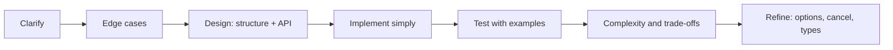
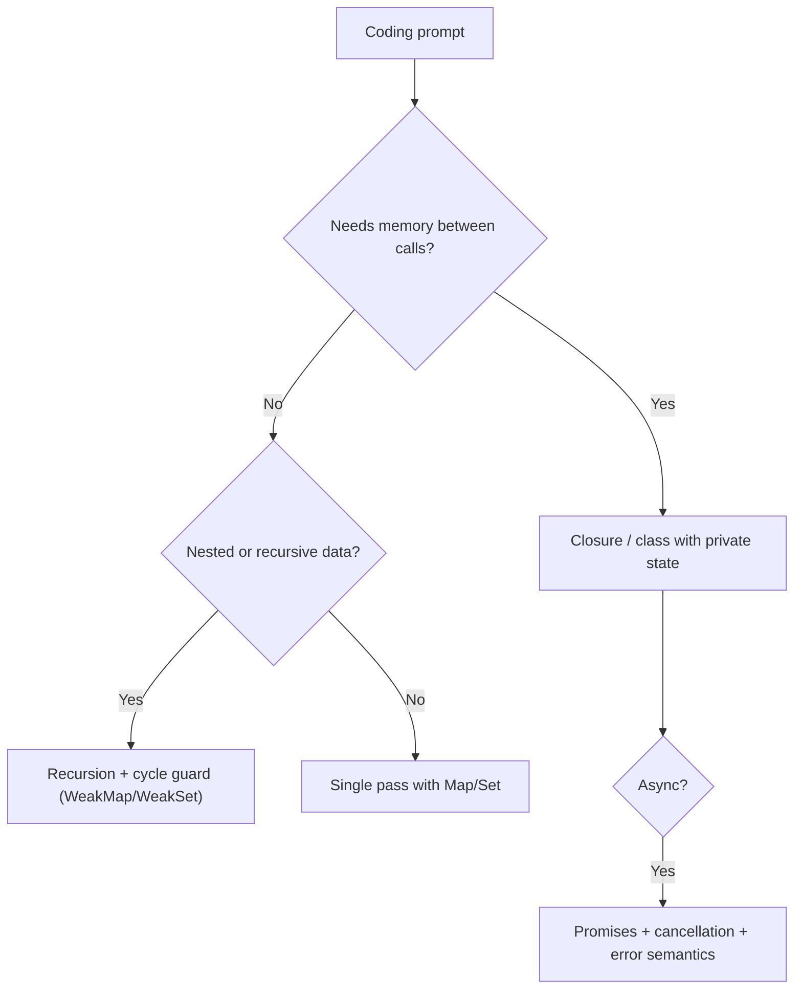

# JavaScript Coding Challenges: Utilities, Polyfills, Promises, Data Structures and Output Prediction

> Verification note: All code in this document is **original illustrative code written for this handbook**, targeting modern ECMAScript (ES2022 syntax such as `#private` fields, `??=`, `Object.hasOwn`, `AggregateError`) with notes where newer APIs could replace the hand-written versions. Behaviors cited for output-prediction puzzles follow the **ECMAScript specification** and were reasoned through step by step; **before an interview, run any snippet you plan to rely on in your target runtime**, because engine versions and flags can differ (for example ESM vs CommonJS `this`, Node vs browser timers, availability of `Promise.withResolvers`, `structuredClone`, `Array.fromAsync` — newer features were cross-checked against the **TC39 finished-proposals** list, fetched 2026-11-26, and runtime support is **hedged**). Several utilities already have full, traced write-ups elsewhere in this category and are **linked, not duplicated**: debounce/throttle/memoize/deep clone/flatten/group-by/dedupe/frequency counter in [dsa-for-fe/05](../dsa-for-fe/05-frontend-specific-coding.md); `map`/`filter`/`reduce`, `bind`, `Promise.all`, concurrency limiter in [08](08-advanced-fundamentals-and-coding.md). This document adds **fuller variants, additional polyfills and utilities, a mini-Promise, data-structure questions and a large output-prediction set**. For algorithm patterns (hash map, sliding window, two pointers, stack) see [dsa-for-fe/](../dsa-for-fe/01-hashmap-pattern.md) and [dsa-topics/](../dsa-topics/01-array-problems.md); for UI machine-coding components see [react/07 §12](../react/07-component-patterns-and-architecture.md#12-classic-ui-coding-round-components) and [html-and-css/08](../html-and-css/08-html-css-coding-round-and-debugging-scenarios.md).

## Table of Contents

1. [Quick Summary (TL;DR)](#1-quick-summary-tldr)
2. [How to Run a JavaScript Coding Round](#2-how-to-run-a-javascript-coding-round)
3. [Function Utilities: Debounce (Full), Throttle (Full), Once, Curry, Compose, Retry](#3-function-utilities-debounce-full-throttle-full-once-curry-compose-retry)
4. [Core Language Polyfills: `call`, `apply`, `new`, `instanceof`, `Object.create`](#4-core-language-polyfills-call-apply-new-instanceof-objectcreate)
5. [Array Utilities and Polyfills](#5-array-utilities-and-polyfills)
6. [Object Utilities: Equality, Paths, Merge, Flatten](#6-object-utilities-equality-paths-merge-flatten)
7. [Promise Utilities and a Mini Promise](#7-promise-utilities-and-a-mini-promise)
8. [Data Structures and Patterns: EventEmitter, LRU, Store, Observable](#8-data-structures-and-patterns-eventemitter-lru-store-observable)
9. [String and Number Utilities](#9-string-and-number-utilities)
10. [DOM and UI Coding Prompts](#10-dom-and-ui-coding-prompts)
11. [Output-Prediction Gauntlet](#11-output-prediction-gauntlet)
12. [Testing Your Answers](#12-testing-your-answers)
13. [Pitfalls](#13-pitfalls)
14. [Interview Questions — Fundamentals](#14-interview-questions--fundamentals)
15. [Interview Questions — Senior Scenarios](#15-interview-questions--senior-scenarios)
16. [Cheat Sheet](#16-cheat-sheet)
17. [Key Terms Glossary](#17-key-terms-glossary)
18. [Further Reading](#18-further-reading)

---

## 1. Quick Summary (TL;DR)

- **Coding-round pattern:** clarify requirements → state edge cases → pick a data structure → write the simplest correct version → test with examples → state complexity → discuss improvements (cancellation, options, memory, TypeScript types).
- **Most-asked utilities:** debounce, throttle, memoize, curry, compose/pipe, deep clone, deep equal, flatten, `Promise.all`/`race`/`allSettled`, EventEmitter, LRU cache, `bind`/`call`/`apply`, `new`, `instanceof`, get/set by path, retry/timeout, concurrency pool.
- **Closures hold state** (timers, caches, flags); **`Map`/`Set`/`WeakMap`** give O(1) operations; **recursion** needs base cases and cycle protection; **async utilities** need cancellation and error semantics.
- **Edge cases that separate good answers:** `this` and arguments forwarding, `NaN`/`-0`, sparse arrays, circular references, empty input, mutation vs copy, promise rejection ordering, microtask ordering.
- **Say the trade-offs aloud:** built-ins vs hand-written (`structuredClone`, `flat`, `Object.groupBy`), complexity, memory leaks (caches, listeners), security (prototype pollution).



---

## 2. How to Run a JavaScript Coding Round

| Step | What to say/do |
|---|---|
| **Clarify** | Inputs/outputs, mutation allowed?, sync vs async, browser vs Node, performance limits, ES version/polyfill constraints |
| **Examples** | Write 2–3 inputs/outputs including an edge case |
| **Approach** | Name the technique (closure, recursion, hash map, queue, DFS) before coding |
| **Code** | Small functions, meaningful names, handle edge cases early, avoid cleverness |
| **Test** | Walk through your examples line by line; test empty/one/many, duplicates, falsy values, `null`/`undefined` |
| **Complexity** | Time and space (including recursion stack and cache growth) |
| **Improve** | Cancellation, error handling, memory bounds, TypeScript signature, tests, built-in alternative |

**Interviewer signals:** correctness first, then communication, edge cases, clean code, and awareness of platform features. Don't memorize — understand why each line exists.

---

## 3. Function Utilities: Debounce (Full), Throttle (Full), Once, Curry, Compose, Retry

Short versions with traces: [dsa-for-fe/05 Problems 1–3](../dsa-for-fe/05-frontend-specific-coding.md#problem-1-debounce). Below are **production-leaning** variants interviewers use as follow-ups.

**Debounce with `leading`/`trailing`, `cancel`, `flush`, and `this` forwarding**
```js
function debounce(fn, wait = 0, { leading = false, trailing = true } = {}) {
  let timer, lastArgs, lastThis, result;

  function invoke() {
    const args = lastArgs, ctx = lastThis;
    lastArgs = lastThis = undefined;
    result = fn.apply(ctx, args);
    return result;
  }

  function debounced(...args) {
    lastArgs = args; lastThis = this;
    const callNow = leading && !timer;
    clearTimeout(timer);
    timer = setTimeout(() => {
      timer = undefined;
      if (trailing && lastArgs) invoke();
    }, wait);
    if (callNow) invoke();
    return result;
  }
  debounced.cancel = () => { clearTimeout(timer); timer = lastArgs = lastThis = undefined; };
  debounced.flush = () => { if (!timer) return result; clearTimeout(timer); timer = undefined; return lastArgs ? invoke() : result; };
  return debounced;
}
```
*Discuss:* return value is the last result (async nature), `flush` on unmount/blur, `cancel` on cleanup; in React create once (`useMemo`/`useRef`) ([03 §11](03-functions-scope-closures-and-this.md#11-closures-and-this-in-frontend-code-react-events-timers)).

**Throttle with leading/trailing**
```js
function throttle(fn, wait, { leading = true, trailing = true } = {}) {
  let last = 0, timer, lastArgs, lastThis;
  const run = (ctx, args) => { last = Date.now(); fn.apply(ctx, args); lastArgs = lastThis = undefined; };
  function throttled(...args) {
    const now = Date.now();
    if (!last && !leading) last = now;
    const remaining = wait - (now - last);
    lastArgs = args; lastThis = this;
    if (remaining <= 0 || remaining > wait) {
      clearTimeout(timer); timer = undefined;
      run(this, args);
    } else if (!timer && trailing) {
      timer = setTimeout(() => { timer = undefined; if (lastArgs) run(lastThis, lastArgs); }, remaining);
    }
  }
  throttled.cancel = () => { clearTimeout(timer); timer = undefined; last = 0; lastArgs = lastThis = undefined; };
  return throttled;
}
```
Alternative with `requestAnimationFrame` for visual updates (one call per frame).

**`once`, `memoize` with resolver, `curry`, `partial`, `pipe/compose`**
```js
const once = (fn) => { let called = false, value; return function (...a) { if (!called) { called = true; value = fn.apply(this, a); } return value; }; };

function memoize(fn, resolver = (...args) => args[0]) {
  const cache = new Map();
  const memoized = function (...args) {
    const key = resolver(...args);
    if (cache.has(key)) return cache.get(key);
    const result = fn.apply(this, args);
    cache.set(key, result);
    return result;
  };
  memoized.cache = cache;
  return memoized;
}
// for async functions, cache the promise and delete it on rejection

const curry = (fn) => function curried(...args) {
  return args.length >= fn.length ? fn.apply(this, args) : (...next) => curried.apply(this, [...args, ...next]);
};
const partial = (fn, ...preset) => (...later) => fn(...preset, ...later);
const pipe = (...fns) => (x) => fns.reduce((acc, f) => f(acc), x);
const compose = (...fns) => (x) => fns.reduceRight((acc, f) => f(acc), x);
const pipeAsync = (...fns) => (x) => fns.reduce((p, f) => p.then(f), Promise.resolve(x));
```

**Placeholder currying (`curry(fn)(_, 2)(1)`)** and **infinite currying** (`sum(1)(2)(3)()`) are common variants:
```js
const sum = (a) => (b) => (b === undefined ? a : sum(a + b));
sum(1)(2)(3)();   // 6
```

**Sleep, timeout, retry with exponential backoff + full jitter**
```js
const sleep = (ms) => new Promise((r) => setTimeout(r, ms));

const withTimeout = (promise, ms, message = 'Timed out') => {
  let id;
  const timeout = new Promise((_, reject) => { id = setTimeout(() => reject(new Error(message)), ms); });
  return Promise.race([promise, timeout]).finally(() => clearTimeout(id));
};   // note: does not cancel the underlying work; pass an AbortSignal too

async function retry(fn, { retries = 3, base = 200, cap = 5000, shouldRetry = () => true } = {}) {
  for (let attempt = 0; ; attempt++) {
    try { return await fn(attempt); }
    catch (err) {
      if (attempt >= retries || !shouldRetry(err)) throw err;
      await sleep(Math.random() * Math.min(cap, base * 2 ** attempt));   // full jitter
    }
  }
}
```
Retry only **idempotent** operations or use idempotency keys ([networking-and-apis/06](../networking-and-apis/06-resilience-retries-timeouts-and-offline.md)).

**`once` for events, `delay`, `pLimit`** (concurrency pool): see [08 Q13](08-advanced-fundamentals-and-coding.md#13-how-would-you-limit-concurrency-when-executing-100-asynchronous-api-requests).

---

## 4. Core Language Polyfills: `call`, `apply`, `new`, `instanceof`, `Object.create`

```js
Function.prototype.myCall = function (ctx, ...args) {
  ctx = ctx == null ? globalThis : Object(ctx);       // box primitives; null/undefined → global (sloppy semantics)
  const key = Symbol('fn');                           // avoid collisions
  ctx[key] = this;
  try { return ctx[key](...args); } finally { delete ctx[key]; }
};
Function.prototype.myApply = function (ctx, args = []) { return this.myCall(ctx, ...Array.from(args)); };
// bind with `new` support: see 09 Q6

function myNew(Ctor, ...args) {
  if (typeof Ctor !== 'function') throw new TypeError('not a constructor');
  const obj = Object.create(Ctor.prototype);
  const result = Ctor.apply(obj, args);
  return result !== null && (typeof result === 'object' || typeof result === 'function') ? result : obj;
}

function myInstanceOf(value, Ctor) {
  if (value === null || (typeof value !== 'object' && typeof value !== 'function')) return false;
  const target = Ctor.prototype;
  for (let p = Object.getPrototypeOf(value); p !== null; p = Object.getPrototypeOf(p)) if (p === target) return true;
  return false;
}

function myObjectCreate(proto, props) {
  function F() {}
  F.prototype = proto;
  const obj = new F();
  if (props) Object.defineProperties(obj, props);
  return obj;               // proto === null requires Object.setPrototypeOf(obj, null) in this polyfill
}
```
*Follow-ups:* strict mode vs sloppy `this`; arrow functions can't be `new`ed; `Symbol.hasInstance`; why `Symbol` keys avoid collisions; inheritance via `Object.create` ([04](04-prototypes-classes-and-the-object-model.md)).

---

## 5. Array Utilities and Polyfills

```js
Array.prototype.myForEach = function (cb, thisArg) {
  for (let i = 0; i < this.length; i++) if (i in this) cb.call(thisArg, this[i], i, this);   // skip holes
};
Array.prototype.myFind = function (pred, thisArg) {
  for (let i = 0; i < this.length; i++) if (pred.call(thisArg, this[i], i, this)) return this[i];
};
Array.prototype.mySome = function (pred, thisArg) {
  for (let i = 0; i < this.length; i++) if (i in this && pred.call(thisArg, this[i], i, this)) return true;
  return false;
};
Array.prototype.myEvery = function (pred, thisArg) {
  for (let i = 0; i < this.length; i++) if (i in this && !pred.call(thisArg, this[i], i, this)) return false;
  return true;
};
Array.prototype.myFlat = function (depth = 1) {
  const out = [];
  (function walk(arr, d) { arr.forEach((v) => (Array.isArray(v) && d > 0 ? walk(v, d - 1) : out.push(v))); })(this, depth);
  return out;
};
Array.prototype.myIncludes = function (x, from = 0) {
  const n = this.length;
  for (let i = from < 0 ? Math.max(n + from, 0) : from; i < n; i++) if (this[i] === x || (x !== x && this[i] !== this[i])) return true;   // SameValueZero
  return false;
};
```
(`map`/`filter`/`reduce` are in [08 Q10](08-advanced-fundamentals-and-coding.md#10--implement-map-filter-and-reduce-without-using-the-built-in-methods).)

**Utility functions**
```js
const chunk = (arr, n) => Array.from({ length: Math.ceil(arr.length / n) }, (_, i) => arr.slice(i * n, i * n + n));
const range = (start, end, step = 1) => Array.from({ length: Math.max(0, Math.ceil((end - start) / step)) }, (_, i) => start + i * step);
const zip = (...arrs) => Array.from({ length: Math.min(...arrs.map((a) => a.length)) }, (_, i) => arrs.map((a) => a[i]));
const unique = (arr) => [...new Set(arr)];
const intersection = (a, b) => { const s = new Set(b); return unique(a.filter((x) => s.has(x))); };   // or new Set methods (ES2025)
const partition = (arr, pred) => arr.reduce(([t, f], x) => (pred(x) ? [[...t, x], f] : [t, [...f, x]]), [[], []]);   // O(n²) due to spread; push for O(n)
const countBy = (arr, fn) => arr.reduce((m, x) => ((m[fn(x)] = (m[fn(x)] ?? 0) + 1), m), {});
const sortBy = (arr, fn) => arr.map((x) => [fn(x), x]).sort((a, b) => (a[0] > b[0]) - (a[0] < b[0])).map(([, x]) => x);   // stable
function shuffle(arr) {                        // Fisher-Yates (unbiased); never use sort(() => Math.random() - 0.5)
  const a = [...arr];
  for (let i = a.length - 1; i > 0; i--) { const j = Math.floor(Math.random() * (i + 1)); [a[i], a[j]] = [a[j], a[i]]; }
  return a;
}
const lastN = (arr, n) => arr.slice(-n);
```
Group by / dedupe / flatten / frequency: [dsa-for-fe/05](../dsa-for-fe/05-frontend-specific-coding.md). Two-sum, anagrams, sliding window, merge intervals, rotate array, move zeroes: [dsa-topics/01](../dsa-topics/01-array-problems.md) and [dsa-for-fe/](../dsa-for-fe/01-hashmap-pattern.md).

---

## 6. Object Utilities: Equality, Paths, Merge, Flatten

**`deepEqual` (handles cycles, Date, RegExp, Map, Set, arrays, NaN, prototypes)**
```js
function deepEqual(a, b, seen = new WeakMap()) {
  if (a === b || (a !== a && b !== b)) return true;                       // equal or both NaN
  if (typeof a !== 'object' || typeof b !== 'object' || !a || !b) return false;
  if (Object.getPrototypeOf(a) !== Object.getPrototypeOf(b)) return false;
  if (seen.get(a) === b) return true;                                     // cycle already being compared
  seen.set(a, b);
  if (a instanceof Date) return a.getTime() === b.getTime();
  if (a instanceof RegExp) return String(a) === String(b);
  if (a instanceof Map) return a.size === b.size && [...a].every(([k, v]) => b.has(k) && deepEqual(v, b.get(k), seen));
  if (a instanceof Set) return a.size === b.size && [...a].every((v) => b.has(v));     // primitives only
  const ka = Reflect.ownKeys(a);
  return ka.length === Reflect.ownKeys(b).length && ka.every((k) => Object.hasOwn(b, k) && deepEqual(a[k], b[k], seen));
}
```
*Discuss:* `0` vs `-0`, sets of objects, property order irrelevance, non-enumerable keys, performance; production libraries (`fast-deep-equal`, lodash `isEqual`).

**`get`/`set` by path (safe)**
```js
const toPath = (p) => (Array.isArray(p) ? p : String(p).replace(/\[(\w+)\]/g, '.$1').split('.').filter(Boolean));
const get = (obj, path, def) => {
  let cur = obj;
  for (const k of toPath(path)) { if (cur == null) return def; cur = cur[k]; }
  return cur === undefined ? def : cur;
};
function set(obj, path, value) {
  const keys = toPath(path);
  let cur = obj;
  keys.forEach((k, i) => {
    if (k === '__proto__' || k === 'constructor' || k === 'prototype') throw new Error('Unsafe path');   // prototype pollution guard
    if (i === keys.length - 1) { cur[k] = value; return; }
    if (typeof cur[k] !== 'object' || cur[k] === null) cur[k] = /^\d+$/.test(keys[i + 1]) ? [] : {};
    cur = cur[k];
  });
  return obj;
}
get({ a: [{ b: 1 }] }, 'a[0].b');        // 1
```

**`pick`, `omit`, `mapValues`, `invert`, `isEmpty`, `merge` (safe deep merge)**
```js
const pick = (o, keys) => Object.fromEntries(keys.filter((k) => Object.hasOwn(o, k)).map((k) => [k, o[k]]));
const omit = (o, keys) => Object.fromEntries(Object.entries(o).filter(([k]) => !keys.includes(k)));
const mapValues = (o, fn) => Object.fromEntries(Object.entries(o).map(([k, v]) => [k, fn(v, k)]));
const isPlain = (v) => v !== null && typeof v === 'object' && [Object.prototype, null].includes(Object.getPrototypeOf(v));
function merge(target, ...sources) {
  for (const src of sources) for (const [k, v] of Object.entries(src)) {
    if (k === '__proto__' || k === 'constructor' || k === 'prototype') continue;
    target[k] = isPlain(v) && isPlain(target[k]) ? merge(target[k], v) : isPlain(v) ? merge({}, v) : v;
  }
  return target;
}
```
**`flattenObject` / `unflatten`**
```js
function flattenObject(obj, prefix = '', out = {}) {
  for (const [k, v] of Object.entries(obj)) {
    const key = prefix ? `${prefix}.${k}` : k;
    isPlain(v) ? flattenObject(v, key, out) : (out[key] = v);
  }
  return out;
}
flattenObject({ a: { b: 1, c: { d: 2 } }, e: 3 });   // { 'a.b': 1, 'a.c.d': 2, e: 3 }
const unflatten = (flat) => Object.entries(flat).reduce((acc, [k, v]) => set(acc, k, v), {});
```
**Query string parse/stringify**: prefer `URLSearchParams` (`Object.fromEntries(new URLSearchParams(qs))`, handle repeated keys with `getAll`). **Deep clone** (cycles, Date, Map, Set): [08 Q8](08-advanced-fundamentals-and-coding.md#8-what-are-shallow-copy-and-deep-copy-how-would-you-implement-a-robust-deep-clone-function) and [dsa-for-fe/05 Problem 4](../dsa-for-fe/05-frontend-specific-coding.md#problem-4-deep-clone) — or `structuredClone`.

---

## 7. Promise Utilities and a Mini Promise

```js
const promiseRace = (items) => new Promise((resolve, reject) => { for (const p of items) Promise.resolve(p).then(resolve, reject); });

const promiseAllSettled = (items) => Promise.all([...items].map((p) =>
  Promise.resolve(p).then((value) => ({ status: 'fulfilled', value }), (reason) => ({ status: 'rejected', reason }))));

const promiseAny = (items) => new Promise((resolve, reject) => {
  const arr = [...items], errors = [];
  let pending = arr.length;
  if (!pending) return reject(new AggregateError([], 'All promises were rejected'));
  arr.forEach((p, i) => Promise.resolve(p).then(resolve, (e) => {
    errors[i] = e;
    if (--pending === 0) reject(new AggregateError(errors, 'All promises were rejected'));
  }));
});

// sequence of async tasks (sequential reduce) and "async pool" (see 09 Q13 for the pool)
const runSequentially = (tasks) => tasks.reduce((p, t) => p.then((acc) => t().then((r) => [...acc, r])), Promise.resolve([]));

// dedupe in-flight requests; cache promise, evict on failure
const dedupe = (fn) => { const inflight = new Map(); return (key, ...a) => { if (!inflight.has(key)) inflight.set(key, fn(key, ...a).finally(() => inflight.delete(key))); return inflight.get(key); }; };
```
`Promise.all`: [08 Q12](08-advanced-fundamentals-and-coding.md#12-implement-promiseall-how-should-it-behave-when-one-promise-rejects).

**Mini Promise (simplified Promises/A+ core; interview-length)**
```js
class MyPromise {
  #state = 'pending'; #value; #jobs = [];
  constructor(executor) {
    let locked = false;
    const settle = (state, value) => {
      if (this.#state !== 'pending') return;
      this.#state = state; this.#value = value;
      this.#jobs.forEach((job) => queueMicrotask(job)); this.#jobs = [];
    };
    const unwrap = (v) => {
      if (v === this) return settle('rejected', new TypeError('Chaining cycle'));
      if (v !== null && (typeof v === 'object' || typeof v === 'function')) {
        let then;
        try { then = v.then; } catch (e) { return settle('rejected', e); }
        if (typeof then === 'function') {
          let done = false;
          try { then.call(v, (y) => { if (!done) { done = true; unwrap(y); } }, (e) => { if (!done) { done = true; settle('rejected', e); } }); }
          catch (e) { if (!done) { done = true; settle('rejected', e); } }
          return;
        }
      }
      settle('fulfilled', v);
    };
    const resolve = (v) => { if (!locked) { locked = true; unwrap(v); } };
    const reject = (r) => { if (!locked) { locked = true; settle('rejected', r); } };
    try { executor(resolve, reject); } catch (e) { reject(e); }
  }
  then(onFulfilled, onRejected) {
    return new MyPromise((resolve, reject) => {
      const job = () => {
        const fulfilled = this.#state === 'fulfilled';
        const cb = fulfilled ? onFulfilled : onRejected;
        if (typeof cb !== 'function') return fulfilled ? resolve(this.#value) : reject(this.#value);
        try { resolve(cb(this.#value)); } catch (e) { reject(e); }
      };
      if (this.#state === 'pending') this.#jobs.push(job); else queueMicrotask(job);
    });
  }
  catch(fn) { return this.then(undefined, fn); }
  finally(fn) { return this.then((v) => MyPromise.resolve(fn()).then(() => v), (e) => MyPromise.resolve(fn()).then(() => { throw e; })); }
  static resolve(v) { return v instanceof MyPromise ? v : new MyPromise((r) => r(v)); }
  static reject(e) { return new MyPromise((_, r) => r(e)); }
}
```
*Discuss:* handlers asynchronous via microtasks, state immutability after settle, flattening thenables, error → rejection, chaining returns new promise; not fully A+ compliant (edge cases around thenable getters and `queueMicrotask` availability).

---

## 8. Data Structures and Patterns: EventEmitter, LRU, Store, Observable

**EventEmitter / pub-sub**
```js
class EventEmitter {
  #handlers = new Map();
  on(event, fn) { (this.#handlers.get(event) ?? this.#handlers.set(event, new Set()).get(event)).add(fn); return () => this.off(event, fn); }
  once(event, fn) { const wrapper = (...a) => { this.off(event, wrapper); fn(...a); }; return this.on(event, wrapper); }
  off(event, fn) { this.#handlers.get(event)?.delete(fn); }
  emit(event, ...args) { [...(this.#handlers.get(event) ?? [])].forEach((fn) => fn(...args)); }   // copy: handlers may unsubscribe while emitting
}
```
*Discuss:* memory leaks (unsubscribe), error isolation per handler (`try/catch`), `Symbol` event names, async emit, wildcard events, `AbortSignal` integration.

**LRU cache (O(1) with `Map` insertion order)**
```js
class LRUCache {
  #max; #map = new Map();
  constructor(max) { this.#max = max; }
  get(key) { if (!this.#map.has(key)) return undefined; const v = this.#map.get(key); this.#map.delete(key); this.#map.set(key, v); return v; }
  set(key, value) {
    this.#map.delete(key); this.#map.set(key, value);
    if (this.#map.size > this.#max) this.#map.delete(this.#map.keys().next().value);
  }
}
```
(Alternate: doubly linked list + hash map; TTL variants; `WeakMap` for object keys.)

**Redux-style store + selector subscription**
```js
function createStore(reducer, preloaded) {
  let state = preloaded; const subs = new Set();
  const getState = () => state;
  const dispatch = (action) => { state = reducer(state, action); subs.forEach((f) => f()); return action; };
  const subscribe = (f) => (subs.add(f), () => subs.delete(f));
  dispatch({ type: '@@INIT' });
  return { getState, dispatch, subscribe };
}
```
*React link:* `useSyncExternalStore(store.subscribe, store.getState)` ([react/06](../react/06-state-management-and-data-fetching.md)).

**Minimal Observable / reactive value**
```js
const signal = (value) => { const subs = new Set(); return { get: () => value, set: (v) => { if (Object.is(v, value)) return; value = v; subs.forEach((f) => f(v)); }, subscribe: (f) => (subs.add(f), () => subs.delete(f)) }; };
```
**Undo/redo (command or snapshot stacks), middleware `compose(...)` (Koa-style `next`)**
```js
const composeMiddleware = (mws) => (ctx) => { let i = -1; const dispatch = (n) => { if (n <= i) return Promise.reject(new Error('next() called twice')); i = n; const fn = mws[n]; return fn ? Promise.resolve(fn(ctx, () => dispatch(n + 1))) : Promise.resolve(); }; return dispatch(0); };
```
**Other structure prompts:** stack/queue/linked list ([dsa-topics/02](../dsa-topics/02-linked-list.md)), trie/autocomplete ([system-design/03](../system-design/03-autocomplete-and-typeahead-search.md)), priority queue, binary search, `Array.prototype.sort` comparator logic, matrix rotation, `Counter`/`Pagination` helpers.

---

## 9. String and Number Utilities

```js
const capitalize = (s) => s.charAt(0).toUpperCase() + s.slice(1);
const camelCase = (s) => s.toLowerCase().replace(/[-_\s]+(.)?/g, (_, c) => (c ? c.toUpperCase() : ''));
const kebabCase = (s) => s.replace(/([a-z0-9])([A-Z])/g, '$1-$2').replace(/[\s_]+/g, '-').toLowerCase();
const reverseWords = (s) => s.trim().split(/\s+/).reverse().join(' ');
const isPalindrome = (s) => { const t = s.toLowerCase().replace(/[^a-z0-9]/g, ''); return t === [...t].reverse().join(''); };
const groupAnagrams = (words) => Object.values(Object.groupBy(words, (w) => [...w].sort().join('')));   // ES2024; fallback: reduce into a Map
const render = (tpl, data) => tpl.replace(/\{\{\s*([\w.]+)\s*\}\}/g, (_, path) => get(data, path, ''));      // uses get() above; escape HTML if output is HTML
const escapeHtml = (s) => s.replace(/[&<>"']/g, (c) => ({ '&': '&amp;', '<': '&lt;', '>': '&gt;', '"': '&quot;', "'": '&#39;' }[c]));
const truncate = (s, n) => (s.length > n ? `${s.slice(0, n - 1)}…` : s);       // UTF-16 caveats: use Intl.Segmenter for graphemes
const formatBytes = (n) => { const u = ['B', 'KB', 'MB', 'GB']; let i = 0; while (n >= 1024 && i < u.length - 1) { n /= 1024; i++; } return `${n.toFixed(1)} ${u[i]}`; };
const clamp = (n, min, max) => Math.min(Math.max(n, min), max);
const sumPrecise = (nums) => nums.reduce((a, b) => a + Math.round(b * 100), 0) / 100;      // cents trick; real money: integers (ES2026 adds Math.sumPrecise, support hedged)
const fib = (() => { const memo = [0, 1]; return function f(n) { return memo[n] ?? (memo[n] = f(n - 1) + f(n - 2)); }; })();
const isPrime = (n) => { if (n < 2) return false; for (let i = 2; i * i <= n; i++) if (n % i === 0) return false; return true; };
```
Algorithmic string problems (longest substring without repeats, valid parentheses, min window): [dsa-for-fe/02](../dsa-for-fe/02-sliding-window-pattern.md), [dsa-for-fe/04](../dsa-for-fe/04-stack-pattern.md), [dsa-for-fe/01](../dsa-for-fe/01-hashmap-pattern.md).

---

## 10. DOM and UI Coding Prompts

| Prompt | Core ideas | See |
|---|---|---|
| **Event delegation todo list** | One listener, `closest`, dynamic nodes | [07 §7](07-modern-ecmascript-and-javascript-in-the-browser.md#7-events-phases-delegation-and-performance) |
| **Debounced search with cancellation and stale-response guard** | debounce + `AbortController` + latest-wins | [05 §8](05-asynchronous-javascript-event-loop-promises-and-async-await.md#8-cancellation-timeouts-and-abortcontroller) |
| **Infinite scroll / lazy images** | `IntersectionObserver`, sentinel, dedupe requests | [system-design/02](../system-design/02-news-feed-and-infinite-scroll.md) |
| **Modal, tabs, accordion, tooltip, dropdown** | Focus management, keyboard, ARIA | [accessibility/06](../accessibility/06-accessible-component-patterns.md), [html-and-css/08](../html-and-css/08-html-css-coding-round-and-debugging-scenarios.md) |
| **Star rating, counter, toggle, pagination** | State + event handling + a11y | [react/07 §12](../react/07-component-patterns-and-architecture.md#12-classic-ui-coding-round-components) |
| **Virtualized list** | Windowing math, scroll listener/observer, recycling | [system-design/02](../system-design/02-news-feed-and-infinite-scroll.md) |
| **Autocomplete / typeahead** | Debounce, cache, keyboard nav, race handling | [system-design/03](../system-design/03-autocomplete-and-typeahead-search.md) |
| **Drag and drop / sortable list** | Pointer events, hit testing, accessible alternatives | [accessibility/06](../accessibility/06-accessible-component-patterns.md) |
| **Form validation** | Constraint API, error summary, announcements | [accessibility/04](../accessibility/04-accessible-forms-errors-and-dynamic-content.md) |
| **Throttled scroll progress bar** | `requestAnimationFrame`, passive listeners | [web-performance/05](../web-performance/05-rendering-layout-animation-and-cls.md) |

---

## 11. Output-Prediction Gauntlet

Cover the comments, predict, then verify. (Assumes a CommonJS or classic-script context unless stated; run in your runtime.)

```js
// 1  scope + hoisting
console.log(a, b); var a = 1; let b = 2;                 // ReferenceError for b (TDZ) — a would be undefined

// 2  closures in loops
for (var i = 0; i < 3; i++) setTimeout(() => console.log(i), 0);            // 3 3 3

// 3  this
const o = { n: 1, f() { return () => this.n; }, g: () => typeof this };
console.log(o.f()(), o.g());                                                 // 1 and 'object' (CJS: module.exports) / 'undefined' (ESM)

// 4  event loop
setTimeout(() => console.log('T'), 0);
Promise.resolve().then(() => console.log('P'));
(async () => { console.log('A1'); await null; console.log('A2'); })();
console.log('S');                                                            // A1 S P A2 T

// 5  promise chain
Promise.resolve(1).then((x) => { throw x + 1; }).catch((e) => e + 1).then(console.log);   // 3

// 6  async order
async function f() { return 1; }
f().then((v) => console.log('then', v)); console.log('sync');               // sync then 1

// 7  coercion
console.log([] + [], [] + {}, [1] == 1, '2' > '12', 2 > '12');               // '' '[object Object]' true true false

// 8  object keys
const obj = { b: 1, 2: 'x', a: 2, 1: 'y' };
console.log(Object.keys(obj));                                               // ['1','2','b','a']

// 9  references
const x = { v: 1 }; const y = x; y.v = 2; console.log(x.v, x === y);        // 2 true

// 10 destructuring defaults
const { p = 5, q = 6 } = { p: null, q: undefined }; console.log(p, q);      // null 6

// 11 labeled / finally
function g() { try { return 'try'; } finally { return 'finally'; } }
console.log(g());                                                            // 'finally'

// 12 sort
console.log([3, 20, 100].sort(), [3, 20, 100].sort((a, b) => a - b));        // [100,20,3] [3,20,100]

// 13 typeof
console.log(typeof null, typeof [], typeof (() => {}), typeof class {}, typeof Symbol());   // object object function function symbol

// 14 spread/rest
const [h, ...t] = 'abc'; console.log(h, t);                                  // 'a' ['b','c']

// 15 getter/setter + defineProperty
const acc = { _v: 1, get v() { return this._v; }, set v(n) { this._v = n * 2; } };
acc.v = 5; console.log(acc.v);                                               // 10

// 16 microtask starvation sketch
// let n = 0; const loop = () => { if (++n < 1e6) queueMicrotask(loop); }; setTimeout(() => console.log('timer'), 0); loop();   // 'timer' only after 1e6 microtasks

// 17 class fields vs methods
class K { a = () => this; b() { return this; } }
const k = new K(); const { a, b } = k; console.log(a() === k, b());          // true undefined

// 18 JSON
console.log(JSON.stringify({ d: new Date(0), u: undefined, n: NaN, nested: { f() {} } }));   // {"d":"1970-01-01T00:00:00.000Z","n":null,"nested":{}}

// 19 reduce edge
console.log([].reduce((a, b) => a + b, 0), [[0, 1], [2, 3]].reduce((a, b) => a.concat(b)));   // 0 [0,1,2,3]

// 20 includes vs indexOf
console.log([NaN].includes(NaN), [NaN].indexOf(NaN));                        // true -1
```

More async mixes and the classic eight-line event-loop trace: [08 Q3](08-advanced-fundamentals-and-coding.md#3--explain-the-event-loop-call-stack-microtask-queue-and-macrotask-queue-predict-the-output-of-a-complex-example-involving-promises-and-settimeout).

---

## 12. Testing Your Answers

- **Write tiny assertions** (`console.assert`, a `test(name, fn)` helper, or Vitest/Jest) covering: normal, empty, single, duplicates, falsy values (`0`, `''`, `false`, `null`), large input, mutation checks (input unchanged), and error paths.
- **Async tests:** use fake timers (Jest/Vitest `useFakeTimers`) for debounce/throttle/retry; use controlled promises (`Promise.withResolvers` or manual resolvers) to force ordering; assert **call counts and argument/`this` forwarding**.
- **Property-based thinking:** `deepEqual(deepClone(x), x)`, `flat(Infinity)` vs your `flatten`, `sort` comparator idempotence, `Promise.all` order vs input order.
- **Complexity sanity:** run with 10⁵–10⁶ elements to catch accidental O(n²) (spread in `reduce`, `includes` in loops).
- **Memory sanity:** caches bounded (LRU/TTL); listeners removable; no retained closures after `cancel`.
- Testing strategy: [testing/02](../testing/02-unit-testing-and-test-doubles.md).

---

## 13. Pitfalls

1. **Forgetting `this`/arguments forwarding** in wrappers (`debounce`, `memoize`, `once`).
2. **`JSON.stringify` as a universal key/clone** (loses types, order-sensitive).
3. **Mutating input arrays/objects** unexpectedly (`sort`, `reverse`, `splice`).
4. **Using `forEach` with async work** and expecting waiting.
5. **Recursion without cycle protection** or depth limits.
6. **Unbounded caches/listeners** (memory leaks).
7. **Biased shuffle** with `sort(() => Math.random() - 0.5)`.
8. **Ignoring sparse arrays, `NaN`, `-0`** in equality/polyfills.
9. **`Promise.race` timeout without cancellation.**
10. **Unsafe deep merge/set-by-path** (prototype pollution).
11. **Regex without escaping user input;** parsing HTML with regex.
12. **Spread inside `reduce` loops** (quadratic).
13. **Not stating complexity or trade-offs.**
14. **Over-engineering** before a correct simple version works.
15. **Not testing out loud** — silent coding loses interviewer signal.

---

## 14. Interview Questions — Fundamentals

- **Implement debounce/throttle. What's the difference?** [dsa-for-fe/05](../dsa-for-fe/05-frontend-specific-coding.md); add leading/trailing, cancel/flush.
- **Implement `bind`/`call`/`apply`.** `Symbol` temp property + `Reflect`/spread; `new` support for `bind`.
- **Implement `new` and `instanceof`.** `Object.create(Ctor.prototype)` + apply; prototype-chain walk.
- **Implement `curry` and `compose/pipe`.** `fn.length`-driven accumulation; reduce/reduceRight.
- **Implement deep equal and deep clone.** Handle cycles, special types, own keys.
- **Implement `Promise.all`/`race`/`allSettled`/`any`.** Preserve order; first-settle semantics; `AggregateError`.
- **Implement `EventEmitter` and `LRUCache`.** `Map` of `Set`; `Map` insertion order.
- **Implement get/set by path safely.** Path parsing, creating intermediates, pollution guards.
- **Flatten arrays/objects.** Recursion/stack; `flat(Infinity)`; prefix keys.
- **Shuffle an array fairly.** Fisher-Yates.
- **Implement retry with backoff.** Exponential + jitter; abort; idempotency.
- **Memoize an async function.** Cache the promise; evict on rejection.
- **Explain microtask vs macrotask output.** [08 Q3](08-advanced-fundamentals-and-coding.md#3--explain-the-event-loop-call-stack-microtask-queue-and-macrotask-queue-predict-the-output-of-a-complex-example-involving-promises-and-settimeout).
- **How do you test timer-based code?** Fake timers and call-count assertions.

---

## 15. Interview Questions — Senior Scenarios

### S1. "Design a production-grade `debounce`/`throttle` for a design-system package."
Options (`leading`, `trailing`, `maxWait`), `cancel`/`flush`/`pending`, SSR safety (no timers at import), TypeScript generics preserving parameters and `this`, React hook wrappers with stable identity, tests with fake timers, bundle size, and docs/examples.

### S2. "Build a small data-fetching cache with request dedupe, TTL, invalidation and stale-while-revalidate."
Map keyed by serialized args → `{ promise, value, expires }`; dedupe in-flight; return stale value while revalidating; invalidate by key/tag; evict on error; abort support; subscribe API for React (`useSyncExternalStore`); consider memory bounds (LRU) and multi-tab sync ([react/06](../react/06-state-management-and-data-fetching.md)).

### S3. "Implement an undo/redo history for an editor state."
Snapshot (immutable states with structural sharing) vs command pattern; `past`, `present`, `future` stacks; batching rapid changes (debounce/transactions); memory limits; persistence/serialization; keyboard shortcuts; collaboration implications ([system-design/08](../system-design/08-collaborative-editor.md)).

### S4. "A teammate's `deepMerge` caused production issues. How do you review/fix it?"
Check prototype pollution, array merge semantics, `undefined` handling, class instances, cycles, mutation vs copy, performance; add safe-key guards, tests with adversarial payloads, or replace with a vetted library/schema validation ([04](04-prototypes-classes-and-the-object-model.md#2-objects-properties-and-descriptors)).

### S5. "Create a promise-based task queue with priority, concurrency and cancellation."
Priority heap, active counter, `AbortSignal` per task, retry policy, backpressure, graceful drain/shutdown, metrics, deterministic tests ([05 §9](05-asynchronous-javascript-event-loop-promises-and-async-await.md#9-common-async-patterns)).

### S6. "How would you teach a junior to avoid the classic `this`/closure/async bugs revealed in these puzzles?"
Provide mental models (call-site rules, lexical capture, microtask ordering), a lint config (`no-loop-func`, `no-floating-promises`, `eqeqeq`), small kata sets, code-review checklists, pairing, and tests that reproduce the bug first ([debugging-scenarios/03](../debugging-scenarios/03-javascript-async-and-data-bugs.md)).

---

## 16. Cheat Sheet

| Task | Key idea |
|---|---|
| debounce | Clear + reset timer; trailing; `cancel/flush` |
| throttle | Time window + optional trailing call |
| memoize | `Map` + resolver; cache promises for async |
| curry | Collect until `fn.length` |
| compose/pipe | `reduceRight` / `reduce` |
| bind/call/apply | Temp `Symbol` key; `new` special case |
| new | `Object.create(proto)` + apply + object return override |
| instanceof | Walk prototype chain |
| deepEqual | Cycles via `WeakMap`; types; own keys |
| get/set path | Parse path; guard unsafe keys |
| Promise.all | Index results; fail fast |
| Promise.any | Collect errors → `AggregateError` |
| EventEmitter | `Map<event, Set<fn>>`; copy before emit |
| LRU | `Map` delete+set; evict first key |
| shuffle | Fisher-Yates |
| retry | Backoff + jitter + idempotent |



---

## 17. Key Terms Glossary

| Term | Meaning |
|---|---|
| **Polyfill** | Implementation of a built-in for environments lacking it |
| **Leading / trailing edge** | Fire at start / end of a burst |
| **Currying** | Turning `f(a,b,c)` into `f(a)(b)(c)` |
| **Partial application** | Pre-filling some arguments |
| **Fisher-Yates** | Unbiased in-place shuffle |
| **LRU** | Least-recently-used cache eviction |
| **Pub/sub** | Publish-subscribe messaging pattern |
| **Single-flight** | One shared in-flight operation per key |
| **Full jitter** | Random delay up to the exponential cap |
| **Prototype pollution** | Injecting properties into shared prototypes |
| **Thenable** | Object with a `then` method |
| **Stale-while-revalidate** | Serve cached data while refreshing |

---

## 18. Further Reading

- [MDN: Promise](https://developer.mozilla.org/en-US/docs/Web/JavaScript/Reference/Global_Objects/Promise) · [Promises/A+ specification](https://promisesaplus.com/) · [MDN: Function.prototype.call](https://developer.mozilla.org/en-US/docs/Web/JavaScript/Reference/Global_Objects/Function/call) · [MDN: structuredClone](https://developer.mozilla.org/en-US/docs/Web/API/Window/structuredClone) · [lodash docs (reference behaviors)](https://lodash.com/docs) · [TC39 finished proposals](https://github.com/tc39/proposals/blob/main/finished-proposals.md) *(hedged: confirm URLs)*
- **This repo:** [03 Functions and `this`](03-functions-scope-closures-and-this.md) · [04 Object model](04-prototypes-classes-and-the-object-model.md) · [05 Async](05-asynchronous-javascript-event-loop-promises-and-async-await.md) · [dsa-for-fe/05 Frontend-specific coding](../dsa-for-fe/05-frontend-specific-coding.md) · [08 Advanced Q&A](08-advanced-fundamentals-and-coding.md) · [dsa-for-fe/](../dsa-for-fe/01-hashmap-pattern.md) · [dsa-topics/](../dsa-topics/01-array-problems.md) · [testing/02](../testing/02-unit-testing-and-test-doubles.md)
