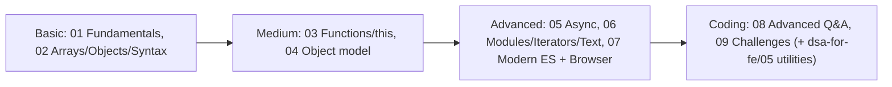
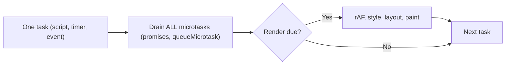
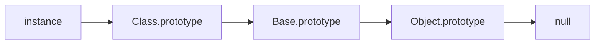
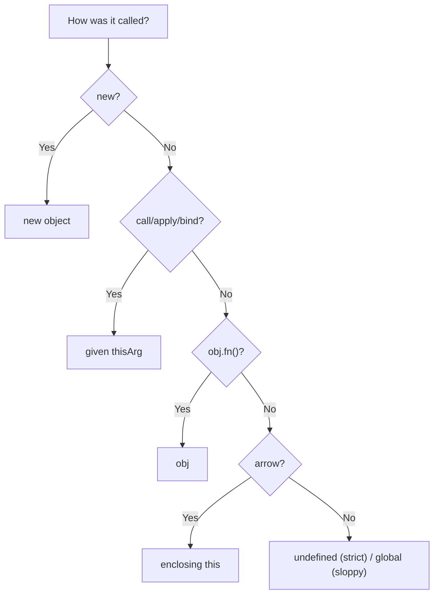

# JavaScript Recall Map

> Verification note: This is a **revision sheet**, not a tutorial. Each section points to the source document for detail ([01](01-language-fundamentals-types-coercion-and-equality.md) · [02](02-arrays-objects-collections-and-modern-syntax.md) · [03](03-functions-scope-closures-and-this.md) · [04](04-prototypes-classes-and-the-object-model.md) · [05](05-asynchronous-javascript-event-loop-promises-and-async-await.md) · [06](06-modules-iterators-generators-errors-and-text-processing.md) · [07](07-modern-ecmascript-and-javascript-in-the-browser.md) · [dsa-for-fe/05](../dsa-for-fe/05-frontend-specific-coding.md) · [08](08-advanced-fundamentals-and-coding.md) · [09](09-coding-challenges-polyfills-and-output-prediction.md)). Language semantics are standards-based and stable. The **edition labels** for newer features (ES2023 non-mutating array methods, ES2024 `Object.groupBy`/`Promise.withResolvers`, ES2025 Set methods/`Promise.try`/iterator helpers/`RegExp.escape`, ES2026-listed `Error.isError`/`Array.fromAsync`, ES2027-listed Temporal/`using`) come from the **TC39 finished-proposals list** (fetched 2026-11-26); **runtime support, polyfills and transpilation must be confirmed on MDN/caniuse/Node docs** *(hedged)*.

## Table of Contents

1. [60-Second Mental Model](#1-60-second-mental-model)
2. [Maps](#2-maps)
3. [Decision Tables](#3-decision-tables)
4. [Facts, Numbers and Defaults](#4-facts-numbers-and-defaults)
5. [Mnemonics](#5-mnemonics)
6. [Rapid-Fire Q&A](#6-rapid-fire-qa)
7. [Say-This Scripts](#7-say-this-scripts)
8. [Red Flags vs Green Flags](#8-red-flags-vs-green-flags)
9. [Final 10-Minute Checklist](#9-final-10-minute-checklist)
10. [Related Recall Maps](#10-related-recall-maps)

---

## 1. 60-Second Mental Model

- **Values:** 7 primitives (immutable, by value) + objects (mutable, by reference). Numbers are IEEE-754 doubles; `BigInt` for big integers; **coercion** follows `ToPrimitive`; prefer `===`; falsy = `false 0 -0 0n "" null undefined NaN`; `??` is nullish, `||` is falsy.
- **Functions & scope:** lexical scoping; **closures** = function + creation environment (private state, factories, stale-closure bugs, leaks). **`this`** is set by the call: `new` > `call/apply/bind` > `obj.method()` > default; arrows are lexical.
- **Objects:** `[[Prototype]]` chain delegates lookups; `class` is sugar over prototypes + TDZ/strict/`#private`; own vs inherited (`Object.hasOwn`); descriptors; `Proxy`/`Symbol` for metaprogramming; composition over inheritance.
- **Async:** one thread, many queues. Task → **drain all microtasks** → render → next task. Promises (`then` async, chain flattening), `async/await`, combinators, **`fetch` doesn't reject on HTTP errors**, cancel with `AbortController`, race conditions = ordering bugs.
- **Modules & data:** ESM (static, live bindings, TLA) vs CJS; iterators/generators (lazy); errors with `cause`; `JSON` drops `undefined`/functions, throws on BigInt/cycles; regex `g` is stateful; dates need ISO + explicit time zones.
- **Modern JS:** `?.`, `??`, `at`, `toSorted`, `groupBy`, Set algebra, `Promise.withResolvers`; **syntax is transpiled, APIs are polyfilled**; feature-detect.
- **Browser:** event phases, **delegation**, `target` vs `currentTarget`, observers instead of polling, `textContent` over `innerHTML`, avoid layout thrashing.
- **Coding rounds:** clarify → edge cases → simple correct solution → test → complexity → improve (cancel, types, memory).

---

## 2. Maps

**Learning path (basic → advanced → coding)**

**Event loop turn**

**Prototype chain**

**`this` decision**

**Where to read**

| Question topic | Read |
|---|---|
| Types, coercion, equality, truthiness | [01](01-language-fundamentals-types-coercion-and-equality.md) |
| Array/object/Map/Set methods, destructuring, spread | [02](02-arrays-objects-collections-and-modern-syntax.md) |
| Scope, closures, `this`, currying, recursion | [03](03-functions-scope-closures-and-this.md) |
| Prototypes, classes, Proxy, Symbols | [04](04-prototypes-classes-and-the-object-model.md) |
| Event loop, promises, async/await, cancellation | [05](05-asynchronous-javascript-event-loop-promises-and-async-await.md) |
| Modules, iterators, errors, JSON, regex, dates | [06](06-modules-iterators-generators-errors-and-text-processing.md) |
| ES editions, DOM/events/browser APIs | [07](07-modern-ecmascript-and-javascript-in-the-browser.md) |
| Debounce/throttle/memoize/deep clone | [dsa-for-fe/05](../dsa-for-fe/05-frontend-specific-coding.md) |
| 20 senior Q&A (execution context to race conditions) | [08](08-advanced-fundamentals-and-coding.md) |
| Polyfills, utilities, mini-Promise, puzzles | [09](09-coding-challenges-polyfills-and-output-prediction.md) |

---

## 3. Decision Tables

**Equality**

| Need | Use |
|---|---|
| Normal comparison | `===` |
| Null or undefined | `x == null` (or `x === null \|\| x === undefined`) |
| NaN/±0 distinction | `Object.is` |
| Array membership incl. NaN | `includes` (SameValueZero) |
| Structural object equality | deep-equal utility / IDs |

**Defaults and fallbacks**

| Situation | Use |
|---|---|
| Missing (null/undefined) only | `??` |
| Any falsy | `\|\|` (intentional) |
| Lazy init | `??=` |
| Safe property path | `?.` |

**Async tool choice**

| Need | Use |
|---|---|
| All or fail fast | `Promise.all` |
| Partial results | `Promise.allSettled` |
| First success | `Promise.any` |
| First settle/timeout | `Promise.race` + abort |
| Sequential | `for...of` + `await` |
| Limited concurrency | Pool of workers over thunks |
| Stale response guard | Abort previous + request ID |

**Copying**

| Need | Use |
|---|---|
| Shallow copy | spread / `Object.assign` / `slice` |
| Deep copy (supported types) | `structuredClone` |
| Deep copy (functions/custom) | hand-written recursion (cycle-safe) |
| Immutable array ops | `toSorted/toReversed/toSpliced/with` |

**Collections**

| Need | Use |
|---|---|
| Key-value, any key type, order | `Map` |
| Unique values | `Set` |
| Object keys with auto-GC | `WeakMap` |
| Dictionary safe from prototype keys | `Object.create(null)` / `Map` |

---

## 4. Facts, Numbers and Defaults

| Fact | Detail |
|---|---|
| Primitives | string, number, bigint, boolean, undefined, null, symbol |
| `typeof null` | `'object'` (legacy) |
| Safe integer | `Number.MAX_SAFE_INTEGER = 2^53 − 1` |
| `0.1 + 0.2` | `0.30000000000000004` |
| Falsy values | `false 0 -0 0n "" null undefined NaN` |
| `parseInt` | Always pass radix; `['1','2','3'].map(parseInt)` → `[1, NaN, NaN]` |
| Default `sort()` | Lexicographic string order; mutates |
| `reduce` empty without init | `TypeError` |
| `every([])` / `some([])` | `true` / `false` |
| `Array(3)` | Sparse (holes skipped by `forEach/map`) |
| `Object.keys` order | Integer-like keys ascending, then insertion order |
| Map/Set equality | SameValueZero (NaN equals NaN) |
| Microtasks | Run to completion before next task and before render |
| `setTimeout(0)` | Next task, clamped; not immediate |
| `fetch` | Rejects on network error/abort only; check `response.ok` |
| `await` | Resumes in a microtask |
| Class bodies | Strict mode, TDZ, require `new` |
| `Object.freeze` | Shallow |
| JSON | `undefined`/functions omitted; `NaN`→`null`; BigInt/cycles throw |
| Date | Months 0-based; date-only ISO = UTC; parse only ISO |
| Regex `g`/`y` | Stateful `lastIndex` |
| Node ordering | `nextTick` before promise microtasks (CJS main) |
| Edition labels | ES2023 array copy methods; ES2024 groupBy/withResolvers; ES2025 Set methods/Promise.try/iterator helpers (support hedged) |

---

## 5. Mnemonics

- **PIN-BUS** (primitives): **P**rimitive **I**mmutable **N**ull/undefined, **B**oolean/**B**igInt, **U**ndefined, **S**tring/**S**ymbol/number.
- **CALL-ORDER for `this`:** **N**ew → **E**xplicit → **M**ethod → **D**efault (arrows: lexical) — "New Elephants Make Dust".
- **MIM for the loop:** **M**icrotasks, then **I**mage (render), then **M**acrotask next.
- **FALSY-8:** `false, 0, -0, 0n, "", null, undefined, NaN`.
- **SPREAD expands, REST gathers** — position decides (call/literal vs binding).
- **CHAT for async bugs:** **C**ancel, **H**andle errors, **A**ctual order, **T**imeouts/retries.
- **COLD for closures:** **C**aptured scope, **O**utliving callbacks, **L**eaks, **D**ated (stale) values.
- **PROTO lookup:** Own → Prototype → Prototype… → null.
- **Coding round:** **C**larify, **E**dge cases, **S**implest correct, **T**est, **C**omplexity, **I**mprove ("Clever Engineers Start To Code Iteratively").
- **Sync vs syntax vs API:** Transpile **syntax**, polyfill **APIs**, detect **features**.

---

## 6. Rapid-Fire Q&A

- **`var` vs `let` vs `const`?** Function vs block scope; hoisting/TDZ; `const` prevents rebinding, not mutation.
- **What is a closure?** A function remembering its creation scope; enables private state; can leak/stale.
- **How is `this` decided?** At call time: new > bind/call/apply > method > default; arrows lexical.
- **Prototype vs `__proto__`?** `Fn.prototype` is the template for instances; `[[Prototype]]`/`__proto__` is an object's link.
- **Are classes real?** Sugar over prototypes with extras (`#private`, TDZ, strict).
- **`==` vs `===` vs `Object.is`?** Coercing vs strict vs strict with NaN/±0 differences.
- **`null` vs `undefined`?** Intentional empty vs unassigned/missing.
- **Event loop order?** Sync → microtasks → render → next task.
- **`Promise.all` vs `allSettled` vs `any` vs `race`?** All-or-fail / all outcomes / first success / first settle.
- **Does `async` mean parallel?** No; it schedules continuations; parallelism needs concurrent operations or workers.
- **`fetch` 404 behavior?** Resolves; check `ok`.
- **How to cancel?** `AbortController`.
- **Shallow vs deep copy?** Top-level only vs recursive; `structuredClone` for supported types.
- **Why is `[10,9,1].sort()` odd?** String order; use `(a,b)=>a-b`.
- **What does spread copy?** Own enumerable props, shallowly.
- **Optional chaining + nullish coalescing?** Safe path access and defaults for nullish only.
- **What is event delegation?** One ancestor listener using `target.closest`.
- **`target` vs `currentTarget`?** Origin vs listener element.
- **ESM vs CJS?** Static/live/async vs dynamic/sync.
- **Why regex `test` alternates?** `g` flag state in `lastIndex`.
- **Debounce vs throttle?** Fire after pause vs at most once per interval.
- **How to avoid memory leaks?** Remove listeners/timers, bound caches, `WeakMap`, abort controllers.
- **How to handle large numbers?** `BigInt` or strings; avoid `number` beyond 2^53.
- **How to use new features safely?** Browserslist + transpile syntax + polyfill APIs + feature detection.

---

## 7. Say-This Scripts

**Explaining a closure**
> "A closure is a function plus the lexical environment where it was created. That lets it keep using those variables after the outer function returns — which is how debounce keeps a timer ID and how React handlers capture a render's props. The flip side is stale values and retained memory, so I clean up listeners and timers."

**Explaining the event loop**
> "The call stack runs one task to completion; then the engine drains all microtasks — promise reactions and `queueMicrotask` — before it renders or takes the next task. That's why a promise `then` runs before a `setTimeout(0)`."

**Explaining `this`**
> "`this` is determined by how the function is called: with `new` it's the new object, with `call/apply/bind` it's the argument, as `obj.method()` it's `obj`, otherwise `undefined` in strict mode. Arrow functions don't have their own, so they use the enclosing one."

**Handling a race condition**
> "It's an ordering bug: whichever response arrives last wins. I'd cancel the previous request with an `AbortController` and ignore stale responses with a request token, then add a test using controlled promises."

**Defending a polyfill/feature choice**
> "Syntax gets transpiled to my Browserslist targets, but APIs like `toSorted` or `Promise.withResolvers` need a polyfill or a feature check. I'd check Baseline and our analytics before adopting, and add a CI smoke test in the oldest supported browser."

**Starting a coding question**
> "Let me clarify inputs, whether I can mutate, and the edge cases — empty, duplicates, falsy values. I'll write the simplest correct version, walk through an example, then discuss complexity and improvements like cancellation or typing."

---

## 8. Red Flags vs Green Flags

| Red flag | Green flag |
|---|---|
| "JS passes objects by reference" without nuance | "Pass by sharing: the reference is copied" |
| Uses `==` and relies on coercion tricks | Uses `===`, `??`, explicit parsing |
| `forEach(async ...)` and expects waiting | `for...of` or `Promise.all(map)` |
| Mutates arrays in state (`sort`/`reverse`) | Copies or `toSorted`, immutable updates |
| `innerHTML` with user data | `textContent`, sanitization, Trusted Types |
| Attaches listener per item | Event delegation + cleanup |
| Treats `setTimeout` timeouts as cancellation | `AbortController` + timeouts |
| Uses `JSON.parse(JSON.stringify())` to clone | `structuredClone` or typed clone with caveats |
| Says "TC39 finished = available everywhere" | Checks support, polyfills, targets |
| Memorizes polyfill code | Explains why each line exists and edge cases |
| No tests/complexity | Tests examples, states Big-O and trade-offs |
| Ignores memory (caches/listeners) | Bounds caches, removes listeners |

---

## 9. Final 10-Minute Checklist

- [ ] Can I list primitives, falsy values and coercion rules, and predict `[] + {}`, `'5' - 2`, `null >= 0`?
- [ ] Can I explain `var/let/const`, TDZ and hoisting with a loop + `setTimeout` example?
- [ ] Can I explain closures (use cases, stale values, leaks) and fix a stale-closure bug?
- [ ] Can I state the `this` rules and implement `bind`/`call`/`apply`/`new`/`instanceof`?
- [ ] Can I explain prototypes, `class` internals, private fields, Proxy and Symbols?
- [ ] Can I trace a promises + `setTimeout` + `async` output on paper?
- [ ] Can I explain `Promise.all/allSettled/any/race`, `fetch` + `ok`, `AbortController`, retry/backoff?
- [ ] Can I debug a race condition and describe latest-wins/cancel patterns?
- [ ] Can I contrast ESM and CJS, describe generators/iterators/async iteration, and use `cause`?
- [ ] Can I list `JSON.stringify` surprises, regex pitfalls (`lastIndex`, ReDoS) and date/time-zone traps?
- [ ] Can I name the newer APIs (`toSorted`, `groupBy`, Set methods, `withResolvers`, `Promise.try`) and discuss support/polyfills?
- [ ] Can I implement debounce/throttle/memoize/curry/compose/deepClone/deepEqual/LRU/EventEmitter from memory and test them?
- [ ] Can I explain event delegation, capture/bubble, `target` vs `currentTarget`, passive listeners, layout thrashing?
- [ ] Can I discuss security basics (XSS sinks, prototype pollution, `postMessage` origin checks)?
- [ ] Can I state complexity and trade-offs for each solution?

---

## 10. Related Recall Maps

[TypeScript](../typescript/06-typescript-recall-map.md) · [React](../react/09-react-recall-map.md) · [Browser Internals](../browser-internals/08-browser-internals-recall-map.md) · [Web Performance](../web-performance/08-web-performance-recall-map.md) · [Web Security](../web-security/09-web-security-recall-map.md) · [Networking and APIs](../networking-and-apis/09-networking-and-apis-recall-map.md) · [Testing](../testing/09-testing-recall-map.md) · [Debugging Scenarios](../debugging-scenarios/09-debugging-recall-map.md) · [HTML and CSS](../html-and-css/09-html-and-css-recall-map.md) · [System Design](../system-design/09-system-design-recall-map.md) · [Leadership](../leadership/09-leadership-recall-map.md)
