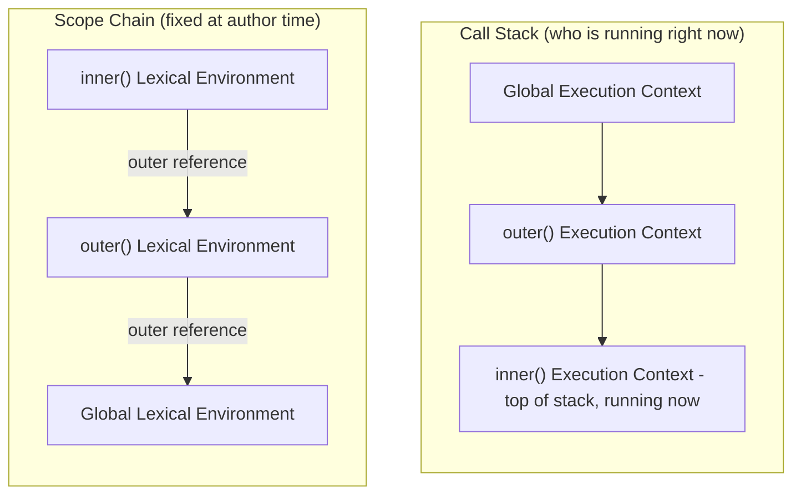
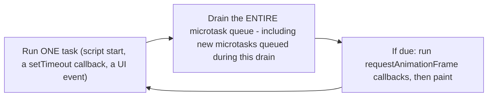
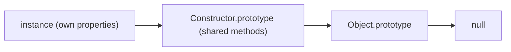
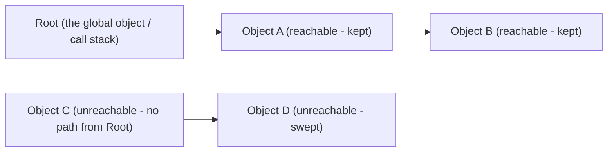

# JavaScript Interview Handbook — Document 2: Advanced Fundamentals & Coding

> Unlike [Document 1](01-arrays-objects-collections-and-modern-syntax.md), which was organized method-by-method, this handbook is a direct question → answer series — twenty senior-level JavaScript questions covering the execution model, async internals, and classic "implement it from scratch" coding challenges. Questions are kept in their original order and numbering, with ★ marking the ones most likely to come up as a true must-know in any interview. Where a question overlaps with a problem already fully implemented elsewhere in this workspace (debounce/throttle, deep clone, group-by/dedup/flatten — all in [dsa-for-fe/05](../dsa-for-fe/05-frontend-specific-coding.md)), this handbook gives a complete, working answer here and links out to the fuller trace/edge-case treatment rather than repeating it. Facts verified against MDN (`Closures`, the in-depth `Microtask guide`, `requestAnimationFrame`, `let`/`Hoisting`, `Function.prototype.{bind,call,apply}`, `Inheritance and the prototype chain`, `structuredClone`, `Object.is`/`Equality comparisons and sameness`, `Promise.all`, `async function`, `unhandledrejection`, `Iterators and generators`, `Symbol`, `WeakMap`, `Memory management`, `Object.{freeze,seal,preventExtensions}`).

## Table of Contents

1. [How To Use This Handbook](#1-how-to-use-this-handbook)
2. [Advanced Fundamentals & Coding — Q&A (Questions 1–20)](#2-advanced-fundamentals--coding-qa-questions-1-20)
3. [Key Terms Glossary](#3-key-terms-glossary)
4. [Further Reading](#4-further-reading)

---

## 1. How To Use This Handbook

Each question is self-contained — read top-to-bottom as a mock interview, or jump straight to the one you need. Several questions here are deliberately paired (closures ↔ memory leaks, the event loop ↔ race-condition debugging, shallow/deep copy ↔ reference equality) because interviewers love to chain a follow-up from one into the other — read the pairing notes even if you only came for one specific question.

---

## 2. Advanced Fundamentals & Coding — Q&A (Questions 1–20)

This batch of twenty moves through four loose clusters, in the order asked: the **core execution model** (Q1–9 — execution context, closures, the event loop, scheduling APIs, hoisting, `this`, prototypes, copying, and reference equality), **hand-rolled implementations of everyday utilities** (Q10–13 and Q18 — `map`/`filter`/`reduce`, debounce/throttle, `Promise.all`, a concurrency limiter, and data-wrangling helpers), **asynchronous programming and memory** (Q14–17 — async/await, generators/iterators/symbols/weak collections, garbage collection, and immutability), and two **closing questions** tying equality semantics and real-world async debugging back together (Q19–20).

### 1. ★ Explain the JavaScript execution context, call stack, lexical environment, and scope chain.

An **execution context** is the environment the engine builds to run a piece of code — it tracks which line is executing, what variables are in scope, and what `this` refers to. There are three kinds: the **global execution context** (created once, for top-level code), a **function execution context** (created fresh every time a function is *called*, not when it's defined), and the rarely-used **eval execution context**.

Every execution context owns a **lexical environment** — a record of the variable/function bindings declared in that scope, plus a reference to its **outer** lexical environment. That outer reference is fixed at the moment the function is *written* (nested inside whatever scope it's textually defined in), not at the moment it's *called* — this is what "lexical" (a.k.a. static) scoping means, as opposed to a function somehow inheriting the scope of whoever happens to call it.

The **call stack** is a LIFO stack of execution contexts currently in progress: calling a function pushes a new context on top; returning from it pops that context off and resumes the one underneath. The **scope chain** is the chain of *lexical environments* (not the call stack) the engine walks outward through when resolving an identifier that isn't found in the current scope — from innermost to outermost, ending at global, throwing `ReferenceError` if it's never found.

```js
const globalVar = 'global';

function outer() {
  const outerVar = 'outer';

  function inner() {
    const innerVar = 'inner';
    console.log(innerVar, outerVar, globalVar); // resolved via the scope chain
  }

  inner();
}

outer();
```

When `inner()` runs, its execution context sits on top of `outer()`'s, which sits on top of the global context — that's the call stack. Looking up `outerVar` inside `inner` fails in `inner`'s own lexical environment, so the engine walks outward to `outer`'s lexical environment (found); `globalVar` isn't in either, so it walks all the way to the global lexical environment (found). That outward walk is the scope chain, and it's fixed by where `inner` was *written* (nested inside `outer`), never by who calls it.



### 2. ★ Explain closures. What are their practical use cases, and how can they cause memory leaks?

A closure is a function bundled together with references to its surrounding lexical environment — in JavaScript, every function forms a closure over the scope it was created in, the moment it's created. That's why an inner function can keep reading (and writing) a variable from its enclosing function *after* that enclosing function has already returned:

```js
function makeAdder(x) {
  return function (y) {
    return x + y; // still reads `x` long after makeAdder(5) has returned
  };
}

const add5 = makeAdder(5);
add5(2); // 7 — `x` is alive inside add5's closure
```

**Practical use cases:** private/encapsulated state (a counter whose internal value can't be touched except through the functions returned alongside it — the classic module pattern), function factories/partial application (`makeAdder` above), and giving a callback "memory" between separate invocations — exactly how `debounce`, `throttle`, and `memoize` work (see [Q11](#11-implement-debounce-and-throttle-when-would-you-use-each-in-a-frontend-application) and [dsa-for-fe/05](../dsa-for-fe/05-frontend-specific-coding.md), which is built entirely on this idea).

**Memory leaks:** a closure keeps its *entire* lexical environment reachable for as long as the closure itself is reachable — not just the specific variables its body happens to reference. If a long-lived closure (an event listener that's never removed, a timer that's never cleared, a module-level cache) was created in the same scope as a large object, that object can stay pinned in memory even though nothing in the program will ever read it again:

```js
function setupHandler(button) {
  const hugeDataset = fetchHugeDataset(); // a large array, only needed briefly

  button.addEventListener('click', function onClick() {
    console.log('clicked'); // never touches hugeDataset at all
  });
  // `onClick` closes over the same scope as `hugeDataset`. As long as the
  // listener stays attached, the engine may be unable to reclaim hugeDataset —
  // even though onClick never reads it.
}
```

The fix is usually one of: call `removeEventListener` once the listener is no longer needed, avoid capturing large objects in the same scope as a long-lived callback (narrow the scope, or null the reference out once you're done with it), and clear timers/intervals you no longer need (`clearTimeout`/`clearInterval`). See [Q16](#16-explain-memory-management-garbage-collection-retained-references-and-common-causes-of-javascript-memory-leaks) for the full catalogue of leak causes.

### 3. ★ Explain the event loop, call stack, microtask queue, and macrotask queue. Predict the output of a complex example involving promises and setTimeout.

The **call stack** runs synchronous code. Two separate queues feed it more work once it's empty: the **macrotask (task) queue** — `setTimeout`/`setInterval` callbacks, the initial script, UI events — and the **microtask queue** — `Promise` reactions (`.then`/`.catch`/`.finally`) and `queueMicrotask()` callbacks. Each turn of the **event loop** does exactly this, in order:

1. Run **one** task from the task queue (or the initial script, on the very first turn).
2. Once the call stack is empty, drain the **entire** microtask queue — including any *new* microtasks that get queued while draining (they still run before step 3).
3. If it's time to render a frame, run any `requestAnimationFrame` callbacks, then paint.
4. Go back to step 1.



The single most important consequence: **microtasks always fully drain before the next task runs**, no matter how many new microtasks get queued along the way. Trace this example line by line:

```js
console.log('A');

setTimeout(() => {
  console.log('B');
  Promise.resolve().then(() => console.log('C'));
}, 0);

Promise.resolve().then(() => {
  console.log('D');
  setTimeout(() => console.log('E'), 0);
});

Promise.resolve().then(() => console.log('F'));

console.log('G');
```

- The synchronous script runs first: logs `A`, schedules a macrotask (call it Task1, logs `B`), queues a microtask (M1, logs `D`), queues a microtask (M2, logs `F`), logs `G`. **Printed so far: `A`, `G`.**
- Call stack is now empty → drain the microtask queue completely: M1 runs (logs `D`, and schedules a *new* macrotask, Task2, which logs `E` — scheduling a macrotask does **not** add anything to the microtask queue, so this doesn't delay M2), then M2 runs (logs `F`). **Printed: `D`, `F`.**
- Microtask queue is empty → run the next task. Task1 was registered first (during the original synchronous script), so it runs before Task2 (which was only registered *during* M1's execution, after the script had already finished). Task1 logs `B`, then queues a new microtask M3 (logs `C`).
- Microtasks drain again before the next task: M3 runs, logging `C`.
- Finally Task2 runs, logging `E`.

**Final order: `A`, `G`, `D`, `F`, `B`, `C`, `E`.** The pattern worth memorizing: every task is *fully* followed by a complete microtask drain before the next task is allowed to start — that's true even for microtasks queued from inside another microtask, or new tasks queued from inside a microtask (those simply join the back of the task queue and wait their turn).

### 4. ★ What is the difference between Promise.then(), queueMicrotask(), setTimeout(), and requestAnimationFrame()?

| API | Queue | Runs relative to the current script | Typical use |
|---|---|---|---|
| `Promise.then()` / `queueMicrotask()` | Microtask queue | Immediately after the current task, before the *next* task — and the whole microtask queue drains first | React to an already-settling value ASAP without waiting for a brand-new task |
| `requestAnimationFrame()` | Its own per-frame callback list | After the current iteration's microtasks drain, right before the browser paints the next frame | Visual/animation updates synced to the display's refresh rate |
| `setTimeout()` / `setInterval()` | Task (macrotask) queue | At least N ms later, as a brand-new task — only after **all** microtasks from the current task have drained | Defer work until the stack and pending microtasks are clear, or genuinely delay by wall-clock time |

Ordering, fastest to slowest: **microtask < `requestAnimationFrame` < `setTimeout`**. A `setTimeout(fn, 0)` is not "immediate" — it's "whenever the task queue gets around to it," which is always after the current script *and* every microtask it queued have finished (see [Q3](#3--explain-the-event-loop-call-stack-microtask-queue-and-macrotask-queue-predict-the-output-of-a-complex-example-involving-promises-and-settimeout)'s full trace).

### 5. Explain hoisting, the temporal dead zone, and the difference between var, let, and const.

**Hoisting** is the (informal) name for the fact that declarations are processed before the engine starts running a scope's code line-by-line. `var` and `function` declarations are hoisted with *value* semantics — `var` bindings are created and initialized to `undefined` up front, so reading one before its declaration line gives `undefined` rather than an error. `let`/`const`/`class` are hoisted too, but **not initialized** — they exist in a **temporal dead zone (TDZ)** from the start of their block until the declaration line actually runs; any read attempt in between throws `ReferenceError`, and even `typeof` on a TDZ variable throws (unlike `typeof` on a truly undeclared variable, which safely returns `"undefined"`).

```js
{
  console.log(bar); // "undefined" — var is hoisted AND initialized
  console.log(foo); // ReferenceError: Cannot access 'foo' before initialization
  var bar = 1;
  let foo = 2; // TDZ for `foo` ends here
}
```

| Aspect | `var` | `let` | `const` |
|---|---|---|---|
| Scope | Function (or global) | Block | Block |
| Before its declaration line | `undefined` (hoisted + initialized) | `ReferenceError` (in the TDZ) | `ReferenceError` (in the TDZ) |
| Re-declare in the same scope | Allowed | `SyntaxError` | `SyntaxError` |
| Re-assign | Allowed | Allowed | `TypeError` — the *binding* can't be reassigned (the object it points to can still be mutated) |
| Creates a property on the global object at top level | Yes | No | No |

`const` prevents **re-assignment**, not mutation: `const user = { name: 'A' }; user.name = 'B';` is perfectly legal — only `user = {}` would throw. Reaching for `const` by default (switching to `let` only when a binding genuinely needs reassignment) is the most common modern style guideline, since it signals intent at a glance.

### 6. ★ Explain this binding and the differences between call, apply, and bind. Implement a custom bind.

`this` is not resolved lexically like a normal variable — it's determined by **how a function is called**, re-evaluated at every call site: as `obj.method()` it's `obj`; as a bare `fn()` it's `undefined` in strict mode (or the global object in sloppy mode); as `new Fn()` it's the newly created instance; as a DOM event handler it's the element the listener is attached to; and inside an arrow function it isn't bound at all — an arrow function has no `this` of its own, so it transparently uses whatever `this` was in its *enclosing* lexical scope.

| Method | Invokes immediately? | Argument format | Returns |
|---|---|---|---|
| `fn.call(thisArg, a, b)` | Yes | Individual, comma-separated | The function's return value |
| `fn.apply(thisArg, [a, b])` | Yes | A single array-like | The function's return value |
| `fn.bind(thisArg, a, b)` | No | Individual (partial application) | A **new** function, permanently bound, to call later |

`fn.bind(thisArg, a, b)` is conceptually `(...rest) => fn.call(thisArg, a, b, ...rest)` — except it's a real function with its own identity, reusable, and (per spec) also usable with `new`, in which case the bound `thisArg` is ignored in favor of the freshly constructed instance.

```js
Function.prototype.myBind = function (thisArg, ...boundArgs) {
  const targetFn = this; // the function myBind was called on

  function bound(...callArgs) {
    const args = [...boundArgs, ...callArgs];
    // called via `new`: let the new instance (not thisArg) become `this`
    if (new.target) {
      return targetFn.apply(this, args);
    }
    return targetFn.apply(thisArg, args);
  }

  // so `new bound()` still produces an instanceof-correct object,
  // and methods on targetFn.prototype remain inherited
  bound.prototype = Object.create(targetFn.prototype || Object.prototype);
  return bound;
};

function greet(greeting) {
  return `${greeting}, ${this.name}`;
}

const boundGreet = greet.myBind({ name: 'Ada' }, 'Hello');
boundGreet(); // "Hello, Ada"
```

This covers the common cases (fixing `this`, partial application, and basic `new` support); the fully spec-compliant `bind()` also handles a few extra edge cases around subclassing via `Reflect.construct`, omitted here for clarity.

### 7. Explain prototypal inheritance, the prototype chain, and how JavaScript classes work internally.

Every JavaScript object has an internal link — `[[Prototype]]`, exposed via `Object.getPrototypeOf()`/`Object.setPrototypeOf()` — to another object (or `null`). Reading a property that isn't found directly on an object falls through to its prototype, then *that* object's prototype, and so on, until the property is found or the chain ends at `null`. This chain of fallback objects is the **prototype chain**, and it's how JavaScript implements inheritance without classes at all:



Every function has a `.prototype` object; calling it with `new` creates a fresh object whose `[[Prototype]]` is set to that function's `.prototype`, which is exactly how shared methods end up reachable from every instance without being copied onto each one individually:

```js
function Box(value) {
  this.value = value;
}
Box.prototype.getValue = function () {
  return this.value;
};

const box = new Box(1);
box.getValue(); // 1 — found on Box.prototype, not on box itself
```

`class` is **syntactic sugar over exactly this mechanism** — it doesn't introduce a new inheritance model. `class Box { getValue() {...} }` puts `getValue` on `Box.prototype`, identical to the manual version above; `class Derived extends Base {}` wires up `Derived.prototype`'s `[[Prototype]]` to `Base.prototype`, equivalent to calling `Object.setPrototypeOf(Derived.prototype, Base.prototype)` by hand; `super(...)` calls the parent constructor. The main things classes add that have no trivial prototypal equivalent are private `#fields` and a stricter, hoisting-but-TDZ'd declaration form. One documented pitfall either way: **never monkey-patch a built-in prototype** (`Array.prototype.myMethod = ...`) in real code — it risks silently breaking if the language later adds a method with the same name but different behavior (this exact scenario, nicknamed "SmooshGate," happened to a community `Array.prototype.flatten` proposal).

### 8. What are shallow copy and deep copy? How would you implement a robust deep-clone function?

A **shallow copy** duplicates only the top level: `{ ...obj }` or `Object.assign({}, obj)` create a new outer object, but any nested object/array inside it is still the *same reference* shared with the original — mutating `copy.nested.x` also mutates `original.nested.x`. A **deep copy** recursively duplicates every nested level, so the clone and the original share no mutable references at all.

[dsa-for-fe/05 Problem 4](../dsa-for-fe/05-frontend-specific-coding.md#problem-4-deep-clone) already implements a baseline recursive `deepClone` and documents its limitations in detail (no circular-reference protection, `Date`/`RegExp`/`Map`/`Set` degrade to plain objects). Here's a more **robust** version that fixes the circular-reference gap with a `WeakMap` and special-cases the most common non-plain types:

```js
function deepClone(value, seen = new WeakMap()) {
  if (value === null || typeof value !== 'object') {
    return value; // primitives AND functions pass through as-is (functions are shared by reference)
  }
  if (seen.has(value)) {
    return seen.get(value); // circular reference: return the clone already in progress
  }
  if (value instanceof Date) return new Date(value.getTime());
  if (value instanceof RegExp) return new RegExp(value.source, value.flags);

  if (Array.isArray(value)) {
    const clone = [];
    seen.set(value, clone);
    value.forEach((item, i) => {
      clone[i] = deepClone(item, seen);
    });
    return clone;
  }

  const clone = {};
  seen.set(value, clone);
  for (const key of Object.keys(value)) {
    clone[key] = deepClone(value[key], seen);
  }
  return clone;
}

const original = { name: 'A', nested: { x: 1 } };
original.self = original; // circular reference

const clone = deepClone(original);
clone.nested.x = 99;
console.log(original.nested.x); // 1 — unaffected
console.log(clone.self === clone); // true — the cycle was preserved, not infinitely recursed
```

The modern built-in alternative is `structuredClone(value)` — it natively handles circular references and types like `Date`/`Map`/`Set`/`ArrayBuffer`, but throws a `DataCloneError` on anything non-serializable (functions, DOM nodes, `Error` objects in some engines). For an interview answer, naming **both** the hand-rolled version (to show you understand recursion + the circular-reference problem) and `structuredClone()` (to show you know the modern shortcut and its own limitation) is the strongest response.

### 9. Explain reference equality, object mutation, immutability, and their effects on React rendering.

For objects, arrays, and functions, `===` checks **reference equality** — are both sides literally the same object in memory — not structural/content equality. Two structurally-identical objects created separately are never `===` to each other:

```js
const a = { x: 1 };
const b = { x: 1 };
const c = a;

a === b; // false — same shape, different objects
a === c; // true — c is literally a reference to the same object as a
a.x = 2;
c.x;      // 2 — mutating through `a` is visible through `c`, same reference throughout
```

**Mutation** changes an object's contents without changing its reference/identity (`a === c` stays `true` the whole time above). **Immutability**, by convention, means never mutating in place — instead producing a *new* object/array when something changes (`{ ...state, x: 2 }` instead of `state.x = 2`), which necessarily changes the reference too.

This distinction is exactly what React's optimizations key off of. `React.memo`, `useMemo`, `useCallback`, and dependency arrays all compare the previous vs. next value by **reference**, not by deep equality, between renders. Two opposite bugs fall out of this: (1) mutating an object/array in place and passing the *same* reference back into state means React's shallow comparison sees "nothing changed," so the UI silently fails to re-render even though the data did change; (2) creating a brand-new object/array/function literal on every render (an inline `style={{ color: 'red' }}`, or `() => doThing()` passed as a prop) produces a *new* reference every single time even when the content is identical, defeating `React.memo` and causing the child to re-render unnecessarily. The fix in both directions is the same rule: treat state as immutable (always produce a new reference when data actually changes) and stabilize references when data *hasn't* changed (`useMemo`/`useCallback`, or hoist constant objects/functions outside the component). See [react-native/10-tire6-react-internals-in-react-native.md](../react-native/10-tire6-react-internals-in-react-native.md) in this workspace for the deeper reconciliation/`setState` mechanics this feeds into.

### 10. ★ Implement map, filter, and reduce without using the built-in methods.

```js
function myMap(array, callback, thisArg) {
  const result = [];
  for (let i = 0; i < array.length; i++) {
    result.push(callback.call(thisArg, array[i], i, array));
  }
  return result;
}

function myFilter(array, callback, thisArg) {
  const result = [];
  for (let i = 0; i < array.length; i++) {
    if (callback.call(thisArg, array[i], i, array)) {
      result.push(array[i]);
    }
  }
  return result;
}

function myReduce(array, callback, initialValue) {
  const hasInitialValue = arguments.length >= 3;
  let accumulator = hasInitialValue ? initialValue : undefined;
  let startIndex = 0;

  if (!hasInitialValue) {
    if (array.length === 0) {
      throw new TypeError('Reduce of empty array with no initial value');
    }
    accumulator = array[0];
    startIndex = 1;
  }

  for (let i = startIndex; i < array.length; i++) {
    accumulator = callback(accumulator, array[i], i, array);
  }
  return accumulator;
}

myMap([1, 2, 3], (n) => n * 2);               // [2, 4, 6]
myFilter([1, 2, 3, 4], (n) => n % 2 === 0);   // [2, 4]
myReduce([1, 2, 3], (acc, n) => acc + n, 0);  // 6
myReduce([], (acc, n) => acc + n);            // throws TypeError — matches the real reduce()
```

All three mirror the real methods' documented callback signature `(element, index, array)` plus an optional `thisArg` for `map`/`filter`, and `myReduce` reproduces the real, frequently-tested edge case: calling `reduce` on an empty array **without** an initial value throws, rather than silently returning `undefined`.

### 11. Implement debounce and throttle. When would you use each in a frontend application?

Both wrap a function in a closure that remembers state between calls — fully implemented, hand-traced, and compared in [dsa-for-fe/05 Problem 1](../dsa-for-fe/05-frontend-specific-coding.md#problem-1-debounce) (Debounce) and [Problem 2](../dsa-for-fe/05-frontend-specific-coding.md#problem-2-throttle) (Throttle). The short version:

```js
function debounce(fn, delay) {
  let timeoutId;
  return function (...args) {
    clearTimeout(timeoutId);
    timeoutId = setTimeout(() => fn.apply(this, args), delay);
  };
}

function throttle(fn, limit) {
  let inThrottle = false;
  return function (...args) {
    if (inThrottle) return;
    fn.apply(this, args);
    inThrottle = true;
    setTimeout(() => { inThrottle = false; }, limit);
  };
}
```

**Debounce** waits for a pause in calls before firing once — use it for search-as-you-type (don't fire a request on every keystroke, only once the user stops) or window-resize handlers where only the *final* size matters. **Throttle** guarantees a maximum firing rate while calls keep coming — use it for scroll handlers or mouse-move handlers where you want regular updates *during* the activity, not just at the end.

### 12. Implement Promise.all(). How should it behave when one promise rejects?

`Promise.all()` should resolve with an array of values in the **same order as the input**, regardless of which promise actually finishes first, and it should **fail fast**: reject as soon as any one input rejects, with that rejection's reason, without waiting for the rest.

```js
function promiseAll(promises) {
  return new Promise((resolve, reject) => {
    const results = [];
    let remaining = promises.length;

    if (remaining === 0) {
      resolve(results); // an empty input resolves immediately with []
      return;
    }

    promises.forEach((p, index) => {
      Promise.resolve(p).then((value) => {
        results[index] = value; // write at the ORIGINAL index, not arrival order
        remaining -= 1;
        if (remaining === 0) resolve(results);
      }, reject); // first rejection wins — a promise can only settle once, so later ones are no-ops
    });
  });
}
```

Wrapping each item in `Promise.resolve(p)` means plain, non-promise values are accepted too (they resolve immediately) — matching the real `Promise.all()`. Because a promise can only ever settle once, calling `reject` from the first rejected input "wins," and any later rejections calling `reject` again are silently ignored by the surrounding `Promise` machinery — no extra bookkeeping needed to implement the fail-fast behavior. (The sibling combinators worth knowing by name: `Promise.allSettled()` waits for every promise regardless of outcome; `Promise.race()`/`Promise.any()` settle as soon as the first promise settles/fulfills.)

### 13. How would you limit concurrency when executing 100 asynchronous API requests?

The naive-looking fix doesn't work: `Promise.all(urls.map(fetchOne))` still starts **all 100** requests immediately, because `.map()` calls `fetchOne` for every URL synchronously up front — by the time `Promise.all` even sees the array, every request is already in flight. To actually *limit* concurrency, the work must be represented as **task factories** (functions that haven't started yet) so a fixed-size pool of "workers" can pull the next one only when a slot frees up:

```js
async function runWithConcurrencyLimit(tasks, limit) {
  const results = new Array(tasks.length);
  let nextIndex = 0;

  async function worker() {
    while (nextIndex < tasks.length) {
      const currentIndex = nextIndex++; // synchronous — safe even with overlapping workers
      results[currentIndex] = await tasks[currentIndex]();
    }
  }

  const workerCount = Math.min(limit, tasks.length);
  await Promise.all(Array.from({ length: workerCount }, worker));
  return results;
}

const tasks = urls.map((url) => () => fetch(url)); // factories, not started promises
await runWithConcurrencyLimit(tasks, 5); // at most 5 requests in flight at once
```

Each `worker()` loop grabs the next index and increments the shared counter *before* awaiting anything, so there's no race between workers even though JavaScript is running several `worker()` calls "concurrently" — the increment itself is synchronous, and JS is single-threaded, so two workers can never read the same `nextIndex` value. A simpler-to-explain (but less efficient) alternative is chunking: process the tasks in fixed-size batches of `limit`, `await Promise.all()` on each batch before starting the next — easier to reason about, but it wastes time waiting for the *slowest* item in a batch before starting the next batch, instead of immediately refilling a slot the moment any single request finishes.

### 14. Explain async/await, promise chaining, error propagation, and unhandled promise rejections.

`async`/`await` is syntax sugar over promises: an `async function` always returns a promise, and `await` pauses the function (without blocking the thread — see [react-native/09-tire5-javascript-internals.md](../react-native/09-tire5-javascript-internals.md) for why nothing actually blocks) until the awaited promise settles, unwrapping its resolved value or re-throwing its rejection as a regular exception. That's what lets ordinary `try`/`catch` work around asynchronous code:

```js
async function getUser(id) {
  try {
    const response = await fetch(`/users/${id}`);
    return await response.json();
  } catch (err) {
    console.error('failed to load user', err);
    throw err; // re-throw: the caller's own await/catch decides what happens next
  }
}
```

**A classic "over-await" mistake:** awaiting two independent operations one after another wastes time serially, when they could run concurrently:

```js
// Sequential: second fetch doesn't even START until the first one finishes
async function sequential() {
  const user = await fetchUser();    // ~1s
  const posts = await fetchPosts();  // THEN another ~1s — total ~2s
  return { user, posts };
}

// Concurrent: both requests start immediately, wait for both together
async function concurrent() {
  const [user, posts] = await Promise.all([fetchUser(), fetchPosts()]); // total ~1s
  return { user, posts };
}
```

**Unhandled promise rejections** happen when a rejected promise has no `.catch()`/second-`.then()`-argument/enclosing `try`-`catch` anywhere in its chain by the time the microtask queue finishes draining — this fires the global `unhandledrejection` event (`window.addEventListener('unhandledrejection', ...)`), which is how error-tracking tools catch "silent" async failures. One genuinely subtle, easy-to-miss gotcha: `const results = [await p1, await p2]` does **not** wire `p2` into any error-handling chain until `p1` has already resolved — if `p2` rejects *before* `p1` settles, you get a real unhandled rejection even if the whole call is wrapped in `.catch()`, because the rejection happens before `p2` is ever actually awaited. Always start independent promises together (`Promise.all([p1, p2])`) rather than awaiting them one at a time if you want their errors reliably caught together.

### 15. What are generators, iterators, symbols, and weak collections? Where are they useful?

An **iterator** is any object implementing the iterator protocol: a `next()` method returning `{ value, done }`. A **generator** (`function* () { yield x; }`) is the easy way to *write* an iterator — calling a generator function doesn't run its body immediately; it returns a generator object, and each `.next()` call resumes execution until the next `yield`:

```js
function* idGenerator() {
  let id = 1;
  while (true) yield id++; // an infinite, lazily-produced sequence
}

const ids = idGenerator();
ids.next().value; // 1
ids.next().value; // 2
```

Useful for: lazily producing infinite or expensive-to-compute sequences (IDs, paginated-API cursors), custom traversal logic for a tree/graph data structure, and — historically — as the mechanism `async`/`await` itself is conceptually built on (per MDN: "the behavior of async/await is similar to combining generators and promises").

An object becomes iterable (usable in `for...of`, spread, destructuring) by implementing `[Symbol.iterator]()`:

```js
const range = {
  from: 1, to: 3,
  [Symbol.iterator]() {
    let current = this.from;
    const last = this.to;
    return { next: () => current <= last ? { value: current++, done: false } : { value: undefined, done: true } };
  },
};
[...range]; // [1, 2, 3]
```

A **Symbol** is a guaranteed-unique primitive, mainly used for two things: property keys that can never accidentally collide with a string key some other code adds to the same object, and **well-known symbols** (`Symbol.iterator`, `Symbol.toPrimitive`, `Symbol.hasInstance`, …) that act as invisible "protocol" hooks letting user code customize built-in language behavior without adding a magic-named string method. Symbol-keyed properties are skipped by `for...in`, `Object.keys()`, and `JSON.stringify()`.

**WeakMap/WeakSet** are like `Map`/`Set` but hold their object keys (WeakMap) or values (WeakSet) *weakly* — an entry doesn't prevent its key/value from being garbage collected, and once collected, the entry simply disappears (this is also why they're not iterable — the key list would depend on unpredictable GC timing). Two classic uses: **private per-instance metadata** that's automatically cleaned up when the instance dies (attaching data to a DOM node, or emulating private fields before `#field` syntax existed), and **caching keyed by an object** without that cache itself becoming a memory leak. See [Q16](#16-explain-memory-management-garbage-collection-retained-references-and-common-causes-of-javascript-memory-leaks) for why that distinction matters.

### 16. Explain memory management, garbage collection, retained references, and common causes of JavaScript memory leaks.

JavaScript manages memory automatically: allocating it when values are created, and reclaiming it via **garbage collection (GC)** once it decides memory is no longer reachable. All modern engines use **mark-and-sweep**: starting from a set of **roots** (the global object, and anything currently on the call stack), the collector marks every object reachable by following references, then sweeps away (frees) everything that was never marked — i.e., everything **unreachable** from a root. This correctly handles the one case the older, now-abandoned **reference-counting** approach couldn't: circular references (two objects referencing only each other) are unreachable from any root once nothing else points to them, so mark-and-sweep reclaims them even though their mutual reference count never hits zero.



A **retained reference** is any live reference that keeps an otherwise-unneeded object reachable — the root cause of every JS "memory leak" (since you can't explicitly `free()` anything; you can only make sure nothing still points to it). The common, recurring causes in frontend code:

- **Forgotten timers/intervals** — a `setInterval` that's never `clearInterval`'d keeps its callback (and everything that callback's closure retains) alive forever.
- **Event listeners that are never removed**, especially ones attached to long-lived targets like `window`/`document` from a component that itself gets destroyed.
- **Closures capturing more than they need** — see [Q2](#2--explain-closures-what-are-their-practical-use-cases-and-how-can-they-cause-memory-leaks)'s example of a listener closure accidentally retaining a large unrelated object.
- **Detached DOM nodes still referenced from JS** — removing an element from the document doesn't free it if a JS variable (or a closure) still points to it.
- **Caches/collections that only ever grow** — a plain `Map`/object used as a cache with no eviction will retain every entry forever; a `WeakMap` keyed by the cached object sidesteps this, since entries disappear once nothing else references the key.

### 17. What are Object.freeze(), Object.seal(), and Object.preventExtensions()? Are they deep operations?

All three are increasingly strict levels of locking down an object's **own** property set — and all three are **shallow**: none of them touch nested objects.

| Operation | Add new properties? | Remove properties? | Change existing values? | Reassign the prototype? |
|---|---|---|---|---|
| `Object.preventExtensions(obj)` | No | Yes | Yes | No |
| `Object.seal(obj)` | No | No | Yes (if writable) | No |
| `Object.freeze(obj)` | No | No | No | No |

```js
const employee = { name: 'Mayank', address: { city: 'Delhi' } };
Object.freeze(employee);

employee.name = 'Dummy';        // fails silently (throws in strict mode) — top level IS frozen
employee.address.city = 'Noida'; // succeeds! — freeze() never touches nested objects
console.log(employee.address.city); // "Noida"
```

To get a true **deep freeze**, recursively freeze every nested object/function before freezing the object itself (watch out for circular references, which would infinite-loop this naive version):

```js
function deepFreeze(object) {
  for (const key of Reflect.ownKeys(object)) {
    const value = object[key];
    if ((value && typeof value === 'object') || typeof value === 'function') {
      deepFreeze(value);
    }
  }
  return Object.freeze(object);
}
```

### 18. How would you implement a function that groups objects by a property, removes duplicates, or flattens a nested array?

All three are fully implemented, hand-traced, and discussed (including their built-in alternatives) in [dsa-for-fe/05](../dsa-for-fe/05-frontend-specific-coding.md): [Group By](../dsa-for-fe/05-frontend-specific-coding.md#problem-6-group-by), [Remove Duplicates](../dsa-for-fe/05-frontend-specific-coding.md#problem-7-remove-duplicates), and [Flatten Array](../dsa-for-fe/05-frontend-specific-coding.md#problem-5-flatten-array). Condensed:

```js
function groupBy(items, keyFn) {
  const groups = {};
  for (const item of items) {
    const key = keyFn(item);
    (groups[key] ??= []).push(item);
  }
  return groups;
}

function removeDuplicates(items, keyFn = (x) => x) {
  const seen = new Set();
  return items.filter((item) => {
    const key = keyFn(item);
    if (seen.has(key)) return false;
    seen.add(key);
    return true;
  });
}

function flatten(array) {
  return array.reduce(
    (flat, item) => flat.concat(Array.isArray(item) ? flatten(item) : item),
    [],
  );
}

groupBy([{ role: 'fe' }, { role: 'be' }, { role: 'fe' }], (x) => x.role);
// { fe: [{role:'fe'}, {role:'fe'}], be: [{role:'be'}] }
removeDuplicates([1, 2, 2, 3], (x) => x); // [1, 2, 3]
flatten([1, [2, [3, 4]], 5]);              // [1, 2, 3, 4, 5]
```

Each has a modern built-in shortcut worth naming: `Object.groupBy(items, keyFn)` (returns a null-prototype object), a `Set` spread (`[...new Set(arr)]`) for deduplicating primitives only, and `array.flat(Infinity)` for flattening arbitrarily deep.

### 19. What are the differences between ==, ===, Object.is(), and truthiness?

`===` (**strict equality**) compares type and value with no conversion — different types are always unequal. `==` (**loose equality**) first coerces operands to a common type, then compares — the source of most of its surprising results. `Object.is()` behaves like `===`, except for two deliberately special numeric cases: `Object.is(NaN, NaN)` is `true` (where `===` says `false`), and `Object.is(+0, -0)` is `false` (where `===` says `true`).

| a | b | `==` | `===` | `Object.is()` |
|---|---|---|---|---|
| `NaN` | `NaN` | false | false | **true** |
| `+0` | `-0` | true | true | **false** |
| `0` | `false` | true | false | false |
| `null` | `undefined` | true | false | false |
| `{}` | a different `{}` | false | false | false |

In practice: default to `===`; reach for `Object.is()` only in the rare case you specifically need to distinguish `NaN`/`±0` (e.g. matching `Object.defineProperty`'s own internal comparison semantics); avoid `==` except for the one conventional idiom `value == null` (deliberately catching both `null` and `undefined` in one check).

**Truthiness** is separate from all three — it's how a value behaves when coerced to `boolean` (in `if`, `while`, `&&`, `||`, `Boolean(x)`, or `!!x`). The complete list of **falsy** values is short and worth memorizing exactly: `false`, `0`, `-0`, `0n`, `""`, `null`, `undefined`, `NaN` — every other value, including `"0"`, `"false"`, `[]`, and `{}`, is truthy.

### 20. How would you debug a race condition involving multiple asynchronous operations?

A race condition in frontend code usually looks like this: two overlapping async calls both eventually resolve, but whichever one happens to finish **last** wins and overwrites shared state — even if it was actually started *first* and is now stale. The textbook example is search-as-you-type: type "a", then quickly type "ab" — if the "a" request is slow and the "ab" request is fast, the "a" results can arrive *after* the "ab" results and incorrectly overwrite them on screen.

**Fix 1 — a request-token guard**, comparing "is my result still the latest one requested" before applying it:

```js
let latestRequestId = 0;

async function search(query) {
  const requestId = ++latestRequestId; // this call's unique ticket
  const results = await fetchResults(query);

  if (requestId !== latestRequestId) {
    return; // a newer search started after this one — drop the stale response
  }
  renderResults(results);
}
```

**Fix 2 — cancel the stale request outright** with `AbortController` (see [react-native/08-tire4-performance-internals.md](../react-native/08-tire4-performance-internals.md) for the fuller async-cancellation comparison table):

```js
let controller;

async function search(query) {
  controller?.abort();          // cancel any in-flight previous request
  controller = new AbortController();
  const results = await fetchResults(query, { signal: controller.signal });
  renderResults(results);
}
```

**General debugging technique**, beyond just fixing the specific case: add sequence numbers or timestamps to logs at the start/end of each async operation so you can reconstruct the actual completion order after the fact; deliberately exaggerate the timing (wrap a mock/test version of the slower call in an extra `setTimeout`) to make the "losing" order happen reliably and reproducibly, instead of hunting an intermittent bug; and most importantly, avoid the root design that causes races in the first place — several independent async operations all mutating one shared variable whenever *they personally* finish. Prefer deriving the final state from whichever response is *provably the latest* (the token-guard pattern above), or — when every result is genuinely needed together and none of them individually should apply alone — coordinate them explicitly with `Promise.all()`/`Promise.allSettled()` instead of several free-running, independently-resolving callbacks.

---

## 3. Key Terms Glossary

- **Execution context** — the environment the engine builds to run a piece of code: global, function, or eval. Tracks the current line, the lexical environment, and `this`.
- **Lexical environment** — a scope's record of variable/function bindings, plus a reference to its outer lexical environment, fixed at the time the function was *written*.
- **Scope chain** — the chain of lexical environments walked outward when resolving an identifier not found in the current scope.
- **Call stack** — the LIFO stack of execution contexts currently in progress.
- **Closure** — a function bundled together with references to the lexical environment it was created in.
- **Microtask** — `Promise` reactions and `queueMicrotask()` callbacks; the entire microtask queue drains before the next task.
- **Task (macrotask)** — `setTimeout`/`setInterval` callbacks and similar; only one runs per event-loop turn.
- **Temporal dead zone (TDZ)** — the span from the start of a block to a `let`/`const`/`class` declaration's own line, during which accessing it throws `ReferenceError`.
- **Prototype chain** — the chain of `[[Prototype]]` links an object falls through when a property isn't found directly on it.
- **Shallow copy / deep copy** — a shallow copy duplicates only the top level (nested references are shared); a deep copy recursively duplicates every level.
- **Reference equality** — comparing whether two values are the literal same object in memory, as opposed to comparing their contents.
- **Generator** — a function (`function*`) whose execution can be paused at `yield` and resumed via `.next()`, returning an iterator.
- **WeakMap / WeakSet** — collections whose object keys (or values, for WeakSet) are held weakly, so they don't prevent garbage collection and the collection isn't iterable.
- **Mark-and-sweep** — the GC algorithm all modern engines use: mark everything reachable from a set of roots, then reclaim (sweep) everything left unmarked.
- **Race condition** — a bug where the outcome depends on the unpredictable relative timing/order of two or more concurrent operations.

---

## 4. Further Reading

- [MDN: Closures](https://developer.mozilla.org/en-US/docs/Web/JavaScript/Guide/Closures)
- [MDN: In depth — Microtasks and the JavaScript runtime environment](https://developer.mozilla.org/en-US/docs/Web/API/HTML_DOM_API/Microtask_guide/In_depth)
- [MDN: Window.requestAnimationFrame()](https://developer.mozilla.org/en-US/docs/Web/API/Window/requestAnimationFrame)
- [MDN: let (Temporal Dead Zone)](https://developer.mozilla.org/en-US/docs/Web/JavaScript/Reference/Statements/let)
- [MDN: Hoisting](https://developer.mozilla.org/en-US/docs/Glossary/Hoisting)
- [MDN: Function.prototype.bind()](https://developer.mozilla.org/en-US/docs/Web/JavaScript/Reference/Global_Objects/Function/bind)
- [MDN: Function.prototype.call()](https://developer.mozilla.org/en-US/docs/Web/JavaScript/Reference/Global_Objects/Function/call)
- [MDN: Function.prototype.apply()](https://developer.mozilla.org/en-US/docs/Web/JavaScript/Reference/Global_Objects/Function/apply)
- [MDN: Inheritance and the prototype chain](https://developer.mozilla.org/en-US/docs/Web/JavaScript/Guide/Inheritance_and_the_prototype_chain)
- [MDN: structuredClone()](https://developer.mozilla.org/en-US/docs/Web/API/structuredClone)
- [MDN: Object.is()](https://developer.mozilla.org/en-US/docs/Web/JavaScript/Reference/Global_Objects/Object/is)
- [MDN: Equality comparisons and sameness](https://developer.mozilla.org/en-US/docs/Web/JavaScript/Guide/Equality_comparisons_and_sameness)
- [MDN: Promise.all()](https://developer.mozilla.org/en-US/docs/Web/JavaScript/Reference/Global_Objects/Promise/all)
- [MDN: async function](https://developer.mozilla.org/en-US/docs/Web/JavaScript/Reference/Statements/async_function)
- [MDN: Window: unhandledrejection event](https://developer.mozilla.org/en-US/docs/Web/API/Window/unhandledrejection_event)
- [MDN: Iterators and generators](https://developer.mozilla.org/en-US/docs/Web/JavaScript/Guide/Iterators_and_generators)
- [MDN: Symbol](https://developer.mozilla.org/en-US/docs/Web/JavaScript/Reference/Global_Objects/Symbol)
- [MDN: WeakMap](https://developer.mozilla.org/en-US/docs/Web/JavaScript/Reference/Global_Objects/WeakMap)
- [MDN: Memory management](https://developer.mozilla.org/en-US/docs/Web/JavaScript/Guide/Memory_management)
- [MDN: Object.freeze()](https://developer.mozilla.org/en-US/docs/Web/JavaScript/Reference/Global_Objects/Object/freeze)
- [MDN: Object.seal()](https://developer.mozilla.org/en-US/docs/Web/JavaScript/Reference/Global_Objects/Object/seal)
- [MDN: Object.preventExtensions()](https://developer.mozilla.org/en-US/docs/Web/JavaScript/Reference/Global_Objects/Object/preventExtensions)
