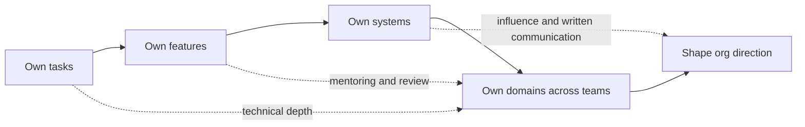
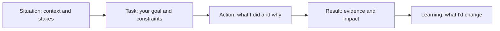
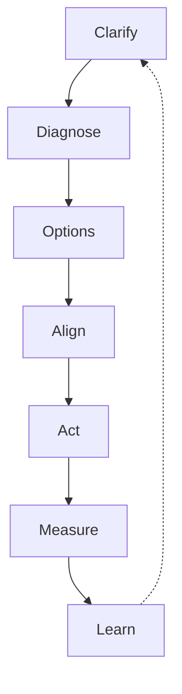
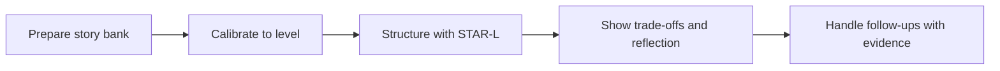

# Leadership Roles, Levels and Interview Expectations

> Verification note: Leadership and career-framework material in this category is **established industry practice, not version-sensitive technical fact**. Names and ideas referenced from memory — the **STAR** answer structure, **Situational Leadership**, **Team Topologies**, **Tuckman's stages**, **Project Aristotle / psychological safety (Edmondson)**, the **SBI** feedback model, **Radical Candor**, **DACI/RACI/RAPID** decision frameworks, and the **Staff Engineer archetypes (Tech Lead, Architect, Solver, Right Hand)** popularized by Will Larson — are described in my own words and **attribution, dates and exact definitions should be confirmed before quoting them in an interview** *(hedged)*. The only data-backed claim reused here is the **DORA** guidance verified earlier in this repo: five delivery metrics per service, used against a team's own baseline and never as targets ([ci-cd-web/07 §7](../ci-cd-web/07-release-automation-observability-and-pipeline-operations.md#7-measuring-dora-in-practice), [frontend-architecture/08 §5](../frontend-architecture/08-teams-governance-platform-and-delivery.md#5-developer-experience-and-delivery-metrics)). **Level names, expectations and promotion criteria differ by company; treat the tables as a model and check the target company's own ladder** *(hedged)*. Technical architecture, ADRs/RFCs, team topologies and platform governance are covered in [frontend-architecture/](../frontend-architecture/README.md); this category covers the **people, influence, planning and behavioral** side.

## Table of Contents

1. [Quick Summary (TL;DR)](#1-quick-summary-tldr)
2. [What "Leadership" Means in a Frontend Career](#2-what-leadership-means-in-a-frontend-career)
3. [Role Archetypes: Tech Lead, Staff, Architect, Manager](#3-role-archetypes-tech-lead-staff-architect-manager)
4. [Level Expectations: Senior to Principal](#4-level-expectations-senior-to-principal)
5. [Scope, Impact and the Multiplier Effect](#5-scope-impact-and-the-multiplier-effect)
6. [What Interviewers Actually Assess](#6-what-interviewers-actually-assess)
7. [Behavioral Interview Mechanics: STAR and Beyond](#7-behavioral-interview-mechanics-star-and-beyond)
8. [Building Your Story Bank](#8-building-your-story-bank)
9. [The Leadership Loop: A Mental Model](#9-the-leadership-loop-a-mental-model)
10. [Transitions: IC to Lead, Lead to Manager, Back](#10-transitions-ic-to-lead-lead-to-manager-back)
11. [Pitfalls](#11-pitfalls)
12. [Interview Questions — Fundamentals](#12-interview-questions--fundamentals)
13. [Interview Questions — Senior Scenarios](#13-interview-questions--senior-scenarios)
14. [Cheat Sheet](#14-cheat-sheet)
15. [Key Terms Glossary](#15-key-terms-glossary)
16. [Further Reading](#16-further-reading)

---

## 1. Quick Summary (TL;DR)

- **Leadership is not a title.** At senior levels it means **raising the output and judgment of people around you** — through decisions, clarity, mentoring, systems and example — not merely being the best coder.
- **Scope grows with level:** *own a feature → own a system → own a domain across teams → shape the organization's technical direction.* Interviewers probe whether your **stories match the scope** of the role.
- **Two tracks:** the **IC (individual contributor) track** (senior → staff → principal) leads by technical influence; the **management track** (EM → senior EM → director) leads through people, process and outcomes. Tech Lead is a **role**, not a level.
- **Behavioral interviews test evidence, not opinions:** specific past situations, your **personal actions** ("I", not "we"), results, and reflection. Prepare a **story bank** of 8–10 flexible stories.
- **Signals interviewers look for:** ownership, judgment under ambiguity, influence without authority, constructive conflict, mentoring, execution with trade-offs, learning from failure, customer/business orientation, and honesty.
- **Strong answers are specific, balanced and reflective** — include context and constraints, alternatives considered, what went wrong, what you would change.



---

## 2. What "Leadership" Means in a Frontend Career

| Dimension | What it looks like | Evidence in a story |
|---|---|---|
| **Technical leadership** | Sets direction, makes and documents decisions, raises quality bar | ADR/RFC, a migration you drove, a standard others adopted |
| **People leadership** | Mentoring, feedback, hiring, onboarding, growth | A person you grew, a team practice you changed |
| **Delivery leadership** | Turns ambiguity into a plan, unblocks, manages risk and scope | Roadmap, slicing, dependency management, shipped outcomes |
| **Organizational leadership** | Aligns teams, builds consensus, changes process, represents engineering | Cross-team program, platform adoption, governance change |
| **Product/business leadership** | Connects technical work to user and business outcomes, says no with alternatives | Metric movement, tradeoff negotiation with PM/design |
| **Self-leadership** | Reliability, learning, handling failure, managing energy | Postmortem ownership, recovered from a mistake |

**Misconception:** leadership = "telling people what to do". More often it is **clarifying goals, removing blockers, creating safety, setting standards, and making decisions easier for others**.

**Frontend flavor:** frontend leaders sit at the intersection of **design, product, backend/platform, QA, accessibility, performance, security and analytics** — so cross-functional influence and translating trade-offs between disciplines is a core skill ([02](02-influence-stakeholders-and-technical-decision-making.md)).

---

## 3. Role Archetypes: Tech Lead, Staff, Architect, Manager

| Role | Primary job | Typical outputs | Common failure |
|---|---|---|---|
| **Tech Lead (role on a team)** | Guides a single team's technical direction and execution; often still codes ~half or more | Designs, reviews, breaks down work, unblocks, aligns with PM/design | Becomes bottleneck; hoards hard work; neglects people |
| **Engineering Manager** | Builds and sustains a healthy, high-performing team; owns people, delivery process, hiring | 1:1s, performance and growth, staffing, planning, stakeholder comms | Micromanages technical decisions; avoids hard feedback |
| **Staff Engineer (IC)** | Solves ambiguous, cross-team technical problems; sets technical strategy for an area | RFCs, prototypes, cross-team programs, mentorship, incident leadership | Ivory tower; "glue work" unrecognized; scope without sponsorship |
| **Principal Engineer / Frontend Architect (IC)** | Org-level technical direction; major bets, standards, platform strategy | Multi-year architecture, tech strategy, exec communication | Detached from code; decisions without adoption |
| **Platform / Design-System Lead** | Product-manages internal platform; drives adoption and paved roads | Roadmap, SLAs, docs, migration support | Builds in isolation; no adoption metrics |
| **Staff-archetypes** *(Larson-style, hedged)* | **Tech Lead** (guide one team), **Architect** (area direction/quality), **Solver** (parachute into hard problems), **Right Hand** (extends an exec's reach) | — | Mismatch between archetype and what the org needs |

**Decision lens for interviews:** when asked "IC or management?", answer from **what energizes you** and **evidence** (you can describe growing people, handling performance issues, running planning — or deep technical leverage) rather than from title ambition. Both paths require leadership; they differ in *how you produce impact*.

**Architect role specifics:** see [frontend-architecture/08 §11](../frontend-architecture/08-teams-governance-platform-and-delivery.md#11-the-architect-and-tech-lead-role) — hands-on, decisions as a service, leverage through paved roads.

---

## 4. Level Expectations: Senior to Principal

*(Illustrative model; hedged — company ladders differ.)*

| Level | Scope | Autonomy | Typical leadership expectations | Interview signals |
|---|---|---|---|---|
| **Senior** | A feature/system within a team | Works with minimal direction; helps shape team work | Mentors juniors/mid-levels; high-quality reviews; leads projects of a few engineers; communicates risks early | Delivered complex features end-to-end; made trade-offs; improved team practices |
| **Staff** | Multiple teams or a critical domain | Defines own problems; navigates ambiguity | Leads cross-team initiatives; writes RFCs; influences roadmap; grows seniors; sponsors others | Changed how multiple teams work; resolved disagreements; strategic trade-offs; measurable organizational impact |
| **Principal** | Organization / multiple domains | Sets technical direction aligned to business strategy | Major bets, standards, exec partnership; develops staff engineers; external credibility | Multi-year outcomes; navigated organizational complexity; balanced innovation and risk |
| **Tech Lead (role)** | One team's delivery and technical direction | Shared with EM/PM | Planning, decomposition, technical decisions, unblocking, quality | Ran a team's technical delivery; handled disagreements; delegated effectively |
| **Engineering Manager** | One team (5–8 reports typical; hedged) | Owns team outcomes | Hiring, performance, growth, planning, process, stakeholder management | Built/grew team; handled underperformance; delivered through others |

**Level inflation in titles:** "Senior Frontend Engineer" at one company can map to staff-level scope at another. Calibrate by **scope, ambiguity and impact**, not titles.

**How scope shows up in answers**

| Level signal | Weak phrasing | Strong phrasing |
|---|---|---|
| Ownership | "I was assigned to fix…" | "I noticed X was costing us Y, proposed Z, and drove it across three teams" |
| Influence | "I told them to…" | "I aligned stakeholders by showing data, offered options, and agreed on the trade-offs" |
| Judgment | "We used the best technology" | "We compared A/B/C on constraints; chose B because…; mitigated risk by…" |
| Impact | "It went well" | "p75 LCP improved from X to Y; incidents dropped; onboarding time halved" *(use true numbers only)* |

---

## 5. Scope, Impact and the Multiplier Effect

**Impact hierarchy:** *Individual output* → *team output* (enabling others) → *organizational output* (systems, standards, culture that scale).

| Multiplier | Example |
|---|---|
| **Teaching and review** | Review comments that teach principles, pairing, brown-bag sessions |
| **Paved roads** | Templates, lint rules, codemods, shared components ([frontend-architecture/08 §3](../frontend-architecture/08-teams-governance-platform-and-delivery.md#3-platform-engineering-and-the-paved-road)) |
| **Decision clarity** | ADRs/RFCs, decision records, clear ownership |
| **Process improvements** | Faster CI, trunk-based development, better incident process |
| **Hiring and onboarding** | Structured interviews, onboarding docs, buddy systems |
| **Culture** | Blameless postmortems, psychological safety, recognition of invisible work |
| **Sponsorship** | Giving others visibility and stretch opportunities |

**Glue work:** unglamorous but vital work (docs, onboarding, coordination, unblocking). It is leadership, but it must be **intentional, shared and visible**; otherwise it creates burnout and unrecognized contribution. Good leaders distribute it and ensure it is acknowledged in performance and promotion.

**Metrics for impact (use carefully):** DORA metrics per service as team-improvement signals, never targets ([ci-cd-web/07 §7](../ci-cd-web/07-release-automation-observability-and-pipeline-operations.md#7-measuring-dora-in-practice)); user-facing metrics (Core Web Vitals, conversion, error rate, support tickets); engineering health (CI time, flaky rate, onboarding time, developer survey results); team health (retention, engagement). Prefer **trend and context** over absolute numbers.

---

## 6. What Interviewers Actually Assess

| Competency | Question probing it | Green flags | Red flags |
|---|---|---|---|
| **Ownership** | "Tell me about a project you drove end-to-end" | Takes responsibility, follows through, handles surprises | Blames others, vague role |
| **Technical judgment** | "A decision you made with incomplete information" | Alternatives, reversibility, risk mitigation, learning | Tech-for-tech's-sake, no trade-offs |
| **Influence without authority** | "Convince a team to adopt X" | Listens, data + empathy, incremental adoption | Mandates, ignores objections |
| **Conflict handling** | "Disagreement with a peer/manager" | Seeks understanding, focuses on goals, commits after decision | Wins at all costs, avoids conflict |
| **Mentoring** | "How did you grow someone?" | Specific actions, calibrated support, outcomes for the other person | Takes credit, generic claims |
| **Execution** | "Delivering under pressure/tight deadline" | Scope management, communication, risk handling | Heroics, silent crunch, hidden risks |
| **Learning from failure** | "A time you failed" | Real failure, accountability, systemic fix | Fake weakness, blames circumstances |
| **Communication** | "Explain a technical trade-off to a non-technical stakeholder" | Clarity, outcomes, options | Jargon, one option |
| **Product/customer sense** | "Say no to a feature" | Understands goals, proposes alternatives | Pure technical purity |
| **Culture/values** | Throughout | Respect, curiosity, humility, collaboration | Arrogance, dismissiveness |
| **Strategic thinking (staff+)** | "How would you set direction for frontend platform?" | Understands business context, sequencing, sustainability | Boil-the-ocean plans, no adoption path |

**How rubrics work:** interviewers typically score against a structured rubric with behavioral evidence; they probe follow-ups ("What did *you* do?", "What would you do differently?", "What was the result?") to separate individual contribution from team outcomes.

---

## 7. Behavioral Interview Mechanics: STAR and Beyond

**STAR:** **S**ituation (brief context), **T**ask (your responsibility/goal), **A**ction (what *you* did, with reasoning), **R**esult (outcome with evidence). Many add **L**earning/Reflection (**STAR-L**) and **trade-offs/alternatives**.

**Time budget (2–3 minutes per story):** Situation + Task ≈ 20%, Action ≈ 50%, Result + Reflection ≈ 30%.



**Rules**
1. **Use "I" for your actions;** use "we" only for team context. Be explicit about your contribution.
2. **Be specific:** names of systems, numbers (only true ones), dates, constraints.
3. **Show reasoning:** why this option, what alternatives, what risks, how you validated.
4. **Include setbacks:** what went wrong and how you handled it.
5. **Quantify when possible**, otherwise describe observable outcomes (fewer incidents, faster onboarding, adoption by N teams).
6. **Stay balanced:** don't villainize colleagues; show empathy and understanding of other perspectives.
7. **Tailor scope** to the target level (senior vs staff vs manager).
8. **Close the loop:** link the story's lesson to how you would behave in the new role.
9. **Handle "tell me about a time" with no perfect match:** use a closest analog and say so honestly; hypothetical answers are weaker than real ones, but "here's what I would do, and here's the nearest real experience" beats inventing.
10. **Do not fabricate.** Interviewers cross-check with references and probe details; inconsistent stories damage trust.

**Follow-up probes to prepare for:** "What was your specific role?", "What did the data say?", "Who disagreed and why?", "What would you do differently?", "How did you know it worked?", "What was the cost?", "What happened afterwards?"

**Remote/virtual specifics:** keep stories concise, check in ("Would you like more detail on the technical part or the stakeholder side?"), use a shared doc if invited, and slow down on key decisions.

---

## 8. Building Your Story Bank

Aim for **8–10 stories**, each tagged for multiple competencies. Write each as bullet points (not a script), with real facts you can defend.

| # | Story type | Competencies it can serve |
|---|---|---|
| 1 | **Large technical initiative** you led (migration, platform, performance, accessibility program) | Ownership, strategy, influence, execution |
| 2 | **Conflict/disagreement** resolved constructively | Communication, collaboration, judgment |
| 3 | **Failure/mistake** with accountability and systemic fix | Humility, learning, incident handling |
| 4 | **Mentoring/growing** a specific person | People leadership, empathy |
| 5 | **Tight deadline / scope negotiation** | Prioritization, communication, pragmatism |
| 6 | **Ambiguous problem** you structured and solved | Judgment, initiative |
| 7 | **Influencing without authority** (adoption, change) | Influence, stakeholder management |
| 8 | **Difficult feedback** given or received | Candor, growth mindset |
| 9 | **Production incident** you led or helped resolve | Calm under pressure, RCA, process improvement ([debugging-scenarios/07](../debugging-scenarios/07-production-incidents-observability-and-root-cause-analysis.md)) |
| 10 | **Tough trade-off** (quality vs speed, build vs buy, rewrite vs refactor) | Technical judgment, risk management |
| 11 | **Hiring/interviewing** experience | Talent bar, fairness |
| 12 | **Cross-functional collaboration** (design, product, backend) | Empathy, alignment |

**Story template (copy and fill)**
```text
Title:            (one line)
Context/stakes:   (team size, product, timeline, constraint)
My role/ask:      (what I owned; who else was involved)
Options considered: A / B / C with trade-offs
Actions (mine):   1) … 2) … 3) …
Obstacles:        (what went wrong or who disagreed)
Result:           (metrics or observable outcomes; time frame)
Reflection:       (what I'd change; what I learned; how it shapes my approach)
Competencies:     (ownership, influence, conflict, mentoring, …)
Evidence I can cite: (doc links, dashboards, PRs — without confidential detail)
```

**Confidentiality:** anonymize company, customer and personal data; speak in generalizable terms; do not disclose secrets.

---

## 9. The Leadership Loop: A Mental Model

A reusable frame for *any* leadership scenario question:

1. **Clarify** — goals, constraints, stakeholders, timeline, what "success" means.
2. **Diagnose** — facts versus assumptions; root causes (people, process, technical, incentives).
3. **Options** — at least two or three, with trade-offs and reversibility.
4. **Align** — who needs to agree; what each cares about; decision owner; escalation path.
5. **Act** — smallest next step; timeline; owners; communication plan.
6. **Measure** — leading and lagging indicators; check-in cadence.
7. **Learn** — retrospective; adjust; share knowledge.



**Situational leadership (concept, hedged):** adapt style to the person's competence and commitment for the *task*: **directing** (low skill, high need for structure), **coaching** (building skill and confidence), **supporting** (skilled but needs confidence/motivation), **delegating** (skilled and motivated). The same person can need different styles for different tasks.

**Decision ownership (concept):** make explicit who **decides**, who **recommends**, who must be **consulted**, who is **informed** (DACI/RACI/RAPID-style). Ambiguous ownership is a primary cause of slow decisions and conflict ([02](02-influence-stakeholders-and-technical-decision-making.md)).

---

## 10. Transitions: IC to Lead, Lead to Manager, Back

| Transition | What changes | Common traps | How to prepare |
|---|---|---|---|
| **IC → Tech Lead** | Output measured by team results; more meetings; delegating | Still doing all hard coding; not delegating; avoiding people issues | Delegate with context; time-box coding; write designs; 1:1 with teammates |
| **Tech Lead → Staff** | Cross-team scope, ambiguity, writing and influence | Waiting for permission; solving only your team's problems | Find org-level problems; build sponsors; write strategy docs |
| **Senior/Lead → Manager** | Success = team's success; feedback, hiring, performance, planning | "Player-coach" overload; avoiding hard conversations; losing technical credibility too quickly | Shadow manager duties; take on mentoring, interviewing, planning; read management basics; try a temporary rotation |
| **Manager → IC (re-entry)** | Return to depth; skills atrophy | Stale technical knowledge | Be honest about gaps; build depth through projects; this is a legitimate path ("pendulum") |
| **New leader in a new org** | Context absent; trust must be earned | Changing too much too fast | First 30/60/90 days plan: listen, learn, quick wins, align on expectations ([08](08-leadership-scenarios-and-case-studies.md)) |

**Interview angle:** be ready to explain **why** you want the next step, **what you have already done** at that level, and **what you are still learning**. Self-awareness reads as seniority.

---

## 11. Pitfalls

1. **Describing team achievements without your personal contribution.**
2. **Stories too small for the target level** (task-level stories for a staff role).
3. **No trade-offs or alternatives** — sounds like luck or dogma.
4. **Blaming others** in conflict or failure stories.
5. **Fake weaknesses** ("I work too hard").
6. **Fabricated or inflated numbers.**
7. **Over-reliance on one story** for every question.
8. **Rambling:** no structure, no result.
9. **Hero narratives** (saving the day alone) instead of leverage and enabling others.
10. **Ignoring people impact** (burnout, morale) in delivery stories.
11. **Confusing title with leadership;** or assuming management is a promotion over IC.
12. **No reflection or learning.**
13. **Disclosing confidential information.**
14. **Not asking clarifying questions** on hypothetical scenarios.
15. **Mismatch between claimed values and behaviors** described.

---

## 12. Interview Questions — Fundamentals

- **What does leadership mean to you as an IC?** Raising the effectiveness of others and the quality of decisions through influence, clarity, mentoring and systems — not authority.
- **Difference between Tech Lead and Engineering Manager?** Tech Lead guides technical direction and delivery; EM owns people, performance, hiring and team health; they partner.
- **Senior vs Staff difference?** Scope and ambiguity: senior owns systems within a team; staff drives cross-team outcomes and sets direction.
- **What is the STAR method?** Situation, Task, Action, Result (plus reflection).
- **How do you show impact?** Outcomes tied to user/business/team metrics, with context and honest attribution.
- **What is influence without authority?** Achieving alignment through trust, evidence, empathy and shared goals.
- **What is glue work?** Coordination, documentation, onboarding and unblocking that enables teams; should be shared and recognized.
- **How do you choose between IC and management?** Energy, strengths, evidence; try rotations; both paths are valid.
- **What is a multiplier?** Work that increases the output of many people (tooling, standards, mentoring).
- **How do you handle a question you have no story for?** Use the closest real analog; be transparent; explain what you'd do.
- **What are the first things you'd do in a new lead role?** Listen, learn context, build relationships, understand goals and pain points, identify quick wins, agree expectations.
- **What does "disagree and commit" mean?** Voice concerns, then support the decision fully once made.

---

## 13. Interview Questions — Senior Scenarios

### S1. "Describe your leadership philosophy, concretely."
Frame as principles with behaviors and evidence: **clarity** (explicit goals and decision owners), **safety** (blameless, speak-up culture), **growth** (assigning stretch work with support), **ownership** (delegate outcomes, not just tasks), **evidence-based decisions** (ADRs, data, reversible experiments). For each, give one real example and one thing you've learned to do differently.

### S2. "You were promoted to tech lead; your peers are now your reports/teammates. What do you do?"
Acknowledge the change openly; hold 1:1s to learn goals and expectations; clarify decision-making and what's changing; delegate with context; avoid overcorrecting (micromanaging) or under-leading; seek early feedback; keep coding in a sustainable proportion; build trust through consistent small wins ([03](03-mentoring-coaching-feedback-and-hiring.md)).

### S3. "How do you know if you're having leadership impact?"
Look for **leading indicators** (people unblocked faster, better PR quality, clearer docs, fewer repeated incidents, more independent decisions by others) and **lagging indicators** (delivery outcomes, retention, quality metrics, adoption). Ask for feedback regularly (360/skip-levels). Beware of vanity metrics; use DORA/DX measures as improvement signals, not targets.

### S4. "Describe the most senior-scope initiative you led."
Structure: why it mattered to the business, how you built the case, stakeholders and alignment, plan and phases, risks and mitigations, obstacles/conflicts, outcomes with evidence, adoption, sustainment, learnings ([06](06-leading-technical-initiatives-and-organizational-change.md)).

### S5. "What kind of leader do you not want to be?"
Name concrete anti-patterns you've seen or been (bottleneck approver, absent leader, hero, blamer, vision-without-execution), and the safeguards you use (delegation boundaries, decision logs, 1:1 cadence, feedback loops).

### S6. "How would you assess a team's health in your first 30 days?"
Listen (1:1s, skip-levels), observe (PR flow, CI time, incident history, on-call load), read artifacts (docs, ADRs, roadmaps), survey (anonymous), baseline metrics (DORA per service as context), identify top 3 friction points and quick wins; avoid premature reorganizations ([05](05-communication-conflict-and-team-health.md)).

---

## 14. Cheat Sheet

| Topic | Remember |
|---|---|
| Scope ladder | Task → feature → system → domain → org |
| Tech Lead | Role on a team; not a level |
| Staff | Cross-team, ambiguity, strategy through influence |
| Manager | Team outcomes via people and process |
| Story bank | 8–10 stories, multi-tagged, fact-checked |
| STAR-L | Situation, Task, Action, Result, Learning |
| "I" vs "we" | Actions = I; context = we |
| Impact | Metrics + observable outcomes + honest attribution |
| Leadership loop | Clarify → Diagnose → Options → Align → Act → Measure → Learn |
| Glue work | Do it intentionally; share and recognize it |
| DORA | Five metrics per service; baseline; never targets |



---

## 15. Key Terms Glossary

| Term | Meaning |
|---|---|
| **IC** | Individual contributor (non-manager career track) |
| **Tech Lead** | Role guiding a team's technical direction |
| **Staff/Principal** | Senior IC levels with cross-team/org scope |
| **Multiplier** | Work that amplifies the output of others |
| **Glue work** | Coordination/enablement work holding teams together |
| **STAR / STAR-L** | Answer structure for behavioral questions |
| **Influence without authority** | Aligning others without formal power |
| **DACI / RACI** | Decision/responsibility assignment frameworks |
| **Sponsorship** | Using your standing to create opportunities for others |
| **Psychological safety** | Belief that one can speak up without punishment |
| **Skip-level** | Meeting with your manager's manager or reports' reports |
| **Bar raiser** | Interviewer enforcing hiring standards *(company-specific)* |

---

## 16. Further Reading

- Will Larson, *Staff Engineer* and *An Elegant Puzzle*; Tanya Reilly, *The Staff Engineer's Path*; Camille Fournier, *The Manager's Path*; Skelton and Pais, *Team Topologies*; Forsgren, Humble, Kim, *Accelerate*; Amy Edmondson on psychological safety; Kim Scott, *Radical Candor* *(hedged: titles/authors from memory; confirm before citing)*
- [DORA metrics guide](https://dora.dev/guides/dora-metrics/) *(hedged: confirm URL)*
- **This repo:** [02 Influence and decisions](02-influence-stakeholders-and-technical-decision-making.md) · [03 Mentoring and hiring](03-mentoring-coaching-feedback-and-hiring.md) · [07 Behavioral question bank](07-behavioral-interview-question-bank-and-answers.md) · [frontend-architecture/08](../frontend-architecture/08-teams-governance-platform-and-delivery.md) · [frontend-architecture/01](../frontend-architecture/01-frontend-architecture-principles-and-decision-making.md)
