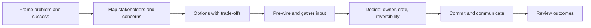
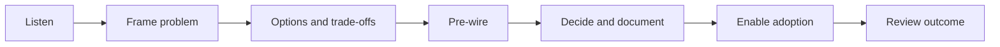

# Influence, Stakeholders and Technical Decision-Making

> Verification note: This document describes **established leadership practice** (stakeholder mapping, decision-rights frameworks such as DACI/RACI/RAPID, "one-way vs two-way door" reversibility, BLUF writing, pre-wiring, consent vs consensus, disagree-and-commit, negotiation by interests rather than positions, Goodhart's law). Framework names and attributions are from memory and **should be confirmed before citing in an interview** *(hedged)*. Technical decision records — **ADRs and RFCs**, trade-off communication, technology selection frameworks and fitness functions — are covered in [frontend-architecture/01 §7–8 and §10](../frontend-architecture/01-frontend-architecture-principles-and-decision-making.md#8-adrs-and-rfcs-recording-decisions) and are **linked, not repeated**. DORA guidance (five metrics per service, own baseline, no targets) was verified earlier ([ci-cd-web/07 §7](../ci-cd-web/07-release-automation-observability-and-pipeline-operations.md#7-measuring-dora-in-practice)). Examples are illustrative and use no real company data.

## Table of Contents

1. [Quick Summary (TL;DR)](#1-quick-summary-tldr)
2. [Sources of Influence](#2-sources-of-influence)
3. [Stakeholder Mapping and Engagement](#3-stakeholder-mapping-and-engagement)
4. [Decision Rights and Decision Types](#4-decision-rights-and-decision-types)
5. [Building a Proposal That Gets Adopted](#5-building-a-proposal-that-gets-adopted)
6. [Working Across Functions: Product, Design, Backend, QA, Security](#6-working-across-functions-product-design-backend-qa-security)
7. [Managing Up and Communicating with Executives](#7-managing-up-and-communicating-with-executives)
8. [Saying No, Negotiating Scope and Handling Pushback](#8-saying-no-negotiating-scope-and-handling-pushback)
9. [Disagreement, Deadlock and Disagree-and-Commit](#9-disagreement-deadlock-and-disagree-and-commit)
10. [Technology Decisions as Leadership: Build vs Buy, Adopt vs Wait, AI Tooling](#10-technology-decisions-as-leadership-build-vs-buy-adopt-vs-wait-ai-tooling)
11. [Pitfalls](#11-pitfalls)
12. [Interview Questions — Fundamentals](#12-interview-questions--fundamentals)
13. [Interview Questions — Senior Scenarios](#13-interview-questions--senior-scenarios)
14. [Cheat Sheet](#14-cheat-sheet)
15. [Key Terms Glossary](#15-key-terms-glossary)
16. [Further Reading](#16-further-reading)

---

## 1. Quick Summary (TL;DR)

- **Influence without authority** rests on **credibility** (track record, competence), **trust** (consistency, honesty), **relationships**, **clarity** (well-framed problems and options) and **leverage** (making the desired choice easy).
- **Start with the problem, not the solution.** Align on *why* and *what success looks like* before debating *how*.
- **Map stakeholders** by influence and interest, and by **what each cares about** (risk, cost, speed, quality, autonomy); tailor the message to their concerns.
- **Make decision rights explicit** — who decides, who recommends, who is consulted, who is informed — and classify decisions as **reversible (decide fast)** or **hard to reverse (decide carefully)**.
- **Write it down:** a short proposal with context, options, trade-offs and a recommendation scales better than meetings ([frontend-architecture/01 §8](../frontend-architecture/01-frontend-architecture-principles-and-decision-making.md#8-adrs-and-rfcs-recording-decisions)).
- **Pre-wire** key people one-on-one before the group meeting; surprises in public create defensiveness.
- **Say no with alternatives** and with data about trade-offs; reframe from "no" to "yes, if…" or "not now, because…".
- **After the decision, commit fully** ("disagree and commit") and revisit only with new evidence.



---

## 2. Sources of Influence

| Source | How to build it | Failure mode |
|---|---|---|
| **Expertise** | Depth in your craft, shipped work, sound technical judgment | Condescension; "expert" blocking others |
| **Track record** | Reliability, follow-through, admitting mistakes | Overpromising |
| **Relationships** | Regular 1:1s, curiosity about others' goals, help without asking for return | Transactional behavior; only reaching out when you need something |
| **Clarity** | Clear problem statements, crisp writing, good diagrams | Jargon, burying the ask |
| **Data and evidence** | Metrics, experiments, prototypes, customer feedback | Cherry-picking; data without narrative |
| **Empathy and listening** | Understanding the other person's constraints and incentives | Fake listening; steamrolling |
| **Coalitions and sponsorship** | Allies across teams; sponsors who endorse your direction | Politicking without substance |
| **Making adoption easy** | Templates, codemods, migration guides, "paved road" | Mandates with no support |
| **Formal authority** | Role, budget, policy (use sparingly) | Compliance without commitment |

**Principle:** authority produces *compliance*; influence produces *commitment*. For lasting change (a new architecture, a design system, an accessibility practice), commitment is what you need.

**Credibility loop:** small promises kept → trust → bigger scope → more influence. Spend credibility deliberately on decisions that matter; do not litigate everything.

**Ethical influence:** transparency about your goals and trade-offs; no manipulation, hidden agendas or fabricated urgency.

---

## 3. Stakeholder Mapping and Engagement

**Step 1 — Identify** everyone affected by or able to affect the decision: product, design, engineering peers, QA, security, legal/compliance, data/analytics, support, SRE/platform, finance, executives, customers/partners.

**Step 2 — Classify** by influence and interest.

| Quadrant | Strategy | Example |
|---|---|---|
| **High influence, high interest** | Collaborate closely; co-create; frequent updates | Product director for a roadmap-affecting migration |
| **High influence, low interest** | Keep satisfied; concise, outcome-focused updates | Finance/exec sponsor |
| **Low influence, high interest** | Keep informed; use as advocates and testers | Teams adopting your component library |
| **Low influence, low interest** | Monitor | Peripheral teams |

**Step 3 — Understand motivations.** Ask: *What does this person's success look like? What are they afraid of? What do they need from me?*

| Stakeholder | Typical concerns | What helps |
|---|---|---|
| **Product manager** | Deadlines, scope, user outcomes, predictability | Options with cost/impact, clear milestones, early risk flags |
| **Designer** | Fidelity, consistency, design-system constraints, accessibility | Early involvement, feasibility feedback, shared component vocabulary |
| **Backend/platform** | API contracts, load, security, release coupling | Contract-first collaboration, clear data needs ([networking-and-apis/07](../networking-and-apis/07-api-client-architecture-and-contracts.md)) |
| **QA/test** | Testability, environments, regression risk | Test strategy, deterministic test data ([testing/01](../testing/01-testing-strategy-and-test-design.md)) |
| **Security/compliance** | Risk reduction, auditability | Threat model, evidence, secure defaults ([web-security/01](../web-security/01-frontend-threat-model-and-owasp-top-10.md)) |
| **Executives** | Business outcomes, cost, risk, reputation | BLUF summary, options, ROI, timeline ([§7](#7-managing-up-and-communicating-with-executives)) |
| **Engineers** | Autonomy, craft, workload, career growth | Context, ownership, say in design, reduced toil |
| **Support/customer success** | Customer pain, workarounds | Closing the loop on issues, status updates |

**Step 4 — Plan engagement:** who needs to hear what, when, in what format (1:1, doc, demo, meeting), and what you need *from* them (decision, input, resources). Track in a lightweight stakeholder log; revisit as the project evolves.

**Step 5 — Maintain trust:** under-promise, communicate bad news early, follow through, acknowledge others' contributions publicly, share credit.

---

## 4. Decision Rights and Decision Types

**Clarify roles** (use any framework; the point is explicitness):

| Role | Meaning (DACI-style, hedged) |
|---|---|
| **Driver** | Runs the process, gathers input, ensures a decision is made |
| **Approver / Decider** | Single accountable person who makes the call |
| **Contributors** | Provide expertise and input |
| **Informed** | Told the outcome |

**RACI** (Responsible, Accountable, Consulted, Informed) fits ongoing responsibilities; **DACI/RAPID**-style models fit specific decisions. Avoid committees as deciders; they diffuse accountability.

**Classify decisions**

| Type | Characteristics | Approach |
|---|---|---|
| **Two-way door (reversible)** | Low cost to undo (library choice for a prototype, internal naming, UI experiment) | Decide fast, delegate, learn |
| **One-way door (hard to reverse)** | High switching cost (rendering model, auth architecture, data contracts, vendor lock-in) | Gather evidence, write an RFC/ADR, involve stakeholders, plan reversibility/exit |
| **Local** | Affects one team | Team decides; inform others |
| **Cross-cutting** | Affects many teams (design tokens, state management standard, CI) | RFC with consultation; clear decider; adoption plan |
| **Urgent** | Time-critical (incident) | Incident commander decides; review later ([debugging-scenarios/07 §2](../debugging-scenarios/07-production-incidents-observability-and-root-cause-analysis.md#2-incident-lifecycle-for-frontend-teams)) |

**Consensus vs consent:** *consensus* = everyone agrees (slow); *consent* = no one has a principled objection that can't be addressed (faster, "safe enough to try"). For most technical decisions aim for **consent with a clear decider**.

**Decision hygiene:** record the decision, rationale, alternatives rejected, **review date/trigger** (what new evidence would reopen it), and owner. Avoid re-litigating without new information; encourage re-opening *with* new evidence.

**Bikeshedding:** time spent is often inversely proportional to impact. Timebox low-stakes decisions; delegate to the owner; use defaults and style guides to remove debate (lint/formatter).

---

## 5. Building a Proposal That Gets Adopted

**Structure (1–3 pages for most; expand for major bets):**

1. **Context and problem** — who is affected, evidence (metrics, incidents, developer pain, user impact).
2. **Goals and non-goals** — what success looks like; what's out of scope.
3. **Constraints** — time, skills, compatibility, compliance, budget.
4. **Options** — including "do nothing" and a minimal option; each with benefits, costs, risks, reversibility.
5. **Recommendation** — and why; **what would change your mind**.
6. **Adoption plan** — rollout phases, migration path, training, support, deprecation, success metrics.
7. **Risks and mitigations** — including organizational risks (adoption, ownership, capacity).
8. **Open questions and decision requested** — who decides, by when.

**Techniques that increase adoption**
- **Pilot first:** prove value with a willing team; use results as evidence.
- **Pre-wire:** share a draft 1:1 with key reviewers; incorporate feedback; credit contributors.
- **Show, don't tell:** a small prototype/demo beats a long document.
- **Quantify cost of inaction** (developer hours, incident frequency, conversion loss) without exaggeration.
- **Offer an exit ramp:** how to reverse if it doesn't work.
- **Reduce friction:** codemods, scaffolding, docs, office hours, migration support ([frontend-architecture/07](../frontend-architecture/07-migrations-modernization-and-technical-debt.md)).
- **Align incentives:** link to team goals/OKRs; make the right thing the easy thing.
- **Close the loop:** report outcomes after adoption; admit when the result was weaker than expected.

**Writing quality:** lead with the conclusion and the ask (BLUF); short paragraphs; tables for comparisons; diagrams for flows; avoid jargon for mixed audiences; separate facts from opinions; link evidence.

**Review etiquette (author):** invite dissent; respond to every comment; distinguish blocking concerns from preferences; update the doc with changes and rationale; publish the outcome.

---

## 6. Working Across Functions: Product, Design, Backend, QA, Security

| Partner | How to collaborate | Typical friction → resolution |
|---|---|---|
| **Product** | Share capacity and risk transparently; translate technical work into user/business outcomes; propose scope options (MVP/phase) | "Why does this take so long?" → show breakdown, uncertainty, options to cut scope; align on definition of done |
| **Design** | Co-design with feasibility input early; adopt a shared design system; agree on component contracts; discuss accessibility and edge states upfront | Pixel-perfect vs timeline → define critical fidelity, use tokens, negotiate polish vs launch |
| **Backend/API** | Contract-first design (OpenAPI/GraphQL schema), mocks, error contracts, versioning | Frontend blocked by API → agree contracts early, mock servers, BFF where appropriate ([networking-and-apis/07](../networking-and-apis/07-api-client-architecture-and-contracts.md)) |
| **QA/SDET** | Shared test strategy, testability requirements, stable test IDs/roles, test data management | Flaky E2E → clarify ownership, move down the pyramid, fix root causes ([testing/07](../testing/07-flakiness-ci-and-non-functional-testing.md)) |
| **Security/Privacy/Legal** | Involve early; use checklists; explain constraints and exceptions; document risk acceptance | Security blocks launch → threat model, mitigations, phased rollout, compensating controls |
| **Platform/SRE** | Align on SLOs, deployment, observability, on-call, cost | "Throw it over the wall" → shared ownership, runbooks, feature flags ([debugging-scenarios/07](../debugging-scenarios/07-production-incidents-observability-and-root-cause-analysis.md)) |
| **Analytics/Data** | Instrumentation plan, event naming, privacy-compliant tracking | Missing data → define measurement in the proposal, not after launch |
| **Support/CS** | Feedback loops, release notes, known issues | Surprise releases → communication plan, beta groups |

**Working agreements:** define handoffs (design → dev), definition of ready/done, escalation paths, communication channels and response expectations, release and on-call responsibilities.

**Product trio mindset:** product, design and engineering collaborate on **discovery** (what to build and why) rather than receiving specs. Senior frontend leaders contribute early with feasibility, performance, accessibility and technical options that shape the solution.

---

## 7. Managing Up and Communicating with Executives

**What leaders need from you:** no surprises, clear status, risks with options, business framing, and decisions teed up.

**BLUF (Bottom Line Up Front) template**
```text
Summary (1–2 sentences): what, why now, and the ask.
Impact: users/revenue/risk/cost; evidence.
Options: A (recommended) / B / C — cost, timeline, risk.
Decision needed: by whom, by when.
Next steps and owners.
```

**Status updates:** RAG (red/amber/green) with **reasons and trend**, top risks with mitigations, decisions needed, notable wins. Avoid watermelon status (green outside, red inside). Escalate **early** with options rather than late with problems.

**Translating technical work to business language**

| Technical statement | Business framing |
|---|---|
| "We need to migrate off legacy framework" | "Reduces onboarding time and security risk; unblocks features requiring X; cost Y over Z quarters; phased with no user disruption" |
| "Performance work (INP/LCP)" | "Faster pages correlate with conversion; our p75 is X vs target Y; expected uplift Z (hypothesis; measure via experiment)" |
| "Add tests/CI quality gates" | "Reduces regression incidents and rework; protects release cadence" |
| "Accessibility remediation" | "Legal and market-access risk reduction, broader reach; compliance timeline" ([accessibility/01](../accessibility/01-accessibility-foundations-wcag-and-assistive-technology.md)) |
| "Tech debt" | "Currently adds ~N% to cycle time for feature work (estimate); paying X reduces risk and speeds delivery" ([frontend-architecture/07 §10](../frontend-architecture/07-migrations-modernization-and-technical-debt.md#10-managing-technical-debt)) |

**Managing your manager:** learn their priorities and communication style; agree on expectations and success criteria; bring solutions with problems; ask for feedback; make their job easier; be transparent about workload and capacity; discuss career goals regularly.

**Skip-levels and sponsors:** build relationships beyond your manager; sponsors advocate for you when you're not in the room. Earn sponsorship through visible, useful results, not self-promotion alone.

---

## 8. Saying No, Negotiating Scope and Handling Pushback

**Principles:** protect the *goal*, not the plan. Negotiate on **interests** (what the stakeholder needs) rather than **positions** (what they asked for).

**Script patterns**
- **Yes, and:** "Yes, we can deliver X by date if we defer Y. Which matters more?"
- **Not now, because:** "That's valuable; right now it would delay Z (committed to customer). Can we schedule it for next quarter?"
- **Options:** "Three ways: (A) full scope in 8 weeks, (B) MVP in 4 weeks with manual fallback, (C) buy a vendor solution (cost, risk)."
- **Data-backed no:** "Our incident rate rose after the last two rushed releases; skipping testing here risks…; here's a safer fast path."
- **Escalation with options:** "We disagree on priority; here are the trade-offs; need a decision from X by Friday."

**Negotiation toolkit:** clarify the underlying need; offer alternatives; trade scope/time/quality/cost explicitly (the "triangle" is real, though quality is rarely negotiable silently — hidden quality cuts become tech debt); document agreements; follow up in writing.

**Handling hard pushback**

| Pushback | Response |
|---|---|
| "Just do it, we don't have time for design" | Offer a time-boxed design/spike; show risk of rework; agree on checkpoints |
| "Why can't we use the trendy technology?" | Evaluate with criteria; run a timeboxed proof of concept; consider team skills and operability |
| "That's not my priority" | Link to their goals/metrics; find shared incentives; escalate with data if necessary |
| "You're overengineering" | Clarify requirements; right-size the solution; document assumptions and revisit triggers |
| "We always did it this way" | Ask what it protects; test the assumption; pilot a change |
| Senior leader's pet idea | Understand intent; explore with questions; propose a small experiment to learn |

**Protecting the team:** shield from churn, push back on unrealistic commitments with data, make trade-offs visible, and ensure the team's capacity is respected (sustainable pace). Over time, build credibility so that "no" is trusted.

---

## 9. Disagreement, Deadlock and Disagree-and-Commit

**Healthy disagreement** focuses on goals and evidence, separates people from positions, and welcomes dissent. **Unhealthy** disagreement is personal, repeated after decisions, or hidden (passive resistance).

**Resolution ladder**
1. **Clarify the disagreement:** facts, values, or risk tolerance? (Different data? Different goals? Different assumptions?)
2. **Seek shared goals:** "What would we both consider success?"
3. **Generate options** beyond the two positions.
4. **Use evidence:** experiment, prototype, benchmark, customer data; define success criteria and a review date.
5. **Timebox** debate; identify the decider.
6. **Decide and document;** record dissenting views respectfully.
7. **Commit:** everyone supports the outcome; disagreements may be revisited with new evidence at the agreed review point.
8. **Escalate** only after genuine attempts, with a neutral framing of options and a recommendation, and inform the other party.

**When you lose the argument:** support the decision wholeheartedly; don't undermine; capture risks to monitor; propose an early signal that would indicate the decision needs revisiting.

**When you're the decider:** explain the reasoning, acknowledge trade-offs and valid concerns, thank dissenters, and define how success will be measured. Decisions made with visible reasoning earn more commitment even from those who disagree.

**Peer vs manager disagreement:** raise concerns privately first; assume positive intent; bring data; propose alternatives; accept that managers sometimes decide on context you lack — ask for that context.

**Cultural note:** directness norms differ across teams and cultures; adapt communication style while preserving honesty ([05](05-communication-conflict-and-team-health.md)).

---

## 10. Technology Decisions as Leadership: Build vs Buy, Adopt vs Wait, AI Tooling

**Build vs buy (leadership lens)** — beyond technical fit, consider: total cost of ownership (maintenance, support, upgrades), core vs context (is it differentiating?), vendor risk/lock-in/exit plan, security/compliance, team skills, time to value, extensibility, community/health, licensing. Document the decision and **revisit triggers**.

**Adopt vs wait (new technology)**
- Evaluate against **problems**, not novelty; define success metrics and a rollback path.
- Use a **tech radar** style (adopt / trial / assess / hold) to make status explicit *(hedged: concept popularized by ThoughtWorks)*.
- Run a **time-boxed spike** or pilot with a willing team; record learnings.
- Account for ecosystem maturity, hiring market, operational complexity, and migration costs ([frontend-architecture/01 §7](../frontend-architecture/01-frontend-architecture-principles-and-decision-making.md#7-technology-selection-a-repeatable-framework)).

**Standardization vs autonomy:** standardize where consistency yields leverage (security, accessibility, observability, design tokens, CI); allow autonomy where context differs; make the paved road attractive rather than mandatory ([frontend-architecture/08 §3–4](../frontend-architecture/08-teams-governance-platform-and-delivery.md#3-platform-engineering-and-the-paved-road)).

**AI coding assistants (team leadership perspective, hedged)** — a current leadership topic; practices vary and tools change rapidly:
- Set **explicit policy**: approved tools, data-handling rules (no secrets/customer data to unapproved services), license and IP considerations, security review expectations.
- Keep **accountability human:** authors remain responsible for code; reviews must not weaken; require tests and understanding.
- Measure with **care:** use team-level outcomes (cycle time, quality, incident rate, developer survey), not lines generated; avoid productivity targets that incentivize gaming.
- Support **learning and mentorship:** ensure juniors still build fundamentals; use AI for scaffolding but require explanations in review.
- Update **review checklists** (hallucinated APIs, subtle bugs, insecure patterns, accessibility regressions) and testing expectations.
- Pilot, gather feedback, and iterate on guidelines; share prompts/patterns that work *(hedged: rapidly evolving area)*.

**Reversibility as a leadership tool:** prefer decisions you can unwind (flags, adapters, boundaries), invest in exit ramps for one-way doors, and design experiments with clear stop criteria.

---

## 11. Pitfalls

1. **Leading with the solution** before aligning on the problem.
2. **Surprising stakeholders** in public meetings.
3. **Unclear decision owner;** decisions by committee.
4. **Mandating without enabling** (no migration support, docs or incentives).
5. **Treating every decision as one-way;** analysis paralysis.
6. **Treating one-way decisions as two-way;** recklessness.
7. **Re-litigating decisions** without new evidence.
8. **Hidden agenda or spin;** destroying trust.
9. **Overusing escalation** or never escalating.
10. **Saying yes to everything,** then missing commitments silently.
11. **Technical jargon with non-technical stakeholders.**
12. **Ignoring emotional/political context** of change.
13. **Using data as a weapon;** cherry-picking.
14. **Never closing the loop** on proposals (no outcome review).
15. **Passive resistance after losing a decision.**
16. **Adopting tools by hype;** or rejecting all novelty by default.

---

## 12. Interview Questions — Fundamentals

- **How do you influence without authority?** Build credibility and relationships, frame problems with evidence, understand stakeholder interests, make adoption easy, pilot, and credit others.
- **How do you decide who decides?** Make decision rights explicit (DACI/RACI style); one accountable decider; consult experts; inform affected parties.
- **One-way vs two-way door decisions?** Hard-to-reverse need more rigor and documentation; reversible should be made quickly.
- **How do you handle disagreement with a peer?** Understand their view, focus on shared goals and evidence, timebox, involve the decider if needed, then commit.
- **What is "disagree and commit"?** State concerns, then fully support the decision.
- **How do you say no to a stakeholder?** Reframe around goals, present trade-offs and alternatives, offer "yes if/not now because."
- **How do you communicate with executives?** BLUF, business impact, options, risks, decision needed.
- **How do you build a proposal?** Problem, goals, options, recommendation, adoption plan, risks, decision request.
- **What is pre-wiring?** Aligning key people individually before a group decision.
- **How do you handle a stakeholder who is never available?** Understand constraints, use async written updates, find a delegate, escalate through the sponsor with options.
- **Build vs buy factors?** TCO, differentiation, risk, skills, time to value, exit strategy.
- **Why measure outcomes after a decision?** Validate assumptions, learn, and build credibility.

---

## 13. Interview Questions — Senior Scenarios

### S1. "Your team wants to adopt a new state-management/data-fetching library; two other teams oppose it."
Clarify problem and success criteria; map concerns (migration cost, learning curve, risk); evaluate options with criteria and a time-boxed spike; pre-wire opponents to understand objections; propose a pilot on one team with measurable outcomes and an exit plan; write an RFC with explicit decision owner; commit to support (docs, codemods, office hours); revisit with data. If consensus fails, escalate with a neutral options document ([frontend-architecture/01 §7–8](../frontend-architecture/01-frontend-architecture-principles-and-decision-making.md#7-technology-selection-a-repeatable-framework)).

### S2. "The PM wants a feature in 4 weeks; your estimate is 10 with significant uncertainty."
Break down work and uncertainty; share range with assumptions and risks; identify the smallest valuable slice; offer options (reduce scope, add people if parallelizable (Brooks's law caveat), cut polish, buy vs build, phased release behind a flag); agree on must-haves vs nice-to-haves; set checkpoints; document and communicate trade-offs; avoid silent quality cuts ([04](04-planning-estimation-prioritization-and-delivery.md)).

### S3. "A senior engineer repeatedly overrides team decisions in code review."
Private conversation: understand intent, share impact; clarify decision rights and standards (linting, ADRs) so reviews focus on high-signal issues; coach on influence and timing (raise concerns in design phase); distinguish blocking vs non-blocking comments; if pattern continues, involve manager and set clear expectations ([05](05-communication-conflict-and-team-health.md)).

### S4. "Executive sponsor wants to rewrite the frontend because of a bad experience with the current app."
Probe the underlying problem(s): performance, reliability, velocity, hiring? Gather evidence; present options: targeted fixes, incremental modernization (strangler), full rewrite with risks (feature parity, timeline, business continuity); quantify costs and benefits; propose a pilot with defined success metrics; agree on decision criteria and review gates ([frontend-architecture/07](../frontend-architecture/07-migrations-modernization-and-technical-debt.md)).

### S5. "How do you drive adoption of a new design system across teams who didn't ask for it?"
Start with their pain points; co-design with a pilot team; provide excellent docs, migration tooling and support; measure adoption and satisfaction; offer incentives (accessibility compliance, faster delivery); governance with a contribution model; avoid mandates without capacity; share success stories ([system-design/06](../system-design/06-design-system-and-component-library.md)).

### S6. "You strongly disagree with your manager's decision on architecture."
Seek to understand their context and constraints; present concerns with evidence and options privately; ask what would change their mind or how to de-risk (experiments, reversible steps, monitoring); if the decision stands, commit while documenting risks and agreeing review triggers; escalate only for serious ethical/safety/legal issues.

---

## 14. Cheat Sheet

| Situation | Move |
|---|---|
| Want adoption | Pilot, pre-wire, enable, show outcomes |
| Unclear decision | Name the decider; classify one-way/two-way |
| Stakeholder conflict | Map interests; shared goals; options |
| Pushback | Ask what it protects; evidence; experiment |
| Exec update | BLUF, impact, options, decision needed |
| Say no | Reframe, trade-offs, alternatives, timeline |
| Lost the argument | Commit; set review trigger |
| New tech | Problem-first; spike; exit ramp |
| AI tooling | Policy, accountability, outcome metrics |



---

## 15. Key Terms Glossary

| Term | Meaning |
|---|---|
| **Pre-wiring** | One-on-one alignment before a group decision |
| **BLUF** | Bottom line up front communication style |
| **DACI / RACI / RAPID** | Frameworks assigning decision/responsibility roles |
| **One-way / two-way door** | Hard-to-reverse vs easily reversible decisions |
| **Consent decision** | Proceed unless principled objection remains |
| **Bikeshedding** | Disproportionate debate on trivial matters |
| **Disagree and commit** | Voice dissent, then fully support the decision |
| **Interests vs positions** | Underlying needs vs stated demands |
| **Tech radar** | Public status list of technologies (adopt/trial/assess/hold) |
| **Sponsor** | Senior advocate who creates opportunities for you |
| **Watermelon status** | Green reporting hiding red reality |
| **Exit ramp** | Planned way to reverse or stop an initiative |

---

## 16. Further Reading

- Fisher and Ury, *Getting to Yes*; Patterson et al., *Crucial Conversations*; Will Larson, *Staff Engineer*; Tanya Reilly, *The Staff Engineer's Path*; Skelton and Pais, *Team Topologies* *(hedged: titles from memory)*
- **This repo:** [01 Roles and levels](01-leadership-roles-levels-and-interview-expectations.md) · [04 Planning and delivery](04-planning-estimation-prioritization-and-delivery.md) · [05 Communication and conflict](05-communication-conflict-and-team-health.md) · [06 Leading initiatives](06-leading-technical-initiatives-and-organizational-change.md) · [frontend-architecture/01](../frontend-architecture/01-frontend-architecture-principles-and-decision-making.md) · [frontend-architecture/08](../frontend-architecture/08-teams-governance-platform-and-delivery.md)
