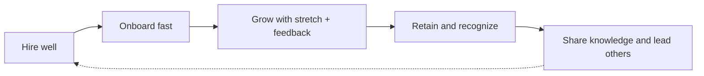
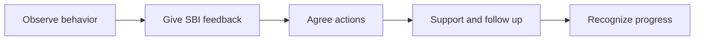

# Mentoring, Coaching, Feedback and Hiring

> Verification note: This document describes **established people-leadership practice**: mentoring/coaching/sponsorship distinctions, the **SBI** (Situation-Behavior-Impact) feedback model, **Radical Candor**-style "care personally, challenge directly", **Situational Leadership**, skill-will diagnosis for performance, structured interviewing with rubrics, calibration and bias-reduction practices, 30/60/90-day onboarding, individual development plans (IDPs) and promotion packets. Sources and attributions are from memory and **should be confirmed before citing** *(hedged)*. Legal and HR rules (performance-improvement processes, interview questions that are off-limits, data retention, employment law) **vary by jurisdiction and company — follow your HR/legal guidance and never treat this document as legal advice** *(hedged)*. Documentation, onboarding and knowledge practices at team level are in [frontend-architecture/08 §9](../frontend-architecture/08-teams-governance-platform-and-delivery.md#9-documentation-knowledge-and-onboarding); this file focuses on the interpersonal and process skills.

## Table of Contents

1. [Quick Summary (TL;DR)](#1-quick-summary-tldr)
2. [Mentoring, Coaching, Teaching and Sponsorship](#2-mentoring-coaching-teaching-and-sponsorship)
3. [Onboarding New Engineers](#3-onboarding-new-engineers)
4. [Growth Plans, Skills Matrices and Career Conversations](#4-growth-plans-skills-matrices-and-career-conversations)
5. [Delegation and Stretch Assignments](#5-delegation-and-stretch-assignments)
6. [Giving and Receiving Feedback](#6-giving-and-receiving-feedback)
7. [Code Review as a Teaching and Culture Tool](#7-code-review-as-a-teaching-and-culture-tool)
8. [One-on-Ones](#8-one-on-ones)
9. [Managing Underperformance and Difficult Situations](#9-managing-underperformance-and-difficult-situations)
10. [Hiring: Designing the Loop for Frontend Roles](#10-hiring-designing-the-loop-for-frontend-roles)
11. [Interviewing Well: Questions, Rubrics, Calibration, Bias](#11-interviewing-well-questions-rubrics-calibration-bias)
12. [Promotion, Recognition and Retention](#12-promotion-recognition-and-retention)
13. [Pitfalls](#13-pitfalls)
14. [Interview Questions — Fundamentals](#14-interview-questions--fundamentals)
15. [Interview Questions — Senior Scenarios](#15-interview-questions--senior-scenarios)
16. [Cheat Sheet](#16-cheat-sheet)
17. [Key Terms Glossary](#17-key-terms-glossary)
18. [Further Reading](#18-further-reading)

---

## 1. Quick Summary (TL;DR)

- **Your leverage as a senior engineer is largely other people.** Growing teammates multiplies output and spreads knowledge, reducing single points of failure.
- **Match support to the person and the task:** *teach* (skill gap), *coach* (ask questions to build their thinking), *mentor* (share experience and perspective), *sponsor* (create opportunities and advocate).
- **Feedback must be timely, specific, behavior-based, and actionable** — and delivered with care and clear intent. Praise specifically too.
- **Onboarding determines early velocity and retention:** a plan with environment setup, first PR in days, a buddy, context docs, and 30/60/90 goals.
- **Delegate outcomes, not just tasks,** with clear context, boundaries, support and check-ins; stretch assignments should be achievable with support.
- **Underperformance is usually a combination of clarity, skill, motivation and context** — diagnose before deciding; document and involve your manager/HR early.
- **Hiring is a leadership responsibility:** design structured loops with rubrics, calibrate interviewers, reduce bias, treat candidates well, and hire for **growth and collaboration** as well as skill.

---

## 2. Mentoring, Coaching, Teaching and Sponsorship

| Mode | Purpose | You do | Example question/behavior |
|---|---|---|---|
| **Teaching/training** | Transfer a specific skill | Explain, demonstrate, pair, provide resources | "Let me show how to profile this component; now you try." |
| **Coaching** | Develop the person's own problem-solving | Ask questions, reflect, challenge, don't give the answer immediately | "What have you tried? What are the options? What would you do if…?" |
| **Mentoring** | Share experience, perspective, career guidance | Offer stories, context, introductions, advice (with humility) | "When I faced this trade-off, I considered X; how does that map to your situation?" |
| **Sponsorship** | Advocate, create opportunities, vouch for the person | Nominate for projects, give visibility, support promotion cases | "I'd like Priya to lead the design review; I'll support her." |
| **Peer collaboration** | Mutual learning | Pair programming, shared reviews, guilds | "Let's pair on the hook refactor." |

**Choosing the mode (situational):**

| Person's state | Approach |
|---|---|
| New to the task, low confidence | **Directing/teaching:** clear steps, examples, frequent check-ins |
| Developing skill, some confidence | **Coaching:** guided problem-solving, feedback, pairing |
| Capable but unsure/unmotivated | **Supporting:** listen, encourage, remove blockers, explore motivation |
| Highly capable and motivated | **Delegating:** outcomes, autonomy, availability when needed |

**Mentoring conversation structure:** (1) goal and context; (2) current reality; (3) options; (4) commitments and next steps; (5) follow-up. (GROW-style model: Goal, Reality, Options, Will — *hedged*).

**Mentee responsibility:** drive the agenda, prepare topics, act on advice, and give feedback to the mentor.

**Avoid:** solving everything for them (learned helplessness); only mentoring people similar to you; confusing mentorship with friendship; treating mentoring as optional "extra" — plan time for it.

**Growth areas frontend engineers commonly need support with:** debugging methodology ([debugging-scenarios/01](../debugging-scenarios/01-debugging-methodology-and-interview-approach.md)), performance reasoning, state/data architecture, testing strategy, accessibility, system design thinking, written communication, estimating, stakeholder communication.

---

## 3. Onboarding New Engineers

**Goals:** make them productive, connected and confident; reveal the "why" behind systems.

| Phase | Targets | Practices |
|---|---|---|
| **Before day 1** | Access, equipment, accounts, buddy assigned | Pre-boarding checklist; welcome message; schedule |
| **Week 1** | Dev environment working; **first PR merged** (small, safe); meet the team and stakeholders | Setup script, "good first issues," architecture overview, walkthrough of release/CI, demo of product |
| **30 days** | Understand codebase areas, delivery process, and on-call/incident expectations; complete a small feature | Pairing; reading list (ADRs, runbooks); regular 1:1s; feedback on early PRs |
| **60 days** | Own a medium task independently; participate in design reviews | Increasing scope; shadow on-call; contribute to docs |
| **90 days** | Operating independently; contributing improvements | Retrospective on onboarding; goals for next quarter; feedback both ways |

**Onboarding assets:** README and "how we work" doc; architecture map; glossary; ADR index; dev environment automation (devcontainer/scripts); runbooks; test and release guide; key contacts; first-week agenda; onboarding checklist with owners ([frontend-architecture/08 §9](../frontend-architecture/08-teams-governance-platform-and-delivery.md#9-documentation-knowledge-and-onboarding)).

**Measure onboarding:** time to first PR, time to first production deploy, new-hire survey, time to independent ownership. Use findings to improve docs (new hires are the best docs testers — ask them to fix gaps they found).

**Onboarding at senior/lead level:** focus on context, relationships, goals and expectations; avoid rushing into change; listen first ([08](08-leadership-scenarios-and-case-studies.md)).

**Remote onboarding:** over-communicate; schedule social/intro sessions; provide asynchronous materials; assign a buddy; frequent video check-ins; clear working hours/availability norms.

---

## 4. Growth Plans, Skills Matrices and Career Conversations

**Skills matrix (frontend example)** — rate each area as *awareness / working / proficient / expert / teaches others* with evidence:

| Area | Examples |
|---|---|
| **Language and platform** | JS/TS, browser internals, accessibility, security |
| **Frameworks and architecture** | React/Next.js, state management, modularity |
| **Quality** | Testing strategy, debugging, performance |
| **Delivery** | CI/CD, observability, incident response |
| **Product and design sense** | User empathy, UX trade-offs, analytics |
| **Collaboration/leadership** | Communication, mentoring, influence, planning |

**Individual development plan (IDP):** 2–3 focus areas aligned with the person's goals and team needs; concrete **experiences** (stretch projects, design-doc authoring, leading a migration), **learning** (reading, courses, shadowing) and **relationships** (mentor, sponsor); review quarterly. The classic mix: ~70% experience, 20% relationships/feedback, 10% formal learning *(hedged: popular heuristic, not a law)*.

**Career conversation questions:** What energizes/drains you? What skills do you want to build? Where do you want to be in 1–2 years? IC or management interest? What support do you need? What would make you leave?

**Honest calibration:** provide realistic feedback on readiness for the next level: *gaps, evidence needed, timeline, sponsorship*; never promise promotions you don't control.

**Visibility and credit:** ensure contributions (including glue work) are noticed; encourage writing, demos, speaking internally; share credit publicly.

---

## 5. Delegation and Stretch Assignments

**Delegation levels (conceptual, hedged):** *tell → sell → consult → agree → advise → inquire → delegate fully.* Choose based on risk, skill, and urgency; explicitly state the level ("You decide; just inform me" vs "Bring me a recommendation").

**Effective delegation checklist**
1. **Outcome and why** — what success looks like and why it matters.
2. **Boundaries** — constraints, budget, dependencies, non-negotiables.
3. **Authority** — what they can decide without asking.
4. **Support** — resources, mentors, access, time.
5. **Check-ins** — cadence and format; early checkpoint to catch misalignment.
6. **Learning goal** — what skill they will build.
7. **Safety net** — fallback if risk materializes; you remain accountable.
8. **Credit** — recognize publicly.

**Stretch assignments:** choose work at the edge of their ability (~10–20% beyond comfort); pair with a guide; define a clear scope; plan review points; debrief afterwards ("what worked, what surprised you").

**Common delegation failures:** delegating tasks without context ("just do it"); micromanaging; undermining by redoing their work; delegating only low-value chores; not following up; taking back the work at the first sign of trouble.

**Tech-lead-specific:** don't keep all the hardest problems; assign design ownership to others with a design review process; write decision criteria so others can decide; hold yourself back in discussions to let others speak first.

---

## 6. Giving and Receiving Feedback

**SBI model:** **S**ituation (when/where), **B**ehavior (observable facts, not assumptions), **I**mpact (effect on goals, team, users). Add **Request/Next step**.

| Weak | Strong (SBI) |
|---|---|
| "Your code is messy." | "In the checkout PR (S), the component mixed fetching, validation and rendering in 400 lines (B), which made it hard for reviewers to verify edge cases and led to two missed bugs (I). Could we split concerns and add tests for the validation rules next time?" |
| "You're not communicating." | "In yesterday's standup (S), you didn't mention the API delay you'd discussed with me (B); the PM planned a demo assuming it was ready (I). Can you flag blockers in the channel as soon as you know?" |
| "Great job!" | "In the incident (S), you posted updates every 15 minutes and clearly labeled hypotheses (B), which let support communicate accurately and kept leadership calm (I). Thank you." |

**Principles**
- **Timely:** close to the event; avoid saving for annual reviews. No surprises in formal reviews.
- **Private for corrective, public for praise** (unless the person prefers otherwise).
- **Focus on behavior and impact, not personality.**
- **Balance support and challenge** — "care personally, challenge directly" (Radical Candor *(hedged)*); avoid "ruinous empathy" (too nice, unclear) and "obnoxious aggression" (harsh).
- **Ask for their perspective** — you may lack context. "How did you see it?"
- **Agree on next steps** and follow up; recognize improvement.
- **Cultural sensitivity:** directness norms vary; adapt delivery without diluting the message.
- **Regular positive feedback:** reinforce desired behaviors; specific recognition builds confidence.

**Receiving feedback:** listen without defending; ask clarifying questions; thank the giver; reflect; choose actions; follow up. Seek feedback proactively (peers, reports, stakeholders); use **360** input; ask specific questions ("What's one thing I could do to make design reviews more useful?").

**Feedback to your manager/up:** frame as shared goals and impact; offer suggestions; choose timing; maintain respect.

**Feedforward:** forward-looking suggestions ("next time try…") can be easier to hear than backward critique; use alongside behavior-specific feedback.

---

## 7. Code Review as a Teaching and Culture Tool

**Purposes:** quality, knowledge sharing, consistency, mentoring, shared ownership. **Not** gatekeeping or showing superiority.

**Reviewer guidelines**
- **Review the code, not the person;** assume positive intent.
- **Prioritize:** correctness, security, accessibility, performance, maintainability, tests; leave style to linters/formatters.
- **Label comment severity:** *blocking* (must fix), *suggestion* (non-blocking), *question*, *nit*, *praise* (conventional-comments style *(hedged)*).
- **Explain why;** link to docs/ADRs; offer alternatives; teach principles not just fixes.
- **Ask questions** instead of declaring ("What happens if the request fails here?").
- **Praise good work** — reinforcing patterns.
- **Be timely:** set expectations (e.g., first response within a working day); small PRs ease review.
- **Escalate offline** when comments become long threads; summarize decisions.

**Author guidelines:** small PRs; description with context, screenshots, test evidence and risks; self-review first; respond to every comment; separate refactors from behavior changes; respect reviewers' time.

**Team practices:** PR templates; CODEOWNERS; review checklists (a11y, performance, security, observability); rotation to spread knowledge; pairing for risky changes; review metrics (time to first review, PR size) as health signals, not individual targets ([frontend-architecture/08 §6](../frontend-architecture/08-teams-governance-platform-and-delivery.md#6-trunk-based-development-and-code-review)).

**Reviewing with AI-generated code (hedged):** require authors to understand and test what they submit; look for plausible-but-wrong code, unused abstractions, inconsistent patterns and security/accessibility regressions.

**Seniors reviewing juniors:** balance thoroughness with encouragement; limit the number of comments per round to the highest-value items; pair for complex feedback; track recurring themes and teach them in a session or doc.

---

## 8. One-on-Ones

**Purpose:** relationship, context, coaching, feedback, career, removing blockers. Owned by the **report**; the lead ensures it happens.

**Cadence:** weekly or biweekly, 30–60 minutes; don't cancel often; skip-levels quarterly.

**Agenda template**
1. **Check-in:** how are things (work and life)?
2. **Their topics first.**
3. **Progress and blockers.**
4. **Feedback (both ways).**
5. **Growth/career topic** (rotate monthly).
6. **Actions and follow-ups** — documented in a shared notes doc.

**Good questions:** "What's frustrating right now?", "What decision do you wish you could make?", "What should we stop/start/continue?", "How is your workload?", "Is there anything I'm doing that makes your job harder?", "What would make this role more interesting?"

**Signals to watch:** disengagement, camera-off withdrawal, sudden quality drops, irritability, working late consistently, avoiding certain colleagues. Check in with curiosity, not accusation ([05](05-communication-conflict-and-team-health.md)).

**Confidentiality:** keep personal matters private; be clear about what you must escalate (legal/safety/harassment).

---

## 9. Managing Underperformance and Difficult Situations

**Diagnose (skill / will / context)**

| Possible cause | Signals | Response |
|---|---|---|
| **Unclear expectations** | Surprise at feedback; inconsistent output | Clarify goals, success measures, examples |
| **Skill gap** | Errors in specific areas; slow on certain tasks | Training, pairing, mentoring, adjusted scope |
| **Motivation/engagement** | Withdrawn, avoiding work | Understand why (boredom, conflict, burnout, misfit); adjust work/goals |
| **Context/system problems** | Blocked by process, tooling, unclear ownership; unrealistic load | Fix the system; remove blockers |
| **Personal circumstances** | Health, family, stress | Empathy; HR resources; flexible arrangements as appropriate |
| **Role mismatch** | Strengths misaligned with role | Redefine role, lateral move, or transition |
| **Behavioral issues** | Disrespect, unreliability, ethical concerns | Direct feedback, clear expectations; escalate per policy |

**Process (generic; follow company/HR policy)**
1. **Gather facts** (specific examples, impact), including whether the person had clear expectations and support.
2. **Have a direct, kind conversation** early; state concerns with SBI; ask for their view.
3. **Agree on expectations and support** (goals, timeline, check-ins, resources).
4. **Document** conversations and progress factually.
5. **Review regularly;** recognize improvement.
6. **Escalate formally** (performance plan) with HR guidance if issues persist; ensure fairness and clarity about consequences.
7. **Support dignity** throughout, whatever the outcome (including transitions out).

**Tech lead without formal authority:** you may not own performance management; give feedback, coach, raise concerns early with the manager, and collaborate on a plan rather than bypassing the manager.

**"Brilliant jerk":** high output with corrosive behavior; costs show up in attrition and silenced teammates. Address behavior explicitly with clear expectations and consequences; technical skill doesn't excuse harm ([05](05-communication-conflict-and-team-health.md)).

**Coasting/senior stagnation:** discuss expectations at their level; offer new challenges, leadership opportunities or change of scope; be honest about trajectory.

**Burnout:** reduce load, clarify priorities, encourage time off, address systemic causes; involve HR/benefits where appropriate.

**Remote performance:** measure outcomes and collaboration, not presence; maintain frequent communication; avoid surveillance-style monitoring.

---

## 10. Hiring: Designing the Loop for Frontend Roles

**Start with the role:** define scope, level, outcomes expected in 6–12 months, must-have vs nice-to-have skills, and team needs (e.g., design-system depth, accessibility, performance, React Native, platform).

**Sample loop for a Senior/Lead Frontend Engineer** *(adapt to company)*

| Stage | Purpose | Signals |
|---|---|---|
| **Recruiter/hiring manager screen** | Motivation, scope fit, logistics, communication | Clarity, relevant experience, expectations alignment |
| **Technical coding (practical)** | Real-world frontend skills: UI component, data fetching, state handling, edge cases, accessibility, tests | Problem solving, code quality, communication, debugging |
| **JS/TS fundamentals** (could be combined) | Language and browser understanding | Depth, ability to reason about behavior |
| **Frontend system design** | Architecture, trade-offs, performance, a11y, scale | Structured thinking, trade-offs, communication ([system-design/01](../system-design/01-frontend-system-design-framework.md)) |
| **Debugging/code review exercise** | Diagnostic reasoning; review quality | Hypothesis-driven, collaboration ([debugging-scenarios/01](../debugging-scenarios/01-debugging-methodology-and-interview-approach.md)) |
| **Behavioral/leadership** | Ownership, collaboration, mentoring, conflict | STAR evidence, values ([07](07-behavioral-interview-question-bank-and-answers.md)) |
| **Cross-functional conversation** | Working with product/design | Empathy, communication |
| **Hiring manager/bar raiser (optional)** | Calibrate bar, culture add | Consistency |

**Design principles**
- **Job-relevant:** mirror real work; avoid trivia and puzzles disconnected from the role.
- **Structured:** same questions and rubric for every candidate in the stage.
- **Right-size:** avoid excessive stages; respect candidates' time; consistent timelines.
- **Accessible and inclusive:** offer accommodations; avoid unnecessary requirements; ensure environment works for screen readers if needed.
- **Take-homes:** keep short (≤ 2–3 hours), paid/optional where possible, clear criteria; alternatives like live pairing; beware inequity for caregivers.
- **AI tools in interviews (hedged, evolving):** define a policy — allowed vs disallowed per stage; consider designing tasks that evaluate reasoning, review and debugging of generated code, and communication; communicate expectations to candidates upfront.
- **Candidate experience:** clear communication, prompt feedback, respectful interviewers; the process reflects your culture.

**Writing the job description:** focus on outcomes and impact, realistic requirements (avoid "10 years of a 5-year-old framework"), highlight growth, compensation range where required/appropriate, inclusive language.

**Sourcing and diversity:** broaden pipelines, referrals plus other channels, structured evaluation to reduce bias, diverse interview panels where possible.

---

## 11. Interviewing Well: Questions, Rubrics, Calibration, Bias

**Rubric example (frontend coding exercise, 1–4 scale)**

| Dimension | 1 — Below bar | 2 — Developing | 3 — Meets bar | 4 — Exceeds |
|---|---|---|---|---|
| **Problem solving** | Stuck; no structure | Needs hints; partial | Clear approach; handles edge cases | Explores alternatives; anticipates scale/constraints |
| **Code quality** | Unreadable; major bugs | Works with gaps | Clean, idiomatic, tested | Elegant; strong abstractions; tests and a11y considered |
| **Frontend depth** | Misconceptions | Basic knowledge | Solid understanding (rendering, state, async, accessibility) | Deep, nuanced trade-offs |
| **Communication** | Unclear; silent | Explains when asked | Narrates thinking; asks clarifying questions | Collaborates; adapts to feedback |
| **Debugging** | Random changes | Some hypotheses | Systematic; verifies assumptions | Fast isolation; preventive thinking |

**Interviewer practices**
- **Prepare:** read the resume, know your questions and rubric, calibrate beforehand.
- **Start friendly;** explain the format; clarify expectations.
- **Ask open follow-ups:** "Why that approach?", "What would you change at 10x scale?", "How would you test this?", "What about accessibility?"
- **Give hints deliberately** and record the level needed.
- **Take notes** of evidence (facts, quotes), not impressions or "gut".
- **Write feedback promptly,** before discussing with others, to avoid anchoring; separate evidence from recommendation.
- **Score against the rubric,** not against other candidates or yourself.
- **Debrief:** share independent scores first; discuss evidence; decide with a documented rationale; hiring manager decides within the process.

**Bias reduction:** structured questions; diverse panels; awareness of similarity/affinity bias, halo/horn effect, confirmation bias, anchoring, "culture fit" as sameness (prefer "culture add" defined by values); consistent time and support; avoid proxies (school, brand names) as quality signals; audit outcomes for disparities where processes allow.

**Legal/ethical:** avoid asking about protected characteristics (age, family status, health, religion etc.); follow local rules and company training *(hedged: jurisdiction-specific)*.

**Closing and offers:** sell honestly; share team vision, growth, challenges; negotiate fairly; give constructive feedback to rejected candidates when allowed.

**Calibration:** periodically review interview outcomes vs on-the-job performance; refine questions and rubrics; train new interviewers (shadowing, reverse-shadowing).

---

## 12. Promotion, Recognition and Retention

**Promotion packets (IC example):** evidence of operating at the next level — **scope, impact, leadership/multiplier, technical excellence, collaboration** — with specific artifacts (RFCs, launch results, mentoring outcomes, peer feedback). Sponsors write and advocate; avoid recency bias; maintain a **brag doc/work log** continuously (for self and report).

**Recognition:** specific, timely, aligned with values; public praise; team celebrations; credit for invisible work; peer-to-peer recognition programs; compensation and level fairness *(coordinate with HR)*.

**Retention drivers:** meaningful work, autonomy, growth, fair pay, supportive manager, psychological safety, reasonable workload, strong team, clear direction. **Exit signals:** stalled growth, repeated frustrations unaddressed, lack of recognition, burnout, manager conflict. **Stay interviews** (asking current employees what keeps them and what might make them leave) are proactive.

**Team composition:** balance experience levels; pair juniors with mentors; avoid over-concentration of knowledge (bus factor); invest in succession planning for key roles.

**Attrition handling:** acknowledge the loss, plan knowledge transfer, redistribute work fairly, learn from exit feedback, adjust process and backfill thoughtfully.

---

## 13. Pitfalls

1. **Mentoring only when asked or only people like you.**
2. **Giving answers instead of building problem-solving ability.**
3. **Saving feedback for formal reviews;** surprises.
4. **Vague or personality-based feedback.**
5. **Delegating without context or authority;** then micromanaging.
6. **Ignoring underperformance** until it becomes a crisis.
7. **Tech lead hoarding hard problems.**
8. **Gate-keeping code reviews** (nit wars, style debates).
9. **Unstructured interviews; "gut feel" hiring.**
10. **Trivia or puzzle questions unrelated to the job.**
11. **Excessive take-homes; poor candidate experience.**
12. **Bias via "culture fit" as similarity.**
13. **No onboarding plan;** new hires left to "figure it out."
14. **Not documenting performance conversations.**
15. **Overlooking glue work in recognition and promotion.**
16. **Promising promotions or outcomes you don't control.**

---

## 14. Interview Questions — Fundamentals

- **Mentoring vs coaching vs sponsoring?** Share experience vs help someone find answers vs advocate for opportunities.
- **How do you give difficult feedback?** SBI, private, timely, ask their perspective, agree next steps, follow up.
- **How do you make code reviews educational?** Explain why, ask questions, label severity, praise, keep PRs small, automate style.
- **How do you onboard a new hire?** Pre-boarding, buddy, working environment, first PR in week one, 30/60/90 plan, regular 1:1s, feedback loop.
- **What do you do in 1:1s?** Their agenda, blockers, feedback, growth, follow-ups.
- **How do you delegate?** Outcome, context, boundaries, authority, support, check-ins.
- **How do you handle underperformance?** Diagnose skill/will/context, clarify expectations, support, document, escalate per policy.
- **How do you design a good interview?** Job-relevant, structured, rubric-based, calibrated, respectful, accessible.
- **How do you reduce bias in hiring?** Structured questions, rubrics, diverse panels, independent scoring, evidence-based debriefs.
- **How do you recognize contributions?** Specific, timely, public when appropriate, including invisible work.
- **How do you support a junior who is struggling?** Clarify expectations, pair, break tasks into steps, regular check-ins, celebrate progress, adjust scope.
- **How do you help someone grow into senior?** Increase scope and ambiguity, design ownership, mentoring others, exposure to stakeholders, feedback on influence and judgment.

---

## 15. Interview Questions — Senior Scenarios

### S1. "A talented mid-level engineer wants to be promoted to senior but isn't ready. How do you handle it?"
Clarify the expectations for senior (scope, independence, influence, mentoring); map evidence to date and gaps; agree on 2–3 focus areas with concrete opportunities (lead a medium project, write an RFC, mentor an intern); set check-ins and timeline; sponsor visibility; be honest that promotion depends on sustained evidence and calibration, not time served; document progress.

### S2. "A new hire struggles in the first month. What do you do?"
Check onboarding quality (access, docs, buddy), clarify expectations, review scope (too large/small?), pair, schedule frequent short check-ins, give early structured feedback, identify skill vs context gaps; adjust plan; involve manager; avoid premature conclusions — early performance often reflects onboarding gaps; escalate if concerns persist.

### S3. "You must hire two senior frontend engineers quickly; the current process takes 8 weeks and misses good candidates."
Analyze funnel metrics (time per stage, drop-offs); simplify and parallelize stages; define clear rubric and calibrate; train interviewers; shorten feedback loops; improve candidate communication; reconsider the take-home; broaden sourcing; keep the bar — don't compromise on signals; track quality-of-hire later.

### S4. "A senior engineer gives harsh code review comments; juniors stop submitting PRs."
Talk privately: share impact (SBI), clarify intent; agree on review norms and comment labeling; model constructive style; pair them with juniors to practice mentoring; set expectations in team working agreements; gather feedback from juniors anonymously; follow up; escalate if behavior persists ([05](05-communication-conflict-and-team-health.md)).

### S5. "How do you build a team with mixed experience levels so everyone grows?"
Pair seniors with juniors on real work; create growth paths with stretch assignments; rotate responsibilities (on-call, release captain, design reviews); learning rituals (tech talks, reading groups); document decisions; encourage questions; psychological safety; individual development plans; measure growth through feedback and outcomes.

### S6. "Your best engineer is a flight risk. What do you do?"
Have an honest conversation: what they want (growth, scope, recognition, compensation, interesting problems); address what you can (stretch roles, sponsorship, projects); coordinate with manager/HR on compensation/level; avoid counteroffers that don't fix underlying issues; plan for knowledge transfer and reduce single points of failure regardless.

---

## 16. Cheat Sheet

| Topic | Key move |
|---|---|
| Teach vs coach | Skill gap → teach; thinking gap → coach |
| Feedback | SBI + request; timely; private for corrective |
| Delegate | Outcome, context, boundaries, authority, check-ins |
| Onboard | First PR in week one; 30/60/90; buddy |
| Review | Label severity, explain why, praise, small PRs |
| 1:1 | Their agenda first; blockers; growth; follow-ups |
| Underperformance | Diagnose skill/will/context; clarify; support; document |
| Hiring | Job-relevant, structured, rubric, calibrate |
| Bias | Independent scoring, evidence-only debriefs |
| Promotion | Evidence at next level; sponsor; work log |

---

## 17. Key Terms Glossary

| Term | Meaning |
|---|---|
| **SBI** | Situation-Behavior-Impact feedback model |
| **Radical Candor** | Care personally while challenging directly |
| **IDP** | Individual development plan |
| **Stretch assignment** | Task slightly beyond current ability, with support |
| **Sponsorship** | Active advocacy for someone's advancement |
| **Skip-level** | Meeting between a leader and their reports' reports |
| **Rubric** | Structured scoring criteria for evaluation |
| **Calibration** | Aligning interviewers/reviewers on standards |
| **Bus factor** | Number of people whose loss would stall a system |
| **Stay interview** | Conversation to understand retention drivers |
| **Brag doc** | Running log of accomplishments for reviews/promotions |
| **PIP** | Performance improvement plan (formal process; HR-governed) |

---

## 18. Further Reading

- Camille Fournier, *The Manager's Path*; Kim Scott, *Radical Candor*; Michael Lopp, *Managing Humans*; Lara Hogan on feedback and growth; *Crucial Conversations*; Laszlo Bock, *Work Rules!* (structured hiring); Google re:Work guides on structured interviewing and manager effectiveness *(hedged: titles/authors from memory; confirm before citing)*
- **This repo:** [01 Roles and levels](01-leadership-roles-levels-and-interview-expectations.md) · [02 Influence and decisions](02-influence-stakeholders-and-technical-decision-making.md) · [05 Communication and team health](05-communication-conflict-and-team-health.md) · [07 Behavioral question bank](07-behavioral-interview-question-bank-and-answers.md) · [frontend-architecture/08](../frontend-architecture/08-teams-governance-platform-and-delivery.md) · [system-design/01](../system-design/01-frontend-system-design-framework.md)
