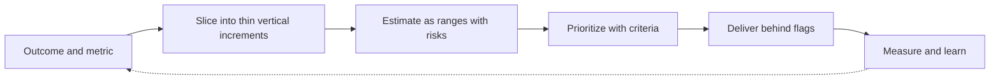
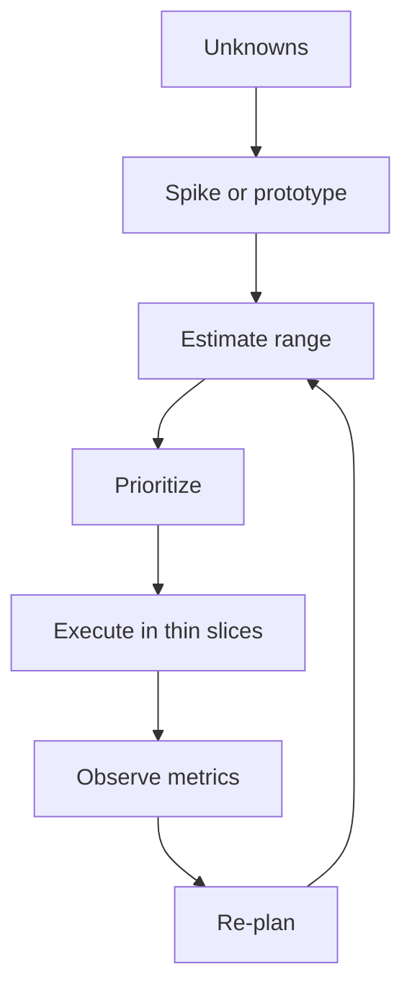

# Planning, Estimation, Prioritization and Delivery

> Verification note: This document covers **established planning and delivery practice**: roadmaps framed by outcomes, OKRs, vertical slicing and walking skeletons, estimation under uncertainty (ranges, three-point estimates, reference classes, the cone of uncertainty, planning fallacy, Hofstadter's law, **Brooks's law**), prioritization frameworks (RICE, ICE, WSJF/cost of delay, MoSCoW, Kano, impact-effort matrices), Kanban/Scrum flow concepts (WIP limits, cycle time, **Little's law**), RAID logs and spikes. Framework origins and exact formulas are from memory and **should be confirmed before citing** *(hedged)*. The only externally verified data reused is **DORA guidance**: five delivery metrics (change lead time, deployment frequency, failed deployment recovery time, change fail rate, deployment rework rate), measured per service against the team's own baseline, never as targets, with smaller batch sizes helping all five ([ci-cd-web/07 §7](../ci-cd-web/07-release-automation-observability-and-pipeline-operations.md#7-measuring-dora-in-practice), [frontend-architecture/08 §5](../frontend-architecture/08-teams-governance-platform-and-delivery.md#5-developer-experience-and-delivery-metrics)). Technical debt strategy and migration planning live in [frontend-architecture/07](../frontend-architecture/07-migrations-modernization-and-technical-debt.md); this file covers the planning, negotiation and delivery-leadership aspects. Numbers in examples are illustrative.

## Table of Contents

1. [Quick Summary (TL;DR)](#1-quick-summary-tldr)
2. [Roadmaps, Outcomes and OKRs](#2-roadmaps-outcomes-and-okrs)
3. [Scoping and Slicing Work](#3-scoping-and-slicing-work)
4. [Estimation Under Uncertainty](#4-estimation-under-uncertainty)
5. [Prioritization Frameworks](#5-prioritization-frameworks)
6. [Capacity, Interruptions and Planning Cadence](#6-capacity-interruptions-and-planning-cadence)
7. [Risk, Dependencies and Unknowns](#7-risk-dependencies-and-unknowns)
8. [Flow, Process and Delivery Health](#8-flow-process-and-delivery-health)
9. [Frontend-Specific Planning Concerns](#9-frontend-specific-planning-concerns)
10. [Deadlines, Scope Creep and Delivering Bad News](#10-deadlines-scope-creep-and-delivering-bad-news)
11. [Launching, Rollout and Learning](#11-launching-rollout-and-learning)
12. [Balancing Features, Quality and Technical Work](#12-balancing-features-quality-and-technical-work)
13. [Pitfalls](#13-pitfalls)
14. [Interview Questions — Fundamentals](#14-interview-questions--fundamentals)
15. [Interview Questions — Senior Scenarios](#15-interview-questions--senior-scenarios)
16. [Cheat Sheet](#16-cheat-sheet)
17. [Key Terms Glossary](#17-key-terms-glossary)
18. [Further Reading](#18-further-reading)

---

## 1. Quick Summary (TL;DR)

- **Plan outcomes, then outputs.** Start from the user/business problem and measurable result; features are hypotheses to achieve it.
- **Slice vertically and thin.** Deliver end-to-end slices of value early (walking skeleton), behind flags, rather than horizontal layers that integrate late.
- **Estimates are ranges with assumptions,** not promises. Communicate **confidence**, what could change the estimate, and the **cost of delay** of waiting for certainty.
- **Reduce uncertainty before committing:** spikes, prototypes, contract agreements, early integration, risk-first ordering.
- **Prioritize with explicit criteria** (impact, confidence, effort, urgency/cost of delay, risk, strategic fit) and make trade-offs visible; say what is **not** being done.
- **Protect capacity:** account for incidents, support, reviews, meetings, holidays, onboarding; plan at ~60–80% of nominal capacity *(hedged heuristic)*.
- **Flow beats utilization:** limit work in progress, shrink batch size, shorten feedback loops; track cycle time and delivery metrics as improvement signals (never targets).
- **Communicate early and honestly,** with options. Surprises destroy trust faster than slips.



---

## 2. Roadmaps, Outcomes and OKRs

**Roadmap formats**

| Format | Description | When |
|---|---|---|
| **Now / Next / Later** | Time horizons without fixed dates; commitment decreases with distance | Uncertain environments; stakeholder alignment without date promises |
| **Quarterly themes** | Problem areas with target outcomes | Medium-term planning |
| **Date-driven release plan** | Commitments tied to dates | Contractual/regulatory launches (use with explicit risk buffers) |
| **Opportunity tree / outcome map** | Outcome → opportunities → solutions → experiments | Discovery-driven teams |

**Outcome vs output:** *Output:* "Ship new checkout." *Outcome:* "Increase checkout completion from X% to Y%." Teams that track only outputs can ship much without improving anything.

**OKRs (Objectives and Key Results) — concepts**
- **Objective:** inspiring qualitative goal. **Key results:** measurable outcomes (2–5), not task lists.
- Distinguish **committed** vs **aspirational** goals; agree how scores are used (not for individual performance ratings).
- Frontend examples: "Make the product feel fast" → KR: p75 INP ≤ 200 ms on top 5 routes *(thresholds per verified Web Vitals guidance in [web-performance/01](../web-performance/01-performance-metrics-and-measurement.md))*; "Reduce regressions" → KR: change fail rate trend improves, flaky test rate < N%; "Accessible by default" → KR: automated a11y checks pass on all new components, critical flows audited.
- **Pitfalls:** key results as activities; too many objectives; sandbagging; using OKRs as performance targets (Goodhart's law).

**Technical roadmap items** need business justification: link to reliability, velocity, cost, risk, compliance, hiring/retention. Present as **options with outcomes** ("reduce time-to-first-PR by 50%", "cut build time to 10 min").

**Stakeholder alignment on the roadmap:** share assumptions, dependencies and risks; revisit regularly; communicate changes with reasons.

---

## 3. Scoping and Slicing Work

**Principles**
- **Vertical slice:** thin path through UI → API → data that delivers user value and tests integration early.
- **Walking skeleton:** minimal end-to-end implementation of the architecture (routing, auth, CI/CD, observability) before filling in features.
- **Feature flags** decouple deploy from release; enable incremental delivery and rollback ([debugging-scenarios/07 §6](../debugging-scenarios/07-production-incidents-observability-and-root-cause-analysis.md#6-scenario-release-regressions-flags-and-rollbacks)).
- **MVP/MLP:** smallest thing that tests the key hypothesis (viable) or that users will love enough (lovable); state what is explicitly out of scope.
- **Risk-first ordering:** tackle the riskiest/least-known parts early (integrations, performance, accessibility patterns, data migration).

**Slicing techniques (frontend examples)**

| Technique | Example |
|---|---|
| **By user flow step** | Cart view → shipping → payment → confirmation |
| **By data variation** | Single item first, then multi-item, then bundles |
| **By platform/viewport** | Mobile web first, desktop later (or reverse) |
| **By capability** | Read-only view → create → edit → delete |
| **By quality attribute** | Functional → performant → polished (explicitly planned, not forgotten) |
| **By rule/variant** | One payment method, then others |
| **By audience** | Internal users → beta → percent rollout |
| **Spike then build** | Time-boxed investigation of unknowns (library, API, performance) |

**Definition of Ready / Done:** ready = understood acceptance criteria, designs, dependencies, analytics; done = tested, accessible, reviewed, observable, documented, deployed behind flag ([frontend-architecture/08 §8](../frontend-architecture/08-teams-governance-platform-and-delivery.md#8-quality-gates-and-definition-of-done)).

**Work breakdown tips:** break into tasks ≤ 1–3 days; make dependencies explicit; include non-functional work (tests, a11y, performance, instrumentation, docs, rollout) as first-class items, not "polish at the end."

---

## 4. Estimation Under Uncertainty

**Why estimates are wrong:** **planning fallacy** (optimism), **Hofstadter's law** (it always takes longer, even when you account for it), unknowns, hidden dependencies, interruptions, scope changes, coordination overhead.

**Techniques**

| Technique | How | Notes |
|---|---|---|
| **Ranges** | "2–4 weeks (80% confidence)" | Communicate uncertainty; narrow as knowledge grows |
| **Three-point estimate** | Optimistic (O), Most likely (M), Pessimistic (P) → expected ≈ (O + 4M + P)/6 | PERT-style *(hedged)* |
| **Reference class / analogy** | Compare to similar past work and actual durations | Beats gut feel; requires history |
| **Decomposition** | Estimate smaller pieces; sum with buffer | Beware of missing integration/non-functional work |
| **Story points** | Relative sizing for velocity-based forecasting | Teams-specific; do not compare across teams; do not convert to person-days by formula |
| **Throughput-based forecasting** | Count completed items per week (Monte Carlo on cycle times) | Works with consistent item sizes *(hedged)* |
| **Planning poker / affinity** | Discuss differences; surface assumptions | Value is the conversation |
| **Spike first** | Time-box exploration to reduce uncertainty | Output = knowledge, not code |

**Cone of uncertainty:** early estimates can be off by a large factor; they converge as the project progresses. Don't commit to a precise date at the idea stage; commit to a date-range and revisit at milestones.

**Estimating frontend work:** include — design review iterations, edge/empty/error/loading states, responsive behavior, accessibility, i18n, browser/device testing, analytics, feature flag/rollout, code review/QA cycles, unfamiliar libraries, API availability (mocks help), performance budget compliance.

**Communicating estimates:** state assumptions ("assumes API contract by Wednesday, design final"), key risks and their impact, what would change the estimate, and the confidence level. Offer **options** that trade scope/time.

**Brooks's law:** adding people to a late project often makes it later (onboarding and communication overhead). More people help only for parallelizable, well-modularized work with clear interfaces.

**#NoEstimates/continuous flow (concept):** in stable-flow teams, slice work into similarly small items and forecast by throughput; still needs prioritization and discussion. Choose the approach that suits the stakeholder's need for predictability ([08](#8-flow-process-and-delivery-health)).

**Estimation anti-patterns:** sandbagging (padding invisibly), commitment under pressure, treating estimates as deadlines, ignoring actuals (no learning), single-point estimates, estimating without understanding the problem.

**Retrospective learning:** record estimates vs actuals; analyze systemic misses (e.g., always underestimating testing, integration, review) and adjust.

---

## 5. Prioritization Frameworks

| Framework | Idea | Formula / method | Best for | Caveats |
|---|---|---|---|---|
| **Impact vs Effort matrix** | Quick wins vs big bets | 2×2 | Rapid triage | Subjective; ignores confidence |
| **RICE** | Reach × Impact × Confidence ÷ Effort | Numeric score | Product feature backlogs | Garbage in, garbage out; false precision |
| **ICE** | Impact × Confidence × Ease | Simple score | Experiments | Subjective scoring |
| **WSJF (Weighted Shortest Job First)** | Cost of delay ÷ job size | Cost of delay = value + time criticality + risk reduction/opportunity | Sequencing when delay costs differ | Estimating cost of delay is hard |
| **MoSCoW** | Must / Should / Could / Won't | Categorization | Scope negotiation for a release | "Must" inflation |
| **Kano model** | Basic / performance / delighter features | Customer research | UX strategy | Needs research |
| **Value vs complexity (risk)** | Maximize value per complexity; consider risk | Visual | Roadmap workshops | Qualitative |
| **Opportunity scoring** | Importance vs satisfaction gaps | Surveys | Customer-driven | Requires data |
| **Cost of delay (CoD)** | What waiting costs per week | Qualitative profiles: urgent, fixed date, standard, intangible | Launch timing, tech investment | Hard to quantify |

**How senior engineers contribute:** supply **effort and risk estimates**, surface **technical enablers** and dependencies, quantify **cost of inaction** for reliability/security/perf, identify **cheaper alternatives**, and propose **sequencing** that enables learning earlier.

**Trade-off visibility:** present the prioritized list with a "line" showing what fits capacity; discuss what moves above/below; record decisions and rationale.

**Beware:** HiPPO (highest paid person's opinion) prioritization; squeaky-wheel bias; recency bias; sunk-cost fallacy; "everything is P0"; ignoring maintenance/operational load; over-reliance on scoring spreadsheets — use them to structure discussion, not replace judgment.

**Technical prioritization signals:** user pain (performance, errors), incident/near-miss data, developer friction (CI time, flaky tests, onboarding), security/compliance deadlines, vendor end-of-life, upcoming feature needs, cost.

---

## 6. Capacity, Interruptions and Planning Cadence

**Capacity model (illustrative)**

```text
Nominal capacity:         8 engineers × 10 working days = 80 person-days
- Holidays/PTO:           -8
- Meetings/ceremonies:    -10
- Reviews/support/on-call/incident buffer: -16
- Onboarding/mentoring:   -6
= Plan capacity:          ≈ 40 person-days  (≈ 50% of nominal)
```
Actual percentages vary by team and period; use **historical data** (throughput, interruption logs).

**Planning cadence options**

| Cadence | Pros | Cons |
|---|---|---|
| **Sprints (1–3 weeks)** | Regular rhythm, forecasts, ceremonies | Overhead; sprint-end rush; artificial deadlines |
| **Kanban (continuous)** | Flow, flexibility, WIP limits | Needs discipline to avoid sprawl |
| **Quarterly planning + weekly execution** | Alignment on outcomes with agile execution | Quarterly plans go stale without re-planning |
| **Shape Up-style cycles (6 weeks + cooldown)** *(hedged)* | Appetite-based scope, uninterrupted focus | Requires strong shaping and trust |

**Interrupt management:** designate an **interrupt/support rotation**, triage requests via a single intake (queue/form), classify urgency, time-box support, track interruptions to inform capacity and staffing arguments; protect focus time (meeting-light days).

**On-call/incidents:** include on-call load in planning; after major incidents, schedule remediation work explicitly ([debugging-scenarios/07 §10](../debugging-scenarios/07-production-incidents-observability-and-root-cause-analysis.md#10-root-cause-analysis-and-blameless-postmortems)).

**Quarterly planning steps:** review outcomes and metrics → confirm priorities with product → collect proposals (including technical) → size and sequence → check dependencies across teams → commit to a few outcomes, keep ~10–20% slack → publish plan and risks → re-plan mid-quarter if assumptions change.

---

## 7. Risk, Dependencies and Unknowns

**RAID log:** **R**isks (may happen), **A**ssumptions (believed true), **I**ssues (happening now), **D**ependencies (outside your control). Review weekly; assign owners and dates.

**Risk handling:** avoid (change plan), mitigate (reduce likelihood/impact), transfer (vendor/insurance), accept (with trigger and contingency). Prioritize by **likelihood × impact** and **proximity**.

**Common frontend risks**

| Risk | Mitigation |
|---|---|
| API not ready/unstable | Contract-first, mock server (MSW), BFF, early integration ([networking-and-apis/07](../networking-and-apis/07-api-client-architecture-and-contracts.md)) |
| Design changes late | Design-dev pairing, component library, design freeze milestones, visual regression |
| Performance/a11y discovered late | Budgets and checks in CI from the start; early audits ([web-performance/07](../web-performance/07-performance-debugging-budgets-and-culture.md), [accessibility/07](../accessibility/07-testing-tooling-and-accessibility-in-the-delivery-process.md)) |
| Browser/device surprises | Test matrix, early device testing ([debugging-scenarios/05](../debugging-scenarios/05-browser-compatibility-storage-and-environment-bugs.md)) |
| Third-party dependency issues (SDKs, payment, analytics) | Spike, sandbox, fallback/kill switch, vendor SLAs |
| Migration complexity | Strangler approach, incremental rollout, rollback ([frontend-architecture/07](../frontend-architecture/07-migrations-modernization-and-technical-debt.md)) |
| Key-person dependency | Pairing, documentation, shared ownership |
| Cross-team dependency delays | Early alignment, explicit asks, escalation path, interface agreements |
| Scope growth | Change control: explicit trade-off conversation, backlog parking lot |
| Security/compliance review delays | Engage early; checklists; threat models |

**Dependency management:** identify at planning time; **make requests explicit** (what, by when, why it matters); get a named owner and commitment; track in a shared board; agree on interface contracts; build **decoupling** (feature flags, adapters, mocks) so you're not blocked; escalate early with options.

**Unknowns:** convert to knowns via spikes; log assumptions; set decision deadlines ("we'll decide by Friday based on spike results").

---

## 8. Flow, Process and Delivery Health

**Flow concepts**
- **WIP limits:** fewer items in progress → faster completion, less context switching.
- **Cycle time:** start → done per item; **lead time:** request → done.
- **Throughput:** items completed per period.
- **Little's law (concept):** average cycle time ≈ WIP ÷ throughput — to reduce cycle time, reduce WIP or raise throughput.
- **Batch size:** smaller batches reduce risk and speed feedback (DORA: smaller batches help all five metrics).

**Healthy signals:** PRs merged within a day or two, small PRs, steady release cadence, low rework, short CI times, few long-running branches, predictable throughput, stable on-call load.

**Warning signs:** chronic carry-over, growing WIP, long review queues, release freezes, "hardening sprints," recurring hotfixes, high flaky rates, deploy fear.

**Metrics (use with care)**

| Metric | Use | Don't |
|---|---|---|
| **DORA** (5 metrics per service) | Spot delivery bottlenecks; track your trend | Set targets, compare teams, blend services |
| **Cycle time / PR size / review time** | Flow diagnostics | Rank individuals |
| **Velocity (points)** | Short-term team forecasting | Compare teams; use as productivity measure |
| **Developer experience surveys** | Friction, satisfaction | Ignore qualitative signals |
| **Quality (escaped defects, incidents, SLOs)** | Reliability trends | Punish reporting |

**Process tuning:** retrospectives with actionable experiments (one or two improvements per cycle), process owners, trial-and-review; remove ceremonies that don't pay for themselves; keep standups/status asynchronous when possible.

**Agile as practice, not ritual:** the goal is fast feedback and adaptability — whichever framework (Scrum, Kanban, hybrid) helps your context; avoid cargo-culting.

---

## 9. Frontend-Specific Planning Concerns

- **Design collaboration:** involve engineers in design critique early; agree on component inventory vs new components; handle states (loading/empty/error/offline), responsive behavior, motion and accessibility upfront; use design tokens and Storybook as shared language ([system-design/06](../system-design/06-design-system-and-component-library.md)).
- **Contracts and mocking:** unblock UI work with typed mocks; agree on error formats and pagination; schedule integration checkpoints.
- **Non-functional requirements as acceptance criteria:** performance budgets (LCP/INP/CLS), accessibility (WCAG 2.2 AA target), browser/device support policy, i18n, security, observability.
- **Cross-browser and device QA:** plan time for real-device testing (especially iOS Safari/WebViews) ([debugging-scenarios/05](../debugging-scenarios/05-browser-compatibility-storage-and-environment-bugs.md)).
- **Analytics and experimentation:** instrument before launch; plan A/B tests and sample size; define success metrics up front.
- **Rollout:** flags, canary/percent rollouts, kill switches, monitoring dashboards, rollback criteria ([ci-cd-web/06](../ci-cd-web/06-deployment-strategies-environments-and-infrastructure.md)).
- **Content and localization dependencies:** copy, translations, legal text, assets.
- **Design system dependency:** if a needed component doesn't exist, plan its creation (cost, ownership, release cycle) or accept a temporary local implementation with a migration plan.
- **Migrations:** framework/library upgrades need explicit capacity (codemods, testing, dual-running) — not "free" background work ([frontend-architecture/07](../frontend-architecture/07-migrations-modernization-and-technical-debt.md)).
- **SEO/rendering decisions** affect effort and architecture ([nextjs-and-rendering/01](../nextjs-and-rendering/01-rendering-strategies-and-hydration.md)).

---

## 10. Deadlines, Scope Creep and Delivering Bad News

**When a deadline is at risk**
1. **Detect early** — track burndown/risk signals, milestone check-ins, integration status.
2. **Re-estimate with facts** — what's done, what's left, uncertainty range.
3. **Prepare options:** (a) reduce scope (cut or defer), (b) move date, (c) add resources (with Brooks's-law caveats; only if parallelizable and ramp-up cost accepted), (d) reduce quality (explicitly, with risks — prefer not; if so define follow-up and guardrails), (e) change approach (buy, simplify, reuse).
4. **Communicate promptly** with a recommendation, impact and ask.
5. **Decide and document;** reset expectations; protect the team from unsustainable crunch.

**Crunch:** occasional, voluntary, time-boxed intensity may be acceptable for true launches, but chronic crunch hurts quality, retention and health; compensate with recovery time; examine root causes (over-commitment, poor scoping, hidden dependencies).

**Scope creep:** capture requests in a backlog; evaluate impact (time, risk) and trade explicitly ("to add X, we remove Y or move the date"); use change control for large changes; clarify "must" vs "nice" early; maintain a visible scope list.

**Delivering bad news** — template
```text
Situation: what changed and when we learned it (facts).
Impact: on dates/scope/quality/customers.
Cause (brief, no blame): what we missed and what we've changed.
Options: A (recommended) / B / C with trade-offs.
Ask: the decision/resources needed and by when.
Next update: when and how.
```

**Hitting deadlines responsibly:** protect the critical path; reduce WIP; swarm on blockers; daily risk check-ins; freeze scope at a defined point; prepare rollback and support readiness; avoid heroics as a plan.

---

## 11. Launching, Rollout and Learning

**Launch readiness checklist (frontend)**
- Acceptance criteria met; edge/error/empty states verified.
- Accessibility and performance budgets checked; cross-browser/device smoke tests.
- Observability: errors, RUM, funnel metrics, dashboards, alerts; release tagging and source maps.
- Rollout plan: flag, canary stages, rollback criteria and owner, kill switch tested.
- Security/privacy review; legal/consent text.
- Support readiness: docs/FAQ, support training, known issues.
- Communication: internal announcement, customer notes, status page plan.
- On-call coverage and runbooks.
- Post-launch review scheduled.

**Progressive rollout:** internal dogfood → small percentage → expand with automated health checks → 100%; monitor guardrail metrics (errors, latency, conversion, CWV) and decide with predefined thresholds ([debugging-scenarios/07 §6](../debugging-scenarios/07-production-incidents-observability-and-root-cause-analysis.md#6-scenario-release-regressions-flags-and-rollbacks)).

**Post-launch:** compare outcomes with hypotheses/metrics; gather qualitative feedback; clean up flags and temporary code (tracked, with owners/dates); retrospective on planning and estimation accuracy; share learnings; update roadmap.

**Celebrate and learn:** recognize contributions, including invisible work; blameless review of misses.

---

## 12. Balancing Features, Quality and Technical Work

**Mechanisms**
- **Capacity allocation:** reserve a share (commonly cited ranges like 10–30% *(hedged: heuristic, not a standard)*) for reliability, debt, tooling, and learning; adjust based on health metrics (incidents, cycle time, developer survey).
- **Tie debt to outcomes:** "Reducing CI from 25→10 minutes saves ~X engineer-hours/week and speeds delivery" — use estimates with honesty ([frontend-architecture/07 §10](../frontend-architecture/07-migrations-modernization-and-technical-debt.md#10-managing-technical-debt)).
- **Embed quality in features:** include tests, accessibility, observability and docs in estimates; avoid "later" backlog dumps.
- **Boy-scout rule:** leave touched code a little better, within scope.
- **Debt register:** list items with impact, cost to fix, risk, owner; review periodically; retire or accept explicitly.
- **Error budgets (SRE-style):** when reliability objectives are breached, shift capacity to reliability work ([debugging-scenarios/07](../debugging-scenarios/07-production-incidents-observability-and-root-cause-analysis.md)).
- **Say what you stop doing** when adding new work.

**Negotiation script:** "To hit the Q3 target we must keep feature work at ~70% and spend ~30% on reliability; incidents cost us ~N engineer-days last quarter. Here are three investments and expected impact; which do we prioritize?"

---

## 13. Pitfalls

1. **Outputs without outcomes;** shipping features that don't move metrics.
2. **Point estimates treated as promises.**
3. **Hidden assumptions and unstated risks.**
4. **Horizontal slicing with late integration.**
5. **No capacity for interrupts/on-call/reviews.**
6. **Estimating only coding time;** ignoring tests, a11y, rollout, design iterations.
7. **Adding people to a late project reflexively.**
8. **False precision in scoring frameworks;** HiPPO-driven prioritization.
9. **Unlimited WIP and context switching.**
10. **Velocity or DORA used as targets/rankings.**
11. **Quality cuts hidden as speed.**
12. **Delivering bad news late or without options.**
13. **No post-launch measurement or flag cleanup.**
14. **Chronic crunch and heroics.**
15. **Technical work justified only by tech arguments, not outcomes.**
16. **Dependencies assumed, not agreed.**

---

## 14. Interview Questions — Fundamentals

- **How do you estimate work?** Break down, use ranges with assumptions and confidence, compare to similar past work, include non-functional work, and update as you learn.
- **What is a vertical slice?** A thin end-to-end increment delivering user value across layers.
- **How do you prioritize?** Criteria such as impact, confidence, effort, urgency/cost of delay, and risk; make trade-offs visible.
- **What is RICE?** Reach × Impact × Confidence ÷ Effort.
- **What is WSJF?** Prioritize by cost of delay divided by job size.
- **What is a spike?** Time-boxed investigation to reduce uncertainty.
- **How do you handle scope creep?** Capture, evaluate impact, trade explicitly, change control.
- **What is Brooks's law?** Adding people to a late project makes it later (in many cases).
- **How do you manage dependencies?** Identify early, make explicit requests, agree contracts, decouple with mocks/flags, escalate early.
- **What do you do when a deadline is at risk?** Re-estimate with facts, present options (scope/date/resources/approach), communicate early with a recommendation.
- **Outcome vs output?** Result achieved vs thing delivered.
- **How do you measure delivery health?** DORA metrics per service as improvement signals, cycle time, PR size/review time, developer surveys — never as targets.

---

## 15. Interview Questions — Senior Scenarios

### S1. "Leadership asks for a date for a large, ambiguous initiative (e.g., migrate to a new rendering architecture)."
Clarify objectives and constraints; do a discovery phase (spikes, prototypes, inventory); break into phases with decision gates; provide a range with assumptions, risks and confidence, plus milestones that produce value early; commit to the next phase's date, not the whole; propose how estimates will be refined; outline cost of delay and cost of failure; agree on review checkpoints ([frontend-architecture/07](../frontend-architecture/07-migrations-modernization-and-technical-debt.md)).

### S2. "Three teams need your team's component library changes this quarter; you can only do one."
Gather requirements and business impact from each; assess shared value and effort; use criteria (customer impact, deadlines, reuse, risk); offer alternatives (self-service contribution model, temporary local implementations with migration plan, phased delivery); decide transparently with product/design leads; communicate rationale to teams that lose; define what unblocks them in the meantime ([system-design/06](../system-design/06-design-system-and-component-library.md)).

### S3. "Your team consistently carries over 30% of sprint work. What do you do?"
Diagnose: over-commitment, hidden work/interrupts, large items, dependencies, unclear acceptance criteria, WIP too high, estimation bias. Collect data (cycle times, interruption log); reduce WIP and item size; plan to measured capacity; add buffer; improve refinement; track carry-over trend as a signal (not a target); run retrospectives with experiments.

### S4. "A VP wants a feature by a hard date; you believe it's unrealistic."
Understand why the date matters (event, contract, competitive); present facts: scope breakdown, critical path, risks, ranges; offer options to meet the date (reduced scope, phased rollout, alternate approach, added resources where parallelizable); show impact of each on quality/risk; recommend; agree on checkpoints and a go/no-go criteria; avoid blanket "no"; document the decision.

### S5. "How do you convince leadership to fund a 3-month investment in build/CI/dev-experience?"
Baseline current pain with data (CI time, flaky rate, time-to-merge, incidents, developer survey); estimate cost (engineer-hours lost × rate) and risks; propose phased investments with measurable outcomes (e.g., CI p90 from 25→10 minutes, reduced reruns); show expected effect on delivery metrics (as signals) and morale/retention; pilot quick wins; define review points; link to business goals (faster delivery, fewer incidents) ([ci-cd-web/07](../ci-cd-web/07-release-automation-observability-and-pipeline-operations.md)).

### S6. "Plan the first quarter for a new frontend platform team."
Discover customers (product teams) and pain points (surveys, interviews, data); define outcomes (adoption, delivery speed, quality); pick 2–3 high-leverage bets (e.g., starter template + CI, design-system adoption, performance/a11y baselines); establish service model (docs, office hours, SLAs, contribution model); run pilots; publish a roadmap with Now/Next/Later; measure adoption and satisfaction; avoid building in isolation ([frontend-architecture/08 §3](../frontend-architecture/08-teams-governance-platform-and-delivery.md#3-platform-engineering-and-the-paved-road)).

---

## 16. Cheat Sheet

| Topic | Rule of thumb |
|---|---|
| Roadmap | Outcomes first; Now/Next/Later; revisit |
| Slicing | Vertical, thin, behind flags, risk-first |
| Estimation | Ranges + assumptions + confidence; include non-functional work |
| Prioritization | Explicit criteria; show the line; say what's not done |
| Capacity | Plan below nominal; reserve slack and interrupt buffer |
| Dependencies | Explicit asks, owners, contracts, decoupling |
| Deadline risk | Early signal; options; recommendation; decision |
| Flow | Limit WIP; small batches; track cycle time |
| Metrics | DORA/flow as signals; not targets |
| Debt | Tie to outcomes; allocate capacity; register |
| Launch | Flag, canary, monitor, rollback criteria, cleanup |



---

## 17. Key Terms Glossary

| Term | Meaning |
|---|---|
| **Outcome** | Measurable change in user/business behavior |
| **Vertical slice** | End-to-end thin increment of value |
| **Walking skeleton** | Minimal end-to-end architecture implementation |
| **Spike** | Time-boxed learning task |
| **Cone of uncertainty** | Estimate variance narrowing over time |
| **RICE / ICE / WSJF** | Prioritization scoring frameworks |
| **Cost of delay** | Value lost by postponing |
| **WIP limit** | Cap on in-progress work |
| **Cycle time** | Time from work start to done |
| **RAID log** | Risks, assumptions, issues, dependencies |
| **Brooks's law** | Adding people to a late project delays it further |
| **Goodhart's law** | A measure used as a target stops being a good measure |

---

## 18. Further Reading

- Ryan Singer, *Shape Up*; Donald Reinertsen, *The Principles of Product Development Flow*; Frederick Brooks, *The Mythical Man-Month*; Marty Cagan, *Inspired*; John Doerr, *Measure What Matters*; Forsgren et al., *Accelerate*; Daniel Vacanti, *Actionable Agile Metrics for Predictability* *(hedged: titles from memory; confirm before citing)*
- [DORA metrics guide](https://dora.dev/guides/dora-metrics/) *(hedged: confirm URL)*
- **This repo:** [01 Roles and levels](01-leadership-roles-levels-and-interview-expectations.md) · [02 Influence and decisions](02-influence-stakeholders-and-technical-decision-making.md) · [06 Leading initiatives](06-leading-technical-initiatives-and-organizational-change.md) · [08 Scenarios](08-leadership-scenarios-and-case-studies.md) · [frontend-architecture/07](../frontend-architecture/07-migrations-modernization-and-technical-debt.md) · [frontend-architecture/08](../frontend-architecture/08-teams-governance-platform-and-delivery.md)
