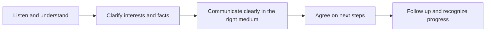
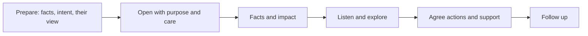
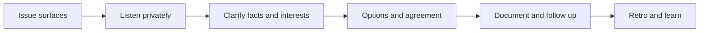

# Communication, Conflict and Team Health

> Verification note: This document describes **established practice** in team communication and group dynamics: written/async communication norms, meeting design, the **Thomas-Kilmann** conflict modes (competing, collaborating, compromising, avoiding, accommodating), principled negotiation, **psychological safety** (Amy Edmondson; Google's Project Aristotle findings), **Tuckman's** team-development stages (forming, storming, norming, performing, adjourning), **self-determination**-style motivation (autonomy, mastery, purpose as popularized by Daniel Pink), burnout recognition and blameless culture. Attributions, dates and exact findings are from memory and **should be confirmed before citing in an interview** *(hedged)*. This is **not clinical, HR or legal advice**: for harassment, discrimination, safety, mental-health crises and employment-law matters, follow company policy and involve HR/legal ([03 §9](03-mentoring-coaching-feedback-and-hiring.md#9-managing-underperformance-and-difficult-situations)). Technical decision records and trade-off communication are in [frontend-architecture/01](../frontend-architecture/01-frontend-architecture-principles-and-decision-making.md); incident communication and blameless postmortems are in [debugging-scenarios/07](../debugging-scenarios/07-production-incidents-observability-and-root-cause-analysis.md).

## Table of Contents

1. [Quick Summary (TL;DR)](#1-quick-summary-tldr)
2. [Communication Principles for Engineering Leaders](#2-communication-principles-for-engineering-leaders)
3. [Written and Asynchronous Communication](#3-written-and-asynchronous-communication)
4. [Meetings That Work](#4-meetings-that-work)
5. [Remote, Hybrid and Cross-Cultural Collaboration](#5-remote-hybrid-and-cross-cultural-collaboration)
6. [Conflict: Types, Modes and Resolution](#6-conflict-types-modes-and-resolution)
7. [Difficult Conversations](#7-difficult-conversations)
8. [Psychological Safety and Team Culture](#8-psychological-safety-and-team-culture)
9. [Team Development, Norms and Working Agreements](#9-team-development-norms-and-working-agreements)
10. [Team Health: Signals, Motivation and Burnout](#10-team-health-signals-motivation-and-burnout)
11. [Ownership, Mistakes and Blameless Culture](#11-ownership-mistakes-and-blameless-culture)
12. [Inclusion and Fairness](#12-inclusion-and-fairness)
13. [Pitfalls](#13-pitfalls)
14. [Interview Questions — Fundamentals](#14-interview-questions--fundamentals)
15. [Interview Questions — Senior Scenarios](#15-interview-questions--senior-scenarios)
16. [Cheat Sheet](#16-cheat-sheet)
17. [Key Terms Glossary](#17-key-terms-glossary)
18. [Further Reading](#18-further-reading)

---

## 1. Quick Summary (TL;DR)

- **Communicate to be understood, not to be right:** know your audience, lead with the point, check understanding, and match medium to message (written for decisions and records; live for nuance and emotion).
- **Default to written, asynchronous, searchable communication** for decisions, designs and status; use meetings for discussion, alignment and relationship-building, not for reading updates.
- **Conflict is normal and useful** when it is about ideas; destructive when it is about people. Separate **people from problems**, focus on **interests**, and use evidence.
- **Hard conversations** need preparation: purpose, facts, impact, curiosity about the other view, clear next steps. Avoiding them is more costly than having them.
- **Psychological safety** — people can speak up, admit mistakes, ask questions and disagree without fear of humiliation or punishment — correlates with learning and high-performing teams.
- **Team health is observable:** morale, workload, conflict handling, turnover, quality trends, participation. Check regularly; act on patterns.
- **Blameless does not mean accountability-free:** focus on systems and learning while owning responsibility for follow-through.

---

## 2. Communication Principles for Engineering Leaders

| Principle | Practice |
|---|---|
| **Know the audience** | Executives: outcomes, risk, cost. PM: scope/time options. Designers: constraints/feasibility. Engineers: design, context, rationale. Support: customer impact. |
| **Lead with the point (BLUF)** | State the conclusion and ask first; details after |
| **One message, several mediums** | Announce in writing, discuss live, summarize afterwards |
| **Say it three ways** | Repeat important messages in different contexts (kickoff, doc, follow-up) |
| **Be concrete** | Examples, numbers, diagrams over abstractions |
| **Separate facts, interpretations and feelings** | "The deploy took 40 minutes (fact); I believe the cache is cold (hypothesis); I'm concerned about the launch date (feeling)" |
| **Listen actively** | Paraphrase, ask open questions, don't prepare your rebuttal while the other is speaking |
| **Assume positive intent, verify impact** | Treat misunderstandings as likely; discuss effects without accusing |
| **Be transparent about uncertainty** | "I don't know yet; here's how we'll find out" |
| **Close loops** | Confirm decisions, owners and dates; follow up |
| **Adapt style** | Direct vs indirect, detail vs summary, written vs verbal preferences |

**Technical communication to mixed audiences:** use analogies carefully, define terms, visualize (flow diagrams, before/after), and tie to user/business impact ([02 §7](02-influence-stakeholders-and-technical-decision-making.md#7-managing-up-and-communicating-with-executives)).

**Presence and credibility:** be prepared, concise, calm under pressure, honest about errors, consistent between private and public messages; share credit and take responsibility.

**Non-verbal and tone:** in text, intent is easily misread; add context ("Quick question, not a blocker"), use clear subject lines, and avoid sarcasm; when emotions escalate in chat, switch to a call.

---

## 3. Written and Asynchronous Communication

**Why written:** scales across time zones and people, creates records, enables thoughtful responses, reduces meeting load, and supports inclusivity (non-native speakers, introverts, different schedules).

**Artifacts and when to use them**

| Artifact | Use |
|---|---|
| **RFC / design doc** | Proposals needing input; see [frontend-architecture/01 §8](../frontend-architecture/01-frontend-architecture-principles-and-decision-making.md#8-adrs-and-rfcs-recording-decisions) |
| **ADR** | Record of decisions made |
| **Status update (weekly)** | Progress, risks, decisions needed, next steps |
| **Project brief** | Goals, scope, stakeholders, milestones |
| **Runbook** | Operational procedures ([debugging-scenarios/07 §11](../debugging-scenarios/07-production-incidents-observability-and-root-cause-analysis.md#11-runbooks-alerts-and-on-call)) |
| **Postmortem** | Learning from incidents |
| **Meeting notes with decisions and owners** | Alignment record |
| **Chat message** | Quick questions, coordination (not decisions without a record) |

**Good written communication**
- **Title/subject that says the point.** First paragraph = summary and ask.
- **Short paragraphs, bullets and tables;** diagrams for flows and architectures.
- **Explicit asks:** who, what, by when. ("@Sam — please review by Thursday EOD; blocking launch.")
- **Context links** (tickets, docs, dashboards); avoid "as discussed" without a record.
- **Distinguish required vs optional readers.**
- **Version and date** long-lived docs; mark status (draft/proposed/accepted).
- **Review etiquette:** comment with intent labels (blocking, suggestion, question), respond to all comments, update the doc and note changes.

**Chat etiquette:** use threads; avoid "hi" with no content ("Hi — quick question about X: …"); set expectations for response times (urgent vs non-urgent); use @-mentions sparingly; avoid sensitive or critical feedback in public channels; summarize long threads and move decisions into docs.

**Async-first meetings:** share pre-reads, collect comments before the meeting, use the live time for unresolved items, and publish outcomes.

**Documentation as leadership:** if the same question is asked three times, write it down; keep docs close to code; treat docs as a product (owners, review, deprecation).

---

## 4. Meetings That Work

| Meeting type | Purpose | Format tips |
|---|---|---|
| **Daily standup** | Coordination, blockers | 10–15 min or async; focus on obstacles, not status theater |
| **Planning/refinement** | Align on scope/estimates | Pre-read; timebox; decisions logged |
| **Design review** | Evaluate proposals | Pre-read; structured feedback; decision owner explicit |
| **Retrospective** | Continuous improvement | Psychological safety; actionable experiments; follow-up |
| **1:1** | Relationship, coaching | Report-owned agenda ([03 §8](03-mentoring-coaching-feedback-and-hiring.md#8-one-on-ones)) |
| **Demo/showcase** | Share progress, gather feedback | Short; user-centered |
| **All-hands/syncs** | Broad information | Q&A; recorded notes |
| **Incident bridge** | Coordination during incidents | Roles, updates cadence ([debugging-scenarios/07 §2](../debugging-scenarios/07-production-incidents-observability-and-root-cause-analysis.md#2-incident-lifecycle-for-frontend-teams)) |
| **Workshops** | Generate ideas/align (roadmap, architecture) | Facilitation, diverse participation, clear outputs |

**Meeting hygiene checklist:** clear purpose and desired outcome; invite only needed people (optional vs required); agenda and pre-reads shared; facilitator and note-taker; timebox; decisions, owners and dates recorded; start/end on time; "no meeting" blocks for focus.

**Facilitation techniques:** round-robin for quieter voices; silent writing before discussion (brainwriting); timeboxed discussions; "parking lot" for tangents; summarizing frequently; explicit decision method (consent, vote, decider); ensure remote participants are included first.

**Retrospective formats:** start/stop/continue; 4Ls (liked, learned, lacked, longed for); sailboat; timeline. Convert findings to **1–3 owned actions**; revisit previous actions first.

**Handling dominating/silent participants:** set speaking norms, use structured turns, check in privately, assign roles (timekeeper, devil's advocate).

**Meeting cost awareness:** hours × attendees; question recurring meetings; consolidate; replace with async where possible.

---

## 5. Remote, Hybrid and Cross-Cultural Collaboration

**Remote/hybrid practices**
- **Over-communicate context;** document decisions; avoid creating "in-room" vs "remote" tiers (hybrid equity: all join from their own device for key meetings, or share notes).
- **Overlap hours** for collaboration; protect deep-focus time; clear norms for response times and "urgent" channels.
- **Build relationships:** virtual coffee, onboarding buddies, in-person gatherings when possible, celebrate wins.
- **Visibility and fairness:** ensure remote contributors have opportunities and recognition; avoid proximity bias in promotions.
- **Tools:** shared docs, whiteboards, recorded demos, async video (Loom-style) for walkthroughs, status dashboards.
- **Time zones:** rotate meeting times; follow-the-sun handoffs with clear handoff docs; avoid chronic burden on one region.
- **Pairing remotely:** screen share + call; shared dev environments; mob sessions for knowledge sharing.

**Cross-cultural communication**
- **Direct vs indirect** styles: some cultures state disagreement openly, others imply it; verify understanding explicitly.
- **High-context vs low-context:** meaning conveyed through context vs explicit words; clarify expectations in writing.
- **Hierarchy norms:** junior engineers may avoid challenging seniors; create safe channels (written comments, anonymous questions, direct invitations).
- **Language:** avoid idioms and sarcasm; use plain language; share slides/notes in advance; allow time for reading and response.
- **Feedback norms vary;** ask about preferences; adapt delivery while keeping clarity.
- **Holidays and working patterns:** respect local calendars; plan releases accordingly.
- **Inclusive meetings:** invite input from everyone; don't penalize accents or phrasing; use captions/transcripts when helpful.

---

## 6. Conflict: Types, Modes and Resolution

**Types**

| Type | Example | Approach |
|---|---|---|
| **Task/idea conflict** | State management approach disagreement | Healthy when evidence-based; use criteria, prototypes |
| **Process conflict** | Review expectations, release process | Clarify norms; working agreements |
| **Relationship conflict** | Personal friction, disrespect | Address behavior and impact; mediation; HR if needed |
| **Value/priority conflict** | Speed vs quality; product vs tech priorities | Escalate trade-offs with options; align on goals |
| **Resource conflict** | Competing demands for shared people/time | Transparent prioritization; decision owner |
| **Role/ownership conflict** | Two teams think they own a component | Clarify ownership (DACI/RACI), document ([02 §4](02-influence-stakeholders-and-technical-decision-making.md#4-decision-rights-and-decision-types)) |

**Conflict modes (Thomas-Kilmann, hedged)**

| Mode | Assertiveness / Cooperativeness | Use when |
|---|---|---|
| **Competing** | High / low | Emergencies, vital unpopular decisions |
| **Collaborating** | High / high | Important issues needing integrated solutions |
| **Compromising** | Medium / medium | Time-limited; equal power; temporary fixes |
| **Avoiding** | Low / low | Trivial issues; cooling-off; insufficient info |
| **Accommodating** | Low / high | Issue matters more to the other; preserving relationship |

No mode is "best" — choose by situation; know your default and its blind spots.

**Resolution steps (practical)**
1. **Cool down** if emotions are high; choose private, neutral timing.
2. **Understand each perspective** — ask open questions, paraphrase; find underlying interests and fears.
3. **Define the problem jointly** in neutral terms ("We need an approach that ships by June and is maintainable").
4. **Identify shared goals and constraints.**
5. **Generate options** (more than two), evaluate against agreed criteria.
6. **Agree** on a path; define who decides if consensus isn't reached.
7. **Document and follow up;** check in after a week or two.
8. **Escalate** (manager, mediator, HR) when attempts fail, there's harassment, or power imbalance exists.

**Mediating between others:** meet separately first; remain neutral; reflect each side's interests; avoid taking sides prematurely; help them craft agreements; follow up.

**Common engineering conflicts**
- **Technology/architecture debates** → decision criteria, spikes, ADR, decider ([frontend-architecture/01 §7–8](../frontend-architecture/01-frontend-architecture-principles-and-decision-making.md#7-technology-selection-a-repeatable-framework)).
- **Code review friction** → comment labels, norms, pairing, automate style.
- **Product vs engineering** → shared outcome metrics, options, joint planning.
- **Design vs engineering** → feasibility early, design-system constraints, negotiated fidelity.
- **On-call fairness** → rotation rules, compensation, load balancing.
- **Credit and visibility** → explicit attribution, fair assignment of high-visibility work.
- **Ownership vacuum** → name owners; RACI; CODEOWNERS ([frontend-architecture/05 §10](../frontend-architecture/05-monorepos-build-systems-and-code-sharing.md#10-governance-and-repository-health)).

---

## 7. Difficult Conversations

**Preparation**
- **Purpose:** what outcome do you want (change behavior, align expectations, repair trust)?
- **Facts:** specific, observable examples; impact; patterns.
- **Your emotions and biases:** what's your part? What might you be missing?
- **Their perspective:** what pressures or constraints might they have?
- **Logistics:** private, unhurried, in person/video for sensitive topics; avoid Friday afternoon or public settings.

**Structure (can adapt)**
1. **Open with intent and care:** "I want to talk about X because I care about the team's success and your growth."
2. **Describe facts and impact (SBI)** without labels.
3. **Invite their view:** "How do you see it?" — listen fully.
4. **Explore causes and constraints.**
5. **Agree on actions and support;** set follow-up.
6. **Close with clarity and respect;** summarize.

**Typical difficult topics:** performance concerns, missed commitments, conflict between teammates, disagreement with manager, feedback on communication style, delivering unwelcome decisions (cancelled project, reorg, denied promotion), saying no to senior stakeholders, boundary-setting about workload.

**Delivering unwelcome news:** be clear and direct; explain reasoning without over-defending; acknowledge impact; avoid false hope; outline what happens next and what support exists; allow reactions; follow up.

**When emotions run high:** acknowledge feelings ("I can see this is frustrating"), slow down, pause, reschedule if necessary; avoid arguing facts while someone is flooded; return to goals.

**Receiving hard feedback:** breathe, listen, ask for examples, thank them, take time before responding, decide actions; seek corroboration but don't dismiss.

**Boundary setting (workload/time):** be specific about constraints ("I can take on X if we defer Y"); propose alternatives; document commitments; consistent behavior.

**Disagreeing with leadership respectfully:** clarify the goal, share your concern with evidence, propose options, ask what would change their mind, commit if the decision stands.

---

## 8. Psychological Safety and Team Culture

**Definition:** a shared belief that the team is safe for interpersonal risk-taking (asking questions, admitting mistakes, offering ideas, dissenting) without fear of embarrassment or punishment. **Google's Project Aristotle** reported psychological safety as the most important factor among those studied for effective teams *(hedged: confirm details)*; it is not the same as comfort or lack of accountability — it supports **high standards with high safety**.

**Behaviors that build it**
- **Leaders model fallibility:** admit mistakes, say "I don't know," ask for input.
- **Respond productively to bad news:** thank people for raising problems; focus on solutions and learning.
- **Invite dissent:** "What am I missing?", "Who sees this differently?"; ask juniors first in discussions to avoid anchoring.
- **Normalize questions and learning;** reward curiosity; no "stupid questions."
- **Blameless postmortems** ([§11](#11-ownership-mistakes-and-blameless-culture)).
- **Equal airtime:** structured turns; protect quiet voices; interrupt interrupters.
- **Consistency:** never punish speaking up (even if you disagree).
- **Confidentiality and respect** in 1:1s and feedback.
- **Celebrate learning from failure** and experiments.

**Signals of low safety:** silence in meetings, issues surface late, fear of deploying/owning, blame in incidents, CYA documentation, defensive code reviews, high turnover, "hero culture."

**Culture is what you tolerate:** values on posters mean little; behaviors rewarded or ignored define culture. Address toxic behaviors consistently regardless of seniority.

**Engineering culture elements:** quality ownership, continuous learning, customer focus, craftsmanship with pragmatism, healthy debate, documentation, sustainable pace, inclusion, accountability.

---

## 9. Team Development, Norms and Working Agreements

**Tuckman's stages (hedged):** **Forming** (polite, uncertain) → **Storming** (conflict about roles/approaches) → **Norming** (norms and trust) → **Performing** (high autonomy and results) → **Adjourning**. Teams regress with changes (new members, reorganizations). Leaders **adjust style** (directing in forming, coaching in storming, supporting in norming, delegating in performing).

**Team charter / working agreement (create together)**

| Area | Questions to decide |
|---|---|
| **Purpose and goals** | Why does the team exist? What outcomes? |
| **Roles and ownership** | Who owns what? Decision rights? |
| **Communication** | Channels, response times, async vs sync, meeting norms |
| **Working hours and availability** | Core overlap, on-call, focus time |
| **Code and review norms** | PR size, review SLAs, comment labels, definition of done ([frontend-architecture/08 §8](../frontend-architecture/08-teams-governance-platform-and-delivery.md#8-quality-gates-and-definition-of-done)) |
| **Decision-making** | How decisions are made, documented, revisited |
| **Conflict handling** | How to raise issues, escalate, give feedback |
| **Incident response** | Roles, comms, blameless review |
| **Learning** | Time for learning, sharing, experimentation |
| **Inclusion** | Expectations for respectful behavior; accommodations |

Review quarterly or when the team changes. Make it visible; reference it in onboarding and retros.

**Team topologies and ownership:** clear boundaries reduce friction; see [frontend-architecture/01 §4](../frontend-architecture/01-frontend-architecture-principles-and-decision-making.md#4-conways-law-team-topologies-and-ownership) and [frontend-architecture/08 §2](../frontend-architecture/08-teams-governance-platform-and-delivery.md#2-team-models-and-ownership).

**Team rituals:** retros, demos, tech talks, learning days, hack days, celebration of launches, rotating facilitation roles.

**Bringing in new members / reorganizing teams:** explain reasons; involve the team in how change happens; clarify roles; expect temporary dips; rebuild norms; check in on morale.

---

## 10. Team Health: Signals, Motivation and Burnout

**Health checks (examples of dimensions)** — clarity of goals, ownership, quality pride, delivery pace, fun, learning, support, psychological safety, tooling/DX, process, mission. Use periodic surveys or team health-check cards (e.g., red/amber/green per dimension), discuss in retros, and act on trends.

**Observable signals**

| Signal | Possible meaning |
|---|---|
| **Rising cycle time, PR backlog, flaky CI** | Systemic friction or overload |
| **Late-night/weekend commits regularly** | Overwork, over-commitment |
| **Quiet in meetings, camera off, reduced participation** | Disengagement, burnout, low safety |
| **Increased conflict/irritability** | Stress, unclear goals, unfair workload |
| **Quality drops, more incidents** | Fatigue, tech debt, pressure |
| **Turnover/requests to move teams** | Culture, leadership, growth issues |
| **Single-person dependency** | Bus-factor risk; knowledge silos |

**Motivation (autonomy, mastery, purpose — popularized by Daniel Pink, hedged):** give **autonomy** (ownership of how), **mastery** (growth, challenge, feedback), **purpose** (link to user/business impact). Money matters for fairness; beyond that, these drivers sustain engagement. Remove demotivators: unclear priorities, constant churn, micromanagement, unfairness, lack of recognition.

**Burnout prevention and response**
- **Recognize signs:** exhaustion, cynicism, reduced efficacy; changes in behavior.
- **Reduce structural causes:** unrealistic deadlines, chronic crunch, unbalanced on-call, unclear priorities, poor tooling, lack of control.
- **Support:** check in privately; adjust workload; encourage time off; clarify priorities; involve HR/employee assistance resources as appropriate.
- **Model healthy behavior:** take vacations, don't send late-night messages expecting replies (schedule send), respect boundaries.
- **Sustainable pace:** plan with slack; limit WIP; rotate on-call; protect recovery after launches/incidents.

**Workload fairness:** monitor who handles on-call, reviews, support, glue work; rotate; make invisible work visible; ensure career credit.

**Change fatigue and uncertainty (reorgs, layoffs, strategy shifts):** communicate what you know/don't know on a cadence, be honest, avoid speculation, help people see how work connects to priorities, support affected colleagues, and watch for survivor guilt and reduced trust ([08](08-leadership-scenarios-and-case-studies.md)).

**Celebrating wins:** acknowledge progress, especially after hard periods; share customer impact stories.

---

## 11. Ownership, Mistakes and Blameless Culture

**Own your mistakes:** quickly acknowledge, communicate impact, mitigate, explain what you'll change; avoid excuses and public self-flagellation; show learning. A good "failure" story in interviews is real, shows accountability, and describes systemic improvements ([07](07-behavioral-interview-question-bank-and-answers.md)).

**Blameless postmortem principles** ([debugging-scenarios/07 §10](../debugging-scenarios/07-production-incidents-observability-and-root-cause-analysis.md#10-root-cause-analysis-and-blameless-postmortems))
- Assume people acted reasonably with the information and constraints they had.
- Ask **how** the system allowed the failure, not **who** failed.
- Capture contributing factors (process, tooling, communication, monitoring).
- Produce **owned, time-bound action items;** track completion.
- Share learnings widely.
- Distinguish **blameless** (no scapegoating) from **accountable** (ownership of follow-up). Repeated negligence or policy violations are handled separately through management processes.

**Handling someone else's mistake:** private first, curiosity, impact and learning; avoid public shaming; help them fix and prevent; thank them for transparency.

**Handling your team's failure with stakeholders:** take responsibility as the leader ("we missed X; here's what we're doing"), don't throw individuals under the bus, present remediation and timeline.

**Credit and accountability:** share credit publicly, take blame (as leader) publicly for team failures, address individual performance privately.

**Learning mechanisms:** retros, postmortems, "failure parties"/learning reviews, internal write-ups, game days.

---

## 12. Inclusion and Fairness

- **Equitable participation:** structured turns, multiple channels (chat, doc, voice), pre-reads, anonymous input options.
- **Fair distribution of opportunities:** rotate high-visibility tasks, presentations, on-call, and glue work; use transparent criteria; sponsor underrepresented colleagues.
- **Bias awareness:** affinity, proximity (remote vs in-office), recency, attribution bias (credit assignment), "culture fit" as similarity.
- **Accessible collaboration:** captions/transcripts, readable docs, screen-reader-friendly formats, flexible schedules; accessible tools ([accessibility/07](../accessibility/07-testing-tooling-and-accessibility-in-the-delivery-process.md)).
- **Respectful norms:** zero tolerance for harassment/discrimination; clear reporting paths; act promptly and fairly.
- **Language:** inclusive terminology; avoid exclusive idioms; avoid gendered defaults.
- **Interrupting patterns:** notice and correct who gets interrupted or whose ideas are repeated by others without credit; amplify: "As Sam said earlier…".
- **Neurodiversity and different working styles:** provide agendas in advance, clear written expectations, quiet focus time, flexibility.
- **Family/personal needs:** respect schedules, parental leave coverage, and flexible arrangements as policy allows.

---

## 13. Pitfalls

1. **Using meetings for status that docs could handle.**
2. **Making decisions in chat with no record.**
3. **Avoiding conflict until it explodes.**
4. **Debating positions instead of interests and evidence.**
5. **Public criticism; private praise rare.**
6. **Treating psychological safety as "being nice."**
7. **Blame-focused postmortems.**
8. **Ignoring burnout signs;** celebrating heroics.
9. **Remote/hybrid inequity (in-room advantage).**
10. **Assuming everyone communicates like you.**
11. **Letting a high performer's toxic behavior slide.**
12. **Over-escalating (or never escalating) conflicts.**
13. **Vague feedback or no follow-up on agreements.**
14. **Reorg/layoff communication that is vague or delayed.**
15. **Unclear ownership;** "everyone's responsible" means no one is.
16. **Using retros with no actions.**

---

## 14. Interview Questions — Fundamentals

- **How do you handle disagreement on your team?** Understand interests, focus on shared goals and evidence, timebox, define decision owner, document, commit.
- **How do you give feedback to someone senior?** Private, specific, impact-focused, curious about their view, aligned to shared goals.
- **What makes a good meeting?** Clear purpose, right people, pre-reads, timebox, decisions and owners recorded.
- **What is psychological safety and how do you build it?** Safe to speak up; leaders model vulnerability, invite dissent, respond constructively to bad news, blameless reviews.
- **How do you handle a team member who dominates discussions?** Structured turns, private feedback, roles, encourage others, written input.
- **How do you communicate bad news?** Early, factual, clear impact, options, next steps.
- **How do you work across time zones?** Async-first, overlap windows, rotate inconvenience, clear handoffs.
- **How do you spot burnout?** Behavior changes, overwork, quality dips, disengagement; check in privately and address root causes.
- **What's your approach to retros?** Safe environment, structured format, a few concrete experiments, follow-up.
- **What is a working agreement?** Team-made norms for communication, reviews, decisions, conflict and availability.
- **How do you disagree with your manager?** Clarify goals, present evidence/options privately, ask what would change their mind, commit if the decision stands.
- **How do you handle a mistake you made?** Own it, mitigate, communicate, fix the system, share learning.

---

## 15. Interview Questions — Senior Scenarios

### S1. "Two senior engineers have a long-running feud; the team is split."
Meet each privately to understand perspectives and behaviors; focus on specific actions and impact; align on team goals; mediate a joint conversation with ground rules; agree on collaboration norms (review etiquette, decision rights); consider structural fixes (ownership boundaries, pairing with others); monitor and follow up; involve manager/HR if behavior crosses lines or persists ([02 §9](02-influence-stakeholders-and-technical-decision-making.md#9-disagreement-deadlock-and-disagree-and-commit)).

### S2. "Your team's retros produce complaints but nothing changes."
Diagnose: actions not owned, issues outside the team's control, low trust, no follow-up. Fix: limit to 1–3 actions with owners/dates; review last retro's actions first; separate issues team can fix vs must escalate (then escalate with data); rotate facilitators; use varied formats; show progress.

### S3. "A star engineer is rude in code reviews and meetings; results are strong."
Address behavior directly with SBI; clarify that results and conduct both matter; set expectations and consequences; coach on alternative styles; gather team feedback; protect affected teammates; involve manager/HR per policy; monitor improvement; if unchanged, treat as performance issue — culture cost outweighs individual output ([03 §9](03-mentoring-coaching-feedback-and-hiring.md#9-managing-underperformance-and-difficult-situations)).

### S4. "Remote teammates feel excluded from decisions made in office hallway chats."
Acknowledge; establish "decisions are made in writing" norm; summarize hallway conversations in the channel/doc and invite input; hold key meetings with all on individual devices or equal setup; rotate meeting times; check in with remote members; measure participation and promotion outcomes for equity.

### S5. "Layoffs happened in another team; your engineers are anxious and productivity dropped."
Be honest about what you know; communicate regularly, even "no new info"; clarify priorities and how team work matters; hold 1:1s to listen; avoid false promises; reduce unnecessary churn; support affected colleagues; watch workload and morale; escalate team concerns to leadership; maintain trust through consistency.

### S6. "How do you detect and prevent burnout on a team shipping a high-pressure launch?"
Plan sustainable scope with buffers; monitor signals (late commits, mood, quality); rotate on-call and launch duties; encourage breaks and time off; keep priorities clear and stable; communicate frequently; recognize contributions; plan recovery time after launch; retrospective on pressure sources; adjust future planning ([04 §10](04-planning-estimation-prioritization-and-delivery.md#10-deadlines-scope-creep-and-delivering-bad-news)).

---

## 16. Cheat Sheet

| Situation | Move |
|---|---|
| Decisions | Write them down with owner/date |
| Meeting | Purpose, pre-read, timebox, outcomes recorded |
| Conflict | Interests over positions; shared goals; options; decider |
| Hard conversation | Prepare facts; SBI; listen; agree actions |
| Safety | Model fallibility; invite dissent; blameless |
| Remote | Async-first; hybrid equity; rotate time pain |
| Retro | 1–3 owned actions; follow up |
| Burnout | Reduce structural causes; check in; sustainable pace |
| Culture | Rewarded and tolerated behavior defines it |
| Mistakes | Own, mitigate, fix the system, share learning |

---

## 17. Key Terms Glossary

| Term | Meaning |
|---|---|
| **Psychological safety** | Safe to take interpersonal risks without punishment |
| **Blameless culture** | Focus on systems and learning while preserving accountability |
| **Working agreement** | Team-defined norms for collaboration |
| **BLUF** | Bottom line up front |
| **Async-first** | Default to non-real-time, written communication |
| **Principled negotiation** | Focus on interests, options, criteria |
| **Tuckman stages** | Forming, storming, norming, performing, adjourning |
| **Thomas-Kilmann modes** | Competing, collaborating, compromising, avoiding, accommodating |
| **Proximity bias** | Favoring those physically near |
| **Hybrid equity** | Equal participation regardless of location |
| **Retrospective** | Team reflection producing improvement actions |
| **Burnout** | Exhaustion, cynicism and reduced efficacy from chronic stress |

---

## 18. Further Reading

- Amy Edmondson, *The Fearless Organization*; Patterson et al., *Crucial Conversations*; Fisher and Ury, *Getting to Yes*; Kim Scott, *Radical Candor*; Esther Derby and Diana Larsen, *Agile Retrospectives*; Daniel Pink, *Drive*; Erin Meyer, *The Culture Map*; Google re:Work on team effectiveness *(hedged: titles from memory; confirm before citing)*
- **This repo:** [01 Roles and levels](01-leadership-roles-levels-and-interview-expectations.md) · [02 Influence and decisions](02-influence-stakeholders-and-technical-decision-making.md) · [03 Mentoring and hiring](03-mentoring-coaching-feedback-and-hiring.md) · [07 Behavioral question bank](07-behavioral-interview-question-bank-and-answers.md) · [08 Scenarios](08-leadership-scenarios-and-case-studies.md) · [debugging-scenarios/07](../debugging-scenarios/07-production-incidents-observability-and-root-cause-analysis.md)
