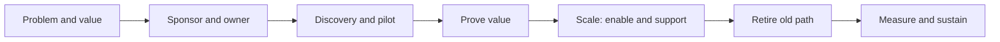
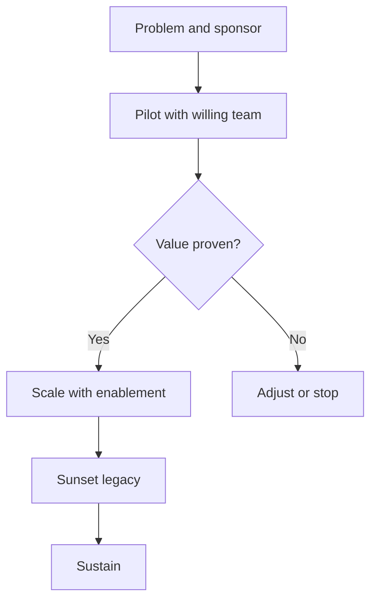

# Leading Technical Initiatives and Organizational Change

> Verification note: This document covers **established program-leadership and change-management practice**: initiative lifecycle and business cases, sponsorship, **Kotter's eight-step** change model and **ADKAR** (Prosci) as lenses, diffusion-of-innovation adoption curves, champions networks and communities of practice, inner-source contribution models, strategy as **diagnosis → guiding policy → coherent actions** (Rumelt), steering committees and milestone tracking, and strangler-style incremental migration. Model names, steps and attributions are from memory and **should be confirmed before citing** *(hedged)*. Technical migration mechanics (strangler fig, codemods, dual-running, rollout safety), micro-frontends, monorepo adoption and platform governance are covered in [frontend-architecture/05–08](../frontend-architecture/07-migrations-modernization-and-technical-debt.md) and are **linked rather than repeated**; DORA guidance on metrics (per service, no targets, baseline trends) was verified earlier ([ci-cd-web/07 §7](../ci-cd-web/07-release-automation-observability-and-pipeline-operations.md#7-measuring-dora-in-practice)). The case studies are **illustrative composites, not real companies**, and use no real data.

## Table of Contents

1. [Quick Summary (TL;DR)](#1-quick-summary-tldr)
2. [Anatomy of a Cross-Team Initiative](#2-anatomy-of-a-cross-team-initiative)
3. [Making the Case: Problem, Value and Sponsorship](#3-making-the-case-problem-value-and-sponsorship)
4. [Strategy, Scope and Phasing](#4-strategy-scope-and-phasing)
5. [Change Management: Why People Resist and What Helps](#5-change-management-why-people-resist-and-what-helps)
6. [Driving Adoption: Platforms, Design Systems and Standards](#6-driving-adoption-platforms-design-systems-and-standards)
7. [Coordinating Across Teams: Governance, Tracking and Communication](#7-coordinating-across-teams-governance-tracking-and-communication)
8. [Migrations, Rewrites and Modernization as Leadership Problems](#8-migrations-rewrites-and-modernization-as-leadership-problems)
9. [Culture Programs: Accessibility, Performance, Security, Quality](#9-culture-programs-accessibility-performance-security-quality)
10. [Measuring Success and Sustaining Change](#10-measuring-success-and-sustaining-change)
11. [Organizational Change: Reorgs, Acquisitions, Growth and Cost Pressure](#11-organizational-change-reorgs-acquisitions-growth-and-cost-pressure)
12. [Case Studies](#12-case-studies)
13. [Pitfalls](#13-pitfalls)
14. [Interview Questions — Fundamentals](#14-interview-questions--fundamentals)
15. [Interview Questions — Senior Scenarios](#15-interview-questions--senior-scenarios)
16. [Cheat Sheet](#16-cheat-sheet)
17. [Key Terms Glossary](#17-key-terms-glossary)
18. [Further Reading](#18-further-reading)

---

## 1. Quick Summary (TL;DR)

- **Large initiatives fail for human and organizational reasons far more often than technical ones:** unclear problem, no sponsor, no adoption plan, change fatigue, competing priorities, ownership gaps, and declaring victory too early.
- **Lead with the problem and the value,** not the technology. Tie the initiative to outcomes leadership already cares about (revenue, risk, cost, speed, quality, retention).
- **Phase it:** discover → pilot with a willing team → prove value → scale with tooling and support → sunset the old way. Each phase has exit criteria.
- **Adoption is a product problem:** treat teams as customers; reduce friction (templates, codemods, docs, office hours); remove the old path eventually.
- **Resistance is information:** it may signal real constraints, lost autonomy, fear, or fatigue. Listen, adapt, and involve skeptics early.
- **Govern lightly but clearly:** one accountable owner, a sponsor, a visible plan and risks, a cadence for decisions and updates.
- **Measure outcomes and adoption, then sustain:** ownership after launch, deprecation of legacy, documentation, onboarding; otherwise the old pattern returns.



---

## 2. Anatomy of a Cross-Team Initiative

| Phase | Goal | Key activities | Exit criteria |
|---|---|---|---|
| **0. Sense** | Identify a real, widely felt problem | Interviews, data (incidents, DORA signals per service, surveys), competitive/industry context | Clear problem statement with evidence |
| **1. Frame** | Shape the initiative | Goals/non-goals, options, business case, risks, stakeholders; secure sponsor | Written proposal reviewed and approved ([frontend-architecture/01 §8](../frontend-architecture/01-frontend-architecture-principles-and-decision-making.md#8-adrs-and-rfcs-recording-decisions)) |
| **2. Discover/Prototype** | Reduce uncertainty | Spikes, prototypes, inventory, benchmarks, risk burn-down | Go/no-go with data |
| **3. Pilot** | Prove value with a willing team | Limited scope, tight feedback, measure outcomes | Evidence of value; list of friction points fixed |
| **4. Scale** | Expand adoption | Tooling, docs, training, support model, waves/cohorts, dependency management | Adoption milestones achieved |
| **5. Converge/Sunset** | Remove legacy and duplication | Deprecation timeline, enforcement (lint/CI), decommission | Old path off |
| **6. Sustain** | Keep it healthy | Ownership, SLAs, contribution model, metrics, periodic review | Stable operations; embedded in onboarding |

**Roles**
- **Sponsor:** senior leader who provides air cover, resources, prioritization power.
- **Initiative lead (you):** accountable for outcomes; coordinates; unblocks; communicates.
- **Working group / champions:** representatives from affected teams; provide input, test, advocate.
- **Platform/core team:** builds enabling tooling and provides support.
- **Product/design/QA/security/SRE partners:** consulted early to avoid late surprises.
- **Steering group (optional):** periodic decisions and trade-offs for large programs.

**Ownership after launch:** decide upfront who maintains the result (a team with capacity), its service level, and how changes are proposed.

---

## 3. Making the Case: Problem, Value and Sponsorship

**Problem statement template**
```text
Who is affected: (teams/users/customers)
What is happening: (observable symptoms, with data)
Impact: (time lost, incidents, revenue risk, hiring/retention, compliance exposure)
Why now: (trigger, deadline, opportunity)
What happens if we do nothing: (cost of inaction)
```

**Value quantification (be honest about uncertainty)**

| Type | Examples | Evidence sources |
|---|---|---|
| **Time/efficiency** | Reduce build/CI time, faster onboarding, fewer duplicate implementations | CI metrics, surveys, engineer-hour estimates |
| **Quality/reliability** | Fewer regressions/incidents, higher accessibility compliance | Incident data, defect counts, audits |
| **Revenue/conversion/performance** | Faster pages, better UX | Experiments, RUM, funnel analysis ([web-performance/01](../web-performance/01-performance-metrics-and-measurement.md)) |
| **Risk/compliance/security** | End-of-life frameworks, legal requirements, vulnerabilities | Security reviews, legal deadlines |
| **Talent/retention** | Modern stack, less toil | Surveys, hiring feedback, attrition reasons |
| **Strategic optionality** | Enables future products | Roadmap alignment |

**Business case structure:** problem, options (including do nothing and minimal), costs (people, tooling, opportunity cost), benefits (with ranges), risks, timeline/phases, success metrics, decision requested.

**Securing a sponsor:** connect to their goals; bring a crisp 1-page summary; show early evidence (pilot/prototype); propose a smaller first step; clarify what you need (time, headcount, political cover); keep them informed so they can advocate.

**Avoiding the "pet project" trap:** validate the problem with others; invite criticism; show you understand trade-offs; tie to measurable outcomes rather than technology fascination.

**Funding and capacity:** negotiate dedicated capacity or allocation (not "in your spare time"); initiatives without capacity stall. Show the opportunity cost explicitly ([04 §12](04-planning-estimation-prioritization-and-delivery.md#12-balancing-features-quality-and-technical-work)).

---

## 4. Strategy, Scope and Phasing

**Strategy kernel (Rumelt-style, hedged):** **Diagnosis** (what's the core challenge?) → **Guiding policy** (the approach to address it) → **Coherent actions** (steps that reinforce each other). A strategy is as much about **what you won't do** as what you will.

**Example (frontend platform consolidation)**
- *Diagnosis:* five teams maintain five component libraries; accessibility defects and visual inconsistency are rising; each team spends ~X% effort rebuilding basics.
- *Guiding policy:* converge on one design system with a contribution model; provide migration tooling; prioritize by user impact.
- *Coherent actions:* inventory + audit; core components with a11y built in; codemods for top 3 variants; docs/office hours; adoption dashboards; sunset old libraries by quarter.

**Scoping**
- **Start narrow, prove value, expand.** Select pilot teams with high pain, supportive leadership, and moderate complexity.
- **Non-goals matter:** state what's excluded (e.g., "not rewriting product UI; only replacing primitives").
- **Dependencies and sequencing:** map cross-team dependencies; fix foundations first (tokens, CI, testing) ([frontend-architecture/07 §4](../frontend-architecture/07-migrations-modernization-and-technical-debt.md)).
- **Waves:** group teams by readiness; use learnings from earlier waves to improve tooling and docs.
- **Reversibility:** keep fallbacks until confidence is high; avoid irreversible steps early.
- **Timeboxes and decision gates:** at each gate decide continue / adjust / stop. Stopping an initiative that no longer makes sense is a leadership success, not a failure.

**Roadmap communication:** show phases, milestones, risks and what teams need to do when; keep it current; avoid false precision for later phases.

---

## 5. Change Management: Why People Resist and What Helps

**Common reasons for resistance**

| Reason | What it sounds like | Response |
|---|---|---|
| **Loss of autonomy/control** | "Why can't we choose our own tools?" | Offer choice within guardrails; involve teams in design; paved road, not mandate |
| **Fear of incompetence** | "We don't know the new framework" | Training, pairing, gradual adoption, safe experimentation |
| **Workload/competing priorities** | "We have deadlines" | Dedicated capacity, tooling that does the work (codemods), align timing with team roadmaps |
| **Skepticism about value** | "The old way works" | Evidence, pilots, acknowledge trade-offs, success stories |
| **Past failures** | "Last migration stalled" | Learn from history; commit to support; show a different approach |
| **Identity/craft attachment** | "We built this" | Acknowledge past contributions; show how new approach honors goals |
| **Unclear benefits for them** | "What's in it for us?" | Translate to their pain points and metrics |
| **Politics/ownership** | "Who owns this now?" | Clarify roles and governance; share credit |

**Models (as lenses, hedged)**
- **Kotter (8 steps):** create urgency → build a guiding coalition → form a vision → communicate the vision → empower action (remove obstacles) → generate short-term wins → consolidate gains → anchor in culture.
- **ADKAR:** **A**wareness → **D**esire → **K**nowledge → **A**bility → **R**einforcement. Diagnose where individuals are stuck.
- **Diffusion of innovations:** innovators → early adopters → early majority → late majority → laggards; target early adopters first; make early majority comfortable with evidence, support and social proof; plan for laggards (deadlines, sunset, assistance).

**Practical tactics**
- **Listen first:** run interviews/surveys; summarize back to teams what you heard.
- **Create champions:** one respected engineer per team; give them early access, influence, recognition.
- **Show quick wins:** visible improvements early (e.g., faster builds on pilot repos).
- **Make the new path the easy path:** templates, generators, defaults, lint autofix, codemods.
- **Be transparent:** timelines, trade-offs, and what's not changing.
- **Handle skeptics well:** invite them into the design review; their objections often reveal real risks.
- **Reduce cognitive load:** one change at a time; avoid simultaneous overlapping migrations for the same teams.
- **Mandates when needed:** if adoption is essential (security/compliance/EOL), set clear deadlines and provide support; combine "carrot" (tools) and "stick" (policy), with explicit exceptions processes.
- **Celebrate and share stories:** internal blog posts, demos, metrics improvements.

---

## 6. Driving Adoption: Platforms, Design Systems and Standards

**Treat internal platforms as products** ([frontend-architecture/08 §3](../frontend-architecture/08-teams-governance-platform-and-delivery.md#3-platform-engineering-and-the-paved-road))
- **Customers:** product teams. **Discovery:** interviews, usage analytics, support tickets.
- **Value proposition:** time saved, quality improved, risk reduced — specific per team.
- **Roadmap and versioning:** semver, deprecation policy, migration guides, changelogs.
- **Support model:** office hours, Slack/Teams channel, SLAs for bugs, triage rotation.
- **Documentation:** quick starts, recipes, examples, decision guides ("when to use/not use").
- **Contribution model (inner source):** clear guidelines, review SLAs, ownership of contributions, recognition for contributors.
- **Metrics:** adoption (% of apps/teams on latest), time-to-first-use, satisfaction (NPS-style/survey), support load, impact on delivery/quality.

**Design-system adoption playbook** ([system-design/06](../system-design/06-design-system-and-component-library.md))
1. Audit existing UI and duplicated components; align with design on tokens and priorities.
2. Build high-value primitives with accessibility baked in ([accessibility/06](../accessibility/06-accessible-component-patterns.md)).
3. Pilot with one product team; fix gaps quickly.
4. Provide migration tooling (codemods, lint rules), visual regression tests, Storybook docs.
5. Governance: contribution process, versioning, breaking-change policy, design/engineering co-ownership.
6. Adoption dashboard; recognize teams; set deprecation dates for legacy.
7. Maintain: staffing, backlog, release cadence, feedback loops.

**Standards and "golden paths":** make secure/accessible/observable defaults the easiest option (templates, CI checks); allow exceptions with documented rationale; measure compliance without shaming.

**Enforcement spectrum:** *documentation → recommendations → templates/tooling → lint/CI warnings → CI errors for new code → mandatory with deadline.* Choose the lightest effective level; escalate if risk justifies.

**Avoid:** building without customer involvement, mandating with no migration support, ignoring ongoing maintenance, treating adoption as "someone else's job."

---

## 7. Coordinating Across Teams: Governance, Tracking and Communication

**Program structure**
- **Single accountable owner;** named leads per team; working group cadence (weekly/biweekly).
- **Shared plan:** milestones, dependencies, owners, status (RAG with reasons) visible to all; keep it lightweight (single page + board).
- **Decision log:** record decisions, rationale, date, owner ([02 §4](02-influence-stakeholders-and-technical-decision-making.md#4-decision-rights-and-decision-types)).
- **Risk register (RAID):** reviewed regularly ([04 §7](04-planning-estimation-prioritization-and-delivery.md#7-risk-dependencies-and-unknowns)).
- **Escalation path:** to sponsor/steering with options; use it early.
- **Steering updates:** 1-page BLUF: progress vs milestones, outcomes data, risks/decisions needed ([02 §7](02-influence-stakeholders-and-technical-decision-making.md#7-managing-up-and-communicating-with-executives)).

**Communication plan**

| Audience | Message | Channel/cadence |
|---|---|---|
| Sponsors/executives | Outcomes, risks, decisions | Monthly 1-pager; steering |
| Engineering managers | Timeline, capacity asks, dependencies | Biweekly sync/email |
| Engineers | How-to, why, support | Docs, demos, office hours, chat channel |
| Product/design | Impact on roadmap, opportunities | Planning meetings; briefs |
| Support/QA/Ops | Release timing, risks | Release notes, runbooks |

**Cadence tips:** consistent weekly update (even "no change"); celebrate milestones; publish adoption stats; keep FAQs updated; record demos for async viewing.

**Cross-team planning:** align initiative asks with teams' quarterly planning cycles (give notice early); offer flexible adoption windows; quantify the effort per team (migration guide estimates) and provide staff augmentation/pairing when possible.

**Handling dependencies and blockers:** maintain a board of blockers with owners; escalate cross-team issues quickly; reduce coupling via adapters/feature flags.

**Remote/global coordination:** document handoffs, rotate meeting times, assign regional champions ([05 §5](05-communication-conflict-and-team-health.md#5-remote-hybrid-and-cross-cultural-collaboration)).

---

## 8. Migrations, Rewrites and Modernization as Leadership Problems

Technical patterns are in [frontend-architecture/07](../frontend-architecture/07-migrations-modernization-and-technical-debt.md); leadership concerns:

| Concern | Leadership move |
|---|---|
| **"Rewrite from scratch" pressure** | Surface the real pain; show risks (parity, timeline, business continuity); propose incremental/strangler path with measurable milestones and value delivered early |
| **Business continuity** | Keep shipping features during migration; allocate dedicated migration capacity; avoid code freezes |
| **Dual-running costs** | Time-box coexistence; track "remaining legacy" burn-down; sunset dates |
| **Morale on long migrations** | Visible progress, celebrate milestones, rotate migration work, keep it from becoming a dumping ground |
| **Knowledge loss** | Document legacy behavior; characterize with tests; involve long-tenured engineers |
| **Scope and perfectionism** | Define "good enough" parity; prioritize by user value/risk; avoid gold-plating |
| **Stakeholder impatience** | Share leading indicators (percent migrated, defects, performance, developer satisfaction) |
| **Metrics** | Percent of traffic/features on new stack, incident rate, build times, bundle size, delivery metrics trend (signals) |
| **Failure criteria** | Define in advance when to pause or change course |

**Rewrite decision test:** Is the problem architectural/organizational (not just code aesthetics)? Can we deliver value incrementally? Do we have domain knowledge and capacity? What's the cost of parity? What's the exit/rollback plan? If answers are weak, choose incremental modernization.

**Upgrade culture:** schedule regular dependency/framework upgrades as routine work ("upgrade train"), automate with bots and codemods, keep versions within N of latest to avoid big-bang jumps ([debugging-scenarios/08 §10](../debugging-scenarios/08-build-tooling-typescript-dependency-and-ci-debugging.md#10-dependency-regressions-upgrades-and-supply-chain-debugging)).

---

## 9. Culture Programs: Accessibility, Performance, Security, Quality

These are **cross-cutting** and fail when treated as one-time projects. Approach as ongoing programs with ownership, tooling and incentives.

| Program | Levers | Metrics (signals) |
|---|---|---|
| **Accessibility** | Design-system components with built-in a11y, lint + axe in CI, manual SR checklists, training, champions in each team, audit cadence, definition of done ([accessibility/07](../accessibility/07-testing-tooling-and-accessibility-in-the-delivery-process.md)) | New-issue rate, audit findings trend, % of critical flows audited, component coverage |
| **Performance** | Budgets in CI, RUM dashboards, perf champions, regular reviews, third-party governance ([web-performance/07](../web-performance/07-performance-debugging-budgets-and-culture.md)) | p75 CWV by route, budget violations, regression MTTR |
| **Security** | Threat modeling, dependency policies, secure defaults, training, secret scanning, CSP rollout ([web-security/08](../web-security/08-secure-frontend-patterns-and-vulnerability-catalogue.md)) | Vulnerability age, exposure incidents, adoption of secure defaults |
| **Quality/testing** | Test strategy, flake budgets, contract tests, pre-merge checks ([testing/01](../testing/01-testing-strategy-and-test-design.md)) | Escaped defects, flake rate, change fail rate trend |
| **Observability/incident readiness** | Release tagging, RUM/error tracking, runbooks, game days ([debugging-scenarios/07](../debugging-scenarios/07-production-incidents-observability-and-root-cause-analysis.md)) | Detection time, recovery time, postmortem action completion |
| **Developer experience** | CI speed, local dev, docs, surveys | CI p90, onboarding time, satisfaction |

**Principles:** make the right thing easy and the wrong thing visible; measure to learn, not to punish; embed in existing rituals (PR templates, definition of done, design reviews); give teams ownership with a small central enablement team; recognize good practice publicly; use **leading indicators** (practice adoption) plus **lagging outcomes** (incidents, user impact); avoid Goodhart's law traps by pairing metrics and discussing context.

**Champions network:** 1–2 volunteers per team, trained and supported, meeting monthly, escalating issues, spreading practices; ensure their time is protected and recognized in performance reviews.

---

## 10. Measuring Success and Sustaining Change

**Metric categories**

| Category | Examples |
|---|---|
| **Adoption** | % of teams/apps migrated; usage of new APIs; deprecated usage count |
| **Outcome** | Incident reduction, delivery metrics trend, user-facing metrics, cost, security posture |
| **Experience** | Developer satisfaction, support tickets, time-to-adopt |
| **Health of the platform** | Release cadence, bug turnaround, contributor count |
| **Leading indicators** | Training completion, docs usage, PR template compliance |

**Rules:** define baseline before starting; choose few metrics tied to goals; show trends and context; avoid gaming (don't set DORA numbers as targets — [ci-cd-web/07 §7](../ci-cd-web/07-release-automation-observability-and-pipeline-operations.md#7-measuring-dora-in-practice)); mix quantitative and qualitative; report honestly, including setbacks.

**Declaring success:** against the original problem and goals; avoid "mission accomplished" prematurely. Hold a retrospective: what worked, what didn't, what to repeat; share a write-up.

**Sustaining**
- **Ownership and funding:** a named team with capacity.
- **Embed in onboarding and templates:** new projects start on the new path by default.
- **Enforce guardrails:** lint rules/CI checks to prevent regression to old patterns.
- **Deprecate and remove legacy:** delete code, archive repos, remove docs; otherwise duplication returns.
- **Regular health reviews:** quarterly check on adoption, issues, roadmap.
- **Knowledge continuity:** docs, ADRs, succession planning for key maintainers.
- **Evolve:** collect feedback; adapt; avoid ossification.

**Common sustainment failures:** key sponsor leaves; champion burnout; platform starved of capacity; exceptions accumulate; docs rot; new hires unaware; metrics not reviewed.

---

## 11. Organizational Change: Reorgs, Acquisitions, Growth and Cost Pressure

| Situation | Leadership challenges | Moves |
|---|---|---|
| **Reorganization** | Uncertainty, loss of context, shifting ownership | Communicate reasons and timelines, clarify new boundaries/ownership quickly, protect critical knowledge, hold 1:1s, adapt processes, watch attrition risk |
| **Acquisition/merger** | Different stacks, cultures, processes | Inventory systems; identify overlap; choose convergence strategy by value and risk; avoid forced migrations without clear benefit; respect culture differences; clear integration roadmap |
| **Rapid growth** | Process breaks, onboarding strain, inconsistent practices | Invest in onboarding, documentation, platform, architecture boundaries ([frontend-architecture/02](../frontend-architecture/02-modularity-layering-and-boundaries.md)); introduce lightweight governance |
| **Cost-cutting/layoffs** | Fear, trust erosion, increased workload | Honest communication; priorities reset (stop work); protect critical areas; support remaining team; avoid overpromising; careful treatment of departing colleagues |
| **Leadership change** | New priorities, re-evaluation | Build relationship early; share context and history; propose aligned outcomes; avoid "we always did it this way" |
| **Technology pivots** (e.g., native→cross-platform, SPA→SSR) | Skills gap, uncertainty | Training, pilots, hire/borrow expertise, phased approach, measurable outcomes |
| **Compliance/regulatory change** | Deadlines, cross-team effort | Early risk assessment, dedicated working group, clear owners, evidence collection |
| **Scaling teams/splitting a team** | Ownership, cohesion | Define team charters, interfaces, shared standards; preserve culture |

**Principles:** transparency within constraints; clarity on what changes vs what doesn't; early and frequent communication; involve people in the "how"; protect psychological safety; track attrition signals; show empathy while staying focused on outcomes.

---

## 12. Case Studies

*(Illustrative composites. Use them as templates for your own true stories.)*

### 12.1 Consolidating component libraries across five product teams
- **Problem:** duplicated components, inconsistent accessibility, slow feature delivery.
- **Approach:** audit; sponsor from product/design; pilot team; core primitives with a11y; codemods; Storybook docs; contribution model; adoption dashboard; deprecation schedule.
- **Obstacles:** team autonomy concerns, backlog pressure, missing components.
- **Resolution:** co-design sessions, dedicated migration capacity per team (e.g., sprint allocation), "adopt-or-justify" policy for new work, office hours.
- **Result (example statements to replace with real data):** fewer a11y defects in new work; faster UI feature delivery; library maintenance centralized.
- **Lessons:** adoption support matters more than the library's technical elegance.

### 12.2 Leading a framework/runtime upgrade (e.g., major React/Next.js version) across a monorepo
- **Problem:** upgrades postponed; security and performance risk; blocked features.
- **Approach:** inventory breaking changes; upgrade branch with codemods; canary app; flagged rollout; CI matrix; communication; rollback plan ([frontend-architecture/07](../frontend-architecture/07-migrations-modernization-and-technical-debt.md)).
- **Obstacles:** third-party library incompatibilities, test flakiness, uneven team readiness.
- **Resolution:** wave plan, patch/replace libraries, flake-fix sprint, dependency freeze window, daily triage channel.
- **Lessons:** treat upgrades as routine; publish a status dashboard; automate.

### 12.3 Establishing an accessibility program
- **Problem:** audit failures and legal risk.
- **Approach:** exec sponsor; baseline audit; fix top-severity critical flows; build accessible components; CI checks; training; champions; definition-of-done updates; quarterly audits ([accessibility/07](../accessibility/07-testing-tooling-and-accessibility-in-the-delivery-process.md)).
- **Obstacles:** perceived slowdown; lack of expertise.
- **Resolution:** pair with design, central expert support, tooling to catch common issues, celebrate wins.
- **Lessons:** shift left; embed in workflow; focus on user journeys.

### 12.4 Reducing build and CI time (developer experience initiative)
- **Problem:** 30-minute CI, long feedback loops, flaky tests.
- **Approach:** baseline metrics; remote cache, affected-only builds, test sharding, flake quarantine with owners; communicate wins; track developer survey ([ci-cd-web/03](../ci-cd-web/03-github-actions-reuse-caching-artifacts-and-speed.md)).
- **Obstacles:** competing priorities; hidden ownership of flaky tests.
- **Resolution:** sponsor support, capacity allocation, ownership manifests, quick wins first.
- **Lessons:** developer experience improvements show in satisfaction and cycle time; maintain over time.

### 12.5 Halting a failing initiative
- **Situation:** a micro-frontend adoption stalls; coordination overhead exceeds benefits.
- **Action:** run a review with data (delivery metrics, team feedback, incidents); present options (continue, reduce scope, rollback to modular monolith); decide with sponsor; communicate openly; salvage reusable pieces ([frontend-architecture/06](../frontend-architecture/06-micro-frontends-and-composition.md)).
- **Lessons:** stopping is leadership; sunk-cost fallacy is costly; capture learnings.

---

## 13. Pitfalls

1. **Starting with the solution/technology** instead of the problem.
2. **No sponsor or no dedicated capacity.**
3. **Big-bang rollout** with no pilot.
4. **Mandates without enablement.**
5. **Ignoring resistance;** treating skeptics as enemies.
6. **Building in isolation from customers (teams).**
7. **Multiple simultaneous migrations overwhelming teams.**
8. **Vague success metrics;** no baseline.
9. **Metrics as targets;** gaming.
10. **No deprecation of the old path;** permanent duplication.
11. **No post-launch ownership;** platform decay.
12. **Declaring victory early.**
13. **Overpromising timelines;** hiding risks.
14. **Heroics from a single champion;** bus factor.
15. **Ignoring morale and change fatigue.**
16. **Sunk-cost bias;** unwillingness to stop.

---

## 14. Interview Questions — Fundamentals

- **How do you start a cross-team initiative?** Validate the problem with data, define goals/non-goals, secure a sponsor, propose options and a phased plan.
- **How do you handle resistance?** Listen to understand concerns; involve skeptics; reduce friction; pilot; show evidence; clarify benefits.
- **How do you drive adoption of a shared library/platform?** Treat it as a product: customer research, migration tools, docs, support, contribution model, metrics, deprecation.
- **What is a champions network?** Volunteers embedded in teams who advocate, give feedback and help adoption.
- **How do you measure success of an initiative?** Baselines, adoption and outcome metrics, qualitative feedback, trend and context.
- **When do you stop an initiative?** When evidence shows benefits don't justify costs, goals changed, or risks too high; decide at gates.
- **Rewrite vs incremental?** Prefer incremental/strangler unless constraints demand otherwise; evaluate parity cost, risk, learnings.
- **How do you coordinate across teams?** Single owner, shared plan, decision log, regular cadence, escalation path.
- **How do you sustain a change?** Ownership, funding, templates/defaults, guardrails, deprecation, onboarding, reviews.
- **How do you communicate a long program?** Audience-specific messages, consistent cadence, milestones, honesty on risks.
- **What is inner source?** Open-source style contribution within a company.
- **What is a golden path?** Opinionated, supported default way to build/deploy that's easiest to follow.

---

## 15. Interview Questions — Senior Scenarios

### S1. "Teams ignore your new shared logging/observability standard."
Find out why (friction, unclear value, priorities, tooling gaps); gather feedback; reduce adoption cost (SDK, templates, auto-instrumentation); show value with a pilot (faster incident resolution); align with incident postmortem actions; define a deprecation/enforcement timeline for critical gaps; add to templates and CI checks; track adoption; celebrate adopters ([debugging-scenarios/07 §3](../debugging-scenarios/07-production-incidents-observability-and-root-cause-analysis.md#3-observability-for-debugging-what-to-capture)).

### S2. "Leadership wants to migrate to micro-frontends to 'scale teams'."
Clarify the problem (team coordination, release independence, ownership?); evaluate alternatives (modular monolith, monorepo boundaries, platform improvements); assess costs (runtime composition, consistency, performance, governance); propose a time-boxed pilot with success criteria and an exit path; involve affected teams; decide with data ([frontend-architecture/06](../frontend-architecture/06-micro-frontends-and-composition.md)).

### S3. "Your migration is 70% done; momentum is gone and the last 30% is hard."
Reassess value and remaining cost; identify blockers (complex legacy areas, ownership gaps); break the tail into prioritized, time-boxed items; get sponsor to protect capacity; set a deprecation date for the old stack; consider alternatives for rarely used areas (retire, freeze, wrap); celebrate progress; track burn-down publicly; tie to risk (security/support end-of-life).

### S4. "Two acquired companies use different frontend stacks. Leadership wants one."
Inventory apps, teams, users, and strategic importance; define convergence goals (hiring, shared components, cost) and non-goals; evaluate options (standardize new work only, shared design tokens, gradual convergence, keep separate with integration); consider customer experience, business roadmap, team morale; start with shared foundations (identity, design tokens, observability); plan phased convergence with measurable value ([frontend-architecture/06](../frontend-architecture/06-micro-frontends-and-composition.md)).

### S5. "You lead a platform team; product teams complain it slows them down."
Gather data and interviews; categorize complaints (friction, missing features, support delays, mandates); stabilize service model (SLAs, office hours, triage); prioritize top pain points; co-design with representative teams; improve docs/templates; communicate roadmap and decision rationale; measure satisfaction and delivery impact; reduce mandates that lack value ([frontend-architecture/08 §3](../frontend-architecture/08-teams-governance-platform-and-delivery.md#3-platform-engineering-and-the-paved-road)).

### S6. "How do you make sure an accessibility/performance initiative doesn't fade after the push?"
Embed into definition of done, CI gates and design-system components; assign owners and champions; schedule regular audits and budgets reviews; include in onboarding; report trends to leadership; reward good practices; automate regression detection; link to business metrics.

---

## 16. Cheat Sheet

| Topic | Remember |
|---|---|
| Start | Problem, evidence, sponsor, non-goals |
| Phase | Discover → pilot → prove → scale → sunset → sustain |
| Adoption | Product mindset: reduce friction, support, measure |
| Resistance | Information; listen; involve; evidence |
| Mandates | Only with support and clear deadlines |
| Governance | Single owner, shared plan, decision log, cadence |
| Metrics | Baseline; adoption + outcomes; no gaming |
| Stop rule | Decision gates; sunk cost isn't a reason |
| Sustain | Ownership, defaults, deprecation, onboarding |
| Culture programs | Tooling + champions + definition of done |



---

## 17. Key Terms Glossary

| Term | Meaning |
|---|---|
| **Sponsor** | Senior leader backing an initiative |
| **Pilot** | Limited trial to test value and feasibility |
| **Champion** | Embedded advocate for a change in a team |
| **Golden path / paved road** | Supported default path that's easy to follow |
| **Inner source** | Open-source style contribution within an organization |
| **Strangler pattern** | Incrementally replacing a system piece by piece |
| **ADKAR** | Awareness, Desire, Knowledge, Ability, Reinforcement |
| **Kotter's 8 steps** | Classic change-management sequence |
| **Diffusion of innovations** | Adoption curve from innovators to laggards |
| **Decision gate** | Checkpoint to continue/adjust/stop |
| **Sunset** | Planned retirement of legacy systems |
| **Steering group** | Cross-functional leaders overseeing a program |

---

## 18. Further Reading

- John Kotter, *Leading Change*; Prosci on ADKAR; Everett Rogers, *Diffusion of Innovations*; Richard Rumelt, *Good Strategy/Bad Strategy*; Skelton and Pais, *Team Topologies*; Will Larson, *Staff Engineer* and *An Elegant Puzzle*; Camille Fournier, *The Manager's Path* *(hedged: titles from memory; confirm before citing)*
- **This repo:** [01 Roles and levels](01-leadership-roles-levels-and-interview-expectations.md) · [02 Influence and decisions](02-influence-stakeholders-and-technical-decision-making.md) · [04 Planning and delivery](04-planning-estimation-prioritization-and-delivery.md) · [05 Communication and team health](05-communication-conflict-and-team-health.md) · [08 Scenarios](08-leadership-scenarios-and-case-studies.md) · [frontend-architecture/05–08](../frontend-architecture/07-migrations-modernization-and-technical-debt.md)
