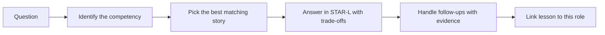
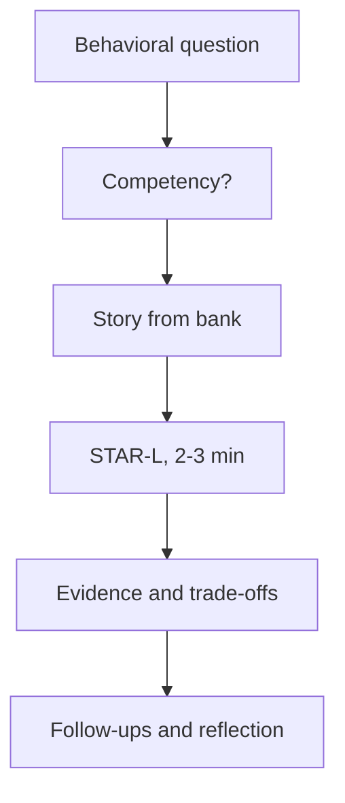

# Behavioral Interview Question Bank and Model Answers

> Verification note: This is a **practice bank**, not a script. The model answers are **illustrative composites written to demonstrate structure, depth and tone — they are not real experiences and must not be memorized or repeated as your own**. Replace every bracketed placeholder (for example `[metric]`, `[N weeks]`) with **true** details from your own work; interviewers probe specifics and cross-check consistency, and fabricated or inflated claims are the most common way to lose an offer. Answer structure (STAR / STAR-L), competency frameworks and rubric-style evaluation are established practice ([01 §6–8](01-leadership-roles-levels-and-interview-expectations.md#6-what-interviewers-actually-assess)). Technical context in answers follows facts verified elsewhere in this repo (for example Core Web Vitals thresholds, Next.js/React behaviors, DORA guidance on using metrics as signals not targets); where I cite such facts I link to the source document. Company-specific processes (leveling, bar raisers, panel formats) vary and are **hedged**.

## Table of Contents

1. [Quick Summary (TL;DR)](#1-quick-summary-tldr)
2. [How to Use This Bank](#2-how-to-use-this-bank)
3. [Opening Questions](#3-opening-questions)
4. [Ownership and Impact](#4-ownership-and-impact)
5. [Technical Judgment and Decision-Making](#5-technical-judgment-and-decision-making)
6. [Influence, Conflict and Collaboration](#6-influence-conflict-and-collaboration)
7. [Mentoring, Feedback and People Leadership](#7-mentoring-feedback-and-people-leadership)
8. [Execution, Ambiguity and Pressure](#8-execution-ambiguity-and-pressure)
9. [Failure, Learning and Self-Awareness](#9-failure-learning-and-self-awareness)
10. [Staff+ and Management-Track Questions](#10-staff-and-management-track-questions)
11. [Motivation, Culture Fit and Closing Questions](#11-motivation-culture-fit-and-closing-questions)
12. [Quick-Fire Hypotheticals](#12-quick-fire-hypotheticals)
13. [Evaluating the Company in Return](#13-evaluating-the-company-in-return)
14. [Pitfalls](#14-pitfalls)
15. [Interview Questions About This Material (Meta)](#15-interview-questions-about-this-material-meta)
16. [Cheat Sheet](#16-cheat-sheet)
17. [Key Terms Glossary](#17-key-terms-glossary)
18. [Further Reading](#18-further-reading)

---

## 1. Quick Summary (TL;DR)

- **Every behavioral question is a probe for a small set of competencies:** ownership, judgment, influence, conflict, mentoring, execution, learning, communication.
- **Use STAR-L** (Situation, Task, Action, Result, Learning) with **2–3 minutes** per answer and **70% on your actions and reasoning**.
- **One story can serve many questions;** keep 8–10 real stories tagged by competency ([01 §8](01-leadership-roles-levels-and-interview-expectations.md#8-building-your-story-bank)).
- **Be specific and honest:** real names of systems (anonymized as needed), real trade-offs, real numbers or observable outcomes, real mistakes.
- **Show level-appropriate scope:** senior = system/team scope; staff = cross-team/ambiguity; manager = people and outcomes through others.
- **Prepare follow-ups:** "What was your role?", "What did you do differently?", "What would you change?", "What did the data show?"
- **Ask good questions back:** interviews are mutual evaluations ([§13](#13-evaluating-the-company-in-return)).



---

## 2. How to Use This Bank

1. **Write your own answer first** from a real story. Then compare with the model's structure.
2. **Record yourself** (audio) and check timing (aim 2–3 minutes), clarity and specificity.
3. **Practice with a partner** who asks follow-ups.
4. **Map each question** to one of your stories; ensure variety across projects and time frames.
5. **Prune jargon** unless the interviewer is technical; adjust depth to the audience.
6. **Keep a "fact sheet"** for each story (dates, team size, metrics, links) so details stay consistent.

**Answer skeleton (reusable)**

```text
Context (1–2 sentences): team/product/problem, stakes.
My responsibility: what I owned and why me.
Options considered: A/B/C with trade-offs.
What I did: 3–4 concrete steps, with reasoning and who I worked with.
Obstacle: what went wrong/was hard; how I handled it.
Result: outcome with evidence (metric or observable change), time frame.
Reflection: what I'd do differently; what I carried forward.
```

**Format of entries below:** *What they assess* → *Answer outline* → *Model answer (illustrative)* → *Likely follow-ups*.

---

## 3. Opening Questions

### 3.1 "Tell me about yourself."
**Assess:** communication, relevance, self-awareness, level fit.
**Outline (≤ 2 min):** present (role, scope, what you're known for) → past (2–3 relevant highlights that led here) → future (why this role). Avoid life story or resume recitation.
**Model (illustrative):** "I'm a senior frontend engineer at `[company type]`, currently leading the web platform for `[domain]` with `[N]` engineers across `[N]` product teams. I'm best known for taking ambiguous cross-team problems — most recently consolidating three component libraries into one accessible design system — and turning them into adopted solutions. Earlier I built `[product area]` from scratch and learned a lot about performance and testing under real traffic. I'm looking for a role with broader architectural scope and more mentoring responsibility, which is why this position on `[team]` appeals to me."
**Follow-ups:** "What are you proudest of?", "What did you learn from the consolidation?"

### 3.2 "Why are you leaving / why this company?"
**Assess:** motivation, professionalism, research.
**Outline:** positive pull (scope, mission, technical challenges) over negative push; specific to the company; honest and respectful about the current employer.
**Model:** "I've learned a lot at `[current]`, especially about `[X]`. I'm looking to apply that to `[specific problem space of this company, e.g., large-scale design systems / high-traffic web performance]`, and to work where `[value, e.g., engineering writes things down and decisions are documented]`. From your engineering blog and conversations so far, this team is tackling `[specific challenge]`, which is where I think I can contribute most."
**Avoid:** bad-mouthing; generic flattery; money as the only reason.

### 3.3 "What are your strengths and weaknesses?"
**Assess:** self-awareness, growth.
**Outline:** 2 genuine strengths tied to impact; 1 real weakness with concrete mitigation and progress (not a disguised strength).
**Model (weakness):** "I used to default to solving hard problems myself, which slowed the team down. I now write a design outline, delegate the implementation with clear boundaries, and pair on the risky parts. In the last quarter two engineers led designs that previously I would have done, and I reviewed rather than authored them."

---

## 4. Ownership and Impact

### 4.1 "Tell me about a project you're most proud of."
**Assess:** ownership, impact, scope, passion.
**Outline:** why it mattered; your decisions; obstacles; measurable outcome; what it enabled afterwards.
**Model (illustrative):** "Our checkout had slow interactions on mid-range Android devices. I owned the investigation and the plan. Using field data I found long tasks from a third-party script and heavy re-renders in the cart; INP at p75 was around `[X ms]`, above the 200 ms 'good' threshold ([web-performance/01](../web-performance/01-performance-metrics-and-measurement.md)). I proposed three changes — defer the script, memoize and split cart state, and add a CI performance budget — pitched them to product with expected conversion impact as a hypothesis, and ran the work with two engineers. INP improved to `[Y ms]`, checkout error rate stayed flat, and the budget caught `[N]` regressions in the following quarter. I'd now also add a RUM alert from day one; we added that later."
**Follow-ups:** "How did you measure?", "What was your part vs the team's?", "What trade-offs did you make?"

### 4.2 "Describe a time you took initiative without being asked."
**Assess:** proactivity, judgment, scope-setting.
**Outline:** noticing a problem; validating it with data; getting buy-in; delivering a small slice; scaling.
**Model:** "I noticed CI times creeping up and PRs waiting on pipelines. I measured p90 CI duration at `[X min]`, found the biggest contributors (cold dependency installs, serial E2E), and proposed caching and sharding. I did a one-week prototype on one repo, shared before/after data, and asked my manager for a small allocation to roll it out. CI p90 dropped to `[Y min]`; PR cycle time improved, and I documented the pattern so other repos could adopt it."

### 4.3 "Tell me about a time you went above and beyond."
**Assess:** ownership vs heroics.
**Outline:** show sustained care for outcomes without unhealthy martyrdom; emphasize systemic fixes.
**Model:** "A critical launch slipped due to a late accessibility audit. Beyond fixing the defects, I worked with design to add accessible component patterns and CI checks so the next launch wouldn't hit the same surprise. The extra work was a few focused evenings, but the lasting change was the definition-of-done update."

### 4.4 "Describe a time you improved a process."
**Outline:** pain point → data → experiment → adoption → measured effect → iteration.
**Model:** "Code reviews were slow and inconsistent. I surveyed the team, introduced PR size guidelines, labeled comment severity, and a review rotation with a first-response goal. Time-to-first-review dropped from roughly `[X]` to `[Y]` and review quality complaints decreased in the next survey."

---

## 5. Technical Judgment and Decision-Making

### 5.1 "Tell me about a difficult technical decision."
**Assess:** judgment under uncertainty, trade-offs, communication.
**Outline:** context and constraints; options with pros/cons; how you gathered evidence; decision and reasoning; risk mitigation; outcome; reflection.
**Model (illustrative):** "We had to choose between server-rendering our product pages with Next.js and continuing with a client-rendered SPA. Constraints: SEO-sensitive pages, a small team, and mixed performance on low-end devices. I wrote a short RFC comparing three options — keep SPA with prerender, adopt Next.js App Router, or adopt a lighter SSR framework — against criteria: SEO, performance, developer experience, hiring, operational complexity ([nextjs-and-rendering/01](../nextjs-and-rendering/01-rendering-strategies-and-hydration.md)). We ran a two-week spike on one route. Next.js won on data fetching and streaming, but operationally required understanding caching semantics, which was the main risk; we mitigated with explicit revalidation rules and a runbook. I recorded the decision in an ADR with revisit triggers. After the pilot, LCP on that route improved and organic landings increased `[approximate/qualified]`. Looking back I'd have invested in caching education earlier — we had a stale-content incident in month two."
**Follow-ups:** "What would have made you choose differently?", "How reversible was it?"

### 5.2 "Tell me about a time you had to make a decision with incomplete information."
**Outline:** what you knew/didn't; how you reduced uncertainty cheaply; reversibility; decision rule; monitoring; adjust.
**Model:** "We needed to pick a payments SDK integration approach before the vendor's sandbox was ready. I classified the decision as reversible by wrapping the SDK behind an adapter and feature-flagged the rollout. I made the call with the info available, defined metrics and rollback triggers, and revisited after the sandbox testing revealed a limitation; we adjusted the adapter without touching the UI."

### 5.3 "Describe a time you chose pragmatism over perfect design."
**Model:** "A partner deadline required a basic reporting page in three weeks. I chose server-side pagination with a simple table and deferred virtualization and advanced filtering. I documented the shortcuts as known debt with a ticket, added performance and a11y baselines so the shortcuts didn't hide accessibility problems, and scheduled follow-up work after launch. We hit the date, and two of the deferred items were delivered the next quarter; the third was never needed, which validated deferring it."

### 5.4 "Tell me about a time you pushed back on a technical direction."
**Outline:** concern with evidence; alternatives; respectful approach; outcome either way.
**Model:** "A proposal to rewrite our UI in a new framework lacked a migration plan. I asked for success metrics and a pilot, shared data on our actual pain points (build times and duplicated components rather than framework limitations), and proposed targeted fixes plus a time-boxed spike. Leadership agreed to the spike, which showed that most gains could be achieved incrementally; we avoided a large rewrite and addressed the real issues."

### 5.5 "Tell me about a time you introduced a new technology."
**Model:** "I advocated adopting Playwright for E2E tests. I evaluated flakiness, speed and debugging tools by migrating our most flaky suite as a pilot; flake rate fell from `[X%]` to `[Y%]`, and the trace viewer cut debugging time. I documented patterns, trained teams in a workshop, and left the old runner in place until coverage matched. Adoption was voluntary at first, then standard for new tests ([testing/04](../testing/04-end-to-end-testing-with-playwright.md))."

### 5.6 "How do you manage technical debt?"
**Outline:** make it visible, tie to outcomes, allocate capacity, prevent new debt.
**Model:** "I keep a lightweight debt register with impact and cost-to-fix; I translate items into outcomes like cycle time or incident rate, negotiate a standing capacity allocation with product, and bundle debt work with features that touch the same area. I also reduce new debt via definitions of done, lint rules and ADR review ([frontend-architecture/07 §10](../frontend-architecture/07-migrations-modernization-and-technical-debt.md#10-managing-technical-debt))."

---

## 6. Influence, Conflict and Collaboration

### 6.1 "Tell me about a time you disagreed with a teammate/manager."
**Assess:** conflict handling, respect, evidence orientation, ability to commit.
**Outline:** nature of disagreement (facts, values, risk tolerance); steps to understand their view; how you resolved; outcome; relationship afterwards.
**Model (illustrative):** "A peer wanted to adopt a global state library across the app; I thought local state plus server-state caching would suffice. Rather than debating in review comments, I asked what problems they were solving; it turned out they wanted fewer prop-drilling bugs and easier debugging. We defined criteria, built a small prototype of both approaches on a representative feature, and compared complexity, bundle size and testability. The data favored a hybrid: server-state library for remote data and a small store for cross-cutting UI state. We recorded the decision, and my peer led the implementation. We've worked well since because we agreed on criteria before arguing about tools."
**Follow-ups:** "What if the data hadn't supported your view?", "How did you handle stakeholders?"

### 6.2 "Tell me about a time you influenced without authority."
**Model:** "I wanted several teams to adopt a shared accessibility checklist in their definition of done. I started by listening to their constraints, then made the checklist short, added automated checks to CI so it cost them little, and ran a pilot with one willing team. After their results (fewer late-found defects), I shared a demo and a one-page summary, and asked each team's lead to adapt it. Within two quarters `[N]` of `[M]` teams adopted it; I tracked adoption and iterated on the checklist from feedback ([accessibility/07](../accessibility/07-testing-tooling-and-accessibility-in-the-delivery-process.md))."

### 6.3 "Describe working with a difficult stakeholder."
**Outline:** understand their pressures; communicate in their language; set boundaries; find shared goals; keep commitments.
**Model:** "A product lead repeatedly added scope late. I learned their pressure came from executive commitments. I proposed a weekly scope review with visible trade-offs ('adding X moves the date by about `[N]` days or displaces Y'). They began to prioritize explicitly, and we protected a stable core scope. Relationship improved because I made their decision-making easier rather than just saying no."

### 6.4 "Tell me about a time you had to deliver bad news."
**Model:** "Two weeks before launch, performance testing showed our checkout missed the agreed budget. I told the product lead and engineering director the same day with data, impact, and three options: delay one week with fixes, launch to a small percentage with monitoring, or cut a feature. We chose the staged rollout with guardrails, fixed the issues in the next sprint, and the launch hit its business goals. Early, factual communication preserved trust."

### 6.5 "How do you work with designers/PMs?"
**Model:** "I involve engineering early in discovery to provide feasibility and options; we agree on component vocabulary and tokens; define states and accessibility up front; and review work-in-progress rather than final handoffs. When timelines are tight, I propose fidelity trade-offs rather than silent quality cuts."

### 6.6 "Tell me about a cross-team collaboration."
**Model:** "Our checkout depended on a backend team's new API. We aligned on a contract-first approach with OpenAPI, used mock servers so frontend work could proceed, scheduled integration checkpoints, and defined error semantics. We caught two contract mismatches early, avoiding late-stage rework ([networking-and-apis/07](../networking-and-apis/07-api-client-architecture-and-contracts.md))."

---

## 7. Mentoring, Feedback and People Leadership

### 7.1 "Tell me about someone you mentored."
**Assess:** investment in others, adaptability, outcomes for the mentee.
**Outline:** their starting point; goals; your approach (teaching/coaching/sponsoring); obstacles; their growth; what you learned.
**Model (illustrative):** "I mentored a mid-level engineer who wanted to move toward senior. We identified two gaps: system design and influencing across teams. I coached by asking them to draft a design doc for a feature, reviewed it with questions rather than answers, and pair-presented at the design review so they could practice. I recommended them to lead a small cross-team effort and checked in biweekly. Within `[N months]` they led the design for `[feature]`, and in the next cycle they were promoted. I learned to leave more space for them to struggle productively."
**Follow-ups:** "What if they hadn't improved?", "How did you tailor your style?"

### 7.2 "Describe giving difficult feedback."
**Model:** "A senior teammate's review comments were blunt and juniors had stopped requesting their review. I talked with them privately using specific examples (situation, behavior, impact) and asked how they saw it. They hadn't realized the effect. We agreed to label comments (blocking vs suggestion), add context and praise good patterns, and I asked juniors for feedback after a month. Review participation recovered and the teammate later mentored juniors effectively."

### 7.3 "Tell me about handling an underperformer."
**Outline:** clarify expectations; diagnose; support; document; outcome; fairness. (If you're not a manager, describe how you supported and escalated appropriately.)
**Model:** "As tech lead, I noticed a teammate missing commitments. I asked privately what was blocking them: unclear requirements and a skill gap in async patterns. We set smaller, clearer tasks, paired twice a week, and checked in. I also told their manager early so we had a joint plan. Their output improved over `[N weeks]`; had it not, the manager and I were prepared to adjust scope or follow the formal process."

### 7.4 "How do you onboard new team members?"
**Model:** "Pre-boarding checklist, a buddy, environment setup scripts, a small first PR in week one, an architecture walkthrough, 30/60/90 goals, and regular feedback. I ask new hires to fix doc gaps they find, which improves onboarding for the next person ([03 §3](03-mentoring-coaching-feedback-and-hiring.md#3-onboarding-new-engineers))."

### 7.5 "Describe building or improving team culture."
**Model:** "I introduced blameless postmortems after an incident where people feared blame. I facilitated the first few, focused on timeline and contributing factors, published action items with owners, and thanked people for transparency. Over time engineers started reporting near-misses earlier, and incident recovery time improved `[qualitatively/with data]` ([debugging-scenarios/07](../debugging-scenarios/07-production-incidents-observability-and-root-cause-analysis.md))."

---

## 8. Execution, Ambiguity and Pressure

### 8.1 "Tell me about a time you worked under a tight deadline."
**Model:** "We had six weeks to deliver a regulatory-driven feature. I broke it into vertical slices, identified the riskiest integration and tackled it first, aligned with compliance on must-haves vs nice-to-haves, used feature flags to ship incrementally, and set up daily risk check-ins. When an upstream API slipped, I surfaced it immediately with options and we mocked the contract to keep progressing. We launched on time with core scope; deferred items were delivered the next sprint. I avoided heroics by cutting scope rather than quality."

### 8.2 "Tell me about a time you handled ambiguity."
**Model:** "Leadership asked us to 'improve mobile web performance' with no specifics. I defined success with stakeholders (INP and LCP on top routes, p75 field data), instrumented RUM to see actual bottlenecks, ran a prioritization workshop, and proposed three experiments with expected impact. Starting with the highest-leverage fix (image and third-party loading), we saw `[improvement]`, which clarified the next steps ([web-performance/07](../web-performance/07-performance-debugging-budgets-and-culture.md))."

### 8.3 "Describe a time you had to prioritize competing demands."
**Model:** "Two teams needed my team's component changes in the same sprint. I gathered impact and deadlines, asked product leaders to rank, offered alternatives (a contribution path for the lower-priority team and a temporary local implementation), and communicated the decision and rationale to both. Both teams could proceed, and we scheduled the follow-up."

### 8.4 "Tell me about a production incident you handled."
**Assess:** calm, process, communication, learning.
**Model:** "A deploy caused a spike in chunk-load errors and blank pages for returning users. As incident lead I declared severity, rolled back to the previous build within minutes, purged the stale HTML at the CDN, and posted regular updates. We then discovered old assets had been deleted during the deploy. In the postmortem we identified contributing factors (no asset retention, no chunk-error handler, no canary alert), and the action items were retaining previous builds, adding a guarded reload on chunk failure, and alerting on chunk-error rate. Recurrence was prevented ([debugging-scenarios/07](../debugging-scenarios/07-production-incidents-observability-and-root-cause-analysis.md))."

### 8.5 "Describe a time you balanced quality and speed."
**Model:** "For a launch I defined non-negotiables (accessibility on core flows, error handling, observability) and negotiable items (visual polish, secondary features). We shipped behind a flag to 5% of traffic with guardrail metrics, learned from real usage, and finished polish in the following weeks. Defining the non-negotiables upfront prevented silent quality erosion."

### 8.6 "Tell me about a time you managed a large project."
**Model:** "I led a six-month migration of a legacy app's routing and data layer, involving four teams. I created a phased plan with decision gates, a pilot team, migration tooling (codemods), a weekly cross-team sync, a decision log, and a dashboard of percent migrated and defect rates. When two teams slipped, I adjusted sequencing and offered pairing support. We completed the migration with no major incidents; the legacy path was removed the following quarter ([06](06-leading-technical-initiatives-and-organizational-change.md))."

---

## 9. Failure, Learning and Self-Awareness

### 9.1 "Tell me about a time you failed."
**Assess:** accountability, learning, honesty. Choose a **real** failure with meaningful stakes, not a trivial one or humblebrag.
**Outline:** what you did and why; what went wrong; your accountability; immediate actions; systemic fix; what you do differently now.
**Model (illustrative):** "I shipped a change to our caching headers without testing behind the CDN configuration, and some users saw stale pages after a content update. I owned the incident: I rolled back, coordinated the CDN purge, and communicated to support. In the postmortem I recognized I had tested only locally and treated the CDN as a black box. We added a staging environment mirroring CDN rules, a header-change checklist, and an automated test asserting key `Cache-Control` values. I now ask 'what layers sit between this change and users?' during design reviews ([06 of debugging scenarios](../debugging-scenarios/06-network-api-auth-and-caching-scenarios.md#5-caching-cdn-and-service-worker-staleness))."
**Follow-ups:** "Who was affected?", "What would you do if it happened again?"

### 9.2 "Tell me about a time you received critical feedback."
**Model:** "A manager told me my design docs were thorough but too long, hiding key decisions. I asked for examples, restructured with a one-page summary and an explicit decision request, and asked reviewers whether it helped. Review turnaround improved and decisions were made faster."

### 9.3 "What would you do differently in your career so far?"
**Model:** "I'd have asked for feedback and sponsorship earlier. For my first few years I assumed good work would speak for itself, and I missed opportunities to lead initiatives. Now I regularly seek input, share my goals, and make impact visible through writing and demos."

### 9.4 "Describe a time you were wrong about a technical choice."
**Model:** "I championed a micro-frontend approach for a mid-sized team; it added deployment and consistency overhead that outweighed benefits. When data from delivery and developer feedback showed this, I led a review, proposed consolidating into a modular monolith, and managed the transition. I learned to define success criteria before adopting architectural patterns ([frontend-architecture/06](../frontend-architecture/06-micro-frontends-and-composition.md))."

### 9.5 "How do you stay current?"
**Model:** "I follow release notes and RFCs for tools we use, read postmortems and engineering blogs, build small prototypes before adopting anything, and share learnings internally. I prioritize learning that solves our problems rather than chasing every trend."

---

## 10. Staff+ and Management-Track Questions

### 10.1 "How do you set technical direction across multiple teams?"
**Outline:** understand business strategy; diagnose problems with data; propose a guiding policy with clear principles; involve teams; sequence; measure.
**Model:** "I start with the company's goals and the biggest engineering constraints — for example slow delivery, inconsistent quality or high operational risk. I interview teams, analyze metrics, and write a short strategy (diagnosis, guiding policy, actions) with explicit non-goals. I validate with leads, pilot on a team, publish a roadmap with phases, and report on outcomes. I treat the strategy as living and revisit it quarterly."

### 10.2 "Tell me about influencing a decision at the director/VP level."
**Model:** "I prepared a one-page BLUF with options, costs, risks and expected outcomes for investing in a platform consolidation. I pre-wired their directs and product partners, anticipated objections (opportunity cost, timeline), proposed a phased approach with decision gates, and asked for a specific decision and date. We secured a staged commitment, and I reported results at each gate ([02 §7](02-influence-stakeholders-and-technical-decision-making.md#7-managing-up-and-communicating-with-executives))."

### 10.3 "How do you develop other senior engineers?"
**Model:** "I give them ownership of ambiguous problems with sponsorship — for example leading an RFC — and coach on stakeholder alignment and written communication. I provide candid feedback on influence and judgment, make their contributions visible to leadership, and step back to let them make and learn from decisions."

### 10.4 "How do you balance hands-on work with leadership?"
**Model:** "I stay hands-on in high-leverage ways: prototypes for risky decisions, deep reviews of architecture-critical changes, and pairing on hard problems. I delegate implementation where others can grow, avoid being on the critical path for delivery, and set aside time for strategic writing and mentoring."

### 10.5 (Manager) "How do you build a high-performing team?"
**Model:** "Clear purpose and goals, hiring for complementary strengths, psychological safety, regular 1:1s and feedback, growth paths, sustainable pace, fair workload, strong working agreements, and a healthy relationship with product and design. I use team health checks and delivery signals to find friction and fix systemic causes ([05 §10](05-communication-conflict-and-team-health.md#10-team-health-signals-motivation-and-burnout))."

### 10.6 (Manager) "Tell me about a time you let someone go or managed someone out."
**Outline:** diagnose; support; documented process; fairness; dignity; impact on team; learning. If you haven't, say so and describe how you would approach with HR guidance.

### 10.7 (Manager) "How do you handle layoffs/reorgs?"
**Model:** "Be as transparent as constraints allow, communicate regularly, support affected people, reset priorities by stopping work, maintain team trust, and watch attrition and workload. Avoid false promises."

### 10.8 "How would you structure a frontend organization of 40 engineers?"
**Model:** "Stream-aligned product teams owning end-to-end slices, a small platform/design-system team enabling them, a lightweight architecture forum for cross-cutting decisions, communities of practice for accessibility/performance/testing, clear ownership and CODEOWNERS, and platform metrics focused on adoption and developer experience. Adjust based on product structure and Conway's law ([frontend-architecture/01 §4](../frontend-architecture/01-frontend-architecture-principles-and-decision-making.md#4-conways-law-team-topologies-and-ownership))."

---

## 11. Motivation, Culture Fit and Closing Questions

- **"What kind of environment do you do your best work in?"** Be honest and specific (autonomy with clear goals, documented decisions, constructive feedback), and show adaptability.
- **"What's your leadership style?"** Describe principles and behaviors with an example; mention adapting to the person and situation ([01 §9](01-leadership-roles-levels-and-interview-expectations.md#9-the-leadership-loop-a-mental-model)).
- **"What do you do when you disagree with company direction?"** Raise concerns with evidence, understand context, commit if decided, escalate only for serious issues.
- **"Where do you see yourself in 3–5 years?"** Link to growth (scope, mentoring, technical depth or leadership) that the role enables.
- **"What are you looking for in a manager?"** Clarity, feedback, support for growth, trust; avoid sounding like you need constant direction.
- **"Do you have questions for us?"** Always. See [§13](#13-evaluating-the-company-in-return).
- **Compensation questions:** research ranges; focus on total compensation and scope; avoid anchoring too early; it's acceptable to ask for the range; align with level. *(Practices vary; hedged.)*

---

## 12. Quick-Fire Hypotheticals

| Prompt | Outline of a good answer |
|---|---|
| "A critical bug is found hours before launch." | Assess severity/impact, options (fix, flag off, delay, mitigate), communicate, decide with owner, verify, postmortem |
| "A teammate pushes code that breaks main repeatedly." | Private feedback, root-cause (tests/CI gaps), improve guardrails (required checks, pre-merge), pair, escalate if needed |
| "Product asks for a feature that harms accessibility/performance." | Understand goal, quantify impact, propose alternatives, escalate trade-off visibly, define guardrails |
| "Your estimate was challenged as too high." | Share breakdown, assumptions, risks; explore scope options; avoid reflexive padding or capitulation |
| "You discover a security issue in production." | Contain, escalate to security, preserve evidence, fix, communicate, postmortem ([debugging-scenarios/07 §9](../debugging-scenarios/07-production-incidents-observability-and-root-cause-analysis.md#9-scenario-data-security-and-privacy-incidents)) |
| "Two senior engineers want opposite architectures." | Clarify criteria, spikes, ADR, decision owner, commit |
| "A new hire is unproductive after a month." | Check onboarding/expectations, pair, small wins, feedback, manager partnership |
| "You're asked to cut a project you led." | Understand rationale, preserve learnings, transition cleanly, redeploy people, communicate |
| "You inherit a messy codebase." | Listen, map risks, quick wins, test safety net, incremental modernization ([frontend-architecture/07](../frontend-architecture/07-migrations-modernization-and-technical-debt.md)) |
| "Leadership wants AI code tools adopted quickly." | Pilot, policy on data/security, accountability, measure outcomes (not output volume), training ([02 §10](02-influence-stakeholders-and-technical-decision-making.md#10-technology-decisions-as-leadership-build-vs-buy-adopt-vs-wait-ai-tooling)) |

---

## 13. Evaluating the Company in Return

**Questions to ask** (choose 4–6; tailor):
- "What does success look like in this role at 6 and 12 months?"
- "How are technical decisions made and documented here? Can I see an example RFC/ADR?" 
- "How do you handle incidents and postmortems?"
- "How is engineering work prioritized between features, reliability and technical debt?"
- "What's the on-call load and how is it distributed/compensated?"
- "How do product, design and engineering collaborate?"
- "What's the biggest challenge the team faces right now?"
- "How do people grow here — what does promotion look like for IC vs management?"
- "How do you measure delivery health? (DORA/other) and how are those metrics used?" *(Listen for "signals, not targets" — see [ci-cd-web/07 §7](../ci-cd-web/07-release-automation-observability-and-pipeline-operations.md#7-measuring-dora-in-practice).)*
- "What's the policy on AI coding tools?"
- "How diverse is the team and how do you support inclusion?"
- "Why is the role open?"

**Green flags:** thoughtful answers with specifics, blameless incident culture, documented decisions, realistic roadmap, respect for engineers' time, clear career paths, healthy turnover. **Red flags:** vague answers, "hero" culture, chronic crunch, blame, no onboarding, no time for quality, high churn without explanation, evasive about compensation or on-call.

---

## 14. Pitfalls

1. **Reciting a memorized script** or using a story that isn't yours.
2. **"We" without "I"** — hiding your contribution.
3. **No result or reflection.**
4. **Over-long setup;** no actions.
5. **Blaming others** or villainizing stakeholders.
6. **Fake weaknesses/failures.**
7. **Fabricated metrics;** inconsistent details under follow-up.
8. **Same story for every question.**
9. **Ignoring the question's competency.**
10. **Being defensive** in follow-ups.
11. **Rambling past 4 minutes.**
12. **Not asking questions at the end.**
13. **Disclosing confidential information.**
14. **Underplaying scope** (for senior roles) or overclaiming (for staff roles).
15. **Not practicing aloud.**

---

## 15. Interview Questions About This Material (Meta)

- **How do you prepare for behavioral interviews?** Build a story bank, practice STAR-L aloud, map stories to competencies, prepare for follow-ups.
- **How do you handle a question you have no direct story for?** Use the closest analogy, be transparent, explain your approach.
- **How do you talk about team accomplishments?** Describe the team outcome, then clearly state your specific contribution.
- **How do you discuss failures?** Real, owned, systemic fixes, lessons applied.
- **How do you show seniority?** Scope, ambiguity handled, influence, mentoring, strategic thinking, judgment.
- **How long should answers be?** Roughly 2–3 minutes, with depth available via follow-ups.
- **How do you handle probing?** Welcome it; answer specifically; admit unknowns.

---

## 16. Cheat Sheet

| Question theme | Story to use | Key evidence |
|---|---|---|
| Ownership | Large initiative | Your decisions, outcome metric |
| Technical judgment | Decision with trade-offs | Options, criteria, reversibility |
| Conflict | Disagreement resolved | Interests, data, commitment |
| Influence | Adoption without authority | Pilot, empathy, enablement |
| Mentoring | Growth of a person | Their progress, your adaptation |
| Failure | Real mistake | Accountability, systemic fix |
| Pressure | Deadline/incident | Scope management, communication |
| Ambiguity | Undefined problem | Framing, experiments |
| Leadership | Philosophy + example | Behaviors, results |



---

## 17. Key Terms Glossary

| Term | Meaning |
|---|---|
| **STAR-L** | Situation, Task, Action, Result, Learning |
| **Competency** | Behavioral skill assessed (ownership, influence, etc.) |
| **Story bank** | Prepared real stories mapped to competencies |
| **Probing/follow-up** | Interviewer's deeper questions to validate details |
| **Bar raiser** | Interviewer ensuring hiring bar consistency *(company-specific)* |
| **Rubric** | Structured evaluation criteria |
| **BLUF** | Bottom line up front |
| **Blameless postmortem** | Systemic incident review without blame |
| **ADR / RFC** | Decision record / request for comments |
| **Guardrail metric** | Metric protected during a rollout |

---

## 18. Further Reading

- Gayle Laakmann McDowell, *Cracking the Coding Interview* (behavioral chapter); Tanya Reilly, *The Staff Engineer's Path*; Camille Fournier, *The Manager's Path*; Will Larson, *Staff Engineer* *(hedged: titles from memory; confirm before citing)*
- **This repo:** [01 Roles and levels](01-leadership-roles-levels-and-interview-expectations.md) · [02 Influence](02-influence-stakeholders-and-technical-decision-making.md) · [03 Mentoring and hiring](03-mentoring-coaching-feedback-and-hiring.md) · [05 Communication and conflict](05-communication-conflict-and-team-health.md) · [08 Scenarios](08-leadership-scenarios-and-case-studies.md) · [09 Recall map](09-leadership-recall-map.md)
