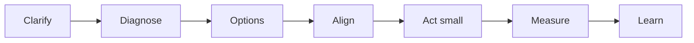
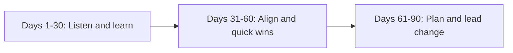
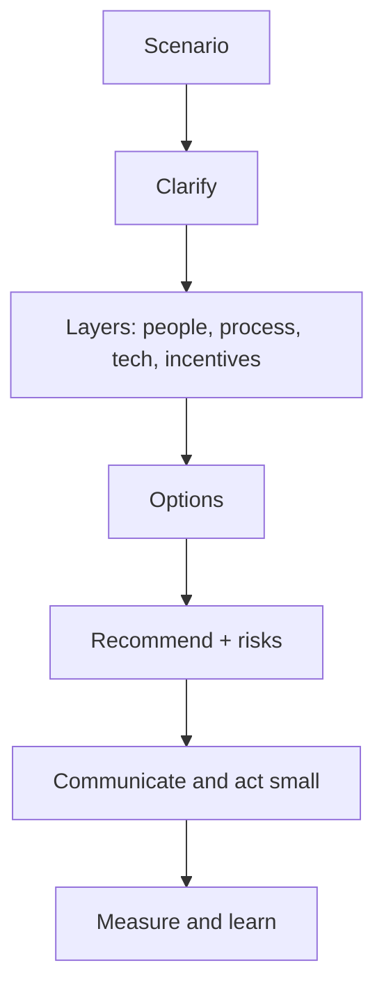

# Leadership Scenarios and Case Studies

> Verification note: The scenarios below are **illustrative composites** designed for interview practice. They are not real companies or people, contain no real data, and any numbers are placeholders. Recommended approaches combine established leadership practice (stakeholder management, structured feedback, blameless incident response, progressive delivery, change management) with technical facts already verified elsewhere in this repo — for example Core Web Vitals thresholds ([web-performance/01](../web-performance/01-performance-metrics-and-measurement.md)), Next.js 16 request-API and caching behavior ([debugging-scenarios/04](../debugging-scenarios/04-react-and-nextjs-debugging-scenarios.md)), TypeScript 6/7 migration facts ([typescript/04](../typescript/04-tsconfig-modules-and-tooling.md)), and **DORA** guidance (five metrics per service, own baseline, never targets — [ci-cd-web/07 §7](../ci-cd-web/07-release-automation-observability-and-pipeline-operations.md#7-measuring-dora-in-practice)). **HR, legal and employment matters (performance plans, terminations, harassment, accommodations, compensation, layoffs) vary by jurisdiction and company; involve HR/legal and follow policy** *(hedged)*. Each scenario uses the **leadership loop** (Clarify → Diagnose → Options → Align → Act → Measure → Learn — [01 §9](01-leadership-roles-levels-and-interview-expectations.md#9-the-leadership-loop-a-mental-model)).

## Table of Contents

1. [Quick Summary (TL;DR)](#1-quick-summary-tldr)
2. [How to Work a Scenario Question](#2-how-to-work-a-scenario-question)
3. [People Scenarios](#3-people-scenarios)
4. [Delivery and Planning Scenarios](#4-delivery-and-planning-scenarios)
5. [Technical Direction and Architecture Scenarios](#5-technical-direction-and-architecture-scenarios)
6. [Incident, Quality and Risk Scenarios](#6-incident-quality-and-risk-scenarios)
7. [Cross-Functional and Stakeholder Scenarios](#7-cross-functional-and-stakeholder-scenarios)
8. [Organizational Change Scenarios](#8-organizational-change-scenarios)
9. [First 30/60/90 Days in a New Lead Role](#9-first-306090-days-in-a-new-lead-role)
10. [Extended Case Studies](#10-extended-case-studies)
11. [AI-Era Leadership Scenarios](#11-ai-era-leadership-scenarios)
12. [Pitfalls](#12-pitfalls)
13. [Interview Questions — Fundamentals](#13-interview-questions--fundamentals)
14. [Interview Questions — Senior Scenarios](#14-interview-questions--senior-scenarios)
15. [Cheat Sheet](#15-cheat-sheet)
16. [Key Terms Glossary](#16-key-terms-glossary)
17. [Further Reading](#17-further-reading)

---

## 1. Quick Summary (TL;DR)

- **Scenario questions test judgment, structure and people sense,** not a single right answer. State assumptions, ask clarifying questions, give a reasoned plan, and name the trade-offs and risks.
- **A reliable structure:** *clarify context and goal → diagnose causes (people, process, technical, incentives) → options with trade-offs → decide and align stakeholders → act in small reversible steps → measure → learn.*
- **Separate immediate mitigation from long-term fixes,** and individual conversations from systemic changes.
- **Protect people and trust** while delivering outcomes; transparency and early communication are almost always better than surprises.
- **Escalate wisely:** early, with options, to the right person; bring recommendations, not just problems.
- **Show you know when to involve HR/legal/security** and when decisions belong to others.

---

## 2. How to Work a Scenario Question

1. **Pause and restate** the situation and goal in one sentence.
2. **Ask 3–5 clarifying questions:** stakes, timeline, who's affected, what's been tried, constraints, authority/decision rights, data available.
3. **Name your assumptions** explicitly if the interviewer won't answer.
4. **Diagnose across layers:** *people* (skills, motivation, relationships), *process* (planning, review, release), *technical* (architecture, tooling, quality), *incentives/organization* (priorities, ownership, metrics).
5. **Generate 2–3 options** with benefits, costs, risks, reversibility. Include a minimal option.
6. **Recommend** one with reasons and what would change your mind.
7. **Plan communication:** who needs to know what and when; who decides.
8. **Define success and checkpoints:** how you'd know it's working; when you'd adjust.
9. **Close with learning/prevention:** how to avoid recurrence.

**Time budget:** ~1 minute framing, ~3–4 minutes answer, then dialogue. Offer to go deeper on any branch.

**Avoid:** jumping to solutions; "just fire/replace"; assuming bad intent; unilateral decisions outside your authority; heroics; ignoring other stakeholders; skipping measurement.

---

## 3. People Scenarios

### 3.1 A strong engineer is disengaging
**Clarify:** timeframe, changes (project, manager, workload, personal), performance impact.
**Diagnose:** burnout, lack of growth, conflict, unclear priorities, compensation, external opportunities.
**Plan:** private 1:1 with curiosity ("What's changed?"); listen; address what's controllable (scope, stretch assignment, sponsorship, workload); involve manager/HR for compensation/level if needed; agree on follow-ups; watch for knowledge silos and reduce risk regardless.
**Measure:** engagement in 1:1s, participation, quality, retention signals. **Learn:** check whether team-wide patterns exist ([05 §10](05-communication-conflict-and-team-health.md#10-team-health-signals-motivation-and-burnout)).

### 3.2 A senior engineer resists a decision and keeps relitigating it
**Diagnose:** disagreement on goals vs. unheard concerns vs. identity/ownership; unclear decision process.
**Plan:** private conversation to understand their concerns; ensure the decision process and rationale are documented ([02 §4](02-influence-stakeholders-and-technical-decision-making.md#4-decision-rights-and-decision-types)); invite them to define what evidence would change the decision and a review date; ask them to commit; coach on "disagree and commit"; if undermining behavior continues, treat as a behavior issue with manager.
**Measure:** team alignment, fewer repeated debates. **Learn:** improve decision hygiene (ADRs, explicit deciders).

### 3.3 You inherit a team that doesn't trust management
**Plan:** listen first (1:1s, skip-level history); acknowledge past issues without blaming individuals; make small visible commitments and keep them; clarify priorities and decision-making; share context transparently; address a few top friction points quickly; avoid large changes in the first weeks; build relationships with product and design; check progress with an anonymous pulse after 6–8 weeks.

### 3.4 A junior engineer's PRs repeatedly need major rework
**Diagnose:** unclear requirements, skill gaps, lack of context, intimidation about asking questions, rushing.
**Plan:** pair on the next task from design through PR; provide a checklist and examples; create smaller tasks with explicit acceptance criteria; schedule short daily check-ins; praise improvements; ensure reviews are constructive ([03 §7](03-mentoring-coaching-feedback-and-hiring.md#7-code-review-as-a-teaching-and-culture-tool)); review progress in 3–4 weeks; involve manager if no improvement.

### 3.5 Two teammates compete for the same promotion
**Plan:** don't promise outcomes; clarify criteria and evidence needed for each; give honest development feedback; ensure fair opportunity distribution; keep conversations separate; sponsor both appropriately; coordinate with manager/calibration; watch collaboration dynamics.

### 3.6 A high performer is unwilling to share knowledge or mentor
**Diagnose:** job security fear, undervalued mentoring, time pressure, personal style.
**Plan:** clarify that knowledge sharing is part of the expectations at their level; reduce bus-factor risk with pairing and docs; align incentives (recognition, goals); give structured opportunities (tech talks, design reviews); set expectations in review criteria.

### 3.7 A team member has a personal crisis
**Plan:** private and compassionate check-in; ask what support they need; adjust workload and deadlines temporarily; involve HR for formal support/leave options; maintain confidentiality; redistribute work fairly without penalizing; check in regularly; avoid assumptions about performance impact.

### 3.8 You must give a "not ready for promotion" message
**Plan:** be clear and kind; share specific evidence vs criteria; name gaps and concrete next steps with timeline; offer sponsorship and opportunities; ask for their view; follow up; don't hide behind committees or promise unconditional outcomes.

### 3.9 An employee reports harassment or discrimination
**Plan:** listen without judgment; take it seriously; don't promise confidentiality you can't keep; follow company policy — escalate to HR/legal immediately; document facts; avoid investigating yourself; protect the reporter from retaliation. This is outside "manager discretion."

### 3.10 Team members suspect a colleague of cutting corners (e.g., skipping tests)
**Plan:** gather facts; discuss with the colleague privately with SBI; clarify team standards and definition of done; improve guardrails (required checks); if integrity issues (falsifying results), escalate per policy.

---

## 4. Delivery and Planning Scenarios

### 4.1 The team keeps missing sprint commitments
**Diagnose:** over-commitment, interruptions, large stories, unclear requirements, dependencies, estimation bias.
**Plan:** measure capacity (historical throughput, interruption log); reduce WIP and story size; refine acceptance criteria; add buffer; track carry-over trend as a signal; retro experiments ([04 §6, §8](04-planning-estimation-prioritization-and-delivery.md#6-capacity-interruptions-and-planning-cadence)).

### 4.2 The product manager wants a date commitment on a six-month project
**Plan:** discovery phase and spikes; range estimates with assumptions and confidence; milestones that deliver value early; commit to the next phase's date; define scope tiers (must/should/could); agree on re-estimation checkpoints; communicate risks early ([04 §4](04-planning-estimation-prioritization-and-delivery.md#4-estimation-under-uncertainty)).

### 4.3 A launch is at risk three weeks out
**Plan:** assess critical path and remaining risk; reduce scope with product; swarm on blockers; cut WIP; ensure rollback and flags; add daily risk check-in; communicate options (date, scope, phased rollout) with a recommendation; protect quality non-negotiables (security, accessibility on core flows, monitoring); avoid blanket overtime ([04 §10](04-planning-estimation-prioritization-and-delivery.md#10-deadlines-scope-creep-and-delivering-bad-news)).

### 4.4 Product demands constant scope additions
**Plan:** understand drivers; make trade-offs visible ("to add X, we defer Y or move the date"); introduce a lightweight change process; protect core scope; offer experiments instead of build-all; agree on cadence for re-prioritization.

### 4.5 Your team is blocked by another team's API and they say it's "next quarter"
**Plan:** clarify needs and impact; propose contract-first mocking so you can proceed; explore alternatives (BFF, temporary adapter, shared ownership of the endpoint); escalate with options to both managers; make the dependency visible on the roadmap ([networking-and-apis/07](../networking-and-apis/07-api-client-architecture-and-contracts.md)).

### 4.6 Tech debt is slowing delivery; leadership says "features first"
**Plan:** quantify impact (cycle time, incident rate, onboarding time) and cost; propose a standing capacity allocation or bundle debt with features; pick a few high-impact items with clear outcomes; show early wins; add guardrails to prevent new debt ([frontend-architecture/07 §10](../frontend-architecture/07-migrations-modernization-and-technical-debt.md#10-managing-technical-debt)).

### 4.7 A long-running project's morale is low
**Plan:** re-clarify purpose and progress; break into milestones and celebrate; rotate difficult tasks; remove blockers; reduce WIP; share customer impact; check workload; consider scope or timeline adjustments; communicate transparently with leadership.

### 4.8 The estimate you gave proves wrong by 2x
**Plan:** raise it immediately with updated range and causes; present options (scope, date, resources, approach); own the learning; adjust the process (reference-class, risk review, spikes); avoid blaming others.

---

## 5. Technical Direction and Architecture Scenarios

### 5.1 Choose between a monolith, micro-frontends and a modular monolith for a growing org
**Plan:** clarify team structure, release independence needs, domain boundaries, performance and consistency constraints; evaluate options against criteria (coordination cost, runtime complexity, ownership clarity); recommend the simplest approach that meets needs (often modular monolith + monorepo boundaries, micro-frontends only with strong justification); pilot; define exit criteria ([frontend-architecture/06](../frontend-architecture/06-micro-frontends-and-composition.md)).

### 5.2 An engineer proposes adopting a brand-new framework for a core product
**Plan:** understand the pain; evaluate against criteria (ecosystem maturity, hiring, operability, migration cost, team skills); time-boxed spike; define success metrics; consider incremental use in a non-critical area; ADR with revisit triggers; avoid both hype-driven adoption and reflexive rejection ([frontend-architecture/01 §7](../frontend-architecture/01-frontend-architecture-principles-and-decision-making.md#7-technology-selection-a-repeatable-framework)).

### 5.3 You need to upgrade a major framework version across 12 apps
**Plan:** inventory apps and risks; create an upgrade guide and codemods; canary app first; wave plan with owners; compatibility matrix for key libraries; CI gates and visual regression; communicate timeline and support; track progress; keep a rollback plan; schedule the next upgrade to avoid backlog ([06 §12.2](06-leading-technical-initiatives-and-organizational-change.md#122-leading-a-frameworkruntime-upgrade-eg-major-reactnextjs-version-across-a-monorepo)).

### 5.4 Core Web Vitals degrade after a feature launch
**Plan:** confirm with RUM field data (p75 per route/device); correlate to the deploy and flags; roll back or flag off if severe; profile (long tasks, hydration, third parties, images); fix root cause; add budgets/alerts; share postmortem ([debugging-scenarios/07 §8](../debugging-scenarios/07-production-incidents-observability-and-root-cause-analysis.md#8-scenario-performance-and-resource-regressions-in-production), [web-performance/07](../web-performance/07-performance-debugging-budgets-and-culture.md)).

### 5.5 Teams build their own versions of shared functionality
**Plan:** discover why (discoverability, missing features, trust, speed); inventory duplicates; define criteria for shared vs local; improve the shared offering via customer feedback; contribution model; deprecate duplicates gradually; avoid mandating without enablement.

### 5.6 The design system team is a bottleneck
**Plan:** analyze request types and SLAs; introduce contribution paths (inner source) with review support; prioritize by impact; improve self-service docs; set triage and communication cadence; consider embedding or rotation; measure lead time for component requests ([system-design/06](../system-design/06-design-system-and-component-library.md)).

### 5.7 A security audit demands remediation across all apps within 60 days
**Plan:** triage findings by severity and exposure; create a cross-team working group with clear owners; provide shared fixes (libraries, headers via platform, CI checks); weekly tracking; decide accepted risks formally with expiry; communicate progress to security/leadership ([web-security/08](../web-security/08-secure-frontend-patterns-and-vulnerability-catalogue.md)).

### 5.8 Should we build or buy a component (e.g., rich text editor, charting, feature flags)?
**Plan:** define requirements and differentiation; TCO (build + maintain) vs license, vendor risk, extensibility, accessibility/performance fit, team skills; run a spike on top candidates; design an adapter to limit lock-in; document the decision and revisit triggers.

---

## 6. Incident, Quality and Risk Scenarios

### 6.1 A production outage occurs; you're the senior engineer on call
**Plan:** assess impact and severity; declare incident roles; mitigate first (rollback/flag/purge); communicate updates at a cadence; investigate with evidence; verify recovery; blameless postmortem with owned actions ([debugging-scenarios/07](../debugging-scenarios/07-production-incidents-observability-and-root-cause-analysis.md)).

### 6.2 The same type of incident recurs
**Plan:** review prior postmortem action completion; analyze contributing factors systematically; address detection and prevention gaps (tests, alerts, guardrails); escalate resource needs; track recurrence rate as a signal; share learnings.

### 6.3 A manager wants to release despite failing quality gates
**Plan:** clarify risk with data (what fails, user impact, rollback ability); propose options (fix, partial rollout behind flag with guardrails, delay, accept documented risk with owner); ensure decision-maker accepts risk explicitly; document; monitor closely; follow up with improvements.

### 6.4 Flaky tests are eroding trust in CI
**Plan:** measure flake rate; classify causes ([testing/07 §2](../testing/07-flakiness-ci-and-non-functional-testing.md#2-flakiness-taxonomy-and-root-causes)); quarantine with owners and deadlines; fix top offenders; improve test design and environment determinism; report trend; avoid blanket retries as a "fix."

### 6.5 A third-party vendor outage breaks your checkout
**Plan:** mitigate (disable script/fallback), communicate; postmortem on isolation (timeouts, error boundaries, kill switch, async loading); vendor SLAs; synthetic tests with failure injection; add ownership/review for new third-party scripts ([debugging-scenarios/07 §7](../debugging-scenarios/07-production-incidents-observability-and-root-cause-analysis.md#7-scenario-third-party-scripts-and-dependencies)).

### 6.6 You find a vulnerability in a dependency used everywhere
**Plan:** assess reachability and severity; coordinate with security; patch/override; communicate to teams; verify via CI/lockfiles; check for exploitation signs; improve dependency management (automated updates, SBOM, policy) ([debugging-scenarios/08 §10](../debugging-scenarios/08-build-tooling-typescript-dependency-and-ci-debugging.md#10-dependency-regressions-upgrades-and-supply-chain-debugging)).

### 6.7 Accessibility complaint or legal notice arrives
**Plan:** involve legal/compliance; triage the reported issues; fix critical journeys first; audit; set remediation roadmap with owners/dates; build prevention (components, CI checks, training, definition of done); communicate progress ([accessibility/07](../accessibility/07-testing-tooling-and-accessibility-in-the-delivery-process.md)).

---

## 7. Cross-Functional and Stakeholder Scenarios

### 7.1 Design delivers pixel-perfect specs the system can't support within the timeline
**Plan:** understand intent and critical fidelity; propose tokens/components that approximate; show timeline impact of exact fidelity; negotiate staged delivery (core now, polish later); update design-system components if the pattern is reusable; maintain a shared review cadence.

### 7.2 An executive asks you to "just ship it" despite accessibility/performance concerns
**Plan:** understand the business driver; quantify risk and cost (legal, conversion, rework); propose a phased approach that meets the date with guardrails (critical flows compliant, rest scheduled); make the trade-off explicit and request decision ownership; document; follow up post-launch.

### 7.3 Backend team changes an API without notice and breaks production
**Plan:** mitigate; review contract and release processes; introduce contract tests, versioning and deprecation policy, communication channels, consumer-driven contracts; blameless review with the backend team ([testing/06](../testing/06-api-contract-and-integration-testing.md)).

### 7.4 Product wants to run many A/B tests; engineering sees quality and complexity risk
**Plan:** define an experimentation framework (flags, guardrail metrics, ownership of cleanup); prioritize tests by expected learning; limit concurrent tests per surface; ensure measurement quality; schedule flag cleanup; share results.

### 7.5 Support complains about repeated unknown regressions
**Plan:** create a feedback loop (triage channel, severity definitions); release notes and early warnings; improve testing/observability on top regression areas; shared metrics (tickets per release); regular sync.

### 7.6 A senior stakeholder wants a technology decision made their way
**Plan:** understand their goal; present options with trade-offs and evidence; propose a pilot or criteria-based evaluation; if they decide otherwise, clarify risks and mitigation, commit, and propose a review point; escalate only if serious risk.

---

## 8. Organizational Change Scenarios

### 8.1 Your team is being split into two
**Plan:** understand rationale; involve the team in drawing boundaries (domains, ownership); define interfaces, shared standards and rituals; clarify who owns what; communicate timeline and support; protect continuity; check morale and workload; revisit after a quarter.

### 8.2 Layoffs affect part of your org
**Plan:** communicate honestly within constraints; clarify priorities and stop non-essential work; support departed colleagues' transitions; hold 1:1s; avoid false promises; monitor workload and attrition risk; maintain team trust.

### 8.3 A new VP announces a major strategy change
**Plan:** seek to understand context; translate to team implications; surface risks and dependencies early; propose phased plan; protect critical work; manage team anxiety with regular updates; align metrics.

### 8.4 Your team is merged with another that has a different culture
**Plan:** listen; identify overlaps and differences; co-create working agreements; respect strengths; avoid "us vs them"; pair across teams; unify tools gradually; track integration health.

### 8.5 Rapid growth: team doubles in six months
**Plan:** invest in onboarding, documentation, architecture boundaries, hiring rubrics, mentoring capacity; introduce lightweight governance; protect senior engineers' time; watch cultural drift; track onboarding time and quality metrics.

### 8.6 You must reduce costs (cloud, vendor, headcount) by 15%
**Plan:** understand drivers and constraints; analyze spend and value; prioritize by impact and risk; propose options (vendor consolidation, caching, build optimization, scope reduction); involve teams; communicate trade-offs; monitor impact on delivery and quality.

---

## 9. First 30/60/90 Days in a New Lead Role

| Phase | Focus | Concrete actions |
|---|---|---|
| **Days 1–30: Learn** | Context, relationships, expectations | 1:1s with every teammate and key partners (product, design, backend, SRE, support); read ADRs, runbooks, roadmaps, incident history; understand release process, on-call and delivery metrics (baseline DORA per service as context); clarify manager's expectations and success criteria; ship a small change to learn the pipeline; **avoid big changes** |
| **Days 31–60: Align** | Priorities, quick wins, trust | Synthesize themes (what's working, what's painful); share findings and top 3 friction points; choose 1–2 quick wins (e.g., flaky test fix, onboarding doc, review SLA); agree on team working agreements; establish regular rituals (1:1s, retros, decision log); build relationships with stakeholders; clarify decision rights |
| **Days 61–90: Plan and lead** | Direction, roadmap, initiatives | Draft a 6–12 month technical/team plan with outcomes and risks; align with product/engineering leadership; start one meaningful initiative with sponsor and metrics; set growth plans for team members; share a 90-day review (what I learned, what changed, what's next) and ask for feedback |

**Principles:** listen before changing; earn trust via reliability; document what you learn; ask "what would you keep/change?"; avoid criticizing the past; set expectations early on communication and decision-making; delegate and develop others.

**Staff+/architect variant:** map the technical landscape (systems, ownership, pain points, debts), identify 2–3 high-leverage cross-team problems, write a short strategy with sponsors, and build credibility with a visible win.

**Manager variant:** add org design, hiring plan, performance baselines (with HR), team health survey, and budget/headcount understanding.

---

## 10. Extended Case Studies

### Case A: "The Rewrite That Isn't Working"
**Situation:** A year ago a team started rewriting the customer portal in a new framework. Feature parity is 55%; the old portal still gets new features; morale is low; leadership is impatient.
**Clarify:** why the rewrite began; business drivers; metrics; remaining scope; team capacity; sunk cost.
**Diagnose:** scope creep, dual maintenance, underestimated parity, weak migration strategy, no user-facing value yet.
**Options:** (1) continue as is; (2) pause and cut scope to a "minimum replacement" with route-by-route cutover (strangler); (3) stop the rewrite and modernize the old app incrementally; (4) hybrid (new stack for new areas only).
**Recommendation:** evaluate with data; likely choose a strangler approach with a hard sunset date for the old portal, freeze new features in old paths except critical, define cutover order by user value/risk, and publish burn-down. Decide with the sponsor at a gate.
**Alignment:** involve product, support, key users; honest reset of expectations; celebrate partial wins.
**Measure:** percent traffic on new paths, defect rate, delivery time, developer satisfaction.
**Learning:** require phased value and decision gates for large rewrites ([frontend-architecture/07](../frontend-architecture/07-migrations-modernization-and-technical-debt.md)).

### Case B: "The Brilliant Jerk"
**Situation:** A staff engineer delivers critical work but belittles teammates in reviews and meetings; two engineers requested transfers.
**Plan:** gather specific examples; speak privately with SBI; clarify that conduct is part of expectations at their level; set concrete behavior goals and support (coaching); check in with affected teammates; involve manager/HR with documentation; reduce harm (adjust review pairings) during improvement; if no change, apply consequences per policy. **Learning:** culture is what you tolerate; seniority raises expectations ([05 §8](05-communication-conflict-and-team-health.md#8-psychological-safety-and-team-culture)).

### Case C: "Everything Is a Priority"
**Situation:** Five stakeholders each insist their project is #1; the team of six can deliver two.
**Plan:** collect asks with expected impact and effort; facilitate a joint prioritization session with decision criteria (impact, urgency/cost of delay, risk, strategic fit); show capacity line; agree on top two; propose alternatives for others (self-service, defer, reduce scope); communicate decisions and review date; maintain a visible roadmap. **Learning:** the real job is making trade-offs explicit ([04 §5](04-planning-estimation-prioritization-and-delivery.md#5-prioritization-frameworks)).

### Case D: "The Bus Factor of One"
**Situation:** Only one engineer understands the checkout and payments integration; they're burned out and considering leaving.
**Plan:** immediate: reduce load, show appreciation, discuss their needs; structural: pair on tasks, document flows and runbooks, rotate on-call with shadowing, create tests as living documentation, assign a second owner, update ownership manifests; recognize knowledge-sharing in performance review. **Measure:** number of engineers able to handle incidents/changes. **Learning:** prevent hero dependency.

### Case E: "Leading Through a Migration to Server Components"
**Situation:** Your org wants to adopt React Server Components via Next.js App Router for performance; engineers are anxious about complexity and caching.
**Plan:** define goals (LCP/INP, bundle size, data fetching simplicity) and non-goals; pilot on a route with clear success metrics; invest in training and internal guides (server/client boundaries, caching semantics, Server Action security); define standards and lint rules; set up observability for cache/staleness issues ([debugging-scenarios/04](../debugging-scenarios/04-react-and-nextjs-debugging-scenarios.md)); wave rollout; keep rollback paths; collect developer feedback. **Learning:** new rendering models demand education and operational readiness, not just code changes ([nextjs-and-rendering/](../nextjs-and-rendering/README.md)).

### Case F: "Misaligned Incentives"
**Situation:** Engineering is measured on features shipped; reliability work is ignored; incidents rise.
**Plan:** show data linking incidents to lost capacity and customer impact; propose shared metrics (SLOs, change fail rate trend as signals — not targets — [ci-cd-web/07 §7](../ci-cd-web/07-release-automation-observability-and-pipeline-operations.md#7-measuring-dora-in-practice)); negotiate capacity allocation; recognize reliability work in reviews; pilot error-budget policy. **Learning:** change incentives or behavior won't change.

---

## 11. AI-Era Leadership Scenarios

*(Hedged: tools and best practices evolve quickly; focus on principles.)*

### 11.1 Leadership wants everyone using AI coding assistants by next month
**Plan:** clarify objectives (speed? quality? cost?); run a pilot with volunteers across experience levels; define policy (approved tools, data handling, license/IP, security review); keep human accountability; update review checklists; measure team-level outcomes (cycle time, defects, developer survey) not volume of generated code; provide training on effective use and verification; revisit policy regularly.

### 11.2 Junior engineers are shipping plausible code they can't explain
**Plan:** adjust expectations (explain choices in PR descriptions); pair and ask them to walk through code; require tests and runnable evidence; use AI as a learning aid with prompts for explanations; review for hallucinated APIs/insecure patterns; build fundamentals through exercises ([03 §7](03-mentoring-coaching-feedback-and-hiring.md#7-code-review-as-a-teaching-and-culture-tool)).

### 11.3 Interview process: candidates may use AI tools
**Plan:** define policy per stage; design tasks assessing reasoning, debugging, review and communication (e.g., critique generated code, explain trade-offs); communicate rules to candidates; avoid unreliable detection; keep fairness and accessibility ([03 §10](03-mentoring-coaching-feedback-and-hiring.md#10-hiring-designing-the-loop-for-frontend-roles)).

### 11.4 Security flags code snippets pasted into external AI tools
**Plan:** treat as a policy/process gap, not blame; clarify allowed data; provide approved tools/environments; training; technical controls (secret scanning, DLP); incident review if sensitive data leaked; update onboarding.

---

## 12. Pitfalls

1. **Giving a solution before clarifying the situation.**
2. **Ignoring people dimension** (only technical fixes).
3. **Ignoring stakeholder dimension** (only team-internal fixes).
4. **Skipping measurement and follow-up.**
5. **Unilateral decisions** outside your authority.
6. **Assuming malice;** failing to ask for perspectives.
7. **Hero narratives;** no delegation.
8. **Avoiding hard conversations.**
9. **Overreacting to a single incident** (blame) or underreacting to patterns.
10. **Not involving HR/legal/security when required.**
11. **No exit/rollback path in plans.**
12. **Vague plans without owners/dates.**
13. **Ignoring cost of inaction.**
14. **Changing too much too soon in a new role.**
15. **Overconfidence;** no mention of risks or what would change your mind.

---

## 13. Interview Questions — Fundamentals

- **How do you approach an ambiguous leadership scenario?** Clarify, diagnose layers, options, align, act small, measure, learn.
- **When do you escalate?** When risk/impact exceeds your authority, after attempts to resolve, with options and recommendation.
- **How do you balance team and business needs?** Make trade-offs visible, align on outcomes, protect sustainable pace.
- **What do you do in your first 90 days?** Learn, build trust, quick wins, then plan and lead changes.
- **How do you handle a team crisis?** Mitigate, communicate, support people, learn blamelessly.
- **How do you prioritize when everything is urgent?** Criteria, capacity line, explicit trade-offs, stakeholder alignment.
- **How do you deal with a toxic high performer?** Direct behavior feedback, expectations, consequences, protect team.
- **How do you handle a team member who is struggling?** Diagnose skill/will/context, clarify expectations, support, document.
- **How do you keep quality high under deadline pressure?** Define non-negotiables, scope flexibly, flags and monitoring.
- **How do you manage knowledge silos?** Pairing, docs, rotation, ownership manifests.
- **How do you lead through reorgs?** Transparency, clarity of roles, listening, protecting priorities.

---

## 14. Interview Questions — Senior Scenarios

### S1. "You're the new tech lead; the team has 40% flaky E2E tests and ignores failures."
Baseline the problem (flake rate, CI time, failure categories); build trust by fixing a high-impact subset with the team; classify causes and move tests down the pyramid; quarantine with owners and deadlines; add dashboards; agree on norms ("red build blocks merge"); invest in deterministic test data and environments; celebrate trend improvements ([testing/07](../testing/07-flakiness-ci-and-non-functional-testing.md)).

### S2. "Describe how you'd lead a company-wide adoption of a design system when teams are hostile to it."
Listen to objections (autonomy, past failures); co-design with representatives; pilot; excellent docs and migration tools; contribution model; measure adoption and satisfaction; incentives (accessibility compliance, faster delivery); governance; sunset legacy with support ([06 §6](06-leading-technical-initiatives-and-organizational-change.md#6-driving-adoption-platforms-design-systems-and-standards)).

### S3. "Your best frontend architect wants to leave to join a startup; the org depends on them."
Understand motivation; address controllable factors (scope, growth, compensation, flexibility); plan knowledge transfer and distributed ownership regardless; accept that retention isn't guaranteed; improve documentation and decision records; develop successors; learn from exit feedback.

### S4. "An executive wants a dashboard ranking teams by deployment frequency."
Explain Goodhart's law and DORA guidance: per-service metrics against baselines, no league tables; propose a dashboard for improvement conversations (all five metrics, trends, context, qualitative signals) with explicit guidelines against ranking; offer alternative outcomes the executive cares about (reliability, speed of delivery) ([ci-cd-web/07 §7](../ci-cd-web/07-release-automation-observability-and-pipeline-operations.md#7-measuring-dora-in-practice)).

### S5. "You disagree with your manager about a launch risk and they decide to proceed."
Share concerns and evidence privately; ask what additional safeguards are possible (flag, canary, monitoring, rollback plan); document the risk acceptance; commit to the plan; prepare mitigations and runbooks; review outcomes honestly afterward.

### S6. "Your team's morale is low after a failed project. What do you do?"
Acknowledge the loss; run a blameless retrospective to extract learnings; communicate what's changing; give recognition for good work; reduce workload temporarily if possible; set a small, achievable next win; ensure fair credit and growth opportunities; follow up with 1:1s.

---

## 15. Cheat Sheet

| Scenario type | First moves |
|---|---|
| Disengaged engineer | 1:1, listen, address controllables |
| Conflict | Interests, evidence, decider, commit |
| Missed commitments | Capacity data, WIP, slicing, communication |
| Outage | Mitigate, communicate, blameless review |
| Tech debt vs features | Quantify, allocate capacity, show wins |
| New framework proposal | Problem-first, spike, criteria, ADR |
| Reorg/layoff | Transparency, clarity, support, priorities |
| New role | Listen 30, align 60, lead 90 |
| HR/legal matters | Escalate per policy; don't improvise |
| AI tools | Policy, accountability, outcome metrics |

---

## 16. Key Terms Glossary

| Term | Meaning |
|---|---|
| **Leadership loop** | Clarify, diagnose, options, align, act, measure, learn |
| **Strangler pattern** | Replace legacy incrementally route by route |
| **Blameless postmortem** | Systemic incident learning without blame |
| **Capacity line** | Visible cutoff showing what the team can deliver |
| **Guardrail metric** | Metric protected during changes |
| **Bus factor** | People whose loss would stall a system |
| **Risk acceptance** | Documented decision to proceed despite known risk |
| **Quick win** | Small visible improvement building trust |
| **Working agreement** | Team-defined collaboration norms |
| **Decision gate** | Checkpoint to continue, adjust or stop |
| **Goodhart's law** | Targets distort the measures they use |
| **Sponsor** | Senior advocate for an initiative |

---

## 17. Further Reading

- Michael Watkins, *The First 90 Days*; Camille Fournier, *The Manager's Path*; Will Larson, *Staff Engineer*; Tanya Reilly, *The Staff Engineer's Path*; Amy Edmondson, *The Fearless Organization*; Forsgren et al., *Accelerate* *(hedged: titles from memory; confirm before citing)*
- **This repo:** [01 Roles and levels](01-leadership-roles-levels-and-interview-expectations.md) · [02 Influence](02-influence-stakeholders-and-technical-decision-making.md) · [03 Mentoring and hiring](03-mentoring-coaching-feedback-and-hiring.md) · [04 Planning and delivery](04-planning-estimation-prioritization-and-delivery.md) · [05 Communication and conflict](05-communication-conflict-and-team-health.md) · [06 Leading initiatives](06-leading-technical-initiatives-and-organizational-change.md) · [07 Behavioral question bank](07-behavioral-interview-question-bank-and-answers.md) · [debugging-scenarios/07](../debugging-scenarios/07-production-incidents-observability-and-root-cause-analysis.md)
