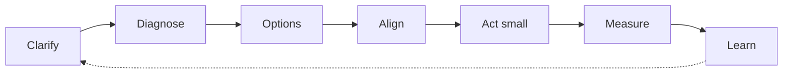
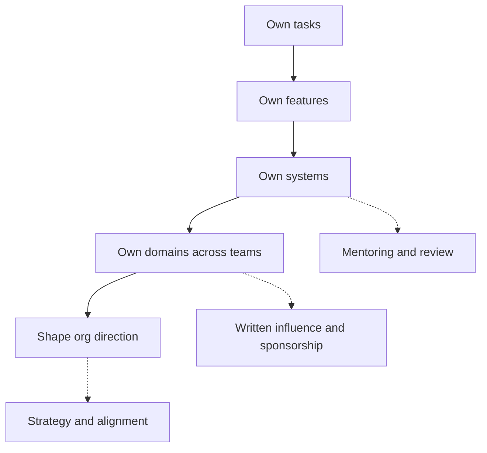
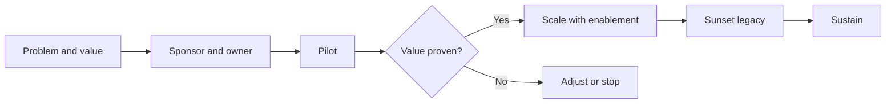

# Leadership Recall Map

> Verification note: This is a **revision sheet**, not a tutorial. Each section points to the source document for detail ([01](01-leadership-roles-levels-and-interview-expectations.md) · [02](02-influence-stakeholders-and-technical-decision-making.md) · [03](03-mentoring-coaching-feedback-and-hiring.md) · [04](04-planning-estimation-prioritization-and-delivery.md) · [05](05-communication-conflict-and-team-health.md) · [06](06-leading-technical-initiatives-and-organizational-change.md) · [07](07-behavioral-interview-question-bank-and-answers.md) · [08](08-leadership-scenarios-and-case-studies.md)). Leadership frameworks (STAR, SBI, Situational Leadership, Tuckman, Thomas-Kilmann, DACI/RACI, RICE/WSJF, Kotter/ADKAR, Radical Candor, psychological safety) are **established practice described from memory — confirm names and attributions before quoting them** *(hedged)*. The one externally verified data point is **DORA**: five delivery metrics (change lead time, deployment frequency, failed deployment recovery time, change fail rate, deployment rework rate), per service, against your own baseline, never as targets or league tables. HR, legal and employment matters vary by jurisdiction and company *(hedged)*.

## Table of Contents

1. [60-Second Mental Model](#1-60-second-mental-model)
2. [Maps](#2-maps)
3. [Decision Tables](#3-decision-tables)
4. [Frameworks, Facts and Defaults](#4-frameworks-facts-and-defaults)
5. [Mnemonics](#5-mnemonics)
6. [Rapid-Fire Q&A](#6-rapid-fire-qa)
7. [Say-This Scripts](#7-say-this-scripts)
8. [Red Flags vs Green Flags](#8-red-flags-vs-green-flags)
9. [Final 10-Minute Checklist](#9-final-10-minute-checklist)
10. [Related Recall Maps](#10-related-recall-maps)

---

## 1. 60-Second Mental Model

- **Leadership = raising the output and judgment of others** through clarity, decisions, mentoring, systems and example — not through title or being the best coder. Scope ladder: *task → feature → system → domain → org.*
- **Interviews test evidence:** specific past situations, **your** actions ("I"), trade-offs, results, reflection. Keep **8–10 real stories** tagged by competency; answer in **STAR-L** in 2–3 minutes.
- **Influence without authority:** credibility + relationships + clarity + evidence + making adoption easy. Write proposals, **pre-wire**, pilot, enable.
- **Decisions:** name the **decider**; classify **one-way vs two-way doors**; record with a review trigger; **disagree and commit**.
- **People:** teach vs coach vs mentor vs sponsor; feedback with **SBI**; delegate **outcomes**; diagnose underperformance by **skill / will / context**; hire with **structured, rubric-based** loops.
- **Delivery:** outcomes over outputs; **vertical slices**; **ranges** not points; prioritize with explicit criteria; protect capacity; **limit WIP**; communicate bad news early with options.
- **Team health:** psychological safety, blameless culture, healthy conflict (interests over positions), sustainable pace.
- **Change:** problem + sponsor + pilot + enablement + sunset + sustain; resistance is information.
- **In scenarios:** *Clarify → Diagnose (people, process, tech, incentives) → Options → Align → Act small → Measure → Learn.* Escalate to HR/legal/security when required.

---

## 2. Maps

**The leadership loop**

**Scope and influence ladder**

**Initiative lifecycle**

**Where each topic lives**

| Need | Read |
|---|---|
| Roles, levels, STAR, story bank | [01](01-leadership-roles-levels-and-interview-expectations.md) |
| Influence, stakeholders, decisions, saying no | [02](02-influence-stakeholders-and-technical-decision-making.md) |
| Mentoring, feedback, 1:1s, hiring | [03](03-mentoring-coaching-feedback-and-hiring.md) |
| Estimation, prioritization, delivery | [04](04-planning-estimation-prioritization-and-delivery.md) |
| Communication, conflict, team health | [05](05-communication-conflict-and-team-health.md) |
| Leading initiatives and change | [06](06-leading-technical-initiatives-and-organizational-change.md) |
| Practice questions and model answers | [07](07-behavioral-interview-question-bank-and-answers.md) |
| Scenarios, first 90 days, case studies | [08](08-leadership-scenarios-and-case-studies.md) |

---

## 3. Decision Tables

**Which support mode?**

| Person state | Mode |
|---|---|
| New to task, low confidence | Teach / direct |
| Developing | Coach |
| Capable, unsure or unmotivated | Support |
| Capable and motivated | Delegate |
| Wants career growth | Mentor + sponsor |

**Which conflict mode?** (Thomas-Kilmann, hedged)

| Mode | Use when |
|---|---|
| Collaborate | Important issue needing a joint solution |
| Compromise | Time-limited, roughly equal stakes |
| Compete | Emergency or vital unpopular decision |
| Accommodate | Matters more to them; relationship first |
| Avoid | Trivial or cooling-off |

**Decision type**

| Type | Approach |
|---|---|
| Two-way door | Decide fast, delegate |
| One-way door | RFC/ADR, stakeholders, exit plan |
| Cross-team | RFC + consultation + named decider + adoption plan |
| Urgent/incident | Incident commander decides; review later |

**Prioritization framework choice**

| Situation | Use |
|---|---|
| Quick triage | Impact vs effort |
| Feature backlog | RICE |
| Sequencing with differing delay costs | WSJF / cost of delay |
| Release scope negotiation | MoSCoW |
| Experiments | ICE |

**Deadline at risk: options**

| Lever | Caveat |
|---|---|
| Cut scope | Preferred; agree must-haves |
| Move date | Communicate early |
| Add people | Brooks's law; only for parallelizable work |
| Cut quality | Explicit, with guardrails and follow-up; avoid silent cuts |
| Change approach | Buy, simplify, reuse |

---

## 4. Frameworks, Facts and Defaults

| Item | Detail |
|---|---|
| **STAR-L** | Situation, Task, Action, Result, Learning; ~20% setup, ~50% action, ~30% result and reflection |
| **SBI** | Situation, Behavior, Impact (+ request) |
| **Leadership loop** | Clarify, Diagnose, Options, Align, Act, Measure, Learn |
| **DACI** | Driver, Approver, Contributors, Informed |
| **RACI** | Responsible, Accountable, Consulted, Informed |
| **RICE** | Reach × Impact × Confidence ÷ Effort |
| **WSJF** | Cost of delay ÷ job size |
| **RAID** | Risks, Assumptions, Issues, Dependencies |
| **Brooks's law** | Adding people to a late project delays it further (usually) |
| **Little's law** | Cycle time ≈ WIP ÷ throughput |
| **Tuckman** | Forming, storming, norming, performing, adjourning |
| **ADKAR** | Awareness, Desire, Knowledge, Ability, Reinforcement |
| **Kotter** | Urgency → coalition → vision → communicate → empower → short-term wins → consolidate → anchor |
| **Goodhart's law** | A measure that becomes a target stops being a good measure |
| **DORA (verified)** | Five metrics per service; own baseline; no targets; small batches help all five |
| **Psychological safety** | Safe to speak up; high safety plus high standards |
| **Capacity planning** | Plan below nominal capacity; reserve slack for interrupts (illustrative ~50–80%, hedged) |
| **1:1 cadence** | Weekly/biweekly; report's agenda first |
| **Code review** | Label blocking vs suggestion; explain why; praise; small PRs |
| **Onboarding** | First PR in week one; 30/60/90 plan; buddy |
| **Interview loop** | Job-relevant, structured, rubric, independent scoring, calibrated |
| **Disagree and commit** | Voice dissent, then fully support, review with new evidence |
| **Blameless** | Systems and learning, not scapegoats, with owned actions |

---

## 5. Mnemonics

- **LEAD loop:** **L**isten/clarify → **E**valuate causes → **A**lign on options → **D**eliver small, measure, learn.
- **STAR-L:** Situation, Task, Action, Result, **L**earning.
- **SBI:** **S**ituation, **B**ehavior, **I**mpact.
- **DAD for decisions:** **D**ecider named, **A**lternatives listed, **D**ate to review.
- **SWW for delegation:** **S**uccess defined, **W**hat boundaries, **W**ho supports.
- **SKILL-WILL-CONTEXT** for underperformance diagnosis.
- **COIN for stakeholder maps:** **C**oncerns, **O**utcomes they want, **I**nfluence, **N**eeds from me.
- **PICS for initiatives:** **P**roblem, **I**ncentives, **C**hampions, **S**ustain.
- **BLUF:** Bottom line up front.
- **Three F's of bad news:** **F**ast, **F**actual, with **F**orward options.
- **Story bank spread:** one each of Lead, Conflict, Fail, Mentor, Ambiguity, Pressure, Influence, Incident.

---

## 6. Rapid-Fire Q&A

- **What is leadership at senior level?** Multiplying others' effectiveness and decision quality, not only personal output.
- **Tech Lead vs Staff vs Manager?** Team technical direction (role) vs cross-team technical scope (IC level) vs people and team outcomes.
- **STAR-L?** Situation, Task, Action, Result, Learning.
- **How do you influence without authority?** Credibility, relationships, clear proposal, evidence, pilot, easy adoption.
- **One-way vs two-way door?** Hard vs easy to reverse; rigor scales with irreversibility.
- **What is pre-wiring?** One-on-one alignment before a group decision.
- **How do you say no?** Reframe to goals, show trade-offs, offer alternatives and timing.
- **SBI example?** "In yesterday's review (S), you interrupted twice (B), which stopped juniors speaking (I)."
- **How to handle underperformance?** Diagnose skill/will/context, set clear expectations, support, document, escalate per policy.
- **Best way to onboard?** Buddy, working environment, first PR in week one, 30/60/90, feedback.
- **How to estimate?** Ranges with assumptions, reference classes, decompose, include non-functional work.
- **What if the deadline slips?** Early signal; options (scope, date, resources, approach); recommendation.
- **How do you prioritize?** Explicit criteria; show capacity line; say what's not done.
- **What is psychological safety?** Safe to take interpersonal risks; leaders model fallibility.
- **Why blameless postmortems?** Surface contributing factors and fix systems, not punish.
- **How to drive adoption?** Treat platform as product: pilot, enable, support, measure, sunset legacy.
- **Rewrite vs incremental?** Incremental/strangler unless strong reasons; gates and exit criteria.
- **DORA use?** Per service, own baseline, all five, never targets.
- **How do you handle a toxic high performer?** Direct behavior feedback, expectations, consequences; culture cost is real.
- **First 90 days?** Listen (30), align and quick wins (60), plan and lead (90).
- **When involve HR/legal?** Harassment, discrimination, performance process, accommodations, terminations, safety.

---

## 7. Say-This Scripts

**Opening a behavioral answer**
> "Let me give you a concrete example. The context was `[X]`; my responsibility was `[Y]`. I considered `[A, B, C]`, chose `[B]` because `[reason]`, and here's what happened..."

**Owning a failure**
> "I made the call to `[X]` without validating `[Y]`. The impact was `[Z]`. I mitigated by `[steps]`, and we changed `[process/tooling]` so it can't recur. I now ask `[question]` before shipping."

**Disagreeing**
> "I see it differently — here's my concern and the evidence. What would change your mind? If we decide to proceed, I'll commit and we can review after `[date/metric]`."

**Saying no with options**
> "We can't do all of this by `[date]`. Options: A (full scope, later), B (core scope on time), C (buy a vendor solution). I recommend B because `[reason]`. What matters most?"

**Delivering bad news**
> "Heads up: `[what changed]`. Impact: `[dates/scope]`. Cause: `[brief, no blame]`. Options and my recommendation: `[...]`. I need `[decision]` by `[date]`."

**Giving feedback (SBI)**
> "In `[situation]`, I noticed `[behavior]`. The impact was `[effect]`. How did you see it? Could we try `[alternative]` next time?"

**Influencing**
> "Before proposing a solution, I want to understand what you're trying to achieve. Here's a one-page option analysis; can we pilot with your team and review results in `[N weeks]`?"

**Closing a scenario answer**
> "I'd measure success by `[leading and lagging indicators]`, check in at `[cadence]`, and what would change my approach is `[trigger]`."

---

## 8. Red Flags vs Green Flags

| Red flag | Green flag |
|---|---|
| "We did…" with no personal role | Clear "I" actions plus credit to the team |
| No trade-offs or alternatives | Options, criteria, reversibility, risks |
| Blames others | Owns outcomes; empathetic about other views |
| Fake weakness or failure | Real failure with systemic fix |
| Fabricated or round-number metrics | Honest numbers or observable outcomes |
| Hero narrative | Enabled others; documented; delegated |
| Mandates without enablement | Pilots, tooling, support, feedback loops |
| Avoids hard conversations | Direct, kind, SBI-style feedback |
| Uses metrics as targets or rankings | DORA/flow as improvement signals |
| Unilateral escalation or bypassing | Escalates early with options to the right person |
| "Culture fit" = like me | "Culture add" with structured evaluation |
| Rambling; no result | 2–3 minutes with reflection |
| Never mentions HR/legal/security | Knows when to involve them |

---

## 9. Final 10-Minute Checklist

- [ ] 8–10 real stories prepared, each with context, my actions, trade-offs, result, learning, and evidence I can defend?
- [ ] Stories spread across competencies (initiative, conflict, failure, mentoring, ambiguity, pressure, influence, incident, hiring)?
- [ ] Opening ("tell me about yourself") under 2 minutes and aligned to the role's level?
- [ ] Can I explain the difference between Tech Lead, Staff, Principal and Manager and why I fit mine?
- [ ] Can I describe how I influence without authority with a real example?
- [ ] Can I describe a decision with options, criteria, reversibility, and an ADR/RFC?
- [ ] Can I describe giving and receiving hard feedback (SBI)?
- [ ] Can I describe a real failure with accountability and systemic fix?
- [ ] Can I walk the leadership loop on a new scenario out loud?
- [ ] Can I discuss estimation, prioritization and deadline-risk communication concretely?
- [ ] Can I discuss hiring: structured loop, rubric, bias reduction?
- [ ] Can I discuss leading a migration/design-system/accessibility initiative through adoption and sunset?
- [ ] Can I discuss team health, psychological safety and burnout without clichés?
- [ ] Do I have 4–6 thoughtful questions for them ([07 §13](07-behavioral-interview-question-bank-and-answers.md#13-evaluating-the-company-in-return))?
- [ ] Have I removed fabricated numbers, confidential details and disparaging remarks?

---

## 10. Related Recall Maps

[Frontend Architecture](../frontend-architecture/09-frontend-architecture-recall-map.md) · [Debugging Scenarios](../debugging-scenarios/09-debugging-recall-map.md) · [System Design](../system-design/09-system-design-recall-map.md) · [CI/CD](../ci-cd-web/09-cicd-recall-map.md) · [Testing](../testing/09-testing-recall-map.md) · [Accessibility](../accessibility/09-accessibility-recall-map.md) · [Web Performance](../web-performance/08-web-performance-recall-map.md) · [React](../react/09-react-recall-map.md) · [Next.js](../nextjs-and-rendering/09-nextjs-recall-map.md) · [TypeScript](../typescript/06-typescript-recall-map.md) · [Web Security](../web-security/09-web-security-recall-map.md) · [Networking and APIs](../networking-and-apis/09-networking-and-apis-recall-map.md) · [Browser Internals](../browser-internals/08-browser-internals-recall-map.md) · [HTML and CSS](../html-and-css/09-html-and-css-recall-map.md) · [React Native](../react-native/16-react-native-recall-map.md)
