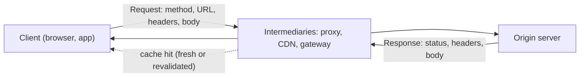
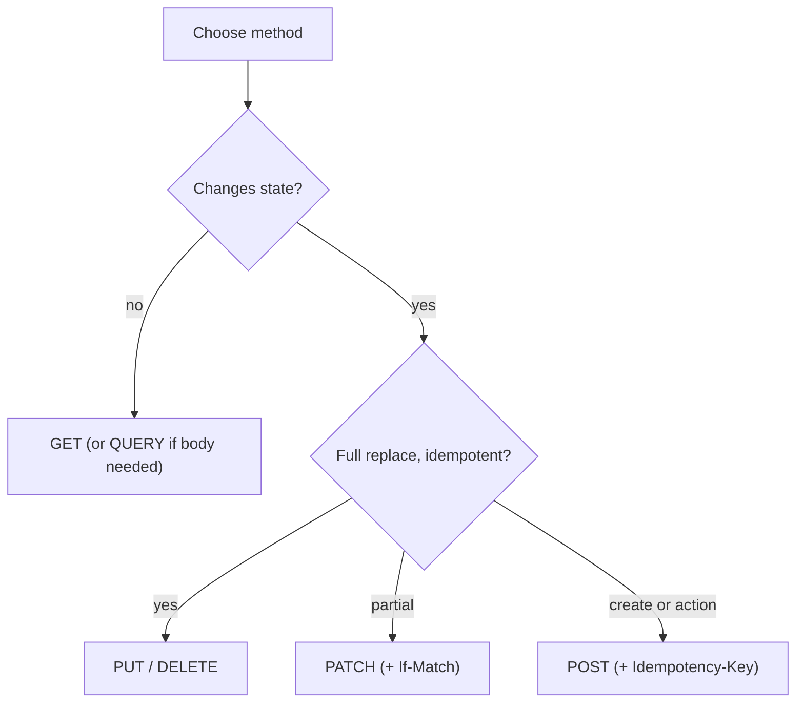

# HTTP Semantics and Protocol Versions

> Verification note: the **method properties table** (safe / idempotent / cacheable, including the newer **`QUERY`** method and the conditional cacheability of `POST`/`PATCH`) was verified against MDN "HTTP request methods" (Sep 2026). **HTTP/3 and QUIC** facts (QUIC standardised 2021, HTTP/3 in 2022, no transport-level head-of-line blocking across streams, built-in security with fewer round trips, connection IDs surviving network changes) were verified against MDN's WebTransport page (Nov 2026). Everything else — status-code semantics, header behaviour, content negotiation, HTTP/1.1 vs HTTP/2 details, `Vary`, conditional requests, range requests, `Retry-After`, redirects — is standards-level knowledge (RFC 9110 HTTP Semantics, RFC 9111 Caching, RFC 9112/9113/9114) **not re-fetched** and marked *(hedged)* where specifics matter. Performance-oriented treatment of the same material (compression, connection reuse, CDN, cache strategy) lives in [web-performance/03](../web-performance/03-network-caching-and-delivery.md); the navigation-time view (DNS/TLS/redirects) lives in [browser-internals/02](../browser-internals/02-navigation-and-page-lifecycle.md).

## Table of Contents

1. [Quick Summary (TL;DR)](#1-quick-summary-tldr)
2. [The HTTP Model: Messages, Resources, Representations](#2-the-http-model-messages-resources-representations)
3. [Methods: Safe, Idempotent, Cacheable](#3-methods-safe-idempotent-cacheable)
4. [Status Codes That Matter](#4-status-codes-that-matter)
5. [Headers Every Frontend Engineer Should Know](#5-headers-every-frontend-engineer-should-know)
6. [Content Negotiation and `Vary`](#6-content-negotiation-and-vary)
7. [Conditional Requests, ETags and Optimistic Concurrency](#7-conditional-requests-etags-and-optimistic-concurrency)
8. [Range Requests, Streaming and Large Bodies](#8-range-requests-streaming-and-large-bodies)
9. [Redirects and Their Method Semantics](#9-redirects-and-their-method-semantics)
10. [HTTP/1.1, HTTP/2 and HTTP/3 Compared](#10-http11-http2-and-http3-compared)
11. [Connections, TLS and Where Latency Comes From](#11-connections-tls-and-where-latency-comes-from)
12. [Proxies, CDNs and Intermediaries](#12-proxies-cdns-and-intermediaries)
13. [Pitfalls](#13-pitfalls)
14. [Interview Questions — Fundamentals](#14-interview-questions--fundamentals)
15. [Interview Questions — Senior Scenarios](#15-interview-questions--senior-scenarios)
16. [Cheat Sheet](#16-cheat-sheet)
17. [Key Terms Glossary](#17-key-terms-glossary)
18. [Further Reading](#18-further-reading)

---

## 1. Quick Summary (TL;DR)

- **HTTP is a stateless request/response protocol** whose *semantics* (methods, status codes, headers) are identical across HTTP/1.1, HTTP/2 and HTTP/3; versions differ in **framing, multiplexing and transport** (TCP vs QUIC/UDP).
- **Method semantics drive correctness:** `GET`/`HEAD`/`QUERY` are **safe, idempotent and cacheable**; `PUT`/`DELETE` are idempotent but not safe; `POST`/`PATCH` are neither safe nor idempotent (cacheable only in special cases). Clients, caches and retry logic rely on these properties (MDN, Sep 2026).
- **`QUERY`** is a newer safe + idempotent + cacheable method that, unlike `GET`, **carries request content with defined semantics** — useful for complex searches that don't fit in a URL (still limited tooling/CDN support *(hedged)*).
- **Status codes are a contract:** 2xx success, 3xx redirection, 4xx client error, 5xx server error; choose precisely (`201`+`Location`, `204`, `304`, `400` vs `422`, `401` vs `403`, `409`, `412`, `429`+`Retry-After`, `503`).
- **Caching is part of semantics:** `Cache-Control`, `ETag`/`Last-Modified`, `Vary`, conditional requests (`If-None-Match`, `If-Match`) — also the basis for optimistic concurrency.
- **HTTP/2** multiplexes streams over one TCP connection (but TCP loss stalls *all* streams); **HTTP/3** runs on **QUIC** (UDP), which isolates streams, folds TLS 1.3 into the handshake and survives network changes via connection IDs.
- **As a frontend engineer you mostly control:** method choice, status/error handling, headers (`Accept`, `Authorization`, `Content-Type`, `Cache-Control`), request count and priority — not the transport (the browser/CDN negotiates it).



---

## 2. The HTTP Model: Messages, Resources, Representations

- **Resource:** anything identified by a URI (`/orders/42`). **Representation:** a concrete rendering of its state (JSON, HTML, PDF) chosen via negotiation.
- **Request:** method + target + headers + optional body. **Response:** status line + headers + optional body.
- **Stateless:** each request must carry what the server needs (cookies/tokens identify sessions; the protocol itself keeps no session).
- **Uniform interface:** because semantics are shared, generic software (browsers, caches, CDNs, retry libraries, security scanners) can act correctly without app knowledge — *if* you use methods and statuses honestly.
- **Message framing differs by version** (HTTP/1.1 text with `Content-Length`/chunked; HTTP/2 and 3 binary frames with header compression) but headers/semantics are the same. HTTP/2+ header names are lowercase and pseudo-headers (`:method`, `:path`, `:authority`) replace the request line *(hedged detail)*.

---

## 3. Methods: Safe, Idempotent, Cacheable

| Method | Safe | Idempotent | Cacheable | Typical use |
|---|---|---|---|---|
| **GET** | Yes | Yes | Yes | Read a resource (no body) |
| **HEAD** | Yes | Yes | Yes | Metadata only |
| **QUERY** | Yes | Yes | Yes | Read with a request body (complex search) |
| **OPTIONS** | Yes | Yes | No | Capabilities; CORS preflight ([web-security/06](../web-security/06-security-headers-cors-and-transport.md)) |
| **TRACE** | Yes | Yes | No | Loop-back diagnostics (disable in production) |
| **PUT** | No | Yes | No | **Replace** a resource (full representation) |
| **DELETE** | No | Yes | No | Remove a resource |
| **POST** | No | No | Conditional* | Create / non-idempotent action / "process this" |
| **PATCH** | No | No | Conditional* | **Partial** modification |
| **CONNECT** | No | No | No | Tunnel (proxies, WebTransport extended CONNECT) |

\* `POST` and `PATCH` are cacheable only when responses carry explicit freshness information **and** a matching `Content-Location` (MDN) — in practice treat them as uncacheable.

**Definitions**
- **Safe:** the client does not request state change (read-only semantics). Crawlers/prefetchers may call safe methods freely — which is why **state-changing `GET` is a CSRF/prefetch hazard** ([web-security/04](../web-security/04-cookies-sessions-and-csrf.md)).
- **Idempotent:** repeating the request has the same *intended effect on server state* as one request (`DELETE /x` twice → still deleted; the second response may differ, e.g., `404`). Idempotency is what makes **automatic retries safe** ([06](06-resilience-retries-timeouts-and-offline.md)).
- **Cacheable:** responses may be stored and reused by caches under `Cache-Control`/validators rules.

**PUT vs PATCH vs POST**
- `PUT /users/7` with a full body → replace (idempotent). Missing fields typically become null/default.
- `PATCH /users/7` → partial update; formats: **JSON Merge Patch** (RFC 7396: send the changed fields, `null` deletes) or **JSON Patch** (RFC 6902: ordered ops `add/remove/replace/move/copy/test`) *(hedged on RFC numbers; verify)*. `PATCH` is **not** guaranteed idempotent (e.g., "increment") — design it to be, or use idempotency keys ([03](03-rest-api-design-and-consumption.md)).
- `POST` for creation (server assigns ID → `201 Created` + `Location`) and for RPC-style actions (`POST /orders/42/cancel`).

**HTML forms** can only send `GET`/`POST`; `fetch`/XHR can send any method (non-safelisted methods trigger CORS preflight).

---

## 4. Status Codes That Matter

### 2xx — success
| Code | Meaning / use |
|---|---|
| **200 OK** | Success with a body |
| **201 Created** | New resource created; include `Location` (and often the body) |
| **202 Accepted** | Accepted for **asynchronous** processing (return a status URL / `Location`) |
| **204 No Content** | Success, no body (`DELETE`, `PUT`, preflight) |
| **206 Partial Content** | Response to a `Range` request |

### 3xx — redirection
| Code | Notes |
|---|---|
| **301 / 308** | Permanent; **308 keeps method and body**, 301 historically lets clients switch `POST`→`GET` |
| **302 / 307** | Temporary; **307 keeps method/body**, 302 historically switches to `GET` |
| **303 See Other** | After `POST`, redirect to a `GET` (Post/Redirect/Get) |
| **304 Not Modified** | Validator matched; reuse the cached copy (no body) |

### 4xx — client errors
| Code | Use |
|---|---|
| **400 Bad Request** | Malformed syntax/unparseable |
| **401 Unauthorized** | Not authenticated (really "unauthenticated"); include `WWW-Authenticate` *(hedged)* |
| **403 Forbidden** | Authenticated but not permitted (or intentionally hiding existence — some APIs use 404) |
| **404 Not Found** | Missing (or hidden) |
| **405 Method Not Allowed** | Include `Allow` |
| **406 / 415** | Not Acceptable / Unsupported Media Type |
| **408 Request Timeout** | Client too slow *(server-side; browsers may retry)* |
| **409 Conflict** | State conflict (duplicate, version clash, business rule) |
| **410 Gone** | Permanently removed |
| **412 Precondition Failed** | `If-Match`/`If-Unmodified-Since` failed → **optimistic concurrency** |
| **413 / 414** | Payload/URI too large |
| **422 Unprocessable Content** | Syntactically valid but semantically invalid (validation errors) |
| **428 Precondition Required** | Server demands conditional requests (prevent lost updates) |
| **429 Too Many Requests** | Rate limited; include **`Retry-After`** |

### 5xx — server errors
| Code | Use |
|---|---|
| **500** | Unexpected server failure |
| **501** | Not implemented |
| **502 / 504** | Bad gateway / gateway timeout (upstream trouble) |
| **503 Service Unavailable** | Overloaded/maintenance; include `Retry-After`; **retryable** |

**Interview rule of thumb:** *4xx = don't blindly retry (fix the request); 5xx and network errors = maybe retry with backoff if the method is idempotent; 429/503 = retry after the server's hint.* **Don't return `200` with an error body** (breaks caches, monitoring, retries and client libraries); don't use `500` for validation errors.

---

## 5. Headers Every Frontend Engineer Should Know

| Group | Headers | Notes |
|---|---|---|
| **Representation** | `Content-Type`, `Content-Length`, `Content-Encoding`, `Content-Language`, `Content-Disposition` | Always send accurate `Content-Type` (+charset) — also a security matter ([web-security/06 §9](../web-security/06-security-headers-cors-and-transport.md#9-mime-sniffing-downloads-and-uploaded-content)) |
| **Negotiation** | `Accept`, `Accept-Encoding`, `Accept-Language`, `Vary` | `Vary` lists request headers that change the response (cache key!) |
| **Caching** | `Cache-Control`, `ETag`, `Last-Modified`, `Age`, `Expires`, `If-None-Match`, `If-Modified-Since` | Deep dive: [web-performance/03 §5](../web-performance/03-network-caching-and-delivery.md#5-http-caching-deep-dive) |
| **Concurrency** | `If-Match`, `If-Unmodified-Since`, `ETag` | Lost-update prevention |
| **Auth** | `Authorization`, `WWW-Authenticate`, `Cookie`, `Set-Cookie` | Bearer tokens vs cookies ([web-security/05](../web-security/05-authentication-and-authorization-in-the-frontend.md)) |
| **CORS** | `Origin`, `Access-Control-*` | Browser-only ([web-security/06 §4](../web-security/06-security-headers-cors-and-transport.md#4-cors-correct-configuration-and-common-mistakes)) |
| **Rate limiting / retries** | `Retry-After`, `RateLimit-*` *(draft standard; names vary by provider — hedged)*, `X-RateLimit-*` (de facto) | [03 §8](03-rest-api-design-and-consumption.md#8-rate-limiting-and-quotas) |
| **Tracing/observability** | `traceparent`/`tracestate` (W3C Trace Context), `X-Request-ID`, `Server-Timing` | [07](07-api-client-architecture-and-contracts.md) |
| **Client hints / priority** | `Sec-CH-*`, `Priority`, `Save-Data`, `Sec-Fetch-*` | Optimisation and security *(hedged support)* |
| **Redirect/location** | `Location`, `Content-Location`, `Link` | `Link: <…>; rel=preload` and pagination links |
| **Misc** | `Date`, `Server`, `Via`, `Allow`, `Upgrade` (WebSocket) | |

**Request body formats and `Content-Type`:** `application/json`, `application/x-www-form-urlencoded`, `multipart/form-data` (files; the browser sets the boundary — **don't set it manually with `fetch` + `FormData`**), `text/plain`, `application/octet-stream`, `application/problem+json` (errors, [03 §5](03-rest-api-design-and-consumption.md#5-error-handling-rfc-9457-problem-details)), `application/x-ndjson` (streaming).

---

## 6. Content Negotiation and `Vary`

- **Server-driven negotiation:** client states preferences (`Accept: application/json;q=0.9, text/html`), server picks a representation and (if its choice depended on a header) must send **`Vary: Accept`** so caches don't serve the wrong one.
- **Compression:** `Accept-Encoding: br, gzip` → `Content-Encoding: br` + `Vary: Accept-Encoding` ([web-performance/03 §4](../web-performance/03-network-caching-and-delivery.md#4-compression)).
- **Language:** `Accept-Language` negotiation vs URL-based locales (URL-based is cache- and SEO-friendlier).
- **Versioning via `Accept`** (`application/vnd.example.v2+json`) works but complicates caching, debugging and tooling; many teams prefer path or header-version conventions ([03 §6](03-rest-api-design-and-consumption.md#6-versioning-and-evolution)).
- **`Vary: *`/`Vary: Cookie`** effectively kills shared caching — avoid for public responses.
- **CDN cache keys** must include any header listed in `Vary` or the CDN may serve the wrong variant (or normalise headers to limit fragmentation) ([web-performance/03 §7](../web-performance/03-network-caching-and-delivery.md#7-cdn-architecture-and-cache-keys)).

---

## 7. Conditional Requests, ETags and Optimistic Concurrency

### Cache revalidation (reads)
```http
GET /api/products/42 HTTP/1.1
If-None-Match: "v17"

HTTP/1.1 304 Not Modified          # body omitted; cache reuses stored copy
ETag: "v17"
```
- **Strong ETag** (`"abc"`): byte-for-byte identity; **weak ETag** (`W/"abc"`): semantic equivalence *(hedged)*.
- `Last-Modified`/`If-Modified-Since` is the older, second-granularity alternative.

### Lost-update prevention (writes)
```http
PUT /api/products/42
If-Match: "v17"
Content-Type: application/json

{ ... }

→ 200 OK + new ETag "v18"           # success
→ 412 Precondition Failed           # someone else changed it; client must refetch/merge
→ 428 Precondition Required         # server insists on If-Match for writes
```
- This is **optimistic concurrency control** without locks; UI pattern: show a conflict dialog / auto-merge fields / retry after refetch.
- Alternative: a **version field** in the body (`version: 17`) → `409 Conflict` on mismatch.
- **Idempotency keys** solve a different problem (duplicate submissions from retries) — see [03 §4](03-rest-api-design-and-consumption.md#4-idempotency-keys-and-safe-retries).

---

## 8. Range Requests, Streaming and Large Bodies

- **`Range: bytes=0-1023`** → `206 Partial Content` + `Content-Range`; server advertises `Accept-Ranges: bytes`. Used by video/audio seeking, resumable downloads, PDF viewers.
- **`If-Range`** makes a range request conditional on an unchanged validator.
- **Chunked transfer encoding (HTTP/1.1)** and **HTTP/2/3 data frames** allow responses of unknown length → **streaming** (SSR streaming, NDJSON, SSE, `fetch` `ReadableStream`) — see [02](02-fetch-api-and-browser-networking.md).
- **Uploads:** `multipart/form-data`, raw `PUT` to presigned URLs, resumable protocols (tus, S3 multipart, Google resumable) ([03 §9](03-rest-api-design-and-consumption.md#9-large-payloads-uploads-and-long-running-operations)).
- **`Expect: 100-continue`** lets clients check acceptance before sending large bodies (rarely used by browsers *(hedged)*).
- **Request size limits** (413) and timeouts live at CDN/gateway/server layers — know them before designing uploads.

---

## 9. Redirects and Their Method Semantics

| Need | Use |
|---|---|
| Permanent move, **preserve method** | **308** |
| Temporary move, **preserve method** | **307** |
| After a successful `POST`, show a page | **303** (to a `GET`) |
| Legacy permanent/temporary | 301/302 (clients may rewrite `POST`→`GET` — surprising for APIs) |

- **Redirect chains** add RTTs (and DNS/TLS if the host changes) — flatten them ([browser-internals/02 §12](../browser-internals/02-navigation-and-page-lifecycle.md#12-redirects-status-codes-and-navigation-edge-cases)).
- `fetch` follows redirects by default (`redirect: 'follow'`); **`Authorization` is stripped on cross-origin redirects** by browsers *(hedged)*; CORS preflights **cannot follow redirects**.
- **API redirects** (e.g., trailing-slash normalisation) cause double requests and can drop bodies on `301/302` — prefer exact canonical URLs.
- **Open redirects** are a security issue ([web-security/08 §2](../web-security/08-secure-frontend-patterns-and-vulnerability-catalogue.md#2-open-redirects-and-url-handling)).

---

## 10. HTTP/1.1, HTTP/2 and HTTP/3 Compared

| Aspect | HTTP/1.1 | HTTP/2 | HTTP/3 |
|---|---|---|---|
| Transport | TCP (+TLS) | TCP + TLS (browsers require TLS) | **QUIC** over UDP (TLS 1.3 built in) |
| Multiplexing | No (one in-flight request per connection; browsers open ~6 per host) | **Yes** (many streams on one connection) | Yes |
| Head-of-line blocking | At HTTP level per connection | **Removed at HTTP level, remains at TCP level** (a lost packet stalls all streams) | **Removed** (loss affects only the stream with missing data) |
| Header compression | None (repeated cookies etc.) | HPACK | QPACK |
| Server push | No | Existed; **effectively removed from browsers** *(hedged)* — use `103 Early Hints`/preload | Same |
| Handshake RTTs | TCP (1) + TLS (1–2) | Same | **Fewer** (combined transport+crypto; 0-RTT resumption possible *(hedged)*) |
| Connection migration | No | No (tied to IP/port) | **Yes** — connection IDs survive Wi-Fi ↔ cellular |
| Discovery | Default | ALPN during TLS | `Alt-Svc` header / HTTPS DNS records; browsers race/fall back *(hedged)* |
| Unreliable data | No | No | **Datagrams** (used by WebTransport) |

MDN (WebTransport page): QUIC "handles security features by itself … meaning fewer round trips", stops one failing resource from holding up others, and keeps a download going across a Wi-Fi→mobile change.

**Practical implications**
- **Stop domain sharding and sprite/concat hacks** on HTTP/2+; do fine-grained caching instead, but don't create hundreds of tiny requests either (per-request overhead, priorities) ([web-performance/03 §2](../web-performance/03-network-caching-and-delivery.md#2-protocols-http11-http2-http3)).
- **HTTP/3 helps most on lossy/mobile networks**; verify actual protocol use per request in DevTools (Protocol column `h3`) ([08](08-network-debugging-and-troubleshooting.md)).
- **WebSocket and SSE** historically rode HTTP/1.1 upgrade/streams; **WebTransport** (Baseline 2026) exposes QUIC streams and datagrams directly ([05](05-real-time-communication-websockets-sse-webtransport.md)).
- **Priorities:** browsers assign request priorities (resource type, `fetchpriority`, `Priority` header *(hedged)*); API calls from JS default to high priority but compete with page resources.

---

## 11. Connections, TLS and Where Latency Comes From

Total request time ≈ **DNS + TCP/QUIC connect + TLS + request transit + server time (TTFB) + download**. Connection reuse (keep-alive, HTTP/2 multiplexing, coalescing to the same IP/cert) removes the first three for subsequent requests.

| Phase | Frontend lever |
|---|---|
| DNS | `dns-prefetch`, fewer hostnames, long DNS TTLs |
| Connect + TLS | `preconnect` for known cross-origin APIs, HTTP/2/3, TLS 1.3, avoid redirects to new hosts |
| Request | Smaller headers (fewer/lean cookies), avoid unnecessary preflights |
| Server/TTFB | Edge caching, BFF aggregation, streaming |
| Transfer | Compression, pagination/field selection, image formats |

- **Preflights add a round trip** for non-simple cross-origin requests; same-origin API paths (BFF, rewrites) avoid them, and `Access-Control-Max-Age` caches them (browser caps apply *(hedged)*).
- **Cookies on the API origin** inflate every request; scope tightly ([web-security/04](../web-security/04-cookies-sessions-and-csrf.md)).
- **TLS:** modern browsers need valid certs; mixed content is blocked/upgraded ([web-security/06 §5](../web-security/06-security-headers-cors-and-transport.md#5-https-hsts-and-mixed-content)).

---

## 12. Proxies, CDNs and Intermediaries

- **Forward proxies/corporate gateways** may inspect/alter traffic (TLS interception), block WebSockets/HTTP/3 (UDP), or add latency — feature-detect and fall back (WebSocket → SSE/long polling; HTTP/3 → HTTP/2 happens automatically).
- **Reverse proxies/API gateways/CDNs** terminate TLS, cache, rate limit, authenticate, route and rewrite. Know their **timeouts** (idle/read timeouts often 30–120 s — design long-polling/SSE heartbeats accordingly) and **buffering** (can break streaming unless disabled — e.g., `X-Accel-Buffering: no`, noted in the Next.js self-hosting research).
- **Headers added by intermediaries:** `X-Forwarded-For/Proto/Host`, `Forwarded`, `Via`, `CF-*`/`X-Amz-*` — trust only from your own proxies (spoofing → Host-header/cache poisoning, [web-security/06](../web-security/06-security-headers-cors-and-transport.md)).
- **Shared-cache correctness:** `Cache-Control: private` vs `public`, `Vary`, `no-store`; never cache personalised responses in shared caches.
- **Request collapsing/coalescing** at CDNs protects origins from thundering herds; stale-while-revalidate and stale-if-error improve resilience ([web-performance/03 §5](../web-performance/03-network-caching-and-delivery.md#5-http-caching-deep-dive)).

---

## 13. Pitfalls

1. **State-changing `GET`** (prefetch/crawler/CSRF hazards, cache surprises).
2. **`200 OK` with `{ "error": … }`** — breaks monitoring, caching, retries and client libraries.
3. **Using `POST` for everything**, losing cacheability, idempotency and tooling benefits.
4. **Treating `PATCH` or `POST` as automatically retry-safe** (duplicate side effects).
5. **Ignoring `Vary`** → wrong content served from caches/CDNs.
6. **Redirect chains and `301/302` on `POST`** (method rewriting, lost bodies).
7. **Assuming HTTP/2 removes all head-of-line blocking** (TCP-level HOL remains).
8. **Hundreds of tiny requests *or* one giant bundle** — measure instead of cargo-culting HTTP/1.1 or HTTP/2 advice.
9. **Wrong or missing `Content-Type`**, or manually setting `multipart` boundaries.
10. **Not honouring `Retry-After`/rate-limit headers.**
11. **Relying on request body for `GET`** (undefined semantics; intermediaries may drop it) — use `POST` or `QUERY` where supported.
12. **Ignoring intermediary timeouts/buffering** for streaming and long-lived connections.

---

## 14. Interview Questions — Fundamentals

### Q1. What do "safe" and "idempotent" mean, and which methods have them?
Safe = read-only semantics (`GET`, `HEAD`, `OPTIONS`, `TRACE`, `QUERY`); idempotent = repeating has the same intended server effect (safe methods plus `PUT` and `DELETE`). `POST` and `PATCH` are neither by default.

### Q2. `PUT` vs `PATCH` vs `POST`?
`PUT` replaces a resource (idempotent), `PATCH` applies a partial change (not guaranteed idempotent), `POST` creates or triggers a non-idempotent action.

### Q3. `401` vs `403`?
`401`: missing/invalid authentication; `403`: authenticated but not allowed. (Some APIs return `404` instead of `403` to avoid revealing existence.)

### Q4. What does `304 Not Modified` do?
Tells the client its cached copy is still valid after a conditional request (`If-None-Match`/`If-Modified-Since`), saving the body transfer.

### Q5. `301` vs `302` vs `307` vs `308`?
Permanent vs temporary; `307`/`308` preserve the method and body, while `301`/`302` historically allow clients to turn `POST` into `GET`.

### Q6. What is `Vary` for?
It lists request headers that influence the response so caches key variants correctly (e.g., `Accept-Encoding`).

### Q7. HTTP/2 vs HTTP/3 in one sentence?
HTTP/2 multiplexes over TCP (loss stalls all streams); HTTP/3 uses QUIC so streams are independent, handshakes are shorter and connections survive network changes.

### Q8. What does 429 mean and how should clients respond?
Rate limited; wait for `Retry-After` (or exponential backoff with jitter), reduce concurrency, and avoid retry storms.

### Q9. How do you prevent two users from overwriting each other's edits via HTTP?
Use `ETag` + `If-Match` (→ `412`) or a version field (→ `409`), then refetch/merge in the UI.

### Q10. What is the `QUERY` method?
A safe, idempotent, cacheable method like `GET` that allows a request body with defined semantics; useful for complex queries, though ecosystem support is still maturing *(hedged)*.

---

## 15. Interview Questions — Senior Scenarios

### S1. "Our API returns 200 for all responses with a status field in the JSON. Why is that a problem and how do you migrate?"
It breaks HTTP-level observability (error-rate dashboards, CDN/browser caching, retry libraries, alerts). Migrate by introducing proper status codes behind a versioned path/header, adopt `application/problem+json` for errors, update the client's error normalisation layer first (accept both), roll out per endpoint with metrics comparing old/new, then remove the legacy path ([03](03-rest-api-design-and-consumption.md), [07](07-api-client-architecture-and-contracts.md)).

### S2. "Users on mobile networks report stalls when switching Wi-Fi to cellular. What protocol features help?"
HTTP/3 over QUIC keeps connections alive across network changes via connection IDs and avoids TCP head-of-line blocking; enable HTTP/3 at the CDN (advertised with `Alt-Svc`), verify browsers actually use `h3` (and fall back gracefully where UDP is blocked), pair with retries/idempotency in the client for in-flight requests, and use resumable downloads/uploads for large transfers.

### S3. "Design the HTTP contract for editing a document concurrently by several users (non-realtime)."
`GET` returns `ETag`; edits use `PUT/PATCH` with `If-Match`; the server answers `412` (or `409` with a diff) on conflict; the client refetches, three-way merges or prompts; use `428` to require preconditions; add idempotency keys for create actions; for realtime collaboration move to CRDT/OT over WebSockets ([system-design/08](../system-design/08-collaborative-editor.md)).

### S4. "A complex search form creates URLs >10 KB that fail through the CDN."
Options: `POST /search` (loses cacheability/semantics but works everywhere), persist the search server-side and `GET /searches/{id}` (cacheable, shareable), compress filters into IDs, or `QUERY` where infrastructure supports it; keep the shareable state in the URL for UX where feasible; check CDN/gateway URL limits (`414`).

### S5. "Why does our SSE/streaming endpoint buffer until the connection closes in production but works locally?"
A proxy/CDN/gateway is buffering responses or compressing without flush; disable buffering for that route (`X-Accel-Buffering: no`, streaming-enabled CDN behaviour), ensure `Cache-Control: no-cache`, avoid response compression that buffers, add heartbeats under idle timeouts, and test through the real edge ([05](05-real-time-communication-websockets-sse-webtransport.md), [08](08-network-debugging-and-troubleshooting.md)).

---

## 16. Cheat Sheet



| Situation | Status |
|---|---|
| Created | 201 + `Location` |
| Async accepted | 202 + status URL |
| Validation failed | 422 (or 400) + problem details |
| Version conflict | 409 / 412 |
| Not authenticated / not allowed | 401 / 403 |
| Rate limited | 429 + `Retry-After` |
| Overloaded / maintenance | 503 + `Retry-After` |
| Cached copy valid | 304 |

| Protocol | One-liner |
|---|---|
| HTTP/1.1 | One request per connection at a time (~6 parallel per host) |
| HTTP/2 | Multiplexed, HPACK; TCP HOL remains |
| HTTP/3 | QUIC: independent streams, fewer RTTs, connection migration |

---

## 17. Key Terms Glossary

| Term | Definition |
|---|---|
| **Safe method** | Read-only semantics |
| **Idempotent method** | Repeating has the same intended effect |
| **Representation** | Concrete encoding of a resource's state |
| **ETag** | Opaque validator for a resource version |
| **Conditional request** | Request guarded by `If-*` headers |
| **Content negotiation** | Choosing a representation via `Accept*` headers |
| **QUIC** | UDP-based transport with built-in TLS 1.3 and streams |
| **Head-of-line blocking** | One delayed item stalling those queued behind it |
| **ALPN / Alt-Svc** | Protocol negotiation / alternative-service advertisement |
| **QUERY** | Safe, idempotent method with request content |

---

## 18. Further Reading

- [MDN — HTTP request methods](https://developer.mozilla.org/en-US/docs/Web/HTTP/Reference/Methods) · [HTTP response status codes](https://developer.mozilla.org/en-US/docs/Web/HTTP/Reference/Status) · [HTTP caching](https://developer.mozilla.org/en-US/docs/Web/HTTP/Guides/Caching) · [WebTransport API](https://developer.mozilla.org/en-US/docs/Web/API/WebTransport_API)
- [RFC 9110 HTTP Semantics](https://www.rfc-editor.org/info/rfc9110) · [RFC 9111 HTTP Caching](https://www.rfc-editor.org/info/rfc9111) · [RFC 9113 HTTP/2](https://www.rfc-editor.org/info/rfc9113) · [RFC 9114 HTTP/3](https://www.rfc-editor.org/info/rfc9114)
- This repo: [02 Fetch API](02-fetch-api-and-browser-networking.md) · [web-performance/03 Network, caching and delivery](../web-performance/03-network-caching-and-delivery.md) · [browser-internals/02 Navigation](../browser-internals/02-navigation-and-page-lifecycle.md)
