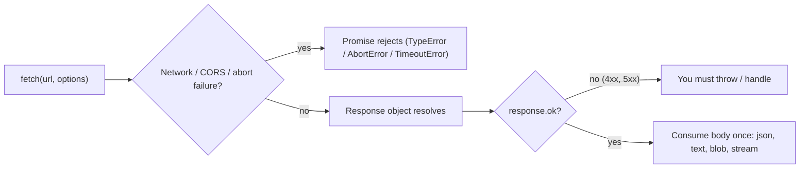

# The Fetch API and Browser Networking

> Verification note: the HTTP semantics this file relies on (methods, idempotency, `QUERY`) and QUIC/HTTP/3 facts were verified in [01](01-http-semantics-and-protocol-versions.md) (MDN, Sep/Nov 2026). Next.js `fetch` behaviour (not cached by default since v15; `cache: 'force-cache'`, `next.revalidate`, `next.tags` opt-ins; `connection()`) comes from the Next.js docs researched earlier in this handbook. **The `fetch()` option list, `Request`/`Response` body semantics, `AbortSignal.timeout()/any()` support, `keepalive` size limits, upload streaming (`duplex: 'half'`), `fetchLater()`, `priority`, Resource Timing fields and `navigator.sendBeacon` behaviour are web-platform knowledge not re-fetched in this session — marked *(hedged)* where support or limits vary by browser; check MDN compatibility tables before depending on them.** A shorter primer exists in [browser-internals/07 §13](../browser-internals/07-events-dom-apis-and-web-components.md#13-fetch-abortcontroller-and-streams-browser-networking-primer); this file goes deeper.

## Table of Contents

1. [Quick Summary (TL;DR)](#1-quick-summary-tldr)
2. [Request, Response and Headers Objects](#2-request-response-and-headers-objects)
3. [Error Semantics: What Rejects and What Doesn't](#3-error-semantics-what-rejects-and-what-doesnt)
4. [Cancellation, Timeouts and Race Conditions](#4-cancellation-timeouts-and-race-conditions)
5. [Fetch Options That Change Behaviour](#5-fetch-options-that-change-behaviour)
6. [Reading Bodies: JSON, Text, Blobs and Streams](#6-reading-bodies-json-text-blobs-and-streams)
7. [Streaming Responses (NDJSON, SSE over Fetch, LLM Tokens)](#7-streaming-responses-ndjson-sse-over-fetch-llm-tokens)
8. [Uploads, Progress and `FormData`](#8-uploads-progress-and-formdata)
9. [Fire-and-Forget: `sendBeacon`, `keepalive`, `fetchLater`](#9-fire-and-forget-sendbeacon-keepalive-fetchlater)
10. [Caching, Service Workers and the `cache` Option](#10-caching-service-workers-and-the-cache-option)
11. [XHR, Axios, Ky and When to Wrap `fetch`](#11-xhr-axios-ky-and-when-to-wrap-fetch)
12. [Fetch on the Server: Node, SSR and Next.js](#12-fetch-on-the-server-node-ssr-and-nextjs)
13. [Measuring Network Behaviour in the Browser](#13-measuring-network-behaviour-in-the-browser)
14. [Pitfalls](#14-pitfalls)
15. [Interview Questions — Fundamentals](#15-interview-questions--fundamentals)
16. [Interview Questions — Senior Scenarios](#16-interview-questions--senior-scenarios)
17. [Cheat Sheet](#17-cheat-sheet)
18. [Key Terms Glossary](#18-key-terms-glossary)
19. [Further Reading](#19-further-reading)

---

## 1. Quick Summary (TL;DR)

- **`fetch()` returns a Promise that rejects only on network-level failure** (DNS, connection reset, CORS failure, abort) — **not on HTTP 4xx/5xx**. Always check `response.ok` / `response.status`.
- **Bodies are single-use streams.** `response.json()`/`text()`/`blob()` consume the body; use `response.clone()` to read twice.
- **Cancel with `AbortController`** (or `AbortSignal.timeout(ms)` *(hedged support)*); pass the signal to `fetch`. Ignoring stale responses ("latest wins") is a correctness requirement for typeahead, route changes and component unmounts.
- **Streaming** is first-class: `response.body` is a `ReadableStream` → progressive NDJSON parsing, SSE-style events over `POST`, LLM token streaming. Request-body streaming (`duplex: 'half'`) is **limited** *(hedged)*.
- **Upload progress** still requires `XMLHttpRequest.upload.onprogress` (or streaming tricks) — plain `fetch` has no upload progress event.
- **Beacons:** use `navigator.sendBeacon()` or `fetch(..., { keepalive: true })` for analytics at page exit (size-limited *(hedged)*); `fetchLater()` is newer *(hedged)*.
- **In Next.js**, `fetch` is extended server-side; since v15 it is **not cached by default** (opt in with `cache: 'force-cache'`, `next.revalidate`, `next.tags`, or `use cache`).
- **Wrap `fetch` once** in an API client (base URL, auth, timeouts, error normalisation, tracing) — see [07](07-api-client-architecture-and-contracts.md).



---

## 2. Request, Response and Headers Objects

```js
const req = new Request('/api/items', {
  method: 'POST',
  headers: { 'Content-Type': 'application/json', 'Accept': 'application/json' },
  body: JSON.stringify({ name: 'x' }),
  credentials: 'same-origin',
  signal,
});
const res = await fetch(req);

res.status; res.ok; res.statusText; res.url; res.redirected; res.type; // 'basic' | 'cors' | 'opaque' | ...
res.headers.get('content-type');                                        // case-insensitive
[...res.headers];                                                       // iterable
```
- **`Headers`** is case-insensitive; some headers are **forbidden** for scripts to set (`Host`, `Cookie`, `Origin`, `Content-Length`, `Sec-*`, etc.) and CORS exposes only **safelisted response headers** unless `Access-Control-Expose-Headers` lists more ([web-security/06 §4](../web-security/06-security-headers-cors-and-transport.md#4-cors-correct-configuration-and-common-mistakes)).
- **`response.type`:** `basic` (same-origin), `cors`, **`opaque`** (`no-cors` cross-origin: status 0, unreadable body — only useful for caching/``-style loads), `opaqueredirect`, `error`.
- **`response.url`/`redirected`** show the final URL after redirects.
- **Bodies:** string, `URLSearchParams`, `FormData`, `Blob`, `ArrayBuffer`/typed arrays, `ReadableStream`. **Never set `Content-Type` manually for `FormData`** — the browser adds the multipart boundary.
- **Body used?** `res.bodyUsed` flips after the first read; reading twice throws `TypeError`. `res.clone()` tees the stream (buffering the unread branch in memory — don't clone huge streaming bodies carelessly).
- **Headers on redirects:** `Authorization` and cookies follow browser rules per origin; CORS preflights can't follow redirects ([01 §9](01-http-semantics-and-protocol-versions.md#9-redirects-and-their-method-semantics)).

---

## 3. Error Semantics: What Rejects and What Doesn't

| Situation | `fetch` result |
|---|---|
| DNS failure, offline, TLS error, connection reset | **Rejects** with `TypeError` ("Failed to fetch"/"NetworkError…"; message is browser-specific and intentionally vague) |
| CORS violation (no ACAO header, failed preflight) | **Rejects** with `TypeError` (details only in the console — [08](08-network-debugging-and-troubleshooting.md)) |
| `controller.abort()` | Rejects with `DOMException` **`AbortError`** (or the reason you pass) |
| `AbortSignal.timeout(ms)` | Rejects with `DOMException` **`TimeoutError`** |
| HTTP 404/500 | **Resolves** — `ok === false` |
| Mixed-content/CSP block | Rejects `TypeError` |
| Body parse errors (`res.json()` on HTML) | `res.json()` rejects with `SyntaxError` |

```ts
export class HttpError extends Error {
  constructor(public status: number, public body: unknown, public response: Response) {
    super(`HTTP ${status}`);
  }
}

export async function request<T>(input: RequestInfo, init?: RequestInit): Promise<T> {
  const res = await fetch(input, init);
  const isJson = res.headers.get('content-type')?.includes('json');   // includes application/problem+json
  const body = res.status === 204 ? undefined : isJson ? await res.json() : await res.text();
  if (!res.ok) throw new HttpError(res.status, body, res);
  return body as T;
}
```
**Error classification for retry logic:** (1) network/timeout → maybe retry (idempotent only), (2) 408/429/502/503/504 → retry with backoff/`Retry-After`, (3) other 4xx → don't retry, surface to the user, (4) abort → ignore silently ([06](06-resilience-retries-timeouts-and-offline.md)).

---

## 4. Cancellation, Timeouts and Race Conditions

```ts
// Cancel on unmount / newer request
const controller = new AbortController();
fetch(url, { signal: controller.signal }).then(handle, (e) => { if (e.name !== 'AbortError') throw e; });
controller.abort();                       // optional reason: controller.abort(new Error('route changed'))

// Timeout
await fetch(url, { signal: AbortSignal.timeout(5000) });                 // TimeoutError

// Combine user-cancel and timeout (AbortSignal.any: support varies; hedged)
const signal = AbortSignal.any([controller.signal, AbortSignal.timeout(5000)]);
```
Fallback timeout (works everywhere):
```ts
function withTimeout(ms: number, parent?: AbortSignal) {
  const c = new AbortController();
  const t = setTimeout(() => c.abort(new DOMException('Timeout', 'TimeoutError')), ms);
  parent?.addEventListener('abort', () => c.abort(parent.reason), { once: true });
  return { signal: c.signal, clear: () => clearTimeout(t) };
}
```
**Latest-wins pattern (typeahead):**
```ts
let current: AbortController | undefined;
async function search(q: string) {
  current?.abort();
  current = new AbortController();
  try { render(await request(`/api/search?q=${encodeURIComponent(q)}`, { signal: current.signal })); }
  catch (e: any) { if (e.name !== 'AbortError') showError(e); }
}
```
Notes:
- **Aborting only stops the client from waiting** — the server may still process the request (esp. non-idempotent). Design mutations accordingly ([06](06-resilience-retries-timeouts-and-offline.md)).
- **Abort rejects body reads too** (`res.json()` mid-stream).
- **React:** abort in effect cleanup; query libraries pass `signal` to the fetcher (TanStack Query) — see [react/06](../react/06-state-management-and-data-fetching.md).
- **Timeouts are layered:** browser limits, CDN/gateway idle timeouts, server timeouts; pick client timeouts shorter than gateway timeouts and surface progress/retry UI.
- **Ignoring responses without aborting** (request IDs/sequence numbers) is needed when abort isn't possible (WebSocket replies).

---

## 5. Fetch Options That Change Behaviour

| Option | Values / effect | Notes |
|---|---|---|
| `method`, `headers`, `body` | Standard | Non-safelisted methods/headers trigger CORS preflight |
| `mode` | `cors` (default cross-origin), `same-origin`, `no-cors` (opaque), `navigate` | Don't use `no-cors` to "fix" CORS — you get an unreadable response |
| `credentials` | `same-origin` (default), `include`, `omit` | `include` needs `Access-Control-Allow-Credentials` + explicit origin |
| `cache` | `default`, `no-store`, `reload`, `no-cache`, `force-cache`, `only-if-cached` | Interacts with the **HTTP cache** ([§10](#10-caching-service-workers-and-the-cache-option)) |
| `redirect` | `follow` (default), `manual`, `error` | `manual` returns opaque-redirect for inspection |
| `referrer` / `referrerPolicy` | Control `Referer` | Privacy ([web-security/06 §6](../web-security/06-security-headers-cors-and-transport.md#6-referrer-policy-and-information-leakage)) |
| `integrity` | SRI hash | Verify fetched bytes |
| `keepalive` | `true` lets the request outlive the page | Size-limited; for analytics *(hedged)* |
| `signal` | `AbortSignal` | Cancellation/timeout |
| `priority` | `high`/`low`/`auto` *(hedged: Chromium/WebKit support)* | Hint like `fetchpriority` for resources ([web-performance/02](../web-performance/02-critical-rendering-path-and-loading-performance.md)) |
| `duplex` | `'half'` required for streaming request bodies *(hedged)* | See [§8](#8-uploads-progress-and-formdata) |

**Default cross-origin behaviour:** cookies aren't sent unless `credentials: 'include'`; requests to other origins need CORS; `fetch('/api')` is same-origin and sends cookies by default.

---

## 6. Reading Bodies: JSON, Text, Blobs and Streams

| Method | Returns | Use |
|---|---|---|
| `json()` | Parsed value | APIs; **synchronous parse on the main thread** — large payloads cause long tasks ([web-performance/04](../web-performance/04-javascript-main-thread-and-inp.md)) |
| `text()` | String | HTML/CSV/logs |
| `blob()` | `Blob` | Files, images, `URL.createObjectURL` |
| `arrayBuffer()` | Binary | Parsing binary formats, WASM |
| `formData()` | `FormData` | Form-encoded/multipart responses |
| `body` | `ReadableStream<Uint8Array>` | Streaming, progress, backpressure |

- **Content-Type checks:** don't assume JSON — error pages from proxies/CDNs are HTML; guard `res.json()` with a content-type check or try/catch.
- **Large JSON:** paginate/field-select ([03](03-rest-api-design-and-consumption.md)), stream NDJSON, or parse in a **Web Worker** and transfer results; avoid `JSON.parse` of tens of MB on the main thread.
- **Download progress:**
```ts
async function downloadWithProgress(url: string, onProgress: (p: number) => void) {
  const res = await fetch(url);
  const total = Number(res.headers.get('content-length')) || 0;     // absent with chunked/compressed bodies
  const reader = res.body!.getReader();
  const chunks: Uint8Array[] = []; let received = 0;
  for (;;) {
    const { done, value } = await reader.read();
    if (done) break;
    chunks.push(value); received += value.length;
    if (total) onProgress(received / total);                        // Content-Length may be the *compressed* size
  }
  return new Blob(chunks);
}
```
- **Text decoding:** `response.body.pipeThrough(new TextDecoderStream())`; use `{ stream: true }` with `TextDecoder` when decoding chunks manually (multi-byte characters can span chunks).
- **Compression:** the browser decompresses `Content-Encoding` transparently; `CompressionStream`/`DecompressionStream` handle other cases *(hedged support)*.

---

## 7. Streaming Responses (NDJSON, SSE over Fetch, LLM Tokens)

### NDJSON (newline-delimited JSON) parser
```ts
export async function* ndjson<T>(res: Response): AsyncGenerator<T> {
  const reader = res.body!.pipeThrough(new TextDecoderStream()).getReader();
  let buf = '';
  for (;;) {
    const { done, value } = await reader.read();
    if (done) break;
    buf += value;
    let i;
    while ((i = buf.indexOf('\n')) >= 0) {
      const line = buf.slice(0, i).trim(); buf = buf.slice(i + 1);
      if (line) yield JSON.parse(line) as T;
    }
  }
  if (buf.trim()) yield JSON.parse(buf) as T;
}
// for await (const row of ndjson<Row>(await fetch('/api/export', { signal }))) append(row);
```
### Server-Sent Events over `fetch` (when you need POST, headers or auth)
`EventSource` only supports `GET` and cookie/CORS credentials (no custom headers). For token-authenticated or `POST` streams (e.g., LLM chat completions), read the stream and parse `data:` lines yourself, or use a library (`@microsoft/fetch-event-source`-style *(hedged)*):
```ts
const res = await fetch('/api/chat', { method: 'POST', headers: { 'Content-Type': 'application/json' }, body: JSON.stringify({ prompt }), signal });
const reader = res.body!.pipeThrough(new TextDecoderStream()).getReader();
// parse "data: {...}\n\n" frames; handle "[DONE]"; abort via signal when user clicks Stop
```
Design points:
- **Backpressure:** streams pause reading when you stop pulling; update the DOM in **batches** (requestAnimationFrame) rather than per token ([web-performance/05](../web-performance/05-rendering-layout-animation-and-cls.md)).
- **Proxy buffering/compression** can defeat streaming — see [01 §12](01-http-semantics-and-protocol-versions.md#12-proxies-cdns-and-intermediaries).
- **Reconnection/resume:** your protocol needs event IDs (`Last-Event-ID` for native SSE) and idempotent replay ([05](05-real-time-communication-websockets-sse-webtransport.md)).
- **React Server Components/Next streaming** use the same chunked mechanism ([nextjs-and-rendering/05](../nextjs-and-rendering/05-streaming-ppr-and-instant-navigation.md)).

---

## 8. Uploads, Progress and `FormData`

```ts
const fd = new FormData();
fd.append('file', file, file.name);
fd.append('meta', JSON.stringify({ folder: 'a' }));
await fetch('/api/upload', { method: 'POST', body: fd });          // browser sets multipart boundary
```
- **Upload progress:** `fetch` has none (by default); use **`XMLHttpRequest`** (`xhr.upload.onprogress`) or axios (wraps XHR in browsers) when you need a progress bar. Streaming request bodies (`body: ReadableStream`, `duplex: 'half'`) are **limited to HTTP/2+ and some engines** *(hedged)*.
- **Large files:** don't read them into memory; send the `File`/`Blob` directly (streamed from disk), or **slice** (`file.slice(start, end)`) for **chunked/resumable uploads** (tus, S3 multipart) with per-chunk retry and checksums ([03 §9](03-rest-api-design-and-consumption.md#9-large-payloads-uploads-and-long-running-operations)).
- **Direct-to-storage uploads:** request a **presigned URL** from your API, `PUT` the blob to storage (CORS configured on the bucket), then notify your API ([web-security/08 §9](../web-security/08-secure-frontend-patterns-and-vulnerability-catalogue.md#9-file-upload-and-download-security)).
- **Concurrency:** limit parallel uploads (3–6) to avoid starving other requests; use a queue with retry/backoff and pause/resume UI.
- **Cancelling** uploads aborts the connection; the server must clean up partial data.
- **Cross-origin uploads** with custom headers/JSON trigger preflight; presigned URLs typically avoid auth headers.

---

## 9. Fire-and-Forget: `sendBeacon`, `keepalive`, `fetchLater`

| Mechanism | Behaviour | Notes |
|---|---|---|
| **`navigator.sendBeacon(url, data)`** | Queues a `POST`, returns boolean quickly; browser sends it even as the page unloads | Can't set custom headers; payload limit (~64 KB total queued *(hedged)*); CORS-safelisted content types only |
| **`fetch(url, { keepalive: true, method: 'POST', … })`** | Like a beacon with custom headers and response handling | Same ~64 KB in-flight limit *(hedged)*; preflighted requests are supported in modern browsers *(hedged)* |
| **`fetchLater()`** *(hedged: new, Chromium-first)* | Registers a deferred request sent when the page is destroyed or after a timeout | Check MDN compatibility before relying on it |
| **Reporting API** | Browser-managed reports (CSP, deprecations, crashes) via `Reporting-Endpoints` | [web-security/03 §7](../web-security/03-content-security-policy-in-depth.md#7-reporting-and-monitoring) |

Best practice: send on **`visibilitychange` (hidden)** or **`pagehide`**, not `unload` (unreliable and blocks bfcache) ([browser-internals/02 §9](../browser-internals/02-navigation-and-page-lifecycle.md#9-page-lifecycle-visibility-freeze-bfcache-discard)); batch events and flush periodically; include an idempotency/event ID because beacons may duplicate; keep payloads small.

---

## 10. Caching, Service Workers and the `cache` Option

- `fetch` participates in the **HTTP cache**: the `cache` option changes how:
  | `cache` value | Behaviour |
  |---|---|
  | `default` | Normal HTTP caching rules (fresh → use; stale → revalidate) |
  | `no-store` | Bypass cache and don't store |
  | `reload` | Bypass cache read, update cache with response |
  | `no-cache` | Always revalidate (conditional request) |
  | `force-cache` | Use any cached copy (even stale), else network |
  | `only-if-cached` | Cache only (requires `mode: 'same-origin'`) → network error if absent *(hedged)* |
- **Server directives win in practice**: set `Cache-Control` properly on API responses (`private, max-age=…`, `no-store` for sensitive); don't rely on client `cache` flags for correctness ([web-performance/03 §5](../web-performance/03-network-caching-and-delivery.md#5-http-caching-deep-dive)).
- **Query libraries** (TanStack Query/SWR) add an **in-memory cache layer** with staleness semantics on top of the HTTP cache — two caches to reason about ([react/06 §6](../react/06-state-management-and-data-fetching.md#6-server-state-tanstack-query-swr-rtk-query)).
- **Service workers** intercept `fetch` events for offline support, stale-while-revalidate and request rewriting ([web-performance/03 §8](../web-performance/03-network-caching-and-delivery.md#8-service-workers-and-the-cache-api)); the **Cache API** stores `Request`/`Response` pairs (and `POST` responses aren't cacheable via `cache.put` by default).
- **bfcache and in-flight requests:** open fetches/XHR can block bfcache eligibility; abort on `pagehide` where appropriate ([web-performance/03 §10](../web-performance/03-network-caching-and-delivery.md#10-backforward-cache-bfcache)).
- **Personalised/authenticated responses:** `Vary: Cookie/Authorization`/`private`/`no-store` and cache partitioning keep users separate ([web-security/06 §10](../web-security/06-security-headers-cors-and-transport.md#10-caching-and-sensitive-responses)).

---

## 11. XHR, Axios, Ky and When to Wrap `fetch`

| Option | Pros | Cons |
|---|---|---|
| **Raw `fetch`** | Native, streaming, tiny, works in workers/SW/Node 18+ | No timeouts/retries/interceptors/progress out of the box; manual JSON/error handling |
| **`XMLHttpRequest`** | Upload progress, legacy | Callback API; no streaming responses |
| **Axios** | Interceptors, transforms, timeouts, upload/download progress (XHR in browsers), cancel tokens → AbortSignal | Bundle weight (~tens of KB *(hedged)*), different semantics (rejects on non-2xx by default) |
| **Ky/ofetch/wretch** *(hedged)* | Thin `fetch` wrappers with retries, hooks, JSON helpers | Another abstraction to maintain |
| **Framework data layers** (TanStack Query, SWR, RTK Query, Apollo, Relay, tRPC) | Cache, dedupe, retries, invalidation | They still call `fetch` underneath — bring your own client ([04](04-graphql-trpc-grpc-and-api-styles.md), [07](07-api-client-architecture-and-contracts.md)) |

**Recommendation:** keep **one thin, typed `request()` wrapper** (base URL, credentials, auth header or cookies, timeout via signal, error normalisation to a typed `ApiError`, request ID/trace headers, JSON/problem+json handling, optional retry for idempotent methods) and let higher-level libraries call it. Avoid scattering raw `fetch` with ad-hoc handling across components.

---

## 12. Fetch on the Server: Node, SSR and Next.js

- **Node 18+** ships a global `fetch` (undici-based). Differences from browsers: **no CORS**, no cookies jar by default, **relative URLs need a base**, different connection pooling (keep-alive agents), timeouts via `AbortSignal.timeout`, **no automatic credentials**.
- **SSR/RSC data fetching:** call your API/DB directly in Server Components when possible; if calling your own `/api` route from the server, you pay an extra hop — call the underlying function instead ([nextjs-and-rendering/04](../nextjs-and-rendering/04-data-fetching-and-mutations.md)).
- **Next.js extended `fetch`:** not cached by default in current versions (opt in via `cache: 'force-cache'`, `next: { revalidate, tags }`, or `'use cache'` with Cache Components); request deduping for identical GETs within one render *(hedged: confirm on nextjs.org)*; forward cookies/headers explicitly (`cookies()`/`headers()`) when calling backends on behalf of the user ([nextjs-and-rendering/03](../nextjs-and-rendering/03-caching-and-revalidation.md)).
- **Forwarding user context:** propagate auth/cookies and trace headers; **never** forward cookies to user-chosen hosts (SSRF/token leakage — [web-security/08 §8](../web-security/08-secure-frontend-patterns-and-vulnerability-catalogue.md#8-ssrf-and-open-proxies-bff-route-handlers-image-optimizers)).
- **Timeouts/retries on the server** protect SSR latency budgets: a slow upstream should degrade (skeleton/Suspense) rather than hang the render ([nextjs-and-rendering/05](../nextjs-and-rendering/05-streaming-ppr-and-instant-navigation.md)).
- **Connection reuse:** server-side keep-alive and HTTP/2 to upstreams matter for BFF throughput.

---

## 13. Measuring Network Behaviour in the Browser

```js
// Resource Timing for a fetch (same-origin or with Timing-Allow-Origin)
new PerformanceObserver((list) => {
  for (const e of list.getEntries()) {
    if (e.initiatorType === 'fetch') {
      console.log(e.name, {
        dns: e.domainLookupEnd - e.domainLookupStart,
        connect: e.connectEnd - e.connectStart,
        tls: e.secureConnectionStart ? e.connectEnd - e.secureConnectionStart : 0,
        ttfb: e.responseStart - e.requestStart,
        download: e.responseEnd - e.responseStart,
        protocol: e.nextHopProtocol,        // 'h2', 'h3' ...
        transfer: e.transferSize, encoded: e.encodedBodySize, decoded: e.decodedBodySize,
      });
    }
  }
}).observe({ type: 'resource', buffered: true });
```
- **Cross-origin entries are redacted** unless the response sends **`Timing-Allow-Origin`**.
- **`Server-Timing`** response headers (`db;dur=53, cache;desc="miss"`) surface backend timings in DevTools and `PerformanceResourceTiming.serverTiming` ([07](07-api-client-architecture-and-contracts.md)).
- **RUM for APIs:** record duration, status, protocol, size, retries, and route (not full URLs with IDs) to see p50/p95/p99 and error rates per endpoint; correlate with trace IDs ([07 §8](07-api-client-architecture-and-contracts.md#8-observability-correlation-ids-and-tracing)).
- **Connection hints:** `navigator.connection` (`effectiveType`, `saveData`) *(hedged: Chromium)* informs adaptive loading ([web-performance/03 §12](../web-performance/03-network-caching-and-delivery.md#12-adaptive-loading-and-reduced-data)); `online`/`offline` events are unreliable signals of true connectivity ([06](06-resilience-retries-timeouts-and-offline.md)).

---

## 14. Pitfalls

1. **Forgetting `response.ok`** — treating 4xx/5xx as success.
2. **Reading the body twice** (`bodyUsed` errors) or cloning huge streams.
3. **`res.json()` on non-JSON responses** (HTML error pages) without guarding.
4. **Setting `Content-Type: multipart/form-data` manually** (breaks the boundary).
5. **No cancellation** → stale responses overwrite fresh state; leaks on unmount.
6. **Using `mode: 'no-cors'`** to bypass CORS errors (opaque response; nothing readable).
7. **Per-token DOM updates** when streaming (jank) and unbounded buffering.
8. **Assuming abort cancels server work** for mutations.
9. **`unload`/`beforeunload` for analytics** instead of `pagehide`/`visibilitychange` + `sendBeacon`/`keepalive`.
10. **Reading `Content-Length` as the decoded size** (compressed/chunked responses).
11. **Scattering raw `fetch` everywhere** without a shared client (inconsistent auth/errors/timeouts).
12. **Calling your own API route from a Server Component** (extra hop; cache/auth surprises).
13. **Large synchronous `JSON.parse` on the main thread.**
14. **Parallelising uploads/downloads without limits**, starving critical requests.

---

## 15. Interview Questions — Fundamentals

### Q1. When does `fetch` reject?
On network-level failures (DNS, offline, TLS, CORS violations) and aborts/timeouts; not on HTTP error statuses — check `response.ok`.

### Q2. Why can't you call `response.json()` twice?
Bodies are one-shot streams; the second read throws. Use `response.clone()` before reading if you need two consumers.

### Q3. How do you cancel a fetch and set a timeout?
Pass an `AbortSignal` (`controller.signal` or `AbortSignal.timeout(ms)`); handle `AbortError`/`TimeoutError` distinctly from real failures.

### Q4. What does `credentials: 'include'` do?
Sends cookies/auth on cross-origin requests (requires CORS credentials support and a specific `Access-Control-Allow-Origin`).

### Q5. How do you show upload progress?
Use `XMLHttpRequest.upload.onprogress` (or a library wrapping it); `fetch` lacks upload progress events.

### Q6. How do you stream a response and render progressively?
Read `response.body` as a `ReadableStream` (decode with `TextDecoderStream`), parse incrementally (NDJSON/SSE frames), and batch DOM updates.

### Q7. `sendBeacon` vs `fetch` with `keepalive`?
Both survive page unload; `sendBeacon` is simpler (POST only, no headers), `keepalive` fetch allows custom headers/methods and response handling; both have small payload limits.

### Q8. What is an opaque response?
A response from a `no-cors` cross-origin request: status 0 and unreadable body, mainly useful for caching/embedding, not data access.

### Q9. Why avoid `unload` for sending analytics?
It's unreliable on mobile and prevents bfcache; use `visibilitychange`/`pagehide` with beacons.

---

## 16. Interview Questions — Senior Scenarios

### S1. "Typeahead sometimes shows results for an old query. Diagnose and fix."
Out-of-order responses. Abort the previous request per keystroke (or ignore by sequence ID), debounce, handle `AbortError` quietly, cache results per query, and ensure the UI renders only the latest request's data; add tests with delayed mocks ([system-design/03](../system-design/03-autocomplete-and-typeahead-search.md)).

### S2. "Design the networking layer for a large React app."
Single typed client over `fetch` (base URL, credentials, auth/CSRF headers, timeout signals, trace/request IDs, error normalisation to `ApiError`/problem+json, retry policy for idempotent calls), schema validation at the boundary (zod), query library for caching/dedupe, MSW for tests, endpoint-level metrics, and clear rules for BFF vs direct calls ([07](07-api-client-architecture-and-contracts.md)).

### S3. "Stream LLM output into a chat UI with Stop, retries and good performance."
`POST` with `fetch`, read `res.body` via `TextDecoderStream`, parse SSE/NDJSON frames, append tokens into a buffer flushed once per animation frame, `AbortController` for Stop, handle partial/error frames, resume strategy (event IDs or re-ask), avoid proxy buffering/compression, and virtualise/limit re-rendering of long markdown ([web-performance/04](../web-performance/04-javascript-main-thread-and-inp.md)).

### S4. "Analytics events are lost when users close the tab."
Switch from `unload`/awaited requests to `visibilitychange`/`pagehide` flush using `sendBeacon` or `keepalive`, batch and cap payloads, include event IDs for dedupe, keep the flush synchronous-fast, and verify on mobile Safari/Chrome; consider `fetchLater` where available *(hedged)*.

### S5. "A 40 MB JSON export freezes the page."
Stream and parse incrementally (NDJSON) or move parsing to a worker, paginate/export server-side as a file download (presigned URL) instead of loading into memory, virtualise the UI, and show progress using `Content-Length` when available (careful with compression).

---

## 17. Cheat Sheet

```ts
// The 10-line mental template
const ac = new AbortController();
const res = await fetch(url, { method, headers, body, credentials: 'same-origin', signal: ac.signal });
if (!res.ok) throw new HttpError(res.status, await safeBody(res), res);
return res.status === 204 ? undefined : await res.json();     // single read; handle AbortError separately
```

| Need | Use |
|---|---|
| Cancel / timeout | `AbortController`, `AbortSignal.timeout` |
| Read twice | `res.clone()` |
| Progressive data | `res.body` stream + `TextDecoderStream` |
| Upload progress | XHR `upload.onprogress` |
| Send at page exit | `sendBeacon` / `keepalive` on `pagehide` |
| Force revalidate | `cache: 'no-cache'` (+ server headers) |
| Server (Next) caching | `force-cache`, `revalidate`, `tags`, `use cache` |

---

## 18. Key Terms Glossary

| Term | Definition |
|---|---|
| **AbortSignal** | Token to cancel async work |
| **ReadableStream** | Pull-based stream of chunks (`Uint8Array` for bodies) |
| **Opaque response** | Unreadable response from `no-cors` cross-origin fetch |
| **Keepalive** | Fetch flag allowing the request to outlive the document |
| **Beacon** | Fire-and-forget request surviving unload |
| **NDJSON** | Newline-delimited JSON records |
| **Backpressure** | Consumer pacing a producer stream |
| **Timing-Allow-Origin** | Header allowing cross-origin Resource Timing details |

---

## 19. Further Reading

- [MDN — Fetch API](https://developer.mozilla.org/en-US/docs/Web/API/Fetch_API) · [Streams API](https://developer.mozilla.org/en-US/docs/Web/API/Streams_API) · [AbortController](https://developer.mozilla.org/en-US/docs/Web/API/AbortController) · [Beacon API](https://developer.mozilla.org/en-US/docs/Web/API/Beacon_API)
- [Fetch Standard](https://fetch.spec.whatwg.org/)
- This repo: [01 HTTP semantics](01-http-semantics-and-protocol-versions.md) · [06 Resilience](06-resilience-retries-timeouts-and-offline.md) · [07 API client architecture](07-api-client-architecture-and-contracts.md) · [browser-internals/07](../browser-internals/07-events-dom-apis-and-web-components.md)
