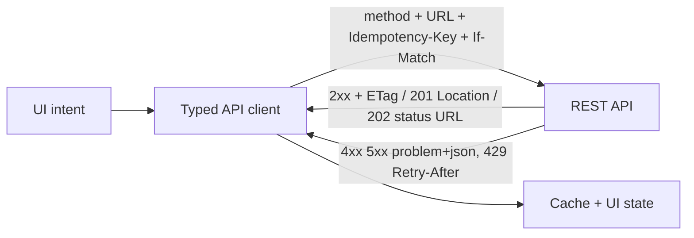
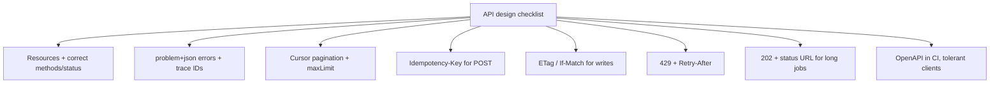

# REST API Design and Consumption

> Verification note: the method/idempotency/cacheability table that underpins retry and `PUT`/`PATCH`/`POST` guidance was verified against MDN (Sep 2026) in [01](01-http-semantics-and-protocol-versions.md). **RFC 9457 (Problem Details for HTTP APIs, obsoleting RFC 7807), `Idempotency-Key` and `RateLimit-*` header drafts, JSON Merge Patch (RFC 7396) / JSON Patch (RFC 6902), RFC 8288 `Link` headers, cursor-pagination patterns, versioning conventions, OpenAPI/JSON Schema tooling and long-running-operation patterns are standards/industry knowledge not re-fetched in this session — marked *(hedged)* where numbers, header names or draft status matter; verify against the RFC Editor / IETF datatracker and the API provider's docs before quoting.** Client-side data libraries are in [react/06](../react/06-state-management-and-data-fetching.md); Server Actions/route handlers are in [nextjs-and-rendering/04](../nextjs-and-rendering/04-data-fetching-and-mutations.md).

## Table of Contents

1. [Quick Summary (TL;DR)](#1-quick-summary-tldr)
2. [Resource Modelling and URL Design](#2-resource-modelling-and-url-design)
3. [Request and Response Conventions](#3-request-and-response-conventions)
4. [Idempotency Keys and Safe Retries](#4-idempotency-keys-and-safe-retries)
5. [Error Handling: RFC 9457 Problem Details](#5-error-handling-rfc-9457-problem-details)
6. [Versioning and Evolution](#6-versioning-and-evolution)
7. [Pagination, Filtering, Sorting and Search](#7-pagination-filtering-sorting-and-search)
8. [Rate Limiting and Quotas](#8-rate-limiting-and-quotas)
9. [Large Payloads, Uploads and Long-Running Operations](#9-large-payloads-uploads-and-long-running-operations)
10. [Bulk, Batch and Partial Responses](#10-bulk-batch-and-partial-responses)
11. [Caching and Concurrency Control](#11-caching-and-concurrency-control)
12. [Documentation and Contracts (OpenAPI)](#12-documentation-and-contracts-openapi)
13. [Consuming APIs from the Frontend: Over/Under-Fetching and BFFs](#13-consuming-apis-from-the-frontend-overunder-fetching-and-bffs)
14. [Pitfalls](#14-pitfalls)
15. [Interview Questions — Fundamentals](#15-interview-questions--fundamentals)
16. [Interview Questions — Senior Scenarios](#16-interview-questions--senior-scenarios)
17. [Cheat Sheet](#17-cheat-sheet)
18. [Key Terms Glossary](#18-key-terms-glossary)
19. [Further Reading](#19-further-reading)

---

## 1. Quick Summary (TL;DR)

- **REST in practice** = resource-oriented URLs, correct methods/status codes, representations (usually JSON), statelessness, cacheability, and **consistent conventions** (errors, pagination, versioning) — not "any JSON over HTTP".
- **Frontend-critical API qualities:** predictable **errors** (RFC 9457 `application/problem+json`), **cursor pagination**, **idempotent writes** (idempotency keys), **optimistic concurrency** (`ETag`/`If-Match`), **rate-limit signalling** (`429` + `Retry-After`), **stable evolution** (additive changes, versioning), **typed contracts** (OpenAPI → generated types) and **field selection/aggregation** to avoid over-fetching.
- **Retries are only safe when requests are idempotent** or carry an **idempotency key**; otherwise a timeout followed by a retry can double-charge/double-create.
- **Long-running work** returns **`202 Accepted`** + a status resource (poll, SSE/WebSocket, or webhook) rather than holding a request open.
- **Pagination:** prefer **opaque cursors** (stable under inserts/deletes, scalable) over offsets for feeds and large datasets; use offsets only for small, stable, "jump to page N" tables.
- **Frontends often need a BFF or GraphQL-like aggregation layer** when UIs compose many resources ([04](04-graphql-trpc-grpc-and-api-styles.md)).



---

## 2. Resource Modelling and URL Design

- **Nouns for resources, HTTP methods for verbs:** `GET /orders`, `POST /orders`, `GET /orders/42`, `PATCH /orders/42`, `DELETE /orders/42`. Plural collection names, lower-case, hyphenated segments, stable IDs (UUID/ULID or opaque strings; **don't expose sequential IDs** where enumeration matters — still enforce authz, [web-security/08](../web-security/08-secure-frontend-patterns-and-vulnerability-catalogue.md)).
- **Sub-resources** for strong ownership: `GET /orders/42/items`; avoid deep nesting (>2 levels) — expose items at `/items/{id}` as well when they stand alone.
- **Actions that don't map to CRUD:** model as sub-resources or controller-style `POST` endpoints: `POST /orders/42/cancel`, `POST /payments/{id}/refunds` (creating a refund resource is more REST-like and gives you an ID/audit trail).
- **Query parameters** for filtering/sorting/pagination/search, **not** for identity: `/orders?status=paid&sort=-createdAt`.
- **Singletons:** `GET /me`, `GET /orders/42/status` — fine when natural.
- **Consistency beats purity:** document conventions once (naming, casing, date formats [ISO 8601/RFC 3339 UTC], money as integer minor units + currency code, enums as strings, IDs as strings).
- **Hypermedia (HATEOAS)**: links in responses (`_links`, `Link` headers RFC 8288 *(hedged)*) help discoverability and pagination; most JSON APIs implement only partial hypermedia (pagination links, `next` cursors).
- **Content types:** `application/json`; use `application/problem+json` for errors; `application/merge-patch+json` / `application/json-patch+json` for `PATCH` formats *(hedged)*.

---

## 3. Request and Response Conventions

```json
// 200 OK — collection with pagination metadata
{
  "data": [{ "id": "ord_123", "status": "paid", "total": { "amount": 4599, "currency": "USD" }, "createdAt": "2026-11-17T10:15:00Z" }],
  "page": { "nextCursor": "eyJpZCI6Im9yZF8xMjMifQ", "hasMore": true }
}
```
- **Envelope or bare?** Envelope (`data`, `page`, `errors`) is extensible (metadata without breaking clients) but heavier; bare arrays can't gain metadata without a breaking change. Be consistent.
- **Field naming:** `camelCase` for JSON consumed by JS (avoid per-call mappers) or `snake_case` with a mapper — pick one, validate at the boundary ([07](07-api-client-architecture-and-contracts.md)).
- **Nullable vs absent:** define semantics (`null` = explicitly empty; absent = unknown/not requested) — matters for `PATCH` ([§11](#11-caching-and-concurrency-control)).
- **Dates/time zones:** UTC ISO strings; the UI formats with `Intl`.
- **Numbers:** never rely on JS `number` for 64-bit IDs or high-precision decimals — send IDs as strings and money as integer minor units or decimal strings.
- **Status codes:** see [01 §4](01-http-semantics-and-protocol-versions.md#4-status-codes-that-matter); `201 Created` + `Location`; `204` for empty success; `202` async.
- **Expansion / includes:** `?expand=customer,items` or `?include=…` to embed related resources (fewer round trips); document limits to prevent huge payloads.
- **Sparse fieldsets:** `?fields=id,status,total` to reduce payload size ([§10](#10-bulk-batch-and-partial-responses)).
- **Content negotiation & compression:** honour `Accept-Encoding` (br/gzip); consider `Vary` implications ([01 §6](01-http-semantics-and-protocol-versions.md#6-content-negotiation-and-vary)).
- **Timestamps for concurrency:** `ETag` preferred over `updatedAt` comparisons (clock skew, precision).
- **Security by default:** authenticate every endpoint, authorise per object ([web-security/05](../web-security/05-authentication-and-authorization-in-the-frontend.md)), whitelist writable fields (mass assignment), validate input.

---

## 4. Idempotency Keys and Safe Retries

**Problem:** the client sends `POST /payments`, the connection drops after the server processed it. A blind retry creates a **second payment**. `POST`/`PATCH` aren't idempotent by default ([01 §3](01-http-semantics-and-protocol-versions.md#3-methods-safe-idempotent-cacheable)).

**Solution pattern (popularised by payment APIs; an `Idempotency-Key` header is being standardised by the IETF HTTPAPI working group — hedged):**
```http
POST /payments
Idempotency-Key: 8f1c5e6e-3d1b-4a9e-8e2f-2f9f3c0f1b11
Content-Type: application/json

{ "amount": 4599, "currency": "USD", "source": "tok_abc" }
```
Server contract:
1. Client generates a **unique key per logical operation** (UUIDv4) and **reuses it for every retry** of that operation.
2. Server stores `(key, request fingerprint, response)`; on a repeat with the **same key + same payload**, it **returns the stored response** (including status) without re-executing.
3. Same key with a **different payload** → `422`/`409` (key misuse).
4. In-flight duplicate → `409 Conflict` (or wait) until the first finishes.
5. Keys expire (e.g., 24 h) *(typical; hedged)*.

Client contract:
```ts
function newOperation<T>(send: (key: string) => Promise<T>) {
  const key = crypto.randomUUID();                // create once, when the user action is initiated
  return retry(() => send(key), { retries: 3 });  // retries reuse the same key
}
```
- **UI correctness:** disable the submit button, show pending state, and keep the key across re-renders (store in a ref/mutation context) — React Query's `mutationKey`/scope helps ([react/06](../react/06-state-management-and-data-fetching.md)).
- **Natural idempotency** (preferred when possible): `PUT /carts/{id}/items/{sku}` with desired state; client-generated resource IDs (`PUT /orders/{clientGeneratedId}`); conditional creates (`If-None-Match: *` → `412` if exists) *(hedged)*.
- **Retry rules:** automatically retry `GET/HEAD/PUT/DELETE` and `POST` **with** idempotency keys on network errors, `408/429/502/503/504` ([06](06-resilience-retries-timeouts-and-offline.md)).
- **Exactly-once is an illusion:** you get **at-least-once delivery + idempotent processing = effectively once**.

---

## 5. Error Handling: RFC 9457 Problem Details

A consistent machine-readable error format lets clients branch on **type** rather than parse messages. **RFC 9457** (obsoletes RFC 7807 *(hedged)*) defines `application/problem+json`:

```http
HTTP/1.1 422 Unprocessable Content
Content-Type: application/problem+json

{
  "type": "https://api.example.com/problems/validation-error",
  "title": "Your request parameters didn't validate.",
  "status": 422,
  "detail": "Two fields are invalid.",
  "instance": "/orders/42",
  "traceId": "4bf92f3577b34da6a3ce929d0e0e4736",
  "errors": [
    { "pointer": "/shipping/postalCode", "code": "invalid_format", "message": "Postal code must be 5 digits." },
    { "pointer": "/items/0/quantity",    "code": "out_of_range",   "message": "Must be between 1 and 99." }
  ]
}
```
- Standard members: `type` (URI identifying the problem class, stable), `title` (short, human-readable, stable per type), `status`, `detail` (instance-specific), `instance` (URI of the occurrence); **extension members** (e.g., `errors`, `traceId`, `retryAfter`) are allowed.
- **Client mapping:** `type`/`code` → UI behaviour (field errors, toast, redirect to login, upgrade prompt); **never parse `detail`** for logic; show localised messages from codes, not server English.
- **Validation errors:** JSON Pointer paths (`/items/0/quantity`) map to form fields (React Hook Form `setError`) ([07 §4](07-api-client-architecture-and-contracts.md#4-error-normalisation-and-typed-results)).
- **Security:** don't leak stack traces/internal IDs; include a **trace/correlation ID** so support can find logs ([web-security/08 §12](../web-security/08-secure-frontend-patterns-and-vulnerability-catalogue.md#12-logging-errors-and-failing-safely)).
- **Status choice:** `400` malformed, `401/403` authn/authz, `404`, `409` conflicts, `412` precondition, `422` semantic validation, `429`, `5xx`.
- **Network and gateway errors** often come as HTML/plain text from CDNs/proxies (`502/503/504`) — your client must handle non-JSON error bodies gracefully.
- **Partial failures in bulk operations:** return `207 Multi-Status`-style per-item results or `200` with per-item statuses ([§10](#10-bulk-batch-and-partial-responses)) — document the pattern.

---

## 6. Versioning and Evolution

| Strategy | Example | Pros | Cons |
|---|---|---|---|
| **URL path** | `/v2/orders` | Explicit, cache- and debug-friendly, easy routing | URL churn; whole-API versions |
| **Header / media type** | `Accept: application/vnd.acme.v2+json`, `API-Version: 2026-11-01` | Clean URLs; fine-grained | Harder to test/cache; must `Vary` |
| **Date-based versions** *(Stripe-style, hedged)* | Pin account/client to a dated version | Gradual upgrades, small diffs | Requires server-side version translation layers |
| **Query param** | `?version=2` | Simple | Pollutes cache keys, easy to forget |
| **No versioning, additive evolution** | Only backward-compatible changes | Least overhead | Requires strict discipline and tooling |

**Backward-compatible (non-breaking) changes:** adding optional fields/endpoints/query params, adding enum values *only if clients tolerate unknowns*, loosening validation. **Breaking:** removing/renaming fields, changing types/semantics, tightening validation, changing error formats/status codes, changing pagination behaviour, changing auth requirements.

Frontend implications:
- **Be liberal in what you accept:** ignore unknown fields; treat unknown enum values with a default branch (`unknown` badge) rather than crashing; make types reflect that (`Status | (string & {})`).
- **Schema validation at the boundary** with tolerant parsing (zod `.passthrough()`/`.catch()` as appropriate) ([07](07-api-client-architecture-and-contracts.md)).
- **Deprecation signals:** `Deprecation`/`Sunset` response headers *(hedged: RFC 8594 `Sunset`; `Deprecation` header spec)*; log and alert on deprecated endpoint usage; CI contract tests against the upcoming version.
- **Mobile/long-lived clients** can't be force-upgraded → server must support old versions for a long window; **web** can deploy in lockstep but beware **cached bundles** and **skew** between new UI and old API during rollout (blue/green, expand-contract migrations; Next.js `deploymentId` for skew protection — [nextjs-and-rendering/08](../nextjs-and-rendering/08-deployment-runtimes-and-operations.md)).
- **Expand/contract pattern:** (1) add new field/endpoint, (2) migrate clients, (3) remove old once usage hits zero.

---

## 7. Pagination, Filtering, Sorting and Search

### Pagination styles
| Style | Request | Pros | Cons | Use |
|---|---|---|---|---|
| **Offset/limit** | `?limit=20&offset=40` or `page=3&pageSize=20` | Simple; random access; total pages | **Inconsistent under inserts/deletes** (duplicates/skips); slow at large offsets (`OFFSET n`) | Small, stable admin tables |
| **Cursor (keyset)** | `?limit=20&cursor=<opaque>` | Stable, efficient (`WHERE (created_at,id) < …`), scales | No random access; cursor tied to sort order | **Feeds, infinite scroll, large lists** |
| **Time/ID-based windows** | `?since=<ts>&until=<ts>` | Simple for logs/events | Needs monotonic keys | Event streams, sync |
| **Link headers/`next` URL** | `Link: <…?cursor=abc>; rel="next"` (RFC 8288) | Hypermedia; clients don't build URLs | Extra parsing | Public APIs |

- **Opaque cursors** (base64 of sort keys + signature/versions) let the server change internals; clients must treat them as black boxes.
- **Return `hasMore`/`nextCursor`**, not just `total`; counts are expensive — provide `total` optionally (`?includeTotal=true`) or approximate counts.
- **Bidirectional paging:** `nextCursor` + `prevCursor` for chat/history (load older/newer) ([system-design/04](../system-design/04-chat-and-real-time-messaging.md)).
- **Stable ordering:** always add a unique tiebreaker (`id`) to the sort.
- **Infinite scroll + cache:** React Query `useInfiniteQuery` stores pages keyed by cursor; invalidation/refetching rules differ for cursor pages ([react/06 §9](../react/06-state-management-and-data-fetching.md#9-pagination-infinite-scroll-real-time-updates)); virtualise rendering ([system-design/02](../system-design/02-news-feed-and-infinite-scroll.md)).
- **Page size limits:** server enforces `maxLimit` to protect itself.

### Filtering, sorting, search
- **Filters:** `?status=paid&createdAt[gte]=2026-01-01` (bracket operators), `filter[status]=paid`, or RSQL/OData-like DSLs; keep a **small, documented, whitelisted** set to avoid injection and unbounded queries.
- **Sorting:** `?sort=-createdAt,name` (leading `-` = descending); whitelist fields.
- **Search:** `?q=` for full-text (backed by search engines); differentiate from filters; debounce in the UI and abort stale requests ([02 §4](02-fetch-api-and-browser-networking.md#4-cancellation-timeouts-and-race-conditions)).
- **URL as state:** reflect UI filters in the browser URL so views are shareable and back-button friendly ([react/06 §10](../react/06-state-management-and-data-fetching.md#10-url-state-and-form-state)).
- **Complex queries** that exceed URL limits: `POST /search`, saved searches, or the HTTP `QUERY` method where supported ([01 §3](01-http-semantics-and-protocol-versions.md#3-methods-safe-idempotent-cacheable)).

---

## 8. Rate Limiting and Quotas

Servers protect themselves with **rate limits** (requests per time window) and **quotas** (per plan/day/month).

```http
HTTP/1.1 429 Too Many Requests
Retry-After: 30
RateLimit-Limit: 100          # draft standard names; many APIs use X-RateLimit-* (hedged)
RateLimit-Remaining: 0
RateLimit-Reset: 30
Content-Type: application/problem+json
```
- **Algorithms (server-side):** fixed window, sliding window, **token bucket**, leaky bucket; limits by user, API key, IP, tenant, endpoint cost.
- **Client behaviour:**
  1. **Honour `Retry-After`** (seconds or HTTP date) — never hammer.
  2. **Exponential backoff with jitter** when no hint ([06](06-resilience-retries-timeouts-and-offline.md)).
  3. **Throttle proactively** using `RateLimit-Remaining`/`Reset` headers where provided; **client-side concurrency limits/queues** (e.g., `p-limit`, request schedulers).
  4. **Coalesce/dedupe** identical in-flight requests; **debounce** user-driven calls; **batch** where the API allows.
  5. **Surface UX:** "Too many requests, retrying in 30 s…" rather than silent failure.
  6. Treat `429` as **non-error for circuit breakers** in some designs (it's explicit backpressure) *(design choice, hedged)*.
- **BFF consideration:** all users share the BFF's IP; propagate user identity (`X-Forwarded-For`, per-user API keys/tokens) so upstream limits apply per user ([web-security/05 §5](../web-security/05-authentication-and-authorization-in-the-frontend.md#5-backend-for-frontend-bff-in-detail)).
- **Abuse protection** (auth endpoints, search, uploads) needs edge rate limits and bot controls — client throttling is UX only ([web-security/05 §12](../web-security/05-authentication-and-authorization-in-the-frontend.md#12-account-abuse-brute-force-enumeration-bots)).
- **GraphQL** needs *cost-based* limits (query complexity) instead of simple request counts ([04](04-graphql-trpc-grpc-and-api-styles.md)).

---

## 9. Large Payloads, Uploads and Long-Running Operations

### Uploads
| Approach | When | Notes |
|---|---|---|
| `multipart/form-data` to your API | Small files (<~10 MB), simple flows | Server memory/timeouts; gateway body limits (`413`) |
| **Presigned URL direct upload** (`PUT` to object storage) | Most file uploads | API issues URL (key, size, content-type, TTL); client uploads; client/storage notifies API; validate after ([web-security/08 §9](../web-security/08-secure-frontend-patterns-and-vulnerability-catalogue.md#9-file-upload-and-download-security)) |
| **Chunked/resumable** (tus protocol, S3 multipart, GCS resumable) | Large files, flaky networks | Per-chunk retry, resume after offline, checksums; limit concurrency |
| Streaming upload (`duplex: 'half'`) | Niche *(hedged)* | HTTP/2+ and engine support caveats ([02 §8](02-fetch-api-and-browser-networking.md#8-uploads-progress-and-formdata)) |

### Long-running operations (LRO)
```http
POST /reports            → 202 Accepted
Location: /operations/op_789
Retry-After: 5

GET /operations/op_789   → 200 { "state": "running", "progress": 0.4 }
GET /operations/op_789   → 200 { "state": "succeeded", "result": "/reports/rep_42" }   # or 303 See Other → result URL
```
- **Delivery options:** **polling** (simple; use `Retry-After`/backoff), **SSE/WebSocket** push ([05](05-real-time-communication-websockets-sse-webtransport.md)), **webhooks** (server-to-server), **email/notification** for very long jobs.
- **UX:** progress indicators, cancel (`DELETE /operations/{id}`), resumability after reload (persist operation ID in URL/state), timeouts, and error states (`failed` with problem details).
- **Idempotency** for job creation (keys) and **expiry** of results.
- **Downloads:** generate then redirect to a presigned URL; support `Range` for big files ([01 §8](01-http-semantics-and-protocol-versions.md#8-range-requests-streaming-and-large-bodies)).
- **Gateway/CDN timeouts** (often ≤ 60–120 s) mean synchronous long calls fail unpredictably — design async from the start for anything > a few seconds.

---

## 10. Bulk, Batch and Partial Responses

- **Bulk endpoints** (`POST /orders:batchCreate`, `POST /items/bulk`) reduce round trips; define **partial-failure semantics**: `200`/`207` with per-item `status`, transactional all-or-nothing option, max batch size, idempotency per item.
- **Batching multiple HTTP requests** (JSON:API-like/Google batch endpoints/`/batch`) cuts round trips on HTTP/1.1; with HTTP/2/3 multiplexing the benefit shrinks, but server-side aggregation (BFF/GraphQL) still helps with dependent calls.
- **Sparse fieldsets/field masks:** `?fields=id,status` (REST) or **partial responses** via `fields` (Google-style) to limit payload.
- **Embedding/expansion:** `?expand=customer` avoids N+1 requests (client-side waterfalls) at the cost of larger responses.
- **Compression & delta updates:** `ETag` + `304`; JSON Patch for deltas; **sync endpoints** with `since` cursors for offline-first apps ([06](06-resilience-retries-timeouts-and-offline.md)).
- **N+1 on the client:** fetching a list and then each item's details separately — fix with embedding, bulk fetch (`GET /items?ids=1,2,3`), or a BFF; React Query's request batching (e.g., DataLoader-style on the server) ([04](04-graphql-trpc-grpc-and-api-styles.md)).
- **`PATCH` formats:** JSON Merge Patch (send changed fields; `null` removes) vs JSON Patch (ops array) *(hedged)* — choose one and document `null` semantics.

---

## 11. Caching and Concurrency Control

- **Read caching:** `Cache-Control` (`private, max-age=60, stale-while-revalidate=300`), `ETag` + `If-None-Match` → `304`. Deep dive: [web-performance/03 §5](../web-performance/03-network-caching-and-delivery.md#5-http-caching-deep-dive); CDN/API gateway caching for public GETs; **never** cache personalised responses in shared caches without `Vary`/`private`.
- **Write concurrency:** `ETag` + `If-Match` → `412` on conflict (or version field → `409`) ([01 §7](01-http-semantics-and-protocol-versions.md#7-conditional-requests-etags-and-optimistic-concurrency)); UI handles conflicts (refetch/merge/prompt).
- **Client cache invalidation after mutations:** invalidate related queries (list + detail), update caches optimistically with rollback, or return the updated resource from the mutation response to write-through ([react/06 §8](../react/06-state-management-and-data-fetching.md#8-mutations-optimistic-updates-cache-invalidation)); Next.js `revalidateTag/updateTag` on the server ([nextjs-and-rendering/03](../nextjs-and-rendering/03-caching-and-revalidation.md)).
- **Return representations from writes:** `201/200` with the created/updated resource (and `ETag`/`Location`) saves a follow-up `GET`.
- **Soft deletes and idempotent deletes:** `DELETE` twice → `204` then `404`/`204` — pick and document; clients should treat `404` after `DELETE` as success.
- **Eventual consistency:** after writes, reads from replicas/search indexes can lag — support **read-your-writes** via returning data, session consistency tokens, or short polling/refetch.

---

## 12. Documentation and Contracts (OpenAPI)

- **OpenAPI (3.x) description** is the machine-readable contract: paths, schemas (JSON Schema), parameters, security schemes, examples, error responses.
- **Generate** TypeScript types/clients (openapi-typescript, orval, openapi-generator, `@hey-api/openapi-ts` *(hedged names)*), mock servers (Prism, MSW handlers), docs (Redoc/Swagger UI), and **contract tests** from the same source ([07](07-api-client-architecture-and-contracts.md)).
- **Design-first vs code-first:** design-first (spec reviewed before implementation) improves frontend/backend parallel work; code-first with generated specs is faster for small teams — either way, **the spec must be in CI** (lint with Spectral, breaking-change detection with `oasdiff`/similar *(hedged)*).
- **Examples and error catalogue** in the spec make UI error handling explicit.
- **Runtime validation still matters:** generated types are compile-time only; validate responses at trust boundaries (zod/valibot, or schema-based validators) for external/third-party APIs ([07 §3](07-api-client-architecture-and-contracts.md#3-runtime-validation-at-the-boundary)).
- **JSON:API / HAL / OData** are alternative conventions that standardise relationships, pagination, sparse fieldsets *(hedged)* — adopt only if the ecosystem benefits justify the verbosity.

---

## 13. Consuming APIs from the Frontend: Over/Under-Fetching and BFFs

| Problem | Symptom | Fix |
|---|---|---|
| **Over-fetching** | Large payloads with unused fields | Sparse fieldsets, view-specific endpoints, GraphQL, BFF DTOs |
| **Under-fetching / waterfalls** | Many sequential requests to render one screen | Expand/include, bulk endpoints, BFF aggregation, prefetch/parallelise ([nextjs-and-rendering/04 §3](../nextjs-and-rendering/04-data-fetching-and-mutations.md#3-waterfalls-parallel-fetching-preloading)) |
| **Chatty mobile clients** | Battery/latency | Batch, cache, push updates |
| **Leaky domain models** | UI coupled to DB shape | Anti-corruption layer/mappers, view models |
| **Inconsistent errors/pagination across services** | Duplicate client code | Gateway/BFF normalisation |

**BFF pattern** (frontend-owned server layer): aggregates microservices, shapes responses per UI, handles auth/cookies/tokens (OAuth BFF — [web-security/05](../web-security/05-authentication-and-authorization-in-the-frontend.md)), enforces limits, and hides internal topology. **Trade-offs:** extra service to own/scale/secure; avoid turning it into a second monolith — keep business rules in domain services.

**Client-side practices**
- Colocate **queries with components** but share **query key factories** and typed endpoint functions.
- **Prefetch** on hover/route intent; use **`staleTime`** to avoid redundant refetches; **dedupe** identical in-flight requests.
- **Parallelise independent requests** (`Promise.all`/parallel hooks); avoid dependent waterfalls by redesigning endpoints.
- **Don't fetch in render without a cache layer**; avoid fetch-on-mount waterfalls at multiple component depths.
- **Handle loading/error/empty/stale states** explicitly for every call.

---

## 14. Pitfalls

1. **Offset pagination on mutating datasets** (duplicates/skips; deep-offset slowness).
2. **Retrying non-idempotent `POST`s without keys.**
3. **Inconsistent error shapes** across endpoints/services; parsing `message` strings.
4. **Breaking changes without versioning/deprecation**, or clients crashing on unknown enum values.
5. **Returning huge unbounded collections** (no `maxLimit`).
6. **64-bit IDs/decimals as JSON numbers** (precision loss in JS).
7. **Ignoring `429/Retry-After`** → retry storms.
8. **Chatty APIs forcing client waterfalls**; no embed/bulk/BFF.
9. **Dates without time zones / locale-formatted strings in APIs.**
10. **No concurrency control** (last write wins silently).
11. **Long synchronous operations** that die at gateway timeouts.
12. **Trusting generated types as runtime guarantees.**
13. **Leaking internals in errors** or using `200` for failures.
14. **Exposing sequential IDs** without authz checks (IDOR).

---

## 15. Interview Questions — Fundamentals

### Q1. What makes an API RESTful in practice?
Resource-oriented URIs, correct HTTP methods/status codes, stateless requests, cacheable representations and consistent conventions; full hypermedia is rarely implemented.

### Q2. Offset vs cursor pagination?
Offset is simple with random access but unstable and slow at scale; cursors (keyset) are stable and efficient but lack random access — use cursors for feeds/large data.

### Q3. How do you make a `POST` safe to retry?
Send a unique `Idempotency-Key`; the server stores and replays the result for repeats with the same key and payload.

### Q4. What is RFC 9457 problem details?
A standard JSON error format (`type`, `title`, `status`, `detail`, `instance`, extensions) served as `application/problem+json`.

### Q5. `PUT` vs `PATCH`?
`PUT` replaces the whole resource (idempotent); `PATCH` applies a partial change (JSON Merge Patch or JSON Patch) and isn't guaranteed idempotent.

### Q6. How should clients handle `429`?
Respect `Retry-After`, back off exponentially with jitter, throttle proactively, and show a meaningful message.

### Q7. How do you handle long-running jobs?
Return `202` + status URL; client polls (with `Retry-After`), subscribes via SSE/WebSocket, or the server calls a webhook; support cancellation and result retrieval.

### Q8. How do you prevent lost updates?
`ETag` + `If-Match` (→ `412`) or a version field (→ `409`), with UI conflict resolution.

### Q9. What's a breaking API change?
Removing/renaming fields, changing types/semantics/status codes/pagination/auth requirements, or tightening validation.

---

## 16. Interview Questions — Senior Scenarios

### S1. "Our mobile app crashes after the API added a new enum value `status: 'on_hold'`."
Clients must tolerate unknown enum values (default branch, `unknown` UI state), types should include an escape hatch, runtime validation should `.catch()` unknowns, contract tests should include forward-compat cases; server side: announce enum additions via changelog, consider feature-flagged rollout per client version.

### S2. "Design the API for a news feed with infinite scroll and live updates."
Cursor pagination (`nextCursor`), stable sort `(publishedAt, id)`, `?since` for new items, ETags per page, `fields` for lightweight cards, WebSocket/SSE for "new posts" signals (not full payloads), dedupe by ID on the client, cache pages per cursor, and virtualised rendering ([system-design/02](../system-design/02-news-feed-and-infinite-scroll.md)).

### S3. "Checkout sometimes double-charges when users have bad connectivity."
Missing idempotency on payment creation: add client-generated idempotency keys reused across retries, server-side replay storage, in-flight duplicate locking (`409`), disable duplicate submissions in the UI, reconcile via webhooks/status endpoint, and monitor duplicate rate; also ensure timeouts show "pending" state rather than re-submitting blindly.

### S4. "Backend teams own 12 microservices; each has different error and pagination formats. What do you do?"
Introduce a BFF/gateway to normalise, publish API standards (problem+json, cursor format, naming) with OpenAPI linting (Spectral) in CI, generate typed clients, adopt an ACL layer in the frontend (mappers + zod), and migrate services incrementally via expand/contract; measure inconsistency and track adoption.

### S5. "A report endpoint times out at the CDN after 60 s."
Make it asynchronous: `POST` returns `202` + operation URL; background job; progress via polling/SSE; result as a presigned download URL; idempotency key for creation; cancel/expiry; UX for navigating away and returning (persist operation ID); alerts on job failures.

### S6. "How would you evolve a public API used by thousands of third-party clients?"
Additive-only changes by default, explicit versioning for breaking ones (path/date versions), `Deprecation`/`Sunset` headers and docs, telemetry by version/client to drive deprecation timelines, compatibility tests, long support windows, migration guides/SDKs, and sandbox environments.

---

## 17. Cheat Sheet



| Need | Pattern |
|---|---|
| Create safely | `POST` + `Idempotency-Key` → `201 Location` |
| Partial update | `PATCH` merge-patch + `If-Match` |
| Feed paging | `?limit&cursor` → `nextCursor` |
| Error shape | `application/problem+json` |
| Async job | `202` + `/operations/{id}` |
| Rate limit | `429` + `Retry-After` |
| Avoid waterfalls | `expand`, bulk, BFF |

---

## 18. Key Terms Glossary

| Term | Definition |
|---|---|
| **Idempotency key** | Client-supplied token making a non-idempotent request replay-safe |
| **Cursor / keyset pagination** | Paging by opaque position token tied to sort keys |
| **Problem Details** | RFC 9457 error format |
| **Optimistic concurrency** | Conflict detection via version/ETag instead of locks |
| **LRO** | Long-running operation (async job pattern) |
| **BFF** | Backend for Frontend aggregation layer |
| **Expand/contract** | Migration pattern: add new, migrate, remove old |
| **Sparse fieldsets** | Requesting only needed fields |
| **OpenAPI** | Machine-readable HTTP API description |

---

## 19. Further Reading

- [MDN — HTTP request methods](https://developer.mozilla.org/en-US/docs/Web/HTTP/Reference/Methods) · [HTTP guides](https://developer.mozilla.org/en-US/docs/Web/HTTP)
- [RFC 9457 — Problem Details for HTTP APIs](https://www.rfc-editor.org/info/rfc9457) · [RFC 9110 — HTTP Semantics](https://www.rfc-editor.org/info/rfc9110) · [OpenAPI Specification](https://spec.openapis.org/oas/latest.html)
- [Google API Design Guide](https://cloud.google.com/apis/design) · [Microsoft REST API Guidelines](https://github.com/microsoft/api-guidelines) · [Zalando RESTful API Guidelines](https://opensource.zalando.com/restful-api-guidelines/) *(hedged: community references)*
- This repo: [01 HTTP semantics](01-http-semantics-and-protocol-versions.md) · [06 Resilience](06-resilience-retries-timeouts-and-offline.md) · [07 API client architecture](07-api-client-architecture-and-contracts.md) · [react/06](../react/06-state-management-and-data-fetching.md)
