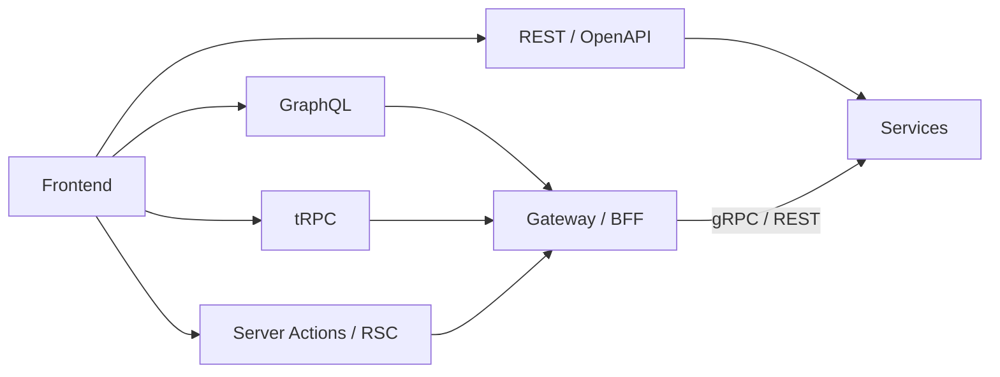
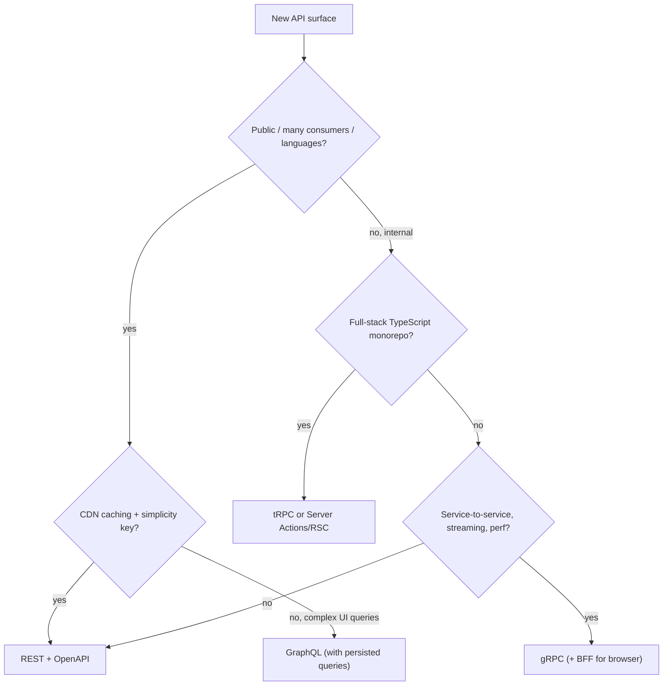
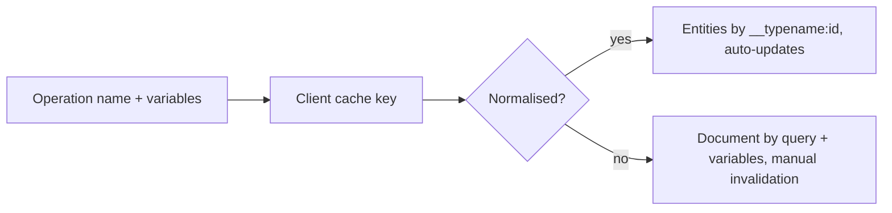

# GraphQL, tRPC, gRPC and Choosing an API Style

> Verification note: HTTP method/status semantics referenced here were verified against MDN in [01](01-http-semantics-and-protocol-versions.md); HTTP/3/QUIC and WebTransport facts in [05](05-real-time-communication-websockets-sse-webtransport.md) were verified against MDN (Nov 2026). **GraphQL behaviour (`errors` array with partial data, introspection, persisted queries, `@defer`/`@stream`, subscriptions transports), Apollo/Relay/urql cache models, DataLoader batching, tRPC semantics, gRPC/gRPC-Web/Connect transport details, federation and cost-limiting practices are industry knowledge not re-fetched in this session — marked *(hedged)* where details vary by library/version; verify against the library docs before quoting versions or option names.** The query-library layer (TanStack Query/SWR) is covered in [react/06](../react/06-state-management-and-data-fetching.md); Server Components/Server Actions as a data/mutation style in [nextjs-and-rendering/04](../nextjs-and-rendering/04-data-fetching-and-mutations.md) and [react/05](../react/05-server-components-and-server-functions.md).

## Table of Contents

1. [Quick Summary (TL;DR)](#1-quick-summary-tldr)
2. [The API Style Landscape](#2-the-api-style-landscape)
3. [GraphQL Fundamentals for Frontend Engineers](#3-graphql-fundamentals-for-frontend-engineers)
4. [GraphQL Client Architecture and Caching](#4-graphql-client-architecture-and-caching)
5. [GraphQL Server Concerns That Reach the Frontend](#5-graphql-server-concerns-that-reach-the-frontend)
6. [GraphQL Security and Performance](#6-graphql-security-and-performance)
7. [tRPC and End-to-End Typed RPC](#7-trpc-and-end-to-end-typed-rpc)
8. [gRPC, gRPC-Web and Connect](#8-grpc-grpc-web-and-connect)
9. [Server Actions, RSC Payloads and "Framework RPC"](#9-server-actions-rsc-payloads-and-framework-rpc)
10. [Gateways, BFFs and Federation](#10-gateways-bffs-and-federation)
11. [Choosing an API Style](#11-choosing-an-api-style)
12. [Pitfalls](#12-pitfalls)
13. [Interview Questions — Fundamentals](#13-interview-questions--fundamentals)
14. [Interview Questions — Senior Scenarios](#14-interview-questions--senior-scenarios)
15. [Cheat Sheet](#15-cheat-sheet)
16. [Key Terms Glossary](#16-key-terms-glossary)
17. [Further Reading](#17-further-reading)

---

## 1. Quick Summary (TL;DR)

- **There is no universally best API style.** REST (resource + HTTP semantics + CDN caching), **GraphQL** (client-shaped queries over a typed graph), **tRPC** (TypeScript-only end-to-end RPC), **gRPC** (binary, contract-first, service-to-service) and **framework RPC** (Server Actions) optimise different constraints.
- **GraphQL** solves **over/under-fetching and multi-resource composition** for UIs and gives a strongly typed schema, at the cost of **caching complexity** (single endpoint, `POST`), **new attack surface** (query depth/cost, introspection, field-level authz) and **server complexity** (N+1, DataLoader, observability).
- **GraphQL errors are different:** an HTTP `200` can carry `data` *and* an `errors` array (partial success) — clients must inspect `errors`, not just `response.ok` ([02](02-fetch-api-and-browser-networking.md)).
- **Client caches differ:** Apollo/Relay use **normalised caches** keyed by `__typename:id`; urql defaults to **document caching**; REST clients typically cache **by URL/query key**.
- **tRPC** gives end-to-end types without codegen but **couples client and server in one TypeScript codebase** — great for full-stack monorepos, poor as a public API.
- **gRPC** is excellent between services (HTTP/2, protobuf, streaming); browsers need **gRPC-Web/Connect** through a proxy or compatible server — usually hidden behind a **BFF**.
- **Frontend decision drivers:** number of clients/teams, UI data-composition needs, caching/CDN requirements, type-safety goals, public vs internal API, team skills, observability and security maturity.



---

## 2. The API Style Landscape

| Style | Transport | Contract | Strengths | Weaknesses | Typical use |
|---|---|---|---|---|---|
| **REST (JSON/HTTP)** | HTTP/1.1–3 | OpenAPI (optional) | HTTP caching/CDN, tooling, simplicity, public APIs | Over/under-fetching, many endpoints, versioning | Public APIs, CRUD, resource-centric apps |
| **GraphQL** | Usually `POST /graphql` (GET for persisted queries *(hedged)*) | SDL schema + introspection | Client-driven shape, one round trip, strong types, great DX | Cache complexity, query cost control, N+1, error model | Multi-client product UIs, aggregation |
| **tRPC** | HTTP (JSON, batched) | TypeScript types (no schema file) | Zero-codegen end-to-end types, great DX | TS-only, tight coupling, not public-API friendly | Full-stack TS monorepos |
| **gRPC** | HTTP/2 + protobuf | `.proto` | Compact, fast, streaming, codegen in many languages | Browser needs gRPC-Web/Connect; debugging harder | Service-to-service, mobile |
| **JSON-RPC** *(hedged)* | HTTP/WebSocket | Informal/OpenRPC | Simple RPC semantics | Weak HTTP semantics | Blockchain/IDE protocols |
| **OData** *(hedged)* | HTTP | EDM metadata | Standard query syntax | Heavy | Enterprise/Microsoft stacks |
| **Server Actions / RSC** | HTTP POST / flight stream | TypeScript signatures | No API layer to maintain; colocated | Framework-coupled; public endpoints (security) | Next.js/React apps |
| **WebSocket/SSE/WebTransport** | Persistent | Protocol-defined | Real-time push | State/scale complexity | [05](05-real-time-communication-websockets-sse-webtransport.md) |
| **Webhooks** | HTTP callbacks | Payload schemas | Server-to-server events | Delivery guarantees, security | Integrations |

---

## 3. GraphQL Fundamentals for Frontend Engineers

```graphql
type Query { order(id: ID!): Order  orders(first: Int, after: String): OrderConnection! }
type Mutation { cancelOrder(id: ID!): CancelOrderPayload! }
type Order { id: ID!  status: OrderStatus!  total: Money!  items: [OrderItem!]!  customer: Customer! }

query OrderPage($id: ID!) {
  order(id: $id) {
    id status total { amount currency }
    customer { id name }
    items { id sku quantity }
  }
}
```
- **Operations:** `query` (read), `mutation` (write, executed serially at the top level), `subscription` (push).
- **Schema-first types:** nullability is explicit (`!`); **non-null fields erroring null their parent**, so nullability design affects blast radius of failures.
- **Fragments:** reusable field sets; **colocate fragments with components** (Relay pattern) so each component declares its data needs and parents compose them — avoids prop-drilled over-fetching and gives **data masking** *(hedged: Relay-style)*.
- **Variables, directives** (`@include`, `@skip`, `@defer`, `@stream` *(hedged: incremental delivery support varies)*).
- **Introspection** powers tooling (GraphiQL, codegen, IDE) but should be controlled in production ([§6](#6-graphql-security-and-performance)).
- **Pagination:** **Relay connections** (`edges { node cursor } pageInfo { hasNextPage endCursor }`) are the de facto standard; they map to cursor pagination ([03 §7](03-rest-api-design-and-consumption.md#7-pagination-filtering-sorting-and-search)).
- **Mutations return payloads** (changed objects + `userErrors`) so clients can update caches and show validation errors without throwing.
- **Evolution without versions:** add fields freely; mark `@deprecated(reason: …)`; track field usage via operation analytics before removal.
- **Typed clients:** `graphql-codegen` generates TypeScript types/hooks per operation (`TypedDocumentNode`) so queries are checked at build time ([07 §6](07-api-client-architecture-and-contracts.md#6-code-generation-and-typed-clients)).

---

## 4. GraphQL Client Architecture and Caching

| Client | Cache model | Notes |
|---|---|---|
| **Apollo Client** *(hedged)* | **Normalised** store: objects keyed by `__typename` + `id`; field policies for pagination/merge | Powerful auto-updates after mutations returning `id`s; complexity in `typePolicies`, `fetchPolicy` (`cache-first`, `network-only`, `cache-and-network`) |
| **Relay** *(hedged)* | Normalised store + compiler; fragments, connections, optimistic updates | Strict conventions (global IDs, connections); excellent at scale; steeper learning curve |
| **urql** *(hedged)* | Document cache by default; **Graphcache** for normalisation | Lightweight, extensible exchanges |
| **TanStack Query + `graphql-request`** | Key-based cache (query key = operation + variables) | Simple; no normalisation (manual invalidation) — often enough ([react/06](../react/06-state-management-and-data-fetching.md)) |

**Normalisation trade-off:** after `cancelOrder` returns `{ id, status }`, every view showing that order updates automatically — but you must ensure **stable IDs**, correct `__typename`s, and merge/pagination policies; debugging cache state is harder than debugging URL-keyed caches.

**Operational practices**
- **Persisted queries / APQ** (Automatic Persisted Queries): send a hash instead of the full query text, enabling **`GET` requests that CDNs can cache** and reducing payload; also lets servers allow-list known operations (security) *(hedged)*.
- **Batching** (multiple operations per HTTP request) reduces overhead on HTTP/1.1 but complicates error/cancellation; with HTTP/2/3 prefer parallel requests unless the gateway benefits.
- **Cancellation:** pass `AbortSignal` ([02 §4](02-fetch-api-and-browser-networking.md#4-cancellation-timeouts-and-race-conditions)).
- **Error handling:** distinguish **network errors**, **HTTP errors**, **GraphQL `errors` with `data`**, and **`userErrors` in payloads**; map error `extensions.code` to UI behaviour.
- **Subscriptions:** WebSocket (`graphql-ws`) or SSE transports *(hedged)* — reconnect/backoff, auth on connect, cache updates from events ([05](05-real-time-communication-websockets-sse-webtransport.md)).
- **SSR/RSC:** hydrate caches from server-fetched data; per-request cache instances to avoid cross-user leaks ([web-security/05 §10](../web-security/05-authentication-and-authorization-in-the-frontend.md#10-authorization-in-react-nextjs-and-apis)).
- **Optimistic updates:** write expected results into the normalised cache and roll back on error.

---

## 5. GraphQL Server Concerns That Reach the Frontend

- **N+1 resolver problem:** resolving a list of orders and each order's `customer` separately issues N+1 backend calls. Fix with **DataLoader**-style batching/caching per request *(hedged)*, joins, or query planning. Frontend symptom: slow lists despite "one request".
- **Partial success:** one failing resolver returns `null` for that field plus an `errors` entry; **non-null violations bubble up** — decide what UI shows for partial data (skeleton/inline error vs whole-page error).
- **Authorisation belongs at the resolver/field level**, not only at the gateway; hide fields per role; never rely on the client to omit fields ([web-security/05 §9](../web-security/05-authentication-and-authorization-in-the-frontend.md#9-authorization-where-and-how-to-enforce)).
- **Caching on the server:** response caching with `@cacheControl` hints, CDN caching for persisted `GET` queries, entity caches, DataLoader per request.
- **File uploads:** multipart spec (`graphql-multipart-request-spec`) or presigned URLs via a mutation (preferred) ([03 §9](03-rest-api-design-and-consumption.md#9-large-payloads-uploads-and-long-running-operations)).
- **Observability:** one endpoint hides route-level metrics — label by **operation name** (require named operations), track resolver timings and error codes, propagate trace IDs ([07 §8](07-api-client-architecture-and-contracts.md#8-observability-correlation-ids-and-tracing)).
- **Schema governance:** linting, breaking-change checks in CI (schema registry/diff tooling *(hedged)*), deprecation policy, naming conventions, field-usage analytics.

---

## 6. GraphQL Security and Performance

| Risk | Mitigation |
|---|---|
| **Deeply nested / expensive queries (DoS)** | Query **depth limits**, **complexity/cost analysis**, pagination caps, timeouts, rate limit by cost ([03 §8](03-rest-api-design-and-consumption.md#8-rate-limiting-and-quotas)) |
| **Alias/batching brute force** (many login attempts in one request) | Limit aliases/batch size; rate limit per operation type; protect auth mutations |
| **Introspection leakage** | Disable or authenticate introspection/GraphiQL in production where appropriate *(not a security boundary — obscurity only)* |
| **Broken object/field authorisation** (IDOR via `node(id:)`) | Authorise in resolvers; check ownership per object; avoid global IDs without checks |
| **Injection** | Parameterised backends; validate inputs/scalars; don't interpolate variables into queries on the client (use variables) |
| **CSRF with cookie auth** | GraphQL `POST` with `application/json` + custom header/CORS preflight; reject `GET` mutations and form-encoded bodies ([web-security/04 §8](../web-security/04-cookies-sessions-and-csrf.md#8-csrf-in-spas-apis-server-actions-and-websockets)) |
| **Information disclosure in errors** | Mask internal errors; stable error `extensions.code`; trace IDs |
| **Persisted-query allow-listing** | Only accept registered operations from first-party clients (strong protection for private APIs) |
| **Subscription abuse** | Auth on connection init, per-connection limits, origin checks |

Performance: avoid huge responses (pagination), use `@defer`/`@stream` where supported to stream slow fields *(hedged)*, keep selection sets lean, split queries per route, prefetch on intent, and measure operation latency/size per operation name.

---

## 7. tRPC and End-to-End Typed RPC

```ts
// server
export const appRouter = router({
  order: router({
    byId: publicProcedure.input(z.object({ id: z.string() })).query(({ input, ctx }) => ctx.db.order.find(input.id)),
    cancel: protectedProcedure.input(z.object({ id: z.string() })).mutation(({ input, ctx }) => ctx.orders.cancel(ctx.user, input.id)),
  }),
});
export type AppRouter = typeof appRouter;

// client (types inferred from AppRouter; no codegen)
const order = await trpc.order.byId.query({ id });
```
- **Strengths:** zero-schema duplication, inferred input/output types, validation with zod at the boundary, great DX with React Query integration, request batching *(hedged)*.
- **Limits:** assumes **TypeScript on both ends**; client and server must share types (monorepo/package) → deployment skew risk; **not suited as a public API** (no stable contract for other languages/consumers); HTTP semantics are minimal (mostly `GET`/`POST`, JSON) so CDN caching/observability need extra care.
- **Security:** it's still a public HTTP endpoint: **authN/authZ in procedures/middleware**, input validation, rate limits, CSRF considerations for cookie auth ([web-security/04](../web-security/04-cookies-sessions-and-csrf.md)).
- **vs Server Actions:** both are TS RPC; tRPC is framework-agnostic with explicit routers and query semantics; Server Actions integrate with React forms/progressive enhancement and the Next.js cache (and are POST-only) — see [§9](#9-server-actions-rsc-payloads-and-framework-rpc).
- **When to choose:** internal full-stack TypeScript apps where one team owns both sides and a public/multi-language API isn't required.

---

## 8. gRPC, gRPC-Web and Connect

- **gRPC:** HTTP/2 transport, **protobuf** binary messages (compact, schema-evolving by field numbers), four call types (unary, server-streaming, client-streaming, bidirectional), deadlines/cancellation, strong codegen. Dominant for **service-to-service** and mobile backends.
- **Browser limitation:** browsers can't speak native gRPC (no control of HTTP/2 framing/trailers) → use **gRPC-Web** (via an Envoy/proxy translating) or **Connect** protocol (gRPC-compatible over plain HTTP with JSON/binary, browser-friendly) *(hedged)*; streaming support in browsers is limited to **server streaming** in most setups.
- **Frontend patterns:** keep gRPC internal; expose **REST/GraphQL via a BFF/gateway** (gRPC-JSON transcoding, `grpc-gateway`) *(hedged)* or use Connect-ES generated clients if you control the stack.
- **Schema evolution:** never reuse/renumber protobuf fields; add optional fields; reserve removed numbers — good discipline to mirror in REST contracts.
- **Debugging:** binary payloads need tools (`grpcurl`, Buf Studio *(hedged)*) — in DevTools, gRPC-Web shows opaque bodies unless you use Connect JSON.
- **Real-time alternatives:** gRPC streaming over HTTP/2 vs WebSocket/SSE/WebTransport for browsers ([05](05-real-time-communication-websockets-sse-webtransport.md)).

---

## 9. Server Actions, RSC Payloads and "Framework RPC"

*(Next.js specifics from docs researched earlier in this handbook; see [nextjs-and-rendering/04](../nextjs-and-rendering/04-data-fetching-and-mutations.md).)*
- **Server Functions/Actions** are **POST-only** RPC endpoints created by `'use server'`; arguments/returns are serialised; the framework generates encrypted action IDs, performs `Origin`/`Host` checks, and executes client dispatches **sequentially** (one at a time).
- **They are public endpoints:** authenticate/authorise inside each action; validate input; return only needed fields ([web-security/05 §10](../web-security/05-authentication-and-authorization-in-the-frontend.md#10-authorization-in-react-nextjs-and-apis)).
- **Reads** are typically done in Server Components (direct DB/DAL access) → no API layer; client-side reads still use route handlers/query libraries.
- **Not a public API:** other clients (mobile, partners) need a stable contract → keep REST/GraphQL for those, share domain logic in a service layer.
- **Observability and caching:** actions don't use HTTP caching; mutation → `revalidateTag/updateTag/revalidatePath` coordinates server caches ([nextjs-and-rendering/03](../nextjs-and-rendering/03-caching-and-revalidation.md)).
- **Trade-off:** fastest path for a single web app; risks coupling business logic to the framework and complicating multi-client strategies.

---

## 10. Gateways, BFFs and Federation

| Layer | Purpose | Notes |
|---|---|---|
| **API gateway** | AuthN, rate limiting, routing, TLS, request/response transformation, caching | Generic, owned by platform; shouldn't contain UI-specific logic |
| **BFF (Backend for Frontend)** | UI-specific aggregation, DTO shaping, session/token handling | Owned by the frontend team; one per client type (web, iOS, Android) when needs differ ([web-security/05](../web-security/05-authentication-and-authorization-in-the-frontend.md)) |
| **GraphQL gateway/federation** *(hedged)* | Compose multiple subgraphs into one supergraph (Apollo Federation, schema stitching, GraphQL Mesh) | Organisational scaling for many teams; adds operational/tooling complexity (query planning, versioning of subgraphs) |
| **Service mesh / internal gRPC** | Service-to-service communication | Hidden from frontend |
| **Edge functions** | Light aggregation/caching near the user | Runtime limits ([nextjs-and-rendering/08](../nextjs-and-rendering/08-deployment-runtimes-and-operations.md)) |

**Guidelines:** let UI-shaped aggregation live in a BFF/GraphQL layer, keep domain rules in domain services, normalise errors/pagination at the edge, forward trace/auth context, enforce timeouts/circuit breakers upstream ([06](06-resilience-retries-timeouts-and-offline.md)), and keep a **contract** (OpenAPI/SDL) for each boundary.

---

## 11. Choosing an API Style



| Criterion | REST | GraphQL | tRPC | gRPC | Server Actions |
|---|---|---|---|---|---|
| HTTP/CDN caching | Excellent | Hard (persisted GET helps) | Limited | N/A | N/A (framework caches) |
| UI data composition | Moderate (expand/BFF) | **Excellent** | Good (procedures) | Poor (browser) | **Excellent** (server components) |
| Type safety | OpenAPI codegen | Codegen | **Inferred** | Codegen | Inferred |
| Public API fit | **Excellent** | Good | Poor | Good (non-browser) | Poor |
| Learning/ops cost | Low | High | Low | Medium | Low |
| Real-time | Add SSE/WS | Subscriptions | Subscriptions *(hedged)* | Streaming | Separate |
| Security surface | Known | Larger (cost/introspection) | Standard | Standard | Public POST endpoints |

**Interview framing:** *"I'd start from consumers and constraints — who calls this, what data shapes do screens need, what must be cached at the edge, how big/skilled is the team — then choose REST for resource APIs, GraphQL when UI composition dominates, tRPC/Server Actions for single-team TS apps, and gRPC internally behind a BFF."* Mixed architectures are normal.

---

## 12. Pitfalls

1. **Assuming `response.ok` means GraphQL success** (errors array with `200`).
2. **No depth/complexity limits** or persisted-query allow-list on public GraphQL.
3. **Unnamed operations** → impossible to monitor.
4. **N+1 resolvers** hidden behind a single "fast" HTTP call.
5. **Over-nesting nullable/non-null types** causing whole-tree nulling or brittle UIs.
6. **Normalised-cache bugs** from missing `id`/`__typename` or incorrect merge functions.
7. **Treating tRPC/Server Actions as private** — they're public endpoints needing authz.
8. **Using tRPC for third-party consumers.**
9. **Exposing gRPC directly to browsers** without gRPC-Web/Connect.
10. **Fetching entire graphs in one mega-query** causing slow TTFB; split per route/component with fragments.
11. **Ignoring cache keys** (operation name + variables) causing stale/leaky UI after auth changes.
12. **GraphQL mutations via `GET`** or form-encoded bodies (CSRF risk).
13. **Unbounded subscriptions/WebSocket connections.**

---

## 13. Interview Questions — Fundamentals

### Q1. What problems does GraphQL solve and which does it introduce?
It lets clients request exactly the fields they need across related resources in one round trip with a typed schema; it introduces caching complexity, query-cost/security concerns, N+1 resolver issues and a different error model.

### Q2. How do GraphQL errors work?
Responses can be HTTP `200` with `data` and an `errors` array; partial data is possible; non-null violations bubble to the nearest nullable parent. Clients must inspect `errors` and mutation `userErrors`.

### Q3. What is a normalised cache?
A client store keyed by object identity (`__typename:id`) so a single update propagates to every query referencing that entity (Apollo, Relay).

### Q4. What are persisted queries?
Pre-registered operations referenced by ID/hash, reducing request size, enabling cacheable `GET`s and allow-listing known operations.

### Q5. tRPC vs REST?
tRPC gives inferred end-to-end TypeScript types without schema files but couples client and server in TS and isn't a public API; REST is language-agnostic with HTTP caching and tooling.

### Q6. Why can't browsers call gRPC directly?
They can't control HTTP/2 framing/trailers required by gRPC; use gRPC-Web or Connect via a compatible proxy/server.

### Q7. What is the N+1 problem in GraphQL?
Resolving a list then each item's relation separately causing many backend calls; fixed with batching (DataLoader), joins or query planning.

### Q8. What's the Relay connection spec?
A standard cursor pagination shape (`edges`, `node`, `cursor`, `pageInfo`) for lists.

---

## 14. Interview Questions — Senior Scenarios

### S1. "Should we move our REST API to GraphQL because screens make 8 calls?"
First diagnose: are waterfalls due to API design (fixable with expand/bulk endpoints or a BFF) or genuinely UI composition? GraphQL helps when many clients/screens need different shapes, but costs: caching strategy (persisted queries/CDN), cost limiting, N+1 batching, observability by operation, new client cache semantics, authz per field. A BFF with a few screen-oriented REST endpoints may achieve most gains with lower risk; pilot GraphQL on one domain, measure payload/latency, and keep REST for public/cacheable resources.

### S2. "Design the data layer for a React app using GraphQL at scale."
Colocated fragments + codegen types, Relay/Apollo normalised cache with explicit pagination policies, persisted queries with allow-listing, per-route queries + prefetch on intent, error handling mapped by `extensions.code`, optimistic updates, `@defer` for slow fields *(hedged)*, operation-name telemetry, schema governance in CI, SSR hydration with per-request caches, and a fallback strategy for gateway outages ([06](06-resilience-retries-timeouts-and-offline.md)).

### S3. "Penetration test shows our GraphQL endpoint allowed a query with depth 40 that took the DB down."
Add depth and complexity limits, pagination caps, per-field cost annotations, timeouts and cost-based rate limits, persisted-query allow-lists for first-party clients, DataLoader batching, and alert on slow/expensive operations by name; test with fuzzers; ensure introspection decisions are deliberate.

### S4. "We have a Next.js monolith with Server Actions and now need a mobile app."
Extract stable domain services and expose a versioned REST/GraphQL API (OpenAPI/SDL) consumed by mobile (and optionally by the web app); keep Server Actions as thin adapters calling the same services; re-implement authz centrally; share validation schemas; plan token-based auth for mobile (PKCE) while web keeps cookie/BFF auth ([web-security/05](../web-security/05-authentication-and-authorization-in-the-frontend.md)).

### S5. "Compare REST+React Query with GraphQL+Apollo for a dashboard with many widgets."
REST+RQ: per-widget endpoints, URL-keyed caches, CDN-friendly, simple invalidation, risk of waterfalls/over-fetching (mitigated by BFF). GraphQL+Apollo: one query composing widgets via fragments, normalised cache auto-updates shared entities, but heavier client, cache policy complexity, and server cost control; choose based on widget cross-sharing of entities, team experience, caching needs and backend topology.

---

## 15. Cheat Sheet

| Question | Answer |
|---|---|
| Public API, CDN caching | REST + OpenAPI |
| Many UI shapes, composition | GraphQL (+ persisted queries, cost limits) |
| Internal TS full-stack | tRPC / Server Actions |
| Service-to-service, streaming | gRPC (BFF for browsers) |
| GraphQL success check | `data` + `errors` + `userErrors` |
| GraphQL cache | Normalised by `__typename:id` |
| Biggest GraphQL risks | Query cost/depth, field authz, introspection, N+1 |



---

## 16. Key Terms Glossary

| Term | Definition |
|---|---|
| **SDL** | GraphQL Schema Definition Language |
| **Fragment** | Reusable GraphQL field selection |
| **Persisted query** | Server-registered operation referenced by ID/hash |
| **DataLoader** | Per-request batching/caching to solve N+1 |
| **Normalised cache** | Entity-keyed client cache |
| **Connection** | Relay cursor pagination shape |
| **tRPC** | TypeScript RPC with inferred types |
| **gRPC / Protobuf** | HTTP/2 RPC with binary schema-based messages |
| **gRPC-Web / Connect** | Browser-compatible gRPC-style protocols |
| **Federation** | Composing multiple GraphQL services into one graph |

---

## 17. Further Reading

- [GraphQL Specification & best practices](https://graphql.org/learn/) · [Relay docs](https://relay.dev/docs/) · [Apollo Client docs](https://www.apollographql.com/docs/react/) · [tRPC docs](https://trpc.io/docs) · [gRPC docs](https://grpc.io/docs/) · [Connect docs](https://connectrpc.com/docs/) *(hedged: vendor docs; check current versions)*
- [OWASP GraphQL Cheat Sheet](https://cheatsheetseries.owasp.org/cheatsheets/GraphQL_Cheat_Sheet.html)
- This repo: [03 REST API design](03-rest-api-design-and-consumption.md) · [07 API client architecture](07-api-client-architecture-and-contracts.md) · [react/06 State and data fetching](../react/06-state-management-and-data-fetching.md) · [nextjs-and-rendering/04](../nextjs-and-rendering/04-data-fetching-and-mutations.md)
