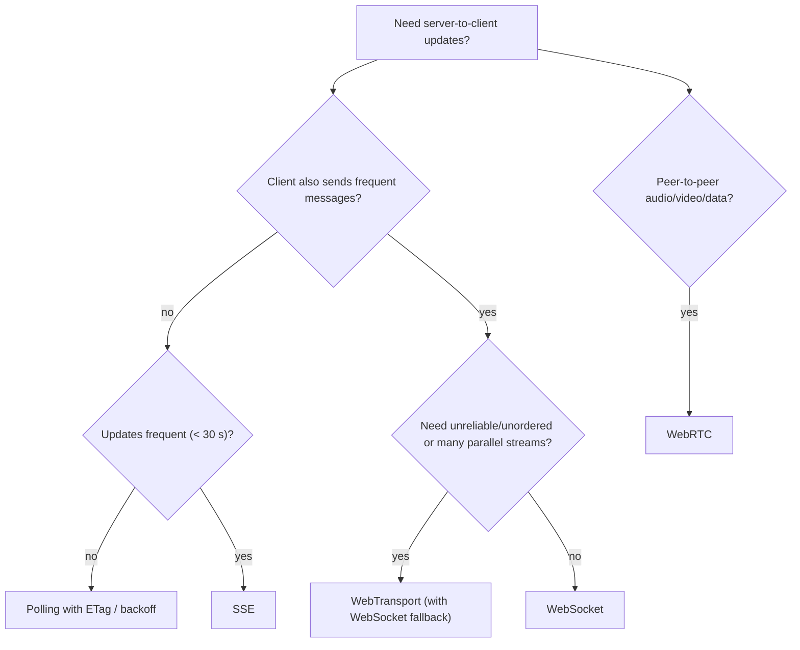
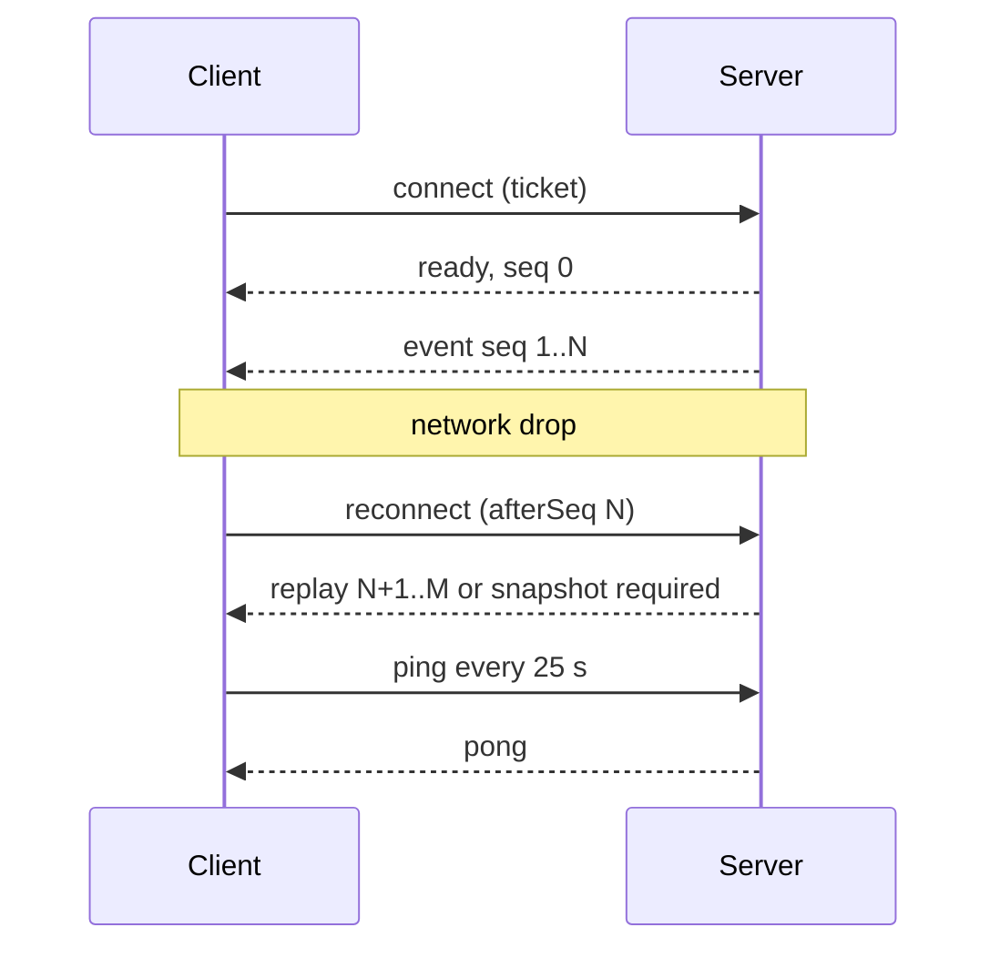

# Real-Time Communication: Polling, SSE, WebSockets, WebTransport and WebRTC

> Verification note: **WebTransport** facts were verified against MDN (Nov 2026): **Baseline 2026 newly available** — Chrome/Edge 97, Firefox 114, Safari 26.4 (iOS too); secure contexts only; usable in Workers; runs over **HTTP/3 (QUIC)** with multiple **bidirectional/unidirectional streams** (reliable) and **datagrams** (unreliable); the server must accept an extended `CONNECT` and **verify the `Origin` header**; URL needs an **explicit port**; `options.protocols` (Chrome 143, Firefox 155, Safari 26.4) and `options.headers` (Chrome 157, Firefox 160) support differs per engine. QUIC/HTTP/3 properties (no transport-level head-of-line blocking across streams, built-in security with fewer round trips, connection IDs surviving Wi-Fi↔cellular changes) were verified in [01](01-http-semantics-and-protocol-versions.md). **SSE connection limits** (≈6 per browser+domain over HTTP/1.1, ≈100 concurrent streams over HTTP/2, auto-reconnect with `Last-Event-ID`, comment keepalives, one-way) were verified in earlier system-design research. **WebSocket protocol details (frames, close codes, subprotocols, ping/pong), `WebSocketStream` status, WebRTC internals (ICE/STUN/TURN/SDP), Web Push, scaling topologies and library behaviours (Socket.IO, ws, SignalR) are general knowledge not re-fetched — marked *(hedged)*.** The full chat-system design lives in [system-design/04](../system-design/04-chat-and-real-time-messaging.md); this file is the transport-selection and mechanics reference.

## Table of Contents

1. [Quick Summary (TL;DR)](#1-quick-summary-tldr)
2. [The Real-Time Options at a Glance](#2-the-real-time-options-at-a-glance)
3. [Polling and Long Polling](#3-polling-and-long-polling)
4. [Server-Sent Events (SSE)](#4-server-sent-events-sse)
5. [WebSockets](#5-websockets)
6. [WebTransport](#6-webtransport)
7. [WebRTC Data Channels and Media](#7-webrtc-data-channels-and-media)
8. [Connection Lifecycle: Heartbeats, Reconnection, Resync](#8-connection-lifecycle-heartbeats-reconnection-resync)
9. [Delivery Semantics: Ordering, Duplicates, Idempotency](#9-delivery-semantics-ordering-duplicates-idempotency)
10. [Scaling and Infrastructure](#10-scaling-and-infrastructure)
11. [Authentication and Security](#11-authentication-and-security)
12. [Client Architecture: One Connection, Many Tabs, Many Components](#12-client-architecture-one-connection-many-tabs-many-components)
13. [Push Notifications and Background Delivery](#13-push-notifications-and-background-delivery)
14. [Choosing a Transport](#14-choosing-a-transport)
15. [Pitfalls](#15-pitfalls)
16. [Interview Questions — Fundamentals](#16-interview-questions--fundamentals)
17. [Interview Questions — Senior Scenarios](#17-interview-questions--senior-scenarios)
18. [Cheat Sheet](#18-cheat-sheet)
19. [Key Terms Glossary](#19-key-terms-glossary)
20. [Further Reading](#20-further-reading)

---

## 1. Quick Summary (TL;DR)

- **Real-time ≠ WebSocket.** Pick the **simplest transport that meets the direction, latency, scale and reliability requirements**: polling → long polling → **SSE** (server→client) → **WebSocket** (bidirectional) → **WebTransport** (HTTP/3 streams + datagrams, now Baseline 2026) → **WebRTC** (peer-to-peer media/data).
- **SSE** is underused: native `EventSource` with automatic reconnect and `Last-Event-ID`, works over plain HTTP (cookies/CORS), perfect for feeds, notifications, progress and LLM token streams — but **server→client only**, `GET` only, no custom headers (use `fetch` streaming when you need them — [02 §7](02-fetch-api-and-browser-networking.md#7-streaming-responses-ndjson-sse-over-fetch-llm-tokens)).
- **WebSocket** gives a full-duplex persistent channel, but **you own** reconnection, heartbeats, auth refresh, message framing/versioning, ordering, deduplication, backpressure and scaling.
- **WebTransport** adds **independent streams** (no head-of-line blocking between them) and **unreliable datagrams** over QUIC — suited to games, live cursors/telemetry, media control — but needs HTTP/3-capable servers and fallbacks.
- **Every real-time design needs the same four mechanisms:** (1) reconnect with backoff + jitter, (2) heartbeat/liveness detection, (3) resync after a gap (cursor/sequence), (4) idempotent, deduplicated message handling.
- **Infrastructure matters as much as the protocol:** idle timeouts, proxy buffering, sticky routing, fan-out via pub/sub, connection limits and graceful deploys.



---

## 2. The Real-Time Options at a Glance

| Option | Direction | Transport | Browser API | Strengths | Weaknesses |
|---|---|---|---|---|---|
| **Short polling** | Client pull | HTTP request/response | `fetch` + timer | Trivial; cacheable (ETag/304) | Latency = interval; wasteful |
| **Long polling** | Client pull, server holds | HTTP | `fetch` loop | Works everywhere; near-real-time | Connection churn; ordering/dup handling |
| **SSE** | Server → client | HTTP (chunked/H2/H3 streams) | `EventSource` / `fetch` stream | Simple, auto-reconnect, HTTP-native, proxies mostly OK | One-way; text only; 6-connection limit on HTTP/1.1 |
| **WebSocket** | Bidirectional | TCP (`ws`/`wss`), upgrade from HTTP/1.1 *(HTTP/2 bootstrapping exists — hedged)* | `WebSocket` | Low latency, binary + text, ubiquitous | Manual reliability; TCP head-of-line blocking; proxies/idle timeouts |
| **WebTransport** | Bidirectional | **HTTP/3 (QUIC)** | `WebTransport` | Multiple streams, datagrams, no cross-stream HOL blocking | Needs HTTP/3 server infra; newer (Baseline 2026) |
| **WebRTC** | Peer-to-peer | UDP (ICE/DTLS/SRTP/SCTP) | `RTCPeerConnection`, `RTCDataChannel` | Lowest latency media, P2P | Signalling, NAT traversal (STUN/TURN), complexity |
| **Web Push** | Server → device (even when closed) | Push service | Push API + service worker | Re-engagement, background | Permission UX, delivery not guaranteed |

---

## 3. Polling and Long Polling

### Short polling (with discipline)
```ts
async function poll(url: string, signal: AbortSignal, intervalMs = 5000) {
  let etag: string | undefined;
  while (!signal.aborted) {
    const res = await fetch(url, { signal, headers: etag ? { 'If-None-Match': etag } : {} });
    if (res.status === 200) { etag = res.headers.get('etag') ?? undefined; handle(await res.json()); }
    // 304: nothing changed — cheap
    await sleep(withJitter(intervalMs), signal);
  }
}
```
- **Use** `ETag`/`304` ([01 §7](01-http-semantics-and-protocol-versions.md#7-conditional-requests-etags-and-optimistic-concurrency)), **backoff** when idle/hidden, **jitter** to avoid synchronised thundering herds, **pause when the tab is hidden** (`document.visibilityState`), and respect `Retry-After`.
- **React Query:** `refetchInterval` (+ `refetchIntervalInBackground: false`) is often the best "real-time" for dashboards that tolerate seconds of delay ([react/06 §9](../react/06-state-management-and-data-fetching.md#9-pagination-infinite-scroll-real-time-updates)).

### Long polling
The server **holds the request open** until data is available or a timeout (e.g., 25–30 s, shorter than proxy idle timeouts); client immediately re-requests. Provide a `since`/cursor to avoid gaps between requests. Useful as a fallback where WebSockets/SSE are blocked (corporate proxies) — libraries like Socket.IO fall back automatically *(hedged)*.

---

## 4. Server-Sent Events (SSE)

```js
const es = new EventSource('/api/stream', { withCredentials: true });
es.addEventListener('order.updated', (e) => handle(JSON.parse(e.data)));
es.onerror = () => { /* browser auto-reconnects; readyState CONNECTING */ };
// es.close() to stop
```
Wire format (`text/event-stream`):
```
id: 1042
event: order.updated
data: {"orderId":"o_1","status":"shipped"}

: keepalive comment (every ~15–30 s)

retry: 5000
```
Facts and practices:
- **Auto-reconnect** with the **`Last-Event-ID`** request header = last `id:` received → server replays missed events. `retry:` tunes delay.
- **Limits:** about **6 concurrent connections per browser+domain on HTTP/1.1** (shared across tabs!) — a classic gotcha; **HTTP/2 multiplexes ~100 streams** per connection by default *(verified in earlier research)* — use HTTP/2+ or a single multiplexed stream with topic filtering.
- **Keepalive comments** (`: ping`) every 15–30 s keep intermediaries from closing idle streams; **disable proxy buffering/compression** for the route (e.g., `X-Accel-Buffering: no`) ([01 §12](01-http-semantics-and-protocol-versions.md#12-proxies-cdns-and-intermediaries)).
- **Limitations:** `GET` only; **no custom headers** (token auth must use cookies, query-string tickets (short-lived, single-use), or a `fetch`-based reader); text only (base64 for binary); one-way (client sends via normal `fetch`/`POST`).
- **Cookies/CORS:** `withCredentials` required cross-origin; same CSRF/CORS considerations as other cookie-authenticated GETs ([web-security/04 §8](../web-security/04-cookies-sessions-and-csrf.md#8-csrf-in-spas-apis-server-actions-and-websockets)).
- **Best for:** notifications, feeds, live scores, build/log streaming, progress of long-running operations ([03 §9](03-rest-api-design-and-consumption.md#9-large-payloads-uploads-and-long-running-operations)), LLM token streaming.
- **Server implementation tips:** flush after each event; assign monotonically increasing IDs; keep a short replay buffer; close idle/abusive connections; handle backpressure (slow clients) by dropping/closing.

---

## 5. WebSockets

```ts
const ws = new WebSocket('wss://api.example.com/ws', ['chat.v1']);   // subprotocol negotiation
ws.binaryType = 'arraybuffer';
ws.onopen = () => ws.send(JSON.stringify({ type: 'auth', ticket }));
ws.onmessage = (e) => handle(JSON.parse(e.data));
ws.onclose = (e) => scheduleReconnect(e.code);                       // 1000 normal, 1001 going away, 1006 abnormal (no close frame)
```
Mechanics *(hedged detail)*:
- **Handshake:** HTTP/1.1 `GET` with `Upgrade: websocket`, `Sec-WebSocket-Key`; server answers `101 Switching Protocols`; then **frames** (text/binary/ping/pong/close) over the same TCP connection. `ws://` vs **`wss://` (always use TLS)**.
- **Browser API limits:** no custom headers on the handshake (auth via cookies, subprotocol trick, query ticket, or first message); **no built-in backpressure** (`bufferedAmount` lets you throttle sends; `WebSocketStream` adds streams-based backpressure but isn't universally supported — hedged); messages are not guaranteed to be delivered after close; **TCP head-of-line blocking** applies.
- **Heartbeats:** the protocol has ping/pong frames but **browsers don't expose them**; implement application-level pings (`{type:"ping"}`) and timeouts to detect half-open connections (laptop sleep, NAT drop) [§8](#8-connection-lifecycle-heartbeats-reconnection-resync).
- **Message design:** envelope `{ v, type, id, ts, payload }`, versioned types, schema validation (zod) on both ends, max message sizes, binary formats (protobuf/MessagePack) when payload/CPU matter, compression (`permessage-deflate` — CPU/memory cost, CRIME-like caveats *(hedged)*).
- **Libraries:** raw `WebSocket`, **Socket.IO** (rooms, ack, fallback, reconnect — custom protocol, not plain WS), `ws`, SignalR, Phoenix Channels, Ably/Pusher/PubNub (managed) *(hedged)*; choose managed services when you don't want to run fan-out infrastructure.
- **Request/response over WS:** correlation IDs + timeouts (otherwise you've rebuilt HTTP badly); consider using plain HTTP for commands and WS only for events.

---

## 6. WebTransport

Verified (MDN, Nov 2026): **Baseline 2026 newly available** (Chrome/Edge 97, Firefox 114, Safari 26.4); "a modern update to WebSockets" over **HTTP/3**, supporting **multiple streams, unidirectional streams and out-of-order delivery**, **reliable transport via streams** and **unreliable UDP-like datagrams**.

```js
const transport = new WebTransport('https://example.com:4999/wt', { protocols: ['chat'] });  // explicit port; options.protocols per-engine support
await transport.ready;

// Reliable, ordered per stream
const stream = await transport.createBidirectionalStream();
const writer = stream.writable.getWriter();
await writer.write(new TextEncoder().encode(JSON.stringify({ type: 'hello' })));

// Unreliable datagrams (latest-wins data: cursors, telemetry, game state)
const dg = transport.datagrams.writable.getWriter();
dg.write(new Uint8Array([1, 2, 3]));

transport.closed.then(() => console.log('closed')).catch(console.error);
transport.draining?.then(() => console.log('server draining: open a new session'));   // support varies
```
Why it matters:
- **No cross-stream head-of-line blocking** (QUIC): a lost packet stalls only its own stream; **datagrams** avoid retransmission delay for data where only the newest value matters; **connection migration** keeps sessions across network changes ([01 §10](01-http-semantics-and-protocol-versions.md#10-http11-http2-and-http3-compared)).
- **Server requirements:** HTTP/3 server that accepts the **extended `CONNECT`** with `:protocol`, **verifies the `Origin`** header (browser clients send it — reject unexpected origins), uses a browser-trusted TLS certificate (or `serverCertificateHashes` for specific cases), and a library (Go `webtransport-go`, Rust `wtransport`, Python `aioquic`, Node `@fails-components/webtransport`; Deno has unstable built-in support — per MDN).
- **Client auth:** `options.headers` (Chrome 157, Firefox 160) allows tokens in the handshake; elsewhere use cookies/handshake messages *(support varies — check MDN)*.
- **Draining:** the `draining` promise (Firefox 155, Safari; Chrome in preview) signals the server wants you to move sessions — plan graceful migration.
- **Fallbacks:** UDP is blocked on some networks, and HTTP/3 may be unavailable → **keep WebSocket/SSE fallbacks** and feature-detect (`'WebTransport' in window`); measure success rates before relying on it.
- **Use for:** multiplayer/real-time state, live cursors/presence (datagrams), media/telemetry streaming, file chunk streams with priorities, large fan-out of independent topics. **Don't use** for ordinary notifications where SSE suffices.

---

## 7. WebRTC Data Channels and Media

*(Concept-level; details hedged.)*
- **Purpose:** low-latency **peer-to-peer** audio/video (`getUserMedia` → `RTCPeerConnection`) and **data channels** (`RTCDataChannel`, SCTP over DTLS; reliable/unreliable and ordered/unordered modes).
- **Signalling is your job:** exchange SDP offers/answers and ICE candidates over WebSocket/HTTP.
- **NAT traversal:** **STUN** discovers public addresses; **TURN** relays when direct connectivity fails (needed for a meaningful fraction of users — budget bandwidth/cost); ICE picks the best path.
- **Topologies:** mesh (small groups), **SFU** (selective forwarding — typical for conferencing), MCU (mixing, rare).
- **Frontend concerns:** permissions UX, device selection, bandwidth adaptation (simulcast/SVC *(hedged)*), echo cancellation, reconnection/ICE restart, `getStats()` for quality telemetry, security (DTLS-SRTP encryption by default; authenticate signalling).
- **When:** video calls, screen share, P2P file transfer, low-latency game data (alternatively WebTransport for client-server).

---

## 8. Connection Lifecycle: Heartbeats, Reconnection, Resync

Applies to WebSocket/SSE/WebTransport/long polling. (System-level treatment: [system-design/04 §8–9](../system-design/04-chat-and-real-time-messaging.md#8-deep-dive-1-connection-management).)

```ts
class ResilientSocket {
  private attempt = 0; private lastSeq = 0; private ws?: WebSocket; private pingTimer?: number; private pongTimer?: number;
  connect() {
    this.ws = new WebSocket(this.url);
    this.ws.onopen = () => { this.attempt = 0; this.send({ type: 'resume', afterSeq: this.lastSeq }); this.startHeartbeat(); };
    this.ws.onmessage = (e) => { const m = parse(e.data); if (m.type === 'pong') return this.clearPongTimer(); if (m.seq <= this.lastSeq) return; /* dedupe */ this.lastSeq = m.seq; this.onMessage(m); };
    this.ws.onclose = () => { this.stopHeartbeat(); setTimeout(() => this.connect(), backoff(++this.attempt)); };   // exponential + jitter, capped
  }
  private startHeartbeat() { this.pingTimer = window.setInterval(() => { this.send({ type: 'ping' }); this.pongTimer = window.setTimeout(() => this.ws?.close(), 10_000); }, 25_000); }
}
```
- **Backoff with jitter** (e.g., 0.5 s → 30 s cap) so a server restart doesn't create a reconnect stampede ([06](06-resilience-retries-timeouts-and-offline.md)).
- **Heartbeat/liveness:** application-level ping/pong (browsers hide WS control frames); close and reconnect if no pong within a timeout; server also times out dead peers. **Heartbeat interval < the shortest intermediary idle timeout** (often 30–60 s).
- **Resync after reconnect:** send `lastSeq`/`Last-Event-ID`/cursor; the server replays from a buffer or returns "gap too large → fetch snapshot via REST then resume". **Never assume no messages were missed.**
- **Visibility & power:** throttle/pause on hidden tabs (browsers throttle timers; mobile OSes suspend sockets), reconnect on `visibilitychange`/`online`, and handle bfcache (`pagehide` → close socket; `pageshow` persisted → reconnect) ([web-performance/03 §10](../web-performance/03-network-caching-and-delivery.md#10-backforward-cache-bfcache)).
- **Auth refresh:** tokens expire during long sessions → re-auth in-band (`{type:'auth', token}`) or reconnect with a fresh ticket; close with an app-level code for "unauthorised" to prevent infinite reconnect loops.
- **Graceful server shutdown:** servers send a "going away/draining" signal so clients reconnect elsewhere with jitter (WebTransport `draining`; WS close `1001`).

---

## 9. Delivery Semantics: Ordering, Duplicates, Idempotency

- **Guarantees you get:** WebSocket/SSE give **ordered delivery per connection** (TCP) but **no delivery guarantee across reconnects**. WebTransport streams are ordered per stream; datagrams are unordered and lossy.
- **What you must build:** **sequence numbers/IDs** per stream/topic, **dedupe** on the client (`Set` of recent IDs or `seq <= last`), **gap detection** (`seq > last + 1` → request replay/snapshot), **acks** for important messages (`{type:'ack', id}` with retry), and **idempotent handlers**.
- **Client-originated messages:** attach a **client message ID**; show optimistic UI; server dedupes by ID (idempotency, [03 §4](03-rest-api-design-and-consumption.md#4-idempotency-keys-and-safe-retries)); reconcile server-assigned IDs/ordering ([system-design/04 §9](../system-design/04-chat-and-real-time-messaging.md#9-deep-dive-2-message-lifecycle-ordering-idempotency-resync)).
- **Ordering across multiple servers/regions** requires server-side ordering keys (per conversation/document) — logical clocks/CRDT/OT for collaborative editing ([system-design/08](../system-design/08-collaborative-editor.md)).
- **State sync vs event sync:** send **events** when order matters and history is needed; send **latest state/snapshots** (or patches with versions) for presence/cursors; combine snapshot + deltas for robustness.
- **Backpressure:** don't let slow clients accumulate unbounded buffers — servers drop, coalesce ("latest value wins") or disconnect; clients should batch UI updates (rAF) to avoid render storms ([web-performance/04](../web-performance/04-javascript-main-thread-and-inp.md)).

---

## 10. Scaling and Infrastructure

| Concern | Guidance |
|---|---|
| **Connection count** | Each connection holds memory/file descriptors; use event-driven servers; tune OS limits; shard by user/room; measure connections per node |
| **Fan-out** | Publish to a **pub/sub backbone** (Redis Pub/Sub/Streams, NATS, Kafka, cloud brokers) so any node can deliver to its connected clients; avoid in-process-only state |
| **Load balancing** | L4/L7 with **connection-level stickiness** for WS/SSE reconnect protocols (or stateless resume via cursors); WebTransport/HTTP/3 needs QUIC-aware LBs *(hedged)* |
| **Idle timeouts** | Cloud LBs/proxies close idle connections (often 30–120 s *(hedged; check yours)*) — heartbeats must be shorter |
| **Proxy buffering/compression** | Disable buffering for SSE/streaming routes; verify through the actual CDN/edge ([08](08-network-debugging-and-troubleshooting.md)) |
| **Serverless/edge** | Request-scoped runtimes are poor for long-lived sockets; use managed WebSocket gateways/Durable-Object-style stateful edge runtimes or dedicated services *(hedged)* |
| **Deployments** | Rolling restarts disconnect everyone: drain gracefully, stagger, expect reconnect spikes (rate-limit reconnects, jitter) |
| **Observability** | Metrics: connections, reconnect rate, message lag, queue depth, dropped messages, close codes; correlate with trace IDs ([07 §8](07-api-client-architecture-and-contracts.md#8-observability-correlation-ids-and-tracing)) |
| **Cost** | Persistent connections cost memory and idle CPU; consider SSE/polling for low-frequency updates or managed services |
| **Multi-region** | Route users to nearest region; cross-region pub/sub; define consistency (eventual) and ordering per entity |

---

## 11. Authentication and Security

(See [web-security/08 §13](../web-security/08-secure-frontend-patterns-and-vulnerability-catalogue.md#13-websockets-sse-and-real-time-channels).)
- **Always `wss://`/HTTPS**; mixed content blocked.
- **WebSocket handshake carries cookies and isn't subject to SOP/CORS → Cross-Site WebSocket Hijacking:** **validate the `Origin` header server-side**; WebTransport servers must likewise verify `Origin` (MDN).
- **Auth options:** cookie session (+ Origin check), **short-lived single-use ticket** (obtained via authenticated HTTP, passed in query string or first message; tickets expire in seconds), subprotocol token trick *(hedged)*, `options.headers` for WebTransport where supported. **Avoid long-lived tokens in URLs** (logged, leaked via `Referer`/history).
- **Authorise every subscription/message** server-side (room/channel IDs are IDOR targets); don't trust client-provided user IDs.
- **Validate and size-limit messages**, rate limit per connection, cap subscriptions, protect against fan-out DoS and slowloris-style idle connections.
- **Output encoding:** chat/live content is a **stored XSS** surface ([web-security/02](../web-security/02-xss-trusted-types-and-sanitization.md)).
- **Token expiry mid-connection:** re-auth or close with a specific code; revoke on logout (close sockets for that session).
- **CSP `connect-src`** must allow `wss:`/WebTransport endpoints ([web-security/03](../web-security/03-content-security-policy-in-depth.md)).

---

## 12. Client Architecture: One Connection, Many Tabs, Many Components

- **One connection per app, not per component:** a connection manager (module/service) with **topic subscriptions** and ref-counting; components subscribe via hooks (`useSubscription(topic)`) and the manager multiplexes over one socket/stream.
- **Multi-tab:** N tabs × 1 connection each wastes server resources (and hits the **6-connection SSE limit on HTTP/1.1**). Options: **`SharedWorker`** hosting the connection, **`BroadcastChannel` + leader election** via **Web Locks** (`navigator.locks.request`) so one tab owns the connection and relays events, or accept per-tab connections with low per-connection cost *(hedged: SharedWorker support varies on mobile)* ([browser-internals/05 §12](../browser-internals/05-browser-storage-and-caching-apis.md)).
- **Bridge to caches:** map events to **query cache updates** (`queryClient.setQueryData`/invalidate) rather than maintaining parallel state ([react/06 §9](../react/06-state-management-and-data-fetching.md#9-pagination-infinite-scroll-real-time-updates)); keep an **event → cache reducer** per topic.
- **Rendering:** batch event application (`requestAnimationFrame`/microtask coalescing), virtualise lists, avoid re-render storms ([system-design/02](../system-design/02-news-feed-and-infinite-scroll.md)).
- **Connection state in UI:** online/connecting/reconnecting/degraded banners; don't block the UI on socket health; fall back to polling if realtime stays down.
- **Testing:** mock sockets (`mock-socket`, MSW `ws` handlers *(hedged)*), simulate drops/duplicates/out-of-order/slow consumers, test resume and snapshot fallback.
- **Typing:** shared event type definitions (discriminated unions) and runtime validation at the boundary ([07 §3](07-api-client-architecture-and-contracts.md#3-runtime-validation-at-the-boundary)).

---

## 13. Push Notifications and Background Delivery

- **Web Push** (Push API + service worker + VAPID) delivers messages when the page isn't open; requires user **permission**, HTTPS, service worker; payload size-limited; delivery isn't guaranteed or instant *(hedged)*. iOS web push support requires installed web apps *(hedged: verify current iOS rules)*.
- **Use for:** re-engagement and important alerts; **don't** use as the primary real-time channel for an open app.
- **Background Sync / Periodic Background Sync** *(hedged: Chromium)* retry failed requests when connectivity returns ([06](06-resilience-retries-timeouts-and-offline.md)).
- **Mobile apps:** FCM/APNs; React Native specifics in [react-native/03](../react-native/03-native-integration.md).
- **Pattern:** foreground → WebSocket/SSE for live updates; background → push notification → open app → resync via cursor.

---

## 14. Choosing a Transport

| Requirement | Choose |
|---|---|
| Update every few seconds, tolerant latency | **Polling** with ETag/backoff (or React Query `refetchInterval`) |
| Server → client stream (feeds, notifications, progress, LLM tokens) | **SSE** |
| Chat, collaborative editing, bidirectional events | **WebSocket** (or managed service) |
| Many independent streams, unreliable data, game/cursor/telemetry | **WebTransport** (+ WS fallback) |
| P2P audio/video/file | **WebRTC** |
| App closed, needs alert | **Web Push** |
| Corporate proxy/restricted networks | Long polling fallback |
| Serverless/edge hosting | Managed realtime service or SSE with streaming support |

**Decision questions:** direction? frequency/latency? payload type (text/binary)? reliability/order? scale (connections, fan-out)? infra constraints (proxies, serverless)? auth model? fallbacks? cost?

---

## 15. Pitfalls

1. **Reaching for WebSockets by default** when SSE/polling suffices.
2. **No heartbeat/timeouts** → half-open connections appear "connected".
3. **Reconnect storms** (no jitter/backoff) after deploys/outages.
4. **Assuming no missed messages** across reconnects (no resume/replay).
5. **No deduplication/idempotency** → double-applied events.
6. **Proxy/CDN buffering or idle timeouts** breaking SSE/streams in production only.
7. **SSE on HTTP/1.1** exhausting the per-domain connection limit across tabs.
8. **Auth tokens in WebSocket URLs** that are long-lived and logged.
9. **Missing Origin validation** (CSWSH).
10. **One socket per component/tab** wasting resources.
11. **Per-message full re-renders** without batching.
12. **Using WebTransport without fallback** or ignoring HTTP/3/UDP blocking.
13. **Unbounded server-side buffers** for slow consumers.
14. **Treating WebSocket close codes as informational only** (e.g., not stopping retries on "unauthorised").

---

## 16. Interview Questions — Fundamentals

### Q1. SSE vs WebSocket?
SSE is one-way server→client over HTTP with auto-reconnect and `Last-Event-ID`; WebSocket is full-duplex over a persistent upgraded connection but requires manual reconnect/heartbeat/resume logic.

### Q2. When would you use long polling?
As a compatibility fallback or when infrastructure blocks WebSockets/SSE; the server holds requests until data arrives, and the client re-requests with a cursor.

### Q3. How do you detect a dead WebSocket?
Application-level ping/pong with timeouts (browsers don't expose control frames), and server-side idle detection; reconnect with backoff + jitter.

### Q4. What is `Last-Event-ID`?
A request header the browser sends on SSE reconnect containing the last received event `id`, letting the server replay missed events.

### Q5. What is WebTransport and why is it different from WebSocket?
An HTTP/3 (QUIC) API offering multiple independent streams plus unreliable datagrams, avoiding head-of-line blocking between streams; Baseline 2026 but needs HTTP/3 servers and fallbacks.

### Q6. How do you secure a WebSocket?
`wss://`, validate `Origin`, authenticate (cookie + Origin check or short-lived ticket), authorise every channel/message, validate/limit messages, rate limit, and escape rendered content.

### Q7. How do you handle ordering and duplicates?
Sequence numbers/IDs, client-side dedupe, gap detection with replay/snapshot, acks for critical messages, idempotent handlers.

### Q8. Why centralise the realtime connection in the client?
To avoid per-component sockets, multiplex topics, manage reconnection/auth centrally, and integrate events with the query cache.

---

## 17. Interview Questions — Senior Scenarios

### S1. "Live dashboard updating every 2 seconds for 50k concurrent users — design it."
Evaluate whether SSE/WebSocket is needed vs short polling with ETag and CDN micro-caching; if streaming, use SSE over HTTP/2/3 with a pub/sub backbone, coalesce updates server-side (latest-value snapshots), batch client updates (rAF), degrade to polling on hidden tabs, stagger reconnects, monitor connection counts/message lag, and design resume via cursors ([system-design/05](../system-design/05-analytics-dashboard.md)).

### S2. "WebSocket connections drop every 60 seconds in production but not locally."
Likely load balancer/proxy idle timeout: send heartbeats under that interval, ensure the LB supports WebSocket upgrades and long timeouts, check proxy buffering/HTTP/2 downgrade behaviour, verify close codes (`1006` abnormal), add reconnect with resume, and test through the real edge.

### S3. "Users on corporate networks can't connect to our WebSocket chat."
Proxies may block Upgrade or non-HTTP traffic: serve over 443 with TLS, add SSE+POST or long-polling fallback (or Socket.IO-style transport negotiation), feature-detect and fall back automatically, monitor transport distribution, and document network requirements; evaluate whether WebTransport/UDP would fare worse (likely blocked).

### S4. "After a deploy, 100k clients reconnect simultaneously and take down the service."
Use jittered exponential backoff, server-driven reconnect hints (random delay in close message/`retry:`), connection admission control/rate limits, staggered rolling deploys with draining, resume via cursors (cheap), and capacity for reconnect spikes; add dashboards/alerts on reconnect rate.

### S5. "Should we adopt WebTransport for our multiplayer cursor/presence feature?"
Presence/cursors are latest-wins and loss-tolerant — a good fit for datagrams and independent streams, and WebTransport is Baseline 2026. But require HTTP/3-capable infrastructure and libraries, fallbacks for UDP-blocked networks, `Origin` verification, observability, and a pragmatic comparison with WebSocket + server-side coalescing/throttling; prototype and measure latency/loss/fallback rates before committing.

### S6. "Design multi-tab realtime so each user has one connection."
Leader election with Web Locks: the tab holding the lock owns the WebSocket and broadcasts events via `BroadcastChannel`; followers send commands through the leader; handle leader tab close (lock release → another tab takes over and resumes with `lastSeq`), bfcache/visibility, and fallback to per-tab connections where unsupported *(hedged)*; or use `SharedWorker` where available.

---

## 18. Cheat Sheet

| Topic | Rule of thumb |
|---|---|
| Transport choice | Polling < SSE < WebSocket < WebTransport by capability/complexity |
| SSE limits | ~6 connections/domain on HTTP/1.1; ~100 streams on HTTP/2 |
| Liveness | App-level ping/pong < intermediary idle timeout |
| Reconnect | Exponential backoff + jitter, cap, resume with cursor |
| Delivery | Seq/IDs + dedupe + gap detection + idempotent handlers |
| Security | `wss`, Origin check, short-lived ticket, per-message authz |
| Scale | Pub/sub fan-out, drain on deploy, monitor close codes |
| WebTransport | HTTP/3, streams + datagrams, Baseline 2026, needs fallback |



---

## 19. Key Terms Glossary

| Term | Definition |
|---|---|
| **SSE** | Server-Sent Events: one-way HTTP event stream (`EventSource`) |
| **WebSocket** | Full-duplex persistent channel after HTTP upgrade |
| **WebTransport** | HTTP/3 API for streams and datagrams |
| **Datagram** | Unreliable, unordered message |
| **Heartbeat** | Periodic liveness message |
| **Resume / replay** | Re-delivery of missed events using a cursor |
| **CSWSH** | Cross-site WebSocket hijacking |
| **SFU** | Selective forwarding unit for WebRTC |
| **STUN / TURN** | NAT discovery / relay servers |
| **Backpressure** | Slowing producers when consumers lag |

---

## 20. Further Reading

- [MDN — WebTransport API](https://developer.mozilla.org/en-US/docs/Web/API/WebTransport_API) · [WebSockets API](https://developer.mozilla.org/en-US/docs/Web/API/WebSockets_API) · [Server-sent events](https://developer.mozilla.org/en-US/docs/Web/API/Server-sent_events) · [WebRTC API](https://developer.mozilla.org/en-US/docs/Web/API/WebRTC_API) · [Push API](https://developer.mozilla.org/en-US/docs/Web/API/Push_API)
- [RFC 6455 — The WebSocket Protocol](https://www.rfc-editor.org/info/rfc6455) · [WHATWG HTML — Server-sent events](https://html.spec.whatwg.org/multipage/server-sent-events.html)
- This repo: [system-design/04 Chat and real-time messaging](../system-design/04-chat-and-real-time-messaging.md) · [06 Resilience](06-resilience-retries-timeouts-and-offline.md) · [web-security/08 §13](../web-security/08-secure-frontend-patterns-and-vulnerability-catalogue.md#13-websockets-sse-and-real-time-channels)
