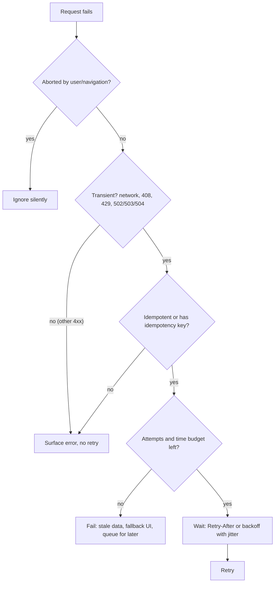
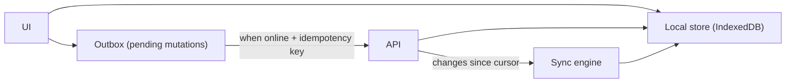

# Resilience: Timeouts, Retries, Backoff and Offline

> Verification note: the idempotency/safety properties that determine which requests may be retried (GET/HEAD/QUERY/PUT/DELETE vs POST/PATCH) were verified against MDN (Sep 2026) in [01](01-http-semantics-and-protocol-versions.md); QUIC connection migration and HTTP/3 behaviour in [01](01-http-semantics-and-protocol-versions.md); SSE/WebSocket reconnect mechanics in [05](05-real-time-communication-websockets-sse-webtransport.md). **Backoff/jitter formulas, retry budgets, circuit-breaker/bulkhead/load-shedding patterns, `navigator.onLine` reliability, Background Sync/Periodic Sync support, Workbox strategies, `stale-while-revalidate`/`stale-if-error` semantics, and testing-tool behaviours (MSW, Playwright, Toxiproxy) are established engineering practice not re-fetched in this session — marked *(hedged)* where support or defaults vary.** Caching strategy details live in [web-performance/03](../web-performance/03-network-caching-and-delivery.md); query-library retry options in [react/06](../react/06-state-management-and-data-fetching.md).

## Table of Contents

1. [Quick Summary (TL;DR)](#1-quick-summary-tldr)
2. [A Taxonomy of Network Failures](#2-a-taxonomy-of-network-failures)
3. [Timeouts and Latency Budgets](#3-timeouts-and-latency-budgets)
4. [Retries: When, How Many, How Long](#4-retries-when-how-many-how-long)
5. [Circuit Breakers, Bulkheads and Load Shedding](#5-circuit-breakers-bulkheads-and-load-shedding)
6. [Deduplication, Coalescing, Cancellation and Races](#6-deduplication-coalescing-cancellation-and-races)
7. [Stale Data as a Resilience Tool](#7-stale-data-as-a-resilience-tool)
8. [Graceful Degradation and UX States](#8-graceful-degradation-and-ux-states)
9. [Offline-First Foundations](#9-offline-first-foundations)
10. [Resilient Mutations: Optimistic UI, Outbox, Idempotency](#10-resilient-mutations-optimistic-ui-outbox-idempotency)
11. [Concurrency Limits, Priorities and Client-Side Rate Limiting](#11-concurrency-limits-priorities-and-client-side-rate-limiting)
12. [Observability: SLOs, Error Budgets and RUM](#12-observability-slos-error-budgets-and-rum)
13. [Testing Failure Modes](#13-testing-failure-modes)
14. [Pitfalls](#14-pitfalls)
15. [Interview Questions — Fundamentals](#15-interview-questions--fundamentals)
16. [Interview Questions — Senior Scenarios](#16-interview-questions--senior-scenarios)
17. [Cheat Sheet](#17-cheat-sheet)
18. [Key Terms Glossary](#18-key-terms-glossary)
19. [Further Reading](#19-further-reading)

---

## 1. Quick Summary (TL;DR)

- **Networks fail constantly** — packet loss, captive portals, tunnels, sleeping laptops, overloaded servers, deploys. Resilient frontends **expect failure** and design UX and protocols around it.
- **Retries are powerful and dangerous.** Retry only **idempotent** requests (or those with idempotency keys), only on **transient** errors (network failure, `408`, `429`, `502/503/504`), with **exponential backoff + jitter**, a **cap on attempts and total time**, and **respect for `Retry-After`**. Uncoordinated retries amplify outages (retry storms).
- **Always set timeouts** (via `AbortSignal`), shorter than gateway timeouts, and tie them to a **user-perceived latency budget**; "no timeout" means "hangs forever".
- **Circuit breakers/bulkheads** stop hammering a failing dependency and isolate failures (one slow widget shouldn't block the page).
- **Stale-while-revalidate and cached fallbacks** turn outages into degraded experiences instead of blank screens.
- **Offline-first** = local data (IndexedDB), a **persistent outbox** of mutations with idempotency keys, sync on reconnect, conflict handling, and honest connectivity UI. `navigator.onLine` is only a hint.
- **Measure** error rates, retry counts, timeouts, p95/p99 latency and failed-mutation rates by endpoint; define **SLOs**; test with injected faults.



---

## 2. A Taxonomy of Network Failures

| Class | Examples | Retry? | Typical UX |
|---|---|---|---|
| **Client offline / no route** | Airplane mode, Wi-Fi without internet, DNS failure | After connectivity returns (queue) | Offline banner, queued actions |
| **Connection errors** | Reset, TLS failure, timeout | Yes (idempotent) with backoff | Inline retry, spinner |
| **Slow responses** | High latency, server overloaded | Cancel at deadline; maybe retry/hedge | Skeletons → timeout message |
| **Throttling** | `429` | Yes after `Retry-After` | "Retrying in N s…" |
| **Server transient** | `502/503/504` | Yes with backoff | Retry + status message |
| **Server bug** | `500` | Limited (maybe once) | Error with trace ID |
| **Client bug / invalid** | `400/422` | **No** | Field errors/fix input |
| **Auth** | `401` | Refresh token once then retry; else login | Re-auth flow ([web-security/05](../web-security/05-authentication-and-authorization-in-the-frontend.md)) |
| **Authorisation / not found** | `403/404` | No | Forbidden/not-found state |
| **Conflict** | `409/412` | After refetch/merge | Conflict UI ([01 §7](01-http-semantics-and-protocol-versions.md#7-conditional-requests-etags-and-optimistic-concurrency)) |
| **Partial / corrupt** | Truncated body, JSON parse error, schema mismatch | Maybe once | Generic error + report |
| **Captive portal/proxy HTML** | `200 OK` HTML login page instead of JSON | No (detect via content-type/schema) | "Network requires sign-in" hint |
| **Stale deploy skew** | Old client vs new API; chunk 404 after deploy | Reload page | "New version available" ([nextjs-and-rendering/08](../nextjs-and-rendering/08-deployment-runtimes-and-operations.md)) |

Distinguish **"couldn't reach the server"** (`fetch` rejects) from **"server said no"** (resolved with 4xx/5xx) — different UX and retry policy ([02 §3](02-fetch-api-and-browser-networking.md#3-error-semantics-what-rejects-and-what-doesnt)).

---

## 3. Timeouts and Latency Budgets

- **Layered timeouts:** browser/OS → CDN/gateway (often 30–120 s *(hedged)*) → server → upstreams. **Client timeout < gateway timeout < server timeout** so failures surface where you can handle them.
- **Per-request-type budgets:** interactive reads 3–10 s; mutations a little longer; uploads/downloads are progress-based; background sync can wait longer. Use **shorter timeouts + retry** for idempotent reads, **longer single attempt** for non-idempotent writes (don't abandon mid-flight and double-submit).
- **Deadline propagation:** overall deadline for a user action (e.g., 8 s) shared across retries: `remaining = deadline - now` becomes each attempt's timeout.
- **Connect vs response timeouts:** `fetch` offers only an overall signal; to detect "slow to first byte" vs "stalled stream" you can implement **stall detection** on streams (no chunk within N seconds → abort).
- **Timeout ≠ cancelled work:** the server may still complete the operation — design for **at-least-once** semantics ([03 §4](03-rest-api-design-and-consumption.md#4-idempotency-keys-and-safe-retries)).

```ts
export async function requestWithDeadline<T>(fn: (signal: AbortSignal) => Promise<T>, deadlineMs: number, parent?: AbortSignal) {
  const c = new AbortController();
  const t = setTimeout(() => c.abort(new DOMException('Deadline exceeded', 'TimeoutError')), deadlineMs);
  parent?.addEventListener('abort', () => c.abort(parent.reason), { once: true });
  try { return await fn(c.signal); } finally { clearTimeout(t); }
}
```

---

## 4. Retries: When, How Many, How Long

### Decision rules
| Condition | Rule |
|---|---|
| Method | **GET/HEAD/PUT/DELETE/QUERY** safe to retry; **POST/PATCH only with idempotency key/natural idempotency** |
| Errors | Retry network errors, `408`, `429`, `502`, `503`, `504` (and sometimes `500` once); **never** other `4xx` |
| Attempts | Small (2–4); total retry time bounded by the user's deadline |
| Delay | `Retry-After` if present, else **exponential backoff with jitter** |
| Context | Don't retry aborted/unmounted requests; don't retry when offline (wait for connectivity) |
| Layering | **Retry at one layer only** (client library *or* query library *or* gateway) — multiplying layers (3×3×3) creates storms |

### Backoff formulas
- **Exponential:** `delay = min(cap, base * 2^attempt)`.
- **Full jitter** *(AWS-style, hedged attribution)*: `delay = random(0, min(cap, base * 2^attempt))` — spreads retries best.
- **Equal jitter:** `delay = exp/2 + random(0, exp/2)`.
- **Decorrelated jitter:** `delay = min(cap, random(base, prev * 3))`.

```ts
const sleep = (ms: number, signal?: AbortSignal) => new Promise<void>((res, rej) => {
  const t = setTimeout(res, ms);
  signal?.addEventListener('abort', () => { clearTimeout(t); rej(signal.reason); }, { once: true });
});

function retryAfterMs(res?: Response): number | undefined {
  const h = res?.headers.get('retry-after'); if (!h) return;
  const s = Number(h); if (!Number.isNaN(s)) return s * 1000;
  const d = Date.parse(h); return Number.isNaN(d) ? undefined : Math.max(0, d - Date.now());
}

export async function retrying<T>(op: (attempt: number) => Promise<T>, opts: { retries?: number; base?: number; cap?: number; signal?: AbortSignal; shouldRetry?: (e: unknown) => boolean } = {}) {
  const { retries = 3, base = 300, cap = 8000, signal, shouldRetry = isTransient } = opts;
  for (let attempt = 0; ; attempt++) {
    try { return await op(attempt); }
    catch (e) {
      if (signal?.aborted || attempt >= retries || !shouldRetry(e)) throw e;
      const hinted = e instanceof HttpError ? retryAfterMs(e.response) : undefined;
      const delay = hinted ?? Math.random() * Math.min(cap, base * 2 ** attempt);     // full jitter
      await sleep(delay, signal);
    }
  }
}
```
- **Retry budgets** *(hedged; SRE practice)*: cap retries to a fraction of total traffic (e.g., ≤10% extra) so retries can't multiply load during incidents.
- **Hedged requests** (send a duplicate after the p95 latency and take the first reply) reduce tail latency for **idempotent** reads, at cost of load — use sparingly, usually server-to-server.
- **Library defaults:** TanStack Query retries queries 3× with exponential backoff by default and mutations 0× *(hedged: verify v5 defaults)* — configure `retry`/`retryDelay` and **don't stack** with a client-level retry ([react/06 §7](../react/06-state-management-and-data-fetching.md#7-data-fetching-patterns-and-pitfalls)).
- **Don't retry on user-visible blocking flows without feedback** — show "retrying…" after the first failure.

---

## 5. Circuit Breakers, Bulkheads and Load Shedding

### Circuit breaker
States: **closed** (normal) → **open** (fail fast after N failures within a window; no calls for a cool-down) → **half-open** (allow a few probe requests; success closes, failure reopens).
```ts
class CircuitBreaker {
  private failures = 0; private openedAt = 0; private state: 'closed' | 'open' | 'half' = 'closed';
  constructor(private threshold = 5, private cooldownMs = 15000) {}
  async call<T>(fn: () => Promise<T>): Promise<T> {
    if (this.state === 'open') {
      if (Date.now() - this.openedAt < this.cooldownMs) throw new Error('circuit-open');
      this.state = 'half';
    }
    try { const r = await fn(); this.failures = 0; this.state = 'closed'; return r; }
    catch (e) { if (++this.failures >= this.threshold || this.state === 'half') { this.state = 'open'; this.openedAt = Date.now(); } throw e; }
  }
}
```
- **Where it helps on the client:** non-critical dependencies (recommendations, analytics, widgets): after repeated failures stop calling and render a fallback; also in **BFF/server layers** protecting upstreams.
- **Don't count `4xx` (client errors) or `429`** as failures (design choice, hedged); count timeouts and `5xx`.
- **Per-endpoint/host breakers**, not global.

### Bulkheads and isolation
- **Isolate failure domains in the UI:** independent data fetching per widget with its own error boundary/Suspense boundary so one failure doesn't blank the page ([react/03](../react/03-concurrent-react-suspense-and-transitions.md), [nextjs-and-rendering/05](../nextjs-and-rendering/05-streaming-ppr-and-instant-navigation.md)).
- **Separate concurrency pools** for critical vs background requests (prevent a flood of low-priority calls starving checkout).
- **Isolate third parties** (iframes/workers) so slow vendors can't block the main thread ([web-security/07](../web-security/07-supply-chain-and-third-party-script-security.md)).

### Load shedding (server) and client cooperation
Servers reject excess load early (`503`/`429` + `Retry-After`); clients should **back off, degrade (disable non-essential polling/prefetch) and avoid retry amplification**. Feature flags/kill switches let you disable expensive UI features during incidents.

---

## 6. Deduplication, Coalescing, Cancellation and Races

- **In-flight deduplication:** identical concurrent `GET`s share one promise (React Query/SWR do this by key; in plain code keep a `Map<key, Promise>`), preventing request storms from many components mounting.
- **Request coalescing/batching:** collect IDs over a tick and issue one bulk request (DataLoader-style) ([03 §10](03-rest-api-design-and-consumption.md#10-bulk-batch-and-partial-responses)).
- **Cancellation:** abort superseded requests (typeahead, route changes, unmount) ([02 §4](02-fetch-api-and-browser-networking.md#4-cancellation-timeouts-and-race-conditions)); ensure aborts aren't counted as failures/retried.
- **Race handling:** use **latest-wins** (abort previous or sequence IDs); for mutations on the same entity, **serialise** per-entity queues (avoid reordering: rename then delete).
- **Idempotent UI actions:** disable duplicate submits, but also keep correctness server-side via idempotency keys.
- **Refresh-token stampede:** many concurrent 401s must trigger **one** refresh (single-flight promise) and retry afterwards ([07 §5](07-api-client-architecture-and-contracts.md#5-auth-interceptors-and-token-refresh)).

---

## 7. Stale Data as a Resilience Tool

- **Stale-while-revalidate (SWR):** show cached data immediately, refresh in background; HTTP `Cache-Control: stale-while-revalidate=N` and library caches (TanStack Query `staleTime`/`gcTime`, SWR) provide it ([web-performance/03 §5](../web-performance/03-network-caching-and-delivery.md#5-http-caching-deep-dive), [react/06 §6](../react/06-state-management-and-data-fetching.md#6-server-state-tanstack-query-swr-rtk-query)).
- **Stale-if-error:** `Cache-Control: stale-if-error=N` lets caches/CDNs serve stale responses when the origin errors *(hedged: verify CDN support)* — an effective outage shield for public GETs.
- **Keep previous data while refetching/failing:** `keepPreviousData`/`placeholderData` patterns; show a "last updated 5 min ago — retry" banner instead of an empty state.
- **Persisted caches:** persist query cache to IndexedDB/localStorage for fast starts and offline reading (versioned, with `maxAge`, cleared on logout) ([react/06 §12](../react/06-state-management-and-data-fetching.md#12-persistence-offline-auth-token-refresh)); **never persist sensitive data** without need ([web-security/01 §7](../web-security/01-frontend-threat-model-and-owasp-top-10.md#7-what-must-never-live-in-the-client)).
- **Fallback content:** static defaults, cached last-known values, skeletons with retry affordances, or alternative sources (CDN snapshots) for non-critical modules.
- **Service worker strategies (Workbox-style *(hedged)*):** `StaleWhileRevalidate` for APIs where staleness is okay, `NetworkFirst` with timeout fallback to cache for freshness-sensitive data, `CacheFirst` for static assets ([web-performance/03 §8](../web-performance/03-network-caching-and-delivery.md#8-service-workers-and-the-cache-api)).
- **Be honest:** indicate staleness for time-sensitive data (prices, inventory) and block risky actions (checkout) on stale data.

---

## 8. Graceful Degradation and UX States

- **Every async region has four states:** loading, success, **empty**, **error** (+ stale/refreshing). Design them explicitly; error states offer **Retry** and context (what failed, what the user can still do).
- **Progressive disclosure of failures:** inline field-level errors → section-level retry → page-level fallback → global banner for connectivity.
- **Error boundaries** per region (React `ErrorBoundary`, Next `error.js`) with reset hooks that refetch ([react/03](../react/03-concurrent-react-suspense-and-transitions.md)).
- **Don't toast every failed request**; aggregate and rate-limit notifications; separate user-actionable errors from background noise.
- **Timeouts need UX:** after N seconds show "Still working…" with cancel; after the deadline, offer retry and keep user input.
- **Preserve user input** on failure (forms, drafts); autosave drafts locally.
- **Feature degradation ladder:** realtime → polling → manual refresh; rich widgets → static content; personalised → generic.
- **Accessibility:** announce errors via `aria-live`, move focus to error summaries, ensure retry buttons are reachable by keyboard.
- **Skew/version errors:** chunk-load failures after deploy → prompt reload (and retry once) rather than a generic error.

---

## 9. Offline-First Foundations

### Detecting connectivity
- **`navigator.onLine` / `online`/`offline` events** only indicate whether the device has *a network interface*, not that your server is reachable (captive portals, DNS issues). Use them as **hints to trigger probes** and avoid pointless requests; confirm with a lightweight health request or by actual fetch outcomes ([02 §13](02-fetch-api-and-browser-networking.md#13-measuring-network-behaviour-in-the-browser)).
- **Network Information API** (`effectiveType`, `saveData`) *(hedged: Chromium)* for adaptive behaviour.

### Architecture

- **Local-first reads:** read from IndexedDB/cache; sync updates into it ([browser-internals/05](../browser-internals/05-browser-storage-and-caching-apis.md)). Use libraries (Dexie, RxDB, PouchDB, Replicache, TanStack DB/persisters *(hedged)*) if complexity warrants.
- **Outbox:** persist mutations `{ id (idempotency key), type, payload, createdAt, attempts }` to IndexedDB; a sync loop drains it in order per entity with backoff; survive reloads/crashes.
- **Sync protocol:** `GET /changes?since=<cursor>` (cursor-based, [03 §7](03-rest-api-design-and-consumption.md#7-pagination-filtering-sorting-and-search)), tombstones for deletes, server-assigned versions.
- **Conflict handling:** last-write-wins (simple, lossy), field-level merge, `ETag/If-Match` conflicts → UI resolution, or CRDT/OT for collaborative data ([system-design/08](../system-design/08-collaborative-editor.md)).
- **Background Sync API** *(hedged: Chromium-only)* lets a service worker retry queued requests when connectivity returns even after the tab closes; **fallback:** drain the outbox on `online`/`visibilitychange`/app start.
- **Storage limits & eviction:** origin quotas are best-effort and can be evicted (Safari's 7-day ITP rule for script-written data) — treat local data as a **cache of server truth** unless you request persistent storage ([browser-internals/05](../browser-internals/05-browser-storage-and-caching-apis.md)).
- **Auth offline:** tokens expire; allow read-only offline, refresh on reconnect, handle `401` during sync by pausing and prompting re-auth.
- **PWA basics:** service worker + manifest + app shell caching ([web-performance/03 §8](../web-performance/03-network-caching-and-delivery.md#8-service-workers-and-the-cache-api)).

---

## 10. Resilient Mutations: Optimistic UI, Outbox, Idempotency

| Technique | What it does | Caveats |
|---|---|---|
| **Optimistic update** | Apply the change locally immediately; roll back on failure | Need rollback + error UI; avoid for irreversible/high-risk actions |
| **Pessimistic (wait for server)** | Show pending, update after success | Slower perceived performance, but simpler/safer |
| **Idempotency keys** | Make retries safe | Reuse the same key per logical action ([03 §4](03-rest-api-design-and-consumption.md#4-idempotency-keys-and-safe-retries)) |
| **Outbox queue** | Persist & replay when online | Ordering, conflicts, poison messages (dead-letter after N failures + UI) |
| **Mutation scopes/serialisation** | Run mutations on the same entity sequentially | Prevents out-of-order effects (TanStack Query `scope` *(hedged)*) |
| **Reconciliation** | Replace optimistic data with server response (IDs, timestamps) | Temp IDs → real IDs mapping |
| **Undo/redo and soft delete** | Provide recovery for mistakes/failed sync | Server support for restoration |

```ts
// Optimistic mutation sketch with rollback (TanStack Query style)
useMutation({
  mutationFn: (vars) => api.updateTodo(vars, { idempotencyKey: vars.opId }),
  onMutate: async (vars) => { await qc.cancelQueries({ queryKey: ['todos'] }); const prev = qc.getQueryData(['todos']); qc.setQueryData(['todos'], (old) => apply(old, vars)); return { prev }; },
  onError: (_e, _v, ctx) => qc.setQueryData(['todos'], ctx?.prev),
  onSettled: () => qc.invalidateQueries({ queryKey: ['todos'] }),
});
```
- **Failed-mutation UX:** keep the item visible with "Failed — Retry/Discard", don't silently drop user work.
- **Poison messages:** after N attempts or a `4xx`, move to dead-letter state and surface to the user/support.
- **Cross-tab outbox:** use Web Locks so only one tab drains the queue ([05 §12](05-real-time-communication-websockets-sse-webtransport.md#12-client-architecture-one-connection-many-tabs-many-components)).

---

## 11. Concurrency Limits, Priorities and Client-Side Rate Limiting

- **Browser per-host limits:** ~6 concurrent HTTP/1.1 connections per host; HTTP/2/3 multiplex many streams but **server/CDN concurrency** and CPU still matter.
- **Client request queues:** limit concurrent API calls (`p-limit`, `p-queue`, custom scheduler), prioritise user-initiated over background; pause low-priority work when hidden or offline; coalesce prefetches.
- **Proactive throttling:** respect `RateLimit-*`/`Retry-After`; token-bucket on the client for noisy features (autosave, telemetry) ([03 §8](03-rest-api-design-and-consumption.md#8-rate-limiting-and-quotas)).
- **Backpressure for uploads/downloads:** cap parallelism (3–6), pause/resume, chunk size adaptation ([02 §8](02-fetch-api-and-browser-networking.md#8-uploads-progress-and-formdata)).
- **Fetch priority:** `fetchpriority`/`priority` hints and request ordering for critical resources ([web-performance/02](../web-performance/02-critical-rendering-path-and-loading-performance.md)).
- **Save-Data/slow networks:** reduce prefetching, polling frequency, image quality (`navigator.connection` *(hedged)*) ([web-performance/03 §12](../web-performance/03-network-caching-and-delivery.md#12-adaptive-loading-and-reduced-data)).

---

## 12. Observability: SLOs, Error Budgets and RUM

- **Define SLIs per critical journey/endpoint:** success rate (non-5xx, non-timeout), latency p50/p95/p99, mutation success, time-to-first-data, offline-queue size/age, retry rate.
- **SLOs and error budgets** *(SRE practice)*: e.g., "99.9% of checkout submits succeed within 5 s"; burn-rate alerts instead of single-error alerts.
- **Client RUM for APIs:** log (sampled) route template, status, duration, protocol (`nextHopProtocol`), retries, timeout/abort flags, online state, and trace ID — **no PII or full URLs with IDs** ([02 §13](02-fetch-api-and-browser-networking.md#13-measuring-network-behaviour-in-the-browser), [07 §8](07-api-client-architecture-and-contracts.md#8-observability-correlation-ids-and-tracing)).
- **Separate user-caused aborts from failures** in dashboards; track **retry success rate** (retries that succeed vs waste).
- **Alert on symptoms** (failed checkouts, login failures) rather than raw error counts; include dependency-health breakdown.
- **Release health:** correlate error spikes with deploys/flags; support fast rollback.
- **Synthetic checks** from multiple regions/networks catch DNS/CDN/TLS issues RUM can't (no traffic when everything is down).

---

## 13. Testing Failure Modes

| Technique | What it covers |
|---|---|
| **MSW** handlers returning `500`, `429` + `Retry-After`, delayed responses, network errors (`HttpResponse.error()` *(hedged)*) | Unit/integration tests of retry/error UX ([07 §7](07-api-client-architecture-and-contracts.md#7-mocking-and-testing-the-network-layer)) |
| **Playwright/Cypress** `route.abort()`, `route.fulfill()` with delays/errors, `context.setOffline(true)` | E2E offline/error flows |
| **DevTools network throttling** (Slow 3G, Offline) and CPU throttling | Manual UX checks |
| **Toxiproxy / chaos proxies** *(hedged)* | Latency, jitter, drops, bandwidth limits between app and API |
| **Fault injection in staging** | Return 5xx/slow responses via headers/flags to test fallbacks |
| **Fake timers** | Deterministic backoff tests (Jest/Vitest `useFakeTimers`) |
| **Property tests/simulations** for outbox ordering & dedupe | Sync correctness |
| **Game days** | Practice incident response |

Test the **unhappy paths first**: timeouts, partial failures, duplicate submissions, token expiry mid-flow, reconnect storms, slow consumers, version skew.

---

## 14. Pitfalls

1. **Retrying non-idempotent requests** (double orders/payments).
2. **Retry storms:** no jitter, no cap, retries at multiple layers.
3. **No timeouts** (hung spinners) or timeouts longer than gateways.
4. **Ignoring `Retry-After`/`429`.**
5. **Retrying `4xx`/validation errors** and abusing auth endpoints.
6. **Trusting `navigator.onLine`.**
7. **Optimistic updates without rollback/error UI.**
8. **Outbox without idempotency keys, ordering or dead-letter handling.**
9. **Persisting sensitive data offline** without a threat model.
10. **Blank screens on failures** — no stale/fallback strategy.
11. **Global error handling only** (one failed widget breaks the page).
12. **Treating aborts as errors** in telemetry/alerts.
13. **Not testing failure modes** until production incidents.
14. **Multiple concurrent token refreshes** after expiry.

---

## 15. Interview Questions — Fundamentals

### Q1. Which requests are safe to retry automatically?
Idempotent methods (`GET`, `HEAD`, `PUT`, `DELETE`, `QUERY`) on transient failures; `POST`/`PATCH` only when protected by idempotency keys or natural idempotency.

### Q2. What is exponential backoff with jitter and why use it?
Delays grow exponentially between attempts with randomness added, spreading retries to avoid synchronised retry storms and reduce server load during incidents.

### Q3. What should you do on `429`?
Wait for `Retry-After` (or backoff), throttle subsequent requests, and show a user-friendly message; don't retry immediately.

### Q4. What is a circuit breaker?
A pattern that stops calling a failing dependency after repeated failures (open), then probes (half-open) before resuming (closed), preventing cascading failures and wasted calls.

### Q5. Why is `navigator.onLine` unreliable?
It reports only interface connectivity; captive portals, DNS failures or server outages still look "online".

### Q6. How does stale-while-revalidate improve resilience?
Serves cached data immediately and refreshes in the background; combined with `stale-if-error`, users still see content during origin failures.

### Q7. What is an outbox pattern in the browser?
A persistent queue of pending mutations (with idempotency keys) stored locally and replayed when online, ensuring reliability across reloads and outages.

### Q8. Why set client timeouts shorter than gateway timeouts?
So the client controls failure handling, can retry/fallback, and avoids ambiguous gateway errors after long hangs.

---

## 16. Interview Questions — Senior Scenarios

### S1. "Our app melted the API during an outage: clients retried aggressively. Fix it."
Introduce jittered exponential backoff with caps, respect `Retry-After`, remove duplicate retry layers (library + wrapper), add retry budgets and circuit breakers, coalesce/dedupe identical requests, degrade non-essential polling/prefetch during failures, and server-side load shedding with `503`/`429`; add dashboards on retry rate and test with chaos tools.

### S2. "Design an offline-capable task manager."
IndexedDB local store, UI reads local-first, mutations enqueue to an outbox with idempotency keys and temp IDs, sync engine drains in order per entity with backoff, `changes?since=cursor` pull with tombstones, conflict policy (field-level merge + `If-Match` conflicts surfaced), Background Sync where available plus `online`/focus triggers, storage eviction handling (re-sync from server), clear sync-state UI, and tests for duplicate/out-of-order/reconnect scenarios.

### S3. "Checkout intermittently shows errors but orders still get created."
Timeouts/aborts after the server committed the order. Add idempotency keys with replay, show "pending/verifying" states and poll an order-status endpoint instead of re-submitting, extend/disable client timeout for the single payment call, reconcile via webhooks, log trace IDs, and track "ambiguous outcome" rate as an SLI.

### S4. "After deploys users see 'ChunkLoadError' and blank screens."
Version skew: old HTML references removed chunks. Keep old assets available for a grace period, use skew protection/deployment IDs, catch chunk load errors → prompt reload (once, guarded against loops), service worker update flows, and monitor chunk-error rate per release ([nextjs-and-rendering/08](../nextjs-and-rendering/08-deployment-runtimes-and-operations.md)).

### S5. "Which resilience features would you put in a shared API client?"
Timeouts/deadlines via `AbortSignal`, retry policy for idempotent methods only with jitter and `Retry-After`, auth refresh single-flight, error normalisation (`ApiError` with status/type/trace ID), request IDs/trace headers, dedupe, optional circuit breaker per host, telemetry hooks, and escape hatches per call (`retry: false`, custom timeout) ([07](07-api-client-architecture-and-contracts.md)).

### S6. "How do you test that the UI survives a flaky network?"
MSW/Playwright fault injection (delays, 5xx, 429, aborts, offline toggles), throttling profiles, fake timers for backoff, tests asserting retry counts/idempotency keys, outbox persistence across reload, and chaos proxies in staging; verify UX states (retry buttons, stale banners) and a11y announcements.

---

## 17. Cheat Sheet

| Topic | Rule |
|---|---|
| Retry what | Idempotent + transient (network, 408, 429, 502/503/504) |
| Retry how | 2–4 attempts, exp backoff + full jitter, `Retry-After`, one layer only |
| Timeouts | Client < gateway < server; deadline per user action |
| Breaker | Open after N failures, half-open probes |
| Stale data | SWR + stale-if-error + persisted cache |
| Offline | Local store + outbox + idempotency + sync cursor |
| Mutations | Optimistic + rollback, or pessimistic for risky ops |
| Online detection | `onLine` is a hint; probe/observe |
| Testing | MSW/Playwright/Toxiproxy fault injection |


---

## 18. Key Terms Glossary

| Term | Definition |
|---|---|
| **Backoff** | Increasing delay between retries |
| **Jitter** | Randomisation of delays to avoid synchronisation |
| **Retry budget** | Cap on retry traffic proportion |
| **Circuit breaker** | Fail-fast guard around a failing dependency |
| **Bulkhead** | Isolation of resources/failure domains |
| **Load shedding** | Rejecting excess load to preserve service |
| **Stale-while-revalidate** | Serve cached then refresh in background |
| **Outbox** | Persistent queue of pending mutations |
| **Dead-letter** | Parked messages that repeatedly fail |
| **SLO / error budget** | Reliability target / allowed unreliability |

---

## 19. Further Reading

- [MDN — HTTP caching (`stale-while-revalidate`, `stale-if-error`)](https://developer.mozilla.org/en-US/docs/Web/HTTP/Guides/Caching) · [Retry-After](https://developer.mozilla.org/en-US/docs/Web/HTTP/Reference/Headers/Retry-After) · [Service Worker API](https://developer.mozilla.org/en-US/docs/Web/API/Service_Worker_API) · [Background Synchronization API](https://developer.mozilla.org/en-US/docs/Web/API/Background_Synchronization_API)
- [AWS Architecture Blog — Exponential Backoff and Jitter](https://aws.amazon.com/blogs/architecture/exponential-backoff-and-jitter/) · [Google SRE Book — Addressing Cascading Failures](https://sre.google/sre-book/addressing-cascading-failures/) *(hedged: vendor/community references)*
- This repo: [02 Fetch API](02-fetch-api-and-browser-networking.md) · [03 REST API design](03-rest-api-design-and-consumption.md) · [07 API client architecture](07-api-client-architecture-and-contracts.md) · [react/06](../react/06-state-management-and-data-fetching.md)
