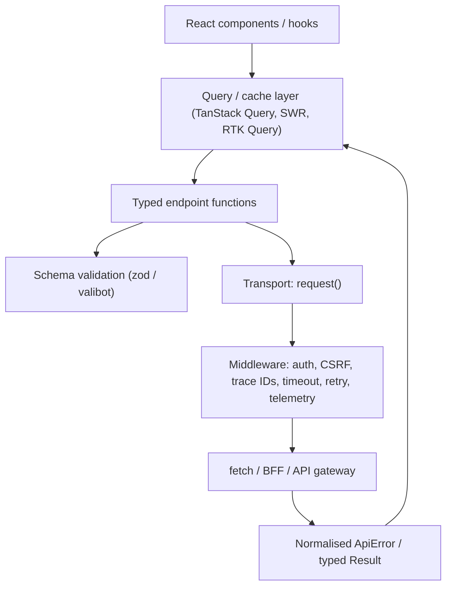
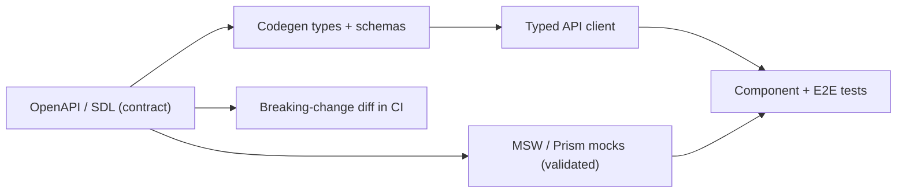

# API Client Architecture and Contracts

> Verification note: HTTP semantics that shape client design (method idempotency, status/error handling, conditional requests) were verified in [01](01-http-semantics-and-protocol-versions.md) (MDN, Sep 2026); auth-token handling rules (single-flight refresh, no tokens in JS-readable storage for sensitive apps, BFF recommendation) come from IETF RFC 10017 as summarised in [web-security/05](../web-security/05-authentication-and-authorization-in-the-frontend.md). **Tooling and spec details — W3C Trace Context (`traceparent` format), OpenTelemetry browser instrumentation, `Server-Timing`, OpenAPI codegen tools (openapi-typescript, orval, hey-api), zod/valibot behaviours, MSW handler APIs, Pact consumer-driven contract testing, Spectral/oasdiff — are established practice not re-fetched in this session; option/package names are marked *(hedged)* and may have changed.** Query-library mechanics are in [react/06](../react/06-state-management-and-data-fetching.md); GraphQL clients in [04](04-graphql-trpc-grpc-and-api-styles.md).

## Table of Contents

1. [Quick Summary (TL;DR)](#1-quick-summary-tldr)
2. [A Layered API Client Architecture](#2-a-layered-api-client-architecture)
3. [Runtime Validation at the Boundary](#3-runtime-validation-at-the-boundary)
4. [Error Normalisation and Typed Results](#4-error-normalisation-and-typed-results)
5. [Auth Interceptors and Token Refresh](#5-auth-interceptors-and-token-refresh)
6. [Code Generation and Typed Clients](#6-code-generation-and-typed-clients)
7. [Mocking and Testing the Network Layer](#7-mocking-and-testing-the-network-layer)
8. [Observability, Correlation IDs and Tracing](#8-observability-correlation-ids-and-tracing)
9. [Environments, Base URLs and Multiple Backends](#9-environments-base-urls-and-multiple-backends)
10. [Contract Testing and Compatibility](#10-contract-testing-and-compatibility)
11. [Query Keys, Cache Integration and Invalidation Hooks](#11-query-keys-cache-integration-and-invalidation-hooks)
12. [Security Touchpoints in the Client](#12-security-touchpoints-in-the-client)
13. [Pitfalls](#13-pitfalls)
14. [Interview Questions — Fundamentals](#14-interview-questions--fundamentals)
15. [Interview Questions — Senior Scenarios](#15-interview-questions--senior-scenarios)
16. [Cheat Sheet](#16-cheat-sheet)
17. [Key Terms Glossary](#17-key-terms-glossary)
18. [Further Reading](#18-further-reading)

---

## 1. Quick Summary (TL;DR)

- **Treat the network as a typed boundary.** One thin **transport layer** (`fetch` wrapper) + **endpoint functions** (typed, validated) + **cache/state layer** (TanStack Query/SWR/RTK Query/Relay) + **UI**. Components never call `fetch` directly.
- **Compile-time types are not runtime guarantees.** Generated or hand-written TypeScript types don't protect against server drift, proxies returning HTML, or third-party APIs — **validate responses at trust boundaries** (zod/valibot/arktype) at least for external or critical data.
- **Normalise errors once:** map network failures, HTTP statuses, `application/problem+json`, GraphQL `errors` and validation failures into a single `ApiError` taxonomy the UI can switch on ([03 §5](03-rest-api-design-and-consumption.md#5-error-handling-rfc-9457-problem-details)).
- **Centralise cross-cutting concerns** as middleware/interceptors: auth (single-flight refresh), CSRF header, request IDs and **W3C trace context**, timeouts, retries (idempotent only), telemetry, locale/tenant headers.
- **Generate from contracts** (OpenAPI/GraphQL SDL/proto) to avoid drift; **test against contracts** (mock servers, MSW, consumer-driven contract tests) so frontend and backend can evolve independently.
- **Observability is a client feature:** propagate `traceparent`/request IDs, record route-template latency/errors, and show support-friendly error IDs to users.



---

## 2. A Layered API Client Architecture

```
src/api/
  http/
    client.ts          # request(): base URL, headers, timeouts, middleware pipeline
    errors.ts          # ApiError taxonomy + normalisers
    middleware/        # auth.ts, csrf.ts, trace.ts, retry.ts, telemetry.ts
  schemas/             # zod schemas per resource (source of truth for runtime types)
  endpoints/
    orders.ts          # getOrder(), listOrders(), createOrder() -> typed + validated
  queries/
    orders.ts          # query key factory + queryOptions + mutations
  generated/           # OpenAPI-generated types/clients (do not edit)
```
Principles:
- **Single transport** with a **middleware pipeline** (`(req, next) => Promise<Response>`) so concerns compose and are testable in isolation.
- **Endpoint functions are the public API** of the data layer: they accept domain-typed parameters, return **domain types** (not raw DTOs) when mapping is warranted, and hide URLs/serialisation.
- **Anti-corruption layer:** map backend DTOs to UI models when backend shapes are awkward (snake_case, nested envelopes, nullable chaos) — one place to adapt when the API changes. Don't over-map simple CRUD.
- **Co-locate query keys & options** (`queryOptions`) with endpoint definitions so prefetching, invalidation and SSR hydration share definitions ([§11](#11-query-keys-cache-integration-and-invalidation-hooks)).
- **Keep server-only and browser-only clients separate** (cookie forwarding, base URLs, no `window`), sharing schemas and types.

```ts
// http/client.ts (sketch)
type Middleware = (req: Request, next: (req: Request) => Promise<Response>) => Promise<Response>;

export function createClient({ baseUrl, middleware = [] }: { baseUrl: string; middleware?: Middleware[] }) {
  const run = middleware.reduceRight<(req: Request) => Promise<Response>>(
    (next, mw) => (req) => mw(req, next),
    (req) => fetch(req),
  );
  return async function request<T>(path: string, init: RequestInit & { schema?: { parse(x: unknown): T } } = {}): Promise<T> {
    const { schema, ...rest } = init;
    const res = await run(new Request(new URL(path, baseUrl), rest));
    const body = await readBody(res);                   // json / problem+json / text / empty
    if (!res.ok) throw toApiError(res, body);           // normalise once
    return schema ? schema.parse(body) : (body as T);   // validate at the boundary
  };
}
```

---

## 3. Runtime Validation at the Boundary

TypeScript types are erased at runtime; servers evolve, proxies inject HTML, third parties change shapes. **Validate where data enters your system.**

```ts
import { z } from 'zod';

export const Money = z.object({ amount: z.number().int(), currency: z.string().length(3) });
export const Order = z.object({
  id: z.string(),
  status: z.enum(['pending', 'paid', 'shipped', 'cancelled']).catch('pending' as never),   // tolerate unknown enum values deliberately
  total: Money,
  createdAt: z.string().datetime().transform((s) => new Date(s)),
});
export type Order = z.infer<typeof Order>;

export const getOrder = (id: string) => request(`/orders/${id}`, { schema: Order });
```
Guidance:
- **Where to validate:** responses from external/third-party/legacy APIs, anything driving security or money, form inputs (shared schemas with the server), URL/search params, `postMessage`/WebSocket payloads ([web-security/08 §5](../web-security/08-secure-frontend-patterns-and-vulnerability-catalogue.md#5-postmessage-security)), `localStorage`/IndexedDB hydration. **Where it's overkill:** internal, generated, high-frequency payloads where cost matters — measure (parsing large lists costs main-thread time, [web-performance/04](../web-performance/04-javascript-main-thread-and-inp.md)); consider validating lazily/sampled or in a worker.
- **Strict vs tolerant parsing:** strict catches drift early but can break the UI for harmless additions; use **tolerant parsing** (ignore unknown fields, `.catch()`/default for unknown enums) for forward compatibility and **strict in tests/CI** against the contract ([03 §6](03-rest-api-design-and-consumption.md#6-versioning-and-evolution)).
- **On validation failure:** report to telemetry with endpoint + issue paths (no PII), show a graceful error, and **don't crash the tree**; treat as a contract violation incident.
- **Transforms at the edge:** parse dates (`string → Date`), IDs, money to domain types once; avoid scattering `new Date(x)` across components.
- **Precision:** JS `number` can't hold 64-bit integers/high-precision decimals — validate IDs as strings and money as integer minor units or decimal strings ([03 §3](03-rest-api-design-and-consumption.md#3-request-and-response-conventions)).
- **Share schemas** between client and server only when the server executes them too (otherwise client-only validation is UX, not security — [web-security/01 §8](../web-security/01-frontend-threat-model-and-owasp-top-10.md#8-client-side-validation-authorization-and-hidden-ui)).
- **Derive types from schemas** (`z.infer`) to keep one source of truth; or generate schemas from OpenAPI (`openapi-zod-client`-style *(hedged)*).

---

## 4. Error Normalisation and Typed Results

```ts
export type ApiErrorKind =
  | 'network' | 'timeout' | 'aborted'      // never reached / no response
  | 'unauthenticated' | 'forbidden' | 'not_found' | 'conflict' | 'validation' | 'rate_limited'
  | 'server' | 'unavailable' | 'contract'  // 5xx / 503 / response failed schema validation
  | 'unknown';

export class ApiError extends Error {
  constructor(
    public kind: ApiErrorKind,
    public status?: number,
    public problem?: { type?: string; title?: string; detail?: string; errors?: { pointer: string; code: string; message: string }[]; traceId?: string },
    public retryAfterMs?: number,
    options?: { cause?: unknown },
  ) { super(problem?.title ?? kind, options); }
  get retryable() { return ['network', 'timeout', 'rate_limited', 'unavailable'].includes(this.kind); }
}

export function toApiError(res: Response, body: unknown): ApiError {
  const problem = isProblem(body) ? body : undefined;
  const retryAfterMs = parseRetryAfter(res.headers.get('retry-after'));
  switch (true) {
    case res.status === 401: return new ApiError('unauthenticated', 401, problem);
    case res.status === 403: return new ApiError('forbidden', 403, problem);
    case res.status === 404: return new ApiError('not_found', 404, problem);
    case res.status === 409 || res.status === 412: return new ApiError('conflict', res.status, problem);
    case res.status === 400 || res.status === 422: return new ApiError('validation', res.status, problem);
    case res.status === 429: return new ApiError('rate_limited', 429, problem, retryAfterMs);
    case res.status === 503 || res.status === 502 || res.status === 504: return new ApiError('unavailable', res.status, problem, retryAfterMs);
    case res.status >= 500: return new ApiError('server', res.status, problem);
    default: return new ApiError('unknown', res.status, problem);
  }
}
```
- **Map to UI behaviour once:** `unauthenticated` → login/refresh; `validation` → form errors via JSON Pointer; `conflict` → refetch/merge dialog; `rate_limited` → countdown; `unavailable/network` → retry + offline hints; `contract` → generic error + telemetry.
- **Never branch on message strings**; branch on `kind`/`problem.type`/codes. Localise messages client-side from codes.
- **Result types vs exceptions:** exceptions fit query libraries (they expect thrown errors); for imperative flows, a `Result<T, ApiError>` (`{ ok: true, data } | { ok: false, error }`) avoids forgotten `try/catch`. Pick one convention per layer.
- **GraphQL/RPC:** normalise `errors[].extensions.code`, `userErrors`, tRPC `TRPCClientError` codes into the same `ApiError` ([04](04-graphql-trpc-grpc-and-api-styles.md)).
- **Include `traceId`** from `problem.traceId` or response headers in user-facing "Something went wrong (ref: abc123)" text ([§8](#8-observability-correlation-ids-and-tracing)).
- **Non-JSON error bodies** (CDN/proxy HTML, captive portals) must be detected via `content-type`/parse failures and mapped to `unavailable`/`network`-like kinds ([06 §2](06-resilience-retries-timeouts-and-offline.md#2-a-taxonomy-of-network-failures)).

---

## 5. Auth Interceptors and Token Refresh

**Prefer cookie-based sessions or a BFF** so the browser client has no tokens to attach/refresh ([web-security/05](../web-security/05-authentication-and-authorization-in-the-frontend.md)); then the interceptor only handles `credentials`, CSRF header and `401` redirects. If you must handle bearer tokens in JS (accepting the XSS trade-off), centralise it:

```ts
let refreshing: Promise<string> | null = null;                       // single-flight

export const authMiddleware: Middleware = async (req, next) => {
  const token = tokenStore.get();                                     // in-memory, not localStorage
  const first = await next(withAuth(req.clone(), token));
  if (first.status !== 401) return first;

  refreshing ??= refreshAccessToken().finally(() => { refreshing = null; });   // one refresh for N concurrent 401s
  let fresh: string;
  try { fresh = await refreshing; } catch { sessionExpired(); return first; }  // redirect to login, keep the 401
  return next(withAuth(req, fresh));                                  // retry once only
};
```
- **Single-flight refresh** prevents stampedes; **retry the original request once** after refresh; if refresh fails → clear state, redirect to login with a validated `returnTo` ([web-security/08 §2](../web-security/08-secure-frontend-patterns-and-vulnerability-catalogue.md#2-open-redirects-and-url-handling)).
- **Don't retry non-idempotent requests blindly** after 401 unless the first attempt provably didn't reach the server (401 means it didn't execute — it's usually safe, but confirm with the API contract).
- **Proactive refresh** (before expiry using `exp` claim with skew) reduces 401 noise but beware sleeping tabs; reactive refresh remains the safety net.
- **Multi-tab coordination:** one tab refreshes; others reuse (BroadcastChannel/Web Locks) — refresh-token rotation makes concurrent refreshes from different tabs fail ([web-security/05 §6](../web-security/05-authentication-and-authorization-in-the-frontend.md#6-tokens-access-refresh-id-jwt)).
- **Attach tokens only to your API origins** (allow-list by URL) — never to arbitrary URLs passed through the client.
- **Logout:** clear tokens/caches (query cache, persisted data), abort in-flight requests, notify other tabs.

---

## 6. Code Generation and Typed Clients

| Source | Tools *(hedged: names/versions change)* | Output |
|---|---|---|
| **OpenAPI 3.x** | `openapi-typescript` (types), `openapi-fetch`, `orval`, `@hey-api/openapi-ts`, `openapi-generator` | Types, typed fetch clients, React Query hooks, zod schemas, MSW handlers |
| **GraphQL SDL + operations** | `graphql-codegen` (+ client presets), Relay compiler | Typed operations/hooks (`TypedDocumentNode`), fragment types |
| **Protobuf** | `buf`, `protobuf-es`, Connect-ES | Typed messages/clients |
| **tRPC** | Inferred (`AppRouter` type) | No codegen |
| **JSON Schema / Zod** | `zod-to-openapi`, `json-schema-to-typescript` | Cross-language contracts |

Practices:
- **Generate in CI and commit or build deterministically**; fail the build if generated output is stale (`git diff --exit-code`).
- **Don't hand-edit generated code**; wrap it with thin adapters (your middleware, error normalisation, validation).
- **Pin the spec source** (versioned URL, package, or monorepo path) and review spec diffs in PRs; run **breaking-change detection** (`oasdiff`/schema diff *(hedged)*) and lint (Spectral).
- **Spec quality drives client quality:** accurate nullability, enums with `x-enum-varnames`, `oneOf` discriminators, error response schemas, examples.
- **Generated types ≠ runtime safety:** combine with validation for risky data ([§3](#3-runtime-validation-at-the-boundary)); some generators emit zod schemas.
- **Monorepo shortcut:** share types via a package when frontend and backend co-deploy; otherwise treat the **spec as the artifact** (versioned, published).
- **Avoid giant generated clients in the bundle:** tree-shakable per-endpoint functions or lazy-loaded modules; watch bundle impact ([web-performance/04](../web-performance/04-javascript-main-thread-and-inp.md)).

---

## 7. Mocking and Testing the Network Layer

| Layer | Technique | Notes |
|---|---|---|
| **Unit** | Fake timers + mocked `fetch`/middleware to test retry, refresh, error mapping | Fast, deterministic |
| **Integration (component)** | **MSW** (Mock Service Worker) handlers intercept at the network layer (Node via interceptors, browser via service worker) | Same handlers for tests, Storybook, local dev ([web-performance/07](../web-performance/07-performance-debugging-budgets-and-culture.md) for perf tests); test real `fetch` code paths |
| **Contract** | OpenAPI-driven mock servers (Prism), consumer-driven contracts (Pact) | [§10](#10-contract-testing-and-compatibility) |
| **E2E** | Playwright/Cypress against staging or a local stack; selectively `route.fulfill` for failure injection | Keep few, high-value |
| **Fault injection** | MSW `delay()`, `HttpResponse.error()`, `status: 429`, offline toggles | [06 §13](06-resilience-retries-timeouts-and-offline.md#13-testing-failure-modes) |

```ts
// MSW handlers (v2 style, hedged) shared by tests and Storybook
import { http, HttpResponse, delay } from 'msw';
export const handlers = [
  http.get('/api/orders/:id', async ({ params }) => { await delay(150); return HttpResponse.json(orderFixture(params.id as string)); }),
  http.post('/api/orders', async ({ request }) => {
    const key = request.headers.get('idempotency-key');
    return key ? HttpResponse.json(orderFixture('o_new'), { status: 201, headers: { Location: '/api/orders/o_new' } })
               : HttpResponse.json({ type: 'about:blank', title: 'Idempotency-Key required', status: 400 }, { status: 400, headers: { 'Content-Type': 'application/problem+json' } });
  }),
];
```
- **Fixtures from the contract:** generate handlers/examples from OpenAPI examples to keep mocks honest; **validate mock responses against schemas** in tests so mocks can't drift from reality.
- **Test behaviour, not implementation:** assert on UI outcomes (error message, retry button, optimistic rollback), request counts (retries/dedupe), and headers (auth, idempotency, trace IDs).
- **Determinism:** disable query-library retries/backoff in tests or use fake timers; reset handlers and caches between tests.
- **Server-side (Next.js/RSC) tests:** call server functions/DAL directly; for route handlers use request/response fakes ([nextjs-and-rendering/04](../nextjs-and-rendering/04-data-fetching-and-mutations.md)).

---

## 8. Observability, Correlation IDs and Tracing

### Request/trace IDs
- Generate **`X-Request-ID`** (UUID) per request (or accept from gateway) and log it with errors; surface it to users in error UIs for support.
- **W3C Trace Context** *(hedged on exact format; verify spec)*: `traceparent: 00-<trace-id 32 hex>-<parent-id 16 hex>-<flags 2 hex>` (+ optional `tracestate`). OpenTelemetry's web SDK can create spans for `fetch`/XHR and inject `traceparent` into requests to configured **same-origin or allow-listed** URLs.
- **CORS gotcha:** adding `traceparent`/custom headers to **cross-origin** requests triggers **preflight** and requires `Access-Control-Allow-Headers: traceparent, x-request-id` on the API ([web-security/06 §4](../web-security/06-security-headers-cors-and-transport.md#4-cors-correct-configuration-and-common-mistakes)); same-origin/BFF avoids it.
- **Propagate through the BFF/SSR**: forward trace headers to upstream calls so a page render links to API spans; include the trace ID in HTML error pages/logs.

### Timing and metrics
- **`Server-Timing`** response header (`db;dur=53, cache;desc="HIT", app;dur=47.2`) shows backend breakdown in DevTools and via `PerformanceResourceTiming.serverTiming`; cross-origin requires `Timing-Allow-Origin` ([02 §13](02-fetch-api-and-browser-networking.md#13-measuring-network-behaviour-in-the-browser)).
- **Client RUM metrics per endpoint template** (`/orders/:id`, not `/orders/42`): count, error rate by `ApiErrorKind`, p50/p95/p99 duration, response size, retries, cache hit/stale, protocol (`h2/h3`), online state; sample high-volume endpoints; **no PII/tokens/query values** in telemetry ([web-security/08 §12](../web-security/08-secure-frontend-patterns-and-vulnerability-catalogue.md#12-logging-errors-and-failing-safely)).
- **Error reporting integration (Sentry/Datadog etc.):** attach `ApiError.kind/status/traceId`, scrub bodies, group by endpoint template; don't report `aborted` or expected `404/401` as exceptions.
- **User-journey correlation:** a session/interaction ID tags requests from one user flow (e.g., checkout) to analyse failures across calls.
- **Dashboards/SLOs:** per-journey SLIs ([06 §12](06-resilience-retries-timeouts-and-offline.md#12-observability-slos-error-budgets-and-rum)).

---

## 9. Environments, Base URLs and Multiple Backends

- **Configuration:** public runtime config (API base URLs) via env at build (`NEXT_PUBLIC_*`/`VITE_*` are inlined — **public only**) or fetched at runtime (`/config.json`/server-injected) when one build serves many environments ([web-security/08 §11](../web-security/08-secure-frontend-patterns-and-vulnerability-catalogue.md#11-secrets-source-maps-and-sensitive-data-exposure)).
- **Same-origin API via reverse proxy/BFF** (`/api/*` → backend) avoids CORS, preflights and cookie `SameSite` issues, and hides internal topology — often the best default ([web-security/06 §4](../web-security/06-security-headers-cors-and-transport.md#4-cors-correct-configuration-and-common-mistakes)).
- **Multiple backends/microservices:** one `createClient` per upstream with its own base URL, auth strategy, error mapper and middleware; shared primitives; **don't leak service topology into components** (endpoint modules hide which service answers).
- **Tenancy/locale headers:** attach `Accept-Language`, `X-Tenant-ID` centrally; include them in **query keys/cache keys** to prevent cross-tenant cache pollution ([web-security/05 §10](../web-security/05-authentication-and-authorization-in-the-frontend.md#10-authorization-in-react-nextjs-and-apis)).
- **Feature flags/version negotiation:** send client version (`X-Client-Version`) for server-side compat decisions and telemetry; handle `426`/custom "upgrade required" responses ([03 §6](03-rest-api-design-and-consumption.md#6-versioning-and-evolution)).
- **SSR vs browser clients:** server clients forward cookies/trace headers from the incoming request; browser clients rely on the browser's cookie jar; don't share singleton state (tokens, caches) across requests on the server (cross-user leaks).
- **Local development:** MSW or a local mock server for backend-unavailable dev; proxy settings in the dev server; per-developer overrides.

---

## 10. Contract Testing and Compatibility

- **Consumer-driven contracts (Pact-style *(hedged)*):** the frontend records the requests it makes and responses it expects as a **contract file**; the backend CI verifies it can satisfy it. Catches breaking changes before deploy and documents real usage. Best when many consumers/teams exist.
- **Provider-driven (OpenAPI):** spec is the contract; **schema-validated mocks** for the frontend, **response validation tests** (Dredd/Schemathesis-style *(hedged)*) for the backend, **breaking-change diff** in CI.
- **Compatibility matrix:** during rollouts, new frontend ↔ old backend and old frontend ↔ new backend both occur (cached bundles, staged deploys). Use **expand/contract** migrations, tolerant parsing, feature flags, and version headers ([03 §6](03-rest-api-design-and-consumption.md#6-versioning-and-evolution)).
- **Smoke tests post-deploy:** hit critical endpoints with real clients/synthetic users; verify schema conformance in production samples.
- **Runtime contract monitoring:** log `contract` errors (schema validation failures) with endpoint + issue paths — an early-warning signal that the backend drifted.
- **Ownership:** define who owns the contract, review process for changes, deprecation SLAs, and a channel for breaking-change announcements.

---

## 11. Query Keys, Cache Integration and Invalidation Hooks

```ts
// queries/orders.ts — key factory + queryOptions keep prefetch, hydration and invalidation consistent
export const orderKeys = {
  all: ['orders'] as const,
  lists: () => [...orderKeys.all, 'list'] as const,
  list: (filters: OrderFilters) => [...orderKeys.lists(), filters] as const,
  detail: (id: string) => [...orderKeys.all, 'detail', id] as const,
};

export const orderQuery = (id: string) => queryOptions({
  queryKey: orderKeys.detail(id),
  queryFn: ({ signal }) => getOrder(id, { signal }),     // pass AbortSignal through
  staleTime: 30_000,
});

export const useCancelOrder = () => {
  const qc = useQueryClient();
  return useMutation({
    mutationFn: (id: string) => cancelOrder(id),          // idempotency key inside
    onSuccess: (order) => { qc.setQueryData(orderKeys.detail(order.id), order); qc.invalidateQueries({ queryKey: orderKeys.lists() }); },
  });
};
```
- **Key design:** include everything that changes the data (IDs, filters, tenant/user, locale) — **not** volatile object identity; stable serialisation.
- **Pass `signal`** to endpoint functions so cancellation works ([02 §4](02-fetch-api-and-browser-networking.md#4-cancellation-timeouts-and-race-conditions)).
- **Invalidate narrowly:** detail + affected lists; prefer returning updated resources from mutations ([03 §11](03-rest-api-design-and-consumption.md#11-caching-and-concurrency-control)).
- **SSR/RSC hydration:** prefetch with the same `queryOptions` on the server, dehydrate, hydrate in client ([react/06](../react/06-state-management-and-data-fetching.md), [nextjs-and-rendering/04 §6](../nextjs-and-rendering/04-data-fetching-and-mutations.md#6-client-side-fetching-swr-tanstack-query)); create **per-request** `QueryClient`s on the server.
- **Global `onError` handling:** central place for toasts/telemetry/auth redirects; avoid duplicates by mapping `ApiErrorKind` to behaviour once.

---

## 12. Security Touchpoints in the Client

- **CSRF:** attach a **custom header/token** for cookie-authenticated mutations; keep `credentials: 'same-origin'` unless cross-origin is required ([web-security/04 §6](../web-security/04-cookies-sessions-and-csrf.md#6-csrf-defences)).
- **Token hygiene:** in-memory tokens only if unavoidable; never log `Authorization`/cookies; scrub telemetry; attach tokens only to allow-listed API origins.
- **URL construction:** build URLs with `new URL()`/`URLSearchParams` and encode path segments (`encodeURIComponent`); never concatenate user input into paths/queries; validate redirect targets ([web-security/08 §2](../web-security/08-secure-frontend-patterns-and-vulnerability-catalogue.md#2-open-redirects-and-url-handling)).
- **Response handling:** treat server-provided HTML/URLs as untrusted when rendering ([web-security/02](../web-security/02-xss-trusted-types-and-sanitization.md)).
- **CORS & credentials:** avoid `credentials: 'include'` to third parties; prefer same-origin BFF proxies.
- **SSRF in server-side clients:** allow-list upstream hosts; don't forward user cookies to arbitrary hosts ([web-security/08 §8](../web-security/08-secure-frontend-patterns-and-vulnerability-catalogue.md#8-ssrf-and-open-proxies-bff-route-handlers-image-optimizers)).
- **Least privilege:** scope tokens/API keys per feature; restrict public keys by origin/quotas.

---

## 13. Pitfalls

1. **Raw `fetch` scattered in components** with inconsistent auth/errors/timeouts.
2. **Types without validation** → runtime crashes when the API drifts or a proxy returns HTML.
3. **Strict schemas that break on harmless additions** (or no schemas for third-party data).
4. **Branching on error message text** instead of codes/`kind`.
5. **Multiple concurrent token refreshes**, or tokens in `localStorage`.
6. **Retries at several layers** (client wrapper + query library + gateway).
7. **Query keys missing tenant/user/locale** (cache leaks) or unstable keys (cache misses).
8. **Hand-editing generated code** or letting generated clients go stale.
9. **Mocks that drift from reality** (unvalidated fixtures).
10. **No trace/request IDs** → support can't correlate user reports with logs.
11. **Telemetry with full URLs/PII.**
12. **Shared singleton clients on the server** carrying one user's cookies/tokens to another request.
13. **Adding custom headers cross-origin** without handling preflight.
14. **Giant generated bundles** shipped to every route.

---

## 14. Interview Questions — Fundamentals

### Q1. Why wrap `fetch` in an API client?
To centralise base URLs, auth/CSRF, timeouts, retries, error normalisation, tracing and validation so components stay simple and behaviour is consistent and testable.

### Q2. Why validate API responses at runtime if you use TypeScript?
Types are erased; servers drift and proxies/third parties return unexpected data. Schemas (zod/valibot) check data at the trust boundary and give actionable errors.

### Q3. How do you normalise errors?
Map network failures, HTTP statuses, problem+json, GraphQL/RPC errors and validation failures into one typed `ApiError` with `kind`, status, problem details, retry hints and trace ID; UI branches on `kind`.

### Q4. How do you prevent a refresh-token stampede?
Use a single-flight promise: the first 401 triggers a refresh, concurrent requests await the same promise, then retry once.

### Q5. What is OpenAPI codegen good for and what are its limits?
It generates typed clients/schemas from the contract to prevent drift; limits: generated types aren't runtime validation and quality depends on spec accuracy.

### Q6. What does MSW do?
Intercepts network requests at the network layer to serve mock responses in tests, Storybook and development with the same handlers.

### Q7. What is `traceparent`?
A W3C Trace Context header carrying trace and parent span IDs so spans across browser, BFF and services link into one trace.

### Q8. Why include tenant/user in query keys?
To avoid cache collisions and cross-tenant/user data leaks in client-side caches.

---

## 15. Interview Questions — Senior Scenarios

### S1. "Design the data-access architecture for a 30-engineer React/Next.js codebase."
Layers: typed transport with middleware (auth/CSRF/trace/timeouts/retry-for-idempotent/telemetry), endpoint modules per domain with zod schemas and DTO→domain mapping where needed, `queryOptions` + key factories, mutation helpers with idempotency, OpenAPI codegen in CI with breaking-change detection, MSW fixtures validated against the spec, lint rules banning raw `fetch` in components, per-request server clients, dashboards per endpoint template, and docs/ownership for the contract.

### S2. "Backend deployed a change and our UI crashed for 5% of users."
Likely contract drift or version skew (cached bundles). Mitigate: tolerant parsing and error boundaries around data-bound UI, `contract` error telemetry with endpoint/paths, feature flags/rollback, expand/contract backend changes, consumer-driven contract tests in backend CI, version headers, and canary releases with automatic rollback on error-rate spikes.

### S3. "We want end-to-end tracing from browser click to database."
Generate a trace ID in the browser (OpenTelemetry web SDK or custom `traceparent`), send via a BFF/same-origin proxy to avoid CORS preflight, forward through BFF to services, record spans with endpoint templates, expose `Server-Timing` for backend summary, include trace ID in error UIs/logs, sample appropriately, and protect against PII in span attributes.

### S4. "Third-party API returns inconsistent shapes (sometimes string IDs, sometimes numbers)."
Wrap in an anti-corruption adapter: tolerant zod schema with `preprocess`/`transform` to normalise, tests with real captured samples, contract-violation telemetry, caching/backoff for rate limits, and keep the raw type out of UI components; consider a BFF to centralise adaptation and secrets.

### S5. "Our E2E tests are flaky because they hit shared staging APIs."
Pyramid shift: more component/integration tests with MSW and schema-validated mocks, contract tests to guarantee mock fidelity, a small number of deterministic E2E flows using seeded test tenants or ephemeral environments, network control (`route.fulfill`) for failure cases, fake timers for retries, and idempotent test data cleanup.

### S6. "How do you roll out a breaking API change across web and mobile clients?"
Expand/contract: ship backward-compatible server changes first, publish new spec/version, update clients behind flags with tolerant parsing, monitor adoption by client version, add deprecation headers and warnings, set a sunset date with comms, remove old behaviour only when usage drops to zero, and keep rollback paths.

---

## 16. Cheat Sheet

| Concern | Where it lives |
|---|---|
| Auth/CSRF/trace/timeout/retry | Transport middleware |
| Runtime validation, DTO mapping | Endpoint functions + schemas |
| Error taxonomy | `ApiError` normaliser |
| Cache keys, invalidation | `queryOptions` + key factories |
| Types from contract | Codegen (OpenAPI/SDL/proto) in CI |
| Mocks | MSW with validated fixtures |
| Contract safety | Pact/OpenAPI diff + schema validation |
| Observability | Request ID, `traceparent`, endpoint-template metrics |



---

## 17. Key Terms Glossary

| Term | Definition |
|---|---|
| **Middleware / interceptor** | Composable function wrapping requests/responses |
| **Anti-corruption layer** | Adapter isolating UI from backend shapes |
| **Single-flight** | Sharing one in-flight operation among callers |
| **Schema validation** | Runtime check of data against a schema |
| **Contract testing** | Verifying consumer/provider agree on API shape |
| **Trace Context** | W3C headers linking distributed spans |
| **Query key factory** | Central builder of cache keys |
| **Expand/contract** | Backward-compatible migration pattern |

---

## 18. Further Reading

- [MDN — Fetch API](https://developer.mozilla.org/en-US/docs/Web/API/Fetch_API) · [Server-Timing](https://developer.mozilla.org/en-US/docs/Web/HTTP/Reference/Headers/Server-Timing) · [W3C Trace Context](https://www.w3.org/TR/trace-context/) · [OpenTelemetry JS](https://opentelemetry.io/docs/languages/js/) *(hedged: check current docs)*
- [OpenAPI Specification](https://spec.openapis.org/oas/latest.html) · [Zod](https://zod.dev/) · [MSW](https://mswjs.io/) · [Pact](https://docs.pact.io/) · [TanStack Query](https://tanstack.com/query/latest)
- This repo: [02 Fetch API](02-fetch-api-and-browser-networking.md) · [03 REST API design](03-rest-api-design-and-consumption.md) · [06 Resilience](06-resilience-retries-timeouts-and-offline.md) · [react/06](../react/06-state-management-and-data-fetching.md) · [web-security/05](../web-security/05-authentication-and-authorization-in-the-frontend.md)
