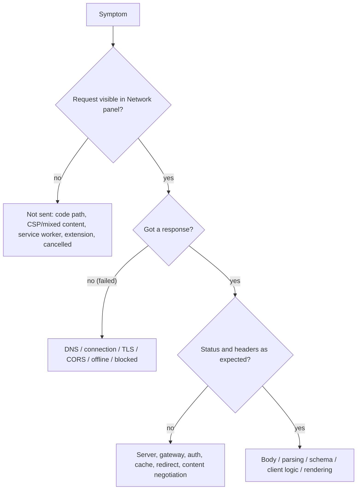
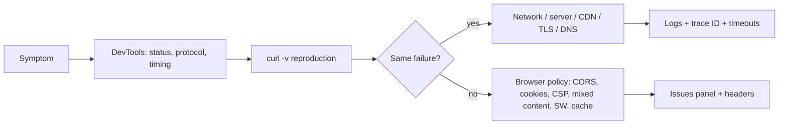

# Network Debugging and Troubleshooting

> Verification note: the protocol/semantics facts used here (status codes, redirects, methods, QUIC/HTTP/3 properties, WebTransport/SSE/WebSocket behaviours) were verified in [01](01-http-semantics-and-protocol-versions.md) and [05](05-real-time-communication-websockets-sse-webtransport.md) (MDN, Sep–Nov 2026) and in earlier research (SSE connection limits, Next.js streaming/buffering notes). **DevTools panel names/columns, curl flags (`--http3`, `-w` variables), proxy tools (Charles, Proxyman, mitmproxy), Wireshark `SSLKEYLOGFILE`, `chrome://net-export`, Playwright HAR/trace, error code strings (`ERR_*`) and mobile debugging workflows are tool knowledge not re-fetched in this session — UI labels change between browser versions and are marked *(hedged)*; adapt to your tool versions.** Related: [web-performance/03 §13](../web-performance/03-network-caching-and-delivery.md#13-debugging-delivery-problems) (delivery/performance debugging) and [web-performance/07](../web-performance/07-performance-debugging-budgets-and-culture.md) (workflow); CORS/cookie debugging is cross-referenced from [web-security](../web-security/README.md).

## Table of Contents

1. [Quick Summary (TL;DR)](#1-quick-summary-tldr)
2. [A Systematic Method: Isolate the Layer](#2-a-systematic-method-isolate-the-layer)
3. [Browser DevTools Network Panel Mastery](#3-browser-devtools-network-panel-mastery)
4. [Reading Waterfalls and Timing Breakdowns](#4-reading-waterfalls-and-timing-breakdowns)
5. [curl and Command-Line Recipes](#5-curl-and-command-line-recipes)
6. [Proxies, Packet Captures and TLS Inspection](#6-proxies-packet-captures-and-tls-inspection)
7. [Symptom-to-Cause Catalogue](#7-symptom-to-cause-catalogue)
8. [CORS, Cookies and Credentials Debugging](#8-cors-cookies-and-credentials-debugging)
9. [Caching, Service Workers and "Why Is This Stale?"](#9-caching-service-workers-and-why-is-this-stale)
10. [Real-Time Connections: SSE, WebSocket, WebTransport](#10-real-time-connections-sse-websocket-webtransport)
11. [Mobile, Native and Remote Debugging](#11-mobile-native-and-remote-debugging)
12. [Production Debugging: RUM, Logs, HAR and Synthetics](#12-production-debugging-rum-logs-har-and-synthetics)
13. [Debugging Playbooks (Step-by-Step)](#13-debugging-playbooks-step-by-step)
14. [Pitfalls](#14-pitfalls)
15. [Interview Questions — Fundamentals](#15-interview-questions--fundamentals)
16. [Interview Questions — Senior Scenarios](#16-interview-questions--senior-scenarios)
17. [Cheat Sheet](#17-cheat-sheet)
18. [Key Terms Glossary](#18-key-terms-glossary)
19. [Further Reading](#19-further-reading)

---

## 1. Quick Summary (TL;DR)

- **Debug by layer, not by guess:** DNS → TCP/QUIC → TLS → HTTP request/response → CDN/proxy/gateway → origin/app → client code. Find the **first layer where reality diverges from expectation**.
- **The Network panel answers 80%:** status, protocol (`h2`/`h3`), initiator, timing phases, request/response headers, payload, cookies and *why* something was blocked. Learn **Preserve log**, **Disable cache**, **Throttling**, **Copy as cURL**, **HAR export**, **Local overrides** and **Request blocking** *(hedged names)*.
- **Reproduce outside the browser** with `curl -v` (headers, redirects, protocol, timing) to separate **browser-enforced** failures (CORS, mixed content, CSP, cookie rules) from **server/network** failures.
- **"Failed to fetch" is intentionally vague** — the real reason (CORS, DNS, TLS, mixed content, blocked by extension, CSP, offline) is in DevTools **console/Network/Issues**, not in the JS error ([02 §3](02-fetch-api-and-browser-networking.md#3-error-semantics-what-rejects-and-what-doesnt)).
- **Timing phases tell the story:** long *Queueing/Stalled* → connection limits/priorities; long *DNS/Connect/SSL* → connection setup; long *Waiting (TTFB)* → server/CDN; long *Content Download* → payload size/bandwidth.
- **Production-only bugs** usually involve an intermediary (CDN, WAF, proxy, load balancer), TLS/HTTP version differences, caching/cookies, auth/session, deploy skew, or real-user networks — so **correlate with request/trace IDs** and compare with a working environment.



---

## 2. A Systematic Method: Isolate the Layer

1. **Define the failure precisely:** what request, which environment/browser/network/user, always or intermittently, since when (deploy? config?), error text, trace/request ID.
2. **Reproduce and minimise:** one request in `curl` or a tiny script; remove variables (cookies, headers, extensions, service worker).
3. **Compare working vs failing:** same request from another network, device, browser profile (incognito), region, or environment; diff **request headers, response headers, protocol, TLS version, IP, `Via`/`Server` headers**.
4. **Bisect the path:** client → (service worker) → browser cache → corporate proxy → CDN/WAF → load balancer → gateway/BFF → origin. Use `curl --resolve` to hit a specific edge/origin IP; bypass the CDN with a direct origin hostname (where safe); check CDN debug headers (`X-Cache`, `CF-Cache-Status`, `Age`, `Via` *(hedged names)*).
5. **Check what changed:** deploys, config/feature flags, certificates (expiry!), DNS records, CDN rules, WAF rules, dependency upgrades, browser releases.
6. **Form a hypothesis, predict an observation, test it** (e.g., "if it's the 60 s idle timeout, the WS closes with `1006` at exactly 60 s").
7. **Fix, verify in the same conditions, add a regression test/alert**, and write down the cause (runbook).

Useful asymmetry: **browser-only failures** → look at browser-enforced policies (CORS, CSP, cookies, mixed content, HSTS, bfcache, service workers). **curl-also-fails** → network/server/TLS/DNS.

---

## 3. Browser DevTools Network Panel Mastery

*(Chrome/Edge names; Firefox and Safari have equivalents — hedged.)*

| Feature | Use |
|---|---|
| **Preserve log** | Keep requests across navigations/redirects (essential for login flows, redirects, OAuth) |
| **Disable cache** (while DevTools open) | Test cold loads; but also test **with cache** for real-user behaviour |
| **Throttling** (Fast/Slow 4G/3G, Offline, custom) | Simulate latency/bandwidth; combine with CPU throttling ([web-performance/07](../web-performance/07-performance-debugging-budgets-and-culture.md)) |
| **Columns:** Status, Type, Initiator, Size (transferred / resource), Time, **Protocol**, **Priority**, Remote Address, Waterfall, Set-Cookies, Response headers | Right-click header row to add; sort by Time/Size; check `h2`/`h3` per request |
| **Filters:** `fetch/XHR`, `WS`, `Doc`, text filters (`method:POST`, `status-code:500`, `-domain:analytics`, `larger-than:100k`, `is:from-cache`, `has-response-header:set-cookie`) *(hedged syntax)* | Narrow quickly |
| **Initiator tab/column & call stack** | Which code triggered the request (find duplicate calls, third-party scripts) |
| **Headers tab** | General (URL, method, status, remote address), **request headers** (cookies sent, `Authorization`, `Origin`), **response headers**; **Provisional headers** warning = request never completed/was blocked |
| **Payload / Preview / Response** | Request body, parsed/raw response; check `Content-Type`/charset mismatches |
| **Timing tab** | Queueing, Stalled, DNS Lookup, Initial connection, SSL, Request sent, **Waiting for server response (TTFB)**, Content Download; **Server Timing** section ([07 §8](07-api-client-architecture-and-contracts.md#8-observability-correlation-ids-and-tracing)) |
| **Cookies tab** | Cookies sent/received and **why a cookie was blocked/filtered** (SameSite, Secure, Domain, third-party blocking) |
| **Copy → Copy as cURL / fetch** | Reproduce exactly in a terminal ([§5](#5-curl-and-command-line-recipes)) |
| **Export HAR** | Share a full capture (sanitise cookies/tokens first — HARs contain secrets) |
| **Request blocking / Local overrides** | Block a URL/domain to test failure paths; override response headers/bodies to test fixes without deploying |
| **WS / EventStream (SSE) tabs** | Frames/messages with timestamps ([§10](#10-real-time-connections-sse-websocket-webtransport)) |
| **Issues panel / Console** | Browser-reported problems: CORS, mixed content, cookie issues, CSP, deprecations (often the *only* place the real reason appears) |
| **Application → Service Workers / Storage / Cache storage** | See what's intercepting/serving responses; "Bypass for network"; unregister; clear storage |
| **Network conditions** | Override User-Agent, disable cache, throttle; **Request blocking** |
| **Size column hints** | `(memory cache)`, `(disk cache)`, `(ServiceWorker)`, `(prefetch cache)`, `(from push)` — tells you who answered |

---

## 4. Reading Waterfalls and Timing Breakdowns

| Observation | Likely cause | Next step |
|---|---|---|
| Long **Queueing/Stalled** before the request | Per-host connection limit (HTTP/1.1 ≈6), request priorities, many requests, service worker startup | Check protocol; reduce requests; priorities; use HTTP/2+; inspect SW |
| Long **DNS** | Cold DNS, many hostnames, slow resolver | `dns-prefetch`/`preconnect`, fewer hosts, DNS provider |
| Long **Initial connection + SSL** | Distance, TLS handshake RTTs, no connection reuse, cert chain/OCSP issues | `preconnect`, TLS 1.3/HTTP/3, edge termination, check cert chain |
| Long **Waiting (TTFB)** | Slow origin/DB, CDN cache miss, cold starts, WAF/gateway delays, auth callout | `Server-Timing`, compare `X-Cache`/`Age`, hit origin directly, check logs/traces |
| Long **Content Download** | Large payload, no compression, bandwidth, streaming | Check `Content-Encoding`, size, pagination, range; verify not stuck on a stream |
| **Vertical step pattern (waterfall chain)** | Dependent requests: HTML → JS → API → image; redirects | Inspect initiators; preload/parallelise; BFF aggregation ([03 §13](03-rest-api-design-and-consumption.md#13-consuming-apis-from-the-frontend-overunder-fetching-and-bffs)) |
| **Many identical requests** | Duplicate fetches (no dedupe), React StrictMode double-invoke in dev, polling, prefetch, multiple components | Query keys/dedupe; check `Initiator`; confirm prod behaviour |
| **OPTIONS before each call** | CORS preflight (non-simple request) | Same-origin proxy; `Access-Control-Max-Age`; remove unnecessary headers ([web-security/06 §4](../web-security/06-security-headers-cors-and-transport.md#4-cors-correct-configuration-and-common-mistakes)) |
| **Request `(canceled)`** | Aborted (navigation, unmount, `AbortController`), blocked, or superseded | Verify intentional; check abort logic |
| **`(failed)`/`net::ERR_…`** | Network/TLS/CORS/blocked; see error string | See [§7](#7-symptom-to-cause-catalogue) |
| **Status `0`/blank with `type: opaque`** | `no-cors` request or blocked | Check mode/CORS ([02 §2](02-fetch-api-and-browser-networking.md#2-request-response-and-headers-objects)) |

Cross-check against **Resource Timing** data (`nextHopProtocol`, `transferSize`) captured in code or RUM ([02 §13](02-fetch-api-and-browser-networking.md#13-measuring-network-behaviour-in-the-browser)).

---

## 5. curl and Command-Line Recipes

```bash
# Headers + protocol negotiation + redirects (verbose)
curl -sS -v -L https://example.com/api/items -o /dev/null

# Only response headers
curl -sSI https://example.com/app.js

# Timing breakdown (DNS, connect, TLS, TTFB, total)
curl -sS -o /dev/null -w 'dns:%{time_namelookup} connect:%{time_connect} tls:%{time_appconnect} ttfb:%{time_starttransfer} total:%{time_total} http:%{http_version} size:%{size_download}\n' https://example.com/api/items

# Force protocol versions (HTTP/3 needs a curl built with it — hedged)
curl --http1.1 -I https://example.com/ ;  curl --http2 -I https://example.com/ ;  curl --http3 -I https://example.com/

# Compression and caching headers as a browser would see them
curl -sS --compressed -D - -o /dev/null -H 'Accept-Encoding: br, gzip' https://example.com/app.js

# Conditional request (ETag revalidation)
curl -sSI -H 'If-None-Match: "v17"' https://example.com/api/products/42

# Hit a specific edge/origin IP while keeping Host/SNI (bypass DNS / test one node)
curl -sS -v --resolve example.com:443:203.0.113.10 https://example.com/health

# Send JSON with an idempotency key
curl -sS -X POST https://api.example.com/payments -H 'Content-Type: application/json' -H 'Idempotency-Key: 8f1c…' -d '{"amount":4599,"currency":"USD"}'

# Simulate a CORS preflight (what the browser sends)
curl -sS -i -X OPTIONS https://api.example.com/orders -H 'Origin: https://app.example.com' -H 'Access-Control-Request-Method: POST' -H 'Access-Control-Request-Headers: content-type,x-csrf-token'

# Cookies jar for session flows
curl -sS -c jar.txt -b jar.txt https://example.com/login -d 'user=a&pass=b'

# Retry / timeouts like a client would
curl -sS --retry 3 --retry-delay 1 --max-time 10 --connect-timeout 3 https://example.com/api/items
```
Other CLI helpers *(hedged)*: `dig +trace example.com` / `nslookup` (DNS), `openssl s_client -connect host:443 -servername host -alpn h2` (TLS chain/ALPN), `mtr`/`traceroute` (path/loss), `ping`, `nc`, `httpie`/`xh`, `hey`/`wrk`/`k6` (load), `jq`.

**Caveat:** `curl` doesn't enforce CORS, SameSite, CSP or mixed-content — success in curl and failure in browser points to **browser-enforced policy**.

---

## 6. Proxies, Packet Captures and TLS Inspection

| Tool | Use | Notes |
|---|---|---|
| **Charles / Proxyman / mitmproxy** | Intercept, inspect, modify, replay HTTP(S) from browsers/devices/emulators | Install the proxy CA on the device to decrypt TLS; some apps pin certificates; mobile apps may bypass system proxy |
| **Wireshark / tcpdump** | Packet-level analysis (retransmissions, RST, handshake failures) | Decrypt TLS with **`SSLKEYLOGFILE`** from Chrome/Firefox/curl *(hedged)*; QUIC/HTTP/3 needs keylog too |
| **Chrome NetLog (`chrome://net-export`)** *(hedged)* | Low-level browser network events (DNS, QUIC, proxy resolution) for stubborn issues | Analyse with the NetLog viewer |
| **DevTools protocol/HAR tools** | Automate captures (Playwright `recordHar`, tracing) | Strip secrets before sharing |
| **Corporate proxy diagnostics** | Check `Via`, injected headers, TLS interception certs, blocked WebSockets/UDP | Ask IT for PAC/proxy logs |
| **Service meshes/ingress logs** | Server-side evidence (request IDs, upstream timings, status flags) | Correlate with `X-Request-ID`/trace IDs |

**Security:** captures contain cookies/tokens/PII — treat HAR/pcap files as secrets; scrub before attaching to tickets ([web-security/08 §11](../web-security/08-secure-frontend-patterns-and-vulnerability-catalogue.md#11-secrets-source-maps-and-sensitive-data-exposure)).

---

## 7. Symptom-to-Cause Catalogue

| Symptom | Common causes | How to confirm | Fix |
|---|---|---|---|
| **`TypeError: Failed to fetch`** | CORS failure, DNS/TLS error, offline, mixed content, CSP `connect-src` block, extension/ad-blocker, server reset | Console/Issues panel text; Network row `(failed)`/`net::ERR_*`; try `curl` | Fix per cause ([§8](#8-cors-cookies-and-credentials-debugging)) |
| **`net::ERR_CERT_*` / `SEC_ERROR_*`** | Expired/mismatched/untrusted cert, missing intermediate, TLS interception | `openssl s_client`, browser cert viewer, SSL Labs *(hedged)* | Renew/fix chain; CA trust; avoid pinning surprises |
| **`net::ERR_NAME_NOT_RESOLVED`** | DNS record missing/propagation, split-horizon DNS, typo | `dig` from multiple resolvers | Fix DNS; TTLs |
| **`ERR_CONNECTION_RESET/REFUSED/TIMED_OUT`** | Server/LB down, firewall, idle timeout, port wrong | `curl -v`, LB logs, security groups | Fix infra; retries/backoff |
| **`ERR_HTTP2_PROTOCOL_ERROR` / `ERR_QUIC_PROTOCOL_ERROR`** | Proxy/LB bug, header too large, invalid frames, upstream closing | Try `--http1.1` vs `--http2`; NetLog | Fix proxy config; header sizes; fall back |
| **`431` / `400 Request Header Fields Too Large`** | Bloated cookies/headers | Inspect cookie sizes in request | Trim cookies; scope them ([web-security/04](../web-security/04-cookies-sessions-and-csrf.md)) |
| **`413 Payload Too Large`** | Gateway/server body limit | Response server header; try smaller | Raise limits or use presigned/chunked uploads ([03 §9](03-rest-api-design-and-consumption.md#9-large-payloads-uploads-and-long-running-operations)) |
| **`502/504` intermittently** | Upstream crash/timeouts, LB health checks, cold starts, deploys | LB/gateway logs, upstream timings | Timeouts alignment, health checks, retries, capacity |
| **`304` unexpectedly / stale data** | Validators/caching rules, `Vary`, service worker | Headers: `ETag`, `Cache-Control`, `Age`; "Disable cache" test | Correct cache headers ([§9](#9-caching-service-workers-and-why-is-this-stale)) |
| **`401` after some time/random** | Token expiry/refresh race, clock skew, cookie expiry/SameSite, multi-tab rotation | Compare `exp`, cookies tab, concurrent refresh logs | Single-flight refresh; cookie flags ([07 §5](07-api-client-architecture-and-contracts.md#5-auth-interceptors-and-token-refresh)) |
| **`403` only in browser** | CORS/CSRF/Origin checks, WAF rules (User-Agent/`Sec-Fetch-*`), missing cookies | Compare headers with curl; WAF logs | Allow-list/adjust rules; send required headers |
| **`200` but HTML instead of JSON** | Captive portal, proxy login page, SPA fallback route, wrong base URL | Response tab/`Content-Type` | Correct routing; detect via content-type ([06 §2](06-resilience-retries-timeouts-and-offline.md#2-a-taxonomy-of-network-failures)) |
| **Mixed content blocked** | HTTP subresource on HTTPS page | Console warning | Use HTTPS/`upgrade-insecure-requests` ([web-security/06 §5](../web-security/06-security-headers-cors-and-transport.md#5-https-hsts-and-mixed-content)) |
| **Redirect loop (`ERR_TOO_MANY_REDIRECTS`)** | HTTP↔HTTPS or www/apex rules fighting, auth redirects, proxy `X-Forwarded-Proto` misconfig | `curl -L -v`; Network with Preserve log | Fix canonical rules/headers |
| **Slow only on first request** | Cold start, TLS/DNS, CDN miss | Timing breakdown across repeats | Warmers, preconnect, caching, edge |
| **Slow only in some regions/ISPs** | Routing, CDN POP, IPv6/MTU/UDP-blocking affecting HTTP/3 | Test via region probes; compare `h2` vs `h3` | CDN/region config; allow HTTP/2 fallback |
| **Duplicate requests** | No dedupe, StrictMode (dev), retries, preflight, prefetch | Initiator column; compare prod | Query dedupe; remove double triggers |
| **Request blocked `(blocked:other)`/`ERR_BLOCKED_BY_CLIENT`** | Ad blocker/privacy extension, CSP, enterprise policy | Incognito without extensions; Issues panel | Rename endpoints (analytics-like names), CSP fixes |
| **Chunk/asset `404` after deploy** | Version skew; CDN not retaining old assets | Network row 404 on `/_next/static/...` | Keep old assets; skew protection ([nextjs-and-rendering/08](../nextjs-and-rendering/08-deployment-runtimes-and-operations.md)) |
| **WebSocket closes at fixed interval (`1006`)** | LB/proxy idle timeout | Time to disconnect equals a round number | Heartbeats < timeout ([05 §8](05-real-time-communication-websockets-sse-webtransport.md#8-connection-lifecycle-heartbeats-reconnection-resync)) |
| **SSE/streaming arrives all at once** | Proxy/CDN buffering or compression | EventStream tab timing; `curl -N` | Disable buffering (`X-Accel-Buffering: no`), flush ([01 §12](01-http-semantics-and-protocol-versions.md#12-proxies-cdns-and-intermediaries)) |
| **Uploads fail at ~N MB / hang** | Body size limits, timeouts, memory buffering | Server/gateway logs | Chunked/presigned uploads |
| **Works on Wi-Fi, fails on cellular/corporate** | Proxy/DPI blocking, UDP blocked, DNS filtering | Test hotspot vs corporate; `curl --http2` | Fallbacks; 443/TLS; allow-lists |

---

## 8. CORS, Cookies and Credentials Debugging

**CORS checklist** (details: [web-security/06 §4](../web-security/06-security-headers-cors-and-transport.md#4-cors-correct-configuration-and-common-mistakes)):
1. Console says which header is missing/mismatched — read it.
2. Is there a **preflight** (`OPTIONS`)? Did it return `2xx` with `Access-Control-Allow-Origin/Methods/Headers`? Preflights **can't follow redirects** and must not require auth.
3. Does the actual response include `Access-Control-Allow-Origin` (exact origin when credentials)? `Allow-Credentials: true`? `Vary: Origin`?
4. Are you sending **non-safelisted headers** (`Authorization`, `traceparent`, `X-CSRF-Token`) the server doesn't allow?
5. Is a CDN/gateway **stripping/caching** CORS headers (cached response for origin A served to origin B)?
6. Simulate with `curl -X OPTIONS` ([§5](#5-curl-and-command-line-recipes)); remember curl doesn't enforce CORS.
7. Prefer **same-origin proxy/BFF** to remove the class of problems.

**"Cookie not sent / not stored"** (Network → Cookies tab shows reasons):
- **SameSite** (unset ⇒ Lax; cross-site fetch needs `SameSite=None; Secure`), **Secure** on HTTP, **Domain/Path** mismatch, **third-party cookie blocking**, cookie size/limit, `credentials: 'include'` missing on fetch, CORS credentials rules, `__Host-` prefix violations ([web-security/04 §3](../web-security/04-cookies-sessions-and-csrf.md#3-secure-cookie-attributes)).
- **`Set-Cookie` ignored** when the response is blocked by CORS or is a redirect handled by `fetch` in `manual` mode.

**Auth header lost:** cross-origin redirects strip `Authorization`; proxies may drop it; `no-cors` mode can't set it.

---

## 9. Caching, Service Workers and "Why Is This Stale?"

1. **Who served it?** Size column: `(memory cache)`, `(disk cache)`, `(ServiceWorker)`, or network. Application → Service Workers: is one registered/controlling the page? Use **Bypass for network** or unregister to test.
2. **What do the headers say?** `Cache-Control` (`max-age`, `no-store`, `no-cache`, `stale-while-revalidate`), `ETag`/`Last-Modified`, `Age`, `Date`, `Vary`, CDN headers (`X-Cache`, `CF-Cache-Status`, `Via`) *(hedged)*. Fresh responses within `max-age` don't hit the network at all.
3. **Is revalidation happening?** `304` responses mean validators work; absence of conditional headers → no validator.
4. **CDN cache keys:** query params, cookies, `Vary` headers; purge/invalidation latency; different POPs hold different versions.
5. **Client caches:** query library `staleTime/gcTime`, persisted caches, Next.js data/route caches ([nextjs-and-rendering/03](../nextjs-and-rendering/03-caching-and-revalidation.md)), `localStorage` snapshots.
6. **Immutable asset caching + filename hashing:** stale `index.html` referencing removed assets → 404s; HTML should be short-lived/revalidated ([web-performance/03 §6](../web-performance/03-network-caching-and-delivery.md#6-caching-strategy-by-asset-type)).
7. **bfcache/back button** restores old state without network: test with `pageshow` `persisted` handling ([web-performance/03 §10](../web-performance/03-network-caching-and-delivery.md#10-backforward-cache-bfcache)).
8. **Test clean vs warm:** hard reload, incognito, clearing site data, curl with/without conditional headers.

---

## 10. Real-Time Connections: SSE, WebSocket, WebTransport

- **WebSocket:** Network → WS → Messages tab shows frames; check handshake (`101 Switching Protocols`, `Origin`, subprotocol, cookies); close code/reason in console/`onclose`; `1006` = abnormal closure (no close frame: network/proxy/server crash/timeouts); `1008/4xxx` app-defined policies; test with `wscat`/`websocat` *(hedged)* and `curl --include` handshake tricks.
- **SSE:** EventStream tab shows events with timestamps; `curl -N -H 'Accept: text/event-stream' URL` verifies streaming and buffering; check `Content-Type: text/event-stream`, no compression/buffering, `Cache-Control: no-cache`, heartbeats, `Last-Event-ID` replay ([05 §4](05-real-time-communication-websockets-sse-webtransport.md#4-server-sent-events-sse)).
- **HTTP/1.1 SSE connection-limit hang:** many tabs → new requests stall (6 per host) — check protocol is `h2`.
- **WebTransport:** DevTools support is limited *(hedged)*; use `transport.getStats()` where available (not in Chrome per MDN compat notes), `transport.closed` rejection details (`WebTransportError`), server logs, QUIC/HTTP/3 reachability (UDP/443 blocked?), certificate/hash rules, and verify the server checks `Origin` ([05 §6](05-real-time-communication-websockets-sse-webtransport.md#6-webtransport)).
- **Common cross-cutting causes:** idle timeouts, proxy buffering, auth expiry mid-connection, reconnect storms, sticky-session misrouting, server restarts without draining.

---

## 11. Mobile, Native and Remote Debugging

- **Chrome Remote Debugging (Android)** and **Safari Web Inspector (iOS)** attach DevTools to mobile browsers/WebViews *(hedged)*; enable debugging in settings/dev builds.
- **Proxy mobile traffic** through Charles/Proxyman/mitmproxy (device Wi-Fi proxy + install CA); beware certificate pinning in native apps and HTTP/3 (QUIC) bypassing HTTP proxies — disable QUIC in test or use tools that support it *(hedged)*.
- **React Native:** use React Native DevTools / network inspector in your RN version, Flipper-style tooling where still used, or proxy tools; native stacks (OkHttp/NSURLSession) differ from browser `fetch` (no CORS, different cookie/redirect/cache behaviour) ([react-native/03](../react-native/03-native-integration.md)) *(hedged)*.
- **Real devices & networks:** test on cellular, captive Wi-Fi, low-end devices; use throttling presets as approximations only.
- **Offline & flaky-network drills:** airplane mode toggles, network link conditioner (macOS/iOS) *(hedged)*, Android emulator network profiles.

---

## 12. Production Debugging: RUM, Logs, HAR and Synthetics

- **Always propagate request/trace IDs**; ensure users can copy one from the error UI; search logs/traces by ID ([07 §8](07-api-client-architecture-and-contracts.md#8-observability-correlation-ids-and-tracing)).
- **RUM segmentation:** by region/ISP/device/browser/protocol (`h2` vs `h3`), network type, release; compare failing vs healthy cohorts to spot CDN/ISP issues ([web-performance/01](../web-performance/01-performance-metrics-and-measurement.md)).
- **Ask users for a HAR** (with instructions to sanitise or via a secure upload tool) or enable **session replay with network metadata** *(privacy review)*; scrub tokens/PII.
- **Synthetic monitoring** from multiple regions/networks (DNS, TLS, HTTP/3, API health, certificate expiry) catches outages with no user traffic.
- **Server/CDN logs:** status distribution, upstream response time, cache hit ratio, WAF blocks, TLS versions, protocol usage; correlate by request ID.
- **Feature flags/kill switches** to disable suspected culprits (prefetching, new endpoints, realtime) during incident triage.
- **Incident hygiene:** capture timeline, evidence (headers, IDs), root cause, and add alerts/tests (e.g., certificate-expiry alerts, header regression tests — [web-security/06 §12](../web-security/06-security-headers-cors-and-transport.md#12-testing-monitoring-and-rollout)).

---

## 13. Debugging Playbooks (Step-by-Step)

### Playbook A — "API calls fail in production, work locally"
1. Compare request in Network: URL/base URL, `Origin`, headers, cookies, protocol.
2. Look for CORS/preflight (`OPTIONS`) failures, mixed content, CSP `connect-src`.
3. Check environment config (`NEXT_PUBLIC_*` baked at build?), reverse proxy/CDN routing, auth/cookie scope (`SameSite`, domain).
4. Reproduce with `curl` using the exact headers; compare with local.
5. Inspect CDN/WAF logs for blocks; check certificate and DNS.
6. Fix and add a post-deploy smoke test for the critical endpoints.

### Playbook B — "Page is slow; API calls take 3 seconds"
1. Timing tab: where is the time (Queueing, Connect, TTFB, Download)?
2. TTFB high → `Server-Timing`, CDN `X-Cache`, origin traces; test origin directly.
3. Many sequential calls → waterfall; redesign endpoints/prefetch ([03 §13](03-rest-api-design-and-consumption.md#13-consuming-apis-from-the-frontend-overunder-fetching-and-bffs)).
4. Large payloads → compression, pagination, fields.
5. Verify HTTP/2/3 and connection reuse; consider `preconnect`.
6. Add RUM per endpoint to track regressions.

### Playbook C — "Users randomly get logged out"
1. Is it `401` from API or cookie disappearance? Check Cookies tab/`Set-Cookie`.
2. Multi-tab refresh-token rotation races? Check refresh logs/single-flight.
3. Cookie attributes (`SameSite`, domain, size limits), Safari ITP/third-party blocking, load balancer session stickiness/sticky store misses.
4. Session store eviction/TTL vs cookie lifetime; clock skew in JWT validation.
5. Fix + add alerting on unexpected `401` rates ([web-security/04](../web-security/04-cookies-sessions-and-csrf.md), [05](../web-security/05-authentication-and-authorization-in-the-frontend.md)).

### Playbook D — "File upload fails for large files only"
1. Response status (`413`, `408`, `502/504`, reset)? Which hop returns it (headers like `Server`, `Via`)?
2. Gateway/CDN/body-size/timeouts; request buffering; memory limits.
3. Switch to presigned direct upload or chunked/resumable; verify CORS on the bucket.
4. Add progress/retry/resume UI and server cleanup of partial uploads.

### Playbook E — "Stale content after deploy"
1. Which layer served it? (`(ServiceWorker)`, disk cache, CDN `Age`.)
2. Check `Cache-Control` on HTML vs hashed assets; CDN purge; SW update flow (`skipWaiting`, update prompts).
3. Fix header strategy; add release invalidation; add "new version available" UX.

---

## 14. Pitfalls

1. **Trusting the JS error message** ("Failed to fetch") instead of DevTools/console/Issues details.
2. **Debugging with cache disabled only** — real users have caches (and service workers).
3. **Forgetting Preserve log** during redirect/login flows.
4. **Assuming curl success means browser success** (CORS/cookies/CSP/mixed content are browser-only).
5. **Sharing HARs/screenshots with tokens/cookies.**
6. **Ignoring the protocol column** (assuming HTTP/2/3 when requests fall back to HTTP/1.1).
7. **Blaming the app when an intermediary is the culprit** (CDN, WAF, corporate proxy, LB timeouts).
8. **Testing only on fast office networks/desktop.**
9. **Chasing duplicate requests that are dev-only** (StrictMode) without checking production builds.
10. **No request IDs** → can't correlate frontend reports with backend logs.
11. **Not checking certificate expiry/DNS changes** after "mysterious" outages.
12. **Fixing symptoms by disabling security features** (`no-cors`, `*` CORS, turning off CSP) instead of finding the cause.

---

## 15. Interview Questions — Fundamentals

### Q1. How do you debug a failing API call in the browser?
Open the Network panel (Preserve log), inspect status, protocol, request/response headers, payload and timing; check Console/Issues for CORS/mixed-content/CSP messages; replay with `curl` via "Copy as cURL" to separate browser policy from server/network problems.

### Q2. What do the phases in the Timing tab mean?
Queueing/Stalled (waiting to start), DNS, Initial connection (TCP/QUIC), SSL/TLS, Request sent, Waiting (TTFB: server/network latency), Content Download (body transfer).

### Q3. Why does `fetch` say only "Failed to fetch" for CORS errors?
For security, scripts aren't given details of cross-origin failures; the browser reports the real reason in the console/DevTools.

### Q4. What does a request with `(from service worker)` in the Size column mean?
The response came from a service worker (possibly from Cache Storage) without hitting the network.

### Q5. How can you tell whether HTTP/2 or HTTP/3 is used?
Enable the Protocol column in DevTools (`h2`, `h3`), or use `curl -I --http2/--http3` and `PerformanceResourceTiming.nextHopProtocol`.

### Q6. How do you test a CORS preflight from the command line?
Send `curl -X OPTIONS` with `Origin`, `Access-Control-Request-Method` and `Access-Control-Request-Headers` and inspect `Access-Control-Allow-*` in the response.

### Q7. A WebSocket drops every 60 seconds — likely cause?
An intermediary idle timeout; add heartbeats shorter than the timeout and verify LB settings.

### Q8. What should you sanitise before sharing a HAR file?
Cookies, `Authorization`/token headers, query-string secrets and sensitive response bodies.

---

## 16. Interview Questions — Senior Scenarios

### S1. "Checkout API calls fail only for users on a particular ISP."
Segment RUM by ISP/region/protocol; compare `h3` vs `h2` success; suspect UDP/QUIC blocking, MTU/IPv6 routing, DNS filtering or a CDN POP issue; test with probes from that ISP; ensure HTTP/2 fallback works; adjust CDN routing/Alt-Svc; add synthetic checks per region; communicate workarounds.

### S2. "Production shows intermittent 502s that we can't reproduce."
Correlate by request ID across CDN/LB/gateway/app logs; check upstream timeouts, health checks, deploy windows, autoscaling cold starts, keep-alive mismatches (LB idle timeout shorter than server keep-alive → reset), connection pool limits; add timeouts/retries for idempotent calls, align timeouts, and instrument upstream timings (`Server-Timing`).

### S3. "Our SSE notifications arrive in bursts every 30 seconds."
Intermediary buffering/compression flushing on a timer. Verify with `curl -N` through each hop, disable buffering/compression on the route, ensure flush after each event, add comment heartbeats, use HTTP/2, and test through the real CDN.

### S4. "After enabling a WAF rule, some users get 403 only in Safari."
Compare request headers between browsers (`Sec-Fetch-*`, `User-Agent`, `Accept`), inspect WAF logs for the matched rule, check bot-score/JS-challenge incompatibilities, adjust rule/exception, and add synthetic Safari checks.

### S5. "A third-party script causes duplicate API calls and slows INP."
Use the Initiator column/stack to attribute requests, block the script via Request blocking to confirm, measure timing/INP impact, govern/remove/sandbox the script, and add monitoring on request counts per page ([web-security/07](../web-security/07-supply-chain-and-third-party-script-security.md)).

### S6. "How do you build an on-call runbook for frontend networking incidents?"
Decision tree by symptom (Playbooks), dashboards (error rate by endpoint/region/protocol/release), commands (`curl` recipes), kill switches/feature flags, rollback steps, contact paths for CDN/DNS/WAF owners, certificate/DNS expiry alerts, example HAR sanitisation steps, and post-incident template with root-cause categories.

---

## 17. Cheat Sheet

| Goal | Tool/Action |
|---|---|
| See what happened | DevTools Network + Console/Issues, Preserve log |
| Reproduce | Copy as cURL → `curl -v` |
| Timing | DevTools Timing tab; `curl -w` variables |
| Protocol | Protocol column; `--http2/--http3`; `nextHopProtocol` |
| Who served it | Size column (cache/SW/network), `Age`, `X-Cache`/`Via` |
| CORS | Check preflight; `curl -X OPTIONS` with Origin/ACR headers |
| Cookies | Network → Cookies tab (blocked reasons) |
| Streams | EventStream/WS tabs; `curl -N` |
| Deep dive | mitmproxy/Charles, Wireshark + `SSLKEYLOGFILE`, NetLog |
| Production | Request IDs, RUM segmentation, synthetics, logs |



---

## 18. Key Terms Glossary

| Term | Definition |
|---|---|
| **HAR** | HTTP Archive: JSON capture of network activity |
| **TTFB** | Time to first byte |
| **Preflight** | `OPTIONS` check before non-simple CORS requests |
| **NetLog** | Chrome low-level network event log |
| **SSLKEYLOGFILE** | TLS secrets log for decrypting captures |
| **Idle timeout** | Intermediary closing silent connections |
| **Version skew** | Mismatch between client bundle and server/API version |
| **Synthetic monitoring** | Scripted probes simulating users |
| **Alt-Svc** | Header advertising alternative protocol endpoints (HTTP/3) |

---

## 19. Further Reading

- [Chrome DevTools — Network features reference](https://developer.chrome.com/docs/devtools/network/reference) · [MDN — CORS troubleshooting](https://developer.mozilla.org/en-US/docs/Web/HTTP/Guides/CORS/Errors) · [curl documentation](https://curl.se/docs/) *(hedged: check current URLs)*
- [mitmproxy docs](https://docs.mitmproxy.org/) · [Wireshark TLS decryption](https://wiki.wireshark.org/TLS)
- This repo: [01 HTTP semantics](01-http-semantics-and-protocol-versions.md) · [02 Fetch API](02-fetch-api-and-browser-networking.md) · [web-performance/03](../web-performance/03-network-caching-and-delivery.md) · [web-security/06](../web-security/06-security-headers-cors-and-transport.md)
