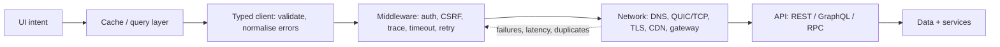
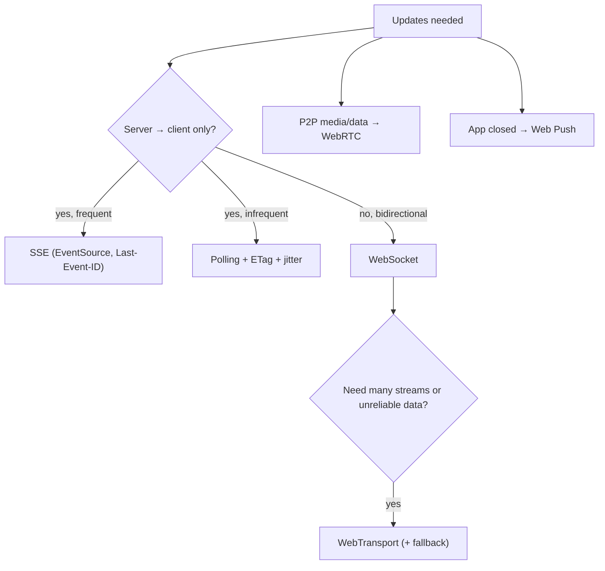
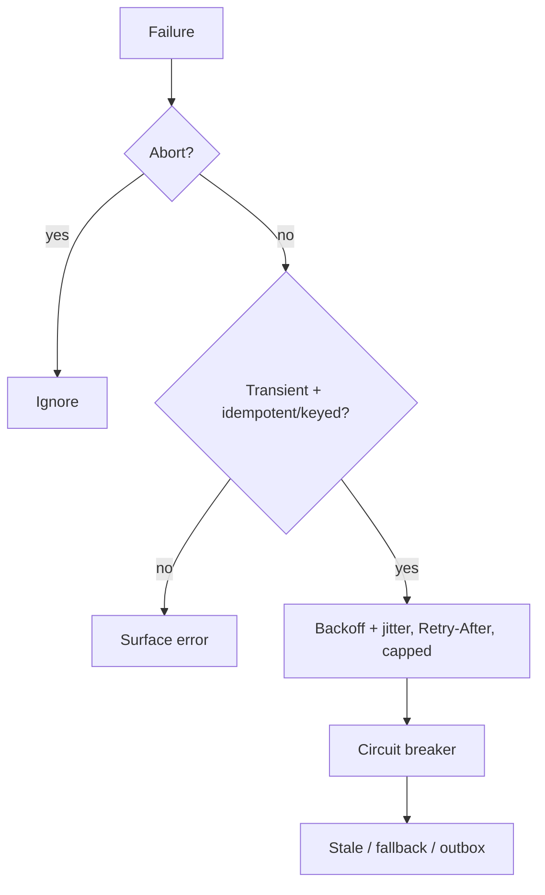

# Networking & APIs — Recall Map (Last-Minute Read)

> One-page mental model for the whole `networking-and-apis/` folder. Verified facts (HTTP method safe/idempotent/cacheable table incl. `QUERY`; QUIC/HTTP/3 properties; WebTransport Baseline 2026 status and support; SSE connection limits) come from MDN and earlier research checked Sep–Nov 2026; items marked *(hedged)* in the full files are general knowledge. Open the full file only for topics where you're weak.
> Full docs: [01 HTTP semantics and protocol versions](01-http-semantics-and-protocol-versions.md) · [02 Fetch API and browser networking](02-fetch-api-and-browser-networking.md) · [03 REST API design and consumption](03-rest-api-design-and-consumption.md) · [04 GraphQL, tRPC, gRPC and API styles](04-graphql-trpc-grpc-and-api-styles.md) · [05 Real-time: WebSockets, SSE, WebTransport](05-real-time-communication-websockets-sse-webtransport.md) · [06 Resilience, retries and offline](06-resilience-retries-timeouts-and-offline.md) · [07 API client architecture and contracts](07-api-client-architecture-and-contracts.md) · [08 Network debugging](08-network-debugging-and-troubleshooting.md)

## Table of Contents

1. [The 60-Second Mental Model](#1-the-60-second-mental-model)
2. [HTTP Semantics Map](#2-http-semantics-map)
3. [Protocol Versions Map](#3-protocol-versions-map)
4. [Fetch Map](#4-fetch-map)
5. [API Design Map](#5-api-design-map)
6. [API Styles Map](#6-api-styles-map)
7. [Real-Time Map](#7-real-time-map)
8. [Resilience Map](#8-resilience-map)
9. [API Client Architecture Map](#9-api-client-architecture-map)
10. [Debugging Map](#10-debugging-map)
11. [Decision Tables](#11-decision-tables)
12. [Numbers and Defaults to Remember](#12-numbers-and-defaults-to-remember)
13. [Mnemonics](#13-mnemonics)
14. [Rapid-Fire Q&A](#14-rapid-fire-qa)
15. [Say-This Scripts](#15-say-this-scripts)
16. [Red Flags and Green Flags](#16-red-flags-and-green-flags)
17. [Final 10-Minute Checklist](#17-final-10-minute-checklist)

---

## 1. The 60-Second Mental Model

> **Networking is a chain of untrusted, failure-prone hops carrying contracts. HTTP gives you shared semantics (methods, statuses, caching, conditionals); your job is to honour them in API design, wrap them in one typed client with validation and observability, assume every call can fail or repeat, and pick the simplest transport (poll → SSE → WebSocket → WebTransport) that fits.**



**Five questions for any networking answer**
1. **What are the HTTP semantics** (safe? idempotent? cacheable?) and what status/headers express them?
2. **What can fail or repeat?** (timeout, retry, duplicate, reorder, stale, offline)
3. **Who is the contract** (OpenAPI/SDL/proto) and how is it validated and versioned?
4. **Which transport/style fits** direction, latency, scale and infra?
5. **How will we observe and debug it** (request/trace IDs, timing, protocol, error taxonomy)?

---

## 2. HTTP Semantics Map

| Method | Safe | Idempotent | Cacheable | Use |
|---|---|---|---|---|
| GET / HEAD | Yes | Yes | Yes | Read |
| **QUERY** | Yes | Yes | Yes | Read with a body |
| OPTIONS / TRACE | Yes | Yes | No | Capabilities / diagnostics |
| PUT / DELETE | No | **Yes** | No | Replace / remove |
| POST / PATCH | No | **No** | Conditional* | Create/action / partial update |

\* only with explicit freshness + matching `Content-Location`.

| Status | Meaning |
|---|---|
| 200 / 201 + `Location` / 202 / 204 / 206 | OK / created / accepted async / no content / partial |
| 301-308 | **307/308 keep method**; 303 → GET after POST |
| **304** | Cached copy valid (conditional) |
| 400 / **422** | Malformed / semantically invalid |
| **401 / 403** | Unauthenticated / unauthorised |
| 404 / 409 / **412** / 428 | Missing / conflict / precondition failed / precondition required |
| **429** + `Retry-After` | Rate limited |
| 500 / 502 / **503** / 504 | Server / bad gateway / unavailable (+`Retry-After`) / gateway timeout |

**Conditionals:** `ETag` + `If-None-Match` → `304` (reads); `ETag` + `If-Match` → `412` (writes, optimistic concurrency).
**Rule:** retry **idempotent + transient** only; **don't** return `200` with an error body.

---

## 3. Protocol Versions Map

| | HTTP/1.1 | HTTP/2 | HTTP/3 |
|---|---|---|---|
| Transport | TCP | TCP + TLS | **QUIC (UDP)** |
| Multiplexing | No (≈6 conns/host) | Yes | Yes |
| HOL blocking | HTTP level | **TCP level remains** | **None across streams** |
| Handshake | TCP + TLS | same | Fewer RTTs (TLS 1.3 built in) |
| Network change | Breaks | Breaks | **Connection migration** |
| Headers | Plain | HPACK | QPACK |

QUIC standardised 2021, HTTP/3 2022 (MDN). **WebTransport** = streams + datagrams over HTTP/3, **Baseline 2026** (Chrome/Edge 97, Firefox 114, Safari 26.4).

---

## 4. Fetch Map

```ts
const ac = new AbortController();
const res = await fetch(url, { method, headers, body, credentials: 'same-origin', signal: ac.signal });
if (!res.ok) throw new HttpError(res.status, await safeBody(res), res);   // fetch does NOT reject on 4xx/5xx
return res.status === 204 ? undefined : await res.json();                 // body is single-use
```
- **Rejects:** network, CORS, abort (`AbortError`), timeout (`TimeoutError`). **Doesn't reject:** HTTP errors.
- **Body one-shot:** `clone()` to reuse. **`FormData`:** never set `Content-Type` manually.
- **Cancel:** `AbortController` / `AbortSignal.timeout`; **latest-wins** for typeahead.
- **Streaming:** `res.body` + `TextDecoderStream` (NDJSON, SSE over `POST`, LLM tokens). **Upload progress:** XHR.
- **Exit-time sends:** `sendBeacon` / `keepalive` on `pagehide`/`visibilitychange`, not `unload`.
- **Opaque response:** `no-cors` → unreadable.

---

## 5. API Design Map

| Concern | Pattern |
|---|---|
| Resources/URLs | Plural nouns, stable IDs (strings), actions as sub-resources |
| Errors | **RFC 9457 `application/problem+json`** + trace ID; map `type`/code, never message |
| Retries on writes | **`Idempotency-Key`** (reuse per logical op; server replays) |
| Concurrency | **ETag + If-Match** → `412` / version → `409` |
| Pagination | **Cursor** (opaque) for feeds; offset only for small stable tables |
| Rate limit | `429` + `Retry-After` (+ `RateLimit-*` hedged) |
| Long jobs | `202` + status URL; poll/SSE/webhook |
| Uploads | Presigned direct upload; chunked/resumable for large |
| Evolution | Additive changes; version for breaking; `Deprecation`/`Sunset`; expand/contract |
| Contract | OpenAPI in CI + lint + breaking-change diff |
| Numbers | 64-bit IDs as strings; money as integer minor units |

---

## 6. API Styles Map

| Style | Best for | Watch out |
|---|---|---|
| **REST + OpenAPI** | Public APIs, CDN caching, resource CRUD | Over/under-fetching |
| **GraphQL** | Multi-client UI composition | Caching, **cost/depth limits**, N+1, field authz, `errors` with HTTP 200 |
| **tRPC** | Single-team TS monorepo | Not a public API; coupling; still authz |
| **gRPC** | Service-to-service, streaming | Browser needs gRPC-Web/Connect → BFF |
| **Server Actions / RSC** | Next.js apps | Public POST endpoints; framework coupling |
| **BFF** | UI-shaped aggregation, token handling | Don't make a second monolith |

**GraphQL success check:** `data` + `errors` + `userErrors`. **Normalised cache** keyed by `__typename:id`. **Persisted queries** → cacheable GET + allow-list.

---

## 7. Real-Time Map


- **SSE:** ≈6 conns/domain on HTTP/1.1, ≈100 streams on HTTP/2; GET only, no custom headers, keepalive comments; proxies must not buffer.
- **WebSocket:** you own heartbeat (app-level ping), reconnect + jitter, resume (`lastSeq`), dedupe, backpressure, **Origin check**, wss only.
- **WebTransport:** HTTP/3, streams + datagrams, server **verifies Origin**, needs fallback.
- **Universal four:** reconnect+backoff · heartbeat · resync · idempotent/dedupe.

---

## 8. Resilience Map


- **Timeouts** always; client < gateway < server; per-action deadline.
- **Backoff:** `random(0, min(cap, base·2^n))` (full jitter); **one retry layer only**; retry budgets.
- **Circuit breaker:** closed → open → half-open. **Bulkheads:** isolate widgets/pools.
- **SWR + stale-if-error** keep UI alive; **persisted cache** for fast/offline starts.
- **Offline:** local store + **outbox** (idempotency keys) + sync cursor + conflict policy; `navigator.onLine` is only a hint.
- **Mutations:** optimistic + rollback, or pessimistic for risky ops; dead-letter poison messages.

---

## 9. API Client Architecture Map

| Layer | Responsibility |
|---|---|
| Components | Call hooks only |
| Query layer | Keys, cache, dedupe, invalidation, prefetch/hydration |
| Endpoint functions | Typed params/returns, **schema validation**, DTO→domain mapping |
| Transport + middleware | Base URL, auth (single-flight refresh), CSRF header, trace/request IDs, timeout, retry (idempotent), telemetry |
| Error normaliser | `ApiError.kind` (network/timeout/auth/validation/conflict/rate_limited/unavailable/contract) |
| Contract | OpenAPI/SDL codegen in CI, breaking-change diff, MSW mocks validated against spec, Pact |
| Observability | `X-Request-ID`, `traceparent` (preflight gotcha cross-origin), `Server-Timing`, endpoint-template RUM |

**Types ≠ runtime guarantees** → validate at boundaries (tolerant parsing, strict in CI).

---

## 10. Debugging Map

- **Layer method:** DNS → connect → TLS → HTTP → CDN/proxy → origin → client.
- **DevTools:** Preserve log · Protocol/Priority columns · Timing tab · Cookies tab · Issues/Console · Size column (who served it) · Copy as cURL · HAR (sanitise!).
- **Timing:** Queueing → connection limit/priority; DNS/Connect/SSL → setup; **Waiting** → server/CDN; Download → payload.
- **curl:** `-v`, `-I`, `-w` timings, `--http2/--http3`, `--resolve`, `-X OPTIONS` for CORS.
- **Browser-only failure** (curl works) → CORS, cookies, CSP, mixed content, service worker, cache.
- **Intermittent in prod** → intermediary timeouts/buffering, deploy skew, protocol/ISP differences.
- **Always:** correlate with request/trace IDs.

---

## 11. Decision Tables

**Which method?**
| Need | Choose |
|---|---|
| Read | GET (QUERY if body needed) |
| Replace | PUT |
| Partial update | PATCH (+ If-Match) |
| Create / action | POST (+ Idempotency-Key) |
| Remove | DELETE |

**Pagination?**
| Data | Choose |
|---|---|
| Feed, large, mutating | Cursor |
| Small stable table with page jumps | Offset |
| Event log / sync | `since` cursor |

**Where to put cross-cutting concerns?**
| Concern | Place |
|---|---|
| Auth/CSRF/trace/timeouts | Transport middleware |
| Validation/mapping | Endpoint functions |
| Caching/invalidation | Query layer |
| Aggregation/session tokens | BFF |

---

## 12. Numbers and Defaults to Remember

| Topic | Value |
|---|---|
| HTTP/1.1 parallel connections per host | ≈6 |
| SSE limits | ≈6 conns/domain (HTTP/1.1), ≈100 streams (HTTP/2) |
| QUIC / HTTP/3 standardised | 2021 / 2022 |
| WebTransport | Baseline 2026: Chrome/Edge 97, Firefox 114, Safari 26.4 |
| `fetch` rejection | Network/CORS/abort only |
| `keepalive`/beacon payload | ~64 KB *(hedged)* |
| Retry attempts | 2–4, capped by deadline |
| Heartbeat | < shortest idle timeout (often 30–60 s) |
| Idempotent methods | GET, HEAD, QUERY, OPTIONS, TRACE, PUT, DELETE |

---

## 13. Mnemonics

- **"SIC" (method properties):** **S**afe · **I**dempotent · **C**acheable.
- **"RETRY" (when):** **R**ecoverable error · **E**xponential backoff · **T**imeouts bounded · **R**etry-After honoured · **Y**es only if idempotent.
- **"VNEP" (client pipeline):** **V**alidate · **N**ormalise errors · **E**xpose typed results · **P**ropagate trace IDs.
- **"4 R's of realtime":** **R**econnect · **R**esync · **R**emove duplicates · **R**eport liveness (heartbeat).
- **"QTSCD" (timing):** **Q**ueue · **T**LS/connect · **S**erver wait · **C**ontent download · **D**NS.
- **"PUT replaces, PATCH patches, POST posts."**
- **"401 = who are you? 403 = you may not."**

---

## 14. Rapid-Fire Q&A

- **Safe vs idempotent?** Read-only vs repeat-has-same-effect.
- **Which methods are idempotent?** GET, HEAD, QUERY, OPTIONS, TRACE, PUT, DELETE.
- **Is POST cacheable?** Only with explicit freshness + `Content-Location`; treat as no.
- **What is QUERY?** Safe, idempotent, cacheable method with request content.
- **307 vs 302?** 307 preserves method/body.
- **304 means?** Cached copy still valid.
- **401 vs 403?** Unauthenticated vs forbidden.
- **422 vs 400?** Semantic validation vs malformed.
- **412 vs 409?** Precondition (`If-Match`) failed vs state conflict.
- **429 handling?** `Retry-After`/backoff, throttle.
- **When does fetch reject?** Network/CORS/abort/timeout, not 4xx/5xx.
- **Why not read body twice?** Single-use stream; `clone()`.
- **Cancel a fetch?** `AbortController`/`AbortSignal.timeout`.
- **Upload progress?** XHR `upload.onprogress`.
- **`sendBeacon` vs keepalive?** Both survive unload; keepalive allows headers.
- **HTTP/2 vs 3?** TCP+HOL at transport vs QUIC independent streams + migration.
- **What does Vary do?** Keys caches by request headers.
- **Idempotency key?** Client token reused across retries; server replays result.
- **Problem Details?** RFC 9457 `application/problem+json`.
- **Cursor vs offset?** Stable/scalable vs simple/random access.
- **How to prevent lost updates?** ETag + If-Match.
- **Long-running job?** 202 + status URL.
- **GraphQL errors?** HTTP 200 + `errors`; partial data.
- **Persisted queries?** Hash IDs → GET cacheable + allow-list.
- **tRPC drawback?** TS-only coupling, not public API.
- **Why gRPC-Web?** Browsers can't do native gRPC.
- **SSE vs WebSocket?** One-way, auto-reconnect, HTTP-native vs full-duplex, DIY reliability.
- **`Last-Event-ID`?** Resume point for SSE reconnect.
- **WebTransport?** HTTP/3 streams + datagrams; Baseline 2026; needs fallback and Origin check.
- **Detect dead WebSocket?** App-level ping/pong.
- **Backoff?** Exponential + jitter, capped.
- **Circuit breaker?** Open after failures, half-open probe.
- **navigator.onLine?** Hint only.
- **Outbox?** Persisted queue of mutations with idempotency keys.
- **Why validate responses?** Types are erased; servers drift.
- **Refresh-token stampede fix?** Single-flight refresh.
- **`traceparent` gotcha?** Custom header cross-origin → preflight.
- **Browser works, curl fails (or vice versa)?** CORS/cookies/CSP vs network/server.

---

## 15. Say-This Scripts

**"Design a robust API client."** "One thin typed transport over `fetch` with middleware — auth with single-flight refresh, CSRF header, request and trace IDs, deadlines via `AbortSignal`, retries only for idempotent or keyed requests with jittered backoff and `Retry-After`. Endpoint functions validate responses with zod, tolerate unknown fields, and normalise everything — network errors, problem+json, GraphQL errors — into one `ApiError` taxonomy. A query layer owns caching and invalidation, MSW and contract tests keep mocks honest, and RUM tracks latency and error rate per endpoint template."

**"How do you handle flaky networks?"** "Classify failures; retry idempotent calls on transient errors with exponential backoff and full jitter, capped by a deadline, in a single layer. Protect with circuit breakers and bulkheads, serve stale data with SWR, queue mutations in an IndexedDB outbox with idempotency keys, and show honest connectivity and retry UI."

**"REST vs GraphQL?"** "REST for resource-centric, public, CDN-cacheable APIs; GraphQL when many UIs compose data and over/under-fetching dominates — but it costs caching, cost limiting, N+1 batching and field-level authz. A BFF can often fix waterfalls with less risk."

**"Pick a real-time transport."** "Start from direction and frequency: polling with ETags for slow updates, SSE for server push, WebSocket for bidirectional, WebTransport for many streams or lossy data — now Baseline 2026 but needing HTTP/3 and fallbacks. Whatever I pick needs reconnect with jitter, heartbeats, resume cursors and deduplication, plus Origin checks and per-message authz."

**"Debug an API failure in production."** "Isolate the layer: DevTools for status, protocol, timing and cookie/CORS reasons; reproduce with curl using the exact headers to separate browser policy from network/server; compare against a working path; check CDN/gateway timeouts and buffering; correlate with the request or trace ID in logs."

---

## 16. Red Flags and Green Flags

| Red flags | Green flags |
|---|---|
| `200` with error JSON | Correct statuses + problem+json |
| Blind retry of `POST` | Idempotency keys + replay |
| Retry without jitter/cap, at several layers | One layer, jittered, deadline-bounded |
| No timeouts | Deadlines via `AbortSignal` |
| Raw `fetch` in components | Typed client + query layer |
| TS types only | Runtime validation at the boundary |
| Offset pagination on feeds | Cursor pagination |
| WebSocket for everything | Simplest transport that fits (SSE/polling) |
| No heartbeat/resume | Heartbeat + `lastSeq` resume + dedupe |
| `no-cors`/`*` to "fix" CORS | Same-origin proxy/BFF or exact allow-list |
| Trust `navigator.onLine` | Probe/observe + outbox |
| No request IDs | Request/trace IDs surfaced in errors |

---

## 17. Final 10-Minute Checklist

- [ ] Can I state safe/idempotent/cacheable for every method and what that means for retries?
- [ ] Can I choose status codes precisely (201/202/204/304/409/412/422/429/503)?
- [ ] Can I explain HTTP/1.1 vs HTTP/2 vs HTTP/3 (HOL blocking, QUIC, migration)?
- [ ] Do I know what `fetch` rejects on, single-use bodies, aborts, streaming, beacons?
- [ ] Can I design pagination, idempotency keys, ETag concurrency, problem+json and long-running ops?
- [ ] Can I compare REST/GraphQL/tRPC/gRPC/Server Actions with trade-offs and security notes?
- [ ] Can I pick between polling/SSE/WebSocket/WebTransport and list the four universal mechanisms?
- [ ] Can I write a retry with backoff+jitter+`Retry-After`, explain circuit breakers and outbox?
- [ ] Can I describe a layered API client (middleware, validation, error taxonomy, codegen, MSW, tracing)?
- [ ] Can I debug a failing request by layer with DevTools and curl, and name common symptom causes?

Related recall maps: [Web Security](../web-security/09-web-security-recall-map.md) · [Browser Internals](../browser-internals/08-browser-internals-recall-map.md) · [Web Performance](../web-performance/08-web-performance-recall-map.md) · [React](../react/09-react-recall-map.md) · [System Design](../system-design/09-system-design-recall-map.md) · [Next.js](../nextjs-and-rendering/09-nextjs-recall-map.md)
