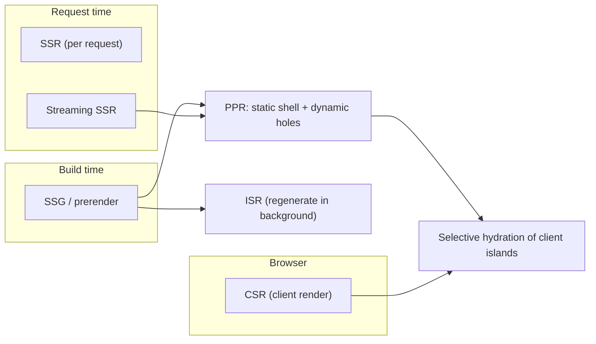
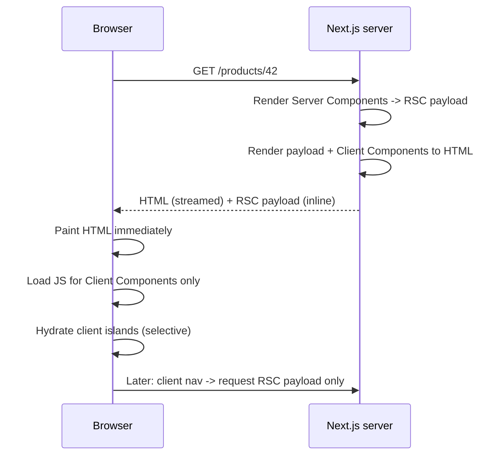
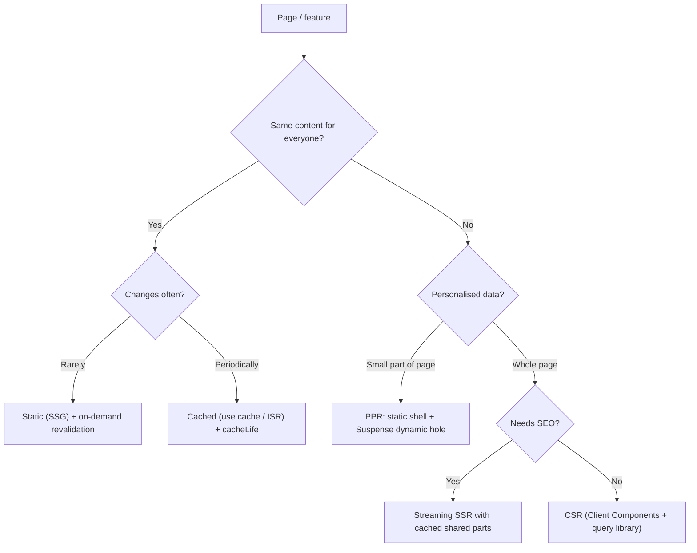
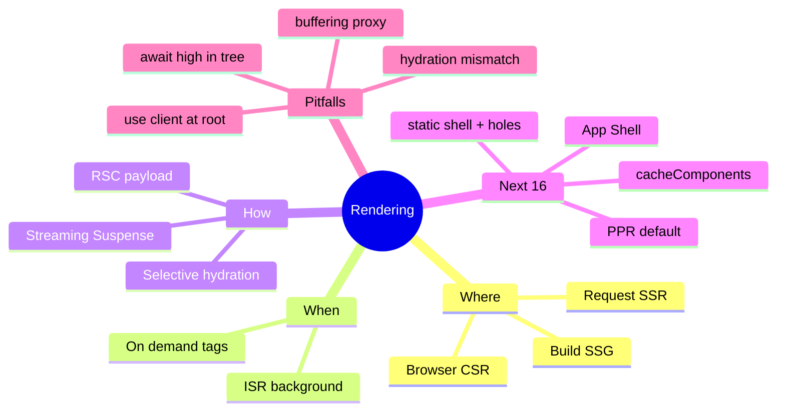

# Rendering Strategies and Hydration (CSR, SSR, SSG, ISR, Streaming, RSC, PPR)

> Verified against the official Next.js docs (App Router, Next.js 16.x; docs updated through Nov 2026). Related: [react/05 Server Components](../react/05-server-components-and-server-functions.md), [react/03 Suspense and transitions](../react/03-concurrent-react-suspense-and-transitions.md), [system-design/01 framework](../system-design/01-frontend-system-design-framework.md).
> Two caching/rendering models exist in Next.js 16: the **Cache Components model** (`cacheComponents: true`, PPR by default) and the **previous model** (no flag; route-level static/dynamic). This file explains both; details in [03 Caching](03-caching-and-revalidation.md) and [05 Streaming/PPR](05-streaming-ppr-and-instant-navigation.md).

## Table of Contents

1. [Quick Summary (TL;DR)](#1-quick-summary-tldr)
2. [Why Rendering Strategy Matters](#2-why-rendering-strategy-matters)
3. [The Rendering Spectrum](#3-the-rendering-spectrum)
4. [Client-Side Rendering (CSR)](#4-client-side-rendering-csr)
5. [Server-Side Rendering (SSR)](#5-server-side-rendering-ssr)
6. [Static Generation (SSG) and ISR](#6-static-generation-ssg-and-isr)
7. [Streaming SSR and Selective Hydration](#7-streaming-ssr-and-selective-hydration)
8. [React Server Components in the Mix](#8-react-server-components-in-the-mix)
9. [Partial Prerendering (PPR) and the Static Shell](#9-partial-prerendering-ppr-and-the-static-shell)
10. [How Next.js Decides: Static vs Dynamic](#10-how-nextjs-decides-static-vs-dynamic)
11. [Hydration Internals and Mismatches](#11-hydration-internals-and-mismatches)
12. [Decision Framework](#12-decision-framework)
13. [Core Web Vitals Impact per Strategy](#13-core-web-vitals-impact-per-strategy)
14. [SEO, Bots and Crawlers](#14-seo-bots-and-crawlers)
15. [Common Pitfalls](#15-common-pitfalls)
16. [Trade-offs vs Other Frameworks](#16-trade-offs-vs-other-frameworks)
17. [Interview Questions — Fundamentals](#17-interview-questions--fundamentals)
18. [Interview Questions — Senior Scenarios](#18-interview-questions--senior-scenarios)
19. [Cheat Sheet](#19-cheat-sheet)
20. [Key Terms Glossary](#20-key-terms-glossary)
21. [Further Reading](#21-further-reading)

---

## 1. Quick Summary (TL;DR)

- **Rendering strategy = *where* and *when* HTML is produced**: browser (CSR), server per request (SSR), build time (SSG), build time + background regeneration (ISR), or a **mix per component** (RSC + streaming + PPR).
- In the **App Router** you don't pick a strategy per page with special functions (`getStaticProps`/`getServerSideProps` are Pages Router). You compose **Server Components**, **Suspense boundaries**, and **caching**; Next.js derives the strategy.
- **Streaming** sends HTML in chunks (Suspense boundaries) so users see content before slow data resolves. **Selective hydration** hydrates boundaries independently, prioritising what the user interacts with.
- **Partial Prerendering (PPR)** = the default with **Cache Components**: a **static shell** (HTML from CDN) + **dynamic holes** streamed at request time. It replaces the old "whole page is static *or* dynamic" decision.
- The mental model for a senior answer: *"Make as much as possible static/cached, stream the rest behind Suspense, ship as little client JS as possible, and keep direct visits and client navigations both instant."*



---

## 2. Why Rendering Strategy Matters

| Concern | Impact |
|---|---|
| **TTFB / FCP / LCP** | Static HTML from a CDN is fastest; per-request SSR depends on server + data latency |
| **INP** | More client JS and hydration work → worse interactivity; Server Components reduce shipped JS |
| **SEO / social previews** | Crawlers need meaningful HTML (and metadata) in the initial response |
| **Personalisation** | Per-user data forces request-time work (or client fetching) |
| **Cost & scale** | Static/cached output is cheap; SSR consumes compute per request |
| **Freshness** | Time/on-demand revalidation vs always-fresh |
| **Complexity** | Cache invalidation, hydration bugs, deployment constraints |

---

## 3. The Rendering Spectrum

| Strategy | HTML produced | Data fetched | Typical use | Weakness |
|---|---|---|---|---|
| **CSR** | In browser after JS runs | Client (after JS) | Dashboards behind login, highly interactive tools | Blank/skeleton first paint, SEO needs care, waterfalls |
| **SSR** | Server, every request | Server, per request | Personalised pages, always-fresh | TTFB depends on slowest data; server cost |
| **SSG** | Build time | Build time | Marketing, docs, blogs | Stale until rebuild; build time at scale |
| **ISR** | Build time + regenerated | Server in background | Catalogues, content with periodic updates | Staleness window; cache coordination in multi-instance |
| **Streaming SSR** | Server, in chunks | Server | Pages with slow/independent sections | Needs Suspense design; infra must not buffer |
| **RSC** | Server components → RSC payload (+HTML) | Server (close to data) | Data-heavy UI, less client JS | Boundary/serialization rules |
| **PPR** | Static shell at build + dynamic stream | Mixed | Most modern pages (shell + personalised/slow parts) | Must structure Suspense and caching deliberately |

---

## 4. Client-Side Rendering (CSR)

**What:** The server sends a minimal HTML shell + JS bundle; the browser executes JS, fetches data, renders UI.

**In Next.js:** a Client Component (`'use client'`) fetching in an effect/query library, or a page that is a Client Component. Client Components are *still prerendered on the server* in Next.js (they run on the server during the initial render to produce HTML) — "CSR" in Next.js usually means **client-driven data fetching and rendering after hydration**.

```tsx
'use client';
import useSWR from 'swr';

export function Notifications() {
  const { data, isLoading } = useSWR('/api/notifications', fetcher);
  if (isLoading) return <Skeleton />;
  return <List items={data} />;
}
```

**Good for:** authenticated, SEO-irrelevant, interaction-heavy surfaces; data that must update live in the browser (websockets, polling).
**Bad for:** above-the-fold content that should be in the initial HTML; request waterfalls (HTML → JS → API → render).
**Note:** a client navigation to a Client Component page can be effectively **instant** (SPA-like) because no server render is needed at navigation time — but the data fetch then happens in the browser.

---

## 5. Server-Side Rendering (SSR)

**What:** HTML generated on the server **per request**, using request data (cookies, headers, params).

**Next.js App Router:** a route becomes request-time rendered when it uses **runtime APIs** (`cookies()`, `headers()`, `searchParams`, `connection()`, uncached `fetch` outside Suspense in the old model, etc.) or an explicit config.

```tsx
// Per-request render because it reads cookies
import { cookies } from 'next/headers';

export default async function Dashboard() {
  const session = (await cookies()).get('session')?.value;
  const data = await getDashboard(session);   // personalised
  return <DashboardView data={data} />;
}
```

**Pros:** fresh, personalised, SEO-friendly, no client waterfall.
**Cons:** TTFB bounded by slowest await *unless streamed*; can't be served from a shared CDN cache (responses are `Cache-Control: private, no-cache, no-store, ...` for dynamic pages); per-request compute cost.
**Fix:** wrap slow parts in `<Suspense>` to stream; cache shared data (`use cache`) so only user-specific parts are dynamic.

---

## 6. Static Generation (SSG) and ISR

### SSG
HTML (and RSC payload) generated at **build time** and served from CDN. In the App Router, a route is static when everything it renders can complete at build time (no runtime APIs, no uncached data in the previous model; no blocking uncached data in the Cache Components model).

**Dynamic routes:** use `generateStaticParams` to prerender known params:

```tsx
export async function generateStaticParams() {
  const posts = await getAllPostSlugs();
  return posts.map((slug) => ({ slug }));
}

export default async function Post({ params }: PageProps<'/blog/[slug]'>) {
  const { slug } = await params;                // params is async in Next 15+/16
  const post = await getPost(slug);
  return <Article post={post} />;
}
```

### ISR — Incremental Static Regeneration
Serve the static result immediately, **regenerate in the background** after a revalidation window or **on demand** (tags/paths). Unknown params can be generated on first request and cached for next visitors.

- **Previous model:** `export const revalidate = 3600`, `fetch(..., { next: { revalidate } })`, tags, `revalidateTag/revalidatePath`; `generateStaticParams` + `dynamicParams`.
- **Cache Components model:** `'use cache'` + `cacheLife`/`cacheTag`; for dynamic params not known at build time, Next.js serves the **App Shell** immediately and **upgrades** it in the background once params are known ("ISR with Cache Components").
- **Self-hosting caveat:** ISR/cache storage is per-instance (memory+disk) by default → use a shared cache handler across pods (see [08](08-deployment-runtimes-and-operations.md)).
- ISR responses use `Cache-Control: s-maxage=<revalidate>, stale-while-revalidate`; your CDN must respect them.

---

## 7. Streaming SSR and Selective Hydration

### Problem with classic SSR (all-or-nothing)
1. Fetch **all** data → 2. render **all** HTML → 3. send **all** → 4. load **all** JS → 5. hydrate **all**. Any slow step blocks everything after it.

### Streaming with Suspense
React renders the shell immediately, sends fallbacks for suspended boundaries, then **streams each boundary's HTML later** (with inline scripts that swap it into place, out of order). Next.js: `loading.tsx` creates a boundary per route segment; explicit `<Suspense>` gives finer control.

```tsx
export default function Page() {
  return (
    <>
      <Header />                                   {/* in the shell */}
      <Suspense fallback={<FeedSkeleton />}>
        <Feed />                                   {/* streams when ready */}
      </Suspense>
      <Suspense fallback={<RecsSkeleton />}>
        <Recommendations />                        {/* independent boundary */}
      </Suspense>
    </>
  );
}
```

### Selective hydration (React 18+)
- Each Suspense boundary hydrates independently; React **prioritises the boundary the user interacts with** (it replays the event after hydration).
- Hydration doesn't need to wait for streaming to finish; code-split client components load on demand.
- **Server Components don't hydrate at all** — only Client Components (and their subtrees) hydrate.

### Infra requirement
Reverse proxies/load balancers must **not buffer** responses (nginx: `X-Accel-Buffering: no`; ensure chunked/HTTP2 streaming end-to-end). Without streaming support, PPR/streaming benefits vanish (everything arrives after full render).

---

## 8. React Server Components in the Mix

- **Server Components (default in App Router)** run only on the server/build; render to the **RSC payload**; add **zero** component JS to the client bundle; can read databases/secrets directly.
- **Client Components (`'use client'`)** run on the server for the initial HTML **and** in the browser (hydrate); needed for state, effects, event handlers, browser APIs.
- The initial response includes **HTML** (for fast paint) and the **RSC payload** (so React can reconcile the server tree with client components). Client navigations fetch only the **RSC payload** for the changed segments (no full document).
- Deep dive: [react/05](../react/05-server-components-and-server-functions.md).



---

## 9. Partial Prerendering (PPR) and the Static Shell

**Idea:** one route can have a **static part** (prerendered at build, cached on CDN) and **dynamic parts** (streamed at request time). The old model forced the whole route to be static *or* dynamic.

- Enabled by **Cache Components** (`cacheComponents: true`). In Next.js 16 the old `experimental.ppr`/`experimental_ppr` flags were **removed**.
- At build, Next.js renders the tree: components that complete (pure computation, imports, `use cache` results with long-enough lifetimes) go into the **static shell**; components that wait on uncached data/runtime APIs must sit behind **`<Suspense>`**, and their **fallback** goes into the shell.
- The shell is served as HTML (often from a CDN) → very low TTFB/LCP; dynamic holes stream in.

```tsx
export default function ProductPage(props: PageProps<'/store/[slug]'>) {
  return (
    <div>
      <Nav />                                                {/* static */}
      <Suspense fallback={<p>Loading product…</p>}>
        <ProductInfo params={props.params} />               {/* cached -> in shell once slug known, else streamed */}
      </Suspense>
      <Suspense fallback={<p>Checking availability…</p>}>
        <Inventory params={props.params} />                 {/* fresh per request */}
      </Suspense>
    </div>
  );
}
```

**App Shell:** when a route's dynamic params aren't known at build time, the reusable, URL-independent version of the static shell is the *App Shell* (param-specific parts remain behind fallbacks). It is also what `<Link>` prefetches with Partial Prefetching. More in [05](05-streaming-ppr-and-instant-navigation.md).

**Platform requirement:** PPR needs streaming-capable hosting (see [08](08-deployment-runtimes-and-operations.md)).

---

## 10. How Next.js Decides: Static vs Dynamic

### Cache Components model (`cacheComponents: true`)
Everything is prerendered by default **until it hits something that can't complete at build time**:

| What the component does | Result |
|---|---|
| Pure computation, `import`, sync file reads | In static shell |
| `'use cache'` (adequate `cacheLife`) | Cached result in static shell |
| `cacheLife` very short (`seconds` profile, `revalidate: 0`, `expire < 5 min`) | Excluded from prerender → dynamic hole |
| Uncached `fetch`/DB, `cookies()`, `headers()`, `searchParams`, dynamic `params`, `Math.random()`, `Date.now()` | Must be inside `<Suspense>` (dynamic hole) — otherwise dev/build reports a **blocking-route** error |
| `await connection()` | Explicitly defers to request time (per-request values) |

### Previous model (no `cacheComponents`)
- A route is **static** by default if it uses no Request-time APIs and no uncached data; **dynamic** if it uses `cookies()`/`headers()`/`searchParams` or `export const dynamic = 'force-dynamic'` / `revalidate = 0` / `fetch(..., { cache: 'no-store' })`.
- `fetch` is **not cached by default** (since Next 15; opt in with `cache: 'force-cache'` or `next: { revalidate }`).
- Route segment config: `dynamic`, `revalidate` (must be statically analysable; lowest across layouts/pages wins), `fetchCache`, `dynamicParams`.

> Interview tip: always ask/say which model the project uses. Many production apps are still on the previous model; new `create-next-app` apps default to Cache Components + Partial Prefetching.

---

## 11. Hydration Internals and Mismatches

**Hydration** attaches event handlers and state to server-rendered HTML by running Client Components in the browser and matching the output to existing DOM. React 19 reports a **diff** of the mismatch in the console.

### Common mismatch causes
| Cause | Example | Fix |
|---|---|---|
| Non-deterministic values | `Date.now()`, `Math.random()`, `new Date().toLocaleString()` (timezone/locale) | Compute on server and pass down, `useEffect` after mount, or `suppressHydrationWarning` for a single text node |
| Browser-only APIs during render | `window.innerWidth`, `localStorage` | Read in effects, or `useSyncExternalStore` with a server snapshot |
| Invalid HTML nesting | `<div>` inside `<p>`, `<a>` in `<a>` | Fix markup (browser repairs DOM, React sees different tree) |
| Extensions / third-party injection | Grammarly, translators | `suppressHydrationWarning` on affected node, avoid relying on exact DOM |
| Conditional rendering by client state | `isMobile ? A : B` from `window.matchMedia` | Render same first pass, switch after mount; or use CSS media queries |
| Inconsistent data between server and client | Different locale/timezone/formatting | Pass explicit locale/timezone; format on one side |

```tsx
// Safe pattern: first render matches server, update after mount
'use client';
import { useSyncExternalStore } from 'react';

const subscribe = (cb: () => void) => {
  const mq = window.matchMedia('(prefers-color-scheme: dark)');
  mq.addEventListener('change', cb);
  return () => mq.removeEventListener('change', cb);
};

export function useIsDark() {
  return useSyncExternalStore(
    subscribe,
    () => window.matchMedia('(prefers-color-scheme: dark)').matches,
    () => false                                   // server snapshot
  );
}
```

**Consequences of mismatches:** React may throw away the server HTML for that boundary and client-render it (slower, flicker, lost streaming benefit) or leave inconsistent DOM in older versions.

**Hydration cost** (INP/TBT): large Client Component trees → more JS to download/parse/execute. Mitigate with Server Components, `next/dynamic`/lazy for heavy widgets, moving `'use client'` boundaries **down** (leaf components), and avoiding large serialized props.

---

## 12. Decision Framework



| Scenario | Recommended |
|---|---|
| Marketing/blog/docs | Static + on-demand revalidation via CMS webhook (`cacheTag` + `revalidateTag`) |
| E-commerce PDP | PPR: cached product info + fresh inventory/price + personalised recs in Suspense |
| E-commerce PLP with filters | Server-rendered with `searchParams`, cached queries (`use cache` with args), per-link prefetch |
| Logged-in dashboard | Shell static; user data in Suspense; widgets as independent boundaries; client fetching for live widgets |
| Real-time (chat, collab) | Client Component + WebSocket; shell via Next.js |
| Search results page | `searchParams` in Suspense, cached search function, debounce/transition on the client |
| Admin tools | CSR is fine; protect via server-side authz |

---

## 13. Core Web Vitals Impact per Strategy

| Metric | SSG/PPR shell | SSR (non-streamed) | Streaming | CSR |
|---|---|---|---|---|
| **TTFB** | Best (CDN) | Server + data latency | Fast first byte (shell) | Fast (tiny HTML) but meaningless content |
| **LCP** | Excellent if LCP element in shell | Good/poor depending on data | Good if LCP element in shell | Poor (JS + fetch before content) |
| **INP** | Depends on hydrated JS | Same | Selective hydration helps | Worst case: all JS on client |
| **CLS** | Fallbacks must match final layout | Stable | Skeleton sizing critical | Skeleton/hydration shifts |

Tips: make the **LCP element** part of the static shell (hero image/text in Server Component, `preload` or `fetchPriority="high"` on the image); keep Suspense fallbacks **dimensionally identical** to final content; avoid layout-shifting hydration.

---

## 14. SEO, Bots and Crawlers

- Meaningful HTML in the initial response (Server Components) is the safest SEO baseline; metadata via `generateMetadata`/`metadata` export.
- With PPR, metadata can be dynamic and **stream after the shell**. Some bots cannot handle streamed metadata, so **Next.js detects them by user agent and skips the static shell**, rendering the page fully dynamically at request time (list is configurable). Consequence: data sources available during build-time prerender must also be available at request time, otherwise bots may get 500s.
- Canonical URLs, `robots`, sitemaps (`sitemap.ts`), structured data (JSON-LD), and filter/query canonicalisation matter for faceted pages.
- CSR-only content can be indexed by modern crawlers that execute JS, but it is slower/less reliable; don't rely on it for critical content.

---

## 15. Common Pitfalls

1. **Making a whole layout dynamic** by awaiting `cookies()`/`params` at the top of a layout → nothing below can be in the shell. Push the await down into a Suspense-wrapped child.
2. **Suspense too high** (wrapping the page) → passes validation but replaces the page with one spinner.
3. **Using `'use client'` at the page root** → ships the whole tree's JS, loses server-only benefits.
4. **Expecting `fetch` to be cached** (old model, Next 15+) or expecting it to be dynamic (Cache Components: uncached = dynamic hole).
5. **Hydration mismatches** from time/locale/random values.
6. **Buffering proxies** killing streaming.
7. **Multi-instance ISR** with per-pod caches → inconsistent content.
8. **Reading env vars at build** that should be runtime (inlined `NEXT_PUBLIC_*`; use `connection()` for server runtime reads).
9. **Testing only direct visits** — client navigations can block even when direct visits are instant (see [05](05-streaming-ppr-and-instant-navigation.md)).
10. **Over-using `force-dynamic`** to "fix" stale data instead of proper revalidation.

---

## 16. Trade-offs vs Other Frameworks

> From general knowledge (not re-verified for this handbook); verify current features before citing specifics.

| Framework | Rendering model highlights |
|---|---|
| **Next.js** | RSC + streaming + PPR/Cache Components; file-system routing; strong platform integration |
| **React Router (Remix lineage)** | Loader/action model, nested routes, streaming with `defer`/Suspense; RSC support evolving |
| **Astro** | Islands architecture, content-first, ships minimal JS; partial hydration per island |
| **TanStack Start** | Type-safe router, server functions, SSR/streaming; younger ecosystem |
| **Vite SPA** | Pure CSR; simplest deployment; weakest SEO/first-paint without extra work |
| **Gatsby / SSG-only** | Build-time heavy; less relevant for dynamic apps |

Interview angle: justify choosing Next.js by **needs** (SEO + personalisation + large team conventions), mention **costs** (framework complexity, caching model learning curve, deployment constraints).

---

## 17. Interview Questions — Fundamentals

### Q1. Explain CSR, SSR, SSG and ISR in one answer.
CSR renders in the browser after JS loads; SSR renders HTML on the server per request; SSG renders at build time; ISR serves static output and regenerates it in the background (time-based or on demand). Choose by freshness, personalisation, SEO and cost.

### Q2. How do you choose a strategy in the App Router?
You don't pick via special functions; you structure the tree: Server Components by default, caching (`use cache`/revalidate) for shared data, and `<Suspense>` for dynamic/uncached parts. Next.js derives static vs dynamic from what the tree uses (runtime APIs/uncached data).

### Q3. What is streaming and why does it help?
React sends the shell immediately and streams Suspense boundaries as their data resolves, so users see content sooner (better TTFB/FCP/LCP) and slow sections don't block fast ones; it also enables selective hydration.

### Q4. What is hydration and what is selective hydration?
Hydration attaches interactivity to server HTML by running Client Components in the browser and matching existing DOM. Selective hydration lets Suspense boundaries hydrate independently and prioritises the one the user interacts with. Server Components never hydrate.

### Q5. What does Partial Prerendering do?
It splits a route into a prerendered static shell (served from CDN) and dynamic holes streamed per request. In Next.js 16 it's the default when `cacheComponents` is enabled.

### Q6. Why might a client component still appear in server HTML?
Client Components are prerendered on the server for the initial HTML and then hydrated; they only run *exclusively* on the client when you defer work (effects, `next/dynamic` with `ssr: false`, browser-only APIs).

### Q7. What are common causes of hydration errors?
Non-deterministic values (time, random), browser-only APIs during render, invalid HTML nesting, differing locale/timezone, extension-injected DOM, and conditional rendering on client-only state.

### Q8. What changed with `fetch` caching in recent Next.js versions?
Since Next 15 `fetch` isn't cached by default in the previous model (opt in with `cache: 'force-cache'`/`next.revalidate`). With Cache Components you cache explicitly with `'use cache'` + `cacheLife`; uncached async work is dynamic and must be in Suspense.

### Q9. What is the difference between static shell and App Shell?
The static shell is the prerendered HTML for a route (with known params it includes concrete content); the App Shell is the reusable URL-independent version used when params aren't known at build time and for prefetching.

### Q10. How do bots interact with PPR?
Next.js detects bots by user agent and renders the page dynamically (skipping the static shell) so metadata is in `<head>`; ensure build-time data sources work at request time too.

---

## 18. Interview Questions — Senior Scenarios

### S1. "Our product page is slow (LCP 4s). It fetches product, price, inventory and recommendations sequentially in an SSR page."
**Answer outline:** measure (RUM + trace) → identify waterfalls → parallelise independent fetches (`Promise.all`, or separate async components) → cache product/price with `use cache` + tags (revalidate on CMS/PIM webhook) → keep inventory/personalised recs in separate Suspense boundaries with size-matched skeletons → ensure LCP image is in the shell with `fetchPriority="high"`/`preload` and proper `sizes` → verify no buffering at proxy/CDN → add `instant()` e2e tests and monitor LCP/INP. Expected result: shell + product from cache; only inventory/recs stream.

### S2. "Hydration errors appear only in production for some users."
Suspects: locale/timezone-dependent formatting, A/B or feature-flag differences between server and client, browser extensions, cached HTML with stale user state, CDN serving a different variant. Debug: React 19 mismatch diff, reproduce with locale/timezone overrides, compare server vs client data sources, pass explicit locale/timezone, render identical first pass then update in effect, use `suppressHydrationWarning` only for leaf text, ensure CDN cache key varies on what changes HTML (cookies/headers) or avoid caching personalised HTML.

### S3. "Marketing wants a CMS edit to appear within seconds, but we need CDN speed."
Static/cached with long `cacheLife` (`max`) + `cacheTag('cms:page-slug')`; CMS webhook calls a Route Handler that invokes `revalidateTag(tag, 'max')` (stale-while-revalidate) or `updateTag` where read-your-writes in a Server Action is required (preview/editor flows); optional Draft Mode for previews; verify multi-instance cache coordination (shared handler) so every pod sees the tag invalidation.

### S4. "We must show per-user pricing but keep SEO and speed."
Shell with shared product content cached; price in a Suspense boundary reading session (`cookies()`), caching with the session-derived key (`use cache` with `sessionId`/segment as argument, or `use cache: private` for browser-only caching); SEO-critical content (title, description, base price in structured data) stays in the shared cached part; personalised price streams in; skeleton sized to avoid CLS.

### S5. "Streaming doesn't seem to work in staging (everything arrives at once)."
Check proxy buffering (nginx `proxy_buffering`/`X-Accel-Buffering: no`), load balancer/CDN compression or buffering, serverless platform response streaming support, middleware/proxy modifying the response, a blocking component outside Suspense (blocking-route error in dev), HTTP/1.1 vs HTTP/2, and whether a layout awaits slow data before rendering children.

### S6. "Should we migrate from Pages Router (`getServerSideProps`) to App Router?"
Evaluate benefits (RSC, less client JS, streaming, nested layouts, Cache Components) vs cost (data fetching rewrite, library compatibility with Server Components, mental model, testing). Incremental migration: both routers can coexist (`app/` and `pages/`), migrate high-value routes first (heavy data pages), keep shared components working in both, adopt caching model deliberately (old vs Cache Components), run codemods/typegen, measure before/after (CWV, bundle size), plan training and lint rules for `'use client'` boundaries.

---

## 19. Cheat Sheet



| Need | Use |
|---|---|
| Fast TTFB for shared content | Static shell / `use cache` |
| Fresh per-request data | `<Suspense>` + uncached async / `connection()` |
| Personalised small region | Suspense hole (+ `use cache: private` or cache keyed by session) |
| CMS invalidation | `cacheTag` + `revalidateTag(tag, 'max')` |
| Read-your-writes | `updateTag` (Server Action) |
| Avoid hydration mismatch | Deterministic first render; `useSyncExternalStore` server snapshot |
| Verify instant UX | Dev validation + `@next/playwright` `instant()` |

---

## 20. Key Terms Glossary

| Term | Definition |
|---|---|
| **CSR/SSR/SSG/ISR** | Client/Server/Static/Incremental rendering strategies |
| **Streaming** | Sending HTML progressively as Suspense boundaries resolve |
| **Hydration** | Making server HTML interactive by running client JS against existing DOM |
| **Selective hydration** | Independent, prioritised hydration of Suspense boundaries |
| **RSC payload** | Serialized Server Component tree sent to the client |
| **PPR** | Partial Prerendering: static shell + dynamic holes |
| **Static shell** | Prerendered HTML of a route served before dynamic content |
| **App Shell** | Reusable URL-independent static shell used for prefetch/ISR upgrade |
| **Dynamic hole** | Suspense-wrapped region rendered at request time |
| **Runtime APIs** | `cookies()`, `headers()`, `searchParams`, `params`, `connection()` |
| **ISR** | Static output regenerated after time or on demand |
| **Blocking route** | Route where uncached/runtime data blocks the shell (error in Cache Components) |

---

## 21. Further Reading

- [Next.js — Caching (Cache Components)](https://nextjs.org/docs/app/getting-started/caching) · [Revalidating](https://nextjs.org/docs/app/getting-started/revalidating)
- [Next.js — Instant navigation guide](https://nextjs.org/docs/app/guides/instant-navigation)
- [Next.js — Self-hosting (streaming, caching)](https://nextjs.org/docs/app/guides/self-hosting)
- [React — Server Components](https://react.dev/reference/rsc/server-components) · [Suspense](https://react.dev/reference/react/Suspense)
- This repo: [react/01 rendering model](../react/01-rendering-model-and-reconciliation.md) · [react/05 RSC](../react/05-server-components-and-server-functions.md)
