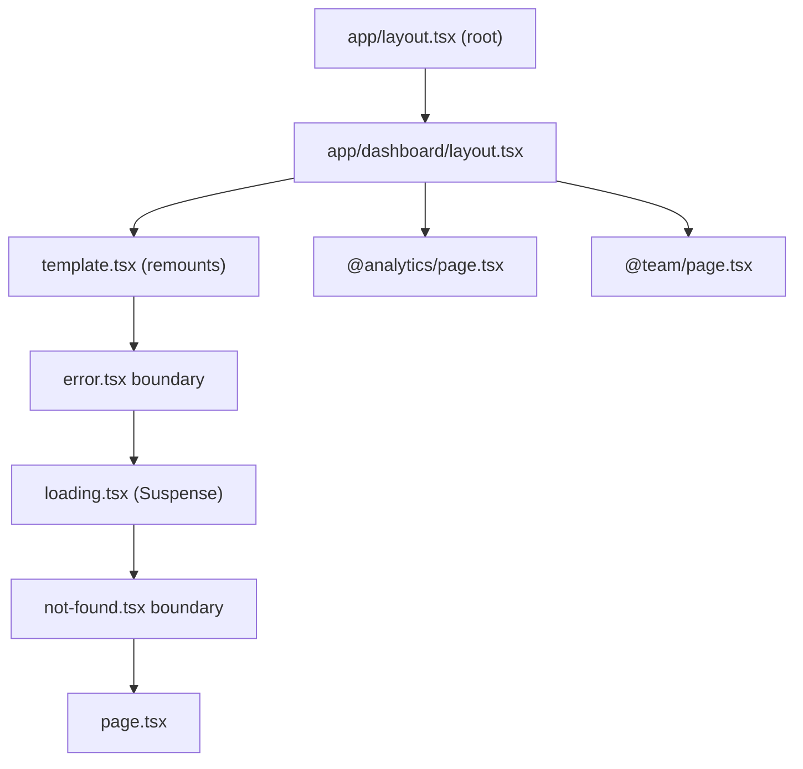
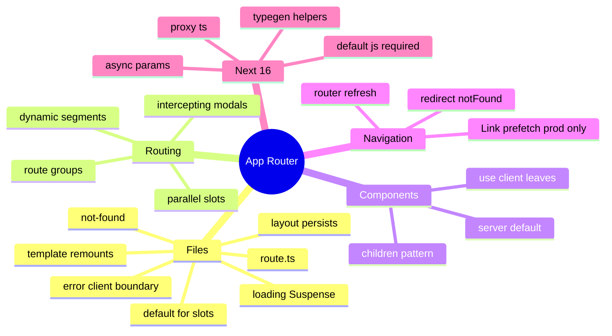

# App Router Fundamentals (Routing, Layouts, Special Files, Navigation, Metadata)

> Verified against the Next.js docs (Next.js 16.x). Related: [01 Rendering strategies](01-rendering-strategies-and-hydration.md), [react/05 Server Components](../react/05-server-components-and-server-functions.md), [typescript/05 TS with React and APIs](../typescript/05-typescript-with-react-and-apis.md).

## Table of Contents

1. [Quick Summary (TL;DR)](#1-quick-summary-tldr)
2. [File-System Routing and Special Files](#2-file-system-routing-and-special-files)
3. [Layouts, Templates and Nested Routing](#3-layouts-templates-and-nested-routing)
4. [Dynamic Routes, Route Groups, Private Folders](#4-dynamic-routes-route-groups-private-folders)
5. [Loading, Error, Not-Found Boundaries](#5-loading-error-not-found-boundaries)
6. [Parallel and Intercepting Routes](#6-parallel-and-intercepting-routes)
7. [Server vs Client Components: Composition Rules](#7-server-vs-client-components-composition-rules)
8. [Navigation: Link, Router, Prefetching, Scroll](#8-navigation-link-router-prefetching-scroll)
9. [Async Request APIs and Typed Props (Next 15/16)](#9-async-request-apis-and-typed-props-next-1516)
10. [Metadata, SEO and Special Metadata Files](#10-metadata-seo-and-special-metadata-files)
11. [Route Handlers vs Pages](#11-route-handlers-vs-pages)
12. [Client-Side Router Behaviour](#12-client-side-router-behaviour)
13. [Pages Router vs App Router](#13-pages-router-vs-app-router)
14. [Pitfalls](#14-pitfalls)
15. [Interview Questions — Fundamentals](#15-interview-questions--fundamentals)
16. [Interview Questions — Senior Scenarios](#16-interview-questions--senior-scenarios)
17. [Cheat Sheet](#17-cheat-sheet)
18. [Key Terms Glossary](#18-key-terms-glossary)
19. [Further Reading](#19-further-reading)

---

## 1. Quick Summary (TL;DR)

- **Folders define URL segments; special files define UI/behaviour** for that segment: `layout`, `page`, `template`, `loading`, `error`, `not-found`, `route`, `default`.
- Layouts **persist** across navigation (state preserved, no re-render of the shared layout); `template.tsx` **re-mounts** on navigation.
- **Server Components by default**; add `'use client'` only at interactive leaves. Pass Server Components as `children`/props into Client Components to keep them on the server.
- `loading.tsx` = automatic Suspense boundary; `error.tsx` = error boundary (**must be a Client Component**); `not-found.tsx` + `notFound()`.
- **Parallel routes** (`@slot`) render multiple pages in one layout; **intercepting routes** show a route in a modal while keeping the URL shareable. In **Next.js 16**, every parallel slot **requires `default.js`** or the build fails.
- **Next.js 15/16:** `params`, `searchParams`, `cookies()`, `headers()`, `draftMode()` are **async** (synchronous access removed in 16). Use `PageProps<'/route'>` / `LayoutProps` / `RouteContext` helpers (generated by `next dev/build/typegen`).
- `middleware.ts` is now **`proxy.ts`** (Node runtime) — see [06](06-proxy-auth-and-security.md).



---

## 2. File-System Routing and Special Files

```
app/
  layout.tsx            # root layout (must render <html> and <body>)
  page.tsx              # /
  proxy.ts              # (project root or src/) network-boundary logic (was middleware.ts)
  global-error.tsx      # error boundary for root layout (client component)
  not-found.tsx         # global 404 UI
  (marketing)/          # route group: no URL segment
    about/page.tsx      # /about
  dashboard/
    layout.tsx
    page.tsx            # /dashboard
    loading.tsx
    error.tsx
    settings/page.tsx   # /dashboard/settings
  blog/[slug]/page.tsx  # /blog/hello
  shop/[...segments]/page.tsx     # catch-all
  docs/[[...segments]]/page.tsx   # optional catch-all (also matches /docs)
  api/items/route.ts    # Route Handler
  _components/          # private folder (opt-out of routing)
```

| File | Purpose | Notes |
|---|---|---|
| `layout.tsx` | Shared UI wrapping children; persists | Receives `children` (+ parallel slots); root layout required |
| `page.tsx` | Makes the segment publicly routable | Receives `params`, `searchParams` (async) |
| `template.tsx` | Like layout but **new instance per navigation** | Use for enter/exit animations, per-page effects, resetting state |
| `loading.tsx` | Instant loading UI (wraps page in Suspense) | Shows during navigation to the segment |
| `error.tsx` | Error boundary for the segment | **Client Component**; receives `error`, `reset` |
| `global-error.tsx` | Boundary for root layout errors | Must include `<html>`/`<body>` |
| `not-found.tsx` | UI for `notFound()` / unmatched URLs | Root one handles global 404 |
| `route.ts` | HTTP endpoint (Web Request/Response) | Cannot coexist with `page.tsx` in the same segment |
| `default.tsx` | Fallback for parallel slot on hard navigation | **Required for all slots in Next 16** |
| `opengraph-image`, `icon`, `sitemap`, `robots`, `manifest` | Metadata files | Static by default unless using runtime APIs |

```tsx
// app/layout.tsx
export const metadata = { title: { default: 'Acme', template: '%s | Acme' } };

export default function RootLayout({ children }: { children: React.ReactNode }) {
  return (
    <html lang="en">
      <body>{children}</body>
    </html>
  );
}
```

---

## 3. Layouts, Templates and Nested Routing

- **Nesting:** layouts wrap child layouts/pages. On navigation within the same layout subtree, only the changed segments re-render (**partial rendering**); shared layouts keep their DOM and client state.
- **Layouts don't receive `searchParams`** (they don't re-render on search param change). Read them in the page or a client component (`useSearchParams`).
- **Layouts can't pass data to children via props** — fetch where needed; duplicate fetches are deduped with `React.cache` (or `fetch` memoization) during a render pass.
- **Template** gives fresh state, remounts effects on each navigation:

```tsx
// app/dashboard/template.tsx — remounts on every navigation
'use client';
import { useEffect } from 'react';
export default function Template({ children }: { children: React.ReactNode }) {
  useEffect(() => { logPageView(); }, []);
  return <div className="fade-in">{children}</div>;
}
```

- **Root layout** must contain `<html>` and `<body>`; multiple root layouts via route groups (`(app)/layout.tsx`, `(auth)/layout.tsx`) — navigation across root layouts is a **full page load**.
- **Layout vs `middleware/proxy` auth:** layouts don't re-render on every navigation, so **never rely on a layout alone for authorisation** (do checks in the data access layer / each page / action). See [06](06-proxy-auth-and-security.md).

---

## 4. Dynamic Routes, Route Groups, Private Folders

| Pattern | Example | Matches |
|---|---|---|
| `[slug]` | `blog/[slug]` | `/blog/a` |
| `[...slug]` | `shop/[...slug]` | `/shop/a`, `/shop/a/b` (not `/shop`) |
| `[[...slug]]` | `docs/[[...slug]]` | `/docs`, `/docs/a/b` |
| `(group)` | `(marketing)/about` | `/about` (group name not in URL) |
| `_folder` | `_components` | Not routable (private) |
| `@slot` | `@modal` | Parallel route slot (not in URL) |

```tsx
// app/blog/[slug]/page.tsx
export async function generateStaticParams() {
  return (await getSlugs()).map((slug) => ({ slug }));
}
export const dynamicParams = true;   // previous model: allow params not returned above (rendered on demand)

export default async function Page({ params }: PageProps<'/blog/[slug]'>) {
  const { slug } = await params;
  const post = await getPost(slug);
  if (!post) notFound();
  return <Article post={post} />;
}
```

- **Route groups** organise code, opt segments into a shared layout, or create multiple root layouts.
- **Treat params as untrusted input**: validate/normalise (`zod`), never use directly in file paths or queries.
- **`generateStaticParams` + Cache Components:** unknown params resolve through the App Shell + ISR upgrade (see [01](01-rendering-strategies-and-hydration.md)).

---

## 5. Loading, Error, Not-Found Boundaries

```tsx
// app/dashboard/loading.tsx — wraps page.tsx in <Suspense fallback={<Loading/>}>
export default function Loading() { return <DashboardSkeleton />; }

// app/dashboard/error.tsx — must be a client component
'use client';
export default function Error({ error, reset }: { error: Error & { digest?: string }; reset: () => void }) {
  return (
    <div role="alert">
      <p>Something went wrong.</p>
      <button onClick={reset}>Try again</button>
    </div>
  );
}

// app/blog/[slug]/not-found.tsx
export default function NotFound() { return <h1>Post not found</h1>; }
```

- `loading.tsx` only wraps the **page and children**, **not the layout** in the same segment (layout data fetching isn't covered by that segment's `loading.tsx`).
- `error.tsx` doesn't catch errors from the **layout of the same segment** (put the boundary one level up) — and root layout errors need `global-error.tsx`.
- In production, server error messages are **hidden from the client**; only a `digest` is sent (log the digest server-side to correlate).
- Expected errors (validation, not found) should be **return values** or `notFound()`/`redirect()`, not thrown exceptions, especially in Server Actions.
- Component-level error boundaries: `catchError` (Next.js function) or your own error boundary for finer scope (see caching doc referencing it).

---

## 6. Parallel and Intercepting Routes

### Parallel routes (`@slot`)
Render multiple independent pages inside one layout (dashboards, split views). Each slot has its own `loading`/`error` and can navigate independently (soft navigation); on **hard navigation** (reload) Next.js can't infer a slot's active state, so it uses `default.tsx`.

```tsx
// app/dashboard/layout.tsx
export default function Layout({ children, analytics, team }: {
  children: React.ReactNode; analytics: React.ReactNode; team: React.ReactNode;
}) {
  return (<>{children}<aside>{analytics}{team}</aside></>);
}

// app/dashboard/@analytics/default.tsx  (REQUIRED in Next 16)
export default function Default() { return null; }       // or notFound()
```

### Intercepting routes (`(.)`, `(..)`, `(..)(..)`, `(...)`)
Load another route **in the current layout context** (e.g., photo modal over a feed) while the URL changes; a hard reload of that URL renders the full page.

```
app/
  feed/page.tsx
  @modal/default.tsx
  @modal/(.)photo/[id]/page.tsx      # intercepts /photo/[id] from /feed (modal)
  photo/[id]/page.tsx                # full page for direct visits
```

Use cases: modals with shareable URLs (login modal, image lightbox, quick view), split inbox/detail views. Pitfalls: accessibility (focus trap, Esc closes → `router.back()`), missing `default.js`, state when refreshing, matching rules are based on **route segments, not file-system folders** (e.g., `(..)` counts route segments, ignoring route groups/slots).

---

## 7. Server vs Client Components: Composition Rules

| You need | Use |
|---|---|
| State, effects, event handlers, browser APIs, context providers | **Client Component** (`'use client'`) |
| DB/secrets/file access, large dependencies, data fetching | **Server Component** |
| Interactivity inside server-rendered content | Server Component renders Client Component leaf |

**Rules**
1. `'use client'` marks a **module boundary**: everything imported by that file (that isn't already a client module) becomes client code.
2. A Client Component **cannot import a Server Component**, but it can **receive one as `children`/props** (pre-rendered on the server).
3. Props from server → client must be **serialisable** (no functions except Server Functions, no class instances).
4. Context providers must be client components; render them as **thin wrappers around `children`** in the layout.
5. Use the `server-only` package to hard-fail if sensitive modules reach the client bundle; `client-only` for browser-only code.

```tsx
// providers.tsx
'use client';
export function Providers({ children }: { children: React.ReactNode }) {
  return <ThemeProvider><QueryClientProvider client={qc}>{children}</QueryClientProvider></ThemeProvider>;
}
// layout.tsx (server) — children remain Server Components
<Providers>{children}</Providers>
```

```tsx
// Interleaving: Server Component passed into Client Component as children
<Modal>            {/* 'use client' */}
  <ServerRenderedContent />   {/* stays on the server */}
</Modal>
```

Heavy client-only widgets: `next/dynamic` / `React.lazy` for code-splitting (`ssr: false` is only allowed in Client Components — it moves rendering fully to the browser).

---

## 8. Navigation: Link, Router, Prefetching, Scroll

| API | Use |
|---|---|
| `<Link href>` | Primary navigation; prefetches; client transition |
| `useRouter()` (`next/navigation`) | `push`, `replace`, `back`, `refresh`, `prefetch` (Client Components) |
| `redirect()` / `permanentRedirect()` | Server-side redirects (Server Components, actions, route handlers) |
| `usePathname`, `useSearchParams`, `useParams` | Read URL in Client Components |
| `useLinkStatus` | Pending indicator for a link (recent versions) |
| `notFound()` | Render nearest `not-found` |

Verified `<Link>` details (Next.js 16 docs):
- **Prefetching happens in production only**, when the link enters the viewport.
- `prefetch="auto"`/`null` (default): static routes → full route prefetched; dynamic routes → down to the nearest `loading.js` boundary. `prefetch={true}` → full route (with Partial Prefetching: App Shell **plus** cached content that depends on the link's URL data). `prefetch={false}` → no prefetch.
- With `partialPrefetching: true`, default `auto` prefetches the per-route **App Shell**.
- `scroll` (default `true`) keeps scroll position if the page is visible; otherwise scrolls to first page element. `replace` swaps history entry. `onNavigate` (client-side nav only; can `preventDefault`). `transitionTypes` (16.2+) feed React `ViewTransition`.
- Prefetching through proxy rewrites requires telling `Link` both display URL and prefetch URL (`as` + `href`).

```tsx
'use client';
import { useRouter, usePathname, useSearchParams } from 'next/navigation';

export function Filters() {
  const router = useRouter(); const pathname = usePathname(); const params = useSearchParams();
  const setFilter = (key: string, value: string) => {
    const next = new URLSearchParams(params);
    value ? next.set(key, value) : next.delete(key);
    router.replace(`${pathname}?${next.toString()}`, { scroll: false });
  };
  return <button onClick={() => setFilter('sort', 'price')}>Sort by price</button>;
}
```

`useSearchParams()` suspends during prerendering (search params aren't known at build) → wrap the component in `<Suspense>`; on a **client navigation** it resolves synchronously (router already has the URL).

`router.refresh()` re-fetches the current route's Server Components (keeps client state); it does not revalidate tagged data (use actions + `updateTag`/`revalidateTag`).

---

## 9. Async Request APIs and Typed Props (Next 15/16)

Since **Next.js 16**, synchronous access is fully removed for: `cookies()`, `headers()`, `draftMode()`, `params` (layout/page/route/default/metadata image files) and `searchParams` (page). Metadata image functions and `sitemap` `id` also receive promises.

```tsx
export default async function Page(props: PageProps<'/blog/[slug]'>) {
  const { slug } = await props.params;
  const { q } = await props.searchParams;       // string | string[] | undefined
  // ...
}

// Route handler
export async function GET(_req: NextRequest, ctx: RouteContext<'/users/[id]'>) {
  const { id } = await ctx.params;
  return Response.json({ id });
}
```

- Run `npx next typegen` to generate global `PageProps`, `LayoutProps`, `RouteContext` helpers (introduced 15.5).
- Codemod: `npx @next/codemod@canary next-async-request-api .` (the main `upgrade` codemod doesn't run all migrations).
- With Cache Components, awaiting `params` **blocks the shell** unless inside Suspense or `generateStaticParams` supplies the value — pass the **promise down** and await in a Suspense-wrapped child to maximise the shell.
- Client Components can unwrap the promise with React `use(params)`.

---

## 10. Metadata, SEO and Special Metadata Files

```tsx
import type { Metadata } from 'next';

export async function generateMetadata({ params }: PageProps<'/blog/[slug]'>): Promise<Metadata> {
  const { slug } = await params;
  const post = await getPost(slug);                 // deduped with page via React cache()
  return {
    title: post.title,
    description: post.excerpt,
    alternates: { canonical: `/blog/${slug}` },
    openGraph: { title: post.title, images: [post.cover] },
  };
}
```

- Static `export const metadata` vs dynamic `generateMetadata`; merged from layouts to pages (page wins; `title.template`).
- File-based: `opengraph-image.tsx`, `twitter-image`, `icon`, `apple-icon`, `sitemap.ts`, `robots.ts`, `manifest.ts`. These are Route-Handler-like and **static by default** unless they use request-time APIs.
- With Cache Components, uncached fetches/runtime data inside `generateMetadata` surface the same insights as pages; dynamic metadata may **stream after the shell** (bots get fully dynamic render).
- Structured data: render `<script type="application/ld+json">` (escape `<` in JSON to avoid XSS).
- `generateViewport` for viewport/theme-color.

---

## 11. Route Handlers vs Pages

- `route.ts` exports HTTP method functions (`GET`, `POST`, `PUT`, `PATCH`, `DELETE`, `HEAD`, `OPTIONS`) using Web `Request`/`Response`; unsupported methods → 405. They **don't participate in layouts or client navigation** and **cannot share a segment with `page.tsx`**.
- Caching: `GET` handlers are **not cached by default** in the previous model (`export const dynamic = 'force-static'` to cache); with Cache Components, `GET` handlers follow the same prerender model as pages (static if no uncached/runtime data; `use cache` must live in a helper function, not the handler body). Other methods are never cached.
- Use Route Handlers for: webhooks, public APIs, third-party callbacks, file downloads/streaming, OAuth callbacks, health checks. Prefer **Server Actions** for first-party mutations triggered by your UI, and **Server Components** for reads (don't call your own API from Server Components).

---

## 12. Client-Side Router Behaviour

- **Soft navigation:** client fetches the RSC payload for changed segments; layouts persist; Suspense boundaries above the shared layout don't re-trigger (important for instant navigation, see [05](05-streaming-ppr-and-instant-navigation.md)).
- **Hard navigation:** full document request (e.g., navigating between different root layouts, external links, reload).
- **Next.js 16 routing overhaul:** **layout deduplication** (shared layout downloaded once when prefetching many URLs) and **incremental prefetching** (only missing parts). Expect more, smaller prefetch requests.
- **Back/forward** restores from router cache and scroll position.
- **Scroll behaviour:** Next.js 16 no longer overrides CSS `scroll-behavior: smooth` during route transitions; add `data-scroll-behavior="smooth"` on `<html>` to restore the old override.
- **Version skew:** after deploys, clients with old code may call new servers → configure `deploymentId` (see [08](08-deployment-runtimes-and-operations.md)).

---

## 13. Pages Router vs App Router

| Topic | Pages Router | App Router |
|---|---|---|
| Rendering functions | `getStaticProps`, `getServerSideProps`, `getStaticPaths` | Async Server Components + caching APIs + `generateStaticParams` |
| Components | Client-hydrated everywhere | Server by default, client opt-in |
| Layouts | `_app`/`_document`, per-page layout patterns | Nested layouts, templates, slots |
| Data fetching | Per-page, top-level | Per-component, colocated |
| Streaming | Limited | First-class (Suspense, `loading.tsx`) |
| API | `pages/api` | Route Handlers (`route.ts`) |
| Mutations | API routes + client fetch | Server Actions/Functions |
| Middleware | `middleware.ts` | `proxy.ts` (16+) |
| Image/Font/Script | Supported | Supported |

Both routers can **coexist** (incremental migration); routes must not conflict. Plan: move highest-value routes first, share UI components, replace data functions with Server Components + a DAL, adopt the caching model deliberately.

---

## 14. Pitfalls

1. Awaiting `params`/`cookies()` in a **layout** → whole subtree dynamic / blocking.
2. Putting `'use client'` on a layout/page unnecessarily (loses server benefits, ships big bundle).
3. Relying on layout for **auth** (layouts don't re-render on every navigation).
4. Forgetting **`default.js`** for parallel slots (build failure in 16).
5. `error.tsx` not marked `'use client'`, or expecting it to catch same-segment layout errors.
6. `useSearchParams` without Suspense (build error / bailout) in static routes.
7. `route.ts` and `page.tsx` in the same segment.
8. Passing non-serialisable props across the boundary.
9. Fetching from your own Route Handler inside Server Components (extra hop; call data layer directly).
10. Not validating `params`/`searchParams` (treated as user input).
11. Assuming `loading.tsx` shows for layout work, or for **client navigations** when a Suspense boundary above the shared layout would cover only direct visits.
12. Using `router.push` for mutations instead of Server Actions + revalidation.

---

## 15. Interview Questions — Fundamentals

### Q1. Difference between layout and template?
A layout persists across navigations (state preserved, not re-rendered when siblings change); a template creates a new instance on each navigation (remounts, effects re-run).

### Q2. How do `loading.tsx` and `error.tsx` work?
`loading.tsx` wraps the segment's page in a Suspense boundary (instant fallback/streaming); `error.tsx` is a client error boundary with `reset()`; neither covers the same segment's layout (use parent boundary/`global-error`).

### Q3. What are route groups and private folders?
Route groups `(name)` organise routes without affecting URLs (and enable multiple layouts); private folders `_name` are excluded from routing.

### Q4. Explain parallel and intercepting routes.
Parallel routes render multiple slots in one layout with independent navigation/loading/error states; intercepting routes render another route inside the current layout (e.g., modal) while the URL is shareable and hard reload shows the full page. Slots need `default.js` in Next 16.

### Q5. Can a Client Component import a Server Component?
No (it would become client code), but it can receive Server Components as `children`/props rendered by a parent Server Component.

### Q6. What changed with `params`/`searchParams`?
They are Promises (async request APIs); synchronous access was removed in Next.js 16. Use `await` in Server Components, `use()` in Client Components, and typed helpers (`PageProps<'/x'>`).

### Q7. What is `proxy.ts`?
The renamed `middleware.ts` (v16): network-boundary logic (rewrites/redirects/headers/early responses) running on the Node.js runtime; edge isn't supported in `proxy` (keep `middleware` for edge).

### Q8. When use a Route Handler vs a Server Action?
Server Actions for first-party UI mutations (form submissions, progressive enhancement, integrated revalidation); Route Handlers for external consumers, webhooks, non-UI clients, custom response formats/streaming.

### Q9. How does `<Link>` prefetching behave?
Production only, on viewport entry; default prefetch depends on static/dynamic route (and with Partial Prefetching prefetches the App Shell); `true` prefetches fully, `false` disables.

### Q10. How do you handle 404s and redirects?
`notFound()` renders the nearest `not-found.tsx` (status 404); `redirect()`/`permanentRedirect()` in Server Components/actions/handlers; config-level `redirects` and `proxy` for broad rules.

---

## 16. Interview Questions — Senior Scenarios

### S1. "Design the routing for a dashboard with a persistent sidebar, tabs, a modal for item details, and per-widget loading."
Root layout (providers), `(app)/dashboard/layout.tsx` with sidebar; tabs as nested routes (links, not state) so URLs are shareable; widgets as parallel slots (`@revenue`, `@activity`) each with `loading.tsx`/`error.tsx` and **`default.tsx`**; item detail as intercepting route (`@modal/(.)items/[id]`) with a full page at `/items/[id]`; modal closes via `router.back()`; focus trap + Esc; data fetched in the components that need it, shared via `React.cache`; pass filters in `searchParams`; use Suspense boundaries to avoid whole-page spinners.

### S2. "Navigation feels slow after migrating to the App Router."
Check prefetch (production only; links in viewport; `prefetch={false}` somewhere?), server render time for dynamic routes (blocking awaits in layouts), missing `loading.tsx`/Suspense on client navigations, large RSC payloads (serialised props), layout-level data fetching, version skew, third-party scripts, and whether the page is dynamic where it could be cached; adopt Cache Components + Partial Prefetching + instant-navigation validation; measure with Navigation Inspector and RUM.

### S3. "How do you structure auth-protected areas?"
Use proxy for coarse redirects (optimistic checks only), but enforce **authn/authz in the data access layer and in every Server Action/Route Handler**; layouts don't guard children (they don't re-render per navigation); centralise `getCurrentUser()` with `React.cache`; return DTOs; handle unauthorised with `redirect('/login')`/`notFound()`; see [06](06-proxy-auth-and-security.md).

### S4. "Client Components are bloating our bundle. What's your plan?"
Audit `'use client'` boundaries (move down to leaves), pass Server Components as children, replace client data fetching with Server Components + cached functions, lazy-load heavy widgets (`next/dynamic`), analyze bundles (Next bundle analyzer tooling / Turbopack analyzer), remove unused providers from the root layout, avoid importing large libs in shared client modules, enable React Compiler where suitable, set performance budgets in CI.

### S5. "Explain how you'd migrate 200 Pages Router pages."
Inventory by traffic/complexity; create the App Router skeleton with shared layout; migrate leaf routes incrementally (coexistence), convert `getServerSideProps` → Server Components + data layer; convert API routes needed externally → Route Handlers, UI mutations → Server Actions; adopt `proxy`; handle `next/head` → Metadata API; verify third-party libs for RSC compatibility (`'use client'` wrappers); ensure redirects/rewrites parity; regression tests (Playwright), canary rollout with feature flags/traffic split, track CWV and errors per route group.

---

## 17. Cheat Sheet



---

## 18. Key Terms Glossary

| Term | Definition |
|---|---|
| **Segment** | A folder level in the route tree |
| **Layout/Template** | Persistent / remounting wrapper UI |
| **Route group** | `(name)` folder not in URL |
| **Parallel route** | `@slot` rendered alongside children |
| **Intercepting route** | Route rendered in current context (modal) via `(.)` conventions |
| **Soft/Hard navigation** | Client RSC fetch vs full document load |
| **RSC payload** | Serialized server render result used by the client router |
| **Proxy** | `proxy.ts`, renamed middleware (Node runtime) |
| **Partial rendering** | Only changed segments re-render on navigation |
| **Typed route helpers** | `PageProps`, `LayoutProps`, `RouteContext` generated by `typegen` |

---

## 19. Further Reading

- [Next.js docs — Linking and navigating](https://nextjs.org/docs/app/getting-started/linking-and-navigating) · [Link component](https://nextjs.org/docs/app/api-reference/components/link)
- [Next.js 16 upgrade guide](https://nextjs.org/docs/app/guides/upgrading/version-16)
- [Route Handlers](https://nextjs.org/docs/app/getting-started/route-handlers) · [proxy.js reference](https://nextjs.org/docs/app/api-reference/file-conventions/proxy)
- This repo: [react/05](../react/05-server-components-and-server-functions.md) · [react/07 component patterns](../react/07-component-patterns-and-architecture.md)
