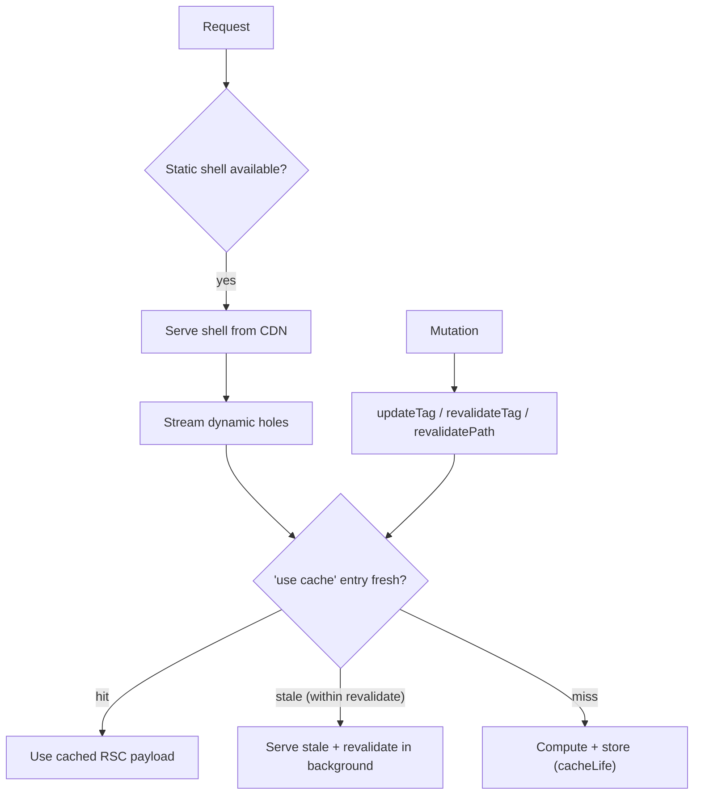
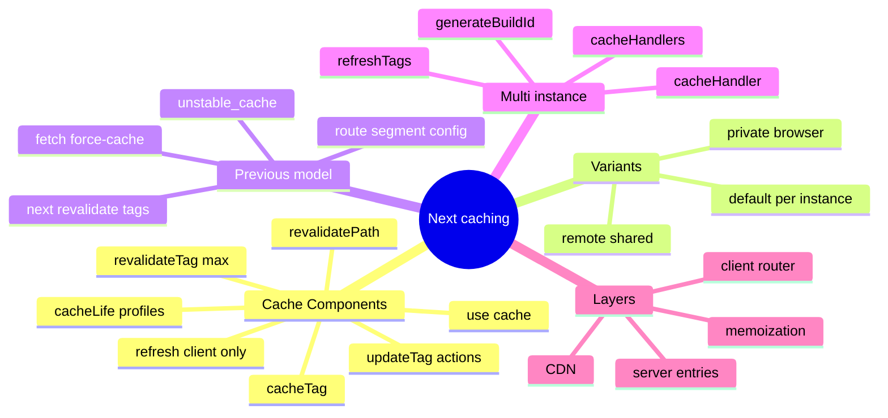

# Caching and Revalidation in Next.js (Cache Components, Previous Model, CDN)

> Verified against the Next.js docs (Caching, Revalidating, Caching-without-Cache-Components guide, Self-hosting; docs updated Jun–Nov 2026, Next.js 16.x). Related: [01 Rendering strategies](01-rendering-strategies-and-hydration.md), [04 Data fetching and mutations](04-data-fetching-and-mutations.md), [05 Streaming/PPR](05-streaming-ppr-and-instant-navigation.md), [08 Deployment](08-deployment-runtimes-and-operations.md).
> **Two models coexist.** (A) **Cache Components** (`cacheComponents: true`): explicit `'use cache'`. (B) **Previous model** (flag off): `fetch` options, `unstable_cache`, route segment config. Say which one you mean in an interview.

## Table of Contents

1. [Quick Summary (TL;DR)](#1-quick-summary-tldr)
2. [Why Caching Is the Hardest Part of Next.js](#2-why-caching-is-the-hardest-part-of-nextjs)
3. [Layers of Caching (Mental Map)](#3-layers-of-caching-mental-map)
4. [Cache Components Model: `use cache`](#4-cache-components-model-use-cache)
5. [`cacheLife`: Time-Based Revalidation](#5-cachelife-time-based-revalidation)
6. [`cacheTag` and On-Demand Revalidation](#6-cachetag-and-on-demand-revalidation)
7. [Cache Variants: default, remote, private](#7-cache-variants-default-remote-private)
8. [Runtime Data, Random Values and Timestamps](#8-runtime-data-random-values-and-timestamps)
9. [Where Cached Content Lives](#9-where-cached-content-lives)
10. [Previous Model (No `cacheComponents`)](#10-previous-model-no-cachecomponents)
11. [Request Memoization: `React.cache` vs `use cache`](#11-request-memoization-reactcache-vs-use-cache)
12. [Client Router Cache and Prefetching](#12-client-router-cache-and-prefetching)
13. [CDN, HTTP Caching and Multi-Instance Concerns](#13-cdn-http-caching-and-multi-instance-concerns)
14. [Patterns and Recipes](#14-patterns-and-recipes)
15. [Debugging Stale or Missing Data](#15-debugging-stale-or-missing-data)
16. [Pitfalls](#16-pitfalls)
17. [Interview Questions — Fundamentals](#17-interview-questions--fundamentals)
18. [Interview Questions — Senior Scenarios](#18-interview-questions--senior-scenarios)
19. [Cheat Sheet](#19-cheat-sheet)
20. [Key Terms Glossary](#20-key-terms-glossary)
21. [Further Reading](#21-further-reading)

---

## 1. Quick Summary (TL;DR)

- **Cache Components model:** nothing is cached implicitly. You **opt in** with `'use cache'` (data-level or UI-level), give it a **lifetime** with `cacheLife`, and **tag** it with `cacheTag` for on-demand invalidation. Uncached async work is **dynamic** and must be behind `<Suspense>`.
- **Revalidate** with: `cacheLife` (time), `revalidateTag(tag, 'max')` (stale-while-revalidate), **`updateTag(tag)`** (immediate expiry, **Server Actions only**, read-your-own-writes), `revalidatePath(path)`, and `refresh()` (client router refresh only; does **not** revalidate tags).
- **Cache keys** = function arguments + **closed-over values** + build id (serialisable inputs required). Different args → different entries.
- **Default storage is per-instance memory** (ephemeral on serverless). Use **`'use cache: remote'`** + a cache handler for shared/durable caching; **`'use cache: private'`** caches in the **browser only** for cookie/header-dependent values.
- **Previous model:** `fetch` is **not cached by default** (since Next 15); opt in with `cache: 'force-cache'` / `next: { revalidate, tags }`; `unstable_cache` for non-fetch; route segment config (`dynamic`, `revalidate`, `fetchCache`).
- **Multi-instance self-hosting**: caches and tag invalidation are per-instance by default → configure shared cache handler(s) and tag coordination.



---

## 2. Why Caching Is the Hardest Part of Next.js

- Historically implicit defaults (v13–14 cached `fetch` aggressively; v15 flipped defaults) caused "why is my data stale / why is it refetching" confusion.
- Multiple layers (memoization, data, route, client router, CDN) interact.
- Serverless vs self-hosted behaves differently (ephemeral memory, per-pod caches).
- **Cache Components** was designed to make caching **explicit and composable** (function- or component-level) and unify static/dynamic via PPR.

---

## 3. Layers of Caching (Mental Map)

| Layer | Scope | Lifetime | Controlled by |
|---|---|---|---|
| **Request memoization** | One server render pass | Single request | `React.cache`, `fetch` auto-memoization (same URL/options) |
| **`use cache` entries** | Function/component result (RSC payload) | `cacheLife` | `cacheLife`, `cacheTag`, `revalidateTag`, `updateTag`, `revalidatePath` |
| **Prerendered HTML / static shell** | Route (or App Shell) | Build + revalidate/expire | `generateStaticParams`, cache lifetimes, ISR |
| **Client router cache** | Browser (RSC payload for visited/prefetched segments) | Session / `stale` window | `<Link prefetch>`, `cacheLife.stale`, `router.refresh()` |
| **Image optimisation cache** | Disk/CDN | `minimumCacheTTL` (default 4h in Next 16) or upstream `Cache-Control`, whichever is larger | `images.*` config |
| **HTTP/CDN cache** | Edge/shared | `Cache-Control` | Response headers, CDN config |
| **Browser HTTP cache** | Browser | `Cache-Control` | Immutable hashed assets (`public, max-age=31536000, immutable`) |

---

## 4. Cache Components Model: `use cache`

**Enable** (new `create-next-app` projects have it by default):

```ts
// next.config.ts
import type { NextConfig } from 'next';
const nextConfig: NextConfig = {
  cacheComponents: true,
  partialPrefetching: true,   // set explicitly; docs say both become default (and options removed) in the next major
};
export default nextConfig;
```

> If `partialPrefetching` is unset, a warning is logged. It exists because the first release of Cache Components shipped without it; set `false` only while migrating apps that adopted Cache Components earlier.

### Data-level caching
```ts
import { cacheLife, cacheTag } from 'next/cache';

export async function getProducts() {
  'use cache';
  cacheLife('hours');
  cacheTag('products');
  return db.query('SELECT * FROM products');
}
```

### UI-level caching (component/page/layout)
```tsx
export default async function BlogPosts() {
  'use cache';
  cacheLife('hours');
  cacheTag('posts');
  const posts = await fetch('https://api.example.com/posts').then(r => r.json());
  return <ul>{posts.map(p => <li key={p.id}>{p.title}</li>)}</ul>;
}
```
A `'use cache'` at the **top of a file** caches **all exported functions** in that file.

### Rules and constraints (from docs/behaviour)
- Cache **async** functions/components; arguments and closed-over values become part of the **cache key** (must be serialisable; see "constraints" in the directive reference).
- **Pair every directive with `cacheLife`** — without it the implicit `default` profile applies.
- Don't read runtime APIs (`cookies()`, `headers()`, `searchParams`) **inside** a standard `use cache` scope — read them outside and **pass values as arguments** (or use `'use cache: private'`).
- In **Route Handlers**, `use cache` can't sit directly in the handler body — extract a helper function.
- Short-lived caches (**`seconds` profile, `revalidate: 0`, or `expire` < 5 minutes**) are **excluded from prerendering** and become dynamic holes.

---

## 5. `cacheLife`: Time-Based Revalidation

Three durations:
- **`stale`**: how long the **client** may use the cached value without checking the server.
- **`revalidate`**: after this, the entry is considered stale on the server; next request serves stale and **revalidates in the background** (SWR).
- **`expire`**: after this, no stale serving; next request **blocks** until fresh content is computed.

| Profile | `stale` | `revalidate` | `expire` |
|---|---|---|---|
| `default` | 5m | 15m | never |
| `seconds` | 30s | 1s | 60s |
| `minutes` | 5m | 1m | 1h |
| `hours` | 5m | 1h | 1d |
| `days` | 5m | 1d | 1w |
| `weeks` | 5m | 1w | 30d |
| `max` | 5m | 30d | 1y |

```ts
cacheLife({ stale: 3600, revalidate: 7200, expire: 86400 });  // custom (seconds)
```

**Design guidance:** for content from a CMS use a long profile (`max`) + `cacheTag` + a webhook that calls `revalidateTag` — avoids needless time-based recompute. Use short lifetimes only when freshness truly matters (and accept that they become dynamic holes).

---

## 6. `cacheTag` and On-Demand Revalidation

```ts
// tag
export async function getUser(id: string) {
  'use cache';
  cacheTag('users', `user:${id}`);
  cacheLife('hours');
  return db.user.find(id);
}
```

```ts
'use server';
import { revalidateTag, updateTag, revalidatePath, refresh } from 'next/cache';

export async function updateProfile(id: string, data: FormData) {
  await authorizeAndSave(id, data);          // verify authn/authz first!
  updateTag(`user:${id}`);                   // immediate expiry; user sees own write
}

export async function publishPost(slug: string) {
  await savePost(slug);
  revalidateTag('posts', 'max');             // SWR: serve stale, refresh in background
  revalidatePath('/blog');                   // path-based (broader); prefer tags
}

export async function markRead(id: string) {
  await db.notification.markRead(id);
  refresh();                                 // refresh client router only; tagged data NOT revalidated
}
```

| API | Where | Behaviour | Use when |
|---|---|---|---|
| `updateTag(tag)` | **Server Actions only** | Expires immediately and refreshes in the same request | Read-your-own-writes (forms, settings) |
| `revalidateTag(tag, profile)` | Server Actions & Route Handlers | Stale-while-revalidate; **second argument required** in Next 16 (`'max'` = longest stale window) | Background refresh, webhooks |
| `revalidatePath(path)` | Server Actions & Route Handlers | Invalidates all cached data for a route | Don't know which tags a route uses |
| `refresh()` | Server Actions | Refreshes client router (re-render of current route) | UI refresh of **uncached** data |

> `revalidatePath` is implemented on top of cache tags (special tag per page). Prefer tags: more precise, avoids over-invalidating.

---

## 7. Cache Variants: default, remote, private

| Directive | Where stored | Can read runtime APIs? | Typical use |
|---|---|---|---|
| `'use cache'` | **Server memory per instance** (ephemeral on serverless) + prerender output at build | No (pass as args) | Shared, non-personalised data; joins static shell if lifetime long enough |
| `'use cache: remote'` | **Shared/durable store** via `cacheHandlers` (network round trip) | No | Serverless or multi-instance deployments where hit rate is high |
| `'use cache: private'` | **Browser only** (not server) | **Yes** (cookies, headers, searchParams) | Personalised data that can be prefetched; **can't be part of static shell**; to join the App Shell its `stale` must be ≥ 5 minutes |

```tsx
// Passing a runtime value as an argument -> part of cache key, enables per-session caching
async function ProfileContent() {
  const sessionId = (await cookies()).get('session')?.value;
  return <CachedContent sessionId={sessionId} />;
}
async function CachedContent({ sessionId }: { sessionId?: string }) {
  'use cache';
  const data = await fetchUserData(sessionId);
  return <div>{data}</div>;
}
```
Because it's gated behind request data it isn't added to the static shell; in-memory caching may not persist across serverless requests → consider `use cache: remote`. Prefetching can still resolve it with the user's actual session during a client transition.

---

## 8. Runtime Data, Random Values and Timestamps

| Operation | Behaviour under Cache Components |
|---|---|
| `cookies()`, `headers()`, `searchParams`, dynamic `params` | Runtime data → needs Suspense (or `generateStaticParams`) |
| `Math.random()`, `Date.now()`, `crypto.randomUUID()` | Must be explicit: `await connection()` + Suspense (per request) **or** `use cache` (shared value) |
| `performance.now()` | Not guarded (telemetry) |
| Module imports, sync `fs.readFileSync`, pure computation | Predictable → prerendered automatically |
| Sync embedded DB (e.g., `better-sqlite3`) | Treated as predictable — call `connection()` first for per-request data |
| Async local resource reads (config, fonts) | Read once at module scope, or `use cache`, or request-time |

```tsx
import { connection } from 'next/server';
async function RequestId() {
  await connection();                          // opts into request time
  return <p>{crypto.randomUUID()}</p>;
}
```

**Maximise the static shell:** don't `await params` in a layout; pass the promise down into a Suspense-wrapped child (see [05](05-streaming-ppr-and-instant-navigation.md)).

---

## 9. Where Cached Content Lives

A cached function's output is serialised into an **RSC payload** (build or runtime). Next.js then:
- renders it to **prerendered HTML** (static shell / ISR upgrade), stored on disk (self-hosted) or platform storage behind a CDN;
- keeps it in a **server/remote store** (default in-memory per instance; remote via `cacheHandlers`);
- sends it to the **browser** inside RSC for navigations/prefetch, where it's fresh for the `stale` window (and `private` entries live only there).

All stores are **per-deployment**: the cache key includes the **build id**, so a new deploy starts fresh (even `remote` entries don't carry over).

---

## 10. Previous Model (No `cacheComponents`)

> Still common in production. Defaults changed in Next 15: **`fetch` is not cached unless you opt in**.

```ts
// Opt-in caching
await fetch(url, { cache: 'force-cache' });
// Time-based
await fetch(url, { next: { revalidate: 3600 } });
// Tags
await fetch(url, { next: { tags: ['user'] } });
// Non-fetch functions
import { unstable_cache } from 'next/cache';
export const getCachedUser = unstable_cache(
  async (id: string) => db.user.find(id),
  ['user'],                                // key parts
  { tags: ['user'], revalidate: 3600 }
);
```

**Route segment config** (layout/page/route):
```ts
export const dynamic = 'auto';          // 'auto' | 'force-dynamic' | 'error' | 'force-static'
export const revalidate = false;        // false | 0 | number (seconds) — must be statically analysable (600 ok; 60*10 not)
export const fetchCache = 'auto';       // advanced override of fetch cache behaviour
```

| Option | Effect |
|---|---|
| `dynamic = 'force-dynamic'` | Always render per request (equivalent to `no-store` for all fetches) |
| `dynamic = 'force-static'` | Force static; `cookies()/headers()/useSearchParams()` return empty values |
| `dynamic = 'error'` | Fail build if dynamic APIs/uncached data are used |
| `revalidate = n` | Default revalidation for route; **lowest** across layouts/pages (and fetches) wins |
| `revalidate = 0` | Always dynamic |

Notes:
- A `fetch` with no cache option is fetched once at build **if reachable before any Request-time API is used**; fetches **after** Request-time APIs run on every request.
- In **development**, pages are always rendered on demand (no caching).
- `fetch` calls are **auto-memoized** within a render pass (same URL/options, GET).
- For non-`fetch` data sources (ORM/DB) use **`React.cache`** to dedupe within a render.
- The legacy "Full Route Cache"/"Data Cache"/"Router Cache" terminology applies to this older mental model; treat details across versions carefully.
- Migration path: [Migrating to Cache Components](https://nextjs.org/docs/app/guides/migrating-to-cache-components) — enabling `cacheComponents` is **not rename-only**: it can surface build errors for uncached data outside `<Suspense>`.

---

## 11. Request Memoization: `React.cache` vs `use cache`

| | `React.cache` | `'use cache'` |
|---|---|---|
| Scope | **Single render pass/request** | Across requests (per `cacheLife`) |
| Purpose | Dedupe identical calls (e.g., `getUser()` in layout + page + metadata) | Persist results, enable prerender/static shell |
| Invalidation | None (per request) | Tags/paths/time |
| Typical combo | Wrap DAL functions with `React.cache`; wrap expensive shared reads with `use cache` | Both can be layered |

```ts
import { cache } from 'react';
export const getPost = cache(async (slug: string) => db.post.find(slug));   // dedupe per render
```

---

## 12. Client Router Cache and Prefetching

- The client keeps **RSC payloads** of visited/prefetched segments; `cacheLife.stale` controls how long the client treats cached data as fresh without asking the server (5 minutes on every built-in profile except `seconds`, which is 30s).
- With **Partial Prefetching**, each visible `<Link>` prefetches the destination **App Shell**; `prefetch={true}` also resolves cached content depending on the link's URL data (`searchParams`, `params`), costing a server invocation per link.
- Next.js 16: **layout deduplication** and **incremental prefetching** reduce transfer size (more, smaller requests).
- Mutations via Server Actions with `updateTag`/`revalidatePath` update server caches **and** refresh the client router in the same round trip.
- Prefetching only runs in **production**.

---

## 13. CDN, HTTP Caching and Multi-Instance Concerns

- Hashed static assets: `Cache-Control: public, max-age=31536000, immutable` (not overridable).
- ISR/cached pages: `s-maxage=<revalidate>, stale-while-revalidate` — your **CDN/reverse proxy must honour** these and cache-key variability.
- Dynamic pages: `private, no-cache, no-store, max-age=0, must-revalidate`; fully prerendered pages: `public`.
- **Per-instance caches:** default cache is memory (**50 MB default**) + disk per instance; in Kubernetes each pod has its own copy → inconsistent content. Configure:
  - `cacheHandler` (+ `cacheMaxMemorySize: 0`) for ISR/fetch cache backed by Redis/S3 (must serialise `Buffer`/`Map`, bound size, index by tag, handle errors).
  - `cacheHandlers` for `'use cache'` backends (`'use cache: remote'`).
  - **Tag coordination:** `revalidateTag()` only invalidates the instance that ran it unless your handler implements `refreshTags()` against shared storage.
- **Build consistency:** same build for all containers; `generateBuildId` stable; `deploymentId` for version-skew protection.
- Image optimisation + CDN: forward the `Accept` header if formats vary; control TTLs with `minimumCacheTTL`.

---

## 14. Patterns and Recipes

### Pattern A — CMS-driven static content with instant invalidation
```ts
export async function getPage(slug: string) {
  'use cache'; cacheLife('max'); cacheTag('cms', `page:${slug}`);
  return cms.getPage(slug);
}
// Route Handler (webhook)
export async function POST(req: Request) {
  if (!verifySignature(req)) return new Response('Unauthorized', { status: 401 });
  const { slug } = await req.json();
  revalidateTag(`page:${slug}`, 'max');
  return Response.json({ ok: true });
}
```

### Pattern B — Shared product data + live inventory
```tsx
export default function Product(props: PageProps<'/store/[slug]'>) {
  return (<>
    <Suspense fallback={<InfoSkeleton/>}><Info params={props.params}/></Suspense>   {/* cached */}
    <Suspense fallback={<StockSkeleton/>}><Stock params={props.params}/></Suspense> {/* fresh */}
  </>);
}
```

### Pattern C — Read-your-writes after a form submit
Server Action → mutate → `updateTag('cart:'+id)` → `redirect()`.

### Pattern D — Search with cached queries
`searchParams` read in a Suspense child; `async function search(q) { 'use cache'; ... }` so identical queries hit the cache; `<Link prefetch>` for popular queries.

### Pattern E — Personalised but cacheable per segment
Pass `segment` (e.g., plan tier) as cache arg instead of `userId` to share entries across users.

---

## 15. Debugging Stale or Missing Data

1. **Which model?** Check `cacheComponents` in config.
2. **Is it cached at all?** (previous model: did you opt-in? after Request-time API?) (new model: `'use cache'` present? lifetime?)
3. **Which layer is stale?** Server entry vs client router (`stale`) vs CDN vs browser.
4. **Did invalidation hit the right tag?** Tag string mismatch; invalidation in a different instance; `refresh()` doesn't touch tags.
5. **Short lifetime excluded from prerender?** `seconds`/`expire < 5m` become dynamic.
6. **Serverless ephemerality:** in-memory entries may disappear → `use cache: remote`.
7. **Multiple pods:** shared cache handler + `refreshTags()`.
8. **Deploy changed build id:** cache reset (expected).
9. **Dev vs prod:** dev doesn't cache pages in the previous model; test with `next build && next start`.
10. **Headers:** inspect `Cache-Control`, `x-nextjs-cache`/CDN hit headers where available (platform-specific).

---

## 16. Pitfalls

1. Reading `cookies()` inside a `use cache` function (must pass as argument or use `private`).
2. Caching **personal data** under a shared key (leaks between users) — include the user/segment in the key or don't cache.
3. Using only time-based revalidation for CMS content (needless recompute; slow freshness).
4. Using `revalidatePath('/')` as a hammer (over-invalidates).
5. Forgetting the **second argument** of `revalidateTag` in Next 16.
6. Expecting `updateTag` in Route Handlers (Server Actions only).
7. Assuming `refresh()` clears tagged caches.
8. Very short `cacheLife` for "freshness" → destroys the static shell and adds latency.
9. Not setting `cacheLife` (implicit `default`: 5m/15m/never expire) and being surprised.
10. Multi-instance deployments with default caches.
11. Returning non-serialisable values from cached functions.
12. Authorisation inside cached functions without including identity in the key.

---

## 17. Interview Questions — Fundamentals

### Q1. How does caching work in Next.js 16 with Cache Components?
Nothing is cached implicitly. `'use cache'` caches the result of an async function/component with a lifetime (`cacheLife`) and tags (`cacheTag`). Uncached async work is dynamic and must be wrapped in Suspense. Long-lived cached content is included in the static shell (PPR).

### Q2. `revalidateTag` vs `updateTag` vs `revalidatePath` vs `refresh`?
`revalidateTag(tag,'max')`: stale-while-revalidate, Actions & Route Handlers. `updateTag`: immediate expire, Actions only, read-your-writes. `revalidatePath`: invalidates a route's cached data (broader). `refresh()`: refreshes the client router; doesn't revalidate tags.

### Q3. What do `stale`, `revalidate` and `expire` mean?
`stale`: client may reuse without checking; `revalidate`: server serves stale and refreshes in background after this; `expire`: beyond this the request waits for fresh data.

### Q4. How is the cache key built?
From function arguments and closed-over values (plus build id and function identity). Different inputs → different entries; inputs must be serialisable.

### Q5. Default fetch caching behaviour?
Previous model (Next 15+): not cached by default; opt in via `cache: 'force-cache'`, `next.revalidate`, or `next.tags`. `fetch` is auto-memoized within one render. With Cache Components: use `'use cache'`.

### Q6. `React.cache` vs `use cache`?
`React.cache` dedupes calls within one request; `use cache` persists across requests with lifetime/tags and participates in prerendering.

### Q7. What is `use cache: private`?
Caches per-user (cookie/header-dependent) results in the browser only; can read runtime APIs; can't be in the static shell; requires `stale ≥ 5 min` to join the App Shell/prefetch.

### Q8. Why might cached content differ across pods?
Default caches are per-instance memory/disk; `revalidateTag` only affects the local instance unless a shared handler with tag coordination (`refreshTags`) is used.

### Q9. Why does `cacheLife('seconds')` hurt?
Short-lived caches (seconds profile, `revalidate: 0`, `expire < 5m`) are excluded from prerendering and become dynamic holes.

### Q10. How do Server Actions interact with caches?
Calling `updateTag`/`revalidatePath` in an action expires server caches and refreshes affected client UI in the same round trip.

---

## 18. Interview Questions — Senior Scenarios

### S1. "Users complain that after editing their profile they still see old data for minutes."
Check: is the profile read via a cached function with a long `cacheLife`? Does the Server Action call `updateTag('user:'+id)` (read-your-writes) rather than `revalidateTag` (SWR)? Does the client router have a `stale` window hiding it (consider `refresh()`/updateTag path)? Is the page behind a CDN caching HTML? Multiple pods with local cache? Fix: tag-based `updateTag` in the action, ensure tag naming consistent, shared cache handler for multi-instance, verify headers at CDN.

### S2. "Design caching for a news site: 5M pages, editors need <10s publish latency, traffic spikes."
Per-article `use cache` with `cacheLife('max')` + tags (`article:id`, `section:x`, `home`); CMS webhook → Route Handler → `revalidateTag(..., 'max')` for affected tags (SWR keeps spikes safe); `generateStaticParams` only for top N, rest via App Shell + ISR upgrade; CDN honouring `s-maxage/stale-while-revalidate`; shared cache handler (Redis) with tag index and `refreshTags()`; protect origin with request coalescing/rate limits; monitor hit ratio, revalidation latency, and stale-served rate; breaking-news uses shorter profile or immediate `updateTag` in editor-preview flows (Draft Mode).

### S3. "Our serverless deployment recomputes cached components on nearly every request."
`'use cache'` default storage is in-memory per instance (ephemeral); low hit rate. Options: `'use cache: remote'` with a durable `cacheHandlers` backend (only if high hit rate justifies the round trip), lengthen lifetimes, include fewer variants in keys, move data caching closer to the source (DB/CDN cache), or accept recompute for low-reuse data.

### S4. "A shared cache leaked one user's data to another."
Root cause: personalised data cached under a shared key (e.g., `use cache` with request-derived data captured but not part of key, or CDN caching a dynamic HTML). Remediate: ensure identity is an explicit argument or avoid caching; use `use cache: private` for browser-only; audit all `use cache` functions touching user data; verify CDN `Cache-Control: private`/`Vary`; add tests with two users; add log/alerts; rotate affected sessions if needed.

### S5. "Migrate a large app from the previous caching model to Cache Components."
Do it incrementally: ensure Next 16 and Node ≥ 20.9; address async request APIs; enable `cacheComponents` on a branch and triage **blocking-route** errors; replace `unstable_cache`/`fetch` options with `use cache` + `cacheLife`/`cacheTag`; replace `dynamic/revalidate/fetchCache` route config; wrap runtime access in Suspense; push awaits down the tree; switch revalidation calls to the new signatures (`revalidateTag(tag,'max')`, `updateTag`); enable Partial Prefetching; add `instant()` e2e tests; roll out per route group; compare CWV and cache hit ratios.

---

## 19. Cheat Sheet



| Goal | Do |
|---|---|
| Cache shared data | `'use cache'` + `cacheLife` + `cacheTag` |
| Fresh per request | Suspense + uncached async (or `connection()`) |
| Invalidate after CMS change | webhook → `revalidateTag(tag,'max')` |
| User sees own write | `updateTag` in Server Action |
| Personal + prefetchable | `use cache: private` or pass session/segment arg |
| Serverless durable cache | `use cache: remote` + `cacheHandlers` |
| Dedupe in one render | `React.cache` |

---

## 20. Key Terms Glossary

| Term | Definition |
|---|---|
| **Cache Components** | Next.js 16 model enabling `use cache` + PPR (`cacheComponents: true`) |
| **`use cache`** | Directive caching an async function/component result |
| **`cacheLife`** | Sets `stale`/`revalidate`/`expire` |
| **`cacheTag`** | Labels entries for on-demand invalidation |
| **SWR** | Stale-while-revalidate: serve stale, refresh in background |
| **App Shell** | Reusable static shell for a route with unknown params |
| **Cache handler** | Pluggable storage for server caches (`cacheHandler`, `cacheHandlers`) |
| **Request memoization** | Per-render dedupe (`React.cache`, `fetch`) |
| **Dynamic hole** | Request-time region inside a static shell |
| **Version skew** | Client/server build mismatch during rollouts |

---

## 21. Further Reading

- [Caching](https://nextjs.org/docs/app/getting-started/caching) · [Revalidating](https://nextjs.org/docs/app/getting-started/revalidating)
- [`use cache` directive](https://nextjs.org/docs/app/api-reference/directives/use-cache) · [`cacheLife`](https://nextjs.org/docs/app/api-reference/functions/cacheLife) · [`updateTag`](https://nextjs.org/docs/app/api-reference/functions/updateTag)
- [Caching and Revalidating (Previous Model)](https://nextjs.org/docs/app/guides/caching-without-cache-components)
- [Self-hosting — Caching and ISR](https://nextjs.org/docs/app/guides/self-hosting#caching-and-isr)
- This repo: [react/05 RSC](../react/05-server-components-and-server-functions.md) · [system-design/01 caching layers](../system-design/01-frontend-system-design-framework.md)
