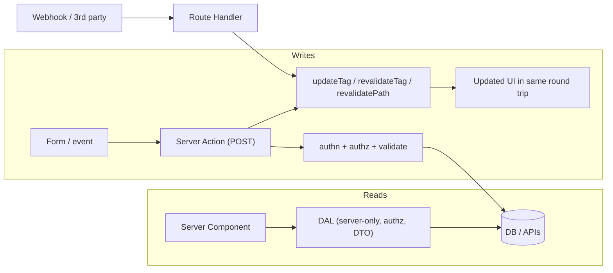
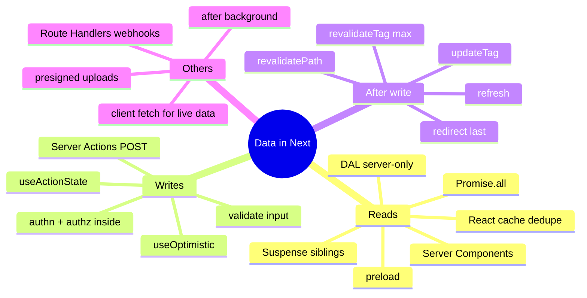

# Data Fetching and Mutations (Server Components, Server Actions, Route Handlers, Client Fetching)

> Verified against the Next.js docs (Mutating Data, Data Security, Route Handlers, Caching guides; Next.js 16.x). Related: [03 Caching](03-caching-and-revalidation.md), [06 Auth and security](06-proxy-auth-and-security.md), [react/04 React 19](../react/04-react-19-and-beyond.md), [react/06 State and data fetching](../react/06-state-management-and-data-fetching.md), [typescript/05](../typescript/05-typescript-with-react-and-apis.md).

## Table of Contents

1. [Quick Summary (TL;DR)](#1-quick-summary-tldr)
2. [Fetching in Server Components](#2-fetching-in-server-components)
3. [Waterfalls, Parallel Fetching, Preloading](#3-waterfalls-parallel-fetching-preloading)
4. [Data Access Layer (DAL) and DTOs](#4-data-access-layer-dal-and-dtos)
5. [Passing Promises to Client Components (`use`)](#5-passing-promises-to-client-components-use)
6. [Client-Side Fetching (SWR, TanStack Query)](#6-client-side-fetching-swr-tanstack-query)
7. [Server Functions and Server Actions](#7-server-functions-and-server-actions)
8. [Forms: `useActionState`, `useFormStatus`, `useOptimistic`](#8-forms-useactionstate-useformstatus-useoptimistic)
9. [Validation, Errors and Redirects](#9-validation-errors-and-redirects)
10. [Revalidation After Mutations](#10-revalidation-after-mutations)
11. [Route Handlers: Webhooks, APIs, Streaming](#11-route-handlers-webhooks-apis-streaming)
12. [Background Work: `after()`](#12-background-work-after)
13. [File Uploads and Large Payloads](#13-file-uploads-and-large-payloads)
14. [Decision Table: Where Should This Code Live?](#14-decision-table-where-should-this-code-live)
15. [Pitfalls](#15-pitfalls)
16. [Interview Questions — Fundamentals](#16-interview-questions--fundamentals)
17. [Interview Questions — Senior Scenarios](#17-interview-questions--senior-scenarios)
18. [Cheat Sheet](#18-cheat-sheet)
19. [Key Terms Glossary](#19-key-terms-glossary)
20. [Further Reading](#20-further-reading)

---

## 1. Quick Summary (TL;DR)

- **Read** data in **Server Components** (async functions) close to the source; no API hop, no client waterfall. **Write** data with **Server Actions** (Server Functions used for mutations) invoked from forms or event handlers.
- **Avoid waterfalls:** start independent requests together (`Promise.all`), split into sibling async components inside Suspense, or **preload**; dedupe with `React.cache`.
- **Centralise data access** in a server-only **Data Access Layer** that performs authorization and returns **DTOs**.
- **Server Functions are public POST endpoints**: always verify authentication **and** authorization **inside** each one; validate input; return only what the UI needs.
- After mutating: **`updateTag`** (read-your-writes), **`revalidateTag(tag,'max')`**, **`revalidatePath`**, **`refresh()`**, then optionally `redirect()`.
- **Client fetching** (SWR/TanStack Query) is for **live, interactive, user-driven** data (polling, infinite scroll, optimistic UI), not for initial page data.
- **Route Handlers** are for **external** consumers: webhooks, OAuth callbacks, public APIs, non-React clients, custom streaming.



---

## 2. Fetching in Server Components

```tsx
// app/posts/page.tsx — Server Component
export default async function PostsPage() {
  const posts = await getPosts();                // DB or fetch, runs on the server
  return <PostList posts={posts} />;
}
```

- You may use `fetch`, an ORM, SDKs, or `fs` directly (server-only). Secrets stay on the server.
- **Cache Components model:** wrap shared reads in `'use cache'` functions; uncached reads stream behind Suspense. **Previous model:** `fetch` is not cached by default; opt in explicitly. See [03](03-caching-and-revalidation.md).
- Don't call your own Route Handlers from Server Components — call the data function directly.
- `fetch` GET requests with the same URL/options are **memoized within a render**; for ORMs wrap with `React.cache`.

```ts
import { cache } from 'react';
import 'server-only';
export const getUser = cache(async (id: string) => db.user.findUnique({ where: { id } }));
```

---

## 3. Waterfalls, Parallel Fetching, Preloading

### Sequential (waterfall) — avoid when independent
```tsx
const user = await getUser(id);
const posts = await getPosts(id);       // waits for user even if independent
```

### Parallel
```tsx
const [user, posts] = await Promise.all([getUser(id), getPosts(id)]);
```
Trade-off: the page waits for the **slowest**. Prefer independent components with their own Suspense boundaries for streaming:

```tsx
export default function Page({ params }: PageProps<'/u/[id]'>) {
  return (
    <>
      <Suspense fallback={<ProfileSkeleton />}><Profile params={params} /></Suspense>
      <Suspense fallback={<PostsSkeleton />}><Posts params={params} /></Suspense>
    </>
  );
}
```

### Preload pattern (documented)
Start loading early above blocking work, combine `server-only` + `React.cache`:

```ts
import { cache } from 'react';
import 'server-only';
export const getItem = cache(async (id: string) => { /* ... */ });
export const preload = (id: string) => { void getItem(id); };
```
```tsx
const { id } = await params;
preload(id);                              // kick off
const ok = await checkIsAvailable();      // other async work
return ok ? <Item id={id} /> : null;      // Item awaits getItem(id) — already in flight
```

### Dependent data (true dependency)
Unavoidable sequence: fetch in a parent, pass IDs to children, or fetch together on the server with a single query/join; consider moving the join into the DB or API (BFF).

---

## 4. Data Access Layer (DAL) and DTOs

The docs recommend choosing **one** approach: external HTTP APIs (existing large orgs), **Data Access Layer** (new projects), or component-level data access (prototypes).

A DAL should: run **only on the server**, perform **authorization**, return **minimal DTOs**, and be the **only** place reading `process.env` secrets.

```ts
// data/auth.ts
import 'server-only';
import { cache } from 'react';
import { cookies } from 'next/headers';

export const getCurrentUser = cache(async () => {
  const token = (await cookies()).get('AUTH_TOKEN')?.value;
  if (!token) return null;
  return verifyAndLoadUser(token);              // returns a small User object/class
});
```
```ts
// data/profile.ts
import 'server-only';
export async function getProfileDTO(slug: string) {
  const viewer = await getCurrentUser();
  const row = await db.user.findUnique({ where: { slug } });
  return {
    username: row.username,
    phone: canSeePhone(viewer, row) ? row.phone : null,    // privacy rules in ONE place
  };
}
```

**Why it matters:** passing whole DB records into Client Components leaks private fields (everything passed as props is serialised to the browser). Use DTOs, `server-only`, and optionally the experimental **taint** APIs (`experimental_taintObjectReference`/`taintUniqueValue` with `experimental.taint`) as an extra layer.

---

## 5. Passing Promises to Client Components (`use`)

Start a fetch on the server, don't `await` it, pass the **promise** to a Client Component and unwrap with React `use()` inside Suspense — the server work starts immediately while the shell streams.

```tsx
// Server Component
export default function Page() {
  const commentsPromise = getComments();          // not awaited
  return (
    <Suspense fallback={<CommentsSkeleton />}>
      <Comments promise={commentsPromise} />
    </Suspense>
  );
}

// Client Component
'use client';
import { use } from 'react';
export function Comments({ promise }: { promise: Promise<Comment[]> }) {
  const comments = use(promise);
  return <ul>{comments.map(c => <li key={c.id}>{c.text}</li>)}</ul>;
}
```
Useful when the consumer needs client interactivity (sorting, local state) but data should be fetched on the server. See [react/03 Suspense](../react/03-concurrent-react-suspense-and-transitions.md).

---

## 6. Client-Side Fetching (SWR, TanStack Query)

Use when data is **user-driven or live**: infinite scroll, search-as-you-type, polling/real-time widgets, optimistic mutations, background refetch on focus, offline caches.

```tsx
'use client';
import { useQuery } from '@tanstack/react-query';

export function Suggestions({ q }: { q: string }) {
  const { data } = useQuery({
    queryKey: ['suggest', q],
    queryFn: ({ signal }) => fetch(`/api/suggest?q=${encodeURIComponent(q)}`, { signal }).then(r => r.json()),
    enabled: q.length > 1,
    staleTime: 30_000,
  });
  return <List items={data ?? []} />;
}
```

**Hybrid pattern:** prefetch on the server and hydrate the client cache (TanStack Query `HydrationBoundary`/`dehydrate`, or SWR `fallback`) so the first paint has data and the client takes over for refetching/mutations. Don't fetch initial page content on the client "because we always did" — it costs a waterfall (HTML → JS → API).

Client-side fetching calls **Route Handlers** or external APIs; ensure CORS/auth and cancel stale requests with `AbortController` (see [system-design/03 autocomplete](../system-design/03-autocomplete-and-typeahead-search.md)).

---

## 7. Server Functions and Server Actions

**Server Function** = async function that runs on the server and can be called from the client over the network. A **Server Action** is a Server Function used for mutations (passed to `<form action>`, `formAction`, or called inside `startTransition`).

```ts
// app/actions.ts
'use server';
import { auth } from '@/lib/auth';

export async function createPost(formData: FormData) {
  const session = await auth();
  if (!session?.user) throw new Error('Unauthorized');       // authn

  const title = String(formData.get('title') ?? '');
  // validate, authorise, mutate, revalidate...
}
```

Facts (from the docs):
- Defined with `'use server'` at the top of a function body (Server Components) or at the top of a **file** (all exports). **Can't be defined inside Client Components**, but can be **imported** into them or passed as props.
- **POST only**; reachable directly (not just via your UI) — **always verify authn/authz in each function**; a page-level redirect doesn't protect the action.
- Forms in Server Components support **progressive enhancement** (work before/without JS). In Client Components, submissions are queued until hydration and then prioritised.
- When invoked, Next.js can return **updated UI and data in a single round trip**.
- The **client dispatches/awaits actions sequentially** (one at a time) — don't use them for parallel data fetching; use Server Components/Route Handlers or perform parallel work inside one action.
- Built-in protections: encrypted non-deterministic action IDs (regenerated per build; cached up to 14 days), dead-code elimination of unused actions, encrypted closed-over variables, Origin vs Host check (CSRF defence in depth; configure `serverActions.allowedOrigins` for proxies).
- Return values are **serialised to the client** — return only what's needed.
- No mutations, cookie sets or revalidation **during render**; do them in actions.

---

## 8. Forms: `useActionState`, `useFormStatus`, `useOptimistic`

### `useActionState` — state + pending + progressive enhancement
```tsx
'use client';
import { useActionState } from 'react';
import { createPost } from '@/app/actions';

type State = { ok: boolean; errors?: Record<string, string[]>; message?: string };

export function PostForm() {
  const [state, action, pending] = useActionState<State, FormData>(createPost, { ok: false });
  return (
    <form action={action} aria-busy={pending}>
      <label>Title <input name="title" required aria-describedby="title-err" /></label>
      <p id="title-err" role="alert">{state.errors?.title?.[0]}</p>
      <button disabled={pending}>{pending ? 'Saving…' : 'Create'}</button>
      {state.message && <p role="status">{state.message}</p>}
    </form>
  );
}
```
```ts
// app/actions.ts
'use server';
export async function createPost(prev: State, formData: FormData): Promise<State> {
  const parsed = PostSchema.safeParse({ title: formData.get('title') });
  if (!parsed.success) return { ok: false, errors: parsed.error.flatten().fieldErrors };
  // authz + mutation...
  updateTag('posts');
  return { ok: true, message: 'Created' };
}
```

### `useFormStatus` — pending state in a child of a `<form>`
```tsx
'use client';
import { useFormStatus } from 'react-dom';
export function SubmitButton() {
  const { pending } = useFormStatus();
  return <button disabled={pending}>{pending ? 'Saving…' : 'Save'}</button>;
}
```

### `useOptimistic` — instant UI, reconcile on completion
```tsx
'use client';
import { useOptimistic, startTransition } from 'react';
export function Likes({ initial, likeAction }: { initial: number; likeAction: () => Promise<void> }) {
  const [count, addOptimistic] = useOptimistic(initial, (c, delta: number) => c + delta);
  return (
    <form action={async () => { addOptimistic(1); await likeAction(); }}>
      <button>♥ {count}</button>
    </form>
  );
}
```
If the action fails/throws, the optimistic state reverts when the transition ends. Pair with error UI (`useActionState` result or boundary). Details in [react/04](../react/04-react-19-and-beyond.md).

---

## 9. Validation, Errors and Redirects

- **Validate on the server** (zod/valibot) even if validated on the client — client data is untrusted (form data, URL params, headers).
- **Expected errors** (validation, business rules) → **return** structured state; **unexpected errors** → throw → nearest `error.tsx` (production hides messages; log with the `digest`).
- **Authorization** (ownership checks to prevent **IDOR**) must run in the action/DAL — authentication alone isn't enough.
- **`redirect()`** throws a framework-handled control-flow exception: code after it doesn't run; **call revalidation before** `redirect()`; don't wrap it in a `try/catch` that swallows it.
- **Cookies** set/deleted in an action cause the current page and layouts to re-render so UI reflects the new cookie.
- **Rate limit** expensive actions (email, writes) — e.g., per user/IP in the DAL or at the proxy/BFF layer.
- **Idempotency:** for payments/orders pass an idempotency key (hidden input) so retries/double-clicks don't duplicate.

```ts
'use server';
import { redirect } from 'next/navigation';
import { updateTag } from 'next/cache';

export async function deletePost(postId: string) {
  const session = await auth();
  if (!session?.user) throw new Error('Unauthorized');
  const post = await db.post.findUnique({ where: { id: postId } });
  if (!post || post.authorId !== session.user.id) throw new Error('Forbidden');   // IDOR check
  await db.post.delete({ where: { id: postId } });
  updateTag('posts');
  redirect('/posts');                                  // after revalidation
}
```

---

## 10. Revalidation After Mutations

| Need | Call |
|---|---|
| User must see their own change immediately | `updateTag(tag)` (Server Actions only) |
| Background refresh is fine | `revalidateTag(tag, 'max')` |
| Whole route | `revalidatePath('/posts')` |
| Refresh client UI for uncached data | `refresh()` (doesn't revalidate tags) |
| Navigate away | `redirect(url)` (after the above) |

Use the same tags in the read functions (`cacheTag`) and in actions. See [03](03-caching-and-revalidation.md).

---

## 11. Route Handlers: Webhooks, APIs, Streaming

```ts
// app/api/webhooks/cms/route.ts
import { revalidateTag } from 'next/cache';

export async function POST(request: Request) {
  const signature = request.headers.get('x-signature');
  const body = await request.text();                       // read raw body for HMAC verification
  if (!verifyHmac(body, signature, process.env.CMS_WEBHOOK_SECRET!)) {
    return new Response('Unauthorized', { status: 401 });
  }
  const { slug } = JSON.parse(body);
  revalidateTag(`page:${slug}`, 'max');
  return Response.json({ ok: true });
}
```

Use for: webhooks (verify signature, be idempotent, respond fast), OAuth callbacks, public/partner APIs, file download/streaming (`ReadableStream`), health checks, proxying to internal services (BFF) with auth/rate-limits.
Remember: `POST` handlers are **never cached**; `GET` caching rules depend on model; handlers don't use layouts; no `route.ts` + `page.tsx` in the same segment. Add **CORS** only where required (explicit allow-list, handle `OPTIONS`).

**Streaming response example**
```ts
export async function GET() {
  const stream = new ReadableStream({
    async start(controller) {
      for await (const chunk of generate()) controller.enqueue(new TextEncoder().encode(chunk));
      controller.close();
    },
  });
  return new Response(stream, { headers: { 'Content-Type': 'text/plain; charset=utf-8' } });
}
```

---

## 12. Background Work: `after()`

`after()` (from `next/server`) schedules work to run **after the response is sent** (logging, analytics, cache warming) without blocking the user. It is supported when self-hosting with `next start`; on shutdown send `SIGINT`/`SIGTERM` and allow a drain period (docs recommend 10–30 s) so pending `after()` callbacks finish.

```tsx
import { after } from 'next/server';
export async function createOrder(formData: FormData) {
  'use server';
  const order = await saveOrder(formData);
  after(() => analytics.track('order_created', { id: order.id }));
  return { id: order.id };
}
```

---

## 13. File Uploads and Large Payloads

- Small files: `<input type="file" name="avatar">` in a form → Server Action receives `File` in `FormData`. Enforce **size/type limits on the server** (don't trust MIME from client; sniff content), scan if needed.
- Large files: **pre-signed URL uploads directly to object storage** (S3/GCS) — the browser uploads to storage, your server only issues the URL and records metadata; supports resumable/multipart uploads and avoids server memory/timeouts. (Server Actions have a configurable body size limit — check the current `serverActions` config docs for the setting name/default before quoting numbers.)
- Return a record ID and update via `updateTag`; show progress client-side (XHR/fetch streams).
- See [system-design/07](../system-design/07-image-gallery-and-media-heavy-ui.md) for resumable uploads and EXIF/security.

---

## 14. Decision Table: Where Should This Code Live?

| Task | Best place |
|---|---|
| Initial page data | Server Component (+ `use cache` where shared) |
| Per-user secure data | Server Component via DAL (+ Suspense) |
| Form submit / UI mutation | Server Action |
| Optimistic toggles | `useOptimistic` + Server Action |
| Live updates (poll/WS/SSE) | Client Component + TanStack Query/SWR/WebSocket |
| Search-as-you-type | Client fetch → Route Handler (or Server Action with transition) with debounce/abort |
| Webhooks / OAuth callbacks / public API | Route Handler |
| Mobile/other clients also need the API | Route Handlers (or separate API service) |
| Heavy/slow job | Queue + background worker; action enqueues job; poll/stream status |
| Cross-service orchestration | BFF in Route Handlers/DAL; keep secrets server-side |

---

## 15. Pitfalls

1. **Unprotected Server Actions** (assuming UI gating or page-level checks protect them).
2. **Authentication without authorization** (IDOR).
3. **Returning raw DB rows** from actions/Server Components into Client Components.
4. **Sequential awaits** creating waterfalls; or one giant `Promise.all` blocking streaming.
5. **Fetching initial data in `useEffect`** (client waterfall).
6. **`redirect()` inside `try/catch`**; revalidating after `redirect()`.
7. **Treating `searchParams`/`params`/headers as trusted.**
8. **Using actions for reads/parallel fetching** (client dispatches them sequentially).
9. **Side effects during render** (cookies, revalidation, mutations).
10. **No idempotency/rate limiting** on expensive or financial actions.
11. **Forgetting `server-only`** and leaking server modules/secrets to client bundles.
12. **Optimistic updates without rollback/error UI.**
13. **Webhooks without signature verification/idempotency**, or doing slow work before responding.
14. **Double fetching** (layout + page + metadata) without `React.cache`.

---

## 16. Interview Questions — Fundamentals

### Q1. Where should data fetching live in the App Router?
In Server Components (or functions they call) for initial/page data; client libraries only for live/interactive data. Use a DAL for security and consistency.

### Q2. How do you avoid request waterfalls?
Parallelise independent requests, split into sibling async components with Suspense boundaries, preload early, dedupe via `React.cache`, and avoid client-side initial fetches.

### Q3. What is a Server Action and how is it invoked?
A Server Function used for mutations, passed to `<form action>`/`formAction` or called in `startTransition`; it runs on the server via POST and can return updated UI/data in one round trip.

### Q4. Are Server Actions secure by default?
They have built-in protections (encrypted IDs, dead-code elimination, encrypted closures, Origin check) but are still **public POST endpoints**; you must verify authn/authz and validate input in each one.

### Q5. How do you show pending and optimistic UI?
`useActionState` (pending flag), `useFormStatus` for child buttons, `useOptimistic` for optimistic state; revert on failure.

### Q6. What's the difference between `updateTag` and `revalidateTag`?
`updateTag` immediately expires data in a Server Action (read-your-writes); `revalidateTag(tag,'max')` serves stale while refreshing in the background and works in Route Handlers too.

### Q7. When do you choose a Route Handler over a Server Action?
For external callers (webhooks, mobile apps, partners), custom HTTP semantics/streaming, or when the endpoint isn't tied to your React UI.

### Q8. Why not call your own API route from a Server Component?
It adds an unnecessary network hop and duplicates auth/serialisation; call the shared data function directly.

### Q9. What is `after()` for?
Running non-critical work after the response is sent (logging, analytics) without delaying the user.

### Q10. How do you pass server-fetched data to interactive client code safely?
Fetch/authorize on the server, shape a minimal DTO, pass serialisable props (or a promise unwrapped with `use()`); never pass entire records or secrets.

---

## 17. Interview Questions — Senior Scenarios

### S1. "Design the mutation flow for 'delete project' with optimistic UI, authorization and cache invalidation."
Client: `useOptimistic` removes the row immediately; call the Server Action. Server Action: `auth()` → 401 if absent; load project by ID; **ownership/role check** → 403; perform delete (soft delete if needed); `updateTag('projects')` and `updateTag('project:'+id)`; `redirect` if on the detail page; return `{ok:true}`. On failure the optimistic state reverts and an error toast appears; log with correlation ID; rate limit and audit-log the deletion; idempotent (deleting twice is a no-op); e2e tests for non-owners.

### S2. "A form works locally but double-submits orders in production."
Causes: no pending/disabled state, user double-clicks, retries after slow network, actions are dispatched sequentially but each completes. Fix: disable submit while pending, **idempotency key** persisted server-side (unique constraint), return the same order for repeated key, show clear status; guard payment provider calls with the same key; add server-side dedupe window; test with throttled network.

### S3. "The dashboard makes six dependent-looking API calls and feels slow."
Map true dependencies; fetch independent calls in parallel inside separate Suspense boundaries; move joins into a single server-side DAL call or BFF endpoint; cache shared data with tags; stream widgets; for live widgets use client queries with `staleTime` and polling; add request tracing to find slow upstreams; set timeouts/retries/circuit breakers; verify no client-side waterfalls.

### S4. "Security review found IDOR in several Server Actions."
Introduce a DAL with mandatory authz helpers (`requireUser()`, `requireOwnership(resource)`), make actions thin wrappers calling DAL, ban direct DB imports outside DAL (lint rule/dependency boundaries, `server-only`), add tests for cross-tenant access, return DTOs, centralise logging; use middleware/proxy only for coarse checks; consider row-level security at the DB; audit all `'use server'` files (arguments validated? user re-authorized? return values filtered?).

### S5. "Search-as-you-type on a Next.js page: Server Action, Route Handler, or client fetch?"
Reads are cheaper and more cache-friendly as GET requests: client input with debounce + AbortController → Route Handler (GET, cache headers) or a Server Component re-render driven by `searchParams` with `useTransition` and `router.replace` (shareable URLs; cached `use cache` search function). Avoid Server Actions for reads since the client dispatches them sequentially and they aren't cacheable GETs.

---

## 18. Cheat Sheet



---

## 19. Key Terms Glossary

| Term | Definition |
|---|---|
| **DAL** | Data Access Layer: server-only module enforcing authz and returning DTOs |
| **DTO** | Data Transfer Object: minimal safe shape sent to the client |
| **Server Function/Action** | Server-run async function callable from the client; Action = mutation use |
| **IDOR** | Insecure Direct Object Reference: missing ownership check |
| **Progressive enhancement** | Forms work without JS, then upgrade |
| **Optimistic update** | UI updated before server confirms, reverted on failure |
| **Idempotency key** | Client-supplied token making retries safe |
| **BFF** | Backend-for-Frontend layer shaping APIs for the UI |
| **`after()`** | Run work after the response is sent |
| **Taint API** | Experimental React APIs to block passing sensitive values to the client |

---

## 20. Further Reading

- [Mutating data](https://nextjs.org/docs/app/getting-started/mutating-data) · [Data security](https://nextjs.org/docs/app/guides/data-security) · [Server Actions guide](https://nextjs.org/docs/app/guides/server-actions)
- [Route Handlers](https://nextjs.org/docs/app/getting-started/route-handlers) · [`after`](https://nextjs.org/docs/app/api-reference/functions/after)
- [React — Server Functions](https://react.dev/reference/rsc/server-functions) · [`useActionState`](https://react.dev/reference/react/useActionState) · [`useOptimistic`](https://react.dev/reference/react/useOptimistic)
- This repo: [react/04 React 19](../react/04-react-19-and-beyond.md) · [react/06 state and data fetching](../react/06-state-management-and-data-fetching.md)
