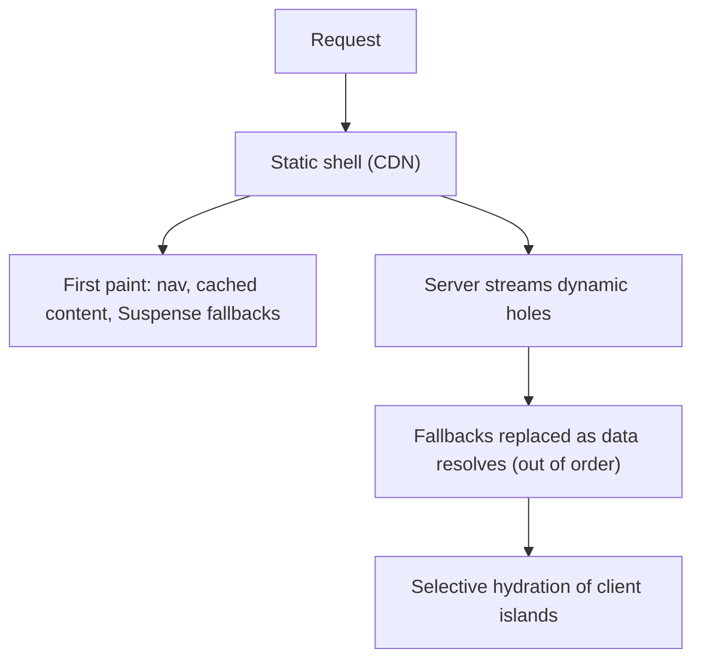
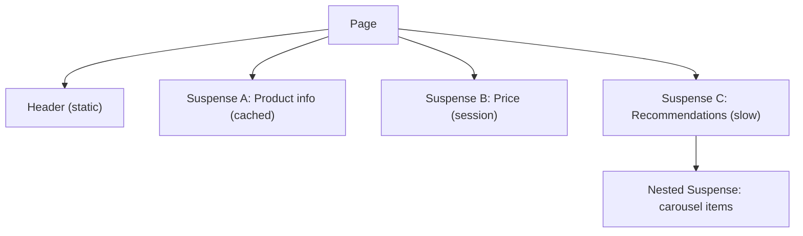
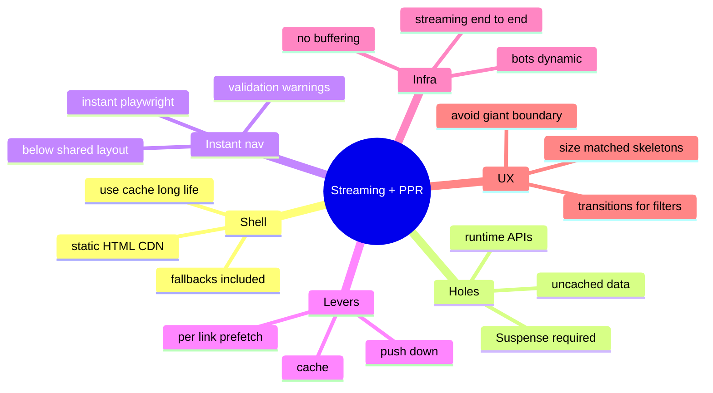

# Streaming, Partial Prerendering and Instant Navigation

> Verified against the Next.js docs (Caching, Instant navigation guide, Link reference, Self-hosting; Next.js 16.3/16.4 era, docs updated Oct–Nov 2026). Related: [01 Rendering strategies](01-rendering-strategies-and-hydration.md), [03 Caching](03-caching-and-revalidation.md), [react/03 Suspense and transitions](../react/03-concurrent-react-suspense-and-transitions.md), [web CLS/LCP topics in system-design/07](../system-design/07-image-gallery-and-media-heavy-ui.md).

## Table of Contents

1. [Quick Summary (TL;DR)](#1-quick-summary-tldr)
2. [Streaming Mechanics](#2-streaming-mechanics)
3. [Designing Suspense Boundaries](#3-designing-suspense-boundaries)
4. [Static Shell, Dynamic Holes, App Shell](#4-static-shell-dynamic-holes-app-shell)
5. [Maximising the Static Shell (Push Down)](#5-maximising-the-static-shell-push-down)
6. [Direct Visits vs Client Navigations](#6-direct-visits-vs-client-navigations)
7. [Instant Navigation Workflow (Next.js 16.3+)](#7-instant-navigation-workflow-nextjs-163)
8. [Prefetching: Partial Prefetching and Per-Link Prefetch](#8-prefetching-partial-prefetching-and-per-link-prefetch)
9. [Loading States That Don't Hurt CLS or UX](#9-loading-states-that-dont-hurt-cls-or-ux)
10. [Errors, Not-Found and Metadata While Streaming](#10-errors-not-found-and-metadata-while-streaming)
11. [Bots and Crawlers](#11-bots-and-crawlers)
12. [Infrastructure Requirements](#12-infrastructure-requirements)
13. [Testing and Observability](#13-testing-and-observability)
14. [Pitfalls](#14-pitfalls)
15. [Interview Questions — Fundamentals](#15-interview-questions--fundamentals)
16. [Interview Questions — Senior Scenarios](#16-interview-questions--senior-scenarios)
17. [Cheat Sheet](#17-cheat-sheet)
18. [Key Terms Glossary](#18-key-terms-glossary)
19. [Further Reading](#19-further-reading)

---

## 1. Quick Summary (TL;DR)

- **Streaming** = send the shell now, stream each Suspense boundary when its data resolves. **PPR** = prerender a **static shell** at build and stream **dynamic holes** at request time; it is the default with `cacheComponents: true`.
- **What goes where:** pure/cached content → static shell; uncached data and **runtime APIs** (`cookies()`, `headers()`, `searchParams`, dynamic `params`) → behind `<Suspense>` (fallback is part of the shell). Without a boundary you get a **blocking-route** error.
- **Instant navigation** (Next.js 16.3+): a navigation is instant when the browser can start rendering the new page immediately with **static, cached, and fallback** content while the server streams the rest. Dev-time **validation** checks both **page loads and client navigations**.
- **Client navigations only re-render below the shared layout**, so a Suspense boundary in a layout above the shared point **does not** cover that navigation. This is the main reason pages that pass on direct load can still block on click.
- **Levers:** *push down* (move the `await` into a Suspense-wrapped child), *cache* (`'use cache'` + `cacheLife`), *per-link prefetching* (`<Link prefetch>` for URL-dependent data).
- Keep **fallbacks size-matched** (CLS) and **as small as possible** (don't replace most of the page with one spinner).



---

## 2. Streaming Mechanics

1. React renders the tree on the server. When a component **suspends** (awaiting data), React emits the **fallback** in place and continues rendering siblings.
2. When the suspended component resolves, React streams its **HTML + a small inline script** that swaps it in place — even if later boundaries resolve earlier (**out-of-order streaming**).
3. In the browser, React **hydrates** boundaries selectively; interactions on a not-yet-hydrated boundary raise its priority.
4. React 19.2 improvements include **batched reveals** of Suspense content during streaming SSR to avoid janky multiple swaps; and **Suspense pre-warming** (React 19). See [react/04](../react/04-react-19-and-beyond.md).

`loading.tsx` creates an implicit boundary around a segment's page; explicit `<Suspense>` gives finer granularity.

```tsx
// app/dashboard/page.tsx
export default function Dashboard() {
  return (
    <>
      <h1>Dashboard</h1>                                   {/* static */}
      <Suspense fallback={<KpiSkeleton />}><Kpis /></Suspense>
      <Suspense fallback={<ChartSkeleton />}><RevenueChart /></Suspense>
      <Suspense fallback={<TableSkeleton />}><RecentOrders /></Suspense>
    </>
  );
}
```

---

## 3. Designing Suspense Boundaries

**Principles**
1. **One boundary per independently useful piece of UI** (widget, section, list), not one per component.
2. **Place boundaries as low as possible** so more content joins the shell; but not so low that you get popcorn UI (many tiny spinners).
3. **Group content that should appear together** (avoid layout jumps) inside the same boundary.
4. **Above-the-fold first**: critical LCP content in the shell or in the first resolved boundary.
5. **Fallback = skeleton with the same dimensions** as final UI.
6. **Nested boundaries** for progressive detail (page → section → item).
7. Validation passing ≠ good UX: a single boundary wrapping the whole page *passes* but replaces most of the page with a spinner on every navigation.



---

## 4. Static Shell, Dynamic Holes, App Shell

| Concept | Meaning |
|---|---|
| **Static shell** | Prerendered HTML + serialized RSC payload for a route; served directly from a CDN; contains static content, cached results with adequate lifetimes, and **fallbacks** of Suspense boundaries |
| **Dynamic hole** | Suspense-wrapped region rendered at request time |
| **App Shell** | When dynamic params are unknown at build, the reusable URL-independent version of the shell (param-specific parts remain behind fallbacks). Includes static content and **session data derived from `cookies()`/`headers()`** (client-cached per session, not in shared server cache) |
| **ISR upgrade** | After first visit to an unknown param URL, Next.js upgrades the App Shell with concrete content and caches it |

What lands in the shell (Cache Components):
- Pure computations, imports, sync fs reads → shell automatically.
- `'use cache'` with long-enough `cacheLife` → shell.
- Short-lived caches (`seconds`, `revalidate: 0`, `expire < 5m`) → **excluded** (dynamic hole).
- `use cache` called with runtime-derived args (e.g., `sessionId`) → **not** in shell (gated by request data) but can be prefetched with the user's session.
- `'use cache: private'` → browser-cached only; **can't** be in the static shell.

---

## 5. Maximising the Static Shell (Push Down)

**Anti-pattern:** awaiting `params` (or `cookies()`) at the top of a layout makes the entire subtree wait.

```tsx
// ❌ Layout blocks the shell if slug is not known at build time
export default async function Layout({ children, params }: LayoutProps<'/shop/[slug]'>) {
  const { slug } = await params;
  return (<div><Sidebar /><h1>{slug}</h1>{children}</div>);
}
```

**Fix:** pass the promise down and await inside a Suspense-wrapped child:

```tsx
// ✅ Sidebar, children and the fallback are in the shell; only the heading streams
export default function Layout({ children, params }: LayoutProps<'/shop/[slug]'>) {
  return (
    <div>
      <Sidebar />
      <Suspense fallback={<h1>Loading…</h1>}>
        {params.then(({ slug }) => <SlugHeading slug={slug} />)}
      </Suspense>
      {children}
    </div>
  );
}
function SlugHeading({ slug }: { slug: string }) { return <h1>{slug}</h1>; }
```

Same principle for `cookies()`, `headers()`, `searchParams` and data fetches: **the deeper the async work sits in the tree, the more of the page can be prerendered.** For a complete workflow see the docs' "Optimizing the static shell".

Related: **per-request values** (`Math.random`, `Date.now`, `crypto.randomUUID`) → `await connection()` inside Suspense (dynamic) or `use cache` (shared).

---

## 6. Direct Visits vs Client Navigations

| | Direct visit (hard load) | Client navigation (soft) |
|---|---|---|
| Initial UI | **Static shell HTML**, typically from CDN | Renders from the **RSC payload**, re-rendering only **below the layout shared** by current and destination routes |
| Which Suspense boundaries apply | All, from the document root | Only those **below** the shared layout |
| `useSearchParams()` | Suspends during prerender (params unknown at build) | Resolves **synchronously** (router already has the URL) |
| Cache assumption | Warm CDN/cache | Warm client/prefetched data |

**Consequence:** a root-layout `<Suspense>` makes a direct visit pass validation but does nothing for navigating between `/store/shoes` and `/store/hats` (the `/store` layout stays mounted; only the page re-renders). **Each case is validated independently.**

Special case: navigating into a **Client Component page** (`"use client"`) behaves like an SPA transition (no server render at navigation time) → instant; but it still needs Suspense for hooks like `useSearchParams()` in the static shell. Don't make pages client components just to pass validation.

---

## 7. Instant Navigation Workflow (Next.js 16.3+)

**Enable**
```ts
// next.config.ts
const nextConfig = { cacheComponents: true, partialPrefetching: true };
export default nextConfig;
```

**Dev-time validation** (default `validationLevel: 'warning'`): Cache Components validates **every Page and Default segment** in development and surfaces **blocking-route** insights naming the offending component, with fix cards:
- **Cache** – add `'use cache'` (+ `cacheLife`) to the function/component.
- **Stream** – wrap in / move into `<Suspense>`.
- **Block** – explicitly allow blocking (`export const instant = false` on the page/layout) when the route isn't a priority.
- Set `experimental.instantInsights.validationLevel: 'manual-warning'` to only validate segments that explicitly export `instant`.

**Worked example (from docs): product page**
```tsx
export default function ProductPage(props: PageProps<'/store/[slug]'>) {
  return (
    <div>
      <Suspense fallback={<p>Loading product…</p>}><ProductInfo params={props.params} /></Suspense>
      <Suspense fallback={<p>Checking availability…</p>}><Inventory params={props.params} /></Suspense>
    </div>
  );
}
async function ProductInfo({ params }: { params: Promise<{ slug: string }> }) {
  const { slug } = await params;
  const product = await getProduct(slug);       // 'use cache' inside
  return <><h1>{product.name}</h1><p>${product.price}</p></>;
}
async function getProduct(slug: string) { 'use cache'; return db.products.findBySlug(slug); }
async function Inventory({ params }: { params: Promise<{ slug: string }> }) {
  const { slug } = await params;
  const item = await db.inventory.findBySlug(slug);          // fresh each request
  return <p>{item.count} in stock</p>;
}
```
Navigating `/store/shoes → /store/hats`: product name/price appear immediately from cache; "Checking availability…" shows where inventory streams in.

**Fixing a blocking route — the three levers**
1. **Push down:** extract the I/O (and the `await params`) into a Suspense-wrapped child.
2. **Cache:** `'use cache'` + `cacheLife` for shared/slow-changing data (featured lists, product info).
3. **Per-link prefetch:** when a route reads URL data (`searchParams`/`params`), opt links into `prefetch={true}` so the framework resolves cached content with the link's URL before the click.

**Tooling**
- **Navigation Inspector** (Next.js DevTools): "Pause on navigations" freezes the page at its initial loading state, showing the static shell on direct visits and the prefetched destination on client navigations.
- **React DevTools Suspense panel**: toggle boundaries between fallback/resolved to see coverage.
- **E2E regression guard:** `@next/playwright` `instant()` helper asserts on the UI available immediately.

```ts
import { test, expect } from '@playwright/test';
import { instant } from '@next/playwright';

test('product page is instant on client navigation', async ({ page }) => {
  await page.goto('/store/shoes');
  await instant(page, async () => {
    await page.click('a[href="/store/hats"]');
    await page.waitForURL((u) => u.pathname === '/store/hats');
    await expect(page.locator('h1')).toContainText('Baseball Cap');
    await expect(page.getByText('In stock')).toHaveCount(0);       // dynamic hole still pending
  });
  await expect(page.getByText('In stock')).toBeVisible();
});
```
Run against `next dev` (testing API enabled automatically); for production-build CI enable `experimental.exposeTestingApiInProductionBuild` **only for the test build** (set the env var at `next build` time). Pass `baseURL` when `page.goto()` is the first navigation.

> Definition caveat from the docs: "instant" assumes **warm caches**; a cold cache still needs the server to compute the cached result once.

---

## 8. Prefetching: Partial Prefetching and Per-Link Prefetch

Verified behaviour:
- Prefetching runs **only in production**, when a `<Link>` enters the viewport.
- **Without Partial Prefetching:** `prefetch="auto"/null` → static routes prefetch the full route; dynamic routes prefetch down to the nearest `loading.js` boundary. `true` → full route. `false` → never.
- **With `partialPrefetching: true`:** default `auto` prefetches the per-route **App Shell** (static + cached content + session data derived from `cookies()`/`headers()`); links to the same route **share one App Shell request**.
- `<Link prefetch={true}>` additionally resolves **per-link URL data** (`searchParams`, `params`): Next.js re-renders the route's tree at prefetch time with the destination URL, so `use cache` functions called with URL-derived args (e.g., `search(q)`) are included before the click. This **costs a server invocation per prefetchable link** → use selectively.
- `'use cache: private'` results run on the server, are cached in the browser, and join the per-link prefetch.
- Next.js 16 routing: **layout deduplication** + **incremental prefetching** → more but smaller requests.

```tsx
<Link href="/search?q=shoes" prefetch>Shoes</Link>          // resolves cached search('shoes') ahead of the click
<Link href="/account" prefetch={false}>Account</Link>      // skip prefetch (e.g., rarely visited / expensive)
```

Guidance: prefetch **high-probability** links; avoid `prefetch` on huge lists of links to dynamic URLs; watch server cost; keep App Shell good first, per-link prefetch second ("per-link prefetching cannot fix a route that blocks without the App Shell").

---

## 9. Loading States That Don't Hurt CLS or UX

- **Match dimensions**: reserve height/width (min-height, aspect-ratio, fixed row counts) to avoid layout shift when content arrives (see CLS ≤ 0.1 target).
- **Prefer cached content over spinners:** keep the header, image and description visible; only price/availability behind fallbacks.
- **Avoid flashing** very short fallbacks (React/Next may delay/batch reveals; use transitions for in-page updates).
- **Accessibility:** announce important async updates with `aria-live="polite"` regions; give skeletons `aria-hidden` (or a visually hidden "Loading…" status) so screen readers aren't spammed; respect `prefers-reduced-motion` for shimmer.
- **Content ordering:** stream above-the-fold first; use nested boundaries for below-the-fold; consider `content-visibility: auto` for long lists (needs `contain-intrinsic-size`).
- **Transitions for in-page filters:** wrap `router.replace` in `startTransition` (or `useTransition`) so old results stay visible while new ones load, instead of reverting to a skeleton.

```tsx
'use client';
const [pending, start] = useTransition();
const onChange = (q: string) => start(() => router.replace(`?q=${encodeURIComponent(q)}`));
<div aria-busy={pending} style={{ opacity: pending ? 0.6 : 1 }}>{children}</div>
```

---

## 10. Errors, Not-Found and Metadata While Streaming

- Once streaming has started, the **HTTP status is already 200**; errors in later boundaries are handled by the nearest `error.tsx`/error boundary (Next.js `catchError` for component-level boundaries); to return a real 404/redirect status, `notFound()`/`redirect()` must run **before** the response starts streaming (i.e., in code that resolves before the shell flush).
- **Metadata** (`generateMetadata`) can be dynamic with PPR and streams after the shell; with Cache Components uncached data/runtime APIs in metadata surface the same insights as pages.
- **Error boundaries should wrap risky subtrees** so one widget failing doesn't blank the page; Suspense handles waiting, error boundaries handle failing.
- Log the **digest** (production hides error messages from the client).

---

## 11. Bots and Crawlers

With PPR, metadata can stream after the shell. Some bots can't handle that and need metadata inside `<head>`. Next.js **detects bots by user agent, skips the static shell and renders dynamically** at request time (list configurable per the Streaming guide). Implications:
- Data sources available during build-time prerender **must also be available at request time**, otherwise the dynamic render may throw and bots receive a 500.
- Verify with bot UAs in staging; ensure SEO-critical content isn't only in streamed holes that bots won't see.

---

## 12. Infrastructure Requirements

- **No buffering**: reverse proxies (nginx `X-Accel-Buffering: no`), load balancers (chunked transfer/HTTP2 streaming), serverless integrations (some, e.g. AWS ALB + Lambda, may buffer by default) must pass chunks through. **PPR requires streaming** — otherwise static shell + dynamic content arrive together after full render, eliminating the TTFB advantage.
- **CDN:** fully prerendered pages return `Cache-Control: public`; pages touching dynamic APIs are `private`; check your CDN honours these and cache-key variability (see [03](03-caching-and-revalidation.md), [08](08-deployment-runtimes-and-operations.md)).
- **Compression + streaming:** ensure compression middleware flushes chunks.
- **Platform adapters:** see the PPR Platform Guide and Adapter API (`adapterPath`, stable since 16.2) for platform-specific support.

---

## 13. Testing and Observability

- **Local:** `next build && next start` (prefetching and caching differ in dev); Navigation Inspector; React DevTools Suspense panel; throttle network/CPU.
- **CI:** Playwright `instant()` tests for critical routes (both initial load and client navigation); visual regression for skeleton → content; Lighthouse/CWV budgets.
- **RUM:** LCP, INP, CLS per route; **TTFB of dynamic holes** (server timing); percentage of navigations served from prefetch; error rate per boundary; `useReportWebVitals`/custom beacons.
- **Server:** trace spans per async component (OpenTelemetry via `instrumentation`), cache hit ratios, time-to-first-byte vs time-to-last-byte.
- Next.js 16 removed `size`/`First Load JS` from `next build` output (inaccurate with RSC) — use Lighthouse/RUM and bundle analyzers instead.

---

## 14. Pitfalls

1. **Awaiting runtime data in layouts** → blocking shell.
2. **Root-level Suspense only** → direct visits pass, client navigations block.
3. **Single giant boundary** → passes validation, awful UX.
4. **Fallbacks without dimensions** → CLS.
5. **Using `use cache` for per-user data without identity in the key** (leak risk).
6. **`cacheLife('seconds')`** everywhere → dynamic holes, no shell.
7. **Per-link `prefetch` on hundreds of links** → server cost spike.
8. **Buffering proxies** → no streaming benefit.
9. **Forgetting bots** → metadata/data mismatch errors for crawler renders.
10. **Testing only direct visits** or only in `next dev` (prefetch is production-only).
11. **Making pages `"use client"` to dodge Suspense design** → bundle bloat; still need Suspense for hooks like `useSearchParams`.
12. **Setting status codes after streaming begins** (can't change 200).

---

## 15. Interview Questions — Fundamentals

### Q1. What is PPR and how is it enabled in Next.js 16?
Partial Prerendering serves a prerendered static shell plus streamed dynamic holes. It's the default behaviour when `cacheComponents: true` (the old `experimental.ppr` flag was removed in 16).

### Q2. What goes into the static shell?
Static content, pure computations/imports, `'use cache'` results with sufficiently long lifetimes, and the **fallbacks** of Suspense boundaries wrapping uncached/runtime data.

### Q3. Why does Next.js require Suspense around runtime data?
So the route can still produce a static shell; the Suspense boundary provides fallback UI where request-time content streams. Without it the build/dev reports a blocking-route error.

### Q4. Explain instant navigation.
A navigation is instant if the browser can render the destination immediately with static/cached/fallback content while the rest streams. Because client navigations only re-render below the shared layout, boundaries above it don't count; validation checks both load and navigation cases.

### Q5. What's the App Shell?
The reusable, URL-independent version of a route's static shell (param-specific parts behind fallbacks); used for prefetching and as the starting point for ISR with unknown params.

### Q6. What does `<Link prefetch={true}>` do under Partial Prefetching?
Resolves the route's cached content that depends on the link's URL data (`searchParams`, `params`) at prefetch time, at the cost of a server invocation per link.

### Q7. How do you improve a blocking route?
Push the await into a Suspense-wrapped child, cache with `'use cache'`, or use per-link prefetching; then confirm with validation, Navigation Inspector and `instant()` tests.

### Q8. Why can't you set a 404 status from inside a streamed boundary?
Headers/status are sent with the first flush; after streaming starts the status is 200. Use `notFound()`/`redirect()` before the shell is flushed (or handle via error UI).

### Q9. How do bots affect PPR?
Next.js detects bots and renders dynamically (no static shell) so metadata is in `<head>`; ensure build-time data sources work at request time.

### Q10. What infrastructure breaks streaming?
Buffering reverse proxies/load balancers/compression layers; PPR without streaming loses its benefit.

---

## 16. Interview Questions — Senior Scenarios

### S1. "Route passes dev validation but navigating from the listing to a detail page flashes a full-page spinner."
The boundary is likely **above the shared layout** or too high. Inspect with Navigation Inspector on a client navigation; move Suspense **below** the shared layout (in the page), push `await params` into a child, cache product/info with `use cache`, size-match skeletons, add `prefetch={true}` on listing links if URL data matters, and add an `instant()` navigation test so it doesn't regress.

### S2. "Product listing with filters: URL-driven, cached, instant, SEO-friendly."
Filters in `searchParams` (URL = state); page reads them inside a Suspense child and calls cached `search(filters)` (`use cache`, args as key, tags for catalogue updates); shell contains layout/filters UI; filter changes via `router.replace` in a transition (keep old results visible); canonical URLs for facet combinations; `<Link prefetch>` for popular filters; per-link prefetch cost monitored; analytics for zero-result queries; bots render dynamically so metadata/data must work at request time.

### S3. "TTFB is great in staging but streaming is not visible in production behind our CDN."
Check CDN/LB buffering and compression settings, HTTP/2 vs HTTP/1.1, `Transfer-Encoding: chunked`, nginx `proxy_buffering`/`X-Accel-Buffering`, WAF/bot-protection layers, serverless adapter streaming support, and whether the CDN caches dynamic HTML contrary to `Cache-Control: private`. Verify with `curl -N` timing, WebPageTest filmstrip, and server logs for chunk flush times.

### S4. "How would you roll out Cache Components + Partial Prefetching in a large app?"
Upgrade to Next 16 first; enable `cacheComponents` on a branch; treat blocking-route errors as a worklist per route group; adopt `use cache` for shared reads, Suspense for dynamic regions; enable `partialPrefetching` explicitly (avoid the unset warning); use feature flags/canary traffic; add `instant()` tests for top routes; monitor LCP/INP/CLS, cache hit ratios, server cost (per-link prefetch), and error rates; keep an escape hatch (`instant = false` for low-priority routes).

### S5. "Explain why `useSearchParams` behaves differently between page load and navigation."
On a page load during prerender, search params aren't known so the hook suspends (needs Suspense, shell contains the fallback). On a client navigation, the router already has the destination URL so the hook resolves synchronously, so the same component can render immediately on navigation but sit behind a fallback on direct load — which is why both paths are validated separately.

---

## 17. Cheat Sheet



---

## 18. Key Terms Glossary

| Term | Definition |
|---|---|
| **Streaming SSR** | Sending HTML progressively as Suspense boundaries resolve |
| **Out-of-order streaming** | Later boundaries may be flushed before earlier ones |
| **PPR** | Partial Prerendering: static shell + dynamic holes |
| **Static shell / App Shell** | Prerendered route HTML / reusable URL-independent shell |
| **Blocking route** | Uncached/runtime access outside Suspense that prevents a shell |
| **Instant navigation** | Immediate render of static/cached/fallback UI on navigation |
| **Partial Prefetching** | `partialPrefetching: true`: prefetch App Shell by default |
| **Per-link prefetch** | `prefetch={true}` resolving URL-dependent cached content |
| **Navigation Inspector** | Next DevTools panel freezing loading states |
| **`instant()`** | `@next/playwright` helper asserting immediate UI |

---

## 19. Further Reading

- [Ensuring instant navigations](https://nextjs.org/docs/app/guides/instant-navigation) · [Optimizing prefetching](https://nextjs.org/docs/app/guides/optimizing-prefetching) · [Optimizing the static shell](https://nextjs.org/docs/app/guides/optimizing-the-static-shell)
- [Caching (Cache Components)](https://nextjs.org/docs/app/getting-started/caching) · [Link component](https://nextjs.org/docs/app/api-reference/components/link)
- [React — Suspense](https://react.dev/reference/react/Suspense)
- This repo: [react/03](../react/03-concurrent-react-suspense-and-transitions.md) · [03 Caching](03-caching-and-revalidation.md)
