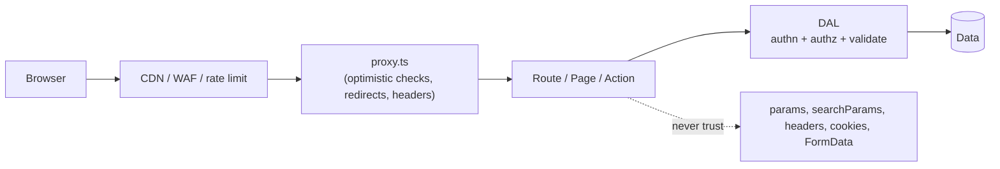
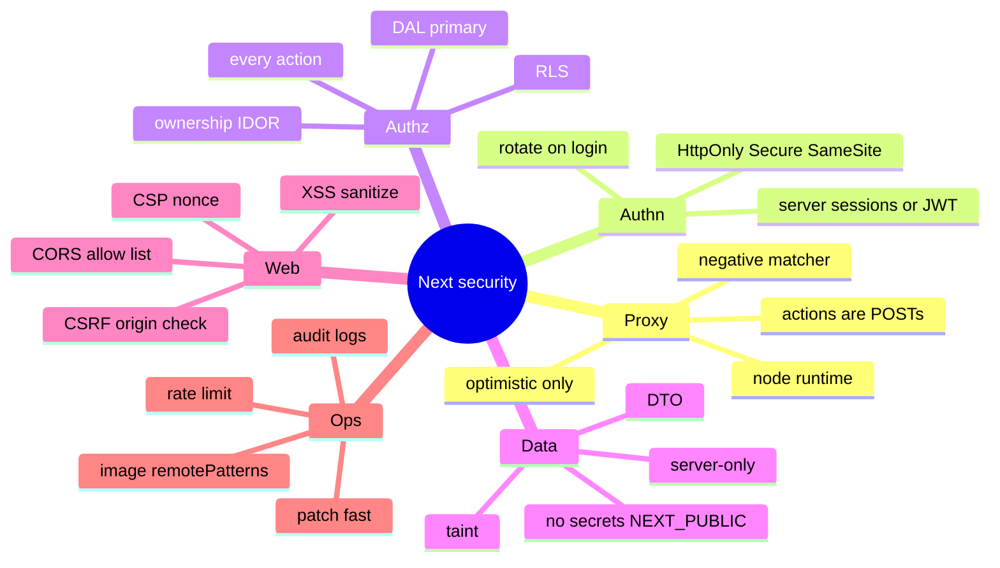

# Proxy, Authentication and Security in Next.js

> Verified against the Next.js docs (proxy.js reference, Data Security guide, Mutating Data, Image component, Self-hosting, v16 upgrade guide, Next.js blog security posts; Oct–Nov 2026). Cookie/CSP/OWASP guidance outside those pages is general knowledge — hedged where relevant. Related: [02 App Router](02-app-router-fundamentals.md), [04 Data fetching and mutations](04-data-fetching-and-mutations.md), [react/05 RSC and the 2025 RSC CVEs](../react/05-server-components-and-server-functions.md).

## Table of Contents

1. [Quick Summary (TL;DR)](#1-quick-summary-tldr)
2. [Threat Model for a Next.js App](#2-threat-model-for-a-nextjs-app)
3. [`proxy.ts` (formerly Middleware)](#3-proxyts-formerly-middleware)
4. [Authentication Architecture](#4-authentication-architecture)
5. [Authorization: Where Checks Must Live](#5-authorization-where-checks-must-live)
6. [Server Actions and Route Handlers Security](#6-server-actions-and-route-handlers-security)
7. [Data Exposure: Server/Client Boundary](#7-data-exposure-serverclient-boundary)
8. [XSS, CSP and Security Headers](#8-xss-csp-and-security-headers)
9. [CSRF, CORS and Cookies](#9-csrf-cors-and-cookies)
10. [Environment Variables and Secrets](#10-environment-variables-and-secrets)
11. [Image Optimisation and SSRF Surface](#11-image-optimisation-and-ssrf-surface)
12. [Rate Limiting, Abuse and Bots](#12-rate-limiting-abuse-and-bots)
13. [Patching and Supply-Chain Hygiene](#13-patching-and-supply-chain-hygiene)
14. [Security Review Checklist (Audit Guide)](#14-security-review-checklist-audit-guide)
15. [Pitfalls](#15-pitfalls)
16. [Interview Questions — Fundamentals](#16-interview-questions--fundamentals)
17. [Interview Questions — Senior Scenarios](#17-interview-questions--senior-scenarios)
18. [Cheat Sheet](#18-cheat-sheet)
19. [Key Terms Glossary](#19-key-terms-glossary)
20. [Further Reading](#20-further-reading)

---

## 1. Quick Summary (TL;DR)

- **Defence in depth:** `proxy.ts` for **coarse, optimistic** checks (redirect unauthenticated users); **real authentication + authorization in the Data Access Layer and inside every Server Action/Route Handler**.
- **Layouts don't protect children** (they don't re-render on every navigation); **page-level checks don't protect Server Actions** (separate POST entry points).
- **Server Functions are public endpoints.** Verify identity, **ownership (IDOR)**, validate input, return minimal data.
- **Never pass whole records to Client Components**; use DTOs, `server-only`, and the taint APIs as an extra layer. `NEXT_PUBLIC_*` values are inlined into client bundles — never secrets.
- **`proxy.ts`** (v16 rename of `middleware.ts`): Node runtime only, runs on every request unless you set a **matcher**; it's a "last resort" feature, not a general-purpose middleware chain.
- **Patch quickly:** Next.js now ships **scheduled monthly security releases** plus out-of-band fixes; the Dec 2025 RSC vulnerabilities (CVE-2025-66478 in Next.js; React CVE-2025-55182, CVSS 10) showed that the RSC protocol itself is an attack surface.



---

## 2. Threat Model for a Next.js App

| Asset | Threat | Primary controls |
|---|---|---|
| Sessions/credentials | Theft (XSS), fixation, CSRF | HttpOnly+Secure+SameSite cookies, short TTL, rotation, CSP |
| Data | Broken access control / IDOR, over-fetching to client | DAL authz, DTOs, row-level security |
| Server | RCE/DoS via framework/library CVEs, SSRF | Patching, input limits, image `remotePatterns`, egress controls |
| Integrity | CSRF on actions, mass assignment | Origin check (built-in), allowed origins, schema validation |
| Availability | Abuse of expensive actions/endpoints | Rate limiting, quotas, caching |
| Supply chain | Malicious/compromised packages & scripts | Lockfiles, provenance, `npm audit`/SCA, minimal third-party scripts, CSP/SRI |
| Privacy | PII in logs/URLs/analytics | Redaction, minimisation, DTOs |

OWASP Top 10 mapping: A01 Broken Access Control (most Next.js bugs), A03 Injection/XSS, A05 Misconfiguration (headers, CORS, env), A06 Vulnerable Components, A07 Auth failures, A10 SSRF.

---

## 3. `proxy.ts` (formerly Middleware)

**Facts (docs):**
- File convention `proxy.ts|js` at project root (or `src/`), exporting **one** function (default export or named `proxy`) and an optional `config` with `matcher`.
- Runs **before routes are rendered**: rewrites, redirects, header/cookie changes, or responding directly. Invoked for **every route** unless you use a matcher; without a matcher it also runs for `_next/static`, `_next/image`, and `public/` files — use a **negative matcher** so redirects/auth logic don't block CSS/JS/images.
- **Node.js runtime only** (the `runtime` option is not available; setting it throws). The **edge runtime is not supported** in `proxy` — keep using `middleware` if you need edge. Not supported with **static export**.
- Execution order: `headers` → `redirects` → **proxy** → `beforeFiles` rewrites → filesystem routes → `afterFiles` rewrites → dynamic routes → `fallback` rewrites.
- **Server Functions are POSTs to the route where they're used** — a matcher that excludes a path **also skips proxy for Server Function calls on that path**, and refactoring an action to a different route can silently remove coverage → **never rely on proxy alone** for auth.
- `_next/data` routes still trigger proxy even if excluded by a negative matcher (intentional, to avoid accidental data exposure).
- Meant to be invoked separately from render code and in optimised cases deployed to the CDN — **don't rely on shared modules/globals**; pass info to the app via headers, cookies, rewrites, redirects or URL.
- `NextResponse.next({ request: { headers } })` forwards **request** headers upstream; `NextResponse.next({ headers })` sends them to the **client** (common mistake).
- `event.waitUntil(promise)` (via `NextFetchEvent`) for background work like logging.
- Migration: `npx @next/codemod@canary middleware-to-proxy .`; flags renamed (`skipMiddlewareUrlNormalize` → `skipProxyUrlNormalize`).

```ts
// proxy.ts
import { NextResponse, type NextRequest } from 'next/server';

export function proxy(request: NextRequest) {
  const hasSession = request.cookies.has('session');           // optimistic: cookie present, NOT verified here
  if (!hasSession && request.nextUrl.pathname.startsWith('/dashboard')) {
    const url = new URL('/login', request.url);
    url.searchParams.set('next', request.nextUrl.pathname);    // validate on the login side to avoid open redirects
    return NextResponse.redirect(url);
  }
  return NextResponse.next();
}

export const config = {
  matcher: ['/((?!api|_next/static|_next/image|favicon.ico|sitemap.xml|robots.txt).*)'],
};
```

**Good uses:** locale redirects, A/B bucketing cookies (careful with caching), bot filtering/geo rewrite, coarse auth redirects, adding security headers, CORS preflight handling.
**Bad uses:** heavy data fetching, DB queries per request, full authorization logic, long-running work (it's on the critical path of every matched request).

---

## 4. Authentication Architecture

> General patterns (the docs have a dedicated Authentication guide; pick a maintained library such as Auth.js or a managed provider rather than hand-rolling crypto).

| Approach | How | Pros | Cons |
|---|---|---|---|
| **Server-side session (opaque ID in cookie)** | Session ID → DB/Redis lookup | Easy revocation, small cookie, server-controlled | Lookup per request (cache with `React.cache` per render), store to run |
| **Stateless signed/encrypted session (JWT/JWE in cookie)** | Verify signature/decrypt | No DB hit, scalable | Revocation hard (short TTL + refresh), cookie size, key rotation |
| **OAuth/OIDC (social/enterprise SSO)** | Redirect flow, code exchange in Route Handler | No password handling, SSO | Complexity: state/nonce/PKCE, token storage |
| **Passkeys/WebAuthn** | Public-key credentials | Phishing-resistant | Implementation/recovery UX |

**Cookie settings:** `HttpOnly` (not readable by JS), `Secure`, `SameSite=Lax` (or `Strict` where possible), scoped `Path`/`Domain`, short expiry with rotation on privilege change/login, `__Host-` prefix where appropriate.

```ts
// data/auth.ts — single source of truth for "who is calling"
import 'server-only';
import { cache } from 'react';
import { cookies } from 'next/headers';

export const getSession = cache(async () => {
  const token = (await cookies()).get('session')?.value;
  if (!token) return null;
  return verifySession(token);                       // signature/expiry/DB lookup
});

export async function requireUser() {
  const s = await getSession();
  if (!s) redirect('/login');
  return s.user;
}
```

**Login flow (Server Action):** validate credentials (constant-time compare, rate limit, lockout/backoff), create session, set cookie via `cookies().set(...)`, `redirect()`. **Logout:** delete session server-side (not just the cookie). **Session fixation:** issue a new session ID on login. **MFA/step-up** for sensitive actions.

**Cache interplay (important):** authenticated HTML must never be stored in a shared cache. Dynamic pages are served `private, no-cache, no-store`; if you cache user-specific results with `use cache`, **include the user/segment in the key**; `use cache: private` caches in the browser only.

---

## 5. Authorization: Where Checks Must Live

| Layer | Purpose | Sufficient alone? |
|---|---|---|
| `proxy.ts` | Redirect obviously unauthenticated users early | **No** (matcher gaps, can be bypassed by direct POSTs to uncovered paths) |
| Layout | UI shell | **No** (doesn't re-render on every navigation; children may be fetched independently) |
| Page/Server Component | Render gating | **No** for mutations; OK for reads if also enforced in DAL |
| **DAL / data functions** | **Authoritative authn + authz + DTO shaping** | **Yes — primary control** |
| **Server Action / Route Handler** | Entry-point re-verification | **Required** |
| Database RLS | Last line of defence (multi-tenant) | Recommended |

```ts
export async function deletePostAction(postId: string) {
  'use server';
  const user = await requireUser();                              // authn
  const post = await db.post.findUnique({ where: { id: postId }});
  if (!post || post.authorId !== user.id) throw new Error('Forbidden');   // authz (ownership) -> prevents IDOR
  await db.post.delete({ where: { id: postId }});
  updateTag('posts');
}
```

Model **roles/permissions** centrally (RBAC/ABAC) with helper functions (`can(user, 'post:delete', post)`); log denials; test cross-tenant access explicitly.

---

## 6. Server Actions and Route Handlers Security

From the Data Security guide:
- By default an exported Server Action is **reachable via direct POST**, even if not imported elsewhere. Built-in protections: **encrypted, non-deterministic action IDs** (regenerated per build; cached up to 14 days), **dead-code elimination** of unused actions, **encrypted closed-over variables** (new key per build). The docs still say: treat actions as reachable and verify auth in each.
- **CSRF:** actions use `POST` only (+ SameSite cookies by default) and Next.js compares the **Origin** header to **Host/X-Forwarded-Host**; configure `serverActions.allowedOrigins` (under `experimental`) for reverse-proxy/multi-layer setups.
- **Multi-instance:** set the same `NEXT_SERVER_ACTIONS_ENCRYPTION_KEY` (base64, 16/24/32 bytes) on all instances, otherwise you'll see "Failed to find Server Action" errors; rotate keys per standard practice.
- **Validate** everything (zod/valibot): FormData, `params`, `searchParams`, headers. Treat bracketed folders `/[param]/` as user input.
- **Return values** are serialised to the client — don't return raw DB records.
- **No side effects during render** (cookie set, revalidation, mutations) — Next.js prevents it; use actions.
- **Rate-limit** expensive actions (email/SMS, writes, exports); add **idempotency keys** for payments.
- **Route Handlers:** verify auth per handler; webhooks need **signature verification** (HMAC) on the **raw body**, replay protection (timestamp/nonce), idempotency, quick response + background processing; explicit **CORS** allow-list; never reflect arbitrary `Origin`.
- `proxy.ts` and `route.ts` "have a lot of power": audit with traditional techniques + periodic pen tests/vulnerability scans.

---

## 7. Data Exposure: Server/Client Boundary

- Everything passed from a Server Component to a Client Component is **serialised into the RSC payload / HTML** and visible to the user.
- **DTO pattern:** shape the minimal object in the DAL; use classes or explicit mappers so an entire row isn't passed accidentally.
- **`server-only`** import in DAL modules → build error if imported from client code. **Only the DAL reads `process.env` secrets.**
- **Taint APIs:** `experimental_taintObjectReference` / `experimental_taintUniqueValue` (enable `experimental.taint`) block tainted values from being passed to the client — an *additional* layer, not a replacement for filtering.
- Functions and class instances are already blocked from being passed to Client Components (except Server Functions).
- **Client Components still run on the server for prerendering** and must follow browser-level security assumptions.
- Beware **logging** full objects/errors, **analytics** payloads, and **URLs** (query strings are logged everywhere; don't put tokens/PII in them).

---

## 8. XSS, CSP and Security Headers

**XSS vectors in Next.js apps**
- `dangerouslySetInnerHTML` with unsanitised HTML (sanitise with a vetted library; prefer rendering markdown to React elements).
- JSON-LD `<script type="application/ld+json">`: escape `<` in the serialised JSON (`JSON.stringify(data).replace(/</g, '\\u003c')`).
- `href`/`src` with `javascript:` URLs from user input → allow-list schemes.
- Unsafe third-party scripts (use `next/script` with strategy; restrict via CSP).
- SVG uploads/optimisation (Next.js never optimises SVGs by default; `dangerouslyAllowSVG` requires CSP + `contentDispositionType: 'attachment'`).

**Content Security Policy:** use a nonce-based CSP (nonce generated per request, typically in `proxy.ts`/headers, applied to scripts); the docs have a dedicated *Content Security Policy* guide — check it for the current recommended setup because dynamic nonces force dynamic rendering for affected routes (hedged: verify behaviour for your Next.js version).

**Headers (via `next.config` `headers()` or proxy):**
| Header | Purpose |
|---|---|
| `Content-Security-Policy` | Restrict script/style/frame/connect sources |
| `Strict-Transport-Security` | Force HTTPS |
| `X-Content-Type-Options: nosniff` | Prevent MIME sniffing |
| `Referrer-Policy` | Limit referrer leakage |
| `Permissions-Policy` | Disable unused powerful APIs |
| `frame-ancestors` (CSP) / `X-Frame-Options` | Clickjacking defence |
| `Cross-Origin-Opener-Policy` / `Cross-Origin-Embedder-Policy` | Isolation (needed for some APIs) |

---

## 9. CSRF, CORS and Cookies

- **Server Actions:** POST-only + Origin/Host check + SameSite cookies; keep SameSite=Lax/Strict and don't accept cross-origin requests unless intended (`allowedOrigins`).
- **Route Handlers** used by browsers with cookie auth are **CSRF-prone for state-changing methods** — require CSRF tokens or custom headers + strict CORS, or use bearer tokens (not cookies) for cross-origin API clients.
- **CORS:** explicit allow-list; handle `OPTIONS`; `Access-Control-Allow-Credentials: true` requires a specific origin (never `*`); don't reflect arbitrary origins. In Next.js you can set CORS in proxy (example in docs) or per Route Handler.
- **Open redirects:** validate `next`/`returnTo` parameters (same-origin relative paths only).

---

## 10. Environment Variables and Secrets

- Server-only by default; **`NEXT_PUBLIC_*` is inlined at build time** into the client bundle (public, and fixed per build — not runtime-configurable).
- Next.js 16 removed `serverRuntimeConfig`/`publicRuntimeConfig`; read server env at **request time** by calling `await connection()` (or any request-time API) before `process.env` access — enabling one Docker image per many environments.
- Keep secrets out of the repo; load from the platform's secret manager; **rotate** (esp. `NEXT_SERVER_ACTIONS_ENCRYPTION_KEY`, session signing keys); separate keys per environment; least-privilege DB/API credentials.
- Don't `console.log(process.env)`; scrub env from error reports.
- Only the DAL touches `process.env` (reduces accidental exposure).

---

## 11. Image Optimisation and SSRF Surface

Verified Next.js 16 image-security posture:
- **`remotePatterns`** strictly allow-list protocol/host/port/pathname/search (omitting fields implies `**` — avoid); `images.domains` is deprecated.
- **`localPatterns`** restrict local paths; **local images with query strings** now need `images.localPatterns.search` (prevents enumeration).
- **`qualities`** default `[75]` (requests with other `q` values → 400); **`dangerouslyAllowLocalIP`** false by default (**SSRF guard**: blocks optimisation of local/private-network IPs; enable only for private networks you control); **`maximumRedirects`** default 3 (redirects aren't re-validated against `remotePatterns`); **`maximumResponseBody`** 50 MB default; `minimumCacheTTL` default 4 hours.
- The default loader does **not forward headers** to the source image — authenticated images need `unoptimized` or a custom loader.
- Self-host behind a reverse proxy for payload limits/slow-connection protection.

---

## 12. Rate Limiting, Abuse and Bots

- Rate limit at the **edge/WAF/CDN** (cheapest) and **per-identity in the DAL** (for authenticated abuse). Use sliding window/token bucket in Redis; apply to login, signup, password reset, search, exports, expensive actions.
- **Bot management:** CAPTCHA/Turnstile on signup/login/checkout; honeypots; behavioural signals; protect public APIs with API keys/quotas.
- **DoS considerations:** body size limits (reverse proxy), timeouts, backpressure, avoid unbounded loops over user input, cap pagination sizes, cache expensive reads.
- A reverse proxy in front of `next start` is recommended to handle malformed requests, slowloris, payload limits and rate limiting.

---

## 13. Patching and Supply-Chain Hygiene

- **Security release cadence (Next.js blog, 2026):** formal scheduled monthly security releases (July, August, September, **October 14 out-of-band**, **November 3**), announced in advance; plus the **Dec 2025** RSC advisories (CVE-2025-66478 and follow-ups). Takeaway: subscribe to advisories, keep Next.js/React **patched on the latest supported minor** of your major, and have a fast upgrade pipeline (CI, canary, rollback).
- **React RSC CVE-2025-55182** (CVSS 10, RCE) fixed in React 19.0.1/19.1.2/19.2.1 — Server Functions/RSC endpoints are a real attack surface; **don't expose unpatched servers**; consider WAF rules as temporary mitigation.
- **Lockfiles + provenance:** commit lockfiles, use `npm ci`, enable dependency review, SCA (Dependabot/Renovate + audit), pin build tools, restrict install scripts, internal registry mirroring (e.g., artifactory per your org policy).
- **Third-party scripts:** minimise, load with `next/script` strategies, restrict with CSP, use SRI where feasible, consider sandboxed iframes / Partytown-style isolation for tags.
- **Build adapters/platform:** adapters (stable API since 16.2) run in your build — treat as trusted code.
- **Observability for security:** log auth failures/denials, anomalous action rates, 4xx/5xx spikes, `x-forwarded-*` anomalies; alert on webhook signature failures.

---

## 14. Security Review Checklist (Audit Guide)

(From the docs' auditing section plus general practice)

1. **DAL:** is there an isolated DAL? Are DB packages/env imported only there?
2. **`"use client"` files:** do props accept private data? Types too broad?
3. **`"use server"` files:** args validated? user **re-authorised**? **ownership** checked? return values filtered? DB access delegated to DAL?
4. **`/[param]/` folders:** params validated?
5. **`proxy.ts` / `route.ts`:** reviewed with traditional techniques; matcher gaps; webhook signature checks; CORS.
6. **Headers/CSP:** configured and tested; no unsafe-inline without nonce.
7. **Env:** no secrets in `NEXT_PUBLIC_*`; rotate keys; runtime vs build-time.
8. **Images:** strict `remotePatterns`; SSRF flags default.
9. **Cache safety:** no per-user data under shared keys; CDN honours `private`.
10. **Dependencies:** patched Next.js/React; SCA clean; scripts reviewed.
11. **Logging:** no secrets/PII; correlation IDs; audit trail for sensitive actions.
12. **Testing:** authz tests (cross-tenant), fuzz inputs, pen test.

---

## 15. Pitfalls

1. "Auth is in the layout/proxy, so we're safe" (direct POST/data fetch bypass).
2. Authentication without ownership checks (IDOR).
3. Matcher excludes a path → actions on that path skip proxy.
4. Returning/passing entire DB rows to the client.
5. Caching personalised data with shared keys / CDN caching authenticated HTML.
6. `NEXT_PUBLIC_` for secrets.
7. Trusting `x-forwarded-*`/`Host` headers without a trusted proxy chain.
8. Open redirect via `?next=`.
9. Webhooks without raw-body HMAC verification or replay protection.
10. Wide `remotePatterns` or enabling `dangerouslyAllowLocalIP` casually.
11. Not patching (RSC CVEs).
12. Doing heavy work in `proxy`.
13. `redirect()` in `try/catch` swallowing the control-flow exception.
14. Using `dangerouslySetInnerHTML` with unsanitised content.

---

## 16. Interview Questions — Fundamentals

### Q1. Where should authorization be enforced in Next.js?
In the Data Access Layer and in every Server Action/Route Handler (authn + authz + ownership). `proxy.ts` and layouts are only optimistic UX/routing layers.

### Q2. Why isn't a layout-level auth check enough?
Layouts persist and don't re-render on every navigation, and child routes/actions/data fetches are separate entry points.

### Q3. Are Server Actions protected from CSRF?
They use POST only, rely on SameSite cookies, and Next.js compares Origin with Host/X-Forwarded-Host; configure `allowedOrigins` behind proxies. They're still public endpoints that need auth checks.

### Q4. What is `proxy.ts` and how does it differ from `middleware.ts`?
It's the v16 rename: same purpose (pre-render network-boundary logic) but Node.js runtime only; edge not supported; function renamed to `proxy`; guidance is to use it as a last resort.

### Q5. How do you avoid leaking data to Client Components?
DAL + DTOs, `server-only`, only pass needed serialisable fields, taint APIs as backup, never put secrets in `NEXT_PUBLIC_*`.

### Q6. How do you handle sessions securely?
HttpOnly/Secure/SameSite cookies, server-side validation and revocation (or short-lived signed tokens with rotation), new session on login, secure logout, MFA/step-up for sensitive flows.

### Q7. What is IDOR and how do you prevent it?
Accessing another user's resource by changing an ID; prevent with ownership/permission checks on every access (DAL helpers, RLS) in addition to authentication.

### Q8. How should webhooks be secured?
Verify HMAC signature on the raw body, check timestamp/nonce to prevent replay, make handlers idempotent, respond quickly, and process asynchronously.

### Q9. What image-related security settings matter?
Strict `remotePatterns`/`localPatterns`, default `dangerouslyAllowLocalIP: false`, limited `qualities`, `maximumRedirects`, SVG handling with CSP, and not forwarding auth headers.

### Q10. How do you keep up with framework vulnerabilities?
Follow the Next.js security release schedule/advisories, keep Next.js and React patched, automate dependency updates, and maintain a fast CI/CD rollout with rollback.

---

## 17. Interview Questions — Senior Scenarios

### S1. "A pentester modifies a hidden ID in a Server Action call and deletes another user's resource."
IDOR from missing ownership checks. Fix: move logic into a DAL function that always loads the resource and verifies `ownerId === user.id` (or permission), add `requireUser()`; reuse across actions; add cross-tenant tests; consider DB row-level security; audit all actions; add structured audit logging and alerts for denied attempts; don't rely on hidden fields, closure encryption, or UI gating.

### S2. "We use proxy for auth and just discovered an API path wasn't covered."
Matcher gaps happen (negative matchers, Server Functions on excluded paths, refactors). Treat proxy as optimistic only: enforce auth in Route Handlers/actions/DAL; add automated tests enumerating routes and expected responses unauthenticated; keep matcher simple and tested with `unstable_doesMiddlewareMatch`-style tests; log unauthenticated hits; review `_next/data` and rewrites; add a WAF rule as defence in depth.

### S3. "Design authentication for a multi-tenant SaaS on Next.js."
OIDC SSO + email/password with MFA via a vetted library/provider; server-side sessions (Redis) or short-lived JWT + refresh rotation; tenant ID bound to session; DAL enforces tenant scoping on every query (and DB RLS); roles/permissions (RBAC/ABAC) helpers; proxy for coarse redirects; CSRF protection (SameSite + Origin check); rate limiting per tenant/user/IP; audit logs; secure cookie settings; session revocation on password/role change; cache keys include tenant/user; E2E authz test matrix; security headers/CSP; secrets rotation and patching policy.

### S4. "Security asks for a strict CSP without breaking performance."
Use a nonce-based CSP generated per request (proxy), add the nonce to scripts (`next/script`), avoid inline scripts/styles or hash them, restrict `connect-src`, `frame-ancestors`, `img-src` (including optimiser domains), report-only first (`Content-Security-Policy-Report-Only`) with a reporting endpoint, iterate; understand that per-request nonces make affected routes dynamic and defeat full CDN caching of HTML — mitigate by scoping CSP strictness, using hash-based allowances for static content where feasible, or splitting public static vs authenticated dynamic areas. (Verify the CSP guide for your version.)

### S5. "We learned of a critical RSC vulnerability. What's your response?"
Triage using advisories (affected versions/paths); upgrade Next.js/React to patched releases immediately (canary → prod fast path); if blocked, apply WAF mitigations and restrict exposure; check logs for exploitation indicators (unusual POSTs to action endpoints, spikes); rotate secrets potentially exposed (server env, signing/encryption keys, DB credentials) if compromise suspected; communicate; post-incident: automation for dependency updates, staging soak tests, subscription to the security mailing list, runbook updates.

---

## 18. Cheat Sheet



---

## 19. Key Terms Glossary

| Term | Definition |
|---|---|
| **IDOR** | Insecure Direct Object Reference — missing per-resource authorization |
| **DAL / DTO** | Server-only data layer / minimal safe data shape |
| **proxy.ts** | v16 network-boundary file (renamed middleware), Node runtime |
| **CSRF** | Cross-site request forgery |
| **CSP / nonce** | Content Security Policy / per-request script token |
| **HMAC** | Keyed hash used to verify webhook signatures |
| **SSRF** | Server-side request forgery (e.g., via image optimiser fetching internal URLs) |
| **RLS** | Row-level security in the database |
| **Taint API** | React experimental API preventing values from reaching the client |
| **SCA** | Software composition analysis (dependency vulnerability scanning) |

---

## 20. Further Reading

- [Proxy (proxy.js)](https://nextjs.org/docs/app/api-reference/file-conventions/proxy) · [Data Security](https://nextjs.org/docs/app/guides/data-security) · [Authentication guide](https://nextjs.org/docs/app/guides/authentication) · [Content Security Policy guide](https://nextjs.org/docs/app/guides/content-security-policy)
- [Next.js blog — security releases](https://nextjs.org/blog) · [Image component security options](https://nextjs.org/docs/app/api-reference/components/image)
- [OWASP Top 10](https://owasp.org/www-project-top-ten/) · [OWASP IDOR cheat sheet](https://cheatsheetseries.owasp.org/cheatsheets/Insecure_Direct_Object_Reference_Prevention_Cheat_Sheet.html)
- This repo: [04 Data fetching and mutations](04-data-fetching-and-mutations.md) · [react/05](../react/05-server-components-and-server-functions.md)
