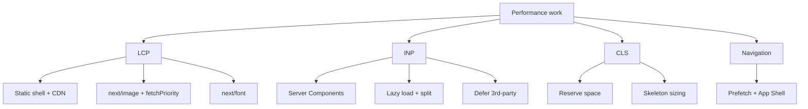
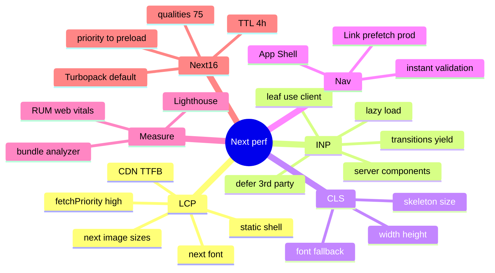

# Performance Optimization in Next.js (Core Web Vitals, Images, Fonts, Scripts, Bundles)

> Verified against the Next.js docs (Image component reference, v16 upgrade guide, Link, Self-hosting, blog index; Oct–Nov 2026). Core Web Vitals thresholds are the published "good" values (LCP ≤ 2.5 s, INP ≤ 200 ms, CLS ≤ 0.1 at the 75th percentile). `next/font`, `next/script`, `@next/third-parties` and `useReportWebVitals` details are from general knowledge of the stable APIs — hedged where I could not re-verify. Related: [01 Rendering strategies](01-rendering-strategies-and-hydration.md), [05 Streaming/PPR](05-streaming-ppr-and-instant-navigation.md), [react/08 React performance](../react/08-react-performance-optimization.md), [system-design/07 image-heavy UI](../system-design/07-image-gallery-and-media-heavy-ui.md).

## Table of Contents

1. [Quick Summary (TL;DR)](#1-quick-summary-tldr)
2. [Performance Model: What Next.js Optimises for You](#2-performance-model-what-nextjs-optimises-for-you)
3. [LCP: Shell, Images, Fonts, TTFB](#3-lcp-shell-images-fonts-ttfb)
4. [`next/image` Deep Dive (Next.js 16)](#4-nextimage-deep-dive-nextjs-16)
5. [`next/font`](#5-nextfont)
6. [`next/script` and Third-Party Scripts](#6-nextscript-and-third-party-scripts)
7. [INP: Hydration, Client JS and Long Tasks](#7-inp-hydration-client-js-and-long-tasks)
8. [Bundle Size: Server Components, Code Splitting, Analysis](#8-bundle-size-server-components-code-splitting-analysis)
9. [CLS: Layout Stability in Next.js Apps](#9-cls-layout-stability-in-nextjs-apps)
10. [Navigation Performance: Prefetch and Instant Navigation](#10-navigation-performance-prefetch-and-instant-navigation)
11. [Server Performance: Data, Caching, Streaming](#11-server-performance-data-caching-streaming)
12. [Build and Dev Performance (Turbopack, React Compiler)](#12-build-and-dev-performance-turbopack-react-compiler)
13. [Measuring: Lab, Field, Tracing](#13-measuring-lab-field-tracing)
14. [Performance Budgets and CI](#14-performance-budgets-and-ci)
15. [Pitfalls](#15-pitfalls)
16. [Interview Questions — Fundamentals](#16-interview-questions--fundamentals)
17. [Interview Questions — Senior Scenarios](#17-interview-questions--senior-scenarios)
18. [Cheat Sheet](#18-cheat-sheet)
19. [Key Terms Glossary](#19-key-terms-glossary)
20. [Further Reading](#20-further-reading)

---

## 1. Quick Summary (TL;DR)

- **LCP**: get the hero into the **static shell** (CDN), optimise the image (`next/image` with correct `sizes`, `fetchPriority="high"`/`loading="eager"` or `preload` for the LCP element), self-host fonts via `next/font`, and keep TTFB low (cache, streaming, nearby data).
- **INP**: ship **less client JS** — Server Components by default, `'use client'` at leaves, lazy-load heavy widgets, defer third-party scripts, avoid hydration of huge trees, break long tasks, use transitions, (optionally) React Compiler.
- **CLS**: reserve space for images/embeds/skeletons; use `next/font` (size-adjusted fallback); don't inject content above existing content.
- **Navigation speed**: Cache Components + Partial Prefetching, `<Link>` prefetch (production only), **instant navigation** validation.
- **Measure** with lab (Lighthouse/DevTools) **and field** (RUM: `useReportWebVitals`, CrUX). Next.js 16 removed `size`/`First Load JS` from build output — use bundle analysers and RUM.
- **Next.js 16 image defaults changed** (`priority` → `preload`, `qualities: [75]`, 4-hour `minimumCacheTTL`, `imageSizes` without 16) — know them for interviews.



---

## 2. Performance Model: What Next.js Optimises for You

| Feature | Benefit |
|---|---|
| Server Components | No component JS shipped for server-only UI; data close to source |
| Automatic code splitting | Per-route bundles; Client Components chunked |
| Streaming + Suspense | Early first paint, progressive content |
| PPR / static shell | CDN-served HTML with dynamic holes |
| `next/image` | Responsive `srcset`, lazy loading, format negotiation, size/CLS protection, on-demand optimisation + caching |
| `next/font` | Self-hosted fonts, no external request, layout-shift-safe fallback |
| `next/script` | Controlled load strategies for third-party scripts |
| Link prefetching | Faster client navigations (production) |
| Turbopack (default in 16) | Faster dev/build; filesystem cache |
| Immutable asset caching | Hashed assets served with `immutable` |

But **you** still own: data architecture, caching, boundaries, third parties, image sizing, and client JS discipline.

---

## 3. LCP: Shell, Images, Fonts, TTFB

**Checklist**
1. **Identify the LCP element** (DevTools Performance panel / Web Vitals attribution): usually a hero image or heading.
2. **Get it into the first response**: Server Component, in the static shell/cached content, not behind a client fetch or deep Suspense.
3. **Image**: right size/format, `sizes`, `fetchPriority="high"` (or `loading="eager"` / `preload`), no lazy-loading, no CSS `background-image` for LCP unless preloaded.
4. **Fonts**: `next/font` (self-hosted, preloaded) with `display: swap/optional`; limit weights/subsets.
5. **TTFB**: serve shell from CDN; avoid blocking dynamic work before the shell; keep data close; reduce redirects (proxy redirects add a round trip).
6. **Render-blocking**: avoid large synchronous third-party scripts in `<head>`; inline only critical CSS (Next handles CSS); minimise CSS-in-JS runtime cost.
7. **Connection hints**: `preconnect` to critical origins (e.g., image CDN) via metadata/`<link>`.

---

## 4. `next/image` Deep Dive (Next.js 16)

Verified from the Image component reference (docs updated 2026-11-06):

```tsx
import Image from 'next/image';
import hero from './hero.jpg';                       // static import: width/height + blur placeholder inferred

export function Hero() {
  return (
    <Image
      src={hero}
      alt="Product hero"
      sizes="100vw"
      fetchPriority="high"                          // LCP image; or loading="eager"
      placeholder="blur"                            // auto blurDataURL for static imports (jpg/png/webp/avif)
      style={{ width: '100%', height: 'auto' }}
    />
  );
}
```

| Prop / config | Facts |
|---|---|
| `width` + `height` | Intrinsic size to infer aspect ratio and **avoid CLS** (not rendered size). Required unless static import or `fill`. |
| `fill` | Parent must be positioned (`relative/fixed/absolute`); use `object-fit` (`cover`/`contain`); **always add `sizes`** |
| `sizes` | Needed for `fill`/responsive images; **if missing the browser assumes `100vw`** → oversized downloads. With `sizes`, a full `srcset` is generated; without `sizes` on a `width` image only a limited (1x/2x) `srcset`; `fill` without `sizes` uses `deviceSizes` only |
| `preload` (new in 16) | Boolean inserting a `<link rel="preload">` in `<head>`; **`priority` is deprecated** (16.0). Docs: in most cases use `loading="eager"` or `fetchPriority="high"` instead; don't use with multiple potential LCP images, with `loading`, or with `fetchPriority` |
| `loading` | `lazy` (default) or `eager` |
| `placeholder` | `empty` / `blur` (needs `blurDataURL`, auto for static imports) / data URL; keep `blurDataURL` tiny (≤10px recommended) |
| `quality` | 1–100, default 75; values outside the `images.qualities` allow-list are coerced to the closest; direct `/_next/image?q=` outside list → 400 |
| `unoptimized` | Serve as-is (SVG, tiny images, GIF animations); auto for `.svg` src |
| `loader`/`loaderFile` | Custom image service/CDN |
| `getImageProps()` | Get props for `<picture>` art direction or CSS `image-set()` backgrounds (not compatible with `placeholder`) |
| `decoding` | `async` default |

Config (Next.js 16 defaults):
- `images.formats`: default `['image/webp']`; add `'image/avif'` **first** for AVIF (docs: AVIF encodes ~50% slower, ~20% smaller than WebP; each format cached separately; **CDN/proxy must forward the `Accept` header**).
- `images.minimumCacheTTL`: **14400 (4 h)** (was 60 s before 16); expiry = larger of this and upstream `Cache-Control`; no invalidation mechanism — keep low or change `src`.
- `images.qualities`: default **`[75]`** (required allow-list in 16).
- `images.imageSizes`: default **`[32, 48, 64, 96, 128, 256, 384]`** (16 removed in 16); `deviceSizes`: `[640, 750, 828, 1080, 1200, 1920, 2048, 3840]`.
- `remotePatterns` (strict allow-list; `images.domains` deprecated), `localPatterns` (local paths; query strings need `search`), `maximumRedirects` (3), `maximumResponseBody` (50 MB), `maximumDiskCacheSize` (v16.1.7), `dangerouslyAllowLocalIP` (false), `dangerouslyAllowSVG` (+CSP and `contentDispositionType`).
- Static imports get **content-hashed** URLs with long-lived `immutable` caching.
- Self-hosting: works with `next start`; on glibc Linux, sharp may need memory-allocator configuration to avoid excessive memory; or use an external loader/CDN.

**Common image mistakes:** missing `sizes` on `fill`; lazy-loading the LCP image; using `fill` without a positioned parent; huge `blurDataURL`; AVIF enabled with a CDN that ignores `Accept`; unbounded `remotePatterns`; hosting originals at 6000px and relying on runtime optimisation cold-start latency (pre-resize at upload).

---

## 5. `next/font`

> General knowledge of the stable API; confirm option names in the docs before quoting.

```tsx
// app/layout.tsx
import { Inter } from 'next/font/google';
import localFont from 'next/font/local';

const inter = Inter({ subsets: ['latin'], display: 'swap', variable: '--font-inter' });
const brand = localFont({ src: './fonts/Brand.woff2', display: 'swap', variable: '--font-brand' });

export default function RootLayout({ children }: { children: React.ReactNode }) {
  return <html lang="en" className={`${inter.variable} ${brand.variable}`}><body>{children}</body></html>;
}
```
- Fonts are **downloaded at build time and self-hosted** (no browser request to Google at runtime → privacy + performance).
- Generates **size-adjusted fallback fonts** to minimise layout shift when the web font swaps in.
- Prefer **variable fonts**; subset to needed scripts; limit weights; use `display: 'swap'` (or `optional` for non-critical fonts).
- CSS variables (`variable`) let Tailwind/CSS reference fonts without extra class juggling.

---

## 6. `next/script` and Third-Party Scripts

> Strategies from the stable API (general knowledge; `worker` is experimental).

| Strategy | When it loads | Use for |
|---|---|---|
| `beforeInteractive` | Before hydration, injected into initial HTML (root layout only) | Critical scripts (consent managers, bot detection) |
| `afterInteractive` (default) | Shortly after hydration | Analytics, tag managers |
| `lazyOnload` | Browser idle | Chat widgets, social embeds |
| `worker` (experimental) | Web worker (Partytown) | Offloading heavy tags |

```tsx
import Script from 'next/script';
<Script src="https://example.com/widget.js" strategy="lazyOnload" onLoad={() => init()} />
```
- **Third parties are the #1 INP/LCP regressor** in many apps: audit each tag (value vs cost), load late, consolidate via a tag manager server-side, use facades for heavy embeds (YouTube/maps/chat), set `preconnect` selectively, restrict with CSP/SRI.
- `@next/third-parties` provides optimised components for common services (Google Analytics/Tag Manager, YouTube, Maps) — check the docs for current components.
- Measure per-script main-thread time (Performance panel "Bottom-Up" by origin).

---

## 7. INP: Hydration, Client JS and Long Tasks

**Causes:** large hydrated trees, heavy event handlers, synchronous layout thrash, third-party scripts, expensive re-renders, long tasks during route transitions.

**Levers**
1. **Shrink client JS:** Server Components for static/non-interactive UI; keep `'use client'` boundaries at leaves; pass Server Components as `children`.
2. **Lazy-load** heavy widgets (rich text editor, charts, maps) with `next/dynamic` or `React.lazy`; trigger on interaction/viewport (IntersectionObserver).
3. **Avoid large props** across the boundary (they're serialised into HTML + RSC payload).
4. **Defer work in handlers:** `startTransition` for non-urgent updates, `useDeferredValue` for derived expensive views, `scheduler.yield()` (feature-detect; not Safari) or `setTimeout` to break long tasks, Web Workers for CPU-heavy tasks.
5. **Virtualise** long lists (TanStack Virtual); `content-visibility: auto` for sections.
6. **React Compiler** (`reactCompiler: true` in Next 16, stable but **not default**; adds Babel → slower builds) reduces unnecessary re-renders automatically; keep manual memoisation as escape hatch.
7. **Reduce hydration cost:** `Suspense` boundaries enable selective hydration; avoid mounting everything at once; ensure no hydration mismatches (which force client re-render).
8. **Event delegation and passive listeners** for scroll/touch.
9. **Input responsiveness:** debounce network, never block on synchronous JSON parsing of huge payloads; stream data.

See [react/08](../react/08-react-performance-optimization.md) for React-level tuning.

---

## 8. Bundle Size: Server Components, Code Splitting, Analysis

**Principles**
- The cheapest JS is the JS you don't send: move libraries (markdown parsers, date libs, syntax highlighters, SDKs) into **Server Components**.
- **Route-based splitting** is automatic; add **component-level** splitting for rarely used UI.
- Avoid importing large libs in shared client modules/layout providers; prefer deep imports/modular libs; replace moment-style libs with lightweight/Temporal-ready ones; tree-shake (ESM, `sideEffects: false` packages).
- **Remove unused providers** from the root layout; scope providers to the subtree that needs them.
- `server-only` imports prevent accidental inclusion of server libs into client bundles.
- **Analysis:** Next.js 16.1 introduced a new bundle analyzer and the Oct 2026 blog describes bundle-analysis tools plus an agent skill for shipping less JavaScript (see the blog; commands evolve). Classic alternative: `@next/bundle-analyzer` (webpack-oriented; verify Turbopack compatibility in current docs).
- Since Next.js 16's build output no longer prints `size`/`First Load JS` (inaccurate with RSC), rely on **analyzers, Lighthouse and RUM** for budgets.
- **Dynamic import example**
```tsx
import dynamic from 'next/dynamic';
const Chart = dynamic(() => import('./Chart'), { loading: () => <ChartSkeleton /> });   // client-only (ssr:false) only inside Client Components
```
- Prefer `import()` triggered **on interaction** for modals/editors: `const { Editor } = await import('./editor')`.
- Watch **duplicate dependencies** (multiple versions), polyfills for unsupported browsers (Next 16 targets Chrome/Edge/Firefox 111+, Safari 16.4+), and **source maps** (don't ship to production publicly if sensitive).

---

## 9. CLS: Layout Stability in Next.js Apps

- Images: always give `width`/`height` or `fill` with a sized container (`aspect-ratio`).
- Fonts: `next/font` fallback metrics.
- **Suspense fallbacks must match final dimensions**; avoid inserting banners/cookie notices that push content.
- Embeds/ads: reserve slots with `min-height`/`aspect-ratio`.
- Streaming reveals: batch reveals (React 19.2) help; design boundaries so content doesn't reorder.
- Animations: use `transform`/`opacity`; honour `prefers-reduced-motion`.
- Client-only content that changes layout after hydration (e.g., `window.innerWidth`-based layouts) → use CSS media/container queries.
- Verify with Layout Shift Regions in DevTools and field CLS segmented by route.

---

## 10. Navigation Performance: Prefetch and Instant Navigation

- `<Link>` prefetches **in production only**, when links enter the viewport; `prefetch={false}` for rarely used/expensive links; `prefetch={true}` for high-probability links (with Partial Prefetching resolves URL-dependent cached content).
- **Partial Prefetching** prefetches the **App Shell** per route and shares it across links; **layout deduplication** and **incremental prefetching** reduce bytes (more small requests).
- Adopt **instant navigation** validation and `@next/playwright` `instant()` tests for key flows ([05](05-streaming-ppr-and-instant-navigation.md)).
- Use `transitionTypes` + React `ViewTransition` for perceived-speed animations (Link `transitionTypes` added in 16.2).
- Avoid `router.push` for navigation that could be a link (no prefetch); avoid mounting giant client trees on route change; use `loading.tsx`/Suspense so navigation feels immediate.
- Reduce **layout-level data** that re-fetches per navigation.

---

## 11. Server Performance: Data, Caching, Streaming

- **Waterfalls** are the main server-side cost: parallelise independent fetches; preload; dedupe via `React.cache`.
- **Cache** shared reads with `use cache` + `cacheLife`/`cacheTag`; keep fresh data in dedicated Suspense holes; avoid ultra-short `cacheLife` that destroys the shell.
- **Stream** slow regions; ensure no proxy buffering.
- **Database**: indexes, connection pooling (serverless-friendly poolers/HTTP drivers), avoid N+1 (batch/dataloader), select only needed columns (also a security win).
- **Compression** (gzip/brotli) at CDN/proxy; HTTP/2/3.
- **Cold starts (serverless)**: keep functions small, avoid heavy initialisation at module scope, region-colocate with data; consider Node server for steady traffic.
- **Image optimisation load**: pre-size uploads, long TTLs, CDN in front, bound memory (`maximumResponseBody`, disk cache size).
- **`after()`** for non-critical post-response work (logging/analytics).
- **Observability**: OpenTelemetry via `instrumentation`, per-route p50/p95/p99, cache hit ratio, slow query logs.

---

## 12. Build and Dev Performance (Turbopack, React Compiler)

Verified (v16 guide + blog):
- **Turbopack is stable and default** for `next dev` and `next build` (opt out with `--webpack`); a **custom `webpack` config makes `next build` fail** unless you pass a flag or migrate; filesystem caching is **on by default** for dev and build; 16.1+ added Turbopack dev FS caching improvements; 16.4 added lazy compilation and smaller output (per blog summary).
- `next dev` and `next build` use **separate output dirs** (`.next/dev`) so they can run concurrently, with a lockfile preventing duplicates.
- **React Compiler:** `reactCompiler: true`; uses Babel → higher dev/build times; not enabled by default.
- **`next lint` removed** → run ESLint/Biome directly (CI step), builds no longer lint.
- Monorepo/CI tips: persist `.next/cache`; use remote caching (Turborepo/Nx) for lint/test/build; split typecheck (`tsc`, note TS 7 native compiler speedups in [typescript/04](../typescript/04-tsconfig-modules-and-tooling.md)).

---

## 13. Measuring: Lab, Field, Tracing

| Tool | Use |
|---|---|
| **Lighthouse / PageSpeed** | Lab audits; throttled mobile profile |
| **Chrome DevTools Performance** | Long tasks, LCP element, layout shifts, interaction tracing |
| **React DevTools Profiler** | Re-render causes (see [react/08](../react/08-react-performance-optimization.md)) |
| **Next.js DevTools** | Navigation Inspector, route insights |
| **CrUX / Search Console** | Field data at origin/URL level |
| **RUM (`useReportWebVitals` from `next/web-vitals`, or `web-vitals` lib)** | Per-route CWV, segmented by device/connection/release |
| **Server traces (OTel)** | Slow data calls, cache misses |
| **Bundle analyzers** | JS composition |

```tsx
'use client';
import { useReportWebVitals } from 'next/web-vitals';
export function WebVitals() {
  useReportWebVitals((m) => navigator.sendBeacon('/api/vitals', JSON.stringify(m)));   // batch + sample in production
  return null;
}
```
Attribute regressions to **release**, **route**, **device class**; use INP attribution (`web-vitals/attribution`) to find the offending interaction/script.

---

## 14. Performance Budgets and CI

- Budgets: LCP ≤ 2.5 s, INP ≤ 200 ms, CLS ≤ 0.1 (p75 field); JS per route (e.g., ≤ 170 KB gzipped initial for content pages — team-specific); image bytes per page; third-party count.
- CI: Lighthouse CI on key routes (production build), bundle-size diff on PRs (e.g., size-limit), `instant()` navigation tests, visual regression for skeletons.
- **Release guardrails:** canary + RUM comparison, auto-rollback on regressions; feature flags for heavy features.
- **Governance:** third-party review process; dependency size review; performance owners per surface.

---

## 15. Pitfalls

1. Lazy-loading or client-fetching the LCP image/content.
2. `fill` without `sizes` (downloads viewport-wide images for small slots).
3. Using deprecated `priority` (16) or `preload` on multiple candidates.
4. Ignoring third-party scripts' INP impact.
5. `'use client'` at layout/page level for convenience.
6. Enabling AVIF while CDN ignores `Accept` (cache poisoning/format mismatch).
7. Huge `blurDataURL`s or props serialised into RSC payload.
8. Over-short `cacheLife` destroying the shell.
9. Measuring only in dev or only on fast desktop.
10. Relying on removed `First Load JS` build metrics.
11. Not pre-sizing uploads → slow first optimisation, memory spikes.
12. Too many per-link prefetches (server cost) or none (slow navigations).
13. Forgetting `preconnect`/DNS for critical third-party origins.
14. Layout shifts from skeleton/content mismatch.

---

## 16. Interview Questions — Fundamentals

### Q1. How do you improve LCP in Next.js?
Put the LCP element in the static shell/Server Component, optimise the image (`next/image`, correct `sizes`, `fetchPriority="high"`/`loading="eager"`/`preload`, modern formats), self-host fonts with `next/font`, reduce TTFB via caching/CDN/streaming, and remove render-blocking third parties.

### Q2. How do you improve INP?
Ship less client JS (Server Components, leaf `'use client'`), lazy-load heavy components, defer third-party scripts, break long tasks (transitions/yield/workers), virtualise lists, and avoid hydration mismatches/large hydration trees.

### Q3. What does `next/image` do for performance?
Generates responsive `srcset`, lazy loads by default, negotiates formats (WebP/AVIF), serves optimised cached variants, prevents CLS with intrinsic dimensions, supports blur placeholders, and enforces allow-lists.

### Q4. When and why is `sizes` required?
For `fill`/responsive images; without it the browser assumes `100vw`, downloading unnecessarily large images, and Next.js generates a limited `srcset`.

### Q5. What changed for `priority` in Next.js 16?
`priority` is deprecated in favour of `preload`; docs recommend `loading="eager"` or `fetchPriority="high"` in most cases and warn against `preload` with multiple LCP candidates.

### Q6. How does `next/font` avoid layout shift and external requests?
Fonts are fetched at build time and self-hosted; a size-adjusted fallback font minimises shift when the web font swaps in.

### Q7. `afterInteractive` vs `lazyOnload`?
`afterInteractive` loads soon after hydration (analytics); `lazyOnload` waits for browser idle (chat/social widgets).

### Q8. Why did Next.js 16 remove First Load JS from build output?
It was inaccurate for RSC architectures (bundlers disagreed on client payload accounting); use Lighthouse/RUM/bundle analyzers.

### Q9. What's the performance trade-off of per-link prefetching?
Faster navigation to URL-dependent content at the cost of a server invocation per prefetchable link; use selectively.

### Q10. How do you measure real-user performance?
RUM with Web Vitals (`useReportWebVitals`), segmented by route/device/release, plus CrUX and server traces; lab tools for diagnosis.

---

## 17. Interview Questions — Senior Scenarios

### S1. "Mobile LCP is 4.2 s on the PDP. Walk through your investigation."
Segment field data (mobile, slow 4G), find the LCP element (hero image), check TTFB (is HTML dynamic and uncached?), image discovery (late because client-rendered/lazy?), size/format (`sizes` missing, AVIF/WebP?), priority hints, font blocking, third-party scripts, redirects; fixes: move hero into static shell, `fetchPriority="high"`, correct `sizes`, CDN caching with `Accept` forwarding, `next/font`, defer tags; validate with lab + canary RUM; set a CI budget.

### S2. "INP regressed after adding a marketing tag manager and a rich-text editor."
Profile interactions to attribute long tasks; load tags with `lazyOnload`/server-side tagging; lazy-load the editor on first interaction/visibility with a placeholder; break up expensive handlers; ensure editor code isn't in the shared bundle; consider isolating tags (worker/iframe); add a performance review gate for new third parties; monitor INP p75 per route.

### S3. "Bundle size doubled after a refactor. How do you find and fix it?"
Run the bundle analyzer on before/after builds; look for `'use client'` boundary moves, new heavy libs in shared modules, duplicate dependencies, barrel-file imports; move libs to Server Components, split with dynamic imports, deep-import or use `optimizePackageImports`-style options (verify the current config name), lock versions to dedupe; add size-limit checks in CI.

### S4. "Image optimisation CPU/memory spikes in our self-hosted pods."
Pre-size uploads; increase `minimumCacheTTL`; ensure CDN in front with cache hits; limit `qualities`, formats (AVIF costs more CPU), `maximumResponseBody`, disk cache size; configure sharp/allocator per docs for glibc Linux; scale optimisation separately (external loader/service such as an image CDN); monitor cache hit ratio and p95 optimisation time.

### S5. "Design a performance program for a 20-engineer Next.js org."
RUM + dashboards per route/team; budgets in CI (Lighthouse CI, size limits, `instant()` tests); performance champions + review checklist (boundaries, third parties, images); standard components (`Image`, fonts) with safe defaults/lint rules; regular third-party audits; release canaries with automatic rollback; incident playbook for CWV regressions; training on RSC/caching; quarterly cleanup of dead code/dependencies.

---

## 18. Cheat Sheet



---

## 19. Key Terms Glossary

| Term | Definition |
|---|---|
| **LCP/INP/CLS** | Core Web Vitals for loading, interactivity, visual stability |
| **TTFB** | Time to first byte |
| **Static shell** | CDN-served prerendered HTML portion |
| **`sizes`** | Image slot width hint used by browser to pick `srcset` candidate |
| **`fetchPriority`** | Resource priority hint (`high`/`low`/`auto`) |
| **`preload`** | Next/Image prop inserting a preload link (replaces deprecated `priority`) |
| **Selective hydration** | Hydrating Suspense boundaries independently |
| **RUM** | Real user monitoring |
| **Long task** | Main-thread task > 50 ms |
| **Turbopack** | Rust-based bundler, default in Next.js 16 |

---

## 20. Further Reading

- [Image component](https://nextjs.org/docs/app/api-reference/components/image) · [Self-hosting (image optimization, streaming)](https://nextjs.org/docs/app/guides/self-hosting) · [Next.js 16 upgrade guide](https://nextjs.org/docs/app/guides/upgrading/version-16)
- [Ensuring instant navigations](https://nextjs.org/docs/app/guides/instant-navigation) · [Next.js blog](https://nextjs.org/blog)
- [web.dev — Core Web Vitals](https://web.dev/articles/vitals) · [web.dev — Optimize LCP](https://web.dev/articles/optimize-lcp) · [Optimize INP](https://web.dev/articles/optimize-inp)
- This repo: [react/08](../react/08-react-performance-optimization.md) · [system-design/07](../system-design/07-image-gallery-and-media-heavy-ui.md)
