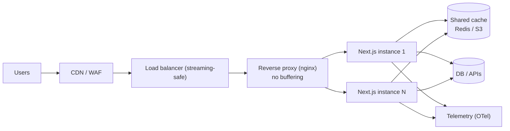
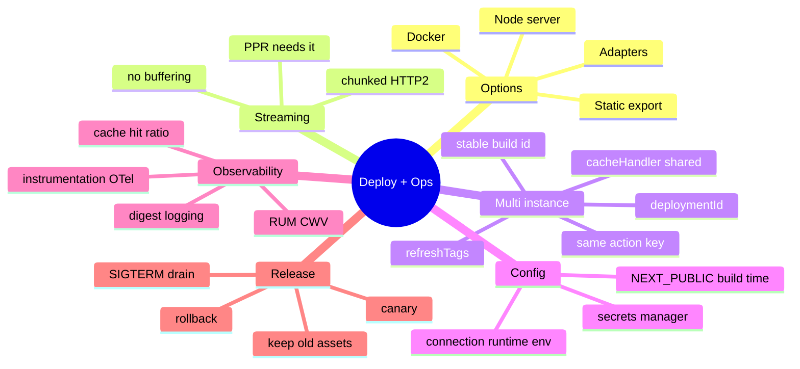

# Deployment, Runtimes and Operations (Self-Hosting, Docker, CI/CD, Observability, Upgrades)

> Verified against the Next.js docs (Self-hosting guide updated 2026-10-15, proxy.js reference, Next.js 16 upgrade guide, Route Handlers, Image reference, blog index). Items marked *general knowledge* (Docker `standalone` output, OpenTelemetry/`instrumentation` details, testing tool limitations, multi-zones) were not re-fetched — confirm in the docs before quoting versions/flags. Related: [03 Caching](03-caching-and-revalidation.md), [05 Streaming/PPR](05-streaming-ppr-and-instant-navigation.md), [06 Security](06-proxy-auth-and-security.md), [react-native/16 GitHub Actions CI/CD](../react-native/16-tire12-github-actions-cicd.md).

## Table of Contents

1. [Quick Summary (TL;DR)](#1-quick-summary-tldr)
2. [Deployment Options](#2-deployment-options)
3. [Runtimes: Node.js vs Edge](#3-runtimes-nodejs-vs-edge)
4. [Self-Hosting Checklist](#4-self-hosting-checklist)
5. [Multi-Instance Deployments](#5-multi-instance-deployments)
6. [Docker and Containers](#6-docker-and-containers)
7. [Static Export (`output: 'export'`)](#7-static-export-output-export)
8. [Adapters and Platform Support](#8-adapters-and-platform-support)
9. [CI/CD Pipeline](#9-cicd-pipeline)
10. [Environment and Configuration Management](#10-environment-and-configuration-management)
11. [Observability: Logging, Tracing, Metrics, Errors](#11-observability-logging-tracing-metrics-errors)
12. [Testing Strategy](#12-testing-strategy)
13. [Release Strategies and Rollback](#13-release-strategies-and-rollback)
14. [Upgrading Next.js (15 → 16 Playbook)](#14-upgrading-nextjs-15--16-playbook)
15. [Migrations and Architecture Options](#15-migrations-and-architecture-options)
16. [Pitfalls](#16-pitfalls)
17. [Interview Questions — Fundamentals](#17-interview-questions--fundamentals)
18. [Interview Questions — Senior Scenarios](#18-interview-questions--senior-scenarios)
19. [Cheat Sheet](#19-cheat-sheet)
20. [Key Terms Glossary](#20-key-terms-glossary)
21. [Further Reading](#21-further-reading)

---

## 1. Quick Summary (TL;DR)

- Next.js deploys as a **Node.js server** (`next start`), a **Docker container**, a **static export** (no server features), or via **adapters** (platform-specific). Cache Components, PPR, Server Actions, `proxy`, `after()` and image optimisation all work on a Node server/Docker.
- **Streaming must pass through your infra unbuffered** (nginx `X-Accel-Buffering: no`, chunked/HTTP2 end to end) — PPR depends on it.
- **Multi-instance** requires deliberate setup: shared cache handler(s) + tag coordination, **same build**, stable `generateBuildId`, **`deploymentId`** for version-skew protection, the same **`NEXT_SERVER_ACTIONS_ENCRYPTION_KEY`** on all instances.
- **One image, many environments:** read server env vars at **request time** (`await connection()`); `NEXT_PUBLIC_*` is **inlined at build** (not runtime-configurable).
- **Proxy runs on Node.js** in v16 (edge unsupported there); a reverse proxy/CDN in front is recommended for payload limits, slow-connection defence and rate limiting.
- **Operate it:** OpenTelemetry via `instrumentation`, error tracking with the error `digest`, RUM for CWV, cache hit ratio, graceful shutdown (SIGTERM drain 10–30 s so `after()` completes), canary + fast rollback.
- **Stay patched:** Next.js now has a formal monthly security release process; upgrade pipelines should handle minor/patch bumps in days.



---

## 2. Deployment Options

Verified from the docs (feature support table in the proxy reference):

| Option | Server features (RSC, actions, proxy, ISR) | Notes |
|---|---|---|
| **Node.js server** (`next build` + `next start`) | Yes | Full feature set; you own scaling/ops |
| **Docker container** | Yes | Same as Node; package the build, run `next start` (or standalone server) |
| **Static export** | **No** (e.g., no proxy, no Server Actions/dynamic server rendering) | Pure static files on any host/CDN |
| **Adapters** | Platform-specific | Adapter API stable since **16.2**; platforms integrate deployment (`adapterPath`) |
| **Managed platform (e.g., Vercel)** | Platform-optimised (ISR/PPR/edge handled for you) | Convenience vs lock-in/cost |

**Decision guide**

| Need | Pick |
|---|---|
| Marketing/docs, no server features | Static export + CDN |
| Full app, small team, minimal ops | Managed platform |
| Compliance/data residency/cost control, existing K8s | Self-host (Docker + K8s/ECS) |
| Many apps/teams, platform engineering | Self-host with a standard image, shared cache service, golden pipeline |

---

## 3. Runtimes: Node.js vs Edge

- **Node.js runtime** is the default for pages, Route Handlers, Server Actions and (in v16) **`proxy`** — the `runtime` option is **not available in proxy** and setting it throws. To keep using the edge runtime for that logic, keep the deprecated `middleware` convention (the docs say more edge guidance is coming in a later minor).
- Route-level `runtime = 'edge'` is referred to as **deprecated** in the caching guide's notes (e.g., `revalidate` isn't available with it); prefer Node.js unless a platform-specific edge need exists. *(Hedged: re-check the current `runtime` route segment docs.)*
- **Edge limitations:** no full Node APIs, smaller bundle limits, limited libraries (many DB drivers), different cold-start/cost profile. **Node benefits:** full ecosystem, native modules, longer execution, simpler debugging.
- **Region placement matters more than "edge vs node"**: run compute near your **data**; use CDN caching for the shell; avoid cross-region chatty queries.

---

## 4. Self-Hosting Checklist

From the Self-hosting guide:

1. **Reverse proxy** (nginx etc.) in front: handles malformed requests, slow connections, payload limits, rate limiting.
2. **Streaming:** disable buffering (`X-Accel-Buffering: no`; set via `headers()` in `next.config`); ensure LB/proxies pass chunked responses; AWS ALB + Lambda may buffer by default; **PPR needs streaming** or loses its TTFB advantage.
3. **Image optimisation:** works with `next start` out of the box; on glibc Linux you may need allocator configuration for sharp to limit memory; or use an external loader/CDN; forward `Accept` if multiple formats.
4. **Proxy** (`proxy.ts`) works with `next start`; not in static export. For logic needing all Node APIs, move it to a layout/Server Component or use headers/cookies/query matching in `redirects`/`rewrites`.
5. **Env vars:** server-only by default; `NEXT_PUBLIC_` inlined at build; read runtime values after `await connection()`; use `register()` in `instrumentation` for startup code.
6. **Caching & ISR:** default cache = memory (50 MB) + disk **per instance**; review before running multiple instances/ephemeral compute/CDN.
7. **Automatic headers:** hashed immutable assets → `public, max-age=31536000, immutable`; ISR → `s-maxage=<revalidate>, stale-while-revalidate`; dynamic pages → `private, no-cache, no-store, max-age=0, must-revalidate`.
8. **`assetPrefix`** to serve static assets from a CDN/domain.
9. **Build cache/ID:** one build, many containers; stable `generateBuildId` (e.g., git SHA) when rebuilding per stage.
10. **`after()`** supported; **graceful shutdown**: send `SIGINT`/`SIGTERM` and allow a drain period (10–30 s recommended) so in-flight requests and pending `after()` callbacks finish.
11. **Version skew protection** via `deploymentId`.
12. **Cache Components** works on Node servers/Docker (not CDN-only).

---

## 5. Multi-Instance Deployments

| Concern | Problem | Solution (docs) |
|---|---|---|
| **Server Action encryption key** | Each instance generates a different key → "Failed to find Server Action" | Set the **same** `NEXT_SERVER_ACTIONS_ENCRYPTION_KEY` (base64; 16/24/32-byte AES; e.g., `openssl rand -base64 32`) at build; rotate per policy |
| **Deployment identifier** | Rolling deploy → clients with old code hit new servers (missing assets, unknown actions, incompatible prefetches) | Set `deploymentId`; assets get `?dpl=…`; navigation requests send `x-deployment-id`; mismatch triggers a **hard navigation** (full reload) — component state is lost, URL/localStorage state persists |
| **Shared cache** | Per-instance memory/disk caches diverge | `cacheHandler` (ISR/fetch cache; `cacheMaxMemorySize: 0`) with Redis/S3; `cacheHandlers` for `'use cache'`/`'use cache: remote'` |
| **Tag invalidation** | `revalidateTag` only hits the local instance | Implement **`refreshTags()`** in the cache handler to sync tag state from shared storage before each request |
| **Build consistency** | Different builds on different pods | Same artifact; stable `generateBuildId` |
| **Immutable assets** | Rolling deploys lose old hashed assets | Keep old assets in the static folder/CDN bucket (`supportsImmutableAssets`) so skew is harmless |
| **Cache entry serialisation** | `Buffer`/`Map` in entries break `JSON.stringify` | Custom serialisation (errors like `segmentData.get is not a function` otherwise) |
| **Store hygiene** | Unbounded growth | TTL/size eviction; error handling for timeouts |

```js
// next.config.js — shared ISR/fetch cache for multi-pod deployments (docs pattern)
module.exports = {
  cacheHandler: require.resolve('./cache-handler.js'),
  cacheMaxMemorySize: 0,                  // disable default in-memory cache
  deploymentId: process.env.DEPLOYMENT_VERSION,
  generateBuildId: async () => process.env.GIT_HASH,
};
```

---

## 6. Docker and Containers

> General knowledge: `output: 'standalone'` produces a minimal server bundle (traced dependencies) ideal for containers; confirm current behaviour in the docs.

```dockerfile
# Multi-stage example (illustrative)
FROM node:22-alpine AS deps
WORKDIR /app
COPY package*.json ./
RUN npm ci

FROM node:22-alpine AS build
WORKDIR /app
COPY --from=deps /app/node_modules ./node_modules
COPY . .
ARG GIT_HASH
ENV GIT_HASH=$GIT_HASH NEXT_TELEMETRY_DISABLED=1
RUN npm run build

FROM node:22-alpine AS run
WORKDIR /app
ENV NODE_ENV=production
RUN addgroup -S app && adduser -S app -G app
COPY --from=build --chown=app:app /app/.next/standalone ./
COPY --from=build --chown=app:app /app/.next/static ./.next/static
COPY --from=build --chown=app:app /app/public ./public
USER app
EXPOSE 3000
CMD ["node", "server.js"]
```
Notes: Node ≥ 20.9 required by Next 16; use a **non-root user**; set `HOSTNAME=0.0.0.0` when needed for containers; health endpoints (`/api/health` Route Handler); resource limits (image optimisation uses CPU/memory); **graceful shutdown** (`SIGTERM`) with `terminationGracePeriodSeconds` ≥ drain time; **one image promoted across environments** (use runtime env + `connection()`); mount or externalise the cache (see §5); scan images (SCA) and pin base image digests.

*Organisation note:* if your org mandates internal registries/mirrors (e.g., an Artifactory virtual npm registry and an internal container proxy), configure `.npmrc` and base-image references accordingly.

---

## 7. Static Export (`output: 'export'`)

- Produces static HTML/CSS/JS in `out/` for any static host/CDN.
- **Not supported:** `proxy`, Server Actions/Functions, request-time rendering (runtime APIs), default image optimisation (use a custom image loader — docs: images with static export require a loader and are optimised at runtime elsewhere), ISR/revalidation, Route Handlers that depend on requests *(general knowledge — verify the "Static Exports" guide for the exact list in your version)*.
- Dynamic routes need `generateStaticParams`; data must be available at build time.
- Good for docs/marketing and CDN-only hosting; poor fit for personalised apps. Consider **PPR + CDN** on a Node/adapter platform instead if you need a mix.

---

## 8. Adapters and Platform Support

- **Build Adapters API** (alpha in 16.0; `adapterPath` became a **stable top-level option in 16.2**; Next.js blog describes an adapter test suite and working group for consistent deployments) lets platforms hook the build and process output.
- Implications: **PPR/Cache Components support differs per platform** — check the PPR Platform Guide for streaming/shell/cache requirements before choosing a host; test **streaming, ISR, tag revalidation, image optimisation, proxy** on the target platform early.
- Self-managed alternatives (OpenNext-style projects, container platforms) require you to own cache stores and invalidation.

---

## 9. CI/CD Pipeline

```mermaid
flowchart LR
  PR["Pull request"] --> LINT["Lint + typecheck"]
  LINT --> UT["Unit/component tests"]
  UT --> BUILD["next build (prod)"]
  BUILD --> E2E["Playwright e2e + instant() tests"]
  E2E --> LH["Lighthouse CI / bundle budget"]
  LH --> IMG["Build image + SCA scan"]
  IMG --> STG["Deploy staging (canary)"]
  STG --> SMOKE["Smoke + synthetic checks"]
  SMOKE --> PROD["Progressive prod rollout"]
  PROD --> MON["RUM + error + cache metrics"]
  MON -->|regression| RB["Auto rollback"]
```



**Key points**
- `next lint` was **removed** in 16 → run ESLint/Biome CLI as an explicit step; builds no longer lint. TypeScript check via `tsc --noEmit` (or `next typegen` first so `PageProps`/`RouteContext` types exist).
- Cache `.next/cache` between runs; use dependency caching; remote build caches in monorepos (Turborepo/Nx).
- Build **once**, promote the same artifact (stable `generateBuildId`, runtime env).
- E2E against a **production build** (`next start`): prefetching/caching differ in dev; for `instant()` in production builds set the testing-API flag **only** for the test build.
- Security gates: SCA/audit, secret scanning, image scan; pin Actions by SHA.

```yaml
# .github/workflows/ci.yml (illustrative; GitHub-hosted examples — adapt runner labels/registries to your org)
name: ci
on: [pull_request]
jobs:
  verify:
    runs-on: bby-ubuntu                      # org-standard runner label (use ubuntu-latest outside the org)
    steps:
      - uses: actions/checkout@v4
      - uses: actions/setup-node@v4
        with: { node-version: 22, cache: npm }
      - run: npm config set registry https://artifactory.tools.bestbuy.com/artifactory/api/npm/npm-virtual   # org npm mirror
      - run: npm ci
      - run: npx next typegen && npx tsc --noEmit
      - run: npx eslint .
      - run: npm test -- --ci
      - run: npm run build
      - run: npx playwright install --with-deps && npx playwright test
```
For cloud credentials in workflows prefer short-lived federated identity (the org-recommended `bby-corp/tplat-gha-configure-github-credentials` action for GIAM) rather than long-lived secrets. See also [react-native/16](../react-native/16-tire12-github-actions-cicd.md).

---

## 10. Environment and Configuration Management

| Kind | Mechanism | Notes |
|---|---|---|
| Server secrets | Env vars from secret manager; read in DAL | Not exposed to client; rotate |
| Public config | `NEXT_PUBLIC_*` | **Inlined at build** → per-environment builds or fetch config at runtime |
| Runtime server config | `process.env.X` after `await connection()` | One image across environments |
| Feature flags | Provider SDK/server evaluation in Server Components; cache per-segment | Avoid flicker; avoid per-user cache fragmentation |
| Build metadata | `generateBuildId`, `deploymentId` | Skew protection, debugging |
| Removed | `serverRuntimeConfig`/`publicRuntimeConfig` (v16) | Use env vars |

Validate env at startup with a schema (zod) in a server-only module; fail fast on missing variables.

---

## 11. Observability: Logging, Tracing, Metrics, Errors

> `instrumentation` / OpenTelemetry specifics are general knowledge — see the Instrumentation and OpenTelemetry guides.

- **`instrumentation.ts`** (`register()` runs on server start): initialise OpenTelemetry/SDKs; **`instrumentation-client`** (introduced in 15.3 per release notes) for client-side monitoring.
- **Tracing:** spans per request/route/async component/DB call; trace IDs propagated to downstream APIs; identify waterfalls and slow holes.
- **Metrics:** request rate/latency (p50/p95/p99), error rates by route, **cache hit ratio** (`use cache`, ISR, CDN), revalidation latency, image optimisation time, RSC payload size, Server Action duration/failures, memory/CPU, event-loop lag.
- **Logging:** structured JSON with correlation IDs; redact secrets/PII; log error **`digest`** (production hides messages from clients) to join client reports with server logs.
- **Errors:** error boundaries per segment (`error.tsx`, `global-error.tsx`), Sentry-like tooling for client + server; source maps uploaded privately.
- **RUM:** Web Vitals per route/release; navigation timing for prefetch effectiveness.
- **Synthetic monitoring:** critical flows, bot-UA fetches (SEO shell/metadata), streaming checks (TTFB vs time-to-last-byte).
- **Alerts/SLOs:** availability, LCP/INP p75, error budget burn, cache hit drop, 5xx spikes after deploy.

---

## 12. Testing Strategy

| Level | Tools | Notes |
|---|---|---|
| Unit (pure functions, DAL, validators) | Vitest/Jest | Fast, mock DB |
| Component (Client Components) | Testing Library + Vitest/Jest | Test behaviour/accessibility |
| **Server Components** | Prefer **E2E/integration** | *General knowledge:* unit-test runners generally can't render **async** Server Components directly; test them via Playwright or by testing extracted data/functions |
| Server Actions | Unit-test the DAL/validation + e2e form flows | Test authz (non-owner → forbidden) |
| Route Handlers | Call handler with `Request`; integration tests | Webhook signature tests |
| Proxy | Experimental helpers (`unstable_doesMiddlewareMatch`, `isRewrite`, `getRewrittenUrl`) | Test matcher + routing logic |
| E2E | **Playwright** | Run on production build; include `instant()` navigation tests |
| Visual | Playwright snapshots/Chromatic | Skeleton → content |
| Accessibility | axe in e2e, keyboard/screen-reader smoke | Modals/parallel routes focus |
| Performance | Lighthouse CI, size-limit | Budgets |
| Security | Authz matrix, SCA, DAST | Cross-tenant tests |

---

## 13. Release Strategies and Rollback

- **Blue/green or canary** deploys behind the LB/CDN; **`deploymentId`** ensures clients get consistent assets; keep **old static assets** available during rollout.
- **Database migrations:** expand → migrate → contract; Server Actions in flight during deploy may call the new server with old payloads — keep backward compatibility for one release.
- **Feature flags** for risky features; kill switches.
- **Cache concerns on rollback:** `use cache` entries are scoped to a deployment (build id in key) → a rollback starts with a cold cache; plan warm-up/capacity.
- **Rollback triggers:** RUM regression (LCP/INP), error rate, 5xx, cache hit collapse; automation preferred.
- **Zero-downtime:** readiness/liveness probes; drain connections; `SIGTERM` handling.

---

## 14. Upgrading Next.js (15 → 16 Playbook)

From the official v16 guide:
1. **Requirements:** Node ≥ **20.9** (18 unsupported), TypeScript ≥ **5.1**, browsers Chrome/Edge/Firefox 111+, Safari 16.4+; upgrade `@types/react`.
2. Run the **codemod**: `npx @next/codemod@canary upgrade latest` (updates `turbopack` config, migrates `next lint` → ESLint CLI, `middleware` → `proxy`, removes `unstable_` prefixes, removes `experimental_ppr`); then run **`next-async-request-api`** codemod for sync `params`/`cookies()`/`headers()`/`draftMode()` usage and resolve `UnsafeUnwrapped` casts.
3. **Turbopack by default:** custom `webpack` config **fails `next build`** — migrate to `turbopack` options, pass `--turbopack` to ignore, or opt out with `--webpack`; Sass `~` imports unsupported; `resolveAlias` for browser fallbacks.
4. **Caching APIs:** `revalidateTag(tag, 'max')` (second arg required), `updateTag`, `refresh`, stable `cacheLife`/`cacheTag`; `experimental.dynamicIO`/`useCache` removed → `cacheComponents` (not a rename-only change; see [03](03-caching-and-revalidation.md)).
5. **PPR:** `experimental.ppr`/`experimental_ppr` removed; if you use Next 15 canary PPR, **stay on that canary** until you migrate.
6. **Routing:** parallel slots need **`default.js`** (build fails otherwise); layout dedupe/incremental prefetch need no code changes.
7. **Images:** new defaults (TTL 4h, `imageSizes` w/o 16, `qualities [75]`, local IP block, 3 redirects, local query strings need `localPatterns.search`); `domains` → `remotePatterns`; `next/legacy/image` deprecated; `priority` → `preload`.
8. **Removals:** AMP, `next lint`, runtime config, some `devIndicators` options, `unstable_rootParams` (use `next/root-params`).
9. **Behaviour changes:** `scroll-behavior` no longer overridden (opt back in with `data-scroll-behavior="smooth"`), `next dev` config loaded once (checks of `process.argv` for `dev` return false), `.next/dev` output dir, build output no longer shows `size`/`First Load JS`.
10. **React:** React 19.2 features via canary in the App Router; React Compiler optional.
11. **Verify:** typecheck, lint, tests, e2e; check middleware→proxy runtime implications (**don't blindly rename edge middleware**); check Server Action/encryption key config; review cache behaviour; run on staging with RUM.

Ongoing: Next.js ships **monthly security releases** (announced beforehand) and out-of-band fixes; automate patch-level upgrades (Renovate/Dependabot) with CI + canary.

---

## 15. Migrations and Architecture Options

- **Pages → App Router:** coexist; migrate by route; see [02 §13](02-app-router-fundamentals.md#13-pages-router-vs-app-router).
- **CRA/Vite SPA → Next.js:** start with a catch-all client route or migrate page by page; move data fetching to Server Components; handle env var differences; check library SSR compatibility.
- **Monorepos:** shared UI package (client/server boundary discipline), `transpilePackages`/package exports config *(general knowledge)*, remote caching, per-app Docker builds with pruning.
- **Micro-frontends / multi-zones** *(general knowledge; verify docs)*: separate Next.js apps composed behind a router/CDN path-based routing; trade-offs — hard navigations between zones, duplicated shared code; alternatives: monorepo with shared packages, Module Federation (careful with RSC).
- **Backend-for-Frontend:** Route Handlers/DAL as BFF; keep heavy domain logic in services.
- **i18n:** routing via segments (`[lang]`) + proxy locale negotiation; dictionaries loaded server-side; `lang`/`dir` on `<html>`; consider caching per-locale.

---

## 16. Pitfalls

1. Deploying multiple instances with default caches and no shared handler.
2. Different Server Action encryption keys per instance.
3. Buffering proxy/CDN breaking streaming/PPR.
4. Baking environment-specific values via `NEXT_PUBLIC_*` into a single image.
5. Renaming edge middleware to `proxy` blindly (runtime change).
6. No `deploymentId`/old assets retained → broken clients during rollout.
7. Treating a green build as proof (runtime behaviour untested).
8. Testing only in dev (no prefetch/caching).
9. No graceful shutdown → dropped requests/`after()` work.
10. Memory exhaustion from image optimisation/sharp on small pods.
11. Ignoring security releases; manual, slow upgrades.
12. Cold cache after each deploy causing latency/cost spikes (no warm-up).
13. Logging secrets or full objects; missing correlation IDs.
14. Choosing static export then needing server features.

---

## 17. Interview Questions — Fundamentals

### Q1. What are the ways to deploy a Next.js app?
Node.js server, Docker container, static export, or via adapters/managed platforms. Static export lacks server features (no proxy, Server Actions, ISR).

### Q2. What must you configure when running multiple instances?
Shared cache handler(s) with tag coordination (`refreshTags`), same build/`generateBuildId`, `deploymentId`, the same `NEXT_SERVER_ACTIONS_ENCRYPTION_KEY`, and consistent env configuration.

### Q3. What is version skew and how does Next.js mitigate it?
Clients with old code interacting with new servers during rollouts (missing assets, unknown Server Actions, incompatible prefetch data). With `deploymentId`, Next.js tags assets/requests and forces a hard navigation on mismatch; keeping immutable assets available also helps.

### Q4. How do you make streaming work behind nginx?
Disable response buffering (`X-Accel-Buffering: no`), ensure the whole chain supports chunked/HTTP2 streaming, check compression and LB behaviour.

### Q5. How do you build once and deploy to many environments?
Read server env at runtime (`await connection()` before `process.env`), avoid `NEXT_PUBLIC_` for per-env values (inlined at build) or fetch config at runtime, keep a stable build ID.

### Q6. Where does `proxy.ts` run?
On the Node.js runtime (v16); edge is not supported in `proxy` — use `middleware` if you need edge.

### Q7. What does graceful shutdown involve?
Send SIGTERM/SIGINT, stop accepting new requests, finish in-flight requests and pending `after()` callbacks (allow a 10–30 s drain), then exit.

### Q8. How do you test Server Components?
Primarily via E2E/integration tests; unit-test extracted data functions and validation (general knowledge: unit runners struggle with async Server Components).

### Q9. Why is `next lint` gone and what replaces it?
Removed in 16; run ESLint (flat config) or Biome directly; builds no longer lint.

### Q10. What's the first step of a Next.js 16 upgrade?
Check requirements (Node ≥ 20.9, TS ≥ 5.1), run the official codemods, then address Turbopack/webpack, async request APIs, caching API changes, image defaults and `proxy`.

---

## 18. Interview Questions — Senior Scenarios

### S1. "Design the hosting architecture for a global e-commerce site on Next.js (self-hosted on Kubernetes)."
CDN/WAF in front (cache static shells and assets; honour `Cache-Control`; forward `Accept`); streaming-safe ingress (no buffering); Next.js pods (stateless, same image, runtime env, health probes, graceful drain); shared Redis for `cacheHandler`/`cacheHandlers` with tag index and `refreshTags()`; regional deployments close to data replicas; `deploymentId` + retained assets for skew; shared `NEXT_SERVER_ACTIONS_ENCRYPTION_KEY` from secret manager; image optimisation either CDN-fronted or an external loader; OTel traces to a backend; autoscaling on CPU/latency; blue/green with RUM-based gates; DR plan (cache is rebuildable, DB replicated); cost controls (long cache lifetimes, per-link prefetch limits).

### S2. "After a deploy, some users see 'Failed to find Server Action' and broken navigations."
Version skew/key mismatch: verify same encryption key across pods, ensure `deploymentId` configured so mismatches trigger hard navigation, keep previous build's static assets, avoid long-lived tabs hitting new servers without reload, consider shorter rollout with connection draining, add alerting on this error string, and document backward-compatibility policy for action signatures across one release.

### S3. "Our CI is green but production shows a regression in navigation speed."
CI tested dev/preview; production differs (prefetch only in production, cache warmth, CDN). Add production-build e2e with `instant()` assertions, Lighthouse CI on `next start`, synthetic checks after deploy, RUM per release (INP/LCP/nav timings), compare cache hit ratios; check infra changes (buffering, compression), third-party tags added, and prefetch behaviour (links, `prefetch={false}` overrides).

### S4. "Migrate 40 microsites from CRA to Next.js with minimal ops overhead."
Create a shared platform: base Docker image/pipeline, shared UI/design-system package with RSC-safe client boundaries, standard `next.config` (images, headers, cache handler), central observability and security headers, codemods for common patterns, route-by-route migration with redirects/SEO parity, per-site budgets, staged rollout, documentation + templates, and a support channel; decide on multi-tenant single app vs separate apps based on release independence and blast radius.

### S5. "Explain how you'd handle a zero-downtime upgrade from Next.js 15 to 16 for a large app."
Branch upgrade with codemods; fix breaking changes (async request APIs, Turbopack vs webpack, middleware → proxy with runtime review, parallel `default.js`, image defaults, caching signatures); keep Cache Components **off** initially (adopt later as a separate project); full e2e + visual + performance suites on a production build; canary a small traffic slice with RUM/error comparison; keep rollback artifact; monitor skew errors (`deploymentId`); then follow with React Compiler/Cache Components adoption as independent, flag-guarded steps.

---

## 19. Cheat Sheet



| Symptom | First checks |
|---|---|
| Stale data on some pods | Shared handler, `refreshTags`, per-instance cache |
| "Failed to find Server Action" | Encryption key mismatch, skew, `deploymentId` |
| No streaming in prod | Proxy/LB buffering, compression, platform support |
| Memory spikes | Image optimisation, sharp allocator, disk cache size |
| Slow after deploy | Cold caches (build id in key), no warm-up |
| Env value wrong at runtime | `NEXT_PUBLIC_` inlined at build; missing `connection()` |

---

## 20. Key Terms Glossary

| Term | Definition |
|---|---|
| **Adapter** | Platform integration hooking into the Next.js build output (`adapterPath`) |
| **Standalone output** | Minimal server bundle for containers *(general knowledge)* |
| **`deploymentId`** | Identifier enabling version-skew protection |
| **Cache handler** | Pluggable ISR/fetch cache storage; `cacheHandlers` for `use cache` |
| **`refreshTags()`** | Cache handler hook syncing tag invalidations across instances |
| **Version skew** | Client and server on different builds |
| **Graceful shutdown** | Drain in-flight work on SIGTERM |
| **`instrumentation`** | Server startup hook for telemetry/SDKs |
| **Canary release** | Gradual traffic shift with monitoring and rollback |
| **Immutable assets** | Hashed files cached forever |

---

## 21. Further Reading

- [Self-hosting](https://nextjs.org/docs/app/guides/self-hosting) · [Deploying](https://nextjs.org/docs/app/getting-started/deploying) · [PPR platform guide](https://nextjs.org/docs/app/guides/ppr-platform-guide)
- [Upgrading to version 16](https://nextjs.org/docs/app/guides/upgrading/version-16) · [Adapters / `adapterPath`](https://nextjs.org/docs/app/api-reference/config/next-config-js/adapterPath)
- [Instrumentation](https://nextjs.org/docs/app/guides/instrumentation) · [Data Security — encryption key](https://nextjs.org/docs/app/guides/data-security#overwriting-encryption-keys-advanced)
- This repo: [03 Caching](03-caching-and-revalidation.md) · [06 Security](06-proxy-auth-and-security.md) · [react-native/14 OTA/release](../react-native/14-tire10-ota-and-release-architecture.md)
