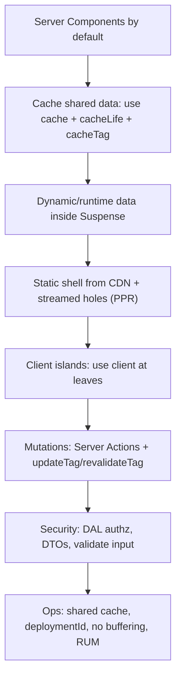
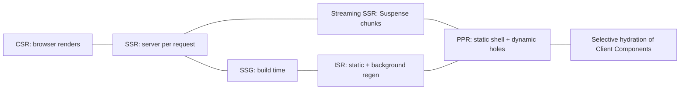
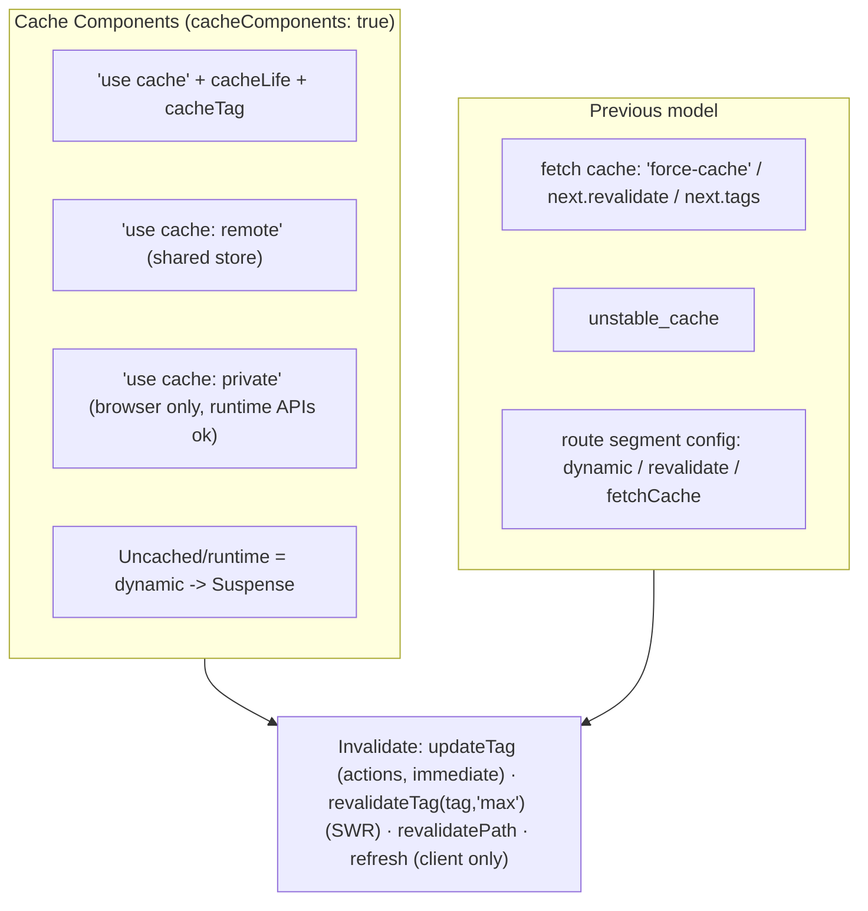
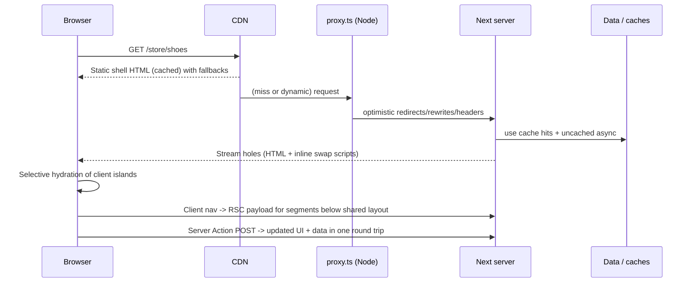
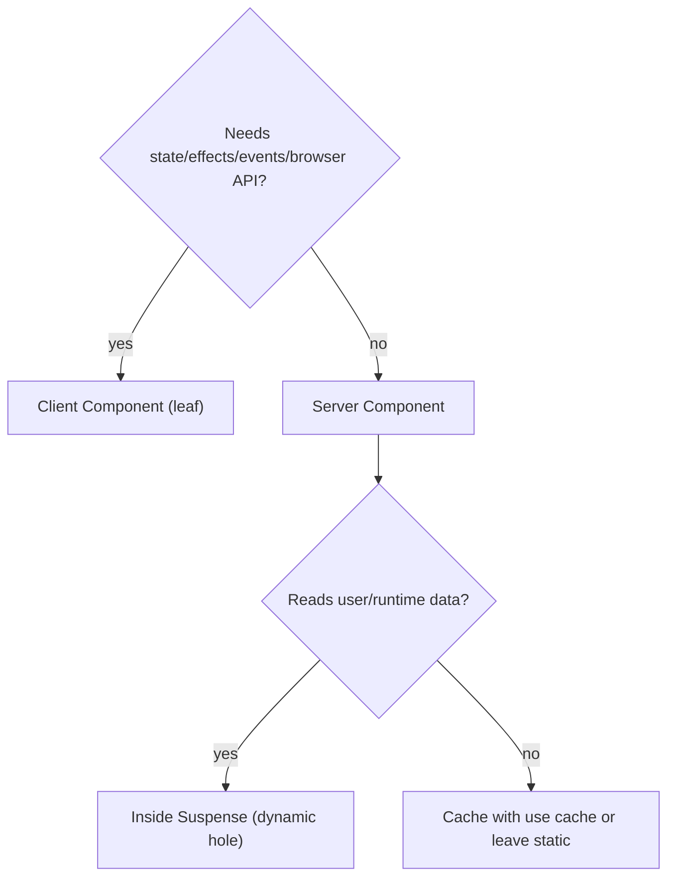
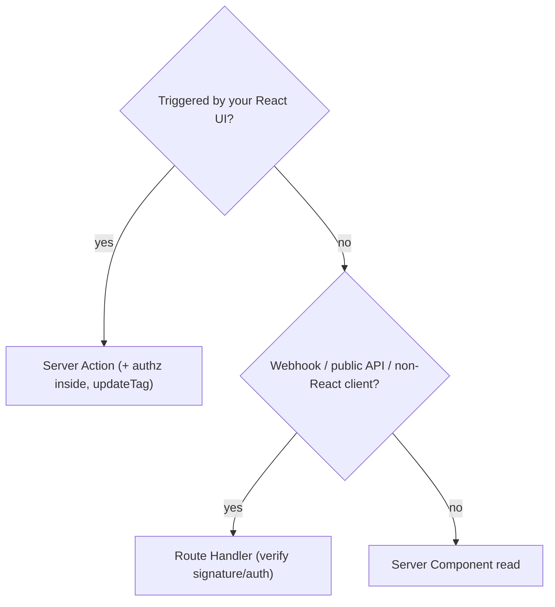
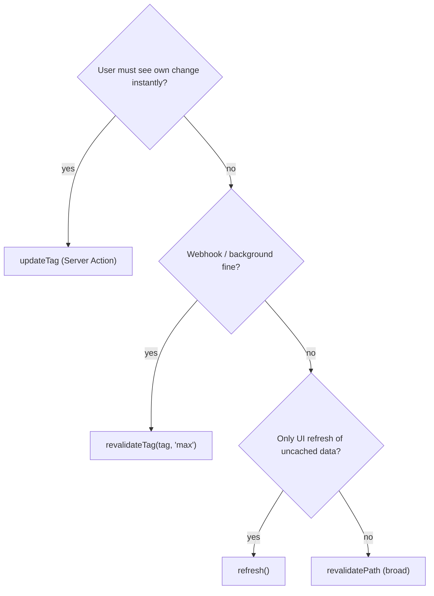

# Next.js and Rendering — Recall Map (Last-Minute Read)

> One-page mental model for the whole `nextjs-and-rendering/` folder. Verified against the Next.js docs (16.x, updated through Nov 2026). Open the full file only for topics where you're weak.
> Full docs: [01 Rendering](01-rendering-strategies-and-hydration.md) · [02 App Router](02-app-router-fundamentals.md) · [03 Caching](03-caching-and-revalidation.md) · [04 Data and mutations](04-data-fetching-and-mutations.md) · [05 Streaming/PPR/instant nav](05-streaming-ppr-and-instant-navigation.md) · [06 Proxy/auth/security](06-proxy-auth-and-security.md) · [07 Performance](07-performance-optimization.md) · [08 Deployment/ops](08-deployment-runtimes-and-operations.md)

## Table of Contents

1. [The 60-Second Mental Model](#1-the-60-second-mental-model)
2. [Rendering Strategy Map](#2-rendering-strategy-map)
3. [Caching Map (Cache Components vs Previous Model)](#3-caching-map-cache-components-vs-previous-model)
4. [Request Lifecycle](#4-request-lifecycle)
5. [Decision Trees](#5-decision-trees)
6. [API Cheat Table](#6-api-cheat-table)
7. [What Changed: Next.js 15 → 16.x](#7-what-changed-nextjs-15--16x)
8. [Numbers and Defaults to Remember](#8-numbers-and-defaults-to-remember)
9. [Mnemonics](#9-mnemonics)
10. [Rapid-Fire Q&A](#10-rapid-fire-qa)
11. [Say-This Scripts](#11-say-this-scripts)
12. [Red Flags and Green Flags](#12-red-flags-and-green-flags)
13. [Final 10-Minute Checklist](#13-final-10-minute-checklist)

---

## 1. The 60-Second Mental Model

> **Make as much as possible static or cached, stream the rest behind Suspense, ship as little client JS as possible, enforce security at the data layer, and operate it with streaming-safe infrastructure and shared caches.**

**Five questions that unlock any Next.js design**
1. Which parts are **shared/cached** and which are **per-request**? (cache vs Suspense hole)
2. What is in the **first byte** (static shell) and is the **LCP element** in it?
3. How does **client navigation** behave (below shared layout, prefetch, App Shell)?
4. **Who can call this** (authn + authz inside the DAL/action) and what leaves the server (DTO)?
5. What happens with **multiple instances/deploys** (cache handler, skew, keys)?

---

## 2. Rendering Strategy Map

| Strategy | One-liner | Use |
|---|---|---|
| CSR | Browser builds UI after JS + fetch | Auth'd, interactive, SEO-irrelevant |
| SSR | HTML per request | Personalised, fresh |
| SSG | HTML at build | Marketing, docs |
| ISR | Static + background regeneration (time/on-demand) | Catalogues, CMS |
| Streaming | Shell first, boundaries later (out of order) | Slow/independent sections |
| **PPR** | **Static shell + dynamic holes** (default with `cacheComponents`) | Most modern pages |
| RSC | Server-only components → RSC payload | Less client JS, secure data access |

**Hydration reminders:** only Client Components hydrate; selective hydration prioritises interaction; mismatches (time/random/locale/window/invalid nesting) force client re-render.

---

## 3. Caching Map (Cache Components vs Previous Model)

| Layer | Scope | Controlled by |
|---|---|---|
| `React.cache` | One render | Dedupe identical calls |
| `use cache` entries | Server (per-instance memory by default) | `cacheLife`/tags |
| Static shell / prerender | Route/App Shell | Build + lifetimes |
| Client router cache | Browser | `stale`, prefetch |
| Image cache | Disk/CDN | `minimumCacheTTL` (4 h default in 16) |
| CDN/HTTP | Edge | `Cache-Control` |

`cacheLife` meaning: **stale** (client reuse) · **revalidate** (serve stale, refresh in background) · **expire** (must wait for fresh).

---

## 4. Request Lifecycle

---

## 5. Decision Trees

**Where does this code run?**

**Mutation or endpoint?**

**Which invalidation?**

---

## 6. API Cheat Table

| API | Import | Purpose |
|---|---|---|
| `'use cache'`, `'use cache: remote'`, `'use cache: private'` | directive | Cache async fn/component result |
| `cacheLife(profile \| {stale,revalidate,expire})` | `next/cache` | Lifetime |
| `cacheTag(...tags)` | `next/cache` | Label for invalidation |
| `updateTag(tag)` | `next/cache` | Immediate expiry, Server Actions only |
| `revalidateTag(tag, 'max')` | `next/cache` | SWR invalidation (2nd arg required in 16) |
| `revalidatePath(path)` | `next/cache` | Route-level invalidation |
| `refresh()` | `next/cache` | Refresh client router (no tag revalidation) |
| `connection()` | `next/server` | Defer to request time (random/time/env) |
| `after(fn)` | `next/server` | Run work after response |
| `cookies()`, `headers()`, `draftMode()` | `next/headers` | **Async** request APIs |
| `redirect()`, `notFound()` | `next/navigation` | Control-flow exceptions |
| `useRouter`, `usePathname`, `useSearchParams` | `next/navigation` | Client navigation/URL |
| `<Link prefetch>` | `next/link` | Prefetch (production only) |
| `PageProps<'/x'>`, `LayoutProps`, `RouteContext` | global (via `next typegen`) | Typed props |
| `proxy(request)` | `proxy.ts` | Network-boundary logic (Node runtime) |
| `generateStaticParams`, `generateMetadata` | route files | Prerender params, SEO |
| `unstable_cache` | `next/cache` | Previous-model non-fetch caching |

---

## 7. What Changed: Next.js 15 → 16.x

| Area | Change |
|---|---|
| Bundler | **Turbopack default** for dev + build; custom `webpack` config fails build unless handled; FS cache on |
| Requirements | Node ≥ **20.9**, TS ≥ **5.1**; Chrome/Edge/Firefox 111+, Safari 16.4+ |
| Request APIs | `params`, `searchParams`, `cookies()`, `headers()`, `draftMode()` **async only** |
| Middleware | `middleware.ts` → **`proxy.ts`** (Node runtime only) |
| Caching | **Cache Components** (`cacheComponents`), `use cache`, `cacheLife/Tag` stable, `updateTag`, `refresh`, `revalidateTag(tag,'max')` |
| PPR | `experimental.ppr`/`experimental_ppr` removed; PPR = default with Cache Components |
| Routing | Layout dedupe + incremental prefetch; parallel slots need `default.js` |
| Images | `priority` → `preload`; `qualities [75]`; TTL 4 h; no 16px; local IP blocked; 3 redirects |
| Removed | AMP, `next lint`, runtime config, `unstable_rootParams`, `dynamicIO`/`useCache` flags |
| React | React 19.2 canary features (ViewTransition, `useEffectEvent`, `Activity`); React Compiler stable option (off by default) |
| 16.1–16.4 | FS cache dev; bundle analyzer; **Adapter API stable (16.2)**; `Link transitionTypes` (16.2); **Instant Navigations** (16.3); lazy compilation + smaller output (16.4) |
| Security process | Monthly scheduled security releases + out-of-band fixes (2026) |

---

## 8. Numbers and Defaults to Remember

| Topic | Value |
|---|---|
| `cacheLife` `default` | stale 5m · revalidate 15m · expire never |
| `cacheLife` `seconds` | 30s / 1s / 60s (short-lived → dynamic hole) |
| `hours` / `days` / `weeks` / `max` | revalidate 1h / 1d / 1w / 30d |
| Short-lived rule | `seconds` profile, `revalidate: 0`, or `expire < 5 min` |
| `use cache: private` + App Shell | needs `stale ≥ 5 min` |
| Server Action ID cache | up to 14 days; regenerated per build |
| Default server cache | memory 50 MB + disk per instance |
| `images.minimumCacheTTL` | 14400 s (4 h) |
| `images.qualities` | `[75]` |
| `images.maximumRedirects` / `maximumResponseBody` | 3 / 50 MB |
| Action encryption key | base64, 16/24/32 bytes |
| Graceful shutdown drain | 10–30 s |
| CWV "good" (p75) | LCP ≤ 2.5 s · INP ≤ 200 ms · CLS ≤ 0.1 |

---

## 9. Mnemonics

- **"SCRAP" (rendering design):** **S**tatic shell · **C**ache shared reads · **R**untime in Suspense · **A**s little client JS as possible · **P**refetch/instant navigation.
- **"VAT-S" (Server Action checklist):** **V**alidate input · **A**uthenticate · **T**enant/ownership check (authz) · **S**hape response (DTO) → then revalidate.
- **"Push-Cache-Prefetch"** (fix blocking routes): push awaits down into Suspense child · cache with `use cache` · per-link prefetch for URL data.
- **"TAG-IT" (invalidations):** **T**ags on reads · **A**ction uses `updateTag` · **G**lobal webhooks use `revalidateTag(…,'max')` · **I**nstances share handler (`refreshTags`) · **T**est with two users.
- **Multi-instance "KIDS":** **K**ey (action encryption) · **I**D (`deploymentId`/build id) · **D**ata cache shared · **S**treaming unbuffered.
- **Boundary rule:** *"Server → client props are public."*

---

## 10. Rapid-Fire Q&A

- **What is PPR?** Static shell from CDN + streamed dynamic holes; default with `cacheComponents` in 16.
- **Why Suspense around runtime data?** Gives fallback for the shell; without it the route is blocking (error).
- **`updateTag` vs `revalidateTag`?** Immediate expiry in Actions (read-your-writes) vs stale-while-revalidate (needs `'max'` profile arg in 16).
- **Does `refresh()` clear tagged caches?** No — it refreshes the client router only.
- **Is `fetch` cached by default?** Not since Next 15 (previous model); opt in. With Cache Components use `use cache`.
- **Why do client navigations sometimes block when direct visits are instant?** Navigations re-render only below the shared layout; boundaries above it don't count.
- **Does prefetch run in dev?** No — production only.
- **What does `<Link prefetch={true}>` add under Partial Prefetching?** Cached content depending on the link's URL data, at a server-invocation cost per link.
- **`use cache` vs `React.cache`?** Cross-request lifetime/tags vs per-render dedupe.
- **Where's `use cache` stored by default?** Per-instance memory (ephemeral on serverless); use `remote` + handler for shared.
- **What makes a `use cache` entry unique?** Args + closed-over values (+ build id).
- **Can Client Components import Server Components?** No; pass as `children`/props.
- **`loading.tsx` is…?** Automatic Suspense around the page.
- **`error.tsx` must be…?** A Client Component; doesn't catch same-segment layout errors.
- **Parallel slots in 16?** Require `default.js` or the build fails.
- **Layout vs template?** Persist vs remount per navigation.
- **Are Server Actions secure by default?** Protected IDs/CSRF origin check, but still public POSTs — verify authn/authz in each.
- **Why not auth in layout/proxy only?** Layouts don't re-render per navigation; proxy matchers can miss paths/actions.
- **proxy vs middleware?** Rename in 16; Node runtime only; keep `middleware` for edge.
- **Where do secrets live?** Server env, read only in the DAL; `NEXT_PUBLIC_*` is public and inlined at build.
- **How to make one Docker image for many envs?** Read env at request time with `connection()`; avoid build-time `NEXT_PUBLIC_` for env-specific values.
- **Streaming broken in prod?** Check proxy/LB buffering (`X-Accel-Buffering: no`), compression, platform.
- **Multi-pod stale data?** Shared cache handler + `refreshTags()`; same build; `deploymentId`.
- **`priority` on `next/image`?** Deprecated in 16 → `preload` (prefer `loading="eager"`/`fetchPriority="high"`).
- **`sizes` missing?** Browser assumes 100vw → oversized images.
- **React 19.2/ViewTransition in Next?** Available via App Router canary React; `Link transitionTypes` since 16.2.
- **Bots and PPR?** Detected by UA → rendered fully dynamically so metadata is in `<head>`.
- **How to test instant navigation?** Dev validation + Navigation Inspector + `@next/playwright` `instant()`.
- **Hydration error causes?** Time/random/locale/window/invalid HTML/extensions.
- **What replaced `next lint`?** ESLint/Biome CLI directly.

---

## 11. Say-This Scripts

**Rendering answer (30 s):** "In the App Router I default to Server Components, cache shared data with `use cache` and tags, put request-specific or slow parts behind Suspense so the route still has a static shell, and keep `'use client'` at interactive leaves. With Cache Components that gives PPR: a CDN-served shell with streamed holes."

**Caching answer:** "Nothing is cached implicitly. I pick a lifetime with `cacheLife`, tag reads, and invalidate from actions with `updateTag` when the user needs to see their own change, or from webhooks with `revalidateTag(tag, 'max')`. For multi-instance deployments I add a shared cache handler and tag coordination."

**Security answer:** "Server Actions and Route Handlers are public entry points. Authentication, authorization and ownership checks live in a server-only Data Access Layer called from every action; proxy and layouts are only optimistic. I validate input, return DTOs, and keep secrets in the DAL."

**Performance answer:** "LCP: element in the shell, `next/image` with correct `sizes`, `fetchPriority`, `next/font`. INP: less client JS, lazy loading, third-party discipline. Navigation: partial prefetching and instant-navigation validation tested with Playwright. Measure with RUM, not only Lighthouse."

**Ops answer:** "One build promoted across environments, runtime env via `connection()`, stable build ID and `deploymentId`, shared cache handler, same Server Action key, unbuffered streaming, graceful shutdown, OTel + RUM, canary with auto-rollback, and a fast patch pipeline for security releases."

---

## 12. Red Flags and Green Flags

| Red flags | Green flags |
|---|---|
| `'use client'` on the page/layout "to make it work" | Client boundary at leaf; Server Components as children |
| Auth check only in layout/proxy | DAL + per-action authn/authz/ownership |
| Fetching initial data in `useEffect` | Server Component reads, parallel/streamed |
| `force-dynamic` as a fix for stale data | Tags + `updateTag`/`revalidateTag` |
| `cacheLife('seconds')` everywhere | Long lifetimes + targeted invalidation; fresh data in Suspense holes |
| Whole page in one Suspense | Small, size-matched boundaries below the shared layout |
| Passing DB rows to client props | DTOs, `server-only`, minimal serialisable props |
| Ignoring multi-instance caches/skew | Shared handler, `refreshTags`, `deploymentId`, same keys |
| Edge middleware renamed to proxy blindly | Review runtime implications; keep `middleware` if edge is required |
| Never tests prod build/navigation | e2e on `next start`, `instant()` tests, RUM per release |
| Late security patching | Automated upgrades; subscribed to advisories |

---

## 13. Final 10-Minute Checklist

- [ ] Can I explain CSR/SSR/SSG/ISR/streaming/PPR and pick one with reasons?
- [ ] Can I describe static shell vs dynamic hole vs App Shell?
- [ ] Do I know `use cache` + `cacheLife` (stale/revalidate/expire) + tags + the four invalidation APIs?
- [ ] Can I explain why client navigations can block and the three fixes (push down, cache, per-link prefetch)?
- [ ] Do I know Server Action security (public POST, authn+authz inside, DTO, CSRF Origin check, encryption key)?
- [ ] Can I list the Next 16 changes (Turbopack default, async APIs, proxy, Cache Components, image defaults, removals)?
- [ ] Can I explain the multi-instance checklist (cache handler, `refreshTags`, `deploymentId`, key, build ID, streaming)?
- [ ] Do I have 2 CWV levers each for LCP/INP/CLS and the Next-specific image/font/script facts?
- [ ] Can I describe the hydration mismatch causes and fixes?
- [ ] Can I sketch the request lifecycle diagram in under 2 minutes?

Related recall maps: [React](../react/09-react-recall-map.md) · [TypeScript](../typescript/06-typescript-recall-map.md) · [System Design](../system-design/09-system-design-recall-map.md) · [React Native](../react-native/17-master-mental-model-recall-map.md)
