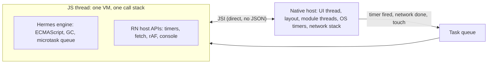
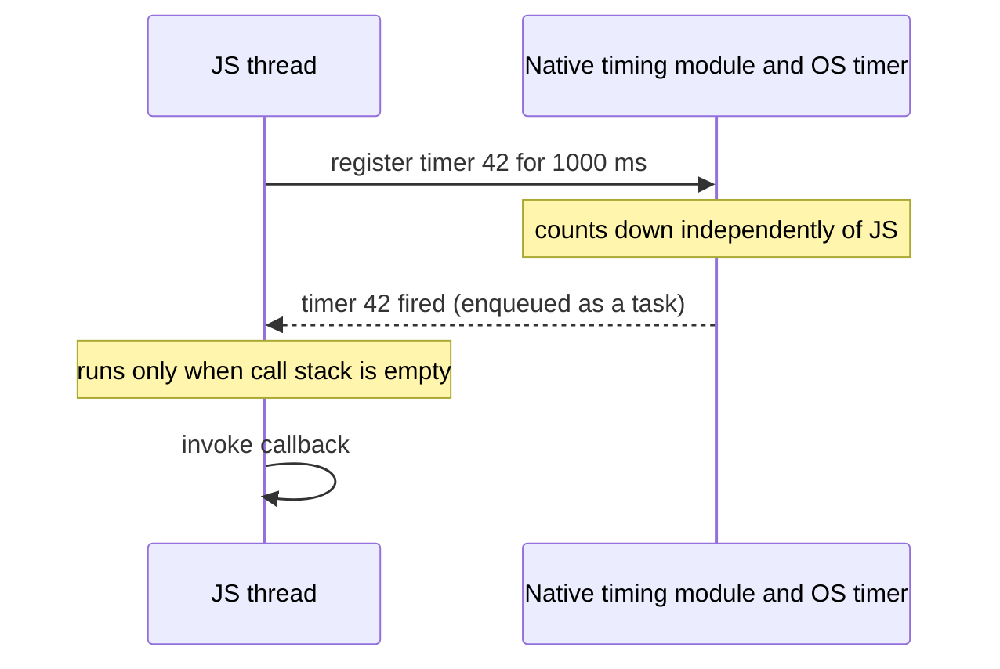
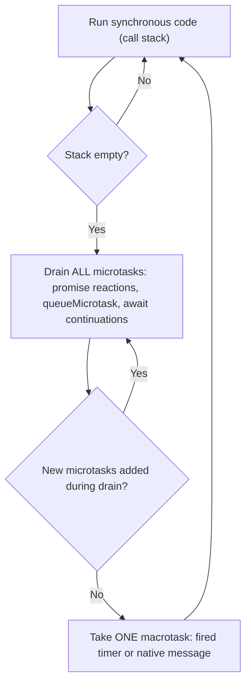
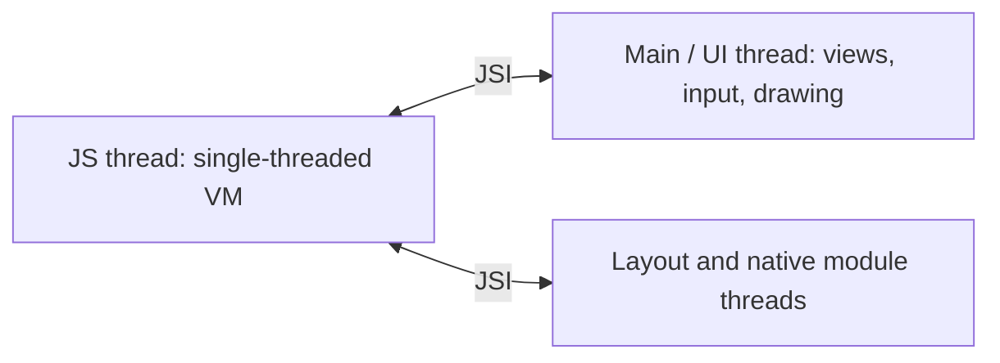
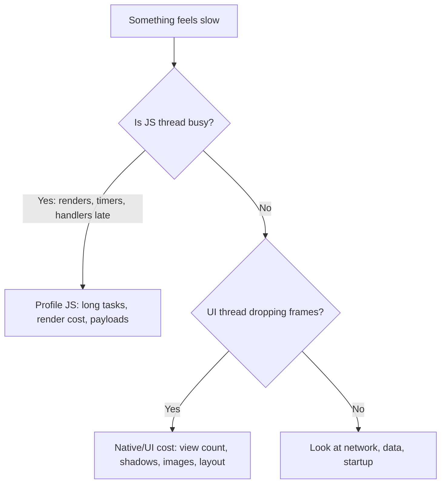

# JavaScript Runtime, Hermes and the Event Loop in React Native

> Verification note: React Native release facts were verified against the official **reactnative.dev blog (0.80 → 0.88, Nov 2026)**: the New Architecture is the **only** architecture since **0.82**; **Hermes V1 is the default engine since 0.84** (it was experimental in 0.82: no JIT and no JS-to-native "Static Hermes" compilation yet; Expensify measured bundle load 3.2%/9% faster, total TTI 7.6%/2.5% faster and content TTI 7.2%/7.5% faster); JavaScriptCore is **community-maintained** since 0.81; `performance.now()`, `PerformanceObserver`, User Timing, Event Timing and Long Tasks APIs became **stable in 0.83**; uncaught promise rejections are reported through the uncaught-error path (`console.error`) since 0.82; `InteractionManager` was **removed** in 0.87 (use `requestIdleCallback`; per the Expo SDK 58 notes); React 19.3 ships with 0.88. ECMAScript event-loop and microtask semantics, closures and garbage-collection concepts are language-level general knowledge. **Hermes internals (the "Hades" concurrent GC, interpreter-first design, bytecode format), exact timer plumbing per platform, the Reanimated/worklets runtime model and Web Worker comparisons are established knowledge not re-fetched in this session — marked *(hedged)* where specific.** Related: [02 Architecture](02-architecture-bridge-to-new-architecture.md), [05 Performance](05-performance-rendering-lists-images-and-memory.md).

## Table of Contents

1. [Quick Summary (TL;DR)](#1-quick-summary-tldr)
2. [Engine vs Runtime and Which Engines React Native Uses](#2-engine-vs-runtime-and-which-engines-react-native-uses)
3. [Hermes in Depth](#3-hermes-in-depth)
4. [Host APIs: Timers, fetch, requestAnimationFrame and Friends](#4-host-apis-timers-fetch-requestanimationframe-and-friends)
5. [The Event Loop in React Native](#5-the-event-loop-in-react-native)
6. [Threads in a React Native App](#6-threads-in-a-react-native-app)
7. [What Happens When the JS Thread Is Blocked](#7-what-happens-when-the-js-thread-is-blocked)
8. [Memory, Closures and Garbage Collection](#8-memory-closures-and-garbage-collection)
9. [Concurrency vs Parallelism and Getting Work Off the JS Thread](#9-concurrency-vs-parallelism-and-getting-work-off-the-js-thread)
10. [Pitfalls](#10-pitfalls)
11. [Interview Questions — Fundamentals](#11-interview-questions--fundamentals)
12. [Interview Questions — Senior Scenarios](#12-interview-questions--senior-scenarios)
13. [Cheat Sheet](#13-cheat-sheet)
14. [Key Terms Glossary](#14-key-terms-glossary)
15. [Further Reading](#15-further-reading)

---

## 1. Quick Summary (TL;DR)

- React Native is **single-threaded JavaScript (one JS thread, one call stack) cooperating with a genuinely multi-threaded native host.** Almost every runtime question traces back to that sentence.
- A **JS engine** (Hermes) implements ECMAScript: syntax, built-ins, GC, the Promise job queue. A **JS runtime** is the engine **plus host APIs** (timers, `fetch`, `requestAnimationFrame`, the JS↔native boundary). `setTimeout`, `fetch` and `requestAnimationFrame` are **host APIs supplied by React Native, not by Hermes**.
- **Hermes** is the default engine (**Hermes V1 since 0.84**): ahead-of-time bytecode, fast startup, low memory, concurrent old-generation GC, no JIT (yet).
- **Event loop order:** run the call stack → drain the **entire microtask queue** (promises, `queueMicrotask`, `await` continuations) → take **one** macrotask (fired timer, native message) → repeat. A promise callback always beats `setTimeout(fn, 0)`.
- A **timer is counted down natively** but its **callback only runs on the JS thread**, so the delay is a *minimum*; a blocked JS thread delays callbacks, not the countdown.
- **A blocked JS thread** freezes anything needing fresh JS output (renders, touch handlers, timers) while native-driven animations, already-committed views and scrolling of native lists continue.
- **Real parallelism** comes only from outside plain JS: native threads, or a **second JS runtime** (Reanimated/Worklets on the UI thread). `async/await` never creates a thread.



---

## 2. Engine vs Runtime and Which Engines React Native Uses

| Concept | Meaning | Examples |
|---|---|---|
| **JS engine** | Implements the ECMAScript spec: parsing/bytecode, objects, closures, `Promise` and its microtask queue, GC. No timers, networking or UI. | Hermes, JavaScriptCore (JSC), V8 |
| **JS runtime** | Engine **plus** the host environment: polyfills, native boundary, event sources, loop plumbing | RN (Hermes + RN host APIs), a browser (engine + DOM + Web APIs), Node (V8 + libuv) |
| **Host API / polyfill** | JS-visible API *not* defined by ECMAScript, supplied by the runtime | `setTimeout`, `setInterval`, `fetch`, `XMLHttpRequest`, `requestAnimationFrame`, `console` |

**Engines in React Native today**
- **Hermes (default)** — Meta's engine built for React Native. **Hermes V1** became the default in **0.84** (opt-in/experimental in 0.82), bringing compiler and VM improvements; confirm at runtime with `HermesInternal.getRuntimeProperties()['OSS Release Version']` (the `global.HermesInternal` object also indicates Hermes is active).
- **JavaScriptCore** — Safari's engine; since **0.81** it is **community-maintained** and no longer in core. On iOS, JSC runs **without a JIT** (apps cannot hold writable-and-executable memory).
- **V8** — available through community packages *(hedged)*. Historically your JS also ran in desktop Chrome under legacy "remote JS debugging"; that mode is gone in favor of **React Native DevTools** ([12](12-expo-eas-tooling-and-debugging.md)), so timers/clock-drift quirks of remote debugging no longer apply.
- **Interview framing:** engines are *similar but not identical*; relying on engine-specific quirks is a classic "works in debug, breaks in release" source.

---

## 3. Hermes in Depth

| Aspect | Detail |
|---|---|
| **Ahead-of-time bytecode** | `hermesc` compiles JS to Hermes bytecode (HBC) at build time; the device loads bytecode instead of parsing/compiling source on every launch — the main startup/TTI win, especially on low-end Android |
| **Interpreter-first** | Hermes is primarily a bytecode **interpreter**, not a tiered JIT: lower memory and more predictable startup in exchange for lower peak throughput on hot numeric loops. **Hermes V1 has no JIT and no JS-to-native ("Static Hermes") compilation yet** (those remain experiments) |
| **Memory** | Designed for mobile constraints; typically a smaller footprint than JSC for RN workloads |
| **Garbage collector** | Generational GC (the "Hades" collector *(hedged naming)*): **young generation** collected fast and often (most objects die young); **old generation** collected **concurrently on another thread** to minimize JS-thread pauses |
| **Bundled Hermes** | Released together with each RN version so the JSI implementation used by Hermes and RN always match (avoids ABI mismatches) |
| **Hermes V1 numbers (Expensify, 0.82 announcement)** | Bundle load 3.2% (iOS) / 9% (Android) faster; total TTI 7.6% / 2.5% faster; content TTI 7.2% / 7.5% faster — *app-dependent* |
| **Debugging/profiling** | Chrome DevTools protocol via React Native DevTools, sampling profiler, heap snapshots, source maps for symbolicated stacks ([12](12-expo-eas-tooling-and-debugging.md)) |
| **Hermes V1 compatibility note** | Not compatible with RN's *precompiled* core builds during the experimental phase (needed building from source); default builds in 0.84+ handle this for you |

"Is Hermes always faster?" — **Faster to start, generally lower memory; not necessarily faster for raw compute-bound JS.**

---

## 4. Host APIs: Timers, fetch, requestAnimationFrame and Friends

### What `setTimeout(cb, 1000)` really does
1. Your call reaches RN's **JS-side timer polyfill**, which stores `cb` under a timer ID and returns the ID immediately.
2. The polyfill asks the **native timing module** (via JSI in the New Architecture) to "call me back in 1000 ms".
3. **Native/OS** counts down using platform primitives — independent of the JS thread.
4. When it fires, native enqueues "timer 42 fired" toward the JS thread.
5. The JS thread handles it **only when its call stack is empty and it is that task's turn**; it then looks up timer 42 and runs `cb`.



**Who is responsible?** All four layers: JS registers and finally executes; RN's polyfill is the glue; native code receives the request; the OS counts the delay. The delay is a **minimum**, never a guarantee.

### Related questions answered once
- **Timer expires while JS is blocked:** the native countdown finishes on time; the **callback waits** in the JS queue until the stack empties, then runs immediately (late, not missed).
- **`setTimeout(fn, 0)` is not synchronous:** it still goes through the native round trip, must wait for current sync code **and all microtasks**, and is a macrotask.
- **Hermes does not implement these APIs.** RN's docs list `{set,clear}{Timeout,Interval,Immediate}`, `{request,cancel}AnimationFrame`, `fetch`, `XMLHttpRequest` as RN-supplied polyfills; Hermes only executes the language.
- **Browser vs RN:** same contract (host API, macrotask, minimum delay); different host. `requestAnimationFrame` is tied to the display link (`CADisplayLink` / `Choreographer`) and RN's own commit cycle, not a browser compositor. Browsers throttle timers in background tabs; RN apps may have JS **suspended** when backgrounded ([08](08-app-lifecycle-background-work-push-and-deep-links.md)).
- **`setImmediate`** exists in RN (not in browsers) and fires at the end of the current JS execution block, before yielding back to native; it is **not** Node's libuv `setImmediate` *(hedged: confirm in your RN version, since timer polyfills have been evolving)*.
- **`setInterval` drift:** each tick is scheduled after the previous callback, so busy JS or throttling makes ticks late and uneven; compute elapsed time from timestamps instead of counting ticks ([08](08-app-lifecycle-background-work-push-and-deep-links.md)).
- **`InteractionManager.runAfterInteractions`** (older advice for deferring work) was **removed in 0.87** *(sourced from Expo SDK 58 release notes, not the RN 0.87 post; verify before relying on it)*; use `requestIdleCallback` or explicit scheduling.
- **Newer web-aligned APIs:** `performance.now()`, `PerformanceObserver`, User Timing (`mark`/`measure`), Event Timing and Long Tasks are **stable since 0.83** — useful for in-app telemetry ([05](05-performance-rendering-lists-images-and-memory.md)). Native components' refs expose **DOM-like nodes** (`parentNode`, `getBoundingClientRect`, `ownerDocument`) since **0.82**.

---

## 5. The Event Loop in React Native

The **shape** is dictated by ECMAScript and implemented by the engine; what differs from the browser is what **feeds** the loop (native messages, fired timers, resolved native calls — no DOM events or browser rendering step).



| Queue | Contents | Rule |
|---|---|---|
| **Call stack** | Currently running sync functions (LIFO) | Must empty before anything else runs |
| **Microtask queue** ("Jobs") | `Promise.then/catch/finally`, `queueMicrotask`, `await` continuations | **Fully drained** (including newly added jobs) before the next macrotask |
| **Task queue** (macrotasks) | Fired `setTimeout/setInterval`, native→JS messages, resolved native-module calls | **One per loop turn** |

**Promise resolution:** resolving schedules a PromiseReactionJob on the microtask queue; callbacks run after current sync code, before any macrotask. (Historically RN shipped a `setImmediate`-based Promise polyfill; with Hermes `Promise` is engine-native and spec-compliant.)

**Which first — promise or `setTimeout(0)`?** Always the promise:
```js
console.log('1 sync');
setTimeout(() => console.log('2 timeout'), 0);
Promise.resolve().then(() => console.log('3 promise'));
queueMicrotask(() => console.log('4 microtask'));
console.log('5 sync end');
// 1, 5, 3, 4, 2
```

**`async/await`:** syntactic sugar over promises. Code **before the first `await`** runs synchronously; each `await` suspends and the continuation resumes as a **microtask** on the same JS thread. `await` on an already-resolved value still yields one microtask turn. No thread is created — the real parallelism behind an awaited operation (network, timer countdown) happens **outside JS**.

```js
async function load() {
  console.log('A sync (before first await)');
  await null;                       // continuation is queued as a microtask
  console.log('C after await');     // runs after the current sync code, before any timer
}
setTimeout(() => console.log('D timeout'), 0);
load();
console.log('B sync after calling load()');
// A, B, C, D
```

**Event loop and React rendering:** a state update does not render by itself — it schedules work. With automatic batching, updates from one synchronous block produce **one** re-render; React's render and commit (during which the renderer creates or clones Fabric shadow nodes via JSI and then triggers a Fabric commit) run as ordinary synchronous JS inside the task that triggered them ([03](03-react-internals-and-rendering-in-react-native.md)). Hence an expensive render blocks everything else exactly like any long synchronous code.

**Unhandled rejections:** since **0.82** an uncaught promise rejection surfaces as `console.error` through the uncaught-error reporting path (previously swallowed), so upgrades can reveal old errors and spike crash-reporting volume ([10](10-app-architecture-state-and-navigation.md) for error handling).

---

## 6. Threads in a React Native App

| Thread | Responsibility |
|---|---|
| **Main / UI thread** | OS-owned. Platform UI framework, raw input, drawing frames, the **only** thread allowed to mutate native views |
| **JS thread** | The one JS VM: your code, React render/commit logic, event handlers. **The only thread that runs your JavaScript** (by default) |
| **Layout work** | Yoga layout runs in Fabric's C++ commit step, normally off the UI thread (in the old architecture: the dedicated "shadow" thread) — see [02](02-architecture-bridge-to-new-architecture.md) |
| **Native module threads** | Module methods usually run on background queues/threads so slow I/O doesn't block the UI; some must run on main for UI APIs ([04](04-native-modules-components-and-platform-code.md)) |
| **Other** | Networking, media, GPU/OS threads owned by libraries or the OS |



**Single or multiple threads?** *JavaScript execution* is single-threaded; *the React Native app* is multi-threaded. The JS and UI threads are **separate OS threads**: the JS thread decides **what** the UI should be; the UI thread **draws** it. A slow JS thread cannot freeze the UI thread itself — it starves it of new instructions.

---

## 7. What Happens When the JS Thread Is Blocked

| Question | Answer |
|---|---|
| Does JS run? | **No JavaScript executes** — no timer callbacks, promise reactions, state updates or touch-handler logic. When the block ends, queued callbacks fire in a burst |
| Does native code run? | **Yes** — other threads are unaffected (UI thread, module threads, OS work) |
| Does the UI keep rendering? | Only for work not needing fresh JS: already-committed views, native-driven animations (`useNativeDriver`, Reanimated worklets), native scrolling. **No new content** (renders, layout changes) |
| Can a button visually respond? | Native press feedback driven on the UI thread may still show; the `onPress` JS handler waits ([05](05-performance-rendering-lists-images-and-memory.md) for JS FPS vs UI FPS) |
| Do timers "miss"? | No — the native countdown completes; execution is delayed |

---

## 8. Memory, Closures and Garbage Collection

- A JS "leak" is a **reference that outlives its usefulness**, keeping an object reachable so GC can't reclaim it (no manual `free`). The React Native leak catalogue (listeners, subscriptions, timers, sockets, navigation, native resources) lives in [05](05-performance-rendering-lists-images-and-memory.md#8-memory-leaks); this section covers the language-level mechanics.
- **Closures retain their whole enclosing scope**, not just the variables they use (engines may optimize, but you should not rely on it):

```js
function setup() {
  const smallFlag = true;
  const hugeDataset = loadMillionRows();      // unused by the returned function
  return () => console.log(smallFlag);        // hugeDataset may stay reachable via this closure
}
const fn = setup();
```
  In RN this bites when a long-lived callback (singleton, module-level emitter, timer, native module) closes over a component's props/state/large data: the whole scope stays alive after unmount until the callback is unregistered. Fix: keep captured scope small, hold values that must survive in refs, always unregister.
- **Creating thousands of objects:** young-generation GC handles short-lived garbage cheaply; trouble comes from **retention** (objects surviving into the old generation, tracked by concurrent old-gen passes) and from **synchronous allocation time on the JS thread**, which can blow the 16.7 ms frame budget by itself. In UI code "thousands of objects" usually means thousands of React elements, adding reconciliation and shadow-tree cost ([05](05-performance-rendering-lists-images-and-memory.md)).
- Do not leak via debugging code that retains big objects (e.g., an array of every API response).

---

## 9. Concurrency vs Parallelism and Getting Work Off the JS Thread

| | Concurrency | Parallelism |
|---|---|---|
| Idea | Many tasks **in progress**, interleaved on one execution unit | Many tasks executing at the **same instant** |
| In plain JS | Yes — event loop interleaves promises/timers/native callbacks | **No** — one call stack runs one thing at a time |
| In React Native | Many in-flight promises/timers on the JS thread | Across native threads (JS + UI + module threads) and **separate JS runtimes** |

> Concurrency is about *dealing with* many things; parallelism is about *doing* many things at once.

**Can RN run JS on multiple threads?** By default no: one thread, one engine instance. **Exception:** **Reanimated/Worklets** *(hedged)* run worklets — JS functions — on a **second JS runtime on the UI thread**, giving genuine JS-level parallelism for per-frame work ([06](06-startup-bundle-animations-and-gestures.md)).

**Web Worker vs the RN JS thread:** a Web Worker (browser/Node) is a separate thread with its own global scope and event loop, communicating by copied messages. The RN "JS thread" is simply *the* thread of the single engine instance, and RN has **no Worker API by default**; the nearest equivalents are the worklet runtime or community worker-style libraries (e.g. `react-native-threads`-style packages; maintenance status must be checked *(hedged)*). Node's `worker_threads` does not exist in RN.

**CPU-heavy work options (most to least preferred):**
1. **Native** — a native module/TurboModule dispatching to a native background thread, returning a Promise ([04](04-native-modules-components-and-platform-code.md)).
2. **Chunk and yield** — split loops across turns (`setTimeout`/`requestIdleCallback`); total time is unchanged but the thread stops being monopolized.
3. **Defer** until interactions settle (`requestIdleCallback`; the old `InteractionManager` is removed).
4. **Second JS runtime** — worklets for per-frame UI work or a worker-style library for general computation.
5. **Move off-device** — compute on the server if the phone doesn't need to.

Trap worth naming: pure JS never blocks the **UI thread** (separate thread); it blocks the **JS thread**, which indirectly freezes anything needing fresh JS output.

---

## 10. Pitfalls

1. Assuming `setTimeout`/`fetch`/`requestAnimationFrame` are engine features, or that Hermes provides them.
2. Treating timer delays as guarantees; `setInterval` for clocks/counters (drift).
3. Believing React Native is single-threaded (only JS execution is).
4. Expecting `async/await` or `Promise.all` to parallelize CPU work.
5. Long synchronous loops, big JSON parses or large list transforms on the JS thread during interactions.
6. Closures in long-lived callbacks retaining large scopes; unremoved listeners/timers.
7. Relying on engine quirks or debug-only behavior that differs in release builds on Hermes.
8. Writing benchmarks that assume a JIT; Hermes is interpreter-first (no JIT in V1).
9. Using the removed `InteractionManager`, or code paths that assumed swallowed promise rejections.
10. Mistaking native-driven animation smoothness for a healthy JS thread.

---

## 11. Interview Questions — Fundamentals

- **What is the React Native JS runtime?** An engine (Hermes by default; V1 since 0.84) plus RN's host environment (timer/network polyfills, JSI boundary, native event sources).
- **Engine vs runtime?** Engine = ECMAScript implementation (syntax, built-ins, GC, microtask queue); runtime = engine + host APIs and event sources.
- **Is Hermes responsible for `setTimeout`, `fetch`, `requestAnimationFrame`?** No. They're RN host polyfills calling native code (OS timer, network stack, display link); Hermes only runs the language.
- **What does Hermes do?** Precompiles JS to bytecode at build time for faster startup, low memory and smaller size; interpreter plus concurrent generational GC; no JIT.
- **Who executes `setTimeout`?** All four: JS registers/executes, RN polyfill bridges, native schedules, the OS counts.
- **Does `setTimeout(fn, 0)` run immediately?** No — async, native round trip, after sync code and all microtasks.
- **What if a timer fires while JS is blocked?** The countdown is unaffected; the callback waits until the stack empties.
- **Same event loop as a browser?** Same algorithm (spec-dictated), different feeders (native messages, no DOM/rendering step).
- **Microtask vs macrotask?** Microtasks (promise reactions, `queueMicrotask`, `await` continuations) are fully drained before the next single macrotask (timer, native message).
- **Promise vs `setTimeout(0)` order?** Promise first, always.
- **Where do `Promise.then` and `async/await` run?** On the JS thread as microtasks; `await` continuations are `.then` continuations; no new thread.
- **Why doesn't `async/await` create a thread?** It is control-flow sugar; real parallelism lives in native code or other runtimes.
- **How does the event loop interact with React rendering?** A render is synchronous JS inside the task that called `setState` (batched into one render), so an expensive render blocks the loop.
- **Single thread or multiple?** JS execution single-threaded; the app multi-threaded (UI, JS, layout, module threads).
- **JS thread blocked 5 seconds?** No JS runs; native threads continue; native-driven animations keep going; queued callbacks burst afterwards.
- **Can the UI thread keep rendering?** Only already-committed/native-driven content, not new JS-dependent updates.
- **How does Hermes GC work?** Young generation collected frequently; old generation collected concurrently to reduce pause times.
- **How do closures cause leaks?** They keep their whole captured scope reachable while the closure is reachable (e.g., registered with a singleton or timer).
- **Concurrency vs parallelism?** Interleaving on one unit vs simultaneous execution on multiple; plain JS has only concurrency.
- **Web Worker vs RN JS thread?** Worker = separate thread/global scope with message passing; RN JS thread is the single engine thread, no Worker API by default.

---

## 12. Interview Questions — Senior Scenarios

### S1. "A screen freezes for ~3 s after a large API response, but scrolling a native list still works. Explain and fix."
JS thread blocked (large `JSON.parse`/transform/render) while the UI thread keeps scrolling committed native content. Confirm with DevTools profiler/Long Tasks API; fix by trimming payloads/pagination, moving heavy transforms to native or chunking with yields, memoizing derived data, rendering fewer items; add a long-task metric (`PerformanceObserver`) to catch regressions ([05](05-performance-rendering-lists-images-and-memory.md)).

### S2. "Our timers/clock drift and fire in bursts after the app returns from background. Why?"
JS may be suspended in the background; `setInterval` ticks are scheduled relative to callbacks and queued behind work. Use timestamps (`Date.now`/server time) for elapsed logic, resync on foreground via `AppState`, and avoid relying on JS timers for background work ([08](08-app-lifecycle-background-work-push-and-deep-links.md)).

### S3. "After upgrading, crash reports jumped with 'unhandled promise rejection' errors."
Since 0.82 uncaught rejections surface via `console.error`/the uncaught-error path rather than being swallowed. Triage: add `.catch`/`try/await`, fix real failures, group/deduplicate in the reporter, and add a global handler policy ([10](10-app-architecture-state-and-navigation.md)).

### S4. "Is Hermes V1 a free upgrade?"
Default since 0.84, with reported TTI/bundle-load gains that depend on the app. Validate with startup traces on low-end Android and real devices, check libraries relying on engine behavior, verify via `HermesInternal.getRuntimeProperties()`, and compare crash/ANR and memory metrics before widening rollout.

### S5. "A CPU-heavy image/filter operation must run on-device without jank."
Implement it natively (TurboModule/Expo module on a background thread) or via a worklet runtime if it is per-frame UI work; return results by Promise; show progress; avoid shipping megabytes through JS (use typed buffers/`ArrayBuffer` or file URIs) ([04](04-native-modules-components-and-platform-code.md)).

### S6. "Prove why a promise logs before a `setTimeout(0)` and why that matters in a render path."
Microtask queue is fully drained before the next macrotask; in React Native a `setTimeout` also needs a native round trip. Matters for ordering assumptions in effects/data loading and for avoiding starvation by recursive microtasks (a never-empty microtask queue blocks timers and native messages).

---

## 13. Cheat Sheet

| Topic | Remember |
|---|---|
| Engine | Hermes (V1 default since 0.84), no JIT, bytecode, concurrent old-gen GC |
| Host APIs | Timers, fetch, rAF are RN polyfills → native |
| Loop | stack → all microtasks → one macrotask |
| Timer | Native counts, JS runs callback; delay = minimum |
| Threads | UI, JS, layout, module threads; only JS runs your JS |
| Blocked JS | No JS runs; native-driven animations continue |
| Parallel JS | Only via second runtime (worklets) or native |
| Leaks | Closure retention, timers, listeners, caches |
| Removed/changed | `InteractionManager` removed (0.87); remote JS debugging gone; JSC community-maintained (0.81); uncaught rejections reported (0.82) |



---

## 14. Key Terms Glossary

| Term | Meaning |
|---|---|
| **Polyfill** | JS-level implementation of an API the engine doesn't provide (RN's `setTimeout`, `fetch`) |
| **JS engine / runtime** | ECMAScript implementation / engine plus host environment |
| **Hermes / Hermes V1** | Meta's mobile engine; V1 is the next-generation default since 0.84 |
| **HBC** | Hermes bytecode produced at build time |
| **Macrotask / microtask** | Task from outside the current JS / promise-reaction job drained before the next task |
| **PromiseReactionJob** | Spec job queued when a promise settles |
| **Worklet** | JS function runnable on a UI-thread runtime (Reanimated/Worklets) |
| **Closure** | Function plus its lexical environment |
| **Concurrency / parallelism** | Interleaved progress / simultaneous execution |
| **Long Task** | Task exceeding ~50 ms on the main thread, observable via `PerformanceObserver` |

---

## 15. Further Reading

- [JavaScript environment](https://reactnative.dev/docs/javascript-environment) · [Timers](https://reactnative.dev/docs/timers) · [Using Hermes](https://reactnative.dev/docs/hermes) · [Bundled Hermes](https://reactnative.dev/architecture/bundled-hermes) · [0.82 release (New Architecture only, Hermes V1)](https://reactnative.dev/blog/2025/10/08/react-native-0.82) · [0.84 release (Hermes V1 default)](https://reactnative.dev/blog/2026/02/11/react-native-0.84) · [Hermes repo](https://github.com/facebook/hermes) · [MDN: Web Workers](https://developer.mozilla.org/en-US/docs/Web/API/Web_Workers_API)
- This repo: [browser-internals/04 JS engine, event loop and memory](../browser-internals/04-javascript-engine-event-loop-and-memory.md) · [02 Architecture](02-architecture-bridge-to-new-architecture.md) · [03 React internals](03-react-internals-and-rendering-in-react-native.md) · [05 Performance](05-performance-rendering-lists-images-and-memory.md)
