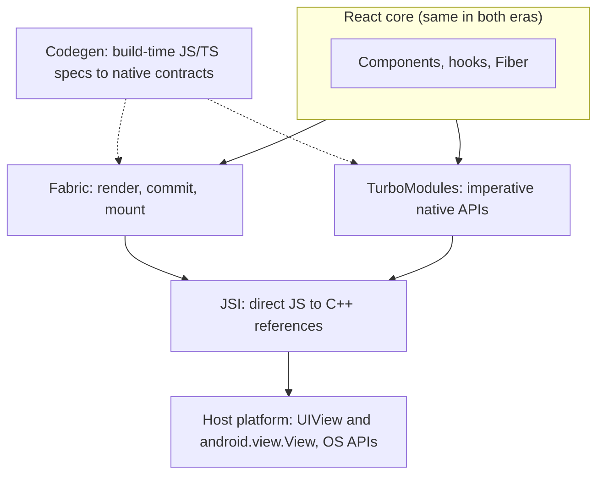
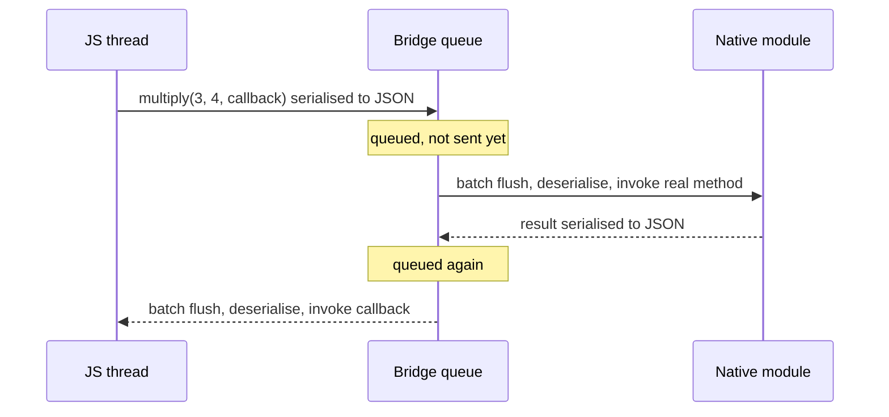
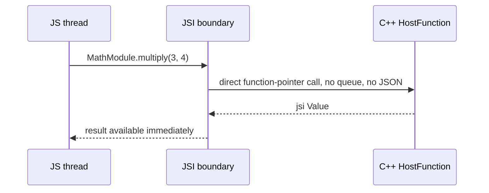
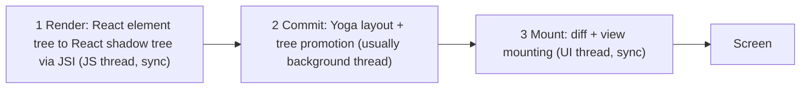
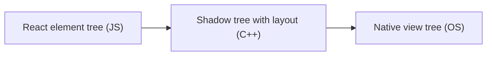
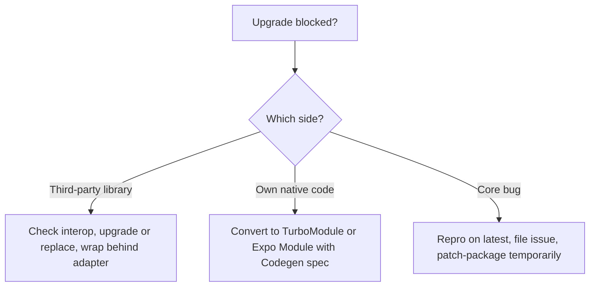

# React Native Architecture: From the Bridge to the New Architecture

> Verification note: Facts were verified against the official **React Native architecture docs** (`reactnative.dev/architecture/*`: overview, Fabric renderer, render pipeline, threading model, view flattening, bundled Hermes) and the **release blog posts 0.80 → 0.88 (Nov 2026)**: the New Architecture became the default in **0.76 (Oct 2024)** and the **only** architecture in **0.82 (Oct 2025)** — `newArchEnabled=false` (Android) and `RCT_NEW_ARCH_ENABLED=0` (iOS) are now **ignored**; **0.81 and Expo SDK 54 are the last versions that allow the Legacy Architecture** (migrate there first, then upgrade); the **Legacy Architecture was frozen in 0.80**, and legacy components were **removed starting 0.84**; **interop layers remain** for the foreseeable future so libraries supporting both architectures keep working; **DOM-like node APIs** on refs (0.82); **web-based event dispatching** became the default in **0.88**. **Hermes V1** is covered in [01](01-javascript-runtime-hermes-and-event-loop.md). Pre-0.76 history (Bridge internals, `MessageQueue`, per-platform shadow trees) and the "4 pillars" framing follow the architecture docs; low-level C++ details (exact `HostObject` APIs, mutation list formats, JNI usage) are established knowledge *(hedged where specific)*. React reconciliation/Fiber details live in [03](03-react-internals-and-rendering-in-react-native.md); practical native module/component authoring in [04](04-native-modules-components-and-platform-code.md).

## Table of Contents

1. [Quick Summary (TL;DR)](#1-quick-summary-tldr)
2. [What "Architecture" Means in React Native](#2-what-architecture-means-in-react-native)
3. [The Old Architecture (Bridge Era)](#3-the-old-architecture-bridge-era)
4. [Why the Architecture Changed](#4-why-the-architecture-changed)
5. [JSI — JavaScript Interface](#5-jsi--javascript-interface)
6. [TurboModules](#6-turbomodules)
7. [Codegen](#7-codegen)
8. [Fabric: Render, Commit, Mount](#8-fabric-render-commit-mount)
9. [Trees, Yoga and View Flattening](#9-trees-yoga-and-view-flattening)
10. [Threading Model: One Pipeline, Either Thread](#10-threading-model-one-pipeline-either-thread)
11. [End-to-End Walkthrough: A Button Tap](#11-end-to-end-walkthrough-a-button-tap)
12. [Migration, Interop and the Timeline](#12-migration-interop-and-the-timeline)
13. [Old vs New: Comparison](#13-old-vs-new-comparison)
14. [Pitfalls](#14-pitfalls)
15. [Interview Questions — Fundamentals](#15-interview-questions--fundamentals)
16. [Interview Questions — Senior Scenarios](#16-interview-questions--senior-scenarios)
17. [Cheat Sheet](#17-cheat-sheet)
18. [Key Terms Glossary](#18-key-terms-glossary)
19. [Further Reading](#19-further-reading)

---

## 1. Quick Summary (TL;DR)

- **Architecture** = how JS logic, the renderer, native modules and the JS↔native channel fit together. React itself (Fiber/reconciliation) is the same in both generations; what changed is everything **below** React.
- **Old (Bridge, 2015–2024):** JS, shadow/layout and UI lanes talked only through an **asynchronous, batched, JSON-serialising Bridge** → no sync calls, serialization tax, batching latency, eager module init, no type safety, duplicated per-platform rendering code, no concurrent rendering.
- **New (default 0.76, only since 0.82):** **JSI** (direct C++ references) + **Fabric** (shared C++ renderer) + **TurboModules** (lazy, typed native modules) + **Codegen** (build-time contract) — the "four pillars", adopted together.
- **Fabric pipeline:** **Render** (JS builds immutable shadow nodes via JSI) → **Commit** (Yoga layout + tree promotion, often background thread) → **Mount** (diff + apply to native views on the UI thread).
- **React's** render/commit and **Fabric's** render/commit/mount are **different layers**: React's commit *triggers* Fabric's render step.
- The New Architecture is an **enabler**, not a speed switch: apps benefit by using sync layout, concurrent features and typed native modules.
- **Today:** nobody opts out; migration work is about **third-party library compatibility**, removing legacy APIs, and the interop layers.



---

## 2. What "Architecture" Means in React Native

Four responsibilities, each with an old and new implementation:

| Responsibility | Old | New |
|---|---|---|
| **Run JS** | JS engine (JSC then Hermes) | Hermes (V1 default since 0.84) — engine-agnostic via JSI |
| **Render** (element tree → native views + layout) | `UIManager` + per-platform shadow trees | **Fabric** |
| **Native module system** (JS → platform APIs) | Native Modules (eager) | **TurboModules** (lazy, typed) |
| **Communication layer** | **Bridge** | **JSI** |
| **Contract generation** | none | **Codegen** |

---

## 3. The Old Architecture (Bridge Era)

### 3.1 Threads (classic mental model)
| Thread | Responsibility |
|---|---|
| **JS thread** | Your app code, React render, business logic; produces UI instructions |
| **Shadow thread** (background) | Runs **Yoga** (Flexbox engine) over the **shadow tree** to compute x/y/width/height |
| **UI / main thread** | Creates/updates real native views, handles gestures, draws; must never block |

Plus extra native-module threads. Lanes exchanged data **only via the Bridge**.

### 3.2 The Bridge
A JS object (`MessageQueue.js`) plus a native counterpart — the **only** channel.
- **Asynchronous only:** no value returned on the same stack frame; even "instant" questions (`measure`) were callbacks.
- **Serialization:** no shared memory, so every argument/return was **JSON-serialised → copied → deserialised**; cost scales with payload size and call frequency.
- **Batching:** queues flushed together (per JS tick / native frame) → fewer crossings but added latency; a busy JS thread backed up **both** outgoing calls and incoming events (touches, scroll).
- **Message shape:** roughly `[moduleID, methodID, args]` for calls; UI mutations (`createView`, `updateView`, `manageChildren`) the same way in reverse.
- **Large data:** each call paid full serialize→copy→deserialize; e.g. camera frames of ~30 MB at ~2 GB/s were impossible to move in real time.



### 3.3 Why the Bridge existed
JS and native were separate runtimes with **no shared memory**, and no API like JSI let an engine hold a native object reference. Something had to translate calls, carry arguments and return events — the Bridge was that format plus queue.

### 3.4 Problems (consolidated)
1. **No synchronous calls** → async `measure` and visible layout "jumps".
2. **Serialization tax** on every call.
3. **Batching latency** (up to a tick).
4. **JS-thread contention** — all traffic shares one queue tied to the JS loop.
5. **Eager module initialisation** → slow startup/TTI.
6. **No type safety** — mismatches were runtime bugs.
7. **Duplicated per-platform renderer logic** (Java and Obj-C shadow tree/layout/flattening).
8. **No concurrent rendering** support (Suspense, transitions, automatic batching).

---

## 4. Why the Architecture Changed

Meta's stated motivations (in development since 2018, rolled out in Meta apps from 2021, opt-in from 0.68):
1. **Synchronous layout and effects** — old `onLayout` was async, so layout-dependent updates landed a frame late ("jump"); the new design allows synchronous access with correctly scheduled updates.
2. **Concurrent rendering** — Suspense, transitions, automatic batching need an interruptible, thread-safe renderer.
3. **Fast JS/native interop** — remove serialization from essentially all interop (including core `View`/`Text`), enabling libraries like VisionCamera to hand JS a native frame **by reference**.

**Nuance:** it is an enabler. Serialization may never have been your app's bottleneck; code may need refactoring to use sync layout or concurrent features.

---

## 5. JSI — JavaScript Interface

- A lightweight **C++ API for embedding a JS engine** that lets JS and native hold **direct references** to each other. It is **not an engine**; engines **implement** it (Hermes, JSC, V8), so Fabric/TurboModule code is engine-agnostic.
- Primitives: `jsi::Runtime`, `jsi::Value`, `jsi::Object`, `jsi::Function`, **`HostObject`** (C++ class with `get/set/getPropertyNames` seen by JS as a normal object), **`HostFunction`** (C++ lambda callable from JS).

```cpp
// Synchronous native function exposed to JS with no serialization
class MathModule : public jsi::HostObject {
 public:
  jsi::Value get(jsi::Runtime& rt, const jsi::PropNameID& name) override {
    if (name.utf8(rt) == "multiply") {
      return jsi::Function::createFromHostFunction(rt, name, 2,
        [](jsi::Runtime& rt, const jsi::Value&, const jsi::Value* args, size_t) -> jsi::Value {
          return jsi::Value(args[0].asNumber() * args[1].asNumber());
        });
    }
    return jsi::Value::undefined();
  }
};
```
From JS: `global.MathModule.multiply(3, 4)` — a direct call, result on the **same stack**.



- **JSI does not make everything synchronous:** it *enables* sync where sensible (layout measurement); a `HostFunction` can still return a `Promise` or callback for genuinely async work.
- **Bridge vs JSI:** the Bridge was a **format plus queue**; JSI is an **interface** with no wire format at all.
- **Hermes and JSI:** Hermes implements JSI like any engine; it is simply the default and is co-released with RN ("bundled Hermes") so ABIs match.
- **Direct bindings:** libraries can inject host objects/functions straight into the JS global (bypassing `NativeModules`), which is how **react-native-mmkv** (synchronous storage) and **Reanimated/Worklets** (UI-thread JS) are fast ([06](06-startup-bundle-animations-and-gestures.md)).
- **Large data example:** VisionCamera exposes native frame objects to JS by reference instead of copying megabytes per call.

---

## 6. TurboModules

The New Architecture's native-module system: a JSI `HostObject` per module.

| | Legacy Native Modules | TurboModules |
|---|---|---|
| Initialisation | **Eager** at startup | **Lazy** — constructed on first JS reference (`TurboModuleRegistry.getEnforcing`) |
| Transport | Bridge (async, JSON) | JSI (direct, sync-capable) |
| Contract | Untyped | Codegen-checked at build time |
| Dispatch logic | Per platform | Shared C++ registry/lookup |
| Memory/startup | All modules cost startup | Only used modules cost |

Net benefits: lazy init (faster start, lower memory, scales with module count), direct JSI calls, type safety via Codegen, shared dispatch logic. Authoring details (specs, Swift/Kotlin, threading, Expo Modules): [04](04-native-modules-components-and-platform-code.md).

---

## 7. Codegen

A **build-time** tool that reads JS/TS (or Flow) specs and generates native scaffolding (C++ structs, Java/Kotlin interfaces, Obj-C++ protocols) for **both** TurboModules and Fabric components.
- **Why needed:** JSI removes the loose structure JSON implicitly provided; without a contract, a mismatched native signature misbehaves silently at runtime.
- **Single source of truth:** the JS/TS declaration; native implementations that don't match **fail the build**.
- Shared pipeline for modules (`Spec extends TurboModule`) and components (`codegenNativeComponent<Props>('Name')`).
- Configuration and workflow (`codegenConfig`, spec file naming, generated output) are covered in [04](04-native-modules-components-and-platform-code.md).

---

## 8. Fabric: Render, Commit, Mount

Fabric is a sibling of `react-dom`: a React renderer (host config) targeting an **immutable C++ shadow tree**, built on JSI.



1. **Render** — React reduces your tree to **host components** (`View`, `Text`…); for each, Fabric synchronously creates a **shadow node** in C++ (`ViewShadowNode`). Parent/child relations mirror the element tree.
2. **Commit** — (a) **layout**: Yoga computes geometry (host-specific `Text`/`TextInput` still call platform text measurement); (b) **tree promotion**: the finished tree becomes the "next tree". Usually asynchronous.
3. **Mount** — **tree diffing** produces minimal `create/update/remove/delete` mutations (also where **view flattening** happens), the next tree becomes the "previously rendered tree", and mutations are applied to real views **on the UI thread**. If the commit was on a background thread, mount waits for the next UI tick; for high-priority UI-thread commits, mount follows immediately in the same tick.

**Why it matters**
- **Synchronous measurement** (fixes layout jump), **concurrent rendering** (multiple immutable tree versions in flight, interruptible), **shared C++ core** (less duplication, smaller memory than JVM/Swift objects, fewer JNI crossings; JNI remains for text measurement and delivering mutations on Android), **portability** to new host platforms (Windows, TV, macOS, Meta Quest).
- **React interop:** because Fabric exposes synchronous, thread-safe APIs, React's concurrent machinery (interruptible render, priorities, Suspense) works on native like on web ([03](03-react-internals-and-rendering-in-react-native.md)).

---

## 9. Trees, Yoga and View Flattening

| Tree | Owner | Contents |
|---|---|---|
| **React element / Fiber tree** | JS (React) | What you asked for: components, props, hooks, state — no pixels |
| **React shadow tree** | C++ (Fabric) | One node per host component: props **plus computed layout**; **immutable**, structural sharing (only the changed path to the root is cloned) → lock-free thread safety |
| **Host view tree** | OS | Real `UIView` / `android.view.View` objects actually drawn |



- **Yoga:** Meta's C Flexbox engine computing x/y/width/height; in Fabric integrated in the shared C++ core (no JNI hop for layout), run during Commit. It computes geometry only; Mount turns geometry into views ([07](07-ui-styling-layout-accessibility-and-localization.md) for Flexbox behaviour).
- **View flattening:** during diffing, **layout-only** nodes (e.g. a margin wrapper `View` with no paint props) are merged into their parent, shrinking the host tree; formerly Android-only, now default on both platforms in C++.
- **`<View />` journey:** host component → `ViewShadowNode` (props + placeholder layout) → Yoga sets geometry → diff may **flatten it away** or create/update the real view on the UI thread.

---

## 10. Threading Model: One Pipeline, Either Thread

Two renderer threads: the **UI thread** (the only one that may touch host views) and the **JS thread** (React render and, usually, layout). Because Fabric's data structures are immutable and thread-safe, the pipeline can run on either:

| Scenario | What happens |
|---|---|
| **Render in JS thread** (common) | Full pipeline starts on the JS thread |
| **Render in UI thread** | High-priority UI event: whole pipeline synchronous on the UI thread, no hop to JS |
| **Default/continuous event interruption** | A low-priority UI event interrupts an in-progress JS render; state merged, rendering continues on JS thread |
| **Discrete event interruption** | A high-priority UI event interrupts a JS render; render finishes synchronously on the UI thread |
| **C++ state update** | Native-owned state (e.g. `ScrollView` offset) skips React render entirely, committing on any thread |

Takeaways: heavy JS no longer *has* to block high-priority native interactions, but frame-critical work (gestures, animations) still prefers **worklets on the UI thread** ([06](06-startup-bundle-animations-and-gestures.md)). Thread-level consequences of a blocked JS thread: [01](01-javascript-runtime-hermes-and-event-loop.md#7-what-happens-when-the-js-thread-is-blocked).

---

## 11. End-to-End Walkthrough: A Button Tap

**Old:** touch on the UI thread → serialised and queued across the Bridge → JS thread handler/`setState` → React render/commit via `UIManager` → UI instructions serialised and queued back → native deserialises → shadow thread runs Yoga → UI thread applies and paints. **Every arrow paid serialisation plus batching.**

**New:**
1. UI thread detects the touch; delivered to JS without JSON.
2. Handler calls `setState`; React render phase, then commit, which **synchronously (via JSI)** creates/updates shadow nodes — Fabric's **Render** (JS thread, or UI thread for high-priority events).
3. Fabric **Commit**: Yoga layout + promotion (typically background thread).
4. Fabric **Mount**: C++ diff (with view flattening), minimal mutations applied **synchronously on the UI thread**, frame painted.
No JSON anywhere; lazily created TurboModules handle imperative native calls the handler makes.

---

## 12. Migration, Interop and the Timeline

| Version | Milestone |
|---|---|
| **0.68** | New Architecture opt-in |
| **0.76** (Oct 2024) | **Default** for new apps (bridgeless mode on) |
| **0.80** (Jun 2025) | **Legacy Architecture frozen**; warnings for APIs that will stop working; deep-import deprecations |
| **0.81** / Expo SDK 54 | **Last versions that allow the Legacy Architecture**; extra warnings/perf work to ease migration |
| **0.82** (Oct 2025) | **New Architecture only** (flags ignored); interop layers kept |
| **0.84** (Feb 2026) | **Legacy components removed** (install/bundle size); Hermes V1 default |
| **0.85–0.88** | Cleanup continues (e.g. legacy Android classes removed/deprecated, event dispatching moved to the web-based path by default in 0.88) |

**Recommended migration path (from the 0.82 guidance):** upgrade to 0.81 / Expo SDK 54 → enable the New Architecture and verify → then upgrade to 0.82+. Blocked by a third-party library? Contact maintainers; blocked by a core bug? File an issue.
- **Interop layers:** legacy Native Modules and legacy native components keep working through wrappers so migration can be incremental; maintainers have said these stay in the codebase for the foreseeable future, and libraries supporting both architectures continue to work on 0.82+.
- **Bridgeless mode** *(hedged detail)*: the New Architecture runs without the legacy Bridge object; legacy-only APIs that depended on it needed shims during the transition.
- **Library compatibility checklist:** check the library's New Architecture support (React Native Directory), upgrade to versions with Fabric/TurboModule support, replace unmaintained packages, and test native-module-heavy flows on a real device.
- **Own native code:** convert to TurboModule/Fabric (or Expo Modules, [04](04-native-modules-components-and-platform-code.md)) using Codegen specs; remove `NativeModules` bridge-isms and `UIManager` calls.

---

## 13. Old vs New: Comparison

| Dimension | Old | New |
|---|---|---|
| JS ↔ native | Bridge: async, JSON, batched | **JSI**: direct references, sync or async |
| Native modules | Eager, untyped | **TurboModules**: lazy, Codegen-typed |
| Renderer | `UIManager` + per-platform shadow trees | **Fabric**: shared C++ core |
| Layout measurement | Async (`measure(cb)`) | Can be synchronous |
| Concurrent React | Unsupported | Supported |
| Large data | Serialise/copy/deserialise | By reference via JSI |
| View flattening | Android only | Both platforms (C++ diff) |
| Threading | Rigid JS/shadow/UI | Pipeline can run on JS or UI thread |
| Status | Frozen 0.80; allowed through 0.81 | Default 0.76; **only** since 0.82 |

---

## 14. Pitfalls

1. Assuming the New Architecture is automatically faster.
2. Confusing React's render/commit with Fabric's render/commit/mount.
3. Treating JSI as an engine or as "faster Bridge" (it's an interface with no wire format).
4. Assuming everything is synchronous with JSI; blocking the JS thread with "sync" native calls.
5. Upgrading past 0.81 without first migrating libraries/native code, then discovering incompatibilities.
6. Relying on `NativeModules`/`UIManager` legacy APIs or deep imports.
7. Expecting `newArchEnabled=false` to work on 0.82+.
8. Shipping hand-rolled interop (JSON strings) over JSI-capable APIs for large buffers.
9. Mixing up shadow tree (C++ layout tree) with the host view tree (flattening makes them differ).
10. Using unmaintained native libraries and discovering they never got Fabric/TurboModule support.

---

## 15. Interview Questions — Fundamentals

- **What is the Bridge and why was it a bottleneck?** Async, batched, JSON-serialising queue between JS and native: serialization tax, batching latency, no sync calls, JS-thread contention.
- **Why was the Bridge needed?** Separate runtimes without shared memory and no JSI-style direct reference mechanism.
- **Walk through a native call in the old architecture.** Serialise `[moduleId, methodId, args]` → queue → batch flush → deserialise → invoke → serialise result → queue → deserialise → callback.
- **Why was JSON a problem?** CPU/memory cost scaling with payload and frequency; no passing functions/buffers by reference; ~30 MB frames impossible.
- **What is JSI?** C++ interface for direct JS↔native references; engine-implemented; no serialization.
- **Does JSI replace the JS engine?** No; engines implement it.
- **How does Hermes interact with JSI?** Hermes implements JSI like JSC/V8; default and version-matched ("bundled").
- **Can JS call C++ directly?** Yes via `HostObject`/`HostFunction`; no queue or JSON.
- **Does JSI make everything sync?** No; it makes sync possible and allows async via Promises/callbacks.
- **What are TurboModules?** JSI-backed, lazily loaded, Codegen-typed native modules replacing legacy Native Modules.
- **Why lazy loading?** Faster startup, lower memory, scales with module count.
- **What is Codegen and why needed?** Build-time generator from JS/TS specs to native interfaces; JS spec is source of truth; mismatches become build errors.
- **What is Fabric?** The shared C++ renderer: render → commit → mount over an immutable shadow tree.
- **What is the shadow tree?** Immutable C++ tree of host-component nodes with props and layout.
- **React tree vs shadow tree vs host view tree?** JS description / C++ props+layout / real platform views.
- **Role of Yoga?** Computes Flexbox geometry during Commit.
- **What is view flattening?** Merging layout-only nodes into parents during diffing to shrink the native hierarchy.
- **How does a component become a native view?** Host component → shadow node (Render) → Yoga layout (Commit) → diff and mutation on UI thread (Mount).
- **What happens on state change?** React render/commit in JS (creating shadow nodes via JSI) → Fabric commit (layout) → mount (UI thread).
- **What runs on JS vs native?** React render and shadow node creation in JS (usually); layout in C++ background; mount on UI thread; drawing/input in OS.
- **How does Fabric enable concurrent rendering?** Immutable, structurally shared trees allow multiple versions in flight and interruption.
- **What is bridgeless mode?** The New Architecture without the legacy Bridge object *(hedged)*.
- **What does "New Architecture only" (0.82) change?** The legacy flags are ignored and legacy code removal began; interop layers remain.
- **JNI vs JSI?** JNI is Android's Java↔C++ mechanism (still used for text measurement and mutation delivery); JSI is RN's engine-agnostic JS↔C++ interface.

---

## 16. Interview Questions — Senior Scenarios

### S1. "Our app is on 0.7x with the old architecture. Plan the path to 0.88."
Inventory native modules/components and third-party libs; upgrade to **0.81 / Expo SDK 54** first and **enable the New Architecture there**; fix library incompatibilities (upgrade, replace, fork), convert own modules to TurboModules/Expo Modules; run regression on real devices (animations, gestures, native views, deep links); then step through 0.82–0.88 reading each release's breaking-change list (0.82 rejection reporting, 0.84 legacy removal, 0.85 Jest preset/Node, 0.87 Strict TS API and Node 22/AGP 9/Kotlin 2). Gate rollout with staged store releases and crash monitoring ([13](13-ota-updates-and-store-releases.md)).

### S2. "A critical library has no New Architecture support."
Check the interop layer working status; look for maintained forks/alternatives; contribute a TurboModule/Fabric port or write a thin native wrapper; isolate it behind an adapter so it can be replaced; track upstream; as a last resort stay on 0.81 temporarily with an end date.

### S3. "A teammate says moving to the New Architecture will fix our jank. How do you respond?"
It is an enabler. Measure first: JS FPS vs UI FPS, long tasks, render counts ([05](05-performance-rendering-lists-images-and-memory.md)); serialization may not be the bottleneck. Wins come from sync layout, concurrent features, lazy modules (startup) and removing bridge-bound libraries.

### S4. "Explain how a high-priority gesture can stay responsive while a heavy render is in progress."
Fabric's immutable trees allow the render phase to be interrupted; a discrete UI-thread event can complete the pipeline synchronously on the UI thread; worklets run the per-frame work on a UI-thread runtime; C++-owned state (scroll) bypasses React rendering.

### S5. "Design an SDK wrapper for a native vendor library with large payloads."
TurboModule spec (Codegen) for control calls; pass large data via file URIs or `ArrayBuffer`-style buffers (Java `ArrayBuffer` TurboModule support landed in 0.88) rather than base64 JSON; run work on native background threads; return Promises; version the native contract and unit-test with mocks ([04](04-native-modules-components-and-platform-code.md)).

### S6. "Debug: layout jumps for an embedded native view."
Old async layout cause; under Fabric, ensure synchronous layout measurement/sizing via proper props and `onLayout`/DOM-node `getBoundingClientRect` where needed, and verify the legacy interop isn't wrapping the view with async measurement paths.

---

## 17. Cheat Sheet

| Concept | One-liner |
|---|---|
| Bridge | Async + JSON + batched queue |
| JSI | Direct C++ references; engine-agnostic interface |
| TurboModule | Lazy, typed, JSI-backed native module |
| Codegen | Build-time contracts; mismatch = build failure |
| Fabric | Render (JS) → Commit (layout) → Mount (UI) |
| Shadow tree | Immutable C++ tree with props + layout |
| View flattening | Layout-only nodes merged into parents |
| Timeline | 0.68 opt-in, 0.76 default, 0.80 frozen, 0.81 last legacy, 0.82 only, 0.84 removal |
| Migration | 0.81 + enable → fix libs → upgrade |



---

## 18. Key Terms Glossary

| Term | Meaning |
|---|---|
| **Bridge** | Legacy async/JSON/batched JS↔native channel |
| **JSI** | JS Interface: C++ API for direct JS↔native references |
| **HostObject / HostFunction** | C++ object/function exposed to JS through JSI |
| **TurboModule** | Lazy, typed JSI-backed native module |
| **Codegen** | Build-time generator of native contracts from JS/TS specs |
| **Fabric** | The C++ shared renderer |
| **Shadow tree / node** | Immutable C++ tree of props + layout |
| **Yoga** | Flexbox layout engine |
| **View flattening** | Removing layout-only views from the native hierarchy |
| **Interop layer** | Wrappers letting legacy modules/components run on the New Architecture |
| **Bridgeless** | Running without the legacy Bridge object |
| **JNI** | Android's Java/C++ interface (not JSI) |

---

## 19. Further Reading

- [Architecture overview](https://reactnative.dev/architecture/overview) · [Fabric renderer](https://reactnative.dev/architecture/fabric-renderer) · [Render, commit, mount](https://reactnative.dev/architecture/render-pipeline) · [Threading model](https://reactnative.dev/architecture/threading-model) · [View flattening](https://reactnative.dev/architecture/view-flattening) · [Glossary](https://reactnative.dev/architecture/glossary)
- [0.82 — New Architecture only](https://reactnative.dev/blog/2025/10/08/react-native-0.82) · [0.84 — Hermes V1 default, legacy removal](https://reactnative.dev/blog/2026/02/11/react-native-0.84) · [0.88](https://reactnative.dev/blog/2026/10/19/react-native-0.88) · [Versions](https://reactnative.dev/versions)
- This repo: [01 Runtime and event loop](01-javascript-runtime-hermes-and-event-loop.md) · [03 React internals](03-react-internals-and-rendering-in-react-native.md) · [04 Native modules and components](04-native-modules-components-and-platform-code.md) · [react/01 Rendering model](../react/01-rendering-model-and-reconciliation.md)
