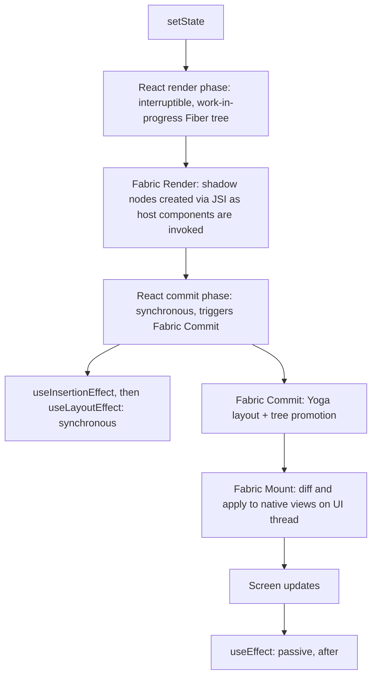
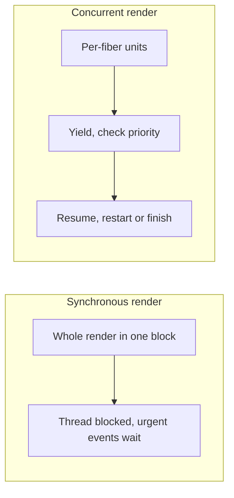
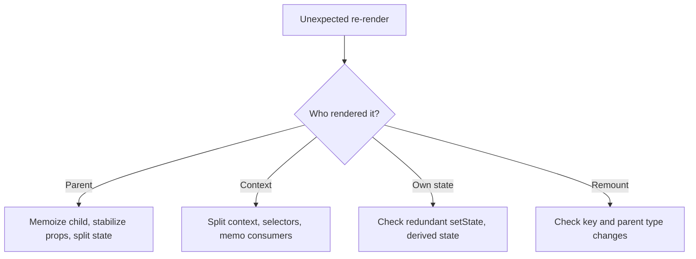

# React Internals and Rendering in React Native

> Verification note: React-core behavior (state updates, reconciliation, Fiber, concurrent rendering, effect timing) follows the official **react.dev** references (`useEffect`, `useLayoutEffect`, `useInsertionEffect`) and the repo's verified React notes ([react/01](../react/01-rendering-model-and-reconciliation.md), [react/02](../react/02-hooks-deep-dive.md), [react/03](../react/03-concurrent-react-suspense-and-transitions.md), [react/04](../react/04-react-19-and-beyond.md)). React Native specifics were verified in the **reactnative.dev release posts (Nov 2026)**: RN ships **React 19.1.1 (0.82)** — which enabled full **owner stacks** and fixed `useDeferredValue`/`startTransition` wrongly showing Suspense fallbacks, aligning with web — **React 19.2 (0.83)** and **React 19.3 (0.88)**; **`Pressable` no longer unmounts listeners in a hidden `Activity` (0.85)**; Expo Router 58 adds React transitions and `Activity`-based screen hiding. The official render-pipeline doc says Fabric's **Render** step creates shadow nodes *as each React element is invoked* and that a **commit is triggered once the shadow tree is complete**; **which exact React phase maps to which Fabric phase**, and **effect ordering relative to Fabric's layout and mount**, are *not* spelled out officially and are marked below as inference *(hedged)*. The two official pages also disagree slightly on the thread that runs layout (see [02 §10](02-architecture-bridge-to-new-architecture.md#10-threading-model-one-pipeline-either-thread)) and carry "active roll-out" captions (last updated 2023-2024). `ViewTransition` is a **DOM-only** React feature (not available in React Native). React Compiler enablement in RN/Expo projects and which React 19 APIs ship in your RN version should be confirmed per project *(hedged)*. Fabric pipeline details: [02](02-architecture-bridge-to-new-architecture.md).

## Table of Contents

1. [Quick Summary (TL;DR)](#1-quick-summary-tldr)
2. [What Happens When You Call a State Setter](#2-what-happens-when-you-call-a-state-setter)
3. [Why Components Re-render](#3-why-components-re-render)
4. [Reconciliation, the "Virtual DOM" and the Host Config](#4-reconciliation-the-virtual-dom-and-the-host-config)
5. [Fiber, Concurrent Rendering and Time Slicing](#5-fiber-concurrent-rendering-and-time-slicing)
6. [Render vs Commit, and React vs Fabric Phases](#6-render-vs-commit-and-react-vs-fabric-phases)
7. [Batching](#7-batching)
8. [Effects: useInsertionEffect, useLayoutEffect, useEffect](#8-effects-useinsertioneffect-uselayouteffect-useeffect)
9. [Modern React Features in React Native](#9-modern-react-features-in-react-native)
10. [Pitfalls](#10-pitfalls)
11. [Interview Questions — Fundamentals](#11-interview-questions--fundamentals)
12. [Interview Questions — Senior Scenarios](#12-interview-questions--senior-scenarios)
13. [Cheat Sheet](#13-cheat-sheet)
14. [Key Terms Glossary](#14-key-terms-glossary)
15. [Further Reading](#15-further-reading)

---

## 1. Quick Summary (TL;DR)

- The **same React** (Fiber reconciler, hooks, concurrent features) runs on web and React Native; only the **host config** differs: `react-dom` mutates the DOM, **Fabric** creates C++ shadow nodes via JSI.
- A state setter **schedules** work; it does not synchronously render or touch a native view. Updates are **batched** (React 18+), rendered in an **interruptible render phase**, then applied in a **synchronous commit phase**.
- **React's phases and Fabric's phases are different layers**: shadow nodes are created in C++ *while React invokes host components* (Fabric **Render**); once the shadow tree is complete a **Fabric Commit** (Yoga layout + tree promotion) is triggered; **Mount** applies native view mutations on the UI thread. Exact alignment with React's render/commit phases is an inference *(hedged)*.
- **Components re-render** because their own state changed, their **parent re-rendered** (the big one), a **consumed context** changed, or an **external-store subscription** reported a change. A `key` change **remounts**.
- **Effect order (React guarantee):** `useInsertionEffect` → (host mutation) → `useLayoutEffect` (sync, before the update is visible) → screen update → `useEffect` (passive, after). How this lines up with Fabric's layout and mount is not officially specified *(hedged)*.
- Concurrent rendering in RN became possible because Fabric's shadow tree is **immutable and thread-safe**; the bridge-era renderer could not do it.
- React 19.x features reach RN through the version of React bundled in each release (19.1.1 in 0.82, 19.2 in 0.83, 19.3 in 0.88).

---

## 2. What Happens When You Call a State Setter

1. React creates an **update object**, enqueues it on the fiber's update queue with a **priority** (a press outranks a background refresh).
2. Inside an already-synchronous block (event handler, promise callback, native callback — all batched since React 18) React does **not** render immediately; it marks the root as having pending work.
3. The **render phase** builds a new work-in-progress Fiber tree: re-invokes affected components/hooks and replays update queues; it is **interruptible**.
4. As host components are invoked, the renderer **creates or clones shadow nodes in C++ via JSI** (Fabric Render); the result is applied in the **commit phase**, which triggers Fabric's own commit *(phase alignment is inferred, see §6)*.

**Does every state update immediately update native UI? No.** The setter only schedules; batching collapses multiple updates; even after React's commit native views are not yet changed — native view mutation is Fabric's **Mount** step, on the UI thread, possibly next tick; in concurrent mode a render can be **interrupted and discarded** before commit; and some state isn't React state at all (scroll offsets committed natively in C++ skip React's render entirely).

---

## 3. Why Components Re-render

| Trigger | Notes |
|---|---|
| Own `useState`/`useReducer` setter with a value not `Object.is`-equal | Same value bails out (mostly) |
| **Parent re-renders** | Default for all children, regardless of prop changes — why `React.memo` exists ([05](05-performance-rendering-lists-images-and-memory.md)) |
| Consumed **context** value changes | Every consumer re-renders unless split/selector-based |
| External store subscription (`useSyncExternalStore`, store hooks) reports a change | Store selectors limit scope |

"Props changed" is not an independent trigger — props change because the parent re-rendered. A **new `key`** doesn't re-render: it **unmounts the old instance and mounts a new one** (state reset). With **React Compiler** enabled, many manual memoizations become automatic *(hedged; verify per project)*; `useMemo`/`useCallback` stay as escape hatches.

---

## 4. Reconciliation, the "Virtual DOM" and the Host Config

- **Reconciliation:** diff the previous element tree against the new to compute minimal changes. Heuristics: **different type at a position → tear down and rebuild**; **same type → keep instance, diff props/children**; **keys** match list items across renders.
- **"Virtual DOM"** is the historical name for an in-memory UI description React diffs instead of touching real output. Modern docs talk about the **element/Fiber tree**; "DOM" is a misnomer outside browsers.
- **Does RN use the DOM? No** — no `document`, no CSSOM; Fabric targets real native views. (RN ≥ 0.82 exposes **DOM-like node APIs** on refs — `parentNode`, `children`, `getBoundingClientRect`, `ownerDocument` — as a convenience, not an HTML DOM.)
- **What does React reconcile against?** Nothing specific: the **host config** abstraction decouples the reconciler from the output. Fabric is "just another renderer," a sibling of `react-dom`, writing the **React shadow tree** (C++) via JSI. Fabric separately **re-diffs** shadow trees to decide the real native mutations ([02](02-architecture-bridge-to-new-architecture.md#9-trees-yoga-and-view-flattening)).
- **Two diffs, two layers:** React decides *what logically changed*; Fabric's mount decides *what physically changes* in the native view tree (including view flattening).

---

## 5. Fiber, Concurrent Rendering and Time Slicing

- **Fiber:** React's reconciliation engine and data structure (React 16+). Each fiber = one unit of work holding type, pending props, memoized state, `child`/`sibling`/`return` pointers and an `alternate`. Two trees — **current** (on screen) and **work-in-progress** — give **double buffering**: build the next tree without touching what is displayed.
- **Relationship to RN:** the same reconciler as `react-dom`; RN could not safely use Fiber's **concurrent** capabilities until Fabric replaced the Bridge-based `UIManager` host config (async, JSON, non-interruptible).
- **Concurrent rendering:** React can pause, abandon, resume or run several versions of a render without corrupting committed UI; foundation for transitions, Suspense and automatic batching. In RN it works because Fabric's shadow tree is **immutable with structural sharing** (clone only the changed path), safe across threads without locks.
- **Time slicing:** the render phase is split into per-fiber units; React periodically **yields** and checks for higher-priority work instead of monopolizing the thread. Payoff: fewer blown frame budgets ([05](05-performance-rendering-lists-images-and-memory.md)).
- **Can rendering be interrupted?** The **render phase yes** (pure, no visible side effects); the **commit phase never** (half-applied mutations would be a broken UI).
- **When interrupted:** (1) pause and resume; (2) **discard and restart** if a higher-priority update affects the same tree — safe because the current tree is untouched; (3) **switch threads** in RN: a discrete high-priority UI-thread event interrupts a JS-thread render and the render completes synchronously on the UI thread ([02](02-architecture-bridge-to-new-architecture.md#10-threading-model-one-pipeline-either-thread)). Users never see discarded renders.

---

## 6. Render vs Commit, and React vs Fabric Phases

| | React render phase | React commit phase |
|---|---|---|
| Also called | Reconciliation | — |
| Interruptible | **Yes** (pause/abort/restart) | **No** (synchronous) |
| Side effects | **None** — must be pure | Host mutations, refs attached, layout effects |
| Work | `beginWork`/`completeWork`, re-run components, diff | Apply result via host config, swap work-in-progress to current; run layout effects |

**Official (render-pipeline doc):** Fabric **Render** = as each React element is invoked, the renderer synchronously creates a React Shadow Node (host components only, never composite components), usually on the JS thread, via JSI. When the shadow tree is complete the renderer **triggers a Commit** (Yoga layout + tree promotion to "next tree"). **Mount** then diffs, flattens and applies mutations on the UI thread.

**Inference *(hedged, not an official statement)*:** React Native uses React's *persistent* host-config mode, where shadow nodes are created or cloned while React completes host components (React's render phase) and the finished tree is handed to Fabric at React's commit. That is why shadow-tree creation is safe to discard when a concurrent render is interrupted. Earlier versions of this handbook said React's commit "creates" shadow nodes; the official doc describes creation during element invocation, so treat that older wording as inaccurate.

**Effect timing vs Fabric *(unspecified officially)*:** React guarantees `useLayoutEffect` runs synchronously in React's commit, before the update is visible. The RN New Architecture docs list **synchronous layout reads in layout effects** as a motivation, which implies layout information can be available there, but the exact point relative to Fabric's commit and mount is not documented, so do not assert an order in an interview; state the React guarantee and that RN docs promise synchronous layout access.

**Commit sub-steps in React:** before-mutation (snapshots), mutation (host updates; refs detached), layout (refs attached, `useLayoutEffect` and `componentDidMount/Update`); passive effects (`useEffect`) are flushed afterwards.

---

## 7. Batching

- **Batching:** multiple updates in one synchronous block → **one** render (no wasted intermediate renders, no half-updated UI).
- **Pre-React 18:** batched only inside React event handlers; updates in promises, timers and native callbacks each rendered separately.
- **React 18+ automatic batching:** everything is batched regardless of origin (timers, promises, native-module callbacks, `NativeEventEmitter` events) unless you opt out with `flushSync`. This matters in RN because many updates originate from **native-originated async callbacks**.

---

## 8. Effects: useInsertionEffect, useLayoutEffect, useEffect

| Hook | When | Blocks the update? | Typical RN use |
|---|---|---|---|
| `useInsertionEffect` | First, synchronously at commit, before layout effects; cannot set state | n/a | Almost never; for CSS-in-JS libraries (RN has no runtime style injection/CSSOM) |
| `useLayoutEffect` | Synchronously right after host mutations, **before the update is visible** | **Yes** (it and any state updates it schedules) | Measure a ref (`measure`/`onLayout`) and correct state to avoid a flicker (e.g. tooltip positioning) |
| `useEffect` | **After** render and commit — passive, generally after the update is visible | No | Default: data fetching, subscriptions, timers, logging |

- react.dev: layout-effect work and its state updates **block painting**; prefer `useEffect` when possible. In RN the equivalent boundary is Fabric applying the change to the real view tree.
- `useEffect` documented nuance: effects caused by an interaction may run before the next paint so results are observable to the event system — a narrow exception.
- Standard dependency semantics: runs after the initial commit and after each commit where a dependency changed; cleanup runs **before the next setup and on unmount**. Strict Mode (dev) double-invokes effects to surface missing cleanup.
- Common async trap: an effect that starts async work must **cancel/ignore** it on cleanup ([05 leaks](05-performance-rendering-lists-images-and-memory.md#8-memory-leaks)).

---

## 9. Modern React Features in React Native

| Feature | RN notes |
|---|---|
| **Suspense / `startTransition` / `useDeferredValue`** | Fixed in **React 19.1.1 (RN 0.82)** to behave like web (previously both wrongly showed the fallback when combined with a Suspense boundary) |
| **Owner stacks** | Fully supported from 0.82 (dev error diagnostics, including with the function-name Babel plugin) |
| **React 19 APIs** (Actions, `useActionState`, `useOptimistic`, `use`, ref as prop) | Available in the bundled React; usable for forms/mutations with your data layer *(per-project verification)* |
| **`Activity`** (19.2) | Hides/preserves state of inactive subtrees; **RN 0.85**: `Pressable` no longer unmounts listeners in hidden Activity; **Expo Router 58** exposes `activityEnabled` for screens |
| **`useEffectEvent`** (19.2) | Non-reactive effect callbacks; available with React 19.2+ (RN 0.83+) |
| **React Compiler** | Automatic memoization; stable 1.0 (Oct 2025) per react.dev; enabling in RN/Expo projects via Babel plugin *(confirm in your setup)* |
| **`ViewTransition`** | **DOM-only**; not available in RN |
| **Error boundaries** | Catch render errors only ([10](10-app-architecture-state-and-navigation.md#9-error-handling-and-crash-reporting)) |
| **React DevTools Profiler** | Via React Native DevTools to inspect renders and commits ([12](12-expo-eas-tooling-and-debugging.md)) |

---

## 10. Pitfalls

1. Assuming a setter updates the UI immediately; reading state right after `setState`.
2. Conflating React's render/commit with Fabric's render/commit/mount.
3. Side effects in render (not safe: the render phase can run multiple times or be discarded).
4. Overusing `useLayoutEffect` (blocks the visible update, eats the frame budget).
5. Missing cleanup for async work/subscriptions in effects.
6. Believing prop changes cause re-renders independently of parents; using unstable inline objects/functions as props to memoized children.
7. Using `key={index}` for dynamic lists (state mix-ups) or changing keys unintentionally (remounts).
8. Expecting concurrent features to work identically on very old RN versions (pre-0.82 Suspense/transition edge cases).
9. Relying on DOM APIs (`document`, `window`) in shared code.
10. Putting heavy derived computation in render without memoization (or relying on the Compiler without checking it is enabled).

---

## 11. Interview Questions — Fundamentals

- **What happens internally on `setState`?** An update is queued with a priority; React schedules a (batched) render; the render phase diffs interruptibly; commit applies shadow-node changes via JSI.
- **Does it update native UI immediately?** No: scheduling, batching, possible interruption, then Fabric commit/mount on the UI thread.
- **What causes a re-render?** Own state, parent re-render, consumed context change, external-store subscription; key change remounts.
- **What is reconciliation?** Diffing old/new element trees (type, key, props) to compute minimal changes.
- **What is the Virtual DOM?** Historical name for the in-memory UI representation diffed against the previous one; in RN the equivalent target is the Fabric shadow tree.
- **Does RN use the browser DOM?** No; Fabric targets native views. RN 0.82+ DOM-like node APIs on refs are only an API convenience.
- **What does React reconcile against without a DOM?** The host-config abstraction: shadow nodes created via JSI.
- **What is Fiber and how does it relate to RN?** React's engine/data structure with current and work-in-progress trees; same reconciler in RN; concurrent features needed Fabric.
- **What is concurrent rendering / time slicing?** Interruptible, prioritized rendering split into per-fiber units with periodic yielding.
- **Can rendering be interrupted?** Render yes, commit no.
- **What happens if a render is interrupted?** Paused/resumed, discarded and restarted, or (in RN) finished synchronously on the UI thread.
- **Render vs commit?** Pure/interruptible reconciliation vs synchronous host mutation.
- **How do React's phases relate to Fabric's in RN?** Shadow nodes are created/cloned via JSI while React invokes host components (Fabric Render); React's commit hands over the finished tree and a Fabric Commit (layout, promotion) follows, then Mount on the UI thread. The exact alignment is inferred *(hedged)*.
- **How does React decide which native views change?** React diffs elements; Fabric re-diffs shadow trees (with view flattening).
- **What is batching / automatic batching?** One render per synchronous block; since 18 regardless of origin.
- **`useEffect` vs `useLayoutEffect` vs `useInsertionEffect`?** Passive after-visible, synchronous before-visible, and pre-layout style injection.
- **When does `useEffect` run?** After render and commit, generally after the update is visible.
- **Why is Strict Mode double-invoking effects?** To expose missing cleanup/impure setup in development.

---

## 12. Interview Questions — Senior Scenarios

### S1. "A tooltip flickers at the wrong position for one frame."
It is positioned from a measurement taken after paint. Measure in `useLayoutEffect` (or via synchronous layout APIs) and set state before the frame is shown; keep that work minimal because it blocks the visible update; alternatively compute placement from known sizes or use a native popover.

### S2. "A list screen re-renders hundreds of rows when a header counter changes."
State lives too high or props are unstable. Colocate/split state, memoize rows (`React.memo`, stable props), use selectors for stores/context, or enable React Compiler; verify with the React DevTools profiler and render counts ([05](05-performance-rendering-lists-images-and-memory.md)).

### S3. "Users type fast in a search box and results flicker/lag."
Use `useDeferredValue`/`startTransition` for the expensive results update (reliable in RN ≥ 0.82 / React 19.1.1), keep the input state urgent and uncontrolled-expensive work off the typing path, debounce network calls, cancel stale requests ([09](09-networking-storage-and-offline.md)).

### S4. "Explain why `setState` in a native callback used to cause multiple renders."
Pre-React 18 batching only covered React event handlers; native-originated callbacks (promises, emitters) rendered per update. React 18 automatic batching collapses them; `flushSync` opts out for rare cases requiring synchronous DOM-like flushing.

### S5. "An effect leaks memory after navigating away."
Missing cleanup or a closure retaining screen state: unsubscribe listeners, clear timers, abort fetches in cleanup; on navigation with preserved screens (`Activity`/freeze) remember effects are cleaned up while hidden only if the library does so ([10](10-app-architecture-state-and-navigation.md)).

### S6. "Is React Native's render pipeline the same as the web's?"
Same reconciler, same render/commit/effect semantics; different host: shadow tree via JSI, then Fabric layout and mount, instead of direct DOM mutation and browser paint. That is why no DOM APIs exist; effect ordering relative to Fabric layout and mount is not officially specified *(hedged)*.

---

## 13. Cheat Sheet

| Concept | Remember |
|---|---|
| Setter | Schedules; batched; render interruptible; commit sync |
| Re-render triggers | State, parent, context, store; key = remount |
| Two diffs | React (elements) then Fabric (shadow trees) |
| Concurrency enabler | Immutable thread-safe shadow tree |
| Effects | Insertion → layout (before visible) → passive (after) |
| Batching | Automatic since React 18 |
| RN React versions | 0.82: 19.1.1, 0.83: 19.2, 0.88: 19.3 |
| DOM-only | `ViewTransition`, `document` |

---

## 14. Key Terms Glossary

| Term | Meaning |
|---|---|
| **Host config** | Interface a React renderer implements to create/update host nodes (DOM, Fabric shadow nodes) |
| **Fiber** | React's unit of work and reconciliation engine |
| **Double buffering** | Current vs work-in-progress trees |
| **Time slicing** | Splitting render into yieldable units |
| **Concurrent rendering** | Pause/abort/resume/multiple tree versions |
| **Passive effect** | `useEffect`, deferred after visible update |
| **Layout effect** | `useLayoutEffect`, synchronous before visible update |
| **Automatic batching** | Single render for updates from any origin |
| **Owner stack** | Dev diagnostic showing which component rendered a failing element |
| **Activity** | React 19.2 component hiding subtrees while preserving state |

---

## 15. Further Reading

- [react.dev useEffect](https://react.dev/reference/react/useEffect) · [useLayoutEffect](https://react.dev/reference/react/useLayoutEffect) · [useInsertionEffect](https://react.dev/reference/react/useInsertionEffect) · [Preserving and resetting state](https://react.dev/learn/preserving-and-resetting-state) · [RN 0.82 (React 19.1.1, DOM nodes)](https://reactnative.dev/blog/2025/10/08/react-native-0.82) · [Threading model](https://reactnative.dev/architecture/threading-model)
- This repo: [react/01 Rendering model](../react/01-rendering-model-and-reconciliation.md) · [react/02 Hooks](../react/02-hooks-deep-dive.md) · [react/03 Concurrent React](../react/03-concurrent-react-suspense-and-transitions.md) · [02 Fabric pipeline](02-architecture-bridge-to-new-architecture.md) · [05 Performance](05-performance-rendering-lists-images-and-memory.md)
