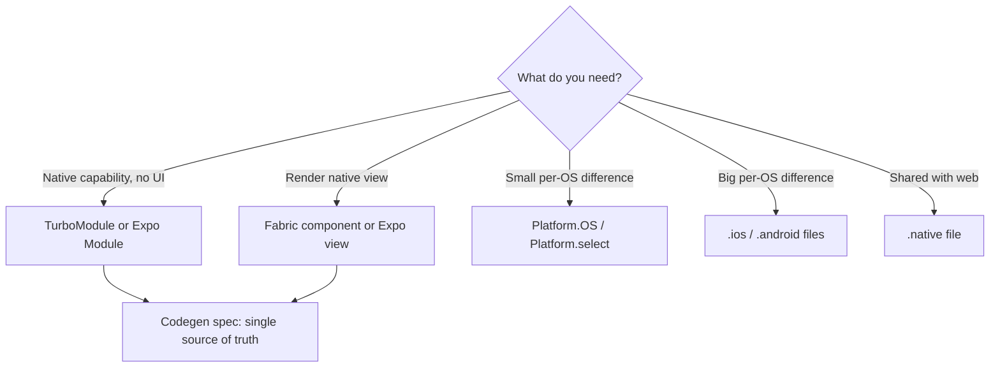
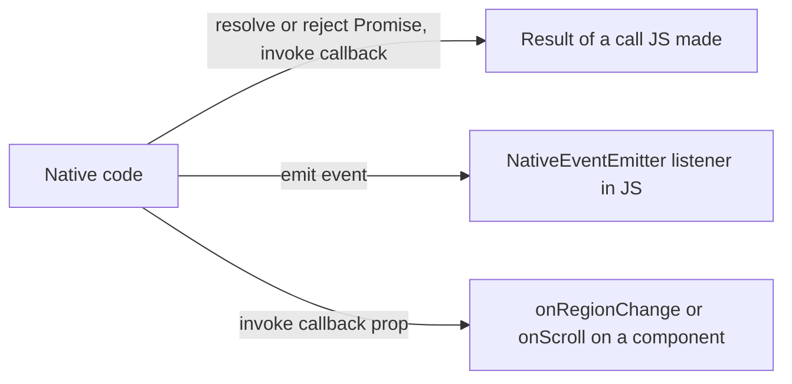
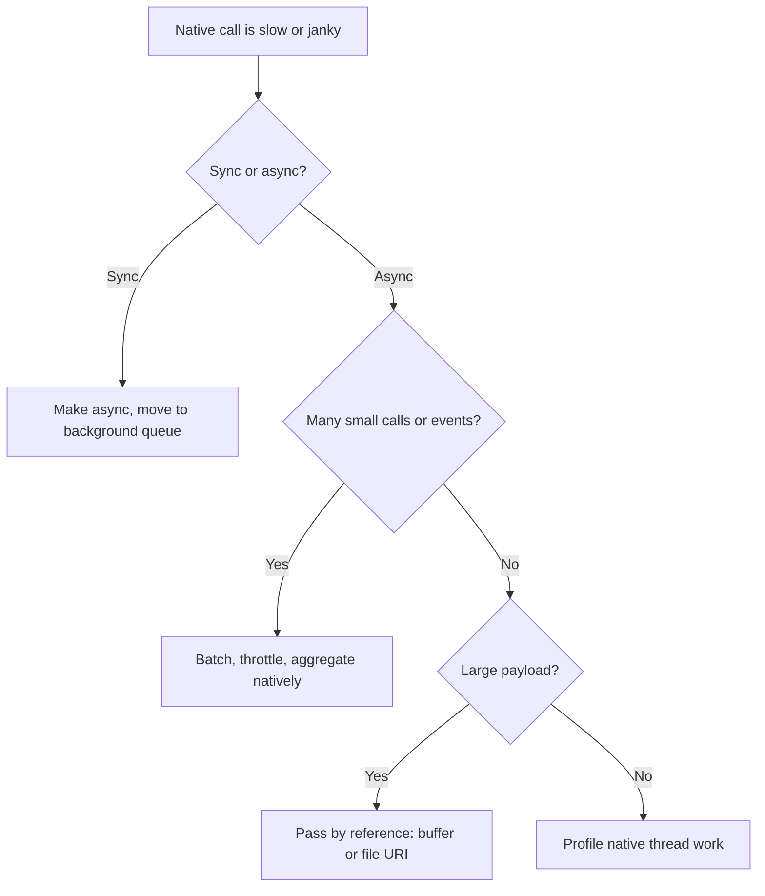

# Native Modules, Native Components and Platform-Specific Code

> Verification note: Architecture and release facts were verified against **reactnative.dev (architecture docs and release posts 0.80 → 0.88, Nov 2026)**: TurboModules/Fabric/Codegen are the only architecture since 0.82; **`ArrayBuffer` values now have native representations in TurboModules on iOS and Android (Java `ArrayBuffer` support in 0.88)**; the **Strict TypeScript API** is the default in 0.87 (refs typed as instances such as `ViewInstance`; deep imports are type errors); `InteractionManager` was removed in 0.87; **Expo Modules** facts come from the **Expo SDK 58 changelog (Oct 2026)**: Expo Modules 2.0 is in beta (plain annotated Swift/Kotlin classes; synchronous calls reported 2.5–5.6× faster than the DSL on iOS; Android microbenchmarks faster than TurboModules, e.g. 112 ns vs 2,837 ns for a no-argument call, *vendor benchmark*), `expo-modules-core` ships **prebuilt** native libraries (≈2× faster Android clean builds), iOS module calls are cheaper in SDK 58, and the **scene-based UIKit lifecycle** is required for iOS 27. `Platform.OS`/`Platform.select`/file-extension resolution follow the **Platform-Specific Code** docs. **Exact registration boilerplate (`ReactPackage`, Objective-C macros, `codegenConfig` keys), Nitro Modules, community library scaffolding tools and thread-hopping idioms (`DispatchQueue`, coroutines) are established knowledge not re-fetched this session — marked *(hedged)* where specific.** Concepts of JSI/TurboModules/Codegen: [02](02-architecture-bridge-to-new-architecture.md).

## Table of Contents

1. [Quick Summary (TL;DR)](#1-quick-summary-tldr)
2. [Native Modules: Exposing Functionality](#2-native-modules-exposing-functionality)
3. [Native Components: Exposing UI](#3-native-components-exposing-ui)
4. [Module vs Component, and Choosing Authoring Tools](#4-module-vs-component-and-choosing-authoring-tools)
5. [Codegen in Practice](#5-codegen-in-practice)
6. [JS to Native and Native to JS Communication](#6-js-to-native-and-native-to-js-communication)
7. [Threads, Blocking and CPU-Heavy Work](#7-threads-blocking-and-cpu-heavy-work)
8. [Large Data and Chatty Boundaries](#8-large-data-and-chatty-boundaries)
9. [Platform Differences and Platform-Specific Code](#9-platform-differences-and-platform-specific-code)
10. [Pitfalls](#10-pitfalls)
11. [Interview Questions — Fundamentals](#11-interview-questions--fundamentals)
12. [Interview Questions — Senior Scenarios](#12-interview-questions--senior-scenarios)
13. [Cheat Sheet](#13-cheat-sheet)
14. [Key Terms Glossary](#14-key-terms-glossary)
15. [Further Reading](#15-further-reading)

---

## 1. Quick Summary (TL;DR)

- **Native Module** = native **functionality** (no UI): battery, Keychain/Keystore, payments SDK, heavy computation. **Native Component** = native **UI**: map, video, camera preview. Libraries often ship **both** (view + imperative controls).
- Under the New Architecture both are **typed by a JS/TS spec** and checked by **Codegen**: modules via `Spec extends TurboModule`, components via `codegenNativeComponent<Props>()`. Mismatches become **build errors**.
- **JS → native:** direct JSI call (sync or async). **Native → JS:** resolve a Promise/callback, emit an event (`NativeEventEmitter`/emitter), or invoke a callback prop on a component.
- **Keep native methods async** for anything non-trivial; synchronous JSI methods **block the JS thread**.
- **Move CPU-heavy work to a native background thread** (return a Promise); pass **large data by reference** (buffers, file URIs, `ArrayBuffer`), and **batch** chatty calls.
- **Platform differences:** `Platform.OS`/`Platform.select` are **runtime** branches (both branches in one bundle); `.ios.`/`.android.` files are **build-time** resolution (other platform's file never bundled); `.native.` separates RN from web/Node.
- **Expo Modules** (Swift/Kotlin API; 2.0 beta with annotated classes) are a productive authoring path for apps that use Expo; bare TurboModules remain the lowest-level path.



---

## 2. Native Modules: Exposing Functionality

The JS-visible contract is a small TypeScript interface; native code must conform to what Codegen generates.

```ts
// NativeDeviceInfo.ts — single source of truth
import type { TurboModule } from 'react-native';
import { TurboModuleRegistry } from 'react-native';

export interface Spec extends TurboModule {
  getBatteryLevel(): Promise<number>;   // async: preferred for non-trivial work
  isTablet(): boolean;                  // sync: only for fast, cheap values
}
export default TurboModuleRegistry.getEnforcing<Spec>('DeviceInfo');
```
```ts
const level = await DeviceInfo.getBatteryLevel();
```

**Native side (conceptual)**
- **Android (Kotlin/Java):** implement the generated `NativeDeviceInfoSpec`; register via a `ReactPackage` *(hedged: exact package wiring varies by RN/template version)*. Legacy style used `ReactContextBaseJavaModule` + `@ReactMethod`.
- **iOS (Swift/Obj-C):** conform to the generated protocol; Swift implementations need a small **Objective-C(++) bridging layer** because RN's export macros (`RCT_EXPORT_MODULE`, legacy `RCT_EXPORT_METHOD`) are Objective-C.
- **How to expose a Swift/Kotlin function (checklist):** (1) declare it in the spec; (2) let Codegen generate the protocol/interface; (3) implement natively; (4) register (bridging header / `ReactPackage`); (5) return a `Promise` for async work, a value directly only for fast sync calls.

**Sync vs async:** legacy Bridge calls were always async; TurboModules **can** be synchronous because JS holds a direct reference — but a sync call blocks the JS thread until it returns ([§7](#7-threads-blocking-and-cpu-heavy-work)).

**Lazy loading:** a TurboModule is created on first `getEnforcing` call, not at startup ([02](02-architecture-bridge-to-new-architecture.md#6-turbomodules)).

**Why JSI matters at scale (VisionCamera):** ~30 MB frames at ~2 GB/s were impossible through the Bridge; JSI hands JS a reference to the native frame instead.

---

## 3. Native Components: Exposing UI

```tsx
// MapViewNativeComponent.ts
import codegenNativeComponent from 'react-native/Libraries/Utilities/codegenNativeComponent';
import type { ViewProps } from 'react-native';
import type { Double } from 'react-native/Libraries/Types/CodegenTypes';

interface NativeProps extends ViewProps {
  latitude?: Double;
  longitude?: Double;
  onRegionChange?: (event: { nativeEvent: { latitude: number; longitude: number } }) => void;
}
export default codegenNativeComponent<NativeProps>('MapView');
```
> Under RN ≥ 0.80 the **Strict TypeScript API** discourages deep imports from `react-native/Libraries/*`; for specs the supported import paths are documented in the New Architecture guides — check the current docs for the exact path *(hedged)*. With the Strict API (default in 0.87) refs are typed as instances (`ViewInstance`, `TextInputInstance`).

- **Props flow JS → native** declaratively (re-render with a new prop; no imperative `setLatitude`); **events flow native → JS** via callback props (like DOM `onClick`, native-sourced).
- **Legacy equivalent:** `ViewManager` / `RCTViewManager` + `requireNativeComponent` (stringly typed); now replaced by Fabric components backed by C++ shadow nodes ([02](02-architecture-bridge-to-new-architecture.md#8-fabric-render-commit-mount)).
- **Imperative commands** on a native view (e.g. `focus()`, `play()`) use codegen'd commands rather than a module reaching into the view tree.
- **Refs:** since 0.82 refs on host components expose DOM-like nodes (`getBoundingClientRect`, `parentNode`) while keeping legacy `measure` ([03](03-react-internals-and-rendering-in-react-native.md)).

---

## 4. Module vs Component, and Choosing Authoring Tools

| | Native Module | Native Component |
|---|---|---|
| Exposes | Functionality (methods, properties, events) | UI (renderable native view) |
| JS shape | Object with methods | React component |
| Visual output | None | Yes |
| New Architecture backing | TurboModule (JSI `HostObject`) | Fabric component (C++ shadow node) |
| Typed via | `Spec extends TurboModule` | `codegenNativeComponent<Props>()` |
| Examples | Keychain, analytics SDK, Bluetooth, crypto | `react-native-maps`, video, camera preview |

If you are "returning a view" from a module, or calling imperative methods on a component as if it were a service, you have conflated the two.

**Authoring options (choose by team and constraints)**

| Option | Strengths | Trade-offs |
|---|---|---|
| **TurboModule / Fabric component (bare)** | Official, lowest-level, full control, ships in any RN app | Most boilerplate (Codegen config, per-platform wiring) |
| **Expo Modules API** (Swift/Kotlin; **2.0 beta** uses annotated plain classes) | Far less boilerplate, typed, fast calls, autolinking, config plugins, prebuilt `expo-modules-core`; works in bare apps with `expo` installed | Adds the Expo modules dependency; 2.0 is beta (SDK 58) |
| **Third-party scaffolding/JSI frameworks** *(hedged)* | e.g. generators for libraries, Nitro-style typed JSI modules | Ecosystem churn; verify New Architecture and Hermes V1 compatibility |
| **Pure JS + existing library** | No native code to maintain | Dependency risk; check maintenance and New Architecture support |

Native library for others to consume → always ship a **typed spec** (Codegen) and autolinking metadata; consumers get compile-time safety and New Architecture compatibility.

**Worked example (barcode scanner):** a Fabric component renders the preview and reports scans via `onScan`; a TurboModule exposes `torchOn()/torchOff()`; both are spec-typed so Codegen generates matching iOS/Android interfaces; per-OS native source lives in `ios/` and `android/`, and any divergent JS glue uses `.ios.ts/.android.ts`.

---

## 5. Codegen in Practice

*(Concept and rationale: [02](02-architecture-bridge-to-new-architecture.md#7-codegen).)*

- **Problem solved:** in the Bridge era the JS and native sides were independently hand-written with no shared source of truth; mismatched types, renamed props or changed signatures surfaced only at runtime.
- **What it does:** reads a spec → generates native interfaces/structs at **build time** (Gradle task on Android, Xcode build phase/script on iOS); your implementation must conform or the build fails.
- **Configuration** *(hedged on exact keys)*: a `codegenConfig` block in the library/app `package.json` (name, `type` such as modules/components/all, spec source directory, per-platform package/namespace settings); spec files follow naming conventions (`Native<Name>.ts` for modules, `<Name>NativeComponent.ts` for components).
- **Secondary benefits:** removes hand-written marshalling, one spec for both platforms, the spec doubles as living documentation, **third-party libraries get the same guarantees** because Codegen scans linked libraries too.
- **Supported types** are a restricted subset (numbers, strings, booleans, arrays, objects, `Promise`, callbacks, enums, `ArrayBuffer`*, etc.); arbitrary classes are not supported — design explicit data shapes. (*`ArrayBuffer` with native representations in TurboModules; Java support in 0.88.)

---

## 6. JS to Native and Native to JS Communication

**JS → native:** via the module/component spec — a direct JSI call in the New Architecture (legacy: serialized Bridge message). JS never calls Swift/Kotlin directly; it calls a JS-visible object backed by native code.

**Native → JS (three ways)**

- **Promise/callback** — answering a request.
- **Native event** — unsolicited push (Bluetooth device found, sensor reading, SDK callback) via `NativeEventEmitter` (modules) or callback props (components). Under JSI native can also hold a direct reference to a JS function and call it.
- **Throttle high-frequency events** (sensors, scroll) natively or coalesce; every callback competes for the JS thread ([05](05-performance-rendering-lists-images-and-memory.md)).

**Event dispatching** *(0.88)*: the default event path now follows the web-based event-dispatching model; library authors who relied on legacy dispatch internals should re-test native-event-heavy components *(hedged detail)*.

---

## 7. Threads, Blocking and CPU-Heavy Work

| Question | Answer |
|---|---|
| Which thread does a native module run on? | Usually its own native thread/queue — neither the JS thread nor necessarily the UI thread; some modules opt into the **main** thread when they must touch UI APIs |
| Can a module block the JS thread? | **Yes**, if a **synchronous** JSI method is slow; async methods keep JS free |
| Can a module update the UI directly? | Not from a background thread: either dispatch to the main thread (`DispatchQueue.main.async` / `runOnUiThread`) *(hedged naming)* or change props/state a native **component** reads |
| 5-second native call | **Async:** JS continues, Promise resolves later. **Sync:** JS thread frozen 5 s — no timers, renders or touches ([01](01-javascript-runtime-hermes-and-event-loop.md#7-what-happens-when-the-js-thread-is-blocked)) |

**Designing a CPU-intensive module**
1. Expose **async** (Promise); never sync.
2. Dispatch work to a **native background thread/queue** (GCD global queue on iOS, executor/coroutine on Android) — not the arrival thread.
3. Resolve/reject on completion; consider **progress events** and **cancellation** tokens.
4. **Batch**: avoid many tiny calls; send structured input once.
5. **Large inputs/outputs by reference** ([§8](#8-large-data-and-chatty-boundaries)).
6. Limit concurrency (a bounded queue) to avoid starving the app; handle app backgrounding.

**Other ways to move CPU work off the JS thread** (see [01 §9](01-javascript-runtime-hermes-and-event-loop.md#9-concurrency-vs-parallelism-and-getting-work-off-the-js-thread)): chunk and yield with `requestIdleCallback`/timers (the old `InteractionManager` is **removed in 0.87**), worklets for per-frame UI work ([06](06-startup-bundle-animations-and-gestures.md)), or compute off-device.

---

## 8. Large Data and Chatty Boundaries

- **Legacy Bridge:** everything became JSON, so large payloads paid serialize/copy/deserialize per call.
- **New Architecture options:** pass **`ArrayBuffer`/typed buffers** (native representations with an explicit byte-ownership contract), **file URIs** or handles instead of base64 strings, or expose a **`HostObject`** to hold native data by reference (as VisionCamera and react-native-mmkv do).
- **Why excessive crossings hurt:** every call has non-zero marshalling cost (a JSI call is cheap but not free; 1,000 tiny calls > one batched call), and high-frequency native→JS events flood the JS thread. Fix: **batch, throttle, or move the hot path off the JS thread**.
- **Images/files:** hand over a path or content URI and let native decode; never ship megapixel bitmaps through JS.

---

## 9. Platform Differences and Platform-Specific Code

| Tool | Granularity | Resolved | Use when |
|---|---|---|---|
| `Platform.OS === 'ios'` | Expression | **Runtime** | One value/line differs (official guidance: small differences) |
| `Platform.select({ ios, android, native, default })` | Value/object | **Runtime** | Several related values differ |
| `Component.ios.tsx` / `Component.android.tsx` | File | **Build time (Metro)** | Different implementations or native libraries |
| `Component.native.tsx` | File | Build time (per bundler) | RN vs web/Node (no iOS/Android difference); tell the web bundler to ignore `*.native.*` |

- **`Platform.select` precedence:** specific platform key → `native` → `default`. It can select **components** too.

```tsx
import { Platform, StyleSheet } from 'react-native';

const styles = StyleSheet.create({
  shadowBox: {
    ...Platform.select({
      ios: { shadowColor: '#000', shadowOpacity: 0.2, shadowRadius: 4 },
      android: { elevation: 4 },
      default: {},
    }),
  },
});

// Component selection (both branches are bundled; see the trap below)
const Picker = Platform.select({
  ios: () => require('./IOSPicker').default,
  android: () => require('./AndroidPicker').default,
})!();

// File-extension resolution (Metro picks at build time):
//   Button.ios.tsx, Button.android.tsx  ->  import Button from './Button'
//   Button.native.tsx / Button.tsx      ->  native vs web or Node
```
- **`Platform.Version`** differs by platform: **Android = API level (integer)**; **iOS = version string** (`"10.3"`, parse the major).
- **Platform-only props** are flagged `@platform` in the RN docs.
- **Runtime vs build-time trap:** with `Platform.select`/`Platform.OS` **both branches are in the same bundle**, so a branch importing a platform-only native library can break the other platform even if never executed; file extensions guarantee the other file is **never bundled**.
- **Decision:** tiny diff → `Platform.OS`; handful of values → `select`; whole implementation/libraries differ → platform files; shared with web → `.native`; no difference → shared code.
- **Related platform realities in current RN** (details in [07](07-ui-styling-layout-accessibility-and-localization.md) and [08](08-app-lifecycle-background-work-push-and-deep-links.md)): Android 15+ **edge-to-edge** (0.86), iOS 27 **UIScene lifecycle** (RN 0.88 `SceneDelegate` support; Expo SDK 58 prebuild generates it), Android 16 (API 36) support (0.81).

---

## 10. Pitfalls

1. Hand-rolled JSON over JSI APIs, or base64 for big binary data.
2. **Synchronous** native methods that do real work (blocks the JS thread).
3. Heavy computation on the thread the call arrived on instead of a native background queue.
4. UI mutation from background threads in native code.
5. No spec/Codegen contract (or specs drifting from implementations).
6. Chatty per-item native calls instead of batched APIs; unthrottled native event streams.
7. Importing platform-only libraries behind `Platform.OS` (breaks the other platform's bundle).
8. Misusing `Platform.Version` (API level vs string).
9. Forgetting module registration/autolinking after adding a library; not running pods/`prebuild`.
10. Depending on legacy `NativeModules`/`UIManager`/`requireNativeComponent` patterns now that legacy components are removed (0.84+).
11. Leaking native resources (listeners, sessions) when the JS context reloads or the view unmounts.
12. Over-using native code where a maintained JS library suffices.

---

## 11. Interview Questions — Fundamentals

- **Native Module vs Native Component?** Functionality (no UI) vs a renderable native view; often shipped together.
- **How does JS call native code?** Through a JS-visible module backed by native code: serialized Bridge messages (legacy) or direct JSI references (TurboModules).
- **How does native call JS?** Resolve a Promise/callback, emit an event (`NativeEventEmitter`), or invoke a callback prop.
- **What is a Native Event?** Native-pushed data JS didn't request as a return value; from modules via emitters, from components via callback props.
- **How do you expose a Swift function?** Spec → Codegen protocol → Swift implementation → Objective-C bridging/registration → Promise for async work.
- **Kotlin?** Spec → generated interface → Kotlin class → `ReactPackage` registration → Promise for async work.
- **Why can TurboModules be synchronous and legacy modules not?** JSI direct reference vs queued async Bridge; sync calls still block the JS thread.
- **Thread a module runs on?** Its own native thread/queue by default; main thread only if it must touch UI APIs.
- **Can a module block JS?** Yes via slow synchronous methods.
- **Can a module update UI directly?** Only by dispatching to the main thread, or via props/state of a native component.
- **How to move CPU work off JS?** Async native module on a background thread; chunk/yield; worklets for UI work; off-device.
- **How to send large data efficiently?** By reference: buffers/`ArrayBuffer`, file URIs, JSI host objects; never JSON/base64.
- **Why can excessive JS↔native calls hurt?** Per-call marshalling and event floods on the JS thread; batch/throttle.
- **What does Codegen solve?** JS/native contract drift: single spec, build-time errors.
- **Is Codegen only for TurboModules?** No — also Fabric component props.
- **`Platform.select` precedence?** Platform key, then `native`, then `default`.
- **`Platform.OS` vs platform file extensions?** Runtime branch with both in the bundle vs build-time file resolution.
- **When `.native.`?** Sharing a module name between RN and web/Node.
- **Why is `Platform.Version` risky?** Android API level integer vs iOS version string.
- **Which new authoring path is trending?** Expo Modules API (2.0 beta with annotated classes), alongside TurboModules.

---

## 12. Interview Questions — Senior Scenarios

### S1. "Design a native module for on-device image compression with progress."
Spec with `compress(uri, options): Promise<Result>` plus a progress event; implement on a native background queue with bounded concurrency and cancellation; take/return **file URIs** (not base64); emit throttled progress; clean up temp files; error codes mapped to typed errors; unit/integration tests with a mock spec ([testing/08](../testing/08-testing-in-practice-tdd-architecture-mobile-and-ai.md)).

### S2. "A vendor SDK needs both a preview UI and controls."
Fabric component for the view (props/callbacks), TurboModule for imperative controls (start/stop/torch), shared spec package, autolinking metadata, a JS wrapper that hides the split, lifecycle handled on unmount/background, and a permissions flow in JS ([08](08-app-lifecycle-background-work-push-and-deep-links.md)).

### S3. "Our app freezes whenever a particular sync native method is called."
It runs long work synchronously on the JS thread. Convert to async + background thread; if a sync value is truly needed, cache it at startup; verify with the profiler and long-task metrics; add a lint/code-review rule that sync specs must be O(1).

### S4. "The Android bundle crashes on startup after adding an iOS-only library."
`Platform.OS` only branches at runtime; the import still evaluates. Split into `.ios.ts`/`.android.ts` (or lazy `require` inside the branch), and ensure autolinking excludes the library on Android (platform config).

### S5. "Decide between writing a TurboModule and an Expo module."
If the app uses Expo/CNG or you want less boilerplate and fast typed calls, choose Expo Modules (check 2.0-beta stability for your SDK); if you are shipping a standalone library for any RN app or need precise C++/JSI control, choose a TurboModule/Fabric component (optionally with Expo module compatibility). Verify New Architecture support, build-time cost (prebuilt `expo-modules-core`), and maintainability.

### S6. "Real-time sensor data at 200 Hz makes the UI janky."
Stop emitting per-sample events to JS: aggregate/downsample natively, emit batched frames at UI rate (~60 Hz or lower), or feed a worklet/shared value for visual use, and keep storage/analytics off the hot path ([06](06-startup-bundle-animations-and-gestures.md)).

---

## 13. Cheat Sheet

| Need | Use |
|---|---|
| Native capability, no UI | TurboModule / Expo module (async by default) |
| Native view | Fabric component / Expo view |
| Contract | Codegen spec (single source of truth) |
| Native → JS | Promise/callback, `NativeEventEmitter`, callback props |
| CPU work | Native background thread + Promise |
| Large data | Buffers/`ArrayBuffer`, URIs, host objects |
| Small per-OS tweak | `Platform.OS` / `Platform.select` |
| Large per-OS difference | `.ios` / `.android` files |
| RN vs web | `.native` files |
| Danger | Sync native methods, base64 blobs, chatty calls, runtime-branch imports |



---

## 14. Key Terms Glossary

| Term | Meaning |
|---|---|
| **Native Module** | JS-callable native functionality with no UI |
| **Native Component** | Native view usable in JSX |
| **TurboModule / Fabric component** | New Architecture module / component backed by JSI and Codegen |
| **Spec** | TS/Flow interface that Codegen reads |
| **Codegen** | Build-time generator of native interfaces from specs |
| **`NativeEventEmitter`** | JS API for native-pushed events |
| **`ReactPackage`** | Android registration mechanism for modules/components |
| **Bridging header** | Obj-C file exposing Swift to RN's macro-based registration |
| **Expo Modules API** | Swift/Kotlin module authoring API from Expo (2.0 beta uses annotations) |
| **`ArrayBuffer`** | Binary buffer type with native representations in TurboModules |
| **`Platform.select`** | Runtime picker by platform key |

---

## 15. Further Reading

- [Platform-specific code](https://reactnative.dev/docs/platform-specific-code) · [Turbo native modules](https://reactnative.dev/docs/turbo-native-modules-introduction) · [Fabric native components](https://reactnative.dev/docs/fabric-native-components-introduction) · [0.88 release (ArrayBuffer TurboModules)](https://reactnative.dev/blog/2026/10/19/react-native-0.88) · [Expo SDK 58 (Expo Modules 2.0 beta)](https://expo.dev/changelog/sdk-58) · [Expo Modules API](https://docs.expo.dev/modules/overview/) *(hedged: check URLs)*
- This repo: [02 Architecture](02-architecture-bridge-to-new-architecture.md) · [05 Performance](05-performance-rendering-lists-images-and-memory.md) · [12 Expo, EAS and tooling](12-expo-eas-tooling-and-debugging.md)
