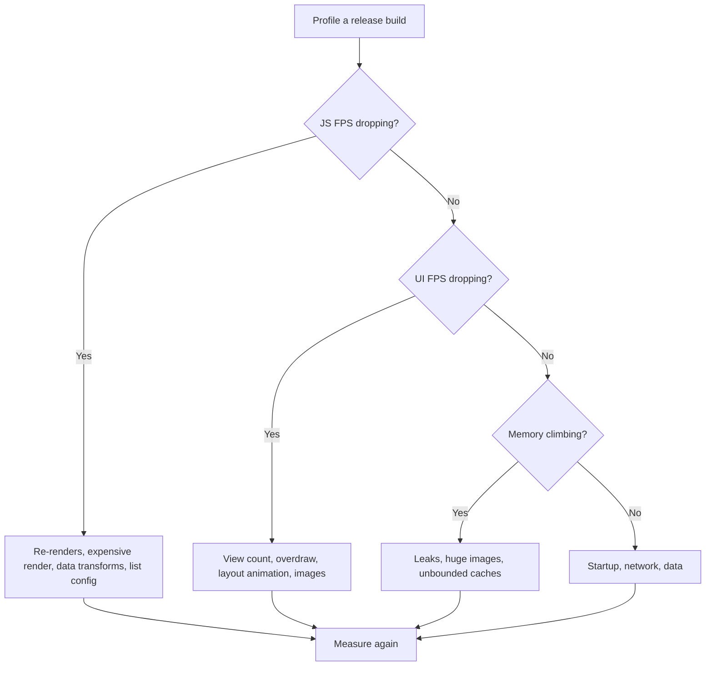
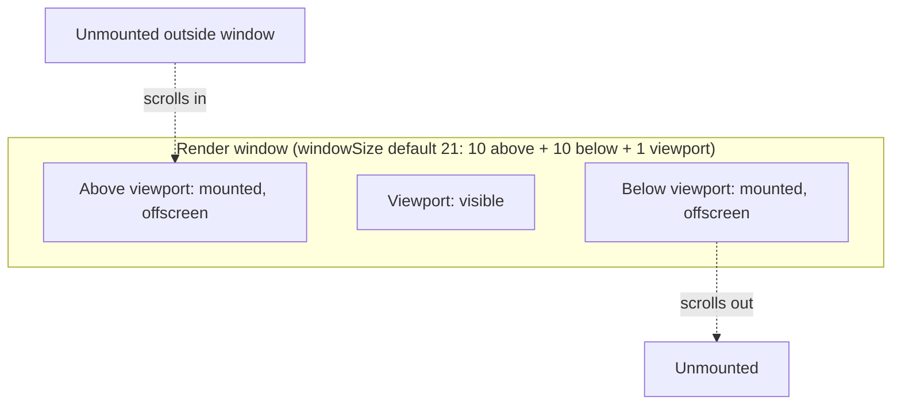
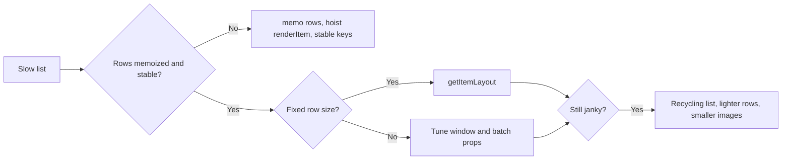

# React Native Performance: Rendering, Lists, Images and Memory

> Verification note: Core guidance follows the official **React Native performance docs** (Performance overview, Optimizing FlatList configuration, Images, Dimensions) and the **react.dev** references for `memo`, `useMemo` and `useCallback`. Version-sensitive facts were verified in the **reactnative.dev release posts (Nov 2026)**: the Android **`debugOptimized`** build type (introduced in 0.82, backported to 0.81/Expo SDK 54; an animation sample ran ≈60 FPS vs ≈20 FPS in plain debug; C++ debugging is not available in it); **Web Performance APIs** (`performance.now`, `PerformanceObserver`, User Timing, Event Timing, **Long Tasks**) are **stable since 0.83**; the new **Animation Backend** is covered in [06](06-startup-bundle-animations-and-gestures.md); **`InteractionManager` was removed in 0.87** (use `requestIdleCallback`); the Expo SDK 58 notes list recycling lists in Expo UI (`List`, `LazyColumn`) and `expo-image` options (`transition.skipOnCacheHit`, `svgVariables`). **FlashList/Legend List recycling behavior, `expo-image` caching semantics, image-format advice, profiler tool names and capability details, React Compiler enablement per project and numeric thresholds (e.g. "~1 ms is worth memoizing") are established practice not re-fetched in this session — marked *(hedged)* where specific.** Always profile **release** builds. Startup/bundle/animation performance: [06](06-startup-bundle-animations-and-gestures.md); network performance: [09](09-networking-storage-and-offline.md); runtime/thread basics: [01](01-javascript-runtime-hermes-and-event-loop.md).

## Table of Contents

1. [Quick Summary (TL;DR)](#1-quick-summary-tldr)
2. [Frame Budgets: JS Thread vs UI Thread](#2-frame-budgets-js-thread-vs-ui-thread)
3. [The Systematic Debugging Flow and Tools](#3-the-systematic-debugging-flow-and-tools)
4. [Preventing Unnecessary Re-renders](#4-preventing-unnecessary-re-renders)
5. [Expensive Components and Unnecessary State Updates](#5-expensive-components-and-unnecessary-state-updates)
6. [Large Lists: FlatList, FlashList and Friends](#6-large-lists-flatlist-flashlist-and-friends)
7. [Image Optimization](#7-image-optimization)
8. [Memory Leaks](#8-memory-leaks)
9. [Async Work After Unmount and Cancellation](#9-async-work-after-unmount-and-cancellation)
10. [Native-Thread Bottlenecks](#10-native-thread-bottlenecks)
11. [Case Study: Crash While Scrolling Product Images](#11-case-study-crash-while-scrolling-product-images)
12. [Pitfalls](#12-pitfalls)
13. [Interview Questions — Fundamentals](#13-interview-questions--fundamentals)
14. [Interview Questions — Senior Scenarios](#14-interview-questions--senior-scenarios)
15. [Cheat Sheet](#15-cheat-sheet)
16. [Key Terms Glossary](#16-key-terms-glossary)
17. [Further Reading](#17-further-reading)

---

## 1. Quick Summary (TL;DR)

- Performance work protects **two frame budgets** (~16.67 ms at 60 fps): the **JS thread** (React render, logic, touch handling) and the **UI thread** (layout, drawing, gestures). Diagnose **which** thread is dropping frames first.
- Most problems are one of: **JS doing too much** (renders, transforms), **UI doing too much** (too many views, overdraw, layout animation), **memory growth** (leaks, huge images, unbounded caches), or **too much work too early** ([06](06-startup-bundle-animations-and-gestures.md)).
- **Measure first**, in a **release build** (dev mode is always slower): Perf Monitor (JS vs UI fps), React DevTools Profiler, Hermes sampling profiler, Android Studio Profiler / Xcode Instruments, Long Tasks via `PerformanceObserver`.
- **Re-render control:** colocate state, stabilize props, `memo` rows, memoize context values and use selectors; **React Compiler** automates much of it where enabled. Memoize only what you measured.
- **Lists:** never `ScrollView.map()` long data; use `FlatList` (tuned) or a **recycling** list (FlashList-style); stable `keyExtractor`, hoisted `renderItem`, memoized light rows, `getItemLayout` for fixed rows.
- **Images:** decoded memory is a function of **pixel dimensions**, not file size — serve right-sized thumbnails, cache with bounds, lazy load, prefer a dedicated image library.
- **Leaks:** everything subscribed to in an effect must be undone in cleanup; cancel async work; clean up on **blur** as well as unmount; release native resources.



---

## 2. Frame Budgets: JS Thread vs UI Thread

| | JS thread | UI / main thread |
|---|---|---|
| Does | React render, business logic, event-handler code, touch event processing | Native layout, drawing, gestures, native-driven animations |
| Budget | ~16.67 ms per frame (60 fps) | ~16.67 ms per frame |
| Perf Monitor shows | **JS FPS** | **UI FPS** |

- **Dropped frames:** a frame drops when either thread misses its budget. A single long JS task drops many at once (a 200 ms re-render ≈ **12 consecutive frames**); batched updates then flush together and the UI "catches up" in a jump.
- **Why a blocked JS thread feels slow:** no timers, no touch-responder processing, no state updates; the app is not crashed, just **unresponsive**.
- **60 FPS with JS blocked?** Yes for UI-thread-only work: `useNativeDriver`/Reanimated worklets, native-stack transitions (`@react-navigation/native-stack`), native `ScrollView` scrolling. **No** for JS-per-frame work (JS-driven animations, re-renders, touch-handler feedback).
- **JS FPS vs UI FPS:** they diverge. JS FPS drops → React/JS problem; UI FPS drops → native rendering problem (views, overdraw, layout animation); **both** drop → chatty JS↔native traffic or one cause with knock-on effects ([04](04-native-modules-components-and-platform-code.md)).
- **Dev mode lies:** JS performance is always worse in development; judge only release builds. On Android, the **`debugOptimized`** build type gives much faster debug-style builds when you can't use release (no C++ debugger).
- **Classic JS-thread slowdowns:** running in dev mode; `console.log` in release bundles (including libraries such as `redux-logger`) — strip with `babel-plugin-transform-remove-console` in production; heavy work in `onPress` that shares a frame with its visual response (defer the heavy part, e.g. `requestAnimationFrame(() => doExpensiveAction())`).

---

## 3. The Systematic Debugging Flow and Tools

1. **Profile** — don't guess; release build.
2. **Check the JS thread** — which FPS counter drops during the janky interaction?
3. **Check re-renders** — React DevTools Profiler (ranked/flamegraph), `why-did-you-render` *(hedged)*; look for unstable props and wide subscriptions.
4. **Check list configuration** — `windowSize`, `initialNumToRender`, `maxToRenderPerBatch`, `getItemLayout`, `keyExtractor`.
5. **Check the row component** — memoized? light? doing formatting/nested lists per row?
6. **Check images** — right-sized, cached, decoded off the JS thread?
7. **Check data transformation** — sort/filter/map inline in render vs memoized/once at fetch time.
8. **Measure again** — change one variable at a time.

**Tool map** *(hedged on UI details)*

| Question | Tool |
|---|---|
| JS vs UI FPS | Dev Menu Perf Monitor |
| Why/when does a component render? | React DevTools Profiler (via React Native DevTools, [12](12-expo-eas-tooling-and-debugging.md)) |
| Where does JS time go? | Hermes sampling profiler; DevTools performance panel |
| Long tasks/interaction timing in production | `PerformanceObserver` with Long Tasks / Event Timing (stable since 0.83), `performance.mark/measure`, RUM/crash tooling |
| Native CPU/memory/GPU | Android Studio Profiler, Perfetto; Xcode Instruments (Time Profiler, Allocations, Animation Hitches) |
| Memory growth | Allocations (Instruments), Android Profiler heap, Hermes heap snapshots |
| Startup | `adb shell am start -W` (TTID/TTFD), Instruments App Launch, Hermes profiler ([06](06-startup-bundle-animations-and-gestures.md)) |
| Real-user data | Expo Observe, Sentry/Datadog-style RUM *(hedged)* ([12](12-expo-eas-tooling-and-debugging.md)) |

---

## 4. Preventing Unnecessary Re-renders

**Why components re-render:** by default whenever their **parent** does; also own state, consumed context and store subscriptions ([03](03-react-internals-and-rendering-in-react-native.md#3-why-components-re-render)). Because object/array/function literals are **new references each render**, passing them to a memoized child defeats `memo` — the root of most "why does my memoized component still re-render?" bugs.

| API | Caches | Use when |
|---|---|---|
| `React.memo(Component)` | Component output (skips if all props `Object.is`-equal) | Re-renders often with unchanged props and render is non-trivial |
| `useMemo(fn, deps)` | A **value** | Slow calculation, or a value that must stay referentially stable (prop to a `memo` child, effect dependency) |
| `useCallback(fn, deps)` | A **function identity** (≡ `useMemo(() => fn, deps)`) | Passing a callback to a `memo` child / dependency |

```tsx
const ProductRow = memo(function ProductRow({ title, price }: Props) {
  return (<View style={styles.row}><Text>{title}</Text><Text>{price}</Text></View>);
});

function ProductList({ products }: { products: Product[] }) {
  const keyExtractor = useCallback((item: Product) => item.id, []);
  const renderItem = useCallback(
    ({ item }: { item: Product }) => <ProductRow title={item.title} price={item.price} />, []);
  return <FlatList data={products} keyExtractor={keyExtractor} renderItem={renderItem} />;
}
```

**Facts worth knowing**
- `memo` still re-renders on **own state or consumed context** changes; a custom comparator can cost more than re-rendering.
- `useMemo` does **not** speed the first render; React may discard cached values, so never depend on it for correctness.
- **When `useMemo` makes things worse:** the computation is cheaper than the bookkeeping, dependencies change every render, the consumer isn't memoized, a slow deep-equality comparator, or relying on it for side-effect guarantees.
- **Structural fixes first:** keep state local, accept `children` JSX so wrapper state changes don't re-render children, keep render pure.
- **React Compiler** inserts equivalent memoization at build time where enabled *(hedged: verify per project)*; understanding reference equality is still tested in interviews.
- **Context:** memoize the Provider value (`useMemo`) or split contexts; with global stores use **selectors**.

---

## 5. Expensive Components and Unnecessary State Updates

- **Inline heavy computation** (sort, filter, deep clone, regex over big strings, formatting) re-runs every render → move to `useMemo`, do it **once at fetch time**, or on the server.
- **Deep trees with per-node logic**, especially in list rows, multiply re-render cost; large inline SVGs recomputed each render are an easy-to-miss cost.
- **Derived data in state** creates two sources of truth and an extra render — derive during render.
- **New object/array on every `setState`** (even when contents are logically unchanged) always re-renders; use updater functions that bail out or compare first.
- **Unthrottled high-frequency updates** (`setState` per `onScroll` pixel) — throttle/debounce, or drive UI-thread-only effects (parallax/fade) with Reanimated shared values that bypass React renders ([06](06-startup-bundle-animations-and-gestures.md)).
- **Why thousands of components hurt:** reconciliation walks more fibers; the renderer creates or clones more shadow nodes via JSI; Yoga and the UI thread handle more layout/views ([02](02-architecture-bridge-to-new-architecture.md)) — usually the symptom of an unvirtualized list or needlessly deep tree.

---

## 6. Large Lists: FlatList, FlashList and Friends

**Why virtualize:** 5,000 rows as live native views is expensive and eventually impossible; virtualization mounts only a **window** around the viewport.



| Prop | Default | Increase | Decrease |
|---|---|---|---|
| `windowSize` | 21 | Fewer blank areas, more memory | Less memory, risk of blank areas |
| `initialNumToRender` | 10 | Slower first render, fewer initial blanks (these items are **never unmounted**) | Faster first render, blanks on mount |
| `maxToRenderPerBatch` | 10 | Better fill rate, longer JS batches (can delay touches) | Less JS per batch, more blanks |
| `updateCellsBatchingPeriod` | 50 ms | Fewer batches (blank risk) | More frequent batches (responsiveness risk) |
| `getItemLayout` | — | Skips async measurement — big win for hundreds+ rows; **fixed-size rows only** (include separators in offsets) | — |
| `keyExtractor` | `key`/`id`/index | Stable identity across reorders (use a real ID, not index) | — |
| `removeClippedSubviews` | `true` Android | Detaches offscreen views (less traversal); **not deallocated**, can cause missing-content bugs (mostly iOS) | — |

Also: **`extraData`** (FlatList is a `PureComponent` — pass external state `renderItem` depends on); **`initialScrollIndex`** requires `getItemLayout`.

**Row best practices:** light components; `memo` rows; cached right-sized images; never define `renderItem` inline; `keyExtractor` stable; avoid nested same-direction virtualized lists.

| Approach | Mounts | Best for |
|---|---|---|
| `ScrollView` + `.map()` | **Every** item, always (memory scales with dataset) | A handful of items only |
| `FlatList` | A window; mounts/unmounts as you scroll | Most medium/large lists |
| **FlashList / Legend List** *(hedged)* | A small **recycled pool** of row instances (like `RecyclerView`/`UICollectionView`), no mount/unmount | Very large lists/heavy rows when tuning isn't enough |
| **Expo UI `List`/`LazyColumn`** (SDK 58) | Native recycling lists (SwiftUI/Compose) — see the SDK's "large lists" guidance before switching | Native-feel lists in Expo UI screens |

With recycling lists, row components must tolerate **reuse**: reset local state on item change, avoid keying state by position, and keep `renderItem` pure.

---

## 7. Image Optimization

- **Pixel dimensions drive decoded memory**, not file size or display size: a 4000×3000 JPEG decodes to tens of MB regardless of compression. Request images close to display size.
- **Thumbnails:** never fetch a full-resolution image for a 60×60 avatar — use server-resized variants or an image CDN's resize parameters (bytes and decode cost then match the UI).
- **Caching:** `Image`'s `cache` source property (`default`, `reload`, `force-cache`, `only-if-cached`) controls HTTP-cache use; for persistent disk/memory caching, eviction, placeholders and progressive loading use a dedicated library such as **`expo-image`** *(hedged specifics; SDK 58 adds `transition.skipOnCacheHit` and `svgVariables`)*. Bounded caches only.
- **Lazy loading** pairs with virtualization: offscreen rows should not hold decoded images.
- **Formats:** modern compressed formats (WebP; AVIF where supported *(hedged)*) for photos; SVG/vector for icons; avoid unused density variants.
- **Decoding** happens off the JS/UI threads by default — decode time shows as late-arriving images, not dropped frames, if you handle placeholders.
- **Network images need explicit `width`/`height`** (no auto-sizing) for layout stability.
- **Animating image size** (width/height) is expensive on iOS (re-crop/rescale each frame) — animate `transform: [{ scale }]` instead.
- **Android:** `resizeMethod="resize"` scales during decode (lower peak memory) vs `"scale"` decode-then-scale *(hedged)*.
- **iOS image cache tuning:** React Native's iOS image loader has an in-memory cache with limits that can be adjusted natively with `RCTSetImageCacheLimits(...)` (called from native app code, e.g. `AppDelegate`) *(hedged: API availability under the New Architecture and your RN version must be checked)*; the default cache can hold many decoded bitmaps in image-heavy feeds, so cap it or use a library with explicit eviction.
- **Local images:** bundled `require('./img.png')` assets pick a density variant (`@2x`/`@3x`); choose a source slightly larger than the displayed size, not far larger (a variant that is ~50% larger than needed noticeably raises decoded memory and rarely improves visible sharpness).

---

## 8. Memory Leaks

A leak = a **reference kept alive after it is needed**, so GC can't reclaim it; memory climbs until jank from GC pressure and eventually an OS kill (worst on low-RAM Android). Universal fix: **everything subscribed in `useEffect` must be undone in its cleanup.** (Language-level closure mechanics: [01](01-javascript-runtime-hermes-and-event-loop.md#8-memory-closures-and-garbage-collection).)

| Leak source | Symptom | Fix |
|---|---|---|
| **Event listeners** (`Dimensions`, `AppState`, `BackHandler`, Keyboard, navigation) | Handlers fire for unmounted screens; duplicates | Keep the returned subscription; call `.remove()` in cleanup |
| **Subscriptions** (Redux, RxJS, Firebase `onSnapshot`) | Callbacks fire after unmount | Return the `unsubscribe` function |
| **Timers** (`setInterval`/`setTimeout`) | Warnings/updates on unmounted components, drift | `clearInterval`/`clearTimeout` in cleanup |
| **WebSockets** | Sockets accumulate, battery drain | `ws.close()` in cleanup (and on blur/background if appropriate) |
| **Retained closures** | Large scopes never collected | Refs for needed values; unregister long-lived callbacks |
| **Navigation references** | Leaks scale with screens ever visited (kept-alive stacks) | Subscribe on **focus**, clean up on **blur**, not just unmount |
| **Native resources** (camera, audio/video players, Bluetooth/location watchers, native animation drivers) | Battery/hardware drain, invisible in JS heap tools | Explicit stop/release (`stopSession`, `clearWatch`, `.release()`) |
| **Large retained objects** (full API responses, decoded images, stale screens) | Steady growth | Evict/prune (LRU, max size, TTL), paginate, store only what's needed |

```tsx
useEffect(() => {
  const sub = Dimensions.addEventListener('change', onChange);
  const id = setInterval(tick, 1000);
  const ws = new WebSocket(url);
  ws.onmessage = handleMessage;
  const unsubscribe = firestore().collection('products').onSnapshot(handleSnapshot);
  return () => { sub.remove(); clearInterval(id); ws.close(); unsubscribe(); };
}, [url]);
```
Navigation example: `useEffect(() => navigation.addListener('focus', loadData), [navigation]);` (the listener returns its own unsubscribe).

**Diagnosing excessive memory**
1. Confirm it's memory (Android `OutOfMemoryError`/low-memory killer, iOS memory warnings/jetsam logs), not a JS exception.
2. Reproduce under a profiler (Android Profiler, Instruments Allocations) while repeating a flow (navigate back and forth, scroll).
3. A **climbing-and-never-returning curve** is the leak signature; healthy memory rises and falls with screen mount/unmount.
4. Isolate by flow; cross-check the table above.
5. Re-measure each fix in a release build.

---

## 9. Async Work After Unmount and Cancellation

Unmounting does **not** cancel in-flight work. When it resolves: updating state of an unmounted component is wasted (and warned about); an older response may **overwrite newer state** (a correctness bug); and the captured closure stays alive until completion.

| Async work | Cancel with |
|---|---|
| `fetch` | `AbortController` (pass `signal`; `.abort()` in cleanup) |
| HTTP client (Axios etc.) | Client cancellation support / `AbortController` |
| Timers | `clearTimeout`/`clearInterval` |
| Subscriptions | `unsubscribe`/`.remove()` |
| Plain Promise without cancel | A ref-based "still current" guard so late results are discarded |

```tsx
useEffect(() => {
  const controller = new AbortController();
  fetch(url, { signal: controller.signal })
    .then(r => r.json()).then(setData)
    .catch(e => { if (e.name !== 'AbortError') throw e; });
  return () => controller.abort();
}, [url]);
```
Request-level resilience (retries, debouncing, deduping) lives in [09](09-networking-storage-and-offline.md).

---

## 10. Native-Thread Bottlenecks

- **Deep, non-flattened hierarchies** cost traversal/measure/draw; Fabric's view flattening helps ([02](02-architecture-bridge-to-new-architecture.md#9-trees-yoga-and-view-flattening)) but remove needless wrapper views.
- **Overdraw:** stacked transparent views force repeated GPU blending — flatten/reduce layers.
- **Animating layout props** (`width`, `top`…) forces Yoga layout per frame — prefer `transform`/`opacity` with the native driver or Reanimated; the **New Animation Backend (0.85)** now lets `Animated` animate layout props natively (experimental) — see [06](06-startup-bundle-animations-and-gestures.md).
- **Large shadows/blur, huge rounded clips, many absolutely positioned layers** are costly on low-end Android *(hedged)*.
- **Rasterization hints:** `shouldRasterizeIOS` / `renderToHardwareTextureAndroid` help repeatedly transformed static views but can spike memory — profile before and after, turn off when the view stops moving.
- **`LayoutAnimation`** uses native animation and is unaffected by JS frame drops but suits only fire-and-forget animations.
- **Many JS↔native crossings** (chatty modules, event floods) show up as both FPS counters dropping ([04](04-native-modules-components-and-platform-code.md#8-large-data-and-chatty-boundaries)).

---

## 11. Case Study: Crash While Scrolling Product Images

Hypotheses in order:
1. **Image size** — actual source pixels vs displayed pixels (a 100×100 thumbnail backed by 3000×3000 sources is likely the whole story).
2. **Memory** — confirm OOM via native logs/profilers; watch memory climb and fail to return while scrolling.
3. **Caching** — bounded/evicting? A hand-rolled unbounded `{url: base64}` cache, or `force-cache` holding everything? Repeated re-decode from data-URI sources?
4. **Virtualization** — `FlatList`/recycling list or `ScrollView.map()` mounting every image? (the most common cause).
5. **Native image handling** — bare `Image` defaults vs a library with downsampling, bounded caches and in-flight cancellation; Android `resizeMethod`.

**Fix list:** serve correctly sized thumbnails; use an image library with bounded caching/downsampling; virtualize the grid (tuned window or recycling); no unbounded custom caches; re-measure memory in a release build to confirm the curve flattens rather than moving the crash later.

---

## 12. Pitfalls

1. Profiling in dev mode; trusting JS FPS from debug builds.
2. Memoizing everything reflexively (or nothing, on a hot list).
3. Inline `renderItem`/`keyExtractor`; index keys on dynamic lists; forgetting `extraData`.
4. `ScrollView.map()` over long data.
5. Full-resolution images for thumbnails; unbounded caches.
6. Missing effect cleanup; cleaning up on unmount only (not blur); not releasing native resources.
7. Unthrottled `onScroll`/sensor-driven `setState`.
8. Storing derived data in state; unstable context values.
9. `console.log` left in release bundles.
10. Animating layout props on the JS thread.
11. Assuming `removeClippedSubviews` saves much memory.
12. Mutating recycled list rows' local state assumptions (FlashList reuse bugs).

---

## 13. Interview Questions — Fundamentals

- **Why does blocking the JS thread feel slow?** No renders, timers or touch processing run; the app is unresponsive though not crashed.
- **What causes dropped frames?** JS (renders, long sync work, `console.log` spam) or UI/native (views, overdraw, layout animation) missing the ~16.67 ms budget.
- **What is the 16.67 ms budget?** 1000 ms ÷ 60 fps, applied separately to the JS and UI threads.
- **JS longer than one frame?** The thread stays busy; frames are skipped (200 ms ≈ 12 dropped); updates flush in a burst.
- **60 FPS with a blocked JS thread?** Only UI-thread-only work (native-driven animation, native scrolling, native-stack transitions).
- **JS FPS vs UI FPS?** JS thread's per-frame throughput vs native thread's.
- **How do you tell which thread is slow?** Release-build Perf Monitor/profilers; whichever counter drops; both → chatty boundary.
- **What causes unnecessary re-renders?** Parent re-renders, unstable props, broad context/store subscriptions, derived state, unthrottled updates.
- **`memo` vs `useMemo` vs `useCallback`?** Component output vs value vs function identity.
- **Does `useMemo` speed the first render?** No.
- **When does `useMemo` hurt?** Cheap computations, constantly changing deps, unmemoized consumers, slow comparators, correctness reliance.
- **What does `windowSize` control?** The mount window in viewport heights (default 21).
- **Why `getItemLayout`?** Skips async measurement; fixed-size rows.
- **Does `removeClippedSubviews` save memory?** Little: detaches, not deallocates; may bug on iOS.
- **ScrollView vs FlatList internals?** All mounted vs windowed mount/unmount; FlashList recycles a pool.
- **What causes memory leaks in RN?** Listeners, subscriptions, timers, sockets, closures, navigation references, native resources, unbounded caches.
- **What happens if a component unmounts mid-async?** The work continues; late setState is wasted/warned and may overwrite newer data; cancel on cleanup.
- **How to cancel async work?** `AbortController`, `clear*`, unsubscribe, or a current-guard ref.
- **Why large local images hurt?** Decoded size is driven by pixel dimensions.
- **Why not animate image width/height?** Re-crop/rescale per frame on iOS; animate `transform: scale`.

---

## 14. Interview Questions — Senior Scenarios

### S1. "Our feed scrolls fine on flagship phones but stutters on low-end Android."
Profile on a low-end device in release: check JS FPS (row render cost, `renderItem` stability, data transforms) vs UI FPS (view count, overdraw, shadows, large images). Fixes: memoized light rows, `getItemLayout`/recycling list, right-sized cached images, fewer wrapper views, reduce shadow/blur layers, tune window sizes, move work out of render, enable Hermes V1/R8/ProGuard and verify startup/memory ([06](06-startup-bundle-animations-and-gestures.md)).

### S2. "Memory grows every time users open and close a detail screen."
Heap compare across repeated navigation. Typical culprits: listeners/timers/sockets without cleanup, focus listeners without blur teardown, global caches retaining screens' data, images not released, native resources (players) not released. Add cleanup, bounded caches, and a regression test/monitor for memory after N navigations.

### S3. "After adding a global store, every screen re-renders on any update."
Subscribing to the whole store/context. Introduce selector-based subscriptions or split contexts, memoize provider values, keep UI-only state local, and verify with the Profiler's "why did this render" information; consider React Compiler benefits only after structure is fixed.

### S4. "Search-as-you-type janks and shows stale results."
Keep input state urgent; debounce network calls; cancel in-flight requests (`AbortController`); defer expensive filtering/results rendering via `useDeferredValue`/`startTransition`; memoize the filtered list; virtualize results; guard against out-of-order responses ([09](09-networking-storage-and-offline.md)).

### S5. "Design a performance budget and monitoring for the app."
Define targets (startup TTI, JS/UI FPS on a low-end reference device, memory ceiling, long-task counts, crash-free sessions); gate in CI (bundle size, startup benchmark on a device farm *(hedged)*); instrument production (Long Tasks/Event Timing APIs, Expo Observe or equivalent); dashboards per release with regression alerts; budgets owned per team ([15](15-senior-scenarios-and-system-design.md)).

### S6. "Image-heavy screen crashes on Android only."
OOM from decoded bitmaps: verify dimensions, adopt downsampling/thumbnails, ensure virtualization and bounded caches, check `resizeMethod`/library decode settings, limit concurrent decodes, and test on a low-RAM device.

---

## 15. Cheat Sheet

| Symptom | First checks |
|---|---|
| JS FPS drops | Renders, memoization, data transforms, list config |
| UI FPS drops | Views, overdraw, layout animation, images |
| Both drop | Chatty JS↔native, event floods |
| Memory climbs | Leaks (cleanup), images, caches |
| Blank list areas | `windowSize`, `maxToRenderPerBatch`, row cost, `getItemLayout` |
| Rows re-render | Inline `renderItem`, unstable props, no `memo`, missing `extraData` logic |
| Late setState warnings | Missing cancellation/cleanup |



---

## 16. Key Terms Glossary

| Term | Meaning |
|---|---|
| **JS FPS / UI FPS** | Per-thread frame rates shown by the Perf Monitor |
| **Virtualization / windowing** | Mounting only a window of rows around the viewport |
| **Recycling** | Reusing a fixed pool of row instances |
| **Blank area** | Gap when rendering can't keep up with scrolling |
| **Shallow equality** | `Object.is` comparison used by `memo`/`useMemo`/`useCallback` |
| **Overdraw** | GPU blending the same pixels multiple times |
| **Long Task** | Main-thread task exceeding ~50 ms (observable in RN ≥ 0.83) |
| **Memory leak** | Reference outliving its usefulness |
| **`debugOptimized`** | Android build type: faster debug-style builds without the C++ debugger |

---

## 17. Further Reading

- [Performance overview](https://reactnative.dev/docs/performance) · [Optimizing FlatList configuration](https://reactnative.dev/docs/optimizing-flatlist-configuration) · [FlatList](https://reactnative.dev/docs/flatlist) · [Images](https://reactnative.dev/docs/images) · [react.dev memo](https://react.dev/reference/react/memo) · [useMemo](https://react.dev/reference/react/useMemo) · [useCallback](https://react.dev/reference/react/useCallback) · [0.82 (debugOptimized, Web Performance APIs)](https://reactnative.dev/blog/2025/10/08/react-native-0.82) · [0.83](https://reactnative.dev/blog/2025/12/10/react-native-0.83)
- This repo: [01 Runtime](01-javascript-runtime-hermes-and-event-loop.md) · [03 React internals](03-react-internals-and-rendering-in-react-native.md) · [06 Startup, bundle and animations](06-startup-bundle-animations-and-gestures.md) · [web-performance/](../web-performance/README.md) (web equivalents: INP, rendering, images)
