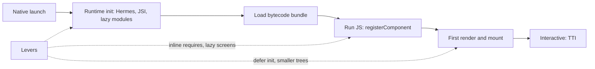
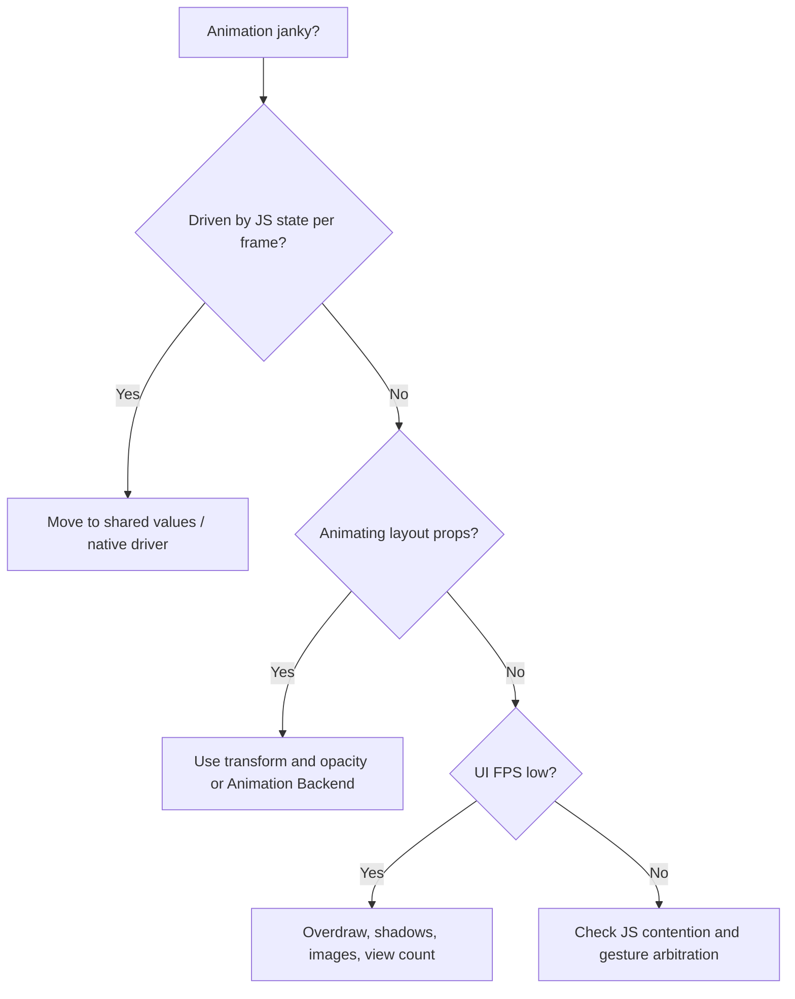

# Startup, Bundle Size, Metro, Animations and Gestures

> Verification note: Release facts were verified against **reactnative.dev posts (0.80 → 0.88, Nov 2026)** and the **Expo SDK 58 changelog (Oct 2026)**: **Hermes V1 is the default engine since 0.84**; **precompiled iOS binaries are the default since 0.84** (experimental in 0.80/0.81); Metro is at **0.87** (RN 0.87 "faster, leaner Metro"; Metro `server.tls` support for HTTPS/WSS Fast Refresh in 0.85); the **New Animation Backend** (0.85, built with Software Mansion) is a shared engine for **both `Animated` and Reanimated** and lets `Animated` animate **layout props with `useNativeDriver: true`** (experimental, opt-in via the experimental release channel; available from 0.85.1); **`InteractionManager` and the `Touchable*` root export were removed in 0.87**, `Modal`'s `animated` prop was removed, `ImageBackground` is deprecated; **R8 is on by default for Android release builds in Expo SDK 58**; Expo SDK 58 ships an experimental **Rust-based Metro transformer** (≈2× faster cold bundling in Expo's own test; skips files needing the Reanimated/Worklets Babel transforms) and **prebuilt `expo-modules-core`** (≈2× faster clean Android builds), plus the `balanced` fingerprint default. **Hermes bytecode precompilation, lazy TurboModules, inline requires, bundle-analysis tooling, Reanimated/Worklets/Gesture Handler mechanics (second UI-thread runtime, Babel plugin) and exact animation-driver restrictions on older versions are established practice not re-fetched in this session — marked *(hedged)* where specific.** App lifecycle/launch sequence: [08](08-app-lifecycle-background-work-push-and-deep-links.md); frame-budget and list performance: [05](05-performance-rendering-lists-images-and-memory.md).

## Table of Contents

1. [Quick Summary (TL;DR)](#1-quick-summary-tldr)
2. [Startup Performance](#2-startup-performance)
3. [Bundle and App Size](#3-bundle-and-app-size)
4. [Metro: Bundler and Dev Server](#4-metro-bundler-and-dev-server)
5. [Animations: Where the Work Runs](#5-animations-where-the-work-runs)
6. [Reanimated, Worklets and UI-Thread JavaScript](#6-reanimated-worklets-and-ui-thread-javascript)
7. [Touch, Gestures and Responsiveness](#7-touch-gestures-and-responsiveness)
8. [Pitfalls](#8-pitfalls)
9. [Interview Questions — Fundamentals](#9-interview-questions--fundamentals)
10. [Interview Questions — Senior Scenarios](#10-interview-questions--senior-scenarios)
11. [Cheat Sheet](#11-cheat-sheet)
12. [Key Terms Glossary](#12-key-terms-glossary)
13. [Further Reading](#13-further-reading)

---

## 1. Quick Summary (TL;DR)

- **Startup** = native launch + runtime init + **bundle load** + first render. Biggest levers: **Hermes bytecode (V1 default)**, **lazy TurboModules**, deferring non-critical init, lazy-loading rarely used screens/modules, a splash that doesn't block on heavy bootstrap, and small, right-sized assets. Measure TTI (TTID/TTFD) on **low-end devices in release**.
- **Bundle/app size:** import only what you use, strip dev code/`console`, trim assets/fonts/locales, enable **R8**/dead-code stripping, analyse with platform and bundle tools. Hermes bytecode helps load time more than download size.
- **Metro** is the **build/dev-time bundler** (resolve → transform → serialise) and dev server (Fast Refresh); in Release it runs once at build time and is absent at runtime. A Metro bundle and an **OTA bundle** are the same artefact; only delivery differs ([13](13-ota-updates-and-store-releases.md)).
- **Animations:** run per-frame work **off the JS thread** — native driver for `transform`/`opacity`, **Reanimated worklets** for gesture-driven/complex animation; avoid animating layout on the JS thread (the **Animation Backend in 0.85** is changing this for `Animated`).
- **Gestures:** keep touch feedback on the UI thread; heavy `onPress` work shares the frame with visual feedback — defer it.
- Dev menu/Fast Refresh/Metro are **Debug-only**; always judge startup and animation smoothness on **Release** builds.

---

## 2. Startup Performance

**What is on the critical path:** OS process start → native bootstrap → runtime/Hermes/JSI/module registry → **bundle load** → module evaluation (every top-level `import` runs) → first React render → Fabric commit/mount → interactive. ([08](08-app-lifecycle-background-work-push-and-deep-links.md#2-startup-from-app-icon-to-first-react-component).)

| Lever | Why it helps |
|---|---|
| **Hermes bytecode (V1 default since 0.84)** | JS is precompiled at build time (`hermesc`), so no on-device parse/compile; V1 improves compiler and VM (Expensify reported ≈3–9% faster bundle load and ≈2.5–7.6% faster TTI on its app — *app-dependent*) |
| **Lazy TurboModules** | Native modules are created on first use, not all at startup |
| **Defer non-critical init** | Analytics, prefetching, cache warming, feature-flag fetches after first interaction (`requestIdleCallback`, `setTimeout`, after first render; the old `InteractionManager` is **removed in 0.87**) |
| **Reduce module evaluation work** | Fewer/lighter top-level imports; avoid heavy work at import time; **inline requires** (lazy `require` on first use — Metro supports inlining requires via config *(hedged)*) |
| **Lazy screens/features** | Don't import every screen eagerly; load rarely used features on demand where your navigation setup supports it; Expo Router async routes on web |
| **Light root tree** | Show a splash/skeleton instead of blocking on a large persisted-store read or synchronous bootstrap |
| **Precompiled iOS binaries (default since 0.84)** | Faster iOS *build* times (CI and local); not a runtime lever |
| **Prebuilt `expo-modules-core` (SDK 58)** | ≈2× faster clean Android builds in Expo's test (build time, not runtime) |
| **R8/ProGuard (Android)** | Smaller, faster-to-load Java/Kotlin code; default in Expo SDK 58 release builds (keep rules for reflection) |
| **Image/font strategy** | Avoid decoding large images before first paint; limit custom font loads blocking first render |

- **Measure, don't guess:** Dev Menu Perf Monitor, Android `adb shell am start -W` (**TTID/TTFD**), Xcode Instruments (App Launch, Time Profiler), the Hermes sampling profiler, in-app marks via the Performance APIs (stable since 0.83), and field data (Expo Observe records startup/navigation performance; Sentry/Datadog-style RUM *(hedged)*). Compare **cold vs warm** starts and **low-end vs flagship** devices.
- **Time-to-interactive subparts:** native launch, bundle load, module evaluation, first render, data fetch, image decode — instrument each ([05](05-performance-rendering-lists-images-and-memory.md#3-the-systematic-debugging-flow-and-tools)).
- **Splash handling:** keep the native splash until root layout and critical data are ready; avoid flashing a second blank view; don't gate the whole app on slow network calls — render cached content.
- **Background restores** (not cold starts) are cheaper: preserve state and avoid re-initialising singletons.

---

## 3. Bundle and App Size

- **Import only what you use:** `import debounce from 'lodash/debounce'` (or ESM-friendly equivalents) instead of whole libraries; audit icon packs, date/locale libraries and UI kits.
- **Strip dev-only code** from release: `console.*` (Babel plugin), dev tooling, mock servers, unused feature flags and test fixtures.
- **Trim assets:** unused images/fonts/locales and extra density variants; use modern compressed formats (WebP; AVIF where supported *(hedged)*) and vector (SVG) for icons; load big media remotely.
- **Platform shrinking:** Android **R8/ProGuard** (default in SDK 58 release) and resource shrinking, **App Bundles (AAB)** for per-device APKs; iOS dead-code stripping and App Thinning reports; compare sizes per release in CI ([14](14-ci-cd-with-github-actions.md)).
- **Analysis tools** *(hedged)*: Metro bundle visualisers (e.g. source-map-explorer-style tools, Expo Atlas), Android APK/AAB Analyzer, Xcode's size report; track a size budget over time.
- **Hermes and size:** bytecode mainly improves *load time*; JS size in the store package can be similar or smaller depending on compression — measure both download and install size.
- **Code splitting is limited** in React Native (a single bundle by default); lazy `require`/async routes reduce *evaluation* cost, not necessarily bundle bytes; OTA updates can ship JS changes without a store release ([13](13-ota-updates-and-store-releases.md)).
- **Native size:** every native library adds binary weight; prefer fewer, maintained SDKs; remove unused architectures/ABIs *(hedged)*.

---

## 4. Metro: Bundler and Dev Server

Per Metro's docs: *a bundler that takes an entry file and options and produces a single JavaScript file containing your code and its dependencies.* Three stages:
1. **Resolution** — build the module graph by following `import`/`require`.
2. **Transformation** — transpile each module (Babel: JSX/TypeScript), parallelised across cores and cached.
3. **Serialisation** — combine modules into the final bundle(s).

| Mode | Role |
|---|---|
| **Debug** | Live HTTP + WebSocket **dev server** (`localhost:8081`): serves bundles on demand, **Fast Refresh** (re-transform only changed modules), symbolication, DevTools connection. Metro **TLS** (0.85) allows HTTPS/WSS dev servers (e.g. via locally trusted certs) |
| **Release** | One-time **build-step** invocation (Gradle bundling task / Xcode build phase) producing the static bundle embedded in the APK/AAB/IPA; Metro is then out of the picture |

- **Why Metro isn't needed in production:** the installed app reads its **embedded** bundle from disk — no network call to Metro (the docs: Release bundles JS locally so the app works unconnected from your computer).
- **Metro bundle vs OTA bundle:** same artefact from the same tool; a build-time bundle ships inside the binary and goes through store review, an **OTA bundle** is uploaded to an update service and downloaded by an installed app — and must stay **compatible with the installed native code** ([13](13-ota-updates-and-store-releases.md)).
- **Config:** `metro.config.js` (resolver for monorepos/symlinks, transformer options, asset plugins, `server.tls`); Expo provides `expo/metro-config` defaults and fingerprinting.
- **Speed:** Metro **0.87** is faster/leaner (RN 0.87); Expo SDK 58's experimental Rust (oxc-based) transformer targets ~2× faster cold bundling when no custom transform worker/Babel plugins are used, and skips files needing the Reanimated/Worklets transforms *(experimental; numbers from Expo's test app)*.
- **Version note:** RN 0.87 requires Node 22+; Metro caches transforms — clear with `--reset-cache` when config/Babel plugins change; Expo's Metro records inlined `EXPO_PUBLIC_*` values so changes invalidate cached output.
- **Debug-only dependency:** Debug builds need network reach to Metro (same Wi-Fi, USB reverse, or tunnel; Expo's new `@expo/ws-tunnel` requires `expo login`).

---

## 5. Animations: Where the Work Runs

Two frame budgets ([05](05-performance-rendering-lists-images-and-memory.md#2-frame-budgets-js-thread-vs-ui-thread)); animations should avoid depending on the **JS thread** per frame.

| Approach | Runs on | Strengths | Limits |
|---|---|---|---|
| `Animated` (JS driver) | JS thread each frame | Any property, simple | Stalls when JS is busy |
| `Animated` + **`useNativeDriver: true`** | Native UI thread after handoff | Smooth under JS load; `transform`/`opacity` | Historically no layout props (`width`, `top`) — **0.85's Animation Backend lifts this** (experimental, opt-in); not interruptible by JS values mid-flight |
| **`LayoutAnimation`** | Native (Core Animation) | Fire-and-forget layout transitions, unaffected by JS/UI frame drops | Not interruptible; coarse control |
| **Reanimated** (worklets) | **UI thread** via JSI | Gesture-driven, interruptible, derived values, layout/entering/exiting animations | Extra dependency and Babel plugin; learning curve ([§6](#6-reanimated-worklets-and-ui-thread-javascript)) |
| CSS-like/declarative animation APIs *(hedged: newer Reanimated releases)* | UI thread | Less boilerplate | Verify support for your Reanimated/RN versions |

- **Prefer `transform` and `opacity`**; animating layout properties forces Yoga layout on each frame ([02](02-architecture-bridge-to-new-architecture.md#9-trees-yoga-and-view-flattening)). **0.85 Animation Backend:** a shared internal engine applying animation updates for both `Animated` and Reanimated, moving core update logic into RN core so Reanimated can land optimisations and `Animated` can animate Flexbox/position props with the native driver (**experimental**; opt in via the experimental release level; stable availability depends on your RN/Reanimated versions).
- **`debugOptimized` (Android, 0.82)** makes debug-style builds much smoother (an animation sample ≈60 FPS vs ≈20 FPS in plain debug) when you can't use release — C++ debugging not available.
- **Navigation transitions:** native-stack animations run on the native thread and stay smooth when JS is blocked; JS-based navigators stall with the JS thread ([10](10-app-architecture-state-and-navigation.md#4-navigation)).
- **Common smoothness killers:** animating `Image` width/height on iOS (re-scale each frame — animate `transform: scale`), large shadows/blur, overdraw, heavy re-renders during animation, JS timers for frame stepping.
- **Hold-your-breath rule:** if an animation depends on JS state each frame (e.g. `setState` per frame), it is JS-bound; move the driving value to a native-driven/Reanimated shared value.

---

## 6. Reanimated, Worklets and UI-Thread JavaScript

*(Mechanics at a conceptual level; details evolve with Reanimated/Worklets releases — verify against current docs.)*
- **Worklet:** a JS function marked to run on the **UI thread** in a **second JS runtime** (a separate engine instance on the UI thread), created through **JSI** and set up by a **Babel plugin** that captures the function so it can be executed off the main JS runtime. This is the clearest case of **real JS-level parallelism** in RN ([01](01-javascript-runtime-hermes-and-event-loop.md#9-concurrency-vs-parallelism-and-getting-work-off-the-js-thread)).
- **Shared values** (`useSharedValue`) live in memory accessible from both runtimes; **`useAnimatedStyle`** derives styles on the UI thread each frame; updates to shared values **don't trigger React re-renders**, which is why gesture-driven effects (parallax, drag, fade-on-scroll) stay at 60/120 fps even when React is busy.
- **Crossing back:** `runOnJS` calls a JS-runtime function from a worklet (e.g. to set React state or navigate); `runOnUI` runs a worklet from JS. Each crossing has cost — don't do it every frame.
- **Constraints:** worklets capture values at creation (closure capture is by copy); only serialisable data crosses runtimes; some APIs (`console`, many libraries) aren't available inside worklets without bridging; **mutating captured JS objects** doesn't behave like normal JS.
- **Build/tooling:** the Babel plugin must be last in the plugin list *(hedged)*; Expo's experimental Rust transformer **skips files needing the Reanimated/Worklets transforms**; Hermes V1 and the New Architecture require compatible Reanimated/Worklets versions — check the library's compatibility table before upgrading RN ([02](02-architecture-bridge-to-new-architecture.md#12-migration-interop-and-the-timeline)).
- **Related:** scroll-linked animations via `useAnimatedScrollHandler`, layout/entering/exiting animations, shared element transitions *(hedged)*; reduce-motion preferences ([07](07-ui-styling-layout-accessibility-and-localization.md)).

---

## 7. Touch, Gestures and Responsiveness

- **Touch pipeline:** OS touch → native → JS event (through the event dispatching path; **default became web-based event dispatching in 0.88**) → `Pressable` handlers. A busy JS thread delays handlers and JS-driven feedback ([01 §7](01-javascript-runtime-hermes-and-event-loop.md#7-what-happens-when-the-js-thread-is-blocked)).
- **`Pressable`** is the current primitive; the legacy `Touchable*` root export was **removed in 0.87**; platform ripple (Android) and highlight feedback can render natively without JS.
- **Heavy work in `onPress`:** the visual response can't show until the handler returns — defer the expensive part (`requestAnimationFrame(() => doExpensiveAction())`) or show feedback first.
- **Gesture libraries:** `react-native-gesture-handler` *(hedged)* runs gesture recognition natively and can drive Reanimated worklets directly on the UI thread (no JS round trip per frame); the built-in `PanResponder`/responder system is JS-driven and more fragile under load.
- **Touch targets and a11y:** minimum hit targets (~44×44 pt / 48 dp), `hitSlop`, focus/press states ([07](07-ui-styling-layout-accessibility-and-localization.md)).
- **Scroll interplay:** native scrolling continues under JS load; scroll-linked JS handlers throttle or move to worklets; nested scrollables and gesture conflicts need explicit arbitration (`simultaneousHandlers`-style APIs *(hedged)*).

---

## 8. Pitfalls

1. Judging startup/animation in Debug or on flagship devices only.
2. Eager imports of every screen and heavy libraries; work at module top level.
3. Blocking splash on slow network or synchronous store hydration.
4. `import _ from 'lodash'`-style whole-library imports; unused assets/fonts.
5. Leaving `console.*` and dev tooling in release bundles.
6. Animating layout props on the JS driver; `setState`-per-frame animations.
7. Assuming Reanimated/Worklets versions are compatible with your RN/Hermes V1/New Architecture version.
8. Crossing `runOnJS` every frame; capturing large JS objects in worklets.
9. Relying on removed APIs (`InteractionManager`, `Touchable*`, `Modal animated`).
10. Mistaking Metro dev-server behaviour (Fast Refresh, lazy compilation) for production behaviour.
11. Ignoring R8/ProGuard keep-rule needs when enabling default minification.
12. Not tracking bundle/app size over releases.

---

## 9. Interview Questions — Fundamentals

- **What happens at startup, and where can you save time?** Runtime init, bundle load, module evaluation, first render; Hermes bytecode, lazy TurboModules, deferred init, lazy screens.
- **Highest-leverage startup lever?** Hermes precompiled bytecode (plus lazy TurboModules and deferring non-critical work).
- **How do you measure startup?** Perf Monitor, `adb shell am start -W`, Instruments App Launch, Hermes profiler, in-app marks/RUM.
- **How to reduce bundle size?** Targeted imports, strip dev code/console, trim assets, R8/dead-code stripping, analyse regularly.
- **What does Hermes do for size vs load time?** Mostly load time; measure package size separately.
- **What is Metro and where does it run?** A bundler (resolve → transform → serialise) and dev server; build-time only in release.
- **Why isn't Metro needed in production?** The installed app reads an embedded bundle.
- **Metro bundle vs OTA bundle?** Same artefact; build-time embedded vs runtime-delivered; OTA must match installed native code.
- **Why animate `transform`/`opacity`?** Avoid per-frame Yoga layout; native driver/UI thread can handle them.
- **What changed for `Animated` in 0.85?** Animation Backend lets native-driven animation cover layout props (experimental).
- **What is a worklet?** A function executed on the UI thread's separate JS runtime via JSI.
- **Why don't shared values cause re-renders?** They live outside React state and drive UI-thread style updates.
- **`runOnJS`?** Calls back into the main JS runtime from a worklet (costly if per frame).
- **Why can JS-driven animations stutter while native ones don't?** They need the JS thread each frame.
- **Why does heavy `onPress` work feel unresponsive?** The feedback frame waits for the handler; defer the work.

---

## 10. Interview Questions — Senior Scenarios

### S1. "Cold start takes 4.5 s on mid-range Android; target is 2 s."
Profile per phase on a real device in release: native launch, bundle load (Hermes V1/bytecode, R8), module evaluation (inline requires, lazy imports, remove top-level work), first render (lighter root, skeletons), data (cache-first). Defer analytics/prefetch, shrink assets/fonts, avoid synchronous persisted-store hydration, and verify with field RUM (Expo Observe or equivalent) before/after; set a startup budget in CI.

### S2. "Bundle grew 40% after adding a charting library."
Analyse the graph (Atlas/visualiser), check for whole-library imports and bundled locales/fonts, evaluate a lighter library or lazy-loading the chart feature, tree-shake via targeted imports, check duplicates of dependencies, measure download and install size, and add size budgets to CI.

### S3. "A drag-to-reorder interaction lags when data loads in the background."
JS thread contention. Move the gesture and positional updates to Gesture Handler + Reanimated shared values (UI thread), keep React state updates (data merge) off the gesture path via transitions/batching, and commit order changes with `runOnJS` on gesture end only.

### S4. "After upgrading RN, Reanimated animations crash or freeze."
Version compatibility (Worklets/Reanimated vs RN/Hermes V1/New Architecture), Babel plugin order/config, Metro cache, and any custom transformer (the experimental Rust transformer skips worklet-requiring files). Pin compatible versions, clear caches, rebuild native, and add an animation smoke test on device.

### S5. "Should we opt into the experimental Animation Backend?"
Evaluate: do you need native-driven layout animations or Reanimated improvements; is it available in your RN patch version (0.85.1+) and experimental channel; run device benchmarks and regression tests; keep a flag to revert; avoid production exposure until it reaches stable in your stack.

### S6. "Splash screen flashes white then shows the app, and feels slow."
Keep the native splash until root content and critical cached data are ready, avoid layout shift between splash and first screen, hydrate from cache instead of waiting on network, preload fonts/critical images, and tune `StatusBar`/edge-to-edge styling ([07](07-ui-styling-layout-accessibility-and-localization.md)).

---

## 11. Cheat Sheet

| Goal | Do |
|---|---|
| Faster launch | Hermes V1 bytecode, lazy modules/screens, defer init, light first render |
| Smaller app | Targeted imports, strip console, trim assets, R8/AAB, analyse |
| Metro | Resolve → transform → serialise; dev server only in Debug |
| Animations | Native driver (`transform`/`opacity`), Reanimated worklets, avoid JS-per-frame |
| 0.85 | Animation Backend: native layout-prop animation for `Animated` (experimental) |
| Gestures | Gesture Handler + shared values; defer heavy `onPress` work |
| Removed | `InteractionManager`, `Touchable*`, `Modal animated` (0.87) |
| Always | Measure on Release, low-end devices |

---

## 12. Key Terms Glossary

| Term | Meaning |
|---|---|
| **TTI / TTID / TTFD** | Time to interactive / initial display / full display |
| **HBC** | Hermes bytecode compiled at build time |
| **Inline requires** | Lazily evaluating `require` on first use *(Metro option)* |
| **Metro** | RN bundler and dev server |
| **Fast Refresh** | Dev-only incremental updates of changed modules |
| **OTA bundle** | JS bundle delivered to installed apps at runtime |
| **Native driver** | Animated mode executing animations natively |
| **Animation Backend** | 0.85 shared animation engine for Animated and Reanimated |
| **Worklet** | UI-thread runnable JS function |
| **Shared value** | Cross-runtime value driving UI-thread styles |
| **R8** | Android code shrinker/optimiser/obfuscator |

---

## 13. Further Reading

- [Performance overview](https://reactnative.dev/docs/performance) · [Animations](https://reactnative.dev/docs/animations) · [Metro concepts](https://metrobundler.dev/docs/concepts/) · [0.85 (Animation Backend, Metro TLS)](https://reactnative.dev/blog/2026/04/07/react-native-0.85) · [0.84 (Hermes V1 default)](https://reactnative.dev/blog/2026/02/11/react-native-0.84) · [Expo SDK 58](https://expo.dev/changelog/sdk-58) · [Reanimated](https://docs.swmansion.com/react-native-reanimated/) · [Gesture Handler](https://docs.swmansion.com/react-native-gesture-handler/)
- This repo: [05 Performance](05-performance-rendering-lists-images-and-memory.md) · [08 Lifecycle and startup](08-app-lifecycle-background-work-push-and-deep-links.md) · [13 OTA updates](13-ota-updates-and-store-releases.md) · [web-performance/02 Critical rendering path](../web-performance/02-critical-rendering-path-and-loading-performance.md)
