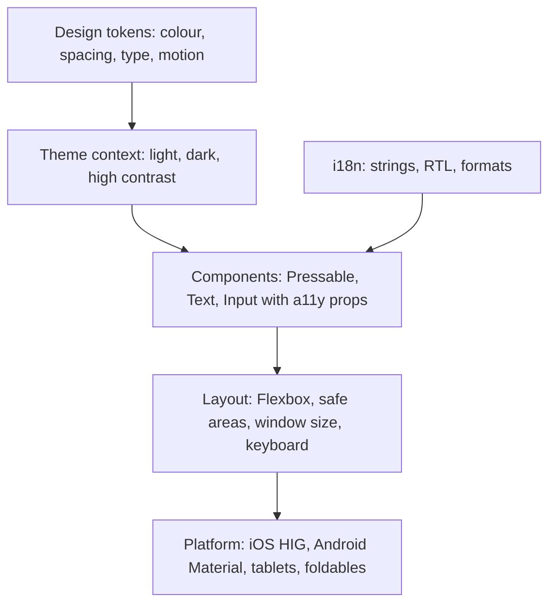
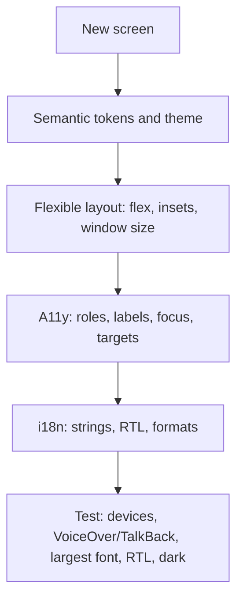

# UI, Styling, Layout, Accessibility and Localization in React Native

> Verification note: Release-specific facts were verified against **reactnative.dev posts (0.80 → 0.88, Nov 2026)** and the **Expo SDK 58 changelog (Oct 2026)**: **`SafeAreaView` (core) is deprecated since 0.81** (use `react-native-safe-area-context`); **edge-to-edge on Android 15+** is comprehensively supported from **0.86**; `StyleSheet.absoluteFillObject` was removed in **0.85** (use `StyleSheet.absoluteFill` or explicit styles); `AccessibilityInfo.setAccessibilityFocus` is deprecated in favour of `sendAccessibilityEvent` (0.85); `Appearance.setColorScheme()` no longer accepts `null` — use `'unspecified'` (0.82); **variable fonts** via `fontVariationSettings` on `Text`/`TextInput` (0.88) and in `expo-font` (SDK 58); in 0.87 `Modal`'s `animated` prop, `StatusBar` `backgroundColor`/`translucent`/`networkActivityIndicatorVisible` props and the `Touchable*` root export were removed and **`ImageBackground` was deprecated** (use a `View` with an absolutely positioned `Image`); **iOS 27 makes iPhone apps resizable** and iPhone Duo support requires attention to **window-size changes and horizontal safe-area insets** (Expo SDK 58); `expo-localization` on iOS no longer force-enables RTL from the device locale — layout direction follows `I18nManager` (SDK 58); Expo UI provides native SwiftUI/Jetpack Compose components. **Flexbox default values, `StyleSheet` details, the `aria-*` prop mapping, font scaling props, `Intl` support on Hermes, `boxShadow`/`filter` style props, keyboard-handling components and design-system libraries are established practice not re-fetched in this session — marked *(hedged)* where specific.** For web accessibility depth see the repo's web material; this file covers the React Native layer.

## Table of Contents

1. [Quick Summary (TL;DR)](#1-quick-summary-tldr)
2. [Styling Model and Flexbox (Yoga)](#2-styling-model-and-flexbox-yoga)
3. [Responsive Layout, Safe Areas and Device Variety](#3-responsive-layout-safe-areas-and-device-variety)
4. [Theming, Dark Mode and Design Systems](#4-theming-dark-mode-and-design-systems)
5. [Text, Fonts, Images and Keyboard Handling](#5-text-fonts-images-and-keyboard-handling)
6. [Accessibility](#6-accessibility)
7. [Internationalisation and Localisation](#7-internationalisation-and-localisation)
8. [Platform Conventions and Native UI](#8-platform-conventions-and-native-ui)
9. [Pitfalls](#9-pitfalls)
10. [Interview Questions — Fundamentals](#10-interview-questions--fundamentals)
11. [Interview Questions — Senior Scenarios](#11-interview-questions--senior-scenarios)
12. [Cheat Sheet](#12-cheat-sheet)
13. [Key Terms Glossary](#13-key-terms-glossary)
14. [Further Reading](#14-further-reading)

---

## 1. Quick Summary (TL;DR)

- **Styling is JS objects + Flexbox via Yoga**, not CSS: density-independent units, no cascade, `View` defaults to `flexDirection: 'column'`. Compose styles with `StyleSheet`, themes via context/tokens.
- **Layout must adapt**: safe areas (notch, home indicator, **Android 15+ edge-to-edge**), keyboards, text scaling, tablets/foldables, split-screen and **resizable iOS 27 apps** — use `useWindowDimensions`, `react-native-safe-area-context` and container-aware layouts, not fixed sizes.
- **Accessibility is a requirement**: roles, labels, states, focus order, touch targets, screen-reader testing (VoiceOver/TalkBack), dynamic type, reduce motion, contrast. Test with real assistive technology.
- **i18n/RTL** are architectural: use logical properties (`start/end`), `Intl`/library formatting, externalised strings, plural rules, text expansion, and verify RTL mirroring (`I18nManager`).
- **Dark mode** via `useColorScheme` and tokenised themes; keep contrast and image assets in mind.
- **Respect platform conventions** (Material vs HIG), use native navigation/controls where they matter, and keep hit targets ≥ ~44 pt / 48 dp.

---

## 2. Styling Model and Flexbox (Yoga)

- **Yoga** (C++ Flexbox engine, [02](02-architecture-bridge-to-new-architecture.md#9-trees-yoga-and-view-flattening)) computes layout; styles are plain objects: `StyleSheet.create({ box: { padding: 16 } })`. Units are **density-independent points** (dp on Android, pt on iOS); use `PixelRatio` for pixel-perfect needs *(hedged)*.
- **Differences from web CSS** *(hedged defaults)*: `flexDirection` defaults to **`column`**; no cascade/inheritance (except some text style inheritance inside `Text`); no CSS selectors/media queries; `position: relative` default; percentages limited; `display` supports `flex`/`none`; text must be inside `<Text>`; `StyleSheet.absoluteFill` for overlays (`absoluteFillObject` removed in 0.85).
- **Core mental model:** main axis (`flexDirection`) vs cross axis; `justifyContent` (main), `alignItems` (cross), `flex`/`flexGrow`/`flexShrink`/`flexBasis`, `gap` (supported in modern RN *(hedged)*), `aspectRatio`, absolute positioning with `top/left/right/bottom`.
- **Performance:** animating layout props forces Yoga layout each frame — prefer `transform`/`opacity` ([06](06-startup-bundle-animations-and-gestures.md)); view flattening removes layout-only wrappers ([02](02-architecture-bridge-to-new-architecture.md)); `StyleSheet.create` mostly helps readability/validation in modern RN *(hedged)*; avoid creating style objects inline in hot list rows ([05](05-performance-rendering-lists-images-and-memory.md)).
- **Shadows/effects:** platform differences (iOS shadow props vs Android `elevation`); newer RN versions add cross-platform `boxShadow`/`filter`-style props *(hedged — verify for your version)*; heavy shadows/blur cost GPU on low-end Android.
- **Styling libraries** *(hedged)*: plain `StyleSheet`, utility-class solutions (NativeWind), CSS-in-JS with runtime variants, **Expo UI** for native SwiftUI/Compose components. Choose for team skills, performance and theming needs.
- **Strict TypeScript API (0.87):** style prop types and ref types follow the strict definitions; deep imports of internal style types are errors ([04](04-native-modules-components-and-platform-code.md)).

---

## 3. Responsive Layout, Safe Areas and Device Variety

| Concern | Guidance |
|---|---|
| **Window size** | `useWindowDimensions()` (reactive) over `Dimensions.get` (static snapshot) *(hedged)*; recompute on rotation/split-screen; **iOS 27 apps are resizable**, and foldables/iPad multitasking change width at runtime |
| **Breakpoints** | Define width classes (compact/regular) rather than device names; design for 320–1000+ dp widths; support landscape where it makes sense |
| **Safe areas** | Use **`react-native-safe-area-context`** (`SafeAreaProvider`, `useSafeAreaInsets`, its `SafeAreaView`); core `SafeAreaView` is **deprecated (0.81)**; Expo SDK 58 notes more places need insets (e.g. inside scroll views for **horizontal insets on iPhone Duo**) |
| **Edge-to-edge (Android 15+)** | Content draws behind system bars; RN 0.86 has comprehensive support — handle `StatusBar`/navigation-bar insets, don't rely on removed `StatusBar` props (`backgroundColor`, `translucent` removed in 0.87) |
| **Orientation** | iOS 27 resizable apps: `requireFullScreen` no longer opts out and `ScreenOrientation.lockAsync` may do nothing — design for rotation/resizing instead of locking |
| **Foldables/hinge** | `expo-hinge` (SDK 58) reports hinge state (iOS 27.1+, Android 11 foldables); use hinge state for effects, not layout *(Apple guidance)*; Expo UI `ArrangementView` for primary/secondary layouts |
| **Tablets** | Master/detail, multi-column layouts, constrained max widths, pointer/keyboard support |
| **Keyboard** | `KeyboardAvoidingView` (behaviour differs per platform *(hedged)*), `keyboardShouldPersistTaps`, scroll-into-view on focus, dismiss on tap outside, handle hardware keyboards and iPad shortcuts |
| **Notches/cutouts, home indicator** | Insets, not magic numbers |

**Tips:** avoid hard-coded heights; use `flex`, `min/max` constraints and `aspectRatio`; test on small phones, large phones, tablets, split-screen; use density-aware images (`@2x/@3x` or responsive sources).

---

## 4. Theming, Dark Mode and Design Systems

- **Dark mode:** `useColorScheme()`/`Appearance` for the system scheme; `Appearance.setColorScheme()` (no `null` since 0.82 — use `'unspecified'`) for in-app override; avoid flashes by reading the scheme before first render; provide dark variants of images/icons; check contrast in both themes.
- **Tokens and theme context:** colours, spacing, radius, typography, elevation, motion defined once; semantic tokens (`textPrimary`, `surface`) map to light/dark/high-contrast values; memoise the theme value ([10 §3.2](10-app-architecture-state-and-navigation.md#32-context)).
- **Design-system practice** *(hedged)*: primitive components (`Box`, `Text`, `Pressable` wrappers) with variants, a11y defaults baked in, documented in Storybook for RN or a playground app, visual/interaction tests ([testing/05](../testing/05-visual-accessibility-and-component-states-testing.md), [testing/08 §6](../testing/08-testing-in-practice-tdd-architecture-mobile-and-ai.md#6-testing-react-native-apps)); share tokens with web in a monorepo.
- **Platform theming:** respect system accent/dynamic colour on Android (Material You *(hedged)*) and iOS materials; **Liquid Glass** support exists on iOS 26+/27 builds (e.g. `expo-glass-effect`; reports availability when built with the iOS 27 SDK) *(use only on supported OS versions with fallbacks)*.
- **Status bar and system UI** follow the theme; edge-to-edge changes how you colour system bars.

---

## 5. Text, Fonts, Images and Keyboard Handling

- **Text:** all text in `<Text>`; `numberOfLines`/`ellipsizeMode`; nested `Text` inheritance; avoid fixed-height containers for text (font scaling and translations expand strings).
- **Font scaling (Dynamic Type / system font size):** honour it (`allowFontScaling` default on) and cap where layouts break using `maxFontSizeMultiplier` *(hedged)*; test at the largest accessibility sizes; never disable scaling globally.
- **Fonts:** load custom fonts before first paint without blocking (splash); **variable fonts** supported via `fontVariationSettings` (0.88) and `expo-font` (SDK 58); subset fonts to limit size ([06](06-startup-bundle-animations-and-gestures.md#3-bundle-and-app-size)).
- **Images:** specify dimensions for network images; `resizeMode` (`cover`, `contain`…); `ImageBackground` is **deprecated (0.87)** — use a `View` with an absolutely positioned `Image`; caching/thumbnails/memory in [05](05-performance-rendering-lists-images-and-memory.md#7-image-optimization); use SVG for icons.
- **Inputs:** `secureTextEntry`, `autoComplete`/`textContentType` for credentials/OTP autofill, `inputMode`/`keyboardType`, return-key handling and focus chaining, paste/clipboard handling for sensitive inputs ([11 §8](11-mobile-security.md#8-sensitive-data-in-logs-and-screens)).
- **Forms:** validate inline with accessible error messaging, avoid layout jumps, scroll to first error, preserve input across rotation and resizing, avoid re-render storms (uncontrolled inputs or form libraries *(hedged)*) ([05](05-performance-rendering-lists-images-and-memory.md)).
- **Modals/sheets:** `Modal` `animated` prop removed (0.87); prefer native-feeling presentations (native stack modals/form sheets, Expo UI sheets) with focus trapping and accessibility announcements.

---

## 6. Accessibility

*(Web accessibility testing practice: [testing/05](../testing/05-visual-accessibility-and-component-states-testing.md). RN uses native accessibility trees (VoiceOver/TalkBack), so the concepts map but the APIs differ.)*

| Topic | React Native practice *(props hedged to RN version)* |
|---|---|
| **Semantics** | `accessible`, `accessibilityRole` (`button`, `header`, `link`, `image`, `adjustable`…), `accessibilityLabel`, `accessibilityHint`, `accessibilityState` (`disabled`, `selected`, `checked`, `busy`, `expanded`), `accessibilityValue`; modern `aria-*` props map to these *(verify support for your version)* |
| **Grouping and order** | Group related content into one focusable element; avoid focusable decorative elements (`importantForAccessibility="no-hide-descendants"` / `accessibilityElementsHidden`); reading order follows layout/view hierarchy — use `accessibilityViewIsModal` / modal semantics to trap focus |
| **Touch targets** | ≥ ~44×44 pt (iOS) / 48×48 dp (Android); `hitSlop` to enlarge without layout change; spacing between targets |
| **Announcements and focus** | `AccessibilityInfo.announceForAccessibility`, `sendAccessibilityEvent` (replaces `setAccessibilityFocus`, deprecated 0.85) to move focus after navigation/errors; live regions (`accessibilityLiveRegion` on Android) *(hedged)* |
| **Dynamic type / zoom** | Text scales with system settings; layouts must not clip; test largest sizes and Display Zoom/Android font scale |
| **Reduce motion / transparency** | `AccessibilityInfo.isReduceMotionEnabled` and change listeners; replace parallax/auto-play with fades/static; respect reduced transparency |
| **Contrast and colour** | WCAG-level contrast in all themes; don't convey information by colour alone; bold-text and high-contrast settings |
| **Screen-reader testing** | **VoiceOver (iOS)** and **TalkBack (Android)** on real devices; Switch/voice control; keyboard (external) navigation on tablets; Accessibility Inspector / Accessibility Scanner *(hedged)* |
| **Automated checks** | RNTL role/label queries and `toHaveAccessibleName`-style assertions in component tests; lint rules for missing labels *(hedged)*; E2E checks with Detox/Maestro by accessibility label ([testing/08](../testing/08-testing-in-practice-tdd-architecture-mobile-and-ai.md#6-testing-react-native-apps)) |

- **Form accessibility:** associate labels, announce errors, set `accessibilityState` for invalid/required, don't rely on placeholder-only labels.
- **Custom components:** replicate native semantics (role, state, actions via `accessibilityActions`/`onAccessibilityAction` *(hedged)*); prefer native controls when possible.
- **Legal/compliance:** EU accessibility requirements and WCAG-mapped expectations apply to financial apps; document an accessibility statement and audit cadence *(hedged)*.

---

## 7. Internationalisation and Localisation

- **Strings:** externalise all user-facing text (i18next/FormatJS/Lingui-style libraries *(hedged)*); avoid string concatenation; use ICU-style plurals and gender where needed; pass context to translators; pseudo-localise to catch truncation and hard-coded text.
- **Locale detection:** `expo-localization` (device locales, calendar, timezone, RTL flag) *(hedged)*; allow in-app language override; persist the choice; handle locale changes at runtime.
- **Formatting:** dates, numbers, currencies, units via **`Intl`** where Hermes supports the APIs you need, or a library/polyfill *(hedged — check the supported `Intl` features in your engine version)*; always format money with currency and locale rules; handle time zones explicitly (store UTC, display local).
- **RTL:** use **logical style properties** (`marginStart/End`, `paddingStart/End`, `start/end` positions) instead of left/right; mirror directional icons (back arrows, chevrons) but not logos/media controls; `I18nManager.forceRTL`/`allowRTL` changes usually need a restart; **since Expo SDK 58 on iOS, layout direction follows `I18nManager`** rather than being force-enabled from the device locale (`supportsRTL`) — test explicitly. Test text alignment and `TextInput` direction.
- **Text expansion and scripts:** German/Finnish expansion, CJK line breaking, Arabic shaping, Thai/Devanagari font fallbacks; avoid fixed widths and truncated critical text.
- **Content and compliance:** localised legal/disclosure text, number/date formats in statements, and regionally specific validation (phone, address, tax IDs).
- **Testing:** snapshot or visual checks per locale/RTL, plural/ICU unit tests, and manual review for key flows ([testing/05](../testing/05-visual-accessibility-and-component-states-testing.md)).

---

## 8. Platform Conventions and Native UI

- **Design languages:** iOS HIG (navigation bars, large titles, swipe-back, bottom sheets, SF Symbols) vs Android Material (top app bars, FABs, bottom navigation, back handling with predictive back *(hedged)*). Match conventions in navigation, controls and gestures; avoid pixel-identical cross-platform UIs that feel foreign.
- **Native components for fidelity:** native stack/tabs (Expo Router **native tabs** stable in SDK 58), Expo UI (SwiftUI/Compose) for pickers, menus, sheets, lists (recycling lists in SDK 58); native controls give platform a11y, animations and OS-version styling (e.g. Liquid Glass) for free.
- **Haptics, sounds, and system integration:** use sparingly and respect user settings; support widgets/Live Activities/App Intents only where they add value (Expo SDK 58 `expo-widgets` on Android, `expo-app-intents` alpha) *(hedged)*.
- **Back behaviour and gestures:** Android system back/predictive back and iOS swipe-back must work with nested navigators and modals ([10](10-app-architecture-state-and-navigation.md#4-navigation)).
- **OS version adoption:** use `Platform.Version` checks and feature detection; provide fallbacks for newer visual APIs ([04 §9](04-native-modules-components-and-platform-code.md#9-platform-differences-and-platform-specific-code)).

---

## 9. Pitfalls

1. Fixed pixel sizes/heights; ignoring font scaling and translation expansion.
2. Using core `SafeAreaView` (deprecated) or hard-coded status bar offsets; relying on removed `StatusBar` props.
3. Missing accessibility roles/labels; tiny touch targets; focus not moved after navigation/errors.
4. Left/right styling that breaks RTL; icons that should mirror but don't.
5. String concatenation for messages; hard-coded date/currency formats.
6. Disabling font scaling globally to "fix" layout.
7. Assuming landscape/orientation locks always work (iOS 27 resizable apps).
8. Colour-only error states; low contrast in dark mode; no reduce-motion handling.
9. Pixel-identical iOS/Android UIs ignoring platform conventions.
10. Inline style objects and large shadows in hot list rows.
11. Testing a11y only with automated checks, not VoiceOver/TalkBack.
12. Using deprecated/removed APIs (`ImageBackground`, `Modal animated`, `absoluteFillObject`).

---

## 10. Interview Questions — Fundamentals

- **How does styling differ from web CSS?** JS style objects, Flexbox (column default), no cascade/selectors/media queries, density-independent units, text inside `<Text>`.
- **What is Yoga?** Meta's Flexbox layout engine used by Fabric in C++.
- **Why `useWindowDimensions` over `Dimensions.get`?** It re-renders on size changes (rotation, split-screen).
- **How do you handle notches and system bars?** `react-native-safe-area-context` insets; edge-to-edge on Android 15+; core `SafeAreaView` is deprecated.
- **How do you implement dark mode?** `useColorScheme` plus tokenised themes; contrast checks; override via `Appearance.setColorScheme` (`'unspecified'`).
- **What are key accessibility props?** `accessible`, role, label, hint, state, value (and `aria-*` equivalents); live regions and announcements.
- **Minimum touch target?** ~44 pt (iOS) / 48 dp (Android); use `hitSlop`.
- **How do you test accessibility?** RNTL role/label queries, VoiceOver/TalkBack on devices, accessibility inspectors/scanners.
- **How to respect Dynamic Type?** Keep font scaling on; cap with `maxFontSizeMultiplier` where needed; design flexible layouts.
- **How to support RTL?** Logical properties, mirrored icons, `I18nManager`, test with RTL locales.
- **Where do you format dates/currency?** `Intl`/library per locale; UTC storage, local display.
- **What changed recently for UI APIs?** SafeAreaView deprecated (0.81), edge-to-edge (0.86), `absoluteFillObject` removed (0.85), `ImageBackground` deprecated/`Modal animated` removed (0.87), variable fonts (0.88).

---

## 11. Interview Questions — Senior Scenarios

### S1. "Design the UI foundation for a banking app used on phones, tablets and foldables."
Token-based design system with semantic themes; width-class breakpoints and hinge/window-size awareness; safe areas/edge-to-edge handled in one layout shell; native navigation; accessibility defaults baked into primitives; i18n/RTL from day one; visual and a11y tests per theme/locale; performance budgets for list rows; platform-specific polish via native components where valuable.

### S2. "The app breaks at 200% font size and in German."
Remove fixed heights/widths, use flexible containers, `numberOfLines` only where truncation is acceptable, set `maxFontSizeMultiplier` selectively, test pseudo-localised strings and accessibility sizes in CI screenshots, and review wrapping of critical content (balances, buttons).

### S3. "VoiceOver reads our custom dropdown as unlabeled text."
Add role/state semantics (`button`, `expanded`), labels/hints, modal focus management for the list, announcements on selection, and prefer a native picker/menu (Expo UI) when feasible; test with VoiceOver/TalkBack and add RNTL assertions.

### S4. "After iOS 27 support, layouts break in split-screen and rotation."
Apps are resizable: remove orientation locks and reliance on `requireFullScreen`, use `useWindowDimensions`/container queries, re-check safe areas, test the scene lifecycle, and use `expo-hinge`/`ArrangementView` only for foldable-specific behaviour ([08](08-app-lifecycle-background-work-push-and-deep-links.md)).

### S5. "Arabic customers report mirrored charts and misaligned currency."
Charts/numerals shouldn't blindly mirror; use logical properties for layout, explicit direction for chart components, locale-aware number/currency formatting (including digit shaping), and mirror only directional UI icons; verify `I18nManager` behaviour after the SDK 58 iOS change.

### S6. "Marketing wants a glass/blur effect everywhere."
Gate by OS capability (Liquid Glass availability on iOS 26+/27 builds; fallback blur or solid surfaces elsewhere), test performance on low-end Android, keep text contrast above thresholds over dynamic backgrounds, provide reduce-transparency fallbacks, and limit use to a few surfaces.

---

## 12. Cheat Sheet

| Topic | Rule |
|---|---|
| Layout | Flexbox column default; no fixed heights for text |
| Responsive | `useWindowDimensions`, width classes, resizable windows |
| Safe areas | `react-native-safe-area-context`; edge-to-edge aware |
| Theme | Semantic tokens; `useColorScheme`; memoised context |
| A11y | Role/label/state, targets ≥44/48, focus management, VoiceOver/TalkBack |
| Fonts | Respect scaling; variable fonts (0.88) |
| i18n | Externalise, ICU plurals, logical props, Intl |
| RTL | `start/end`, mirror directional icons only |
| Removed | `absoluteFillObject`, `Modal animated`, `StatusBar` bg props, `Touchable*` |

---

## 13. Key Terms Glossary

| Term | Meaning |
|---|---|
| **Yoga** | Flexbox layout engine |
| **dp / pt** | Density-independent units on Android / iOS |
| **Safe area insets** | Padding avoiding notches, bars and indicators |
| **Edge-to-edge** | App draws behind system bars (Android 15+) |
| **Dynamic Type** | OS text-size preference scaling app text |
| **Logical properties** | `start/end` styles that flip in RTL |
| **ICU plural** | Locale-aware plural/gender message formatting |
| **VoiceOver / TalkBack** | iOS / Android screen readers |
| **Hit slop** | Extra touchable area beyond visible bounds |
| **Liquid Glass** | Apple's translucent material on newer iOS versions |

---

## 14. Further Reading

- [Style](https://reactnative.dev/docs/style) · [Flexbox](https://reactnative.dev/docs/flexbox) · [Accessibility](https://reactnative.dev/docs/accessibility) · [Appearance](https://reactnative.dev/docs/appearance) · [0.86 (edge-to-edge)](https://reactnative.dev/blog/2026/06/11/react-native-0.86) · [0.81 (SafeAreaView deprecation)](https://reactnative.dev/blog/2025/08/12/react-native-0.81) · [Expo SDK 58](https://expo.dev/changelog/sdk-58) · [react-native-safe-area-context](https://github.com/AppAndFlow/react-native-safe-area-context) *(hedged: check URLs)*
- This repo: [testing/05 Visual and accessibility testing](../testing/05-visual-accessibility-and-component-states-testing.md) · [06 Animations](06-startup-bundle-animations-and-gestures.md) · [10 Navigation](10-app-architecture-state-and-navigation.md) · [web-performance/05 Rendering and CLS](../web-performance/05-rendering-layout-animation-and-cls.md)
