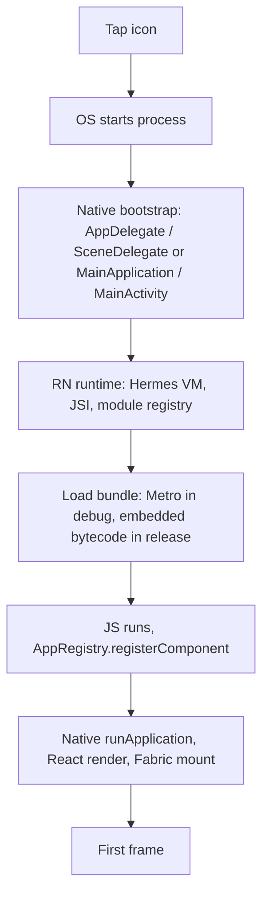
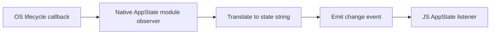
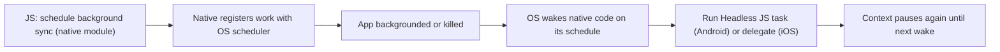
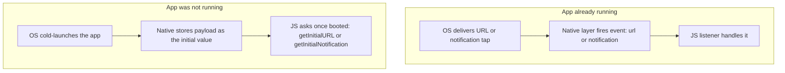
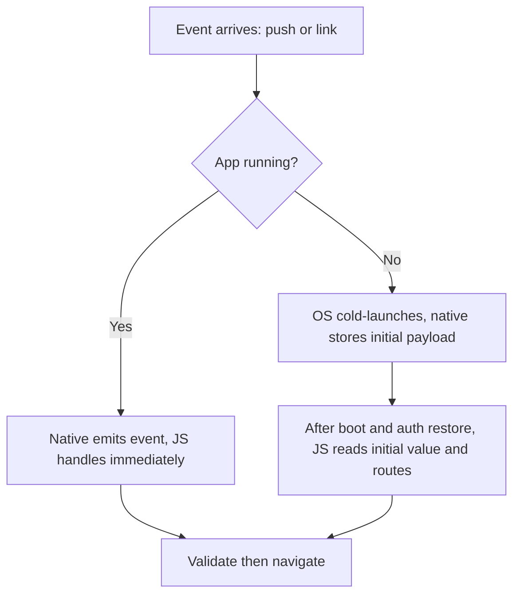

# App Lifecycle, Background Work, Push Notifications, Deep Links and Permissions

> Verification note: RN-facing facts were checked against the official docs for **`AppState`**, **`Linking`**, **`PermissionsAndroid`**, **Headless JS (Android)** and the (deprecated) **`PushNotificationIOS`** page, plus the **reactnative.dev 0.88 post** (iOS **`SceneDelegate` lifecycle support**) and the **Expo SDK 58 changelog (Oct 2026)**: iOS 27 **requires the UIKit scene-based lifecycle** (prebuild now generates `SceneDelegate.swift` and a `UIApplicationSceneManifest` entry; app-delegate callbacks are delivered differently, so customised `AppDelegate.swift` files need migration); `requireFullScreen` no longer opts out of resizing and `ScreenOrientation.lockAsync` may have no effect; `expo-notifications` now **shows foreground notifications by default** unless your handler says otherwise, can group by `threadIdentifier` (iOS) and offers `delivery: 'alarmClock'` for time-critical Android alarms; `expo-linking` reserves `__expo_`-prefixed launch parameters; Expo Observe records native crashes. Uncaught promise rejections are reported since **0.82**; `InteractionManager` was removed in **0.87**. **Native lifecycle callback names, iOS background execution budgets, `BGTaskScheduler`/WorkManager details, FCM/APNs payload semantics, Android 13+ notification permission and `expo-task-manager`/`react-native-background-fetch` specifics are established platform knowledge not re-fetched in this session — marked *(hedged)* where specific.** Timer basics: [01](01-javascript-runtime-hermes-and-event-loop.md#4-host-apis-timers-fetch-requestanimationframe-and-friends); security of deep links: [11](11-mobile-security.md#6-deep-link-security); navigation `linking` config: [10](10-app-architecture-state-and-navigation.md#6-navigation-state-deep-link-config-and-app-restart).

## Table of Contents

1. [Quick Summary (TL;DR)](#1-quick-summary-tldr)
2. [Startup: From App Icon to First React Component](#2-startup-from-app-icon-to-first-react-component)
3. [Debug vs Release Builds](#3-debug-vs-release-builds)
4. [Foreground, Background and AppState](#4-foreground-background-and-appstate)
5. [Timers, Intervals and Drift in Background](#5-timers-intervals-and-drift-in-background)
6. [Fault Semantics: What Crashes What](#6-fault-semantics-what-crashes-what)
7. [Reliable Background Work](#7-reliable-background-work)
8. [Push Notifications](#8-push-notifications)
9. [Deep Linking From the OS to React Native](#9-deep-linking-from-the-os-to-react-native)
10. [Permissions](#10-permissions)
11. [Pitfalls](#11-pitfalls)
12. [Interview Questions — Fundamentals](#12-interview-questions--fundamentals)
13. [Interview Questions — Senior Scenarios](#13-interview-questions--senior-scenarios)
14. [Cheat Sheet](#14-cheat-sheet)
15. [Key Terms Glossary](#15-key-terms-glossary)
16. [Further Reading](#16-further-reading)

---

## 1. Quick Summary (TL;DR)

- **Startup order:** OS launches the process → native bootstrap (`AppDelegate`/`SceneDelegate` on iOS, `MainApplication`/`MainActivity` on Android) → RN runtime and Hermes initialised → **bundle loaded** → `AppRegistry.registerComponent` → `runApplication` → React render → Fabric mount → first frame. **JS doesn't choose its own bundle location**; native does.
- **Debug** fetches the bundle from **Metro** and has dev tooling; **Release** embeds a precompiled static bundle (Hermes bytecode) and needs no Metro ([06](06-startup-bundle-animations-and-gestures.md)).
- **`AppState`** (`active`, `background`, iOS-only `inactive`) is a **native module** re-emitting OS lifecycle callbacks; iOS 27 / Xcode 27 builds require the **scene-based lifecycle**.
- **Background ≠ running.** The OS suspends or kills apps; JS timers stop. Never build "reliability" on JS timers; use OS-sanctioned mechanisms (Android **Headless JS**/WorkManager, iOS **Background Modes/BGTaskScheduler**) and recompute from timestamps on resume.
- **Push:** APNs (iOS) / FCM (Android) deliver; killed-app handling is **native first**; JS sees the payload via the **initial-notification** pattern. Same **cold/warm** pattern for deep links (`getInitialURL` vs `url` event).
- **Permissions:** Android has core `PermissionsAndroid`; iOS needs native frameworks per permission plus **`Info.plist` usage strings** (missing key = crash). Use a normalising library.
- **What crashes what:** a *blocked* JS thread crashes nothing; an uncaught JS error is catchable; a fatal native fault anywhere (Hermes, UI thread) kills the **whole process**.



---

## 2. Startup: From App Icon to First React Component

1. **OS process launch** and platform entry point.
2. **Native bootstrap**
   - **iOS:** `main()` → `UIApplicationMain` → `AppDelegate` (`application:didFinishLaunchingWithOptions:`); RN templates configure an `RCTAppDelegate` subclass / `ReactNativeFactory`. With **iOS 27's required scene lifecycle** the window is created by a **`SceneDelegate`** (RN 0.88 adds support; Expo SDK 58 prebuild generates it) — AppDelegate callbacks for URLs, user activities and quick actions move to scene delegate paths, which Expo forwards to its app-delegate subscribers *(see migration guide if you hand-edit `AppDelegate.swift`)*.
   - **Android:** the OS instantiates `MainApplication` (a `ReactApplication`), then `MainActivity` (extends `ReactActivity`), which obtains the RN instance via `ReactHost`.
3. **Runtime initialisation:** the JS engine is instantiated (Hermes by default), **JSI** is bound, the **native module registry** is prepared. Legacy modules were eagerly created here; **TurboModules are lazy**, a measurable startup win ([02](02-architecture-bridge-to-new-architecture.md#6-turbomodules)).
4. **Hermes initialisation vs compilation:** the VM is created at every launch (milliseconds); the **expensive compile to bytecode (`hermesc`) happened at build time** — in Release the VM loads precompiled bytecode with no parse/compile step.
5. **Bundle loading:** the first substantive JS-thread work. **Release:** a static bundle embedded in the app is read from disk. **Debug:** fetched over HTTP from Metro (`localhost:8081`), which is why debug cold starts are slower and require same-network or `adb reverse`.
6. **How native finds the bundle** (JS can't — it doesn't exist yet): iOS bundle-URL provider returns a Metro URL in Debug and `main.jsbundle` inside the app bundle in Release; Android's `ReactNativeHost`/`ReactHost` uses the developer-support flag, reading `index.android.bundle` from packaged assets in Release.
7. **Execute and render:** the bundle runs top to bottom ending in `AppRegistry.registerComponent`; native calls `AppRegistry.runApplication`; React renders, Fabric lays out and mounts, the first frame draws.
> Everything from "RN runtime bootstrap" onward is platform-agnostic from JS's viewpoint. Startup optimisation (inline requires, lazy screens, bytecode, splash handling): [06](06-startup-bundle-animations-and-gestures.md).

---

## 3. Debug vs Release Builds

| Aspect | Debug | Release |
|---|---|---|
| Dev menu / Fast Refresh | Available | **Disabled**; no live Metro connection |
| Bundle source | Metro dev server | Static bundle embedded at build time |
| Hermes bytecode | Compiled on device if served raw JS | Precompiled `.hbc` at build time |
| Error UI | RedBox/LogBox | None — your error boundaries and crash reporting ([10](10-app-architecture-state-and-navigation.md#9-error-handling-and-crash-reporting)) |
| Android permissions | Includes `SYSTEM_ALERT_WINDOW` for dev overlays | Stripped |
| Signing | Debug keystore / development profile | Real release signing ([13](13-ota-updates-and-store-releases.md)) |
| Performance | Deliberately slower | Representative ([05](05-performance-rendering-lists-images-and-memory.md)); Android **`debugOptimized`** sits between |
| Works without the dev machine | Only with a bundled build | Always |

- iOS note: a static bundle is generated even for **Debug builds targeting a physical device** unless `SKIP_BUNDLING=true` is set on the bundling build phase (safe only if Metro is reachable).
- **Android R8:** Expo SDK 58 enables R8 minification by default in release (`android.enableMinifyInReleaseBuilds=true`); reflection-heavy libraries may need keep rules — test release builds early.

---

## 4. Foreground, Background and AppState

| `AppState` | Platform | Meaning |
|---|---|---|
| `active` | iOS, Android | Foreground |
| `background` | iOS, Android | Another app, home screen, or another Activity/system UI (e.g. autofill picker) |
| `inactive` | **iOS only** | Transition: multitasking view, Notification Center, incoming call |
| `focus` / `blur` events | **Android only** | Interaction focus changes without a state change (e.g. notification drawer pulled) |

**Native callbacks underneath** *(hedged naming)*
- **To background:** iOS `applicationWillResignActive:` → `applicationDidEnterBackground:`; Android `onPause()` → `onStop()` (the OS may kill the process without further callbacks under memory pressure).
- **To foreground:** iOS `applicationWillEnterForeground:` → `applicationDidBecomeActive:`; Android `onRestart()` → `onStart()` → `onResume()`.
- With the iOS scene lifecycle these map to scene callbacks; the JS API is unchanged.

**How RN knows:** `AppState` is a **native module** observing those OS callbacks (iOS `NotificationCenter` notifications / Android activity-lifecycle callbacks), translating them to a state string and emitting a `change` event through the standard event-emitter path; `AppState.addEventListener('change', cb)` returns a subscription — **remove it on cleanup** ([05](05-performance-rendering-lists-images-and-memory.md#8-memory-leaks)).


**What to do on transitions:** persist drafts/state on `background`; **blur sensitive content** (app-switcher preview) on `inactive`/`background` ([11](11-mobile-security.md#8-sensitive-data-in-logs-and-screens)); on `active` refresh stale data, re-check sessions/feature flags, **recompute timer-based UI from timestamps**, and re-establish sockets ([09](09-networking-storage-and-offline.md)).

---

## 5. Timers, Intervals and Drift in Background

- **Timers don't survive suspension.** Once the OS suspends the app, **JS stops executing**, so pending `setTimeout/setInterval` callbacks don't fire; what happens to a missed timer on resume (fires once, re-arms, dropped) is **version/platform dependent and not specified** — design so it doesn't matter. If the OS **kills** the process, all JS state and timers are gone; relaunch is a fresh JS context.
- **Robust pattern:** treat timers as ephemeral; on `AppState` → `active`, recompute anything time-based from `Date.now()`/server time.
- **`setInterval` doesn't guarantee exact cadence** (MDN: elapsed time between calls may be longer than the delay — the delay is a **minimum**). Causes of drift: **queueing delay** behind busy JS (not subtracted from the next interval, so it can compound), **execution-time creep** in the callback (MDN recommends recursive `setTimeout` when overlap matters), **engine/OS throttling** (browsers clamp nested timers and throttle inactive tabs; RN's analogue is backgrounding), and **no real-time guarantees** in general-purpose schedulers.
```js
function loop(delay = 1000) {
  setTimeout(() => { doWork(); loop(delay); }, delay);   // no overlapping runs; cadence = delay + work
}
```
- **Precise timing** (stopwatch/audio): compute elapsed time from timestamps each tick and correct explicitly; use native audio/timing facilities for sample-accurate needs.

---

## 6. Fault Semantics: What Crashes What

| Scenario | Outcome |
|---|---|
| **JS thread blocked** (long sync work) | Nothing crashes; no JS runs; native-driven animation and scrolling continue; callbacks queue ([01](01-javascript-runtime-hermes-and-event-loop.md#7-what-happens-when-the-js-thread-is-blocked)). Visual button feedback: no if JS-driven; yes if native-driven (native-driver/worklet animations, platform ripple) |
| **Uncaught JS exception** | Caught by RN's global handler (`ErrorUtils`/`ExceptionsManager`), tagged `isFatal`; dev shows RedBox/LogBox; in production fatal errors usually terminate the app unless you install a handler (fallback UI or JS-only reload) — a **choice** |
| **Hard native fault inside Hermes** | A VM bug, not a JS error: same process → **entire app dies**, native UI included; shows as a native (C++) crash in reporters, not a JS stack trace |
| **UI/main thread crash** | Whole process dies; JS goes with it |
| **UI thread blocked** (Android) | Watchdog raises an **ANR** (Application Not Responding) — distinct from a merely blocked JS thread, which never triggers ANR |

Reasoning: threads share one address space, and a fatal native signal is a **process-level** event — you can *block* the JS thread without crashing anything, but you cannot lose "just" the JS thread. High-priority interruption (discrete event) is about React's **cooperative scheduler**, not preemption: synchronous code that never yields can't be interrupted ([03](03-react-internals-and-rendering-in-react-native.md)). Uncaught promise rejections are reported (0.82+).

---

## 7. Reliable Background Work

> "Reliable" and "kept alive by a JS timer" are in tension. Delegate to OS-sanctioned mechanisms.

- **Android — Headless JS** (core RN): register an async task, run by a native `HeadlessJsTaskService` (started from a `BroadcastReceiver` or periodic trigger) with a timeout and optional retry policy; may do network/timers but **no UI**; running one in the foreground **crashes by default** (guardrail).
```js
AppRegistry.registerHeadlessTask('SyncTask', () => require('./SyncTask'));
module.exports = async (taskData) => { await syncPendingData(); };
```
  Pair with **WorkManager**/foreground services for guaranteed scheduling *(hedged)*.
- **iOS — no Headless JS in core.** Use **Background Modes** (fetch, remote-notification, audio, location, Bluetooth) and/or **`BGTaskScheduler`**, each with a strict OS-enforced budget (seconds, not minutes); typically via native modules or libraries (`expo-background-task`/`expo-task-manager`, `react-native-background-fetch`) *(hedged names)*.
- **General shape:** JS calls a native module to **register** work with the OS scheduler; the app may be killed; the **OS wakes native code later**, which spins up just enough JS (Headless JS) or calls a delegate directly; when done, the JS context pauses/tears down.

- **Design rules:** idempotent, short, resumable tasks; persist progress; expect throttling (Doze/App Standby on Android, iOS discretionary scheduling) *(hedged)*; use push as the wake-up signal for time-sensitive data; never rely on `setInterval` for background polling.

---

## 8. Push Notifications

- **Services:** **APNs** (iOS) and **FCM** (Android, de facto). **RN core ships no abstraction**: `PushNotificationIOS` is marked deprecated (community packages such as `@react-native-firebase/messaging`, `notifee`, or **`expo-notifications`** replace it). Its docs remain the clearest description of the mechanism.
- **Registration:** the app registers at launch; the OS asynchronously returns a **device token** (iOS `didRegisterForRemoteNotificationsWithDeviceToken`; Android FCM token); a native module emits it to JS; **your backend** sends via APNs/FCM using that token. Tokens change — re-register and sync.
- **App running (foreground):** the OS invokes a native listener (`UNUserNotificationCenterDelegate` / `FirebaseMessagingService.onMessageReceived`) → native module → JS event. **Expo SDK 58:** foreground notifications are **shown by default** unless your `setNotificationHandler` says otherwise.
- **Backgrounded/killed**
  - **Visible alert push:** the **OS renders the banner from the payload with no app code**; tapping **cold-launches** the app with the notification stored as the **initial notification** for JS to read once booted (same pattern as deep links).
  - **Silent/data push:** iOS `content-available: 1` may briefly wake the app (`didReceiveRemoteNotification:fetchCompletionHandler:`) under a short budget — **not guaranteed**; Android data messages go to `FirebaseMessagingService`, which can start a **Headless JS** task. Always **native first**, JS only if the native side spins it up, under hard time limits.
- **Platform details** *(hedged)*: Android 13+ requires a runtime **`POST_NOTIFICATIONS`** permission and notification **channels**; iOS needs user authorisation (provisional/quiet options exist); iOS **thread grouping** (`threadIdentifier`) and Android `delivery: 'alarmClock'` for time-critical alarms are exposed by `expo-notifications` 58.
- **Fintech guidance:** never put sensitive data in payloads (they traverse third parties and lock screens); send an ID and fetch details after authentication; support **notification actions** carefully (re-auth for sensitive actions); deep-link taps through validated routes ([11](11-mobile-security.md#6-deep-link-security)).

---

## 9. Deep Linking From the OS to React Native

*(Navigation `linking` config: [10 §6](10-app-architecture-state-and-navigation.md#6-navigation-state-deep-link-config-and-app-restart).)*

- **iOS:** a custom URL scheme (`Info.plist` `CFBundleURLTypes`) or a **Universal Link** (verified `https://` domain) opens the app; iOS delivers via `application:openURL:options:` (custom scheme) or `application:continueUserActivity:restorationHandler:` (Universal Link) — in the scene-based lifecycle the equivalent scene callbacks — captured by RN's `RCTLinkingManager` wiring.
- **Android:** an **Intent Filter** (`scheme/host/pathPattern`, or an auto-verified **App Link**) matches an `Intent`; the OS routes it to `MainActivity` via `onNewIntent()` (already running) or `getIntent()` (cold start); RN's `Linking` module reads it.
- **JS result is identical:**

```js
useEffect(() => {
  const sub = Linking.addEventListener('url', ({ url }) => handleUrl(url));   // warm
  Linking.getInitialURL().then((url) => { if (url) handleUrl(url); });        // cold
  return () => sub.remove();
}, []);
```
- **Outbound:** `Linking.canOpenURL`, `openURL`, Android `sendIntent`. (`canOpenURL` on iOS requires scheme allow-listing in `Info.plist` *(hedged)*.)
- **Expo:** development builds and Expo Go reserve **`__expo_*`** query parameters (e.g. `__expo_url`) as launcher commands; `expo-linking` strips them from the URL your app sees (`unwrapDevLaunchURL()` available).
- **Security:** validate every incoming URL (host/path/params allow-list), no tokens in links, prefer Universal/App Links, re-authenticate before sensitive screens ([11](11-mobile-security.md#6-deep-link-security)).

---

## 10. Permissions

| | Android | iOS |
|---|---|---|
| Core RN module | **`PermissionsAndroid`** (`check`, `request` with optional `rationale`, `requestMultiple`) | **None** — each framework has its own authorisation API |
| Declaration | `AndroidManifest.xml` | **Usage-description string** in `Info.plist` (e.g. `NSCameraUsageDescription`) — requesting access without the key **terminates the app** |
| Prompting | "Normal" permissions auto-granted at install; "dangerous" ones prompt at runtime | Every protected resource prompts once on first use |
| Results | `GRANTED` / `DENIED` / `NEVER_ASK_AGAIN` | Framework-specific status enums |
| JS access | Direct | Hand-written native module or a normalising library (`react-native-permissions`, Expo modules' `requestPermissionsAsync`) *(hedged)* |

**Internals:** JS never talks to the permission system; a native module calls the platform API and returns a Promise. The first request shows the **OS modal** (wording and appearance not controllable); later checks read cached OS state. UX: explain value before prompting, handle "denied forever" by deep-linking to Settings, degrade gracefully, ask in context (not on launch).

---

## 11. Pitfalls

1. Assuming timers/sockets/animations keep running in the background; polling with `setInterval` for "background sync".
2. Not unsubscribing `AppState`/`Linking` listeners; handling only warm **or** only cold link/notification delivery.
3. Missing `Info.plist` usage strings (iOS crash) or Android manifest permissions; prompting at launch.
4. Heavy work in `AppState` handlers; no state persistence on `background`.
5. Treating silent pushes as guaranteed delivery; sensitive data inside push payloads.
6. Customising `AppDelegate`/`SceneDelegate` by hand without following the scene-lifecycle migration (iOS 27).
7. Assuming `ScreenOrientation.lockAsync`/full-screen opt-outs still apply on iOS 27 resizable apps.
8. Running Headless JS in the foreground (crashes by default) or doing UI work in it.
9. Shipping only Debug-tested behaviour (Metro-dependent assumptions) — test Release builds and R8/minify.
10. Blindly trusting deep-link parameters.

---

## 12. Interview Questions — Fundamentals

- **What happens when an RN app starts?** Process launch → native bootstrap → runtime/Hermes/JSI/module registry → bundle load → `registerComponent` → `runApplication` → render → Fabric mount.
- **Who finds the bundle?** Native configuration (Metro URL in debug, embedded bundle in release); JS cannot.
- **When is Hermes initialised vs compiled?** VM created at launch; bytecode compiled at build time.
- **Debug vs Release?** Metro bundle and dev tooling vs embedded precompiled bundle; dev menu off; permissions and signing differ; release is representative.
- **Where does Metro fit?** Build/dev-time bundler (resolve → transform → serialize) and dev server; absent at runtime in release ([06](06-startup-bundle-animations-and-gestures.md)).
- **What are the AppState values?** `active`, `background`, iOS-only `inactive`; Android `focus`/`blur` events.
- **How does RN know about AppState changes?** A native module observes OS lifecycle callbacks and emits `change` events.
- **What happens to timers in background?** JS suspends; timers don't fire; a killed process loses them; recompute from timestamps.
- **Does `setInterval` guarantee exact intervals? Why drift?** No — minimum delay; queueing, callback time, throttling.
- **If the JS thread crashes?** An uncaught JS error is catchable and configurable; a native fault in Hermes kills the whole process.
- **If the UI thread crashes?** Whole process dies.
- **How to run reliable background work?** Android Headless JS/WorkManager; iOS Background Modes/`BGTaskScheduler`; native modules register work with the OS.
- **How do pushes reach the app?** APNs/FCM → native listener → native module → JS event; killed-app taps use the initial-notification pattern.
- **Notification while killed?** Visible push rendered by the OS; silent push may wake native code briefly.
- **How does deep linking reach JS?** iOS URL/user-activity callbacks, Android Intent Filters → `Linking`: `url` event (warm) or `getInitialURL` (cold).
- **How are permissions handled?** Android via `PermissionsAndroid`; iOS per-framework with `Info.plist` strings; both via native modules.

---

## 13. Interview Questions — Senior Scenarios

### S1. "Our session timer shows wrong remaining time after users return from the background."
The countdown relies on `setInterval` ticks that don't run when suspended. Store an absolute expiry timestamp (server time), compute remaining time on every render/`AppState` active, and enforce expiry server-side too; re-validate the session on resume.

### S2. "Product wants periodic portfolio sync in the background."
Set expectations: iOS is discretionary and budgeted. Use push (silent) + `BGTaskScheduler` refresh on iOS, WorkManager/Headless JS on Android, short idempotent tasks, last-sync timestamps, and a foreground refresh on resume; measure success rates and battery impact; never depend on exact timing.

### S3. "Tapping a notification while the app is killed opens the wrong screen."
Cold-start path ignored: read the **initial notification/URL** after boot, wait for navigation readiness and auth restore, then route through the same validated link handler as warm events; add tests for cold and warm paths and for logged-out users (route after login).

### S4. "App crashes on launch only for iOS 27 beta users after an SDK upgrade."
Check the scene-lifecycle migration (custom `AppDelegate.swift`), `Info.plist` scene manifest generated by prebuild, deprecated launch assumptions, orientation/full-screen configs, and run `expo-doctor`; verify URL/user-activity handling in the scene delegate; test on devices before widening the rollout ([13](13-ota-updates-and-store-releases.md)).

### S5. "Camera works in Debug but crashes in Release on iOS."
Likely a missing `NSCameraUsageDescription` (the OS terminates apps requesting protected resources without it) or a release-only stripped entitlement/config; check Info.plist/permissions in the Release configuration and the crash log.

### S6. "We need push-driven actions (approve a transfer) from the notification."
Notification actions with minimal payload (IDs only), authenticate in-app before approval (biometric step-up), verify server-side with short-lived nonce, handle expired/duplicate actions idempotently, log audit events, and protect lock-screen content ([11](11-mobile-security.md)).

---

## 14. Cheat Sheet

| Topic | Remember |
|---|---|
| Startup | OS → native bootstrap → Hermes/JSI/registry → bundle → register → run → render |
| Bundle | Debug: Metro; Release: embedded bytecode |
| AppState | active / background / inactive (iOS); native module over OS callbacks |
| Background | JS suspended; use OS mechanisms; recompute from timestamps |
| Crashes | Blocked JS ≠ crash; native fault = whole process |
| Push | APNs/FCM; native first when killed; initial-notification pattern |
| Links | `url` event (warm) vs `getInitialURL` (cold) |
| Permissions | Android core module; iOS Info.plist strings + frameworks |
| iOS 27 | Scene lifecycle required; resizable apps |



---

## 15. Key Terms Glossary

| Term | Meaning |
|---|---|
| **`AppDelegate` / `SceneDelegate`** | iOS app and scene lifecycle entry points |
| **`MainApplication` / `MainActivity`** | Android entry points |
| **`AppState`** | RN API for foreground/background state |
| **ANR** | Android "Application Not Responding" watchdog on the main thread |
| **Headless JS** | Android core mechanism to run JS tasks without UI |
| **`BGTaskScheduler`** | iOS framework for scheduled background tasks |
| **APNs / FCM** | Apple / Firebase push delivery services |
| **Device token** | Identifier the backend uses to target a device |
| **Silent push** | Payload that can wake the app without UI (best effort) |
| **Intent Filter** | Android manifest declaration for deep-link routing |
| **Initial value pattern** | Native stores a cold-start payload for JS to fetch after boot |
| **`Info.plist` usage string** | Required explanation for iOS protected-resource access |

---

## 16. Further Reading

- [AppState](https://reactnative.dev/docs/appstate) · [Linking](https://reactnative.dev/docs/linking) · [PermissionsAndroid](https://reactnative.dev/docs/permissionsandroid) · [Headless JS (Android)](https://reactnative.dev/docs/headless-js-android) · [PushNotificationIOS (deprecated)](https://reactnative.dev/docs/pushnotificationios) · [0.88 release](https://reactnative.dev/blog/2026/10/19/react-native-0.88) · [Expo SDK 58](https://expo.dev/changelog/sdk-58) · [MDN setInterval](https://developer.mozilla.org/en-US/docs/Web/API/Window/setInterval)
- This repo: [01 Runtime](01-javascript-runtime-hermes-and-event-loop.md) · [06 Startup, bundle and animations](06-startup-bundle-animations-and-gestures.md) · [10 Navigation](10-app-architecture-state-and-navigation.md) · [11 Security](11-mobile-security.md) · [13 OTA and store releases](13-ota-updates-and-store-releases.md)
