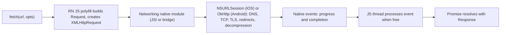
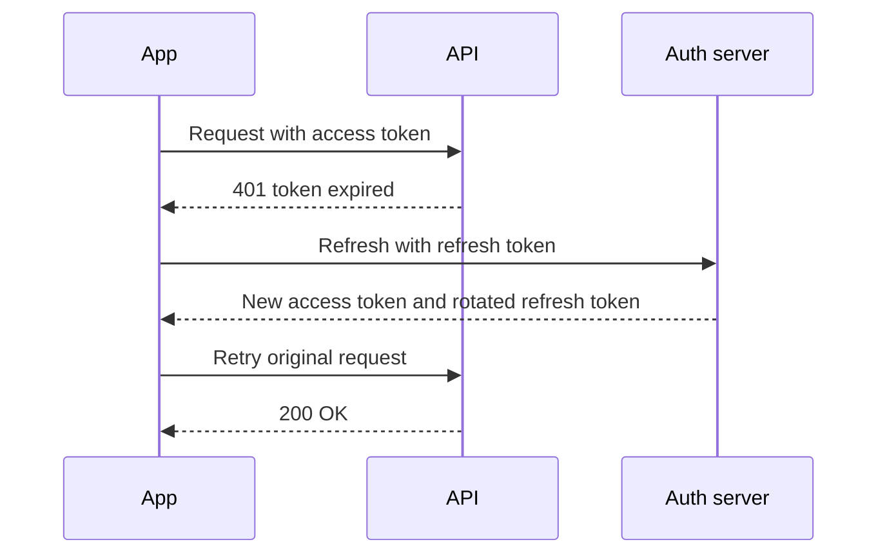
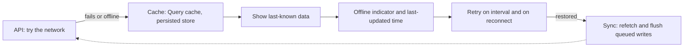
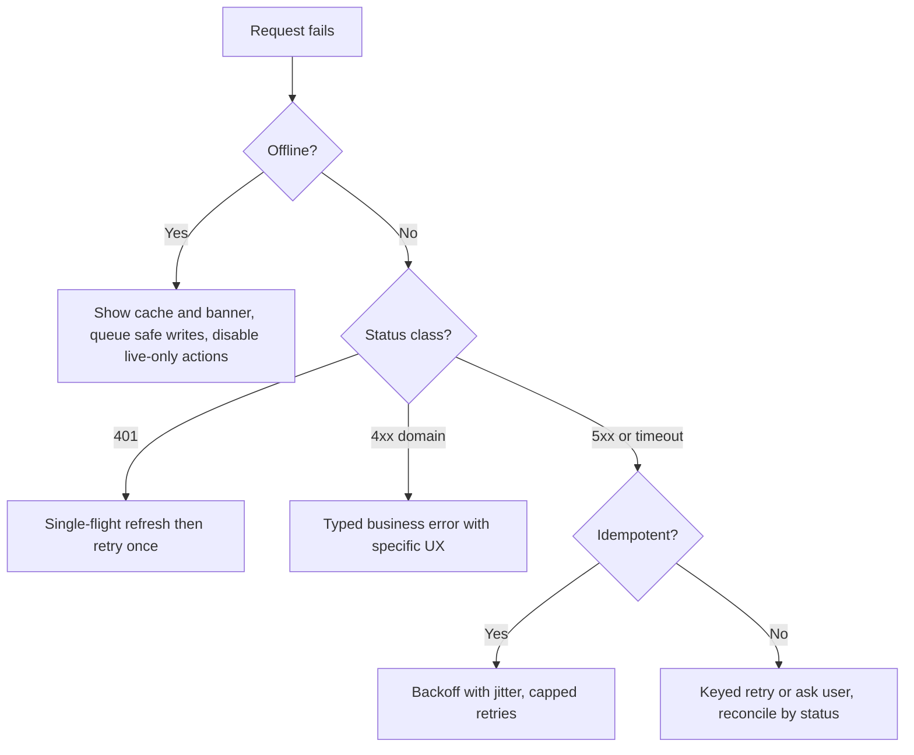

# Networking, Storage and Offline in React Native

> Verification note: Facts follow the official **React Native Networking docs** (`fetch` and `XMLHttpRequest` are built in; **no CORS** in native apps; known limitations of `redirect: 'manual'`, `credentials: 'omit'` and cookie handling; iOS **App Transport Security** and Android **cleartext blocking from API 28**; the iOS hook `RCTSetCustomNSURLSessionConfigurationProvider`), **React Native Security** guidance (AsyncStorage is unencrypted; Keychain/Keystore via libraries), **TanStack Query** documentation (defaults, retries, persisted cache, optimistic updates) and release notes verified for this handbook: **WebSocket inspection in the React Native DevTools Network panel (0.88)** and **request payload previews restored on Android (0.85)**; `expo-sqlite` gained `interruptSync()` and `configureWeb()` and dropped libSQL sync (SDK 58); `expo-file-system` `File.write()` became async with `File.digest()` replacing `File.md5` (SDK 58). The web-platform protocol details (HTTP semantics, REST, resilience patterns, API client architecture, real-time transports) are covered **once** in [networking-and-apis/](../networking-and-apis/README.md); this file holds the **React Native-specific** layer: how requests leave JS, mobile transport rules, client storage, and offline design. **NetInfo/TanStack Query integration details, MMKV/WatermelonDB/SQLite performance claims, background transfer APIs and `expo/fetch` streaming support are established practice not re-fetched in this session — marked *(hedged)*.** Security of tokens, storage and pinning: [11](11-mobile-security.md).

## Table of Contents

1. [Quick Summary (TL;DR)](#1-quick-summary-tldr)
2. [What Happens When You Call fetch()](#2-what-happens-when-you-call-fetch)
3. [React Native fetch vs Browser fetch: CORS, Cookies, TLS](#3-react-native-fetch-vs-browser-fetch-cors-cookies-tls)
4. [Where Certificate Pinning Lives](#4-where-certificate-pinning-lives)
5. [The API Layer in a Production App](#5-the-api-layer-in-a-production-app)
6. [Client Storage Choices](#6-client-storage-choices)
7. [Offline-First and Poor Networks](#7-offline-first-and-poor-networks)
8. [Real-Time Connections on Mobile](#8-real-time-connections-on-mobile)
9. [Pitfalls](#9-pitfalls)
10. [Interview Questions — Fundamentals](#10-interview-questions--fundamentals)
11. [Interview Questions — Senior Scenarios](#11-interview-questions--senior-scenarios)
12. [Cheat Sheet](#12-cheat-sheet)
13. [Key Terms Glossary](#13-key-terms-glossary)
14. [Further Reading](#14-further-reading)

---

## 1. Quick Summary (TL;DR)

- **JS never performs HTTP.** `fetch` is a JS polyfill built on **`XMLHttpRequest`**, which calls RN's **Networking native module**; the real work is done by **`NSURLSession` (iOS)** or **OkHttp (Android)**. Hermes only executes the JS; `fetch` is a host API ([01](01-javascript-runtime-hermes-and-event-loop.md)).
- **No CORS** in native apps (no origin concept; a `WebView` still enforces it). **HTTPS is enforced by default:** iOS ATS; Android blocks cleartext from API 28.
- **A busy JS thread delays delivery**, not the download: the response sits in the native layer until JS can process the event — a latency problem, never data loss.
- **Cookies/redirect/credentials** options are partly unreliable in RN `fetch`; prefer explicit token auth and test redirects.
- **Centralize networking** in an API layer: base URL, auth header, interceptors, single-flight token refresh, timeouts/cancellation, retries only for idempotent calls (or with idempotency keys), normalized errors; use TanStack Query/RTK Query for server state ([10](10-app-architecture-state-and-navigation.md)). Protocol and resilience depth: [networking-and-apis/](../networking-and-apis/README.md).
- **Storage ladder:** AsyncStorage (unencrypted, small non-sensitive), MMKV *(fast KV)*, SQLite/DB (structured/offline), **Keychain/Keystore** (secrets), file system (blobs); pick by sensitivity and access pattern.
- **Offline-first:** never let "no network" mean a blank screen — cache → last-known data → clear offline indicator → retry on reconnect → sync a write queue; some actions (trades, transfers) should **not** work offline.

---

## 2. What Happens When You Call fetch()

- **Not native, not engine:** `fetch` is a JS implementation of the WHATWG Fetch API shipped in RN's JS codebase, built **on top of `XMLHttpRequest`** (also built in; keeps third-party libraries like axios working unchanged).
- **Chain:** your call → fetch polyfill builds `Request`/`Headers` → creates an `XMLHttpRequest` and calls `.send()` → crosses the JS↔native boundary into the **Networking module** (`RCTNetworking` on iOS; an OkHttp-based `NetworkingModule` on Android) → platform HTTP client → native emits progress/completion events → `readyState`/`onreadystatechange` advance → the Promise resolves/rejects.
- **Who does the work:** DNS, sockets, TLS handshake, connection pooling/keep-alive, redirects and decompression are **100% native** (identical to any native app). JS describes *what* to request and is later told the result.
- **Communication:** the same native-module mechanism as everything else — across the async Bridge in the legacy architecture, through direct JSI/TurboModule calls now ([02](02-architecture-bridge-to-new-architecture.md)). Because requests stream results, the module **emits a sequence of events** rather than returning one value.
- **JS busy when the response arrives?** The data is already received natively; the completion event queues behind current JS work, so the Promise resolves late ([01 §7](01-javascript-runtime-hermes-and-event-loop.md#7-what-happens-when-the-js-thread-is-blocked)). Large JSON parsing then adds its own JS cost ([05](05-performance-rendering-lists-images-and-memory.md)).
- **DevTools:** the React Native DevTools **Network panel** shows requests (payload preview on Android restored in 0.85; **WebSocket inspection** added in 0.88) — use it before reaching for proxies ([12](12-expo-eas-tooling-and-debugging.md)).

---

## 3. React Native fetch vs Browser fetch: CORS, Cookies, TLS

| | Browser `fetch` | React Native `fetch` |
|---|---|---|
| Transport | Browser stack with cookie jar, HTTP cache, tab security model | `XMLHttpRequest` → native module → `NSURLSession`/OkHttp |
| **CORS** | Enforced (preflight, `Access-Control-*`) | **Not enforced** — no concept of origin (a `WebView` in your app still enforces it) |
| `redirect: 'manual'` | Supported | Documented as not working |
| `credentials: 'omit'` | Supported | Documented as not working |
| Cookie auth | Reliable | Documented as **unstable** (redirects, `Set-Cookie`) — prefer tokens |
| Duplicate header names | Preserved | On Android only the **last** is kept |
| Transport defaults | Per page origin/HTTPS | iOS **ATS** requires HTTPS; Android API 28+ **blocks cleartext** |

**Why no CORS?** CORS is a **browser-enforced** policy protecting against a page from origin A silently making credentialed requests to origin B within the user's browsing context; the enforcer (the browser's networking and sandbox) is absent in a native app making direct native socket connections. Not a server-side feature being bypassed. (Web CORS configuration: [web-security/06](../web-security/06-security-headers-cors-and-transport.md).)

**TLS** is handled natively with the device's trusted CA store — RN doesn't reimplement it. **ATS exceptions** go in `Info.plist` (scope them to domains; App Review expects justification); Android cleartext needs `android:usesCleartextTraffic` or a network-security config. Both defaults exist to prevent accidentally shipping plain-HTTP traffic.

---

## 4. Where Certificate Pinning Lives

**Always natively** — the pin check must happen during certificate-chain validation, which is platform code ([11 §5](11-mobile-security.md#5-certificate-pinning)).
- **Android:** OkHttp `CertificatePinner` (public-key hashes) or a custom `TrustManager` on the client RN's networking uses.
- **iOS:** `URLSession` delegate (`urlSession:didReceiveChallenge:completionHandler:`) or TrustKit; RN documents a hook, **`RCTSetCustomNSURLSessionConfigurationProvider`**, called early at launch to supply a custom `NSURLSessionConfiguration`.
- In practice teams use a community native module (e.g. an SSL-pinning package) wrapping a pinned client; **plan rotation** (pin intermediates/backups) so a certificate renewal doesn't brick the app.

---

## 5. The API Layer in a Production App

*(Protocols and patterns are covered in [networking-and-apis/03 REST](../networking-and-apis/03-rest-api-design-and-consumption.md), [06 resilience](../networking-and-apis/06-resilience-retries-timeouts-and-offline.md) and [07 client architecture](../networking-and-apis/07-api-client-architecture-and-contracts.md); mobile-specific points below.)*

- **API abstraction:** wrap HTTP in a `services/` module exposing domain functions (`getPortfolio()`, `transferFunds(payload)`), giving one place for auth headers, logging, retry/timeout policy and error normalization; swapping the HTTP client doesn't ripple through screens.
- **Axios vs fetch:** `fetch` is built in (no dependency) but low-level — **it does not reject on HTTP error statuses** (check `response.ok`), has no interceptors, no built-in timeout and no auto JSON handling. Axios adds interceptors, timeout, JSON transforms, rejection on non-2xx and cancellation. Trend: thin `fetch` wrappers (or TanStack Query's fetching) to save bundle weight; know axios cold.
- **Interceptors:** attach bearer tokens, structured logging, response shaping; the key production use is **central 401 handling**.
- **Refresh token flow:** access token (short-lived) on each request; refresh token (longer-lived, stored securely) only to mint access tokens. On `401` pause, refresh, retry once.

  **Gotcha:** with five requests in flight at expiry, naive interceptors fire five refreshes. **Share one in-flight refresh promise** — the first 401 triggers it, all other 401s await the same promise, then retry. Use **refresh-token rotation** with reuse detection (replay signals theft → revoke the family) ([11](11-mobile-security.md#3-authentication-oauth2-oidc-pkce-tokens-and-sessions)).
- **Retries, timeouts, cancellation:** exponential backoff + jitter for transient failures; **don't blindly retry non-idempotent writes** (a repeated "transfer funds" POST could double-execute) — send an **idempotency key**; timeouts via axios `timeout` or `AbortController` + timer; cancel on unmount/navigation/supersession ([05 §9](05-performance-rendering-lists-images-and-memory.md#9-async-work-after-unmount-and-cancellation)).
- **Caching:** primarily library-level (TanStack Query `staleTime`/`gcTime`, RTK Query); HTTP caching (`ETag`/`Cache-Control`) matters at API-design level and helps wrappers that honor headers.
- **Pagination:** offset pagination skips/duplicates rows when data shifts (a live transaction feed); **cursor-based** is robust; `useInfiniteQuery` (`getNextPageParam`) handles page accumulation.
- **Optimistic updates:** update the cache immediately and roll back on error (`onMutate` snapshot → `onError` restore → `onSettled` refetch). Great for low-stakes UI (mark read, reorder watchlist); **wrong for money movement** — show an explicit **pending** state that flips only on confirmed server response.
- **Error normalization:** convert network, HTTP and parse failures into one shape (`{ code, message, status }`) at the API layer so UI branches on a single contract; business outcomes are typed results, not generic errors ([10 §9](10-app-architecture-state-and-navigation.md#9-error-handling-and-crash-reporting)).
- **Runtime validation and contracts:** parse server responses at the boundary (zod-style) and generate types from OpenAPI to catch drift; version APIs so older app builds keep working after rollbacks ([networking-and-apis/07](../networking-and-apis/07-api-client-architecture-and-contracts.md), [testing/06](../testing/06-api-contract-and-integration-testing.md)).
- **Mobile-specific:** large JSON parsing blocks the JS thread; compress payloads (gzip/brotli); avoid over-fetching on cellular; send app/build/version headers for support and server-side compatibility; protect against stale responses after backgrounding.
- **Network performance bottlenecks and fixes:**
  - **Sequential waterfalls** (`await a(); await b();` for independent calls) → `Promise.all` (fail-fast) or `Promise.allSettled` (partial results).
  - **Over-fetching / chatty APIs** → field selection, pagination, batching or a BFF endpoint per screen.
  - **No caching** → query-cache libraries, `ETag`/`Cache-Control`, persisted cache for cold start.
  - **No compression** → gzip/brotli; appropriately sized images.
  - **Search-as-you-type storms** → debounce plus cancel stale requests (`AbortController`).
  - **No retry/backoff** → bounded exponential backoff with jitter for idempotent calls only.
  - **Measure** request counts, payload sizes and time-to-first-data in the DevTools Network panel and in production telemetry.

---

## 6. Client Storage Choices

| Option | Encrypted | Good for | Notes |
|---|---|---|---|
| **AsyncStorage** | **No** (RN's `localStorage` equivalent, sandboxed per app) | Small non-sensitive state, preferences, persisted store slices | Async, string values; avoid large blobs; never tokens/PII |
| **MMKV** *(hedged)* | Optional encryption | Fast synchronous key-value (JSI-based), feature flags, cached lists | Great perf; encryption key still needs secure storage |
| **SQLite / `expo-sqlite`** | Plain unless SQLCipher-style | Structured/relational/offline data, queries, large datasets | SDK 58 adds `interruptSync()`; libSQL sync support removed; encrypted variants for sensitive data |
| **WatermelonDB / Realm-style** *(hedged)* | Depends | Large offline datasets with reactive queries and sync | More setup; evaluate New Architecture and Hermes V1 support |
| **Keychain / Keystore** (`expo-secure-store`, `react-native-keychain`) | **Yes** (OS-protected) | Tokens, passwords, certificates, encryption keys; biometric-gated access | Small values only; behavior on backup/restore and device change differs by platform |
| **File system** (`expo-file-system`) | Plain unless you encrypt | Images, PDFs, downloads, exported statements | SDK 58: `File.write()` is async; `File.digest()` replaces `File.md5` |
| **TanStack Query persister** | Via underlying storage | Cache rehydration on cold start | Persist only non-sensitive queries; set `gcTime` ≥ persistence max age |

- **Rule:** secrets in Keychain/Keystore; everything else chosen by size/access pattern; **allow-list** what is persisted ([10 §3.6](10-app-architecture-state-and-navigation.md#36-persistent-state)).
- **Android:** plain `SharedPreferences` is unencrypted; **Encrypted Shared Preferences** encrypts keys and values; **Keystore** holds hardware-backed keys.
- **iOS:** Keychain survives app reinstall by default in some configurations — decide whether that is desired for tokens *(hedged)*.
- **Lifecycle concerns:** schema/migration versioning, storage quotas, clear-on-logout (including caches and downloaded files), backup exclusion for sensitive files, and handling corrupted/partial writes.
- **Accidental leaks:** persisted whole-store blobs, analytics/crash breadcrumbs, screenshots in app switcher ([11 §8](11-mobile-security.md#8-sensitive-data-in-logs-and-screens)).

---

## 7. Offline-First and Poor Networks

**Principle:** never let "no network" mean "blank screen." Detect connectivity with **NetInfo** *(hedged)* and wire it to the data layer (TanStack Query's online manager refetches stale queries on reconnect).

**Worked answer: "You lose network while viewing a portfolio."**
1. **Detect** (connectivity API) rather than waiting for timeouts.
2. **Keep the screen**: render cached data; a failed refetch must not replace content with an error.
3. **Tell the user** (non-blocking banner, "last updated 4 minutes ago") — essential for financial figures.
4. **Gate live-only actions** (trade, transfer) with explicit "unavailable offline" messaging; don't use optimistic success for money movement.
5. **Retry intelligently** using library refetch-on-reconnect, backoff with jitter; avoid hand-rolled polling loops.
6. **Sync pending writes** (low-risk preference changes) via an **outbox** with idempotency keys, ordering and explicit **conflict handling**; don't assume queued writes are still valid.
7. **Know the limits:** some operations must not be offline; surface "offline, not available" instead of clever queueing for authoritative real-time actions.

**Outbox pattern *(hedged)*:** persist mutations (with client IDs and idempotency keys) → replay in order on reconnect → map server IDs → resolve conflicts (last-write-wins vs merge vs prompt) → surface failures. **Cache invalidation after sync** keeps UI consistent.

**Poor networks (not just offline):** slow/lossy links need timeouts, skeletons, smaller payloads, progressive loading, request prioritization, and no unbounded retries; test with network conditioners/profiles on devices ([12](12-expo-eas-tooling-and-debugging.md), [networking-and-apis/06](../networking-and-apis/06-resilience-retries-timeouts-and-offline.md)).

---

## 8. Real-Time Connections on Mobile

*(Transport choices and protocol details: [networking-and-apis/05](../networking-and-apis/05-real-time-communication-websockets-sse-webtransport.md).)*
- RN supports **WebSocket** natively (the DevTools Network panel can inspect them since 0.88); SSE needs a library or custom streaming *(hedged)*.
- **Mobile realities:** sockets drop on network changes and are **suspended in the background** — close on `background`, reconnect on `active`, resync from a cursor/sequence ID, dedupe events, and use push for background wake-ups ([08](08-app-lifecycle-background-work-push-and-deep-links.md)).
- **Cleanup:** close sockets on unmount/blur/logout to avoid leaks and battery drain ([05 §8](05-performance-rendering-lists-images-and-memory.md#8-memory-leaks)); authenticate the connection (short-lived token on connect/refresh), and rate-limit message handling to protect the JS thread.

---

## 9. Pitfalls

1. Believing `fetch` rejects on 4xx/5xx (it doesn't); not checking `response.ok`.
2. Scattered raw `fetch`/`axios` calls with no central error/auth handling.
3. Parallel token refreshes (no single-flight).
4. Retrying non-idempotent POSTs without idempotency keys.
5. No timeouts/cancellation; late responses overwriting newer state.
6. Parsing huge JSON on the JS thread during interactions.
7. Using cookies for auth in RN, or assuming `credentials: 'omit'`/`redirect: 'manual'` work.
8. Allowing cleartext/ATS exceptions broadly instead of per-domain.
9. Storing tokens/PII in AsyncStorage or persisting entire stores.
10. Optimistic updates for money movement.
11. Blank/error screens when offline; no offline indicator; no write queue idempotency.
12. Hard pinning leaf certificates without a rotation plan.
13. Leaving sockets open in the background or after unmount.

---

## 10. Interview Questions — Fundamentals

- **What happens internally on `fetch()` in RN?** JS polyfill → `XMLHttpRequest` → Networking native module → `NSURLSession`/OkHttp → events back to JS → Promise settles.
- **Who performs the HTTP request?** The native platform client; never JS or Hermes.
- **Is `fetch` implemented by the JS engine?** No — it's a host API polyfill, like `setTimeout`.
- **How does JS talk to native networking?** The same native-module mechanism (Bridge then JSI/TurboModule); results arrive as events.
- **How does `XMLHttpRequest` work in RN?** Built in; `.send()` crosses into native; native events drive `readyState`.
- **Browser vs RN `fetch`?** No CORS, unreliable cookies/redirect/credentials options, different security defaults, last-header-wins on Android.
- **Does RN have CORS restrictions? Why not?** No — CORS is browser-enforced; no browser/origin exists (WebViews still enforce).
- **How is TLS handled?** Natively with the device trust store; ATS/cleartext defaults.
- **Where do you implement pinning?** Natively (OkHttp `CertificatePinner`, `URLSession` delegate/TrustKit, or a native module).
- **What if the response arrives while JS is busy?** It queues; the Promise resolves late; no data loss.
- **`fetch` vs axios?** `fetch` doesn't reject on HTTP errors and lacks interceptors/timeouts; axios adds them.
- **How to avoid duplicate token refreshes?** Share one in-flight refresh promise.
- **Why idempotency keys?** Safe retries for writes.
- **Offset vs cursor pagination?** Cursor is stable under shifting data.
- **When not to use optimistic updates?** Money-moving actions.
- **AsyncStorage vs Keychain?** Unencrypted general storage vs OS-protected secrets.
- **What does offline-first require?** Cache, last-known data, indicator, retry/sync, and a write queue where appropriate.

---

## 11. Interview Questions — Senior Scenarios

### S1. "Design the networking layer for a wealth-management app."
Typed API client over `fetch`: base URL/env config, auth interceptor with single-flight refresh, timeout + abort, retry only for idempotent GETs (and keyed writes), normalized errors and typed domain errors, response validation, telemetry with trace IDs and PII scrubbing, pinning where mandated, TanStack Query for server state with persisted non-sensitive cache, cursor pagination, pending states for money movement, contract tests ([networking-and-apis/07](../networking-and-apis/07-api-client-architecture-and-contracts.md), [testing/06](../testing/06-api-contract-and-integration-testing.md)).

### S2. "Users in poor-signal areas see endless spinners."
Add timeouts and skeletons, cache-first rendering with a visible freshness indicator, smaller/compressed payloads and cursor pagination, backoff with jitter and a cap, cancel stale requests, differentiate offline vs slow vs server errors, and test with throttled network profiles on real devices.

### S3. "A transfer request timed out; the user retried and was charged twice."
Missing idempotency. Generate a client idempotency key per user intent, persist it until confirmation, send it on every retry, make the server dedupe and return the original result, show a pending state, and reconcile by querying the transfer status instead of resubmitting blindly.

### S4. "Support sees random logouts after a deploy."
Likely parallel refresh races or rotation reuse detection triggering family revocation. Add single-flight refresh, serialize refresh per session, handle 401-after-refresh as hard logout only once, log refresh outcomes (no tokens), and verify rotation grace windows with the backend.

### S5. "Offline mode must let advisers capture client notes."
Local-first store (SQLite) with encrypted storage, an outbox with client IDs and idempotency keys, optimistic local UI (low-stakes data), conflict policy per entity, sync indicator, background sync on reconnect and foreground, data minimization and wipe-on-logout, plus audit logging.

### S6. "Pinning broke the app after a certificate renewal."
Pin an intermediate/CA or include backup pins, ship updates ahead of expiry, add remote kill-switch/override for pinning in emergencies with security review, monitor pin failures, and automate expiry alerts ([11](11-mobile-security.md#5-certificate-pinning)).

---

## 12. Cheat Sheet

| Topic | Remember |
|---|---|
| Path | fetch → XHR → native module → NSURLSession/OkHttp → events → Promise |
| CORS | None in RN (WebView has it) |
| Defaults | iOS ATS HTTPS; Android cleartext blocked (API 28+) |
| `fetch` | No reject on HTTP errors; use `ok`; no timeout (use AbortController) |
| Auth | Single-flight refresh, rotation, tokens not cookies |
| Retries | Idempotent only or keyed |
| Pagination | Cursor for live feeds |
| Money | Pending, not optimistic |
| Storage | Secrets: Keychain/Keystore; rest by size/access |
| Offline | Cache + indicator + retry + outbox; some actions disabled |
| Pinning | Native; plan rotation |

---

## 13. Key Terms Glossary

| Term | Meaning |
|---|---|
| **Networking module** | RN native module wrapping the platform HTTP client |
| **`NSURLSession` / OkHttp** | iOS / Android HTTP stacks used by RN |
| **ATS** | iOS App Transport Security (HTTPS by default) |
| **Cleartext traffic** | Unencrypted HTTP; blocked by default on Android API 28+ |
| **CORS** | Browser-enforced cross-origin policy (absent in native apps) |
| **Single-flight refresh** | One shared in-flight token refresh |
| **Idempotency key** | Client-generated key for safe write retries |
| **Outbox** | Persisted queue of pending writes for sync |
| **NetInfo** | Community library reporting connectivity changes *(hedged)* |
| **MMKV** | Fast key-value storage library *(hedged)* |

---

## 14. Further Reading

- [React Native Networking](https://reactnative.dev/docs/network) · [Security](https://reactnative.dev/docs/security) · [Fetch API (MDN)](https://developer.mozilla.org/en-US/docs/Web/API/Fetch_API) · [XMLHttpRequest (MDN)](https://developer.mozilla.org/en-US/docs/Web/API/XMLHttpRequest) · [TanStack Query important defaults](https://tanstack.com/query/latest/docs/framework/react/guides/important-defaults) · [Expo SDK 58](https://expo.dev/changelog/sdk-58)
- This repo: [networking-and-apis/](../networking-and-apis/README.md) · [web-security/06 CORS](../web-security/06-security-headers-cors-and-transport.md) · [10 State and navigation](10-app-architecture-state-and-navigation.md) · [11 Security](11-mobile-security.md) · [08 Lifecycle and background](08-app-lifecycle-background-work-push-and-deep-links.md)
