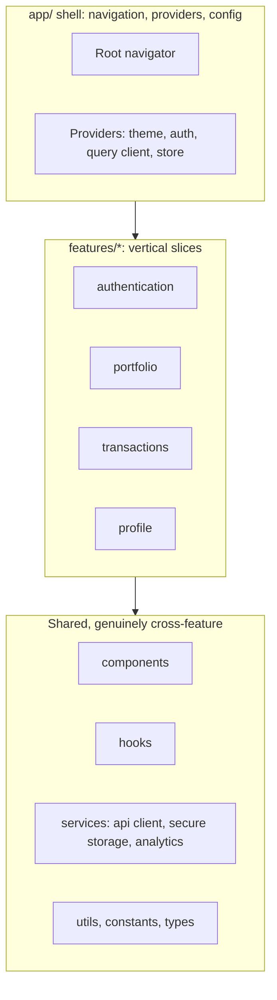
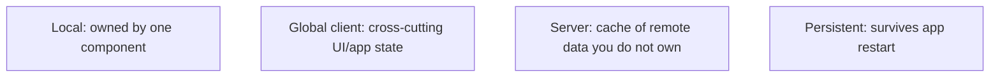
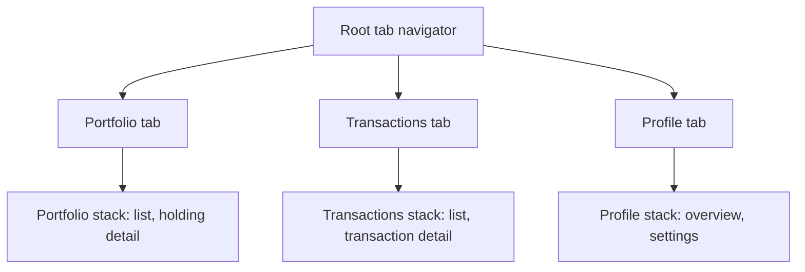
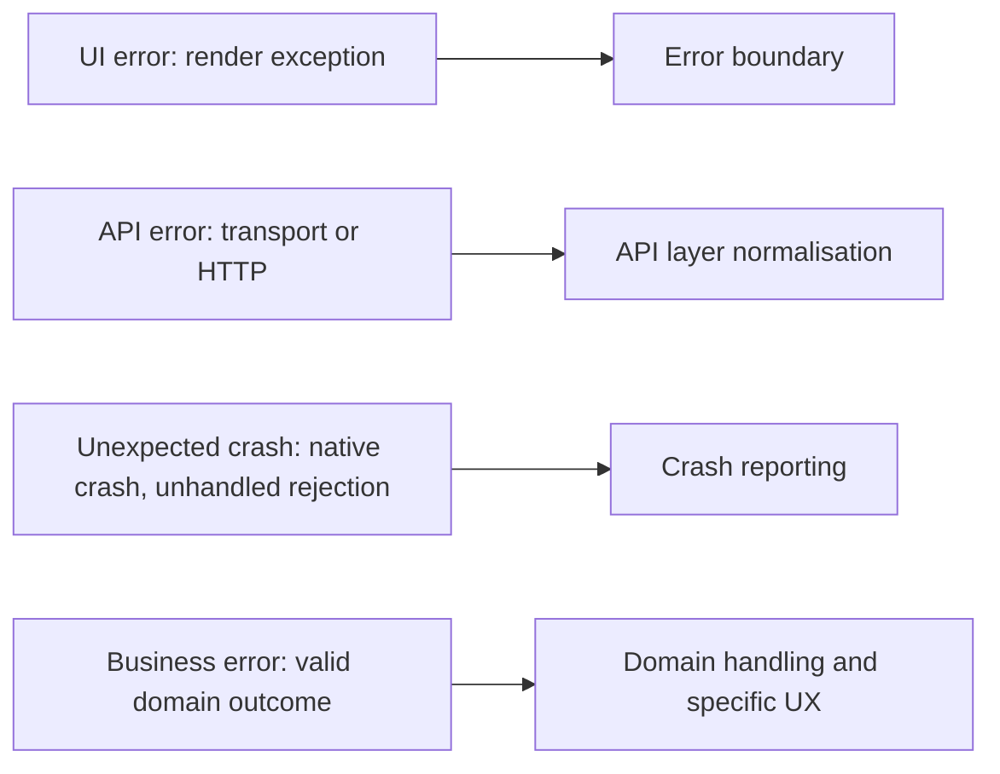
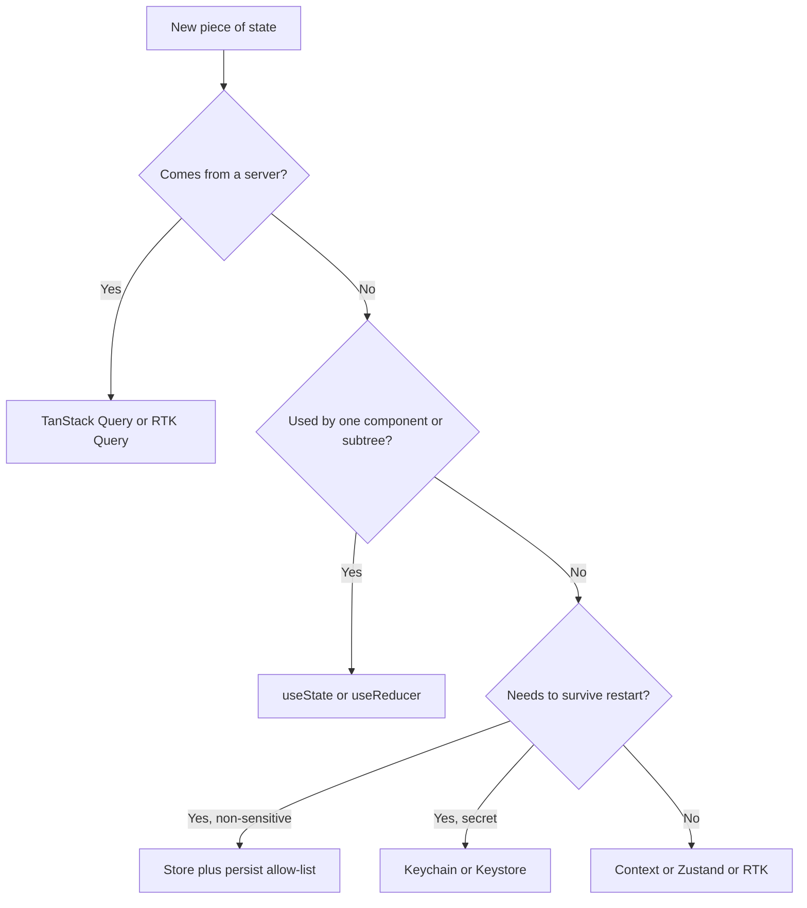

# App Architecture, State Management and Navigation

> Verification note: Library behaviour follows the official docs of **React (Context, Error Boundaries)**, **Redux Toolkit**, **Zustand**, **TanStack Query** (defaults: `staleTime` 0, `gcTime` 5 minutes, 3 retries with exponential backoff), **React Navigation** (conditional screens for auth flows, state persistence, linking) and the **React Native Testing/Security guides** as they were verified for this handbook. Version-sensitive facts were verified against **reactnative.dev release posts (0.80 → 0.88)** and the **Expo SDK 58 changelog (Oct 2026)**: **uncaught promise rejections are reported through the uncaught-error path since 0.82**; **Expo Router 58** stabilised data loaders, server rendering, middleware, native tabs and toolbars, reworked its navigation core (deterministic state; fewer forked React Navigation APIs; `withLayoutContext` deprecated in favour of `integrateWithRouter`), added **React transitions**, `Activity`-based screen hiding (`activityEnabled`) and **screen error boundaries**, and defaults web output to `server`; **Expo Observe** (GA Aug 2026) records startup/navigation performance, JS errors and native crashes; `react-native-safe-area-context` is the replacement for the deprecated core `SafeAreaView` (0.81). **Feature-folder conventions, MMKV/persistence choices, feature-flag vendors, dependency-injection patterns, monorepo tooling and crash-reporting vendors are established practice not re-fetched in this session — marked *(hedged)* where specific.** Related: [09 Networking and offline](09-networking-storage-and-offline.md), [11 Security](11-mobile-security.md), [testing/08 §6](../testing/08-testing-in-practice-tdd-architecture-mobile-and-ai.md#6-testing-react-native-apps) (RN testing practice).

## Table of Contents

1. [Quick Summary (TL;DR)](#1-quick-summary-tldr)
2. [App Architecture](#2-app-architecture)
3. [State Management](#3-state-management)
4. [Navigation](#4-navigation)
5. [Authentication Flows and Protected Screens](#5-authentication-flows-and-protected-screens)
6. [Navigation State, Deep-Link Config and App Restart](#6-navigation-state-deep-link-config-and-app-restart)
7. [Configuration, Feature Flags and Scaling the Codebase](#7-configuration-feature-flags-and-scaling-the-codebase)
8. [Testing Layers for a React Native App](#8-testing-layers-for-a-react-native-app)
9. [Error Handling and Crash Reporting](#9-error-handling-and-crash-reporting)
10. [Pitfalls](#10-pitfalls)
11. [Interview Questions — Fundamentals](#11-interview-questions--fundamentals)
12. [Interview Questions — Senior Scenarios](#12-interview-questions--senior-scenarios)
13. [Cheat Sheet](#13-cheat-sheet)
14. [Key Terms Glossary](#14-key-terms-glossary)
15. [Further Reading](#15-further-reading)

---

## 1. Quick Summary (TL;DR)

- **Organise by feature (vertical slices)**, not by file type; keep shared folders genuinely cross-feature. Root shell in `app/`, features under `features/*`, infrastructure clients in `services/`.
- **"State" is four things:** **local** (`useState`), **global client** (Context / Redux Toolkit / Zustand), **server** (TanStack Query / RTK Query), **persistent** (a behaviour layered on the others; secrets go to Keychain/Keystore, not a persisted store).
- **Don't put everything in Redux:** server state needs caching/staleness tooling, local UI state belongs in components, and over-centralisation hurts performance and ownership.
- **Navigation:** compose stacks/tabs; gate auth by **conditionally including screens** (not `if`s sprinkled in screens) so back can't return to auth; persist navigation state with serialisable params and an error boundary that clears it.
- **Errors are four different things:** UI (error boundary), API (normalised in the API layer), unexpected crashes (crash reporting), business (explicit domain handling).
- **Test by layer:** static → unit → component (user-centric) → a few E2E journeys on device ([testing/08](../testing/08-testing-in-practice-tdd-architecture-mobile-and-ai.md#6-testing-react-native-apps)).
- Wealth-management/fintech context: treat security, correctness over optimism (no optimistic money movement), auditability and graceful degradation as architecture-level requirements ([11](11-mobile-security.md), [09](09-networking-storage-and-offline.md)).



---

## 2. App Architecture

```
src/
  app/            navigation/ providers/ config/
  features/       authentication/ portfolio/ profile/ transactions/
  components/     hooks/ services/ state/ utils/ constants/ types/
```
- **`app/`** — exists once: root navigator composition, provider stack (theme, auth, `QueryClientProvider`, store `Provider`, navigation container), environment/feature-flag config.
- **`features/*`** — each a **vertical slice**: its own screens, components, hooks, API calls and feature-scoped state. A change to transactions touches only `transactions/`.
- **`components/`** — presentational, reusable **across** features; feature-specific logic stays in the feature.
- **`hooks/`** (`useDebounce`, `useAppState`, `useNetworkStatus`), **`services/`** (API client, secure-storage wrapper, analytics, biometrics), **`state/`** (global store composition), **`utils/`** (pure helpers), **`constants/`**, **`types/`**.
- **Why feature-first:** layered structures make every feature touch the same folders (merge conflicts, "what is the transactions feature?" needs a grep); slices let teams **own** features, extract or delete them and keep blast radius small.
- **Pitfall:** shared folders become a dumping ground. Rule: **used by one feature → lives in that feature.**
- **Boundaries** *(hedged)*: enforce with lint rules (import restrictions between features), public `index.ts` per feature, and dependency direction (features → shared, never feature → feature).

---

## 3. State Management

### 3.1 The four kinds

| Kind | Example | Reach for |
|---|---|---|
| **Local** | Input value, modal open | `useState`/`useReducer` — keep as close as possible; the commonest mistake is promoting local state to global too early |
| **Global client (small)** | Theme, locale, flags | Context |
| **Global client (large)** | Auth session, cross-feature UI state | Redux Toolkit or Zustand |
| **Server** | Balances, transactions, profile | TanStack Query (or RTK Query) |
| **Persistent** | Last screen, cached snapshot, tokens | Persistence layer on top of the above; **secrets → Keychain/Keystore** ([11](11-mobile-security.md)) |

### 3.2 Context
Makes a value available to the whole subtree without prop drilling. Official guidance: **try props, then JSX `children`, before context.** Limitation: every consumer re-renders when the provider **value** changes, and a fresh object literal re-renders **all** consumers on every provider render — memoise the value or split contexts ([05](05-performance-rendering-lists-images-and-memory.md#4-preventing-unnecessary-re-renders)). No selectors, devtools or middleware.

### 3.3 Redux Toolkit (RTK)
The standard way to write Redux: `configureStore` (combined reducers, thunk, DevTools), `createSlice` (reducer + actions; Immer allows mutative-looking code), `createAsyncThunk` (pending/fulfilled/rejected), `createEntityAdapter` (normalised collections), `createSelector` (memoised selectors via Reselect), **RTK Query** (`createApi` + `fetchBaseQuery`: generated hooks, caching, invalidation). Best for large teams, strict conventions, time-travel debugging and complex derived state.

### 3.4 Zustand
```ts
import { create } from 'zustand';
const usePortfolioStore = create((set) => ({
  selectedAccountId: null,
  setSelectedAccountId: (id) => set({ selectedAccountId: id }),
}));
const selectedAccountId = usePortfolioStore((s) => s.selectedAccountId);  // no Provider needed
```
Store **is** a hook; selectors with `===` equality (use `useShallow` for multiple fields); state readable/writable **outside React** (`getState/setState/subscribe`); middleware `persist` (pluggable storage via `createJSONStorage`), `immer`, `devtools`, `subscribeWithSelector`. Trade-off: no enforced structure — the team supplies the discipline (slices pattern).

### 3.5 Server state: TanStack Query
Server state is **persisted remotely, asynchronous, shared-ownership and can silently go stale** — plain Redux/Context have no concept of caching, deduping, background refetch or GC.
```ts
const { data, error, isPending } = useQuery({
  queryKey: ['portfolio', accountId],
  queryFn: () => fetchPortfolio(accountId),
});
```
Defaults worth knowing: **`staleTime` 0** (stale immediately but still served from cache while refetching in the background); stale queries refetch on **mount, window/app focus and reconnect**; **`gcTime` 5 minutes** after the last observer unmounts; **3 retries with exponential backoff**; **structural sharing** keeps references when data is deep-equal. `useMutation` (optimistic lifecycle `onMutate`/`onError`/`onSettled`) and `useInfiniteQuery` (pagination) are covered in [09](09-networking-storage-and-offline.md).

### 3.6 Persistent state
- **Redux:** `redux-persist` with allow/deny lists; **Zustand:** `persist` + `createJSONStorage(() => storage)`; **TanStack Query:** persisted cache (`persistQueryClient`) for instant cold-start data; **Navigation:** `onStateChange` + `initialState` ([§6](#6-navigation-state-deep-link-config-and-app-restart)). Storage engines: AsyncStorage (unencrypted), MMKV *(hedged: fast, optional encryption)*, SQLite, secure store ([09](09-networking-storage-and-offline.md#6-client-storage-choices)).
- **Security caveat:** never persist a whole store blindly — sensitive form data and tokens end up unencrypted on disk. Allow-list non-sensitive slices; secrets go to secure storage.

### 3.7 "Why shouldn't we put everything in Redux?"
1. **Server state isn't yours** — hand-built loading/error/data reducers reinvent (worse) what Query/RTK Query give free.
2. **Not all state is global** — a text field belongs in `useState`.
3. **Over-centralisation hurts performance and maintainability** — imprecise selectors, a god object across teams.
4. **Not everything needs sharing** — feature-scoped state keeps features independent and deletable.
5. **Different lifecycles** — auth until logout, server cache with refetching, UI state reset on unmount.
> *Use the right tool per kind of state; keep the global store for the genuinely cross-cutting slice (auth session, theme, flags).*

| | Context | Redux Toolkit | Zustand |
|---|---|---|---|
| Boilerplate | Lowest | Moderate | Low |
| Provider | Yes | Yes | No |
| Re-render granularity | Whole value | Selectors | Selectors |
| DevTools/middleware | None | Rich | Optional |
| Server-state story | None | RTK Query | Pair with TanStack Query |
| Best for | Low-frequency broad values | Large teams/conventions | Small/mid apps |

---

## 4. Navigation

- **Stack** (`createNativeStackNavigator`): push/pop like a call stack with platform transitions (native stack animates on the UI thread → smooth under JS load, [05](05-performance-rendering-lists-images-and-memory.md#2-frame-budgets-js-thread-vs-ui-thread)). **Tabs** (`createBottomTabNavigator`): parallel persistent roots.
- **Nested navigators:** tabs whose tabs are stacks, so deeper navigation inside one tab doesn't disturb the others. In a feature-first app each feature typically owns its stack, composed under one root navigator in `app/navigation/`.


- **React Navigation vs Expo Router:** React Navigation (imperative/typed config; static API with `screens` objects) vs **Expo Router** (file-based routing on top of React Navigation concepts; **SDK 58**: data loaders, SSR, middleware, **native tabs** and toolbars stable; transitions and `Activity`-based hiding; screen-level error boundaries; the router now has its own navigation core). Choose Expo Router for new Expo apps wanting file-based routing, web parity and typed routes; React Navigation for existing/bare apps or fully custom navigators *(verify both against your SDK)*.
- **Native-feel navigation:** native stacks and native tabs (UIKit/Material) reduce JS cost and match platform behaviour; keep screen components light and avoid heavy work in screen mount.
- **Safe areas:** use `react-native-safe-area-context`; the core `SafeAreaView` is deprecated (0.81); more places need insets on newer devices (iPhone Duo, edge-to-edge Android 15+ — [07](07-ui-styling-layout-accessibility-and-localization.md)).

---

## 5. Authentication Flows and Protected Screens

Recommended pattern: **conditionally include screens in the navigator** from a sign-in value, instead of `navigate()` + scattered `if`s.
```tsx
const useIsSignedIn = () => useContext(SignInContext);
const useIsSignedOut = () => !useIsSignedIn();

const RootStack = createNativeStackNavigator({
  screens: {
    Home:   { if: useIsSignedIn,  screen: HomeScreen },
    SignIn: { if: useIsSignedOut, screen: SignInScreen },
  },
});
```
- When the condition flips, React Navigation removes non-matching screens and shows the matching one; **hardware back cannot return to the auth flow** because those screens no longer exist in the tree.
- Add a **splash/loading screen before any navigator** while the stored token is restored from secure storage; a `useReducer` + context exposes `signIn/signOut/signUp`.
- **Shared screens** reachable in both states (e.g. Help) need grouping and a changing `navigationKey` so they reset on auth change.
- **Protected screens are not security**: client gating is UX; authorise every API call on the server ([11](11-mobile-security.md)). Add **step-up authentication** (biometrics/password) before high-risk actions and handle **session expiry** (idle and absolute timeouts) centrally.

---

## 6. Navigation State, Deep-Link Config and App Restart

- **Linking config:** URL `prefixes` (custom scheme and/or universal-link domain) plus a path→screen map; handles **cold start** (link becomes initial state) and **warm start** (link updates state). How the OS delivers links to the app: [08](08-app-lifecycle-background-work-push-and-deep-links.md); link security: [11](11-mobile-security.md).
- **Deferred deep linking** (link context across install) requires an attribution provider — there is no built-in recovery.
- **State persistence:** `onStateChange` writes navigation state (to storage); `initialState` restores it; render a loading view until restored. All route names/params must be **JSON-serialisable** (no functions/class instances/cycles). Always pair with an **error boundary that clears persisted state** so a screen that reliably throws can't trap users in a restart loop.
- **Preserving screens:** hidden/inactive screens may stay mounted — clean up subscriptions on **blur**, not only unmount ([05](05-performance-rendering-lists-images-and-memory.md#8-memory-leaks)); `Activity`-style hiding preserves state while cleaning up effects *(per library support)*.

---

## 7. Configuration, Feature Flags and Scaling the Codebase

- **Environments:** dev/staging/production as separate app variants (distinct bundle IDs/App IDs) so testers can install side by side; config via `react-native-config`/Expo app config with environment-driven values. Config is **not** secrets — anything bundled is public ([11](11-mobile-security.md#11-secrets-management)). Expo SDK 58 sets `NODE_ENV` from the command (development/production) and loads `.env` files accordingly.
- **Feature flags:** decouple deploy from release; fastest rollback lever (no redeploy); support kill switches for third-party SDKs; evaluate server-side where possible; cache last-known flags for offline *(hedged tooling)*. Combine with OTA/staged rollout ([13](13-ota-updates-and-store-releases.md)).
- **Type safety:** TypeScript strictness; **Strict TypeScript API default in 0.87** (deep imports from `react-native/Libraries/*` are type errors; refs typed as instances) — plan migrations ([12](12-expo-eas-tooling-and-debugging.md)).
- **Monorepos** *(hedged)*: shared packages (design system, API client, types) via workspaces; Metro resolver configuration for symlinks; one lockfile policy; affected-only CI builds ([14](14-ci-cd-with-github-actions.md)).
- **Dependency hygiene:** pin RN/Expo versions together (`npx expo install --fix`), prefer maintained libraries with New Architecture support, wrap third-party SDKs behind adapters so they can be swapped or disabled.
- **Observability as architecture:** structured logging with PII scrubbing, release tagging, source maps, performance marks ([12](12-expo-eas-tooling-and-debugging.md)).

---

## 8. Testing Layers for a React Native App

*(Full strategy and tooling: [testing/](../testing/README.md); RN-specific: [testing/08 §6](../testing/08-testing-in-practice-tdd-architecture-mobile-and-ai.md#6-testing-react-native-apps).)*

| Layer | Tool | Speed | Confidence | Scope |
|---|---|---|---|---|
| Static analysis | ESLint, TypeScript | Instant | Narrow class of bugs | Whole codebase |
| Unit | Jest | Fastest | Low (isolated) | One function/class; mock native/network |
| Integration | Jest | Fast | Medium | Several real modules (official definition: multiple modules, external system, real network or I/O) |
| Component | React Native Testing Library | Fast | Medium-high (JS only) | Render + interaction |
| E2E | Detox / Maestro / Appium *(hedged)* | Slowest | Highest | Real flows on a built release app |

- **RNTL guidance:** assert what a user can **see or hear** (text, roles, labels); avoid props/internal state and `testID`-first queries; keep snapshots small (a snapshot is "correct" the moment it is created).
- Component tests are **pure JS** and cannot catch bugs that exist only in native code.
- **E2E scope:** reserve for **vital** flows (authentication, payments, core journeys) — slow, flaky-prone.
- **Tooling note (0.85):** the Jest preset moved to **`@react-native/jest-preset`** (update `jest.config.js`).
- AAA structure, independent tests, mocks only at boundaries.

---

## 9. Error Handling and Crash Reporting


A single catch-all (one giant `try/catch` or one boundary) is itself a design smell.

- **UI errors → Error Boundary.** A class component with `getDerivedStateFromError` (fallback UI) and/or `componentDidCatch` (log). **No function-component equivalent** (use a class or the community `react-error-boundary`). Boundaries do **not** catch errors in **event handlers**, server rendering, errors thrown **in the boundary itself**, or **async code** (`setTimeout`); errors in a `startTransition` callback **are** caught. Place them at meaningful granularity (screen, independent widget). Expo Router 58 adds **screen-level boundaries** that keep the navigator mounted.
```tsx
class ErrorBoundary extends React.Component<Props, { hasError: boolean }> {
  state = { hasError: false };
  static getDerivedStateFromError() { return { hasError: true }; }
  componentDidCatch(error: Error, info: React.ErrorInfo) { logError(error, info.componentStack); }
  render() { return this.state.hasError ? this.props.fallback : this.props.children; }
}
```
- **API errors → API layer.** Normalise network failures, HTTP errors and parse errors into one shape (`{ code, message, status }`) so UI branches on a single contract ([09](09-networking-storage-and-offline.md)). Expected conditions; must never crash the app.
- **Unexpected crashes → crash reporting.** Sentry, Firebase Crashlytics, Bugsnag, or **Expo Observe** (JS errors and **native crashes**, startup/navigation performance, release comparison) *(vendor choice hedged)*: symbolicated stacks (upload source maps in CI), breadcrumbs, release/version tagging, user/session context. **Since 0.82 uncaught promise rejections are reported** through the uncaught-error path — expect new reports after upgrading. Audit default breadcrumbs for **PII/token leakage** ([11](11-mobile-security.md#8-sensitive-data-in-logs-and-screens)). A global JS handler (`ErrorUtils.setGlobalHandler`) *(hedged)* can add policy for fatal errors.
- **Business errors → explicit domain handling.** "Insufficient funds", "market closed", "exceeds daily limit", "additional verification required" are **valid outcomes**, not bugs: model them as typed results/error codes and explain the specific *why* — a generic toast hides actionable information in a financial product.
- **Recovery UX:** retry buttons, offline banners, degraded modes, reset-to-safe-state, and a persisted-navigation reset after crashes ([§6](#6-navigation-state-deep-link-config-and-app-restart)).

---

## 10. Pitfalls

1. Everything in one global store; promoting local state too early; storing server data in Redux by hand.
2. Un-memoised context values; subscribing to whole stores without selectors.
3. Persisting whole stores (including tokens/PII) to unencrypted storage.
4. Auth checks scattered in screens; `navigate('Home')` after login leaving auth screens in history.
5. Treating client-side route guards as security.
6. Non-serialisable navigation params; persisted navigation state with no crash reset.
7. Error boundaries expected to catch event-handler/async errors; one global boundary around everything.
8. Treating business outcomes as exceptions with generic messaging.
9. Shared folders as a dumping ground; features importing each other's internals.
10. Optimistic updates for money movement.
11. Config files treated as secret stores.
12. Relying on E2E for everything instead of the test pyramid.

---

## 11. Interview Questions — Fundamentals

- **Why feature-first folders?** Co-located changes, ownership, easy extraction/deletion; needs discipline in shared folders.
- **Four kinds of state?** Local, global client, server, persistent.
- **Context vs Redux/Zustand?** Context re-renders all consumers on value change and lacks selectors/devtools; RTK/Zustand subscribe via selectors.
- **Why not everything in Redux?** Server state concerns, local state, over-centralisation, scoping, differing lifecycles.
- **Server state vs client state?** Remote, async, shared ownership, can go stale — needs caching/refetch tooling.
- **TanStack Query defaults?** `staleTime` 0, `gcTime` 5 min, 3 retries with exponential backoff, refetch on mount/focus/reconnect.
- **What does RTK add?** Slices with Immer, store setup, thunks, entity adapters, selectors, RTK Query.
- **Zustand advantages/trade-off?** Hook store with selectors, no provider, usable outside React; no enforced structure.
- **Why is persisting a whole store risky?** Unencrypted storage of sensitive data; allow-list and use secure storage for secrets.
- **Stack vs tab vs nested navigators?** Push/pop flow vs parallel roots vs composition (tabs of stacks).
- **How to implement auth flow?** Conditional screens from sign-in state; splash while restoring; back can't return to auth.
- **How to restore navigation after restart?** `onStateChange` + `initialState`, serialisable params, error boundary clearing state.
- **What do error boundaries not catch?** Event handlers, async code, SSR, errors in the boundary; no function-component version.
- **API vs business error?** Transport failure vs valid domain outcome with specific UX.
- **Why crash reporting beyond boundaries?** Native crashes and unhandled rejections never reach a boundary.
- **Test layers?** Static, unit, integration, component (RNTL), E2E for vital flows.
- **Why avoid `testID`-first queries?** They couple tests to implementation; prefer visible text/roles.

---

## 12. Interview Questions — Senior Scenarios

### S1. "Design the architecture for a wealth-management app with portfolio, transactions, profile and auth."
Feature slices; Expo/React Navigation with tabs of stacks and conditional auth screens; TanStack Query for server data with persisted cache for cold start; a tiny global store for session/theme/flags; typed API client with normalised errors ([09](09-networking-storage-and-offline.md)); Keychain/Keystore for tokens and biometric gating ([11](11-mobile-security.md)); pending states instead of optimistic money movement; observability with PII scrubbing; feature flags and staged rollouts ([13](13-ota-updates-and-store-releases.md)); tests per layer.

### S2. "Redux store has 80 reducers and every screen is slow."
Audit by kind: move server data to Query/RTK Query, move UI-local state to components, split into feature slices, add selectors/`createSelector`, normalise collections, remove derived state, check wide subscriptions with the Profiler, and consider Zustand for isolated stores ([05](05-performance-rendering-lists-images-and-memory.md)).

### S3. "A crash loop traps users after an update because navigation state is persisted."
Persisted state referenced a removed route/param shape. Version the persisted state, validate before restore, catch restore errors, clear on boundary failure, and reduce persistence to production-safe cases (or disable it) with a remote kill switch.

### S4. "Users see 'Something went wrong' for rejected transfers."
Business outcomes are being handled as exceptions. Model typed domain errors (limit exceeded, verification required, market closed), map to specific UI and next actions, log structured events without PII, and test each outcome; keep a generic fallback only for unknown errors.

### S5. "Migrate from React Navigation to Expo Router incrementally?"
Pilot on isolated feature routes (Expo Router builds on React Navigation concepts), migrate navigation config and linking, replace custom navigators (APIs moved in SDK 58), reconcile deep-link patterns and tests, keep stack/tab structure stable, use screen error boundaries, and measure startup/navigation metrics before and after.

### S6. "Multiple teams share one app; features keep breaking each other."
Enforce module boundaries (lint rules, public APIs per feature), shared design system package, contract tests for shared services, feature flags per team, CODEOWNERS, per-feature test suites and CI affected-only runs ([14](14-ci-cd-with-github-actions.md), [testing/06](../testing/06-api-contract-and-integration-testing.md)).

---

## 13. Cheat Sheet

| Concern | Rule |
|---|---|
| Folders | Feature slices; shared = used by 2+ features |
| State | Local first; server state in Query; global only for cross-cutting |
| Persistence | Allow-list; secrets in secure storage |
| Auth nav | Conditional screens, splash while restoring |
| Restart | Serialisable params, versioned state, crash reset |
| Errors | Boundary / API layer / crash reporter / domain handling |
| Money | Pending states, not optimism |
| Testing | RNTL user-centric; few E2E |
| Query defaults | stale 0, gc 5 min, retry 3 |



---

## 14. Key Terms Glossary

| Term | Meaning |
|---|---|
| **Feature-first** | Folder structure by domain slice rather than file type |
| **Server state** | Remote data cached on the client |
| **Stale time / gc time** | Freshness window / cache retention after unobserved |
| **Selector** | Function choosing a slice of state so only relevant changes re-render |
| **Error Boundary** | Class component catching render errors in its subtree |
| **Business error** | Valid domain outcome (not a bug) |
| **Step-up authentication** | Re-authentication before a high-risk action |
| **Deferred deep link** | Link context preserved across installation |
| **Feature flag** | Remote switch decoupling deploy from release |
| **Expo Router** | File-based routing built on React Navigation concepts |

---

## 15. Further Reading

- [React: passing data with context](https://react.dev/learn/passing-data-deeply-with-context) · [Error boundaries](https://react.dev/reference/react/Component#catching-rendering-errors-with-an-error-boundary) · [Redux Toolkit](https://redux.js.org/toolkit/introduction/getting-started) · [Zustand](https://github.com/pmndrs/zustand) · [TanStack Query defaults](https://tanstack.com/query/latest/docs/framework/react/guides/important-defaults) · [React Navigation auth flows](https://reactnavigation.org/docs/auth-flow) · [State persistence](https://reactnavigation.org/docs/state-persistence) · [Deep linking](https://reactnavigation.org/docs/deep-linking) · [Expo Router](https://docs.expo.dev/router/introduction/) · [RN testing overview](https://reactnative.dev/docs/testing-overview) · [Expo SDK 58](https://expo.dev/changelog/sdk-58)
- This repo: [react/06 State management and data fetching](../react/06-state-management-and-data-fetching.md) · [system-design/](../system-design/README.md) · [09 Networking and offline](09-networking-storage-and-offline.md) · [11 Security](11-mobile-security.md) · [testing/](../testing/README.md)
