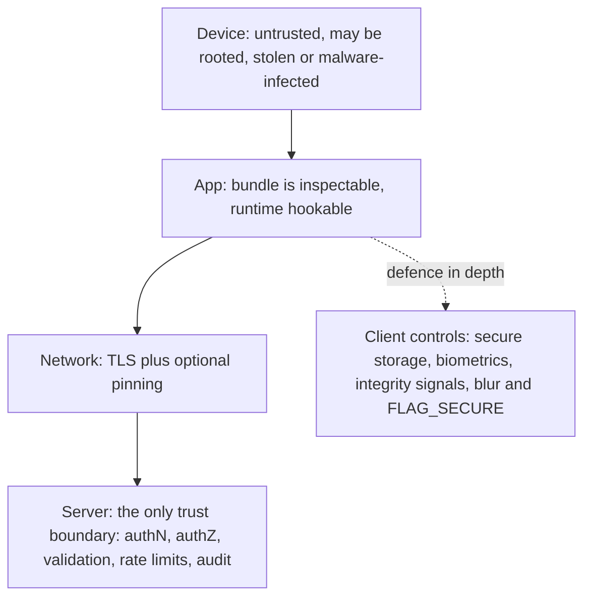
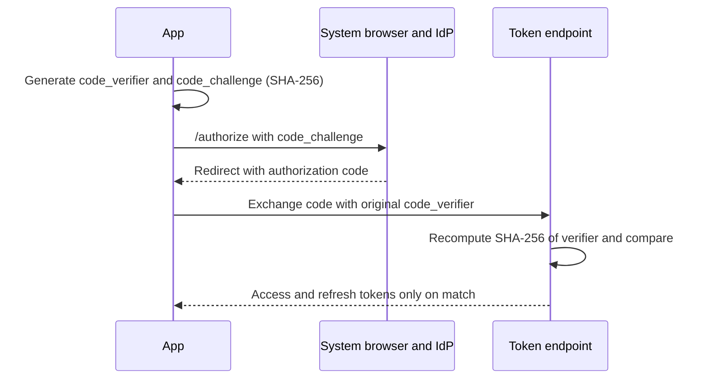
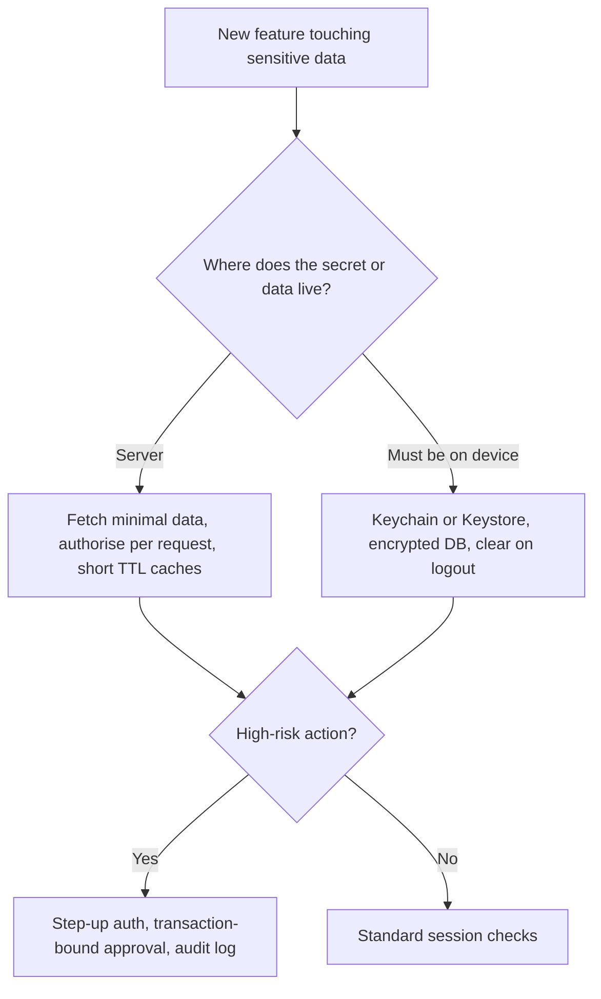

# Mobile Security for React Native Apps

> Verification note: Guidance follows the official **React Native Security** guide (AsyncStorage is unencrypted; no built-in secure storage — use Keychain Services / Android Keystore via libraries such as `expo-secure-store` or `react-native-keychain`; OAuth2 + PKCE with `react-native-app-auth`; deep-link hijacking risk and Universal/App Links; certificate pinning; keep secrets off the client and use an orchestration layer; do not forward tokens/PII to monitoring services) and the OAuth guidance verified earlier in this handbook (**RFC 10017 / BCP 212 "OAuth 2.0 for Browser-Based Applications"**, **RFC 9700 / BCP 240**: authorization code + PKCE, no implicit grant, refresh-token rotation or sender-constraining, strict redirect-URI matching) — see [web-security/05](../web-security/05-authentication-and-authorization-in-the-frontend.md). Version-sensitive RN/Expo facts were verified in the **Expo SDK 58 changelog (Oct 2026)**: **R8 is enabled by default in release builds** (`android.enableMinifyInReleaseBuilds=true`; reflection-based libraries may need keep rules), `expo-secure-store` gained `requireConfirmation` on Android authenticated reads/writes, iOS 27 requires the scene lifecycle, and **`expo-notifications`** shows foreground notifications by default. **Platform behaviours (Android `FLAG_SECURE`, iOS screenshot notification, ATS), OWASP MASVS/MASTG mapping, Play Integrity / App Attest, root/jailbreak library behaviour, SQLCipher/MMKV encryption options and regulatory expectations are established practice not re-fetched in this session — marked *(hedged)* where specific; none of the client-side controls here replaces server-side enforcement.** Storage mechanics: [09 §6](09-networking-storage-and-offline.md#6-client-storage-choices); token refresh mechanics: [09 §5](09-networking-storage-and-offline.md#5-the-api-layer-in-a-production-app).

## Table of Contents

1. [Quick Summary (TL;DR)](#1-quick-summary-tldr)
2. [Threat Model and Why Mobile Is Different](#2-threat-model-and-why-mobile-is-different)
3. [Authentication: OAuth2, OIDC, PKCE, Tokens and Sessions](#3-authentication-oauth2-oidc-pkce-tokens-and-sessions)
4. [Storage: AsyncStorage vs Keychain and Keystore](#4-storage-asyncstorage-vs-keychain-and-keystore)
5. [Certificate Pinning](#5-certificate-pinning)
6. [Deep-Link Security](#6-deep-link-security)
7. [Root, Jailbreak and App Integrity](#7-root-jailbreak-and-app-integrity)
8. [Sensitive Data in Logs and Screens](#8-sensitive-data-in-logs-and-screens)
9. [Encryption](#9-encryption)
10. [Secure API Communication](#10-secure-api-communication)
11. [Secrets Management](#11-secrets-management)
12. [Build, Dependency and Release Security](#12-build-dependency-and-release-security)
13. [Pitfalls](#13-pitfalls)
14. [Interview Questions — Fundamentals](#14-interview-questions--fundamentals)
15. [Interview Questions — Senior Scenarios](#15-interview-questions--senior-scenarios)
16. [Cheat Sheet](#16-cheat-sheet)
17. [Key Terms Glossary](#17-key-terms-glossary)
18. [Further Reading](#18-further-reading)

---

## 1. Quick Summary (TL;DR)

- **Assume the device and the bundle are hostile.** Anything shipped in the app is readable; the client can always be bypassed → **enforce everything server-side**; client controls are defence in depth.
- **Auth:** OAuth2 **authorization code + PKCE** via the system browser (never embedded webviews, never implicit); **OIDC** adds identity (ID token); short-lived access tokens, **rotated** refresh tokens with reuse detection, idle + absolute session timeouts, **step-up** authentication for high-risk actions.
- **Storage:** **AsyncStorage is unencrypted** (non-sensitive only). Tokens/keys live in **Keychain (iOS) / Keystore-backed storage (Android)**; biometrics **gate access** to a stored secret rather than being the credential.
- **Network:** TLS everywhere; consider **certificate pinning** (native; plan rotation); never secrets in URLs.
- **Deep links** are hijackable: no sensitive data inside, prefer **Universal/App Links**, validate every parameter.
- **Device integrity** (root/jailbreak, attestation) is a **signal in an arms race**, not a guarantee.
- **Screens and logs leak:** Android `FLAG_SECURE`; iOS can only detect screenshots and blur the app-switcher snapshot; scrub logs and crash breadcrumbs.
- **Secrets never ship in the bundle**; use a backend/orchestration layer and CI secret stores.
- Fintech context: regulated data, high attacker value, audit requirements — treat many "nice-to-haves" as mandatory.

---

## 2. Threat Model and Why Mobile Is Different

- **Why extra weight in wealth management:** balances, holdings, transaction history and credentials to move money; regulatory expectations (KYC/AML, data protection, SOC2-style controls) *(hedged)*; invest in security proportional to data sensitivity and breach impact — there is no bulletproof security.
- **Attacker capabilities:** reverse-engineer the APK/IPA, hook functions at runtime (Frida-style *(hedged)*), proxy and tamper with traffic, read local storage on rooted/jailbroken or backed-up devices, craft malicious deep links, install a malicious app registering your URL scheme, shoulder-surf, screen-record, steal/lose devices, phish OAuth flows.
- **What mobile adds beyond web:** persistent local storage, no central URL-scheme registry, OS-level backups, background states and snapshots, binary distribution, and device-level compromise.
- **Frameworks to cite** *(hedged)*: OWASP Mobile Top 10 and **MASVS/MASTG** for requirements and test guides; map controls (storage, crypto, auth, network, platform interaction, code quality, resilience) to your checklist.
- **React Native specifics:** JS bundle is readable (Hermes bytecode is **not encryption** *(hedged)* — treat as obfuscation at best); native modules and bridges expand attack surface; third-party SDKs and OTA updates are supply-chain risks ([§12](#12-build-dependency-and-release-security), [web-security/07](../web-security/07-supply-chain-and-third-party-script-security.md)).

---

## 3. Authentication: OAuth2, OIDC, PKCE, Tokens and Sessions

**OAuth2 vs OIDC:** OAuth2 is an **authorization** framework (delegated access) and is **not** an authentication protocol by itself; **OpenID Connect** adds standardised authentication — an **ID Token** (JWT with identity claims), `/userinfo`, and `openid profile email` scopes.

**Why mobile needs PKCE:** native apps have no central registry of URL schemes, so the redirect step is less trustworthy than on the web. **PKCE** binds the authorization code to a secret that never leaves the legitimate app:

- Use **`react-native-app-auth`** (wrapping AppAuth-iOS/Android) or **`expo-auth-session`** *(hedged)* with the **system browser** (ASWebAuthenticationSession / Custom Tabs), **not** embedded webviews (credential phishing, no SSO); exact redirect-URI matching; no implicit or ROPC grants.
- **Tokens:** access token — short-lived (minutes), sent as `Bearer`; refresh token — longer-lived, stored in secure storage, **rotated on every use** with **reuse detection** (replay of a used token → revoke the whole family); consider sender-constraining (DPoP) where supported *(hedged)*.
- **Session expiry:** **idle timeout** (N minutes inactive) and/or **absolute timeout** (N hours regardless); server-authoritative; clear tokens/caches on logout and revoke refresh tokens server-side.
- **Step-up authentication:** re-prompt (biometrics/password/OTP) before high-risk actions even if the session is valid; bind approval to the transaction details (what-you-see-is-what-you-sign).
- **Biometrics:** Face ID/Touch ID/`BiometricPrompt` rarely **is** the credential — it **unlocks a secret** protected by Keychain access control (`biometryCurrentSet`-style *(hedged)*) or Keystore `setUserAuthenticationRequired`; libraries: `react-native-biometrics`, `expo-local-authentication`, biometric-gated `react-native-keychain`. Decide behaviour when biometrics change (invalidate keys). Expo SDK 58 `expo-secure-store` adds `requireConfirmation` for Android authenticated reads/writes.
- **Passkeys/WebAuthn** *(hedged)*: phishing-resistant primary authentication where the backend supports it; fall back safely.
- **BFF for mobile?** Native apps are public clients (no secret); a token-mediating backend or BFF can keep refresh tokens server-side and reduce client token exposure — see the OAuth browser-app guidance for the trade-offs ([web-security/05](../web-security/05-authentication-and-authorization-in-the-frontend.md)).

---

## 4. Storage: AsyncStorage vs Keychain and Keystore

| | AsyncStorage | Secure storage (Keychain / Keystore) |
|---|---|---|
| Encryption | **None by default** | iOS Keychain Services; Android Keystore-backed / Encrypted Shared Preferences |
| Good for | Non-sensitive persisted state (Redux/GraphQL cache slices, preferences) | Tokens, passwords, certificates, encryption keys |
| Scope | Per-app sandbox | Per-app, OS-enforced, hardware-backed where available |
| Web analogue | `localStorage` | — |

- RN ships **no** secure-storage API: bridge Keychain/Keystore or use **`expo-secure-store`** / **`react-native-keychain`**.
- **Android specifics:** plain `SharedPreferences` is unencrypted; **Encrypted Shared Preferences** encrypts keys and values; the **Keystore** protects cryptographic keys in hardware-backed containers, making extraction hard even with root.
- **Accidental leaks** (called out by the official guide): persisting an entire Redux state tree (including a sensitive form field) to AsyncStorage; forwarding tokens/PII to monitoring services ([§8](#8-sensitive-data-in-logs-and-screens)).
- **Operational:** clear on logout; exclude sensitive files from backups *(hedged)*; handle key invalidation (new biometrics, device restore); don't keep long-lived secrets in memory; avoid clipboard exposure for sensitive fields.
- Local databases with sensitive data: encrypt (SQLCipher-style or MMKV encryption with a key held in Keystore/Keychain) *(hedged)* ([09 §6](09-networking-storage-and-offline.md#6-client-storage-choices)).

---

## 5. Certificate Pinning

- **Problem:** HTTPS trusts **any** certificate from a CA in the device's trust store; a malicious root CA (social engineering, MDM abuse) enables MITM. **Pinning** embeds the expected certificate/public key in the app so only that identity is accepted.
- **Implementation is native:** Android OkHttp `CertificatePinner`/`TrustManager`; iOS `URLSession` delegate or TrustKit, with RN's `RCTSetCustomNSURLSessionConfigurationProvider` hook; commonly via a community native module ([09 §4](09-networking-storage-and-offline.md#4-where-certificate-pinning-lives)).
- **Operational cost:** certificates expire/rotate — a pinned app with a rotated server cert **stops working until updated**. Mitigate: pin the **intermediate/CA or public key** (not just the leaf), include **backup pins**, ship updates before expiry, monitor pin failures, and keep an audited emergency path *(hedged)*.
- **Trade-offs:** pinning complicates debugging (proxies like Charles/Proxyman fail) and corporate TLS inspection; it adds strong protection for high-value apps but isn't a substitute for server-side authorisation.

---

## 6. Deep-Link Security

- **Why it's special:** mobile has **no centralised URL-scheme registry**; any app can register your scheme and may intercept links (Android shows a disambiguation dialog; iOS historically resolved silently).
- **Rules:** never put tokens, account numbers or secrets in links; prefer **Universal Links (iOS)** and **verified App Links (Android)** bound to a domain you control via hosted association files; **validate host, path and every parameter** (allow-list routes; type-check params); treat link input as untrusted user input (no direct navigation to sensitive screens without re-auth); beware open-redirect style parameters and link-driven WebView loads.
- **OAuth connection:** because custom-scheme redirects are interceptable, **PKCE** is required for the code exchange ([§3](#3-authentication-oauth2-oidc-pkce-tokens-and-sessions)).
- **Deferred deep links** (attribution providers) carry the same validation requirements.
- Mechanics of how links reach JS: [08](08-app-lifecycle-background-work-push-and-deep-links.md#9-deep-linking-from-the-os-to-react-native); navigation config: [10](10-app-architecture-state-and-navigation.md#6-navigation-state-deep-link-config-and-app-restart).

---

## 7. Root, Jailbreak and App Integrity

- A rooted/jailbroken device weakens OS sandbox guarantees (Keychain/Keystore assumptions, other apps reading storage). Libraries like **`jail-monkey`** (heuristics: root-management apps, writable system partitions, debugger/emulator signals) detect likely compromise.
- **Honest nuance:** detection is an **arms race** — bypassable and occasionally false-positive. Use as **one signal** in defence in depth: warn, restrict sensitive operations (large transfers), avoid caching tokens, raise risk scores server-side; hard-blocking is a **product/compliance decision**.
- **Stronger signals** *(hedged)*: platform attestation (**Play Integrity API** on Android, **App Attest/DeviceCheck** on iOS) verified **server-side** to confirm genuine app + device; combine with device binding and risk-based authentication.
- **Anti-tampering/obfuscation:** Expo SDK 58 enables **R8 minification/obfuscation by default** for Android release builds (smaller, harder to read; reflection libraries need keep rules); JS obfuscators and RASP SDKs exist *(hedged)* — they raise cost, they don't make secrets safe.
- **Debugging surface:** disable debug features and dev menus in release; ensure no test endpoints/flags ship; restrict `WebView` JavaScript bridges.

---

## 8. Sensitive Data in Logs and Screens

**Logs and telemetry**
- Never log tokens, full account numbers, balances or PII — even at debug level (debug logs reach crash reports and tickets).
- Scrub request/response bodies before verbose network logging; strip `console.*` in release ([05](05-performance-rendering-lists-images-and-memory.md#2-frame-budgets-js-thread-vs-ui-thread)).
- **Audit crash/analytics breadcrumbs** (Sentry, Crashlytics, Expo Observe, session replay): they often auto-capture console logs and network calls — configure allow-lists, redact URLs/headers/body fields, disable screenshot/replay on sensitive screens. The official RN guide flags sending tokens and personal info to monitoring services as a security concern.

**Screens**
- **Android:** `WindowManager.LayoutParams.FLAG_SECURE` **blocks** screenshots and screen recording of that window and blanks the recents thumbnail.
- **iOS has no equivalent blocking API:** you can **detect** screenshots after the fact (`UIApplicationUserDidTakeScreenshotNotification`) and **blank/blur the app-switcher snapshot** by swapping to a neutral view when the app resigns active/enters background; screen recording can be detected via `UIScreen.isCaptured` *(hedged)*.
- Libraries (`expo-screen-capture`, `react-native-screenshot-prevent`) wrap this asymmetry. Apply **selectively** (balances, account numbers, statements) — it affects legitimate user actions.
- **Other leaks:** clipboard, keyboard caches/autocomplete on sensitive inputs (`secureTextEntry`, `autoComplete`/`textContentType`), push-notification lock-screen content, accessibility/screen-reader announcements of secrets, screen sharing.

---

## 9. Encryption

- **In transit:** TLS/HTTPS baseline; pinning for high-value apps ([§5](#5-certificate-pinning)).
- **At rest:** Keychain/Keystore items are OS-encrypted. For larger local data (cached transactions, notes) use an **encrypting storage engine** (SQLCipher for SQLite, MMKV encryption) with the key in secure hardware-backed storage *(hedged)*.
- **Principles:** use platform/audited primitives (WebCrypto-like libraries, native crypto), **never hand-roll crypto**; no hardcoded keys; use authenticated encryption (AES-GCM) and unique IVs *(hedged)*; rotate and version keys; handle key invalidation gracefully.
- **Field-level encryption** or tokenisation for highly sensitive fields where the backend supports it.

---

## 10. Secure API Communication

Consolidated rules: always HTTPS; consider pinning; short-lived access tokens (never long-lived API keys); no secrets in URLs or query strings (logs/referrers); **validate and authorise on the server regardless of client checks**; replay protection and idempotency for writes ([09 §5](09-networking-storage-and-offline.md#5-the-api-layer-in-a-production-app)); rate limiting and anomaly detection server-side; reject unsupported/old app versions via a minimum-version endpoint; send an app/build attestation signal *(hedged)*; keep the refresh flow free of race conditions and logging.

---

## 11. Secrets Management

- **Foundational fact: anything inside the app bundle is effectively public** (binaries can be decompiled; obfuscation only raises cost).
- **Config ≠ secrets:** `react-native-config`, `react-native-dotenv`, Expo `EXPO_PUBLIC_*` variables are for **environment configuration** (API base URLs, public client IDs) — values are **inlined into the bundle** (Expo's Metro config now records inlined `EXPO_PUBLIC_*` values in the transform cache so changes invalidate it).
- **Real secrets** (third-party API keys with privileges, signing keys): keep **server-side**; the app talks to your backend/**BFF** or a serverless **orchestration layer** that holds the secret and forwards authorised requests.
- **CI/CD-time secrets:** the CI platform's encrypted secret store (GitHub Actions secrets/environments, EAS secrets/environment variables), a secrets manager, short-lived credentials via OIDC where available, **Fastlane `match`**-style encrypted repositories for signing assets; never commit `.env` files with real secrets ([14](14-ci-cd-with-github-actions.md)).
- **Detect leaks:** secret scanning/push protection, rotation procedures, per-environment keys, scoped keys with referrer/package restrictions (e.g., maps keys restricted to bundle ID) *(hedged)*.

---

## 12. Build, Dependency and Release Security

- **Dependencies:** lockfiles, audit/Dependabot-style updates, review native SDKs and permissions they add, prefer maintained libraries, pin versions, minimise analytics/SDK count; supply-chain practices in [web-security/07](../web-security/07-supply-chain-and-third-party-script-security.md).
- **OTA updates:** signed updates with **code signing** enabled where supported, channel/runtime-version discipline so malicious/incompatible bundles can't be delivered, staged rollouts and rollback ([13](13-ota-updates-and-store-releases.md)).
- **Release builds:** R8/ProGuard on, debug features off, `android:allowBackup` and `exported` components reviewed *(hedged)*, minimal permissions, Info.plist usage strings accurate, ATS exceptions minimal.
- **Signing assets:** upload keys/certificates/provisioning profiles in encrypted secret stores with limited access; audit who can release.
- **Security testing:** SAST/dependency scanning in CI, mobile penetration tests (MASTG-based *(hedged)*), runtime tamper tests, periodic third-party audits; log security-relevant events (auth, step-up, device binding) for fraud detection.

---

## 13. Pitfalls

1. Tokens/PII in AsyncStorage or persisted whole-store blobs.
2. Embedded webviews or implicit flow for login; missing PKCE; loose redirect URI matching.
3. Treating biometrics as the credential instead of unlocking a protected secret.
4. Client-only authorisation; trusting route guards or root checks.
5. Secrets (API keys) in the bundle or `EXPO_PUBLIC_*` variables.
6. Sensitive data in deep links, logs, crash breadcrumbs or push payloads.
7. Pinning the leaf certificate without backup pins/rotation plan.
8. Relying solely on jailbreak detection (arms race) or hard-blocking without policy.
9. Ignoring iOS screenshot limitations; applying `FLAG_SECURE` everywhere.
10. Leaving debug features, test endpoints or verbose logging in release.
11. Un-validated incoming deep-link parameters.
12. Unreviewed native SDKs/permissions and unsigned OTA channels.

---

## 14. Interview Questions — Fundamentals

- **OAuth2 vs OIDC?** Authorization framework vs identity layer adding ID token/userinfo; OAuth2 alone isn't authentication.
- **Why PKCE on mobile?** No URL-scheme registry; intercepted codes are useless without the `code_verifier`.
- **Access vs refresh tokens vs session expiry?** Short-lived bearer vs longer-lived (rotated) minting credential vs idle/absolute timeouts plus step-up.
- **How are biometrics used?** To gate access to a Keychain/Keystore-protected secret, not as the credential itself.
- **AsyncStorage vs Keychain/Keystore?** Unencrypted general storage vs OS-protected secure storage.
- **Why pin certificates? Cost?** Defeats malicious-CA MITM; rotation/expiry can brick the app — pin intermediates/backups.
- **Deep-link risks?** Scheme squatting/interception; never carry secrets; use Universal/App Links; validate parameters.
- **Root/jailbreak detection value?** One signal in defence in depth; bypassable; combine with server-side attestation.
- **Screenshot protection asymmetry?** Android `FLAG_SECURE` blocks; iOS can only detect and blur snapshots.
- **Why are bundled API keys insecure?** Bundles are decompilable; use server-side orchestration.
- **What belongs in logs?** No tokens/PII; scrub breadcrumbs.
- **How to encrypt local data?** Encrypting engines with keys in Keychain/Keystore; don't roll your own crypto.
- **What did Expo SDK 58 change for Android release builds?** R8 minification enabled by default.

---

## 15. Interview Questions — Senior Scenarios

### S1. "Design secure authentication for a wealth-management app."
System-browser OAuth2 code + PKCE with OIDC; short-lived access tokens, rotated refresh tokens with reuse detection stored in Keychain/Keystore; biometric gating of the stored secret; idle/absolute timeouts and server-side session revocation; step-up for transfers with transaction-bound approval; device binding and attestation signals; audit logging; careful logout (revoke, clear caches/files).

### S2. "A pen test says tokens are recoverable from device backups."
Move tokens to secure storage with appropriate accessibility attributes (device-only, not migrating to backups/new devices), exclude sensitive files from backups, shorten token lifetimes, add rotation with reuse detection, re-authenticate on new device, and verify on a rooted device.

### S3. "Marketing wants analytics/session replay; compliance objects."
Minimise data: allow-list events, redact fields and screens, disable replay on sensitive views, mask keystrokes, use consent flows, review SDK network destinations and retention, and gate via feature flags; run a privacy review and test redaction in release builds.

### S4. "Pinning caused an outage after a certificate rotation."
Postmortem: leaf pin without backup. Pin intermediate/public key + backup, pre-announce rotations, add expiry monitoring and staged releases, maintain an audited remote disable path, and test rotation in staging before production.

### S5. "A malicious app registers our custom scheme and receives reset links."
Stop using custom schemes for sensitive flows: migrate to Universal/App Links, keep links opaque and single-use with short expiry, require re-authentication in-app, bind links to device/session where possible, and monitor anomalous redemption.

### S6. "Prevent screenshots of statements."
Android: `FLAG_SECURE` on statement screens; iOS: detect capture events, blur on app switcher, watermark with user identifier, and consider limiting content display (reveal-on-tap) — communicate limits honestly: iOS can't block screenshots.

---

## 16. Cheat Sheet

| Concern | Control |
|---|---|
| Login | Code + PKCE, system browser, OIDC |
| Tokens | Short access, rotated refresh, Keychain/Keystore |
| Biometrics | Gate a stored secret |
| Sessions | Idle + absolute timeouts, step-up |
| Storage | AsyncStorage non-sensitive only |
| Network | TLS, pinning with rotation plan |
| Links | Universal/App Links, validate params, no secrets |
| Integrity | Signals + attestation, not sole control |
| Screens | FLAG_SECURE (Android), blur/detect (iOS) |
| Secrets | Never in bundle; backend/orchestration |
| Logs | No PII/tokens; scrub breadcrumbs |
| Build | R8 on, signed OTA, scanned dependencies |

---

## 17. Key Terms Glossary

| Term | Meaning |
|---|---|
| **PKCE** | Proof Key for Code Exchange protecting the authorization-code redirect |
| **OIDC / ID token** | Identity layer on OAuth2 / JWT with identity claims |
| **Refresh-token rotation** | New refresh token per use; reuse detection revokes the family |
| **Step-up authentication** | Extra verification before high-risk actions |
| **Keychain / Keystore** | iOS / Android OS-protected secret storage |
| **Certificate pinning** | Trusting only a specific certificate/public key |
| **Universal Link / App Link** | Domain-verified deep links |
| **FLAG_SECURE** | Android window flag blocking screenshots/recording |
| **Attestation** | Server-verified proof of genuine app/device (Play Integrity, App Attest) |
| **MASVS / MASTG** | OWASP mobile security requirements and testing guide |

---

## 18. Further Reading

- [React Native Security](https://reactnative.dev/docs/security) · [react-native-app-auth](https://github.com/FormidableLabs/react-native-app-auth) · [OWASP MASVS](https://mas.owasp.org/MASVS/) · [RFC 7636 (PKCE)](https://datatracker.ietf.org/doc/html/rfc7636) · [Expo SDK 58 (R8, secure-store)](https://expo.dev/changelog/sdk-58) *(hedged: check URLs)*
- This repo: [web-security/05 Authentication and authorization](../web-security/05-authentication-and-authorization-in-the-frontend.md) · [web-security/04 Cookies, sessions and CSRF](../web-security/04-cookies-sessions-and-csrf.md) · [09 Networking and storage](09-networking-storage-and-offline.md) · [08 Lifecycle and deep links](08-app-lifecycle-background-work-push-and-deep-links.md) · [13 OTA and releases](13-ota-updates-and-store-releases.md)
